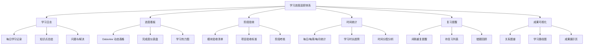
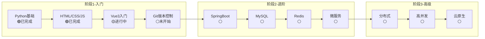

# Obsidian 学习进度追踪体系

> **文档说明**：系统讲解如何在 Obsidian 中建立完整的学习进度追踪体系，包括学习日志模板、Dataview 进度看板、阶段验收标准、时间统计、复习提醒，以及可视化学习成果的方法。
>
> **适用人群**：使用 Obsidian 学习的自学者、需要量化学习进度的全栈/AI 学习者
>
> **前置知识**：[[全栈+AI工程双轨融合学习路线图]]、[[新手第一天入门指南]]

---

## 一、概述

**学习进度追踪**是将学习过程量化、可视化的方法，帮助你回答三个核心问题：
1. **我学了多少？**（学习时长、笔记数量、完成模块）
2. **我学得怎么样？**（练习完成率、项目验收、知识掌握度）
3. **我接下来该学什么？**（下一阶段目标、待复习内容、薄弱环节）



---

## 二、学习日志体系

### 1. 每日学习日志模板

在 `Inbox/学习日志/` 文件夹中，每天创建一篇日志，命名格式 `学习日志-YYYY-MM-DD.md`。

```markdown
---
title: 学习日志
date: 2026-08-27
weekday: 周四
tags: [学习日志]
duration: 2.5h
mood: 😊
phase: 阶段1-入门
---

# 学习日志 - 2026-08-27（周四）

## 📋 今日计划
- [ ] 学习 [[Python-语法基础与数据结构]] 第3-4节
- [ ] 完成列表/字典练习
- [ ] 复习昨天的变量与数据类型

## ✅ 完成情况
- [x] 学习 [[Python-语法基础与数据结构]] 第3-4节
- [x] 完成列表/字典练习
- [ ] 复习昨天的内容（时间不够，明天补）

## 📝 学到的知识点
1. 列表的增删改查操作，`append`/`insert`/`remove` 的区别
2. 字典的键值对操作，`get` 方法避免 KeyError
3. 列表推导式 `[x**2 for x in range(10)]` 的简洁写法

## ❓ 遇到的问题
- 问题：字典遍历中修改字典会报错 `RuntimeError`
- 解决：先转成列表再遍历 `for key in list(d.keys()):`

## 🔗 关联笔记
- [[Python-语法基础与数据结构]]
- [[编程思维与算法入门]]

## 📅 明日计划
- [ ] 复习变量与数据类型（补今天的）
- [ ] 学习函数与模块
- [ ] 完成函数练习：写一个计算器函数

## 💡 今日心得
（写一写今天的学习感受、发现、困惑等）
```

### 2. 日志 Frontmatter 字段说明

| 字段 | 类型 | 说明 | 用途 |
|------|------|------|------|
| `date` | date | 学习日期 | 按日期查询、排序 |
| `weekday` | string | 星期几 | 按星期统计 |
| `tags` | array | 标签 | 分类筛选 |
| `duration` | string | 学习时长 | 时间统计 |
| `mood` | emoji | 学习心情 | 心情趋势 |
| `phase` | string | 所处阶段 | 阶段进度统计 |

### 3. 快速创建日志（Templater 模板）

安装 Templater 插件后，创建模板 `Templates/学习日志模板.md`，配置为每日笔记模板：

```markdown
---
title: 学习日志
date: <% tp.date.now("YYYY-MM-DD") %>
weekday: <% tp.date.now("dddd", 0, tp.file.title, "YYYY-MM-DD") %>
tags: [学习日志]
duration: 
mood: 
phase: 
---

# 学习日志 - <% tp.date.now("YYYY-MM-DD") %>

## 📋 今日计划
- [ ] 

## ✅ 完成情况
- [ ] 

## 📝 学到的知识点
1. 

## ❓ 遇到的问题
- 

## 🔗 关联笔记
- 

## 📅 明日计划
- [ ] 

## 💡 今日心得

```

**使用方法**：按 `Ctrl+P` → 输入 "Templater: Insert template" → 选择学习日志模板，自动填充日期。

---

## 三、Dataview 进度看板

### 1. 学习日志总览

创建 `00-综合导航/进度看板.md`，使用 Dataview 动态展示学习数据：

````markdown
# 📊 学习进度看板

## 最近 7 天学习日志

```
TABLE duration AS "时长", mood AS "心情", phase AS "阶段"
FROM "Inbox/学习日志"
WHERE date >= date(today) - dur(7 days)
SORT date DESC
```

## 本月学习统计

```
TABLE length(rows) AS "日志数", sum(duration) AS "总时长"
FROM "Inbox/学习日志"
WHERE date >= date(today) - dur(30 days)
GROUP BY "本月"
```

## 各阶段学习日志数量

```
TABLE length(rows) AS "日志数"
FROM "Inbox/学习日志"
GROUP BY phase AS "阶段"
SORT phase ASC
```
````

### 2. 知识点掌握度追踪

为每篇核心技术笔记添加 `status` 字段，标记掌握程度：

```yaml
---
title: Python-语法基础与数据结构
status: 🟡 学习中  # ⚪未开始 / 🟡学习中 / 🟢已掌握 / 🔴需复习
---
```

创建掌握度看板：

````markdown
# 📚 知识点掌握度

## 已掌握（🟢）

```
TABLE category AS "分类", difficulty AS "难度"
FROM "01-前端开发" OR "02-后端开发" OR "08-Python全栈" OR "09-AI与效率工具"
WHERE status = "🟢 已掌握"
SORT category ASC
```

## 学习中（🟡）

```
TABLE category AS "分类", difficulty AS "难度"
FROM "01-前端开发" OR "02-后端开发" OR "08-Python全栈" OR "09-AI与效率工具"
WHERE status = "🟡 学习中"
SORT category ASC
```

## 需复习（🔴）

```
TABLE category AS "分类", difficulty AS "难度"
FROM "01-前端开发" OR "02-后端开发" OR "08-Python全栈" OR "09-AI与效率工具"
WHERE status = "🔴 需复习"
SORT category ASC
```
````

### 3. 学习热力图（Calendar 插件）

安装 Calendar 插件后，在每日笔记中添加标签 `#学习日志`，Calendar 视图会自动显示学习热力图：
- 有日志的日期会显示圆点
- 圆点颜色深浅可配置（根据字数或标签数量）
- 点击日期直接跳转到当天日志

**配置方法**：设置 → Calendar → 打开 "Week numbers"、"Confirm creating new note"

### 4. 自定义进度仪表盘

创建一个综合仪表盘页面，整合所有进度数据：

````markdown
# 🎯 学习仪表盘

## 概览

| 指标 | 数值 |
|------|------|
| 累计学习天数 | `=length(rows)` 篇日志 |
| 累计学习时长 | 待统计 |
| 已掌握知识点 | `=length(rows)` 篇 |
| 完成项目 | 0 个 |
| 当前阶段 | 阶段1-入门 |

## 本周学习日志

```
LIST duration + " - " + mood
FROM "Inbox/学习日志"
WHERE date >= date(today) - dur(7 days)
SORT date DESC
```

## 最近学习的笔记

```
TABLE status AS "状态", category AS "分类"
FROM "01-前端开发" OR "02-后端开发" OR "08-Python全栈"
WHERE status != null
SORT file.mtime DESC
LIMIT 10
```

## 待复习清单

```
LIST "最后学习: " + file.mtime
FROM "01-前端开发" OR "02-后端开发" OR "08-Python全栈"
WHERE status = "🔴 需复习"
SORT file.mtime ASC
```
````

---

## 四、阶段验收体系

### 1. 四阶段验收标准

| 阶段 | 名称 | 学习时长 | 笔记数量 | 项目数量 | 验收标准 |
|------|------|---------|---------|---------|---------|
| 阶段1 | 🌱 入门 | 200-300h | 30-50篇 | 3个小项目 | 能独立完成基础功能开发 |
| 阶段2 | 🌿 进阶 | 400-600h | 80-120篇 | 2个中型项目 | 能独立开发完整模块 |
| 阶段3 | 🌳 高级 | 600-1000h | 150-200篇 | 1个系统设计 | 能设计和优化完整系统 |
| 阶段4 | 🏔️ 专家 | 持续 | 持续 | 开源/博客 | 能解决疑难问题和技术决策 |

### 2. 模块验收清单模板

为每个学习模块创建验收清单，完成后勾选：

```markdown
---
title: Python基础模块验收
module: Python基础
phase: 阶段1-入门
status: 🟡 进行中
---

# Python 基础模块验收清单

## 理论知识
- [ ] 变量与数据类型（int/float/str/bool）
- [ ] 运算符与表达式
- [ ] 条件语句（if/elif/else）
- [ ] 循环语句（for/while）
- [ ] 列表/元组/字典/集合
- [ ] 函数定义与调用
- [ ] 模块与包导入
- [ ] 异常处理（try/except）

## 动手练习
- [ ] 练习1：计算器程序
- [ ] 练习2：猜数字游戏
- [ ] 练习3：学生成绩管理（列表+字典）
- [ ] 练习4：文件读写练习
- [ ] 练习5：函数封装练习

## 项目实战
- [ ] 项目1：命令行待办事项应用
- [ ] 项目2：简单的学生信息管理系统

## 自测题
- [ ] 能解释列表和元组的区别
- [ ] 能写出字典遍历的三种方式
- [ ] 能解释 *args 和 **kwargs 的作用
- [ ] 能写出一个装饰器的基本结构

## 验收结果
- 完成日期：
- 掌握度自评：⚪基础 / 🟡一般 / 🟢熟练
- 薄弱环节：
- 下一步：
```

### 3. 项目验收标准

每个项目完成后，按以下标准验收：

| 维度 | 验收标准 | 评分 |
|------|---------|------|
| **功能完整性** | 所有需求功能实现，无明显 Bug | ⭐⭐⭐ |
| **代码质量** | 命名规范、结构清晰、有注释 | ⭐⭐⭐ |
| **技术深度** | 使用了该阶段的核心技术点 | ⭐⭐⭐ |
| **文档完善** | 有 README、设计说明、使用方法 | ⭐⭐ |
| **可扩展性** | 代码易于扩展和维护 | ⭐⭐ |

**项目记录模板**：

```markdown
---
title: 项目-个人博客系统
project_type: 中型项目
phase: 阶段2-进阶
status: 🟢 已完成
start_date: 2026-06-01
end_date: 2026-07-15
tech_stack: [Vue3, SpringBoot, MySQL, Redis]
---

# 项目：个人博客系统

## 项目简介
（一句话描述项目）

## 技术栈
- 前端：Vue3 + TypeScript + Element Plus
- 后端：Spring Boot + MyBatis
- 数据库：MySQL + Redis
- 部署：Docker

## 核心功能
- [x] 用户注册/登录（JWT）
- [x] 文章发布/编辑/删除
- [x] 文章分类和标签
- [x] 评论系统
- [x] 搜索功能
- [x] 后台管理

## 项目亮点
1. 使用 Redis 缓存热门文章
2. 使用 Elasticsearch 实现全文搜索
3. 前后端分离，RESTful API 设计

## 遇到的问题与解决方案
1. 问题：...
   解决：...

## 项目链接
- GitHub：
- 在线演示：

## 复盘与收获
- 学到了：
- 不足：
- 改进方向：
```

---

## 五、时间统计与分析

### 1. 学习时长统计

在学习日志的 Frontmatter 中记录 `duration`，用 Dataview 统计：

````markdown
## 本月学习时长趋势

```
TABLE duration AS "时长"
FROM "Inbox/学习日志"
WHERE date >= date(today) - dur(30 days)
SORT date ASC
```
````

> 💡 Dataview 对时长的求和需要将 duration 转为数字。建议将 duration 存为数字（小时），如 `duration: 2.5`，显示时再格式化。

### 2. 时间分配分析

为学习日志添加 `focus` 字段，记录当天学习的重点方向：

```yaml
---
focus: [Python, 前端]  # 当天学习的技术方向
---
```

统计各方向的时间投入：

````markdown
## 各方向学习时间分布

```
TABLE length(rows) AS "学习天数"
FROM "Inbox/学习日志"
FLATTEN focus AS direction
GROUP BY direction
SORT length(rows) DESC
```
````

### 3. 学习效率分析

每周回顾时，分析学习效率：

| 指标 | 计算方法 | 目标 |
|------|---------|------|
| 日均学习时长 | 周总时长 / 7 | ≥ 1.5h |
| 日志完成率 | 有日志天数 / 7 | ≥ 85% |
| 计划完成率 | 完成任务数 / 计划任务数 | ≥ 70% |
| 知识点增长率 | 新增掌握知识点数 | 每周 ≥ 5个 |
| 复习率 | 复习次数 / 应复习次数 | ≥ 80% |

---

## 六、复习提醒体系

### 1. 间隔重复复习计划

基于艾宾浩斯遗忘曲线，设置复习节点：

| 学习时间点 | 复习时间 | 复习方式 |
|-----------|---------|---------|
| 第 1 天 | 当天 | 做练习，写总结 |
| 第 2 天 | +1 天 | 快速回顾笔记 |
| 第 4 天 | +2 天 | 不看笔记默写核心概念 |
| 第 7 天 | +3 天 | 做综合练习 |
| 第 15 天 | +8 天 | 做项目应用 |
| 第 30 天 | +15 天 | 教别人/写博客 |

### 2. Dataview 待复习列表

为笔记添加 `last_reviewed` 字段，自动生成待复习列表：

````markdown
# 🔔 待复习清单

## 超过 7 天未复习

```
TABLE last_reviewed AS "上次复习", category AS "分类"
FROM "01-前端开发" OR "02-后端开发" OR "08-Python全栈" OR "09-AI与效率工具"
WHERE last_reviewed != null AND last_reviewed <= date(today) - dur(7 days)
SORT last_reviewed ASC
LIMIT 20
```

## 超过 30 天未复习（重点）

```
TABLE last_reviewed AS "上次复习", category AS "分类"
FROM "01-前端开发" OR "02-后端开发" OR "08-Python全栈" OR "09-AI与效率工具"
WHERE last_reviewed != null AND last_reviewed <= date(today) - dur(30 days)
SORT last_reviewed ASC
```
````

### 3. 错题本体系

创建 `Inbox/错题本/` 文件夹，记录学习中遇到的错误：

```markdown
---
title: 错题-字典遍历修改报错
date: 2026-08-27
tags: [错题, Python]
category: Python基础
difficulty: ⭐⭐
---

# 错题：字典遍历中修改字典

## 错误代码
```
d = {"a": 1, "b": 2, "c": 3}
for key in d:
    if d[key] == 2:
        del d[key]  # RuntimeError: dictionary changed size during iteration
```css

## 错误原因
遍历字典时修改字典大小（添加/删除键），Python 不允许。

## 正确写法
```
d = {"a": 1, "b": 2, "c": 3}
for key in list(d.keys()):  # 先转成列表（快照）
    if d[key] == 2:
        del d[key]
```css

## 知识点
- [[Python-语法基础与数据结构]] - 字典操作
- 遍历可变对象时，先创建副本

## 复习记录
- [ ] 第2天复习
- [ ] 第7天复习
- [ ] 第30天复习
```

---

## 七、可视化学习成果

### 1. 关系图谱（Graph View）

Obsidian 内置关系图谱，可视化知识点之间的关联：

**配置建议**：
- 设置 → 关系图谱 → 节点大小：按入度
- 设置 → 关系图谱 → 颜色：按文件夹分组
- 设置 → 关系图谱 → 连线：显示箭头
- 过滤：隐藏 `_backup`、`Inbox` 等临时文件

**使用方法**：
- 左侧边栏 → 打开关系图谱
- 鼠标滚轮缩放，拖拽移动
- 点击节点查看笔记，点击连线查看关联
- 局部图谱：打开笔记后，查看"出链"和"入链"

### 2. 学习路径图

使用 Mermaid 绘制你的学习路径进度图：



### 3. 成果展示页

创建 `00-综合导航/学习成果展示.md`，汇总你的学习成果：

```markdown
# 🏆 学习成果展示

## 个人信息
- 学习方向：全栈 + AI 工程
- 开始日期：2026-06-01
- 当前阶段：阶段1-入门
- 累计学习时长：120 小时

## 数据统计
| 指标 | 数值 |
|------|------|
| 学习日志 | 45 篇 |
| 技术笔记 | 30 篇 |
| 已掌握知识点 | 20 个 |
| 完成项目 | 2 个 |
| 错题记录 | 15 条 |

## 项目作品
1. **TodoList 应用**（Vue3）- [GitHub]()
2. **学生管理系统**（Python）- [GitHub]()

## 技术栈掌握度
- 🟢 Python 基础
- 🟢 HTML/CSS/JavaScript
- 🟡 Vue3
- ⚪ Java / SpringBoot
- ⚪ MySQL / Redis
- ⚪ AI / 大模型应用

## 里程碑
- ✅ 2026-06-15：完成 Python 基础模块
- ✅ 2026-07-01：完成第一个 Vue3 项目
- 🎯 2026-09-01：完成阶段1，进入阶段2
```

---

## 八、周度/月度回顾模板

### 1. 周度回顾

每周日创建一篇周度回顾：

```markdown
---
title: 周度回顾
date: 2026-08-25 ~ 2026-08-31
week: 第35周
tags: [周度回顾]
---

# 周度回顾 - 第35周（8.25-8.31）

## 本周数据
- 学习天数：6 / 7
- 总学习时长：10.5 小时
- 日均时长：1.5 小时
- 完成任务：8 / 10

## 本周学了什么
1. Python 函数与模块
2. Vue3 组件通信
3. Git 分支操作

## 本周项目进展
- 项目：TodoList 应用
- 进度：完成 80%
- 下周计划：完成剩余 20% 并部署

## 本周亮点
- （做得好的地方）

## 本周不足
- （需要改进的地方）

## 下周目标
- [ ] 完成 TodoList 项目
- [ ] 学习 Vue3 路由
- [ ] 开始学习 MySQL 基础

## 心情与状态
- 整体状态：😊 良好
- 需要调整：
```

### 2. 月度回顾

每月最后一天创建月度回顾：

```markdown
---
title: 月度回顾
month: 2026-08
tags: [月度回顾]
---

# 月度回顾 - 2026年8月

## 数据总览
| 指标 | 数值 | 目标 | 达成率 |
|------|------|------|--------|
| 学习天数 | 25 天 | 28 天 | 89% |
| 总时长 | 45 小时 | 50 小时 | 90% |
| 日均时长 | 1.6 小时 | 1.8 小时 | 89% |
| 新增笔记 | 12 篇 | 15 篇 | 80% |
| 完成项目 | 1 个 | 1 个 | 100% |

## 本月学习内容
### 完成的模块
- [x] Python 函数与模块
- [x] Python 文件与异常处理
- [x] Vue3 组件基础

### 进行中的模块
- [ ] Vue3 路由与状态管理（60%）
- [ ] MySQL 基础（30%）

## 项目成果
1. **学生管理系统**（Python）- 已完成
2. **TodoList 应用**（Vue3）- 进行中

## 本月最大收获
1. 
2. 
3. 

## 本月最大困难
1. 
2. 

## 下月计划
### 学习目标
- [ ] 完成 Vue3 路由与状态管理
- [ ] 完成 MySQL 基础
- [ ] 开始 Redis 基础

### 项目目标
- [ ] 完成 TodoList 应用并部署
- [ ] 开始个人博客项目

### 时长目标
- 总时长：≥ 50 小时
- 日均：≥ 1.8 小时

## 阶段进度
- 当前阶段：阶段1-入门（75%）
- 预计完成：2026-09-15
- 下一阶段：阶段2-进阶
```

---

## 九、最佳实践

### 1. 进度追踪的原则

- [ ] **每日必记**：哪怕只学了 15 分钟，也要写日志
- [ ] **真实记录**：不要虚报时长和完成度，自欺欺人没有意义
- [ ] **及时更新**：学完笔记后立即更新 `status` 和 `last_reviewed`
- [ ] **定期回顾**：每周回顾，每月总结，及时调整学习计划
- [ ] **数据驱动**：用统计数据发现薄弱环节，而不是凭感觉
- [ ] **持续迭代**：追踪体系本身也要不断优化，找到最适合自己的方式

### 2. 常见问题

| 问题 | 原因 | 解决方案 |
|------|------|---------|
| 忘记写日志 | 没有养成习惯 | 设置每日提醒，固定时间写（如睡前） |
| 日志太敷衍 | 不知道写什么 | 用模板引导，至少写 3 个知识点 |
| Dataview 查询不生效 | Frontmatter 格式错误 | 检查 YAML 语法，字段名和值的类型 |
| 进度数据不准确 | 没有及时更新状态 | 学完立即更新，每周回顾时批量检查 |
| 追踪变成负担 | 体系太复杂 | 简化模板，只保留最核心的字段 |
| 只追踪不行动 | 沉迷数据收集 | 设定明确的学习目标，追踪是手段不是目的 |

### 3. 推荐插件组合

| 插件 | 用途 | 必选/可选 |
|------|------|----------|
| **Dataview** | 动态查询和统计 | 必选 |
| **Templater** | 模板快速创建 | 必选 |
| **Calendar** | 日历视图和热力图 | 推荐 |
| **Periodic Notes** | 周期笔记管理 | 推荐 |
| **Tracker** | 数据可视化图表 | 可选 |
| **Heatmap Calendar** | GitHub 风格热力图 | 可选 |
| **Excalidraw** | 手绘图表和架构图 | 推荐 |
| **Admonition** | 提示框美化 | 可选 |

---

## 十、关联笔记

### 学习导航
- [[全栈+AI工程双轨融合学习路线图]] · [[新手第一天入门指南]]
- [[分阶段项目实战递进路线]] · [[MOC-知识管理方法论-四级展开]]

### 学习方法
- [[高效学习方法论]] · [[费曼学习法实践]] · [[技术笔记写作规范]]
- [[间隔重复与记忆方法]] · [[时间管理与番茄工作法]]

### 工具
- [[Obsidian使用技巧]] · [[Obsidian-AI插件对比]] · [[Obsidian关系图谱优化]]

### 导航
- [[Home]] · [[MOC-综合导航]] · [[全栈+AI工程双轨融合学习路线图]]

> **行动建议**：今天就创建第一篇学习日志，配置好 Dataview 进度看板。追踪体系的价值在于**持续使用**，而不是完美设计。先用起来，再逐步优化。
