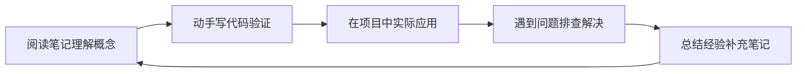

# 全栈+AI工程双轨融合学习路线图

> **文档说明**：本路线图将全栈开发与AI工程两条学习路径有机融合，设计从零基础新手到资深工程师的完整成长轨迹。区别于纯全栈路线，本路线在每个阶段都嵌入AI能力培养，使学习者既能构建传统Web应用，又能开发AI驱动的智能应用。
>
> **适用人群**：零基础新手、转行开发者、希望掌握全栈+AI复合能力的工程师
>
> **总学习周期**：12-24个月（每日3-4小时有效学习）
>
> **核心理念**：全栈是骨架，AI是翅膀。先掌握全栈基础构建应用能力，再逐步融入AI技术实现智能化，最终达到"全栈+AI"复合工程师水准。

---

## 学习阶段总览

四阶段成长路径 · 全栈与AI双轨并行

🌱

入门筑基

编程基础 前后端入门 AI概念启蒙

0-4个月

⚡

进阶实战

框架精通 全栈项目 AI应用开发

4-9个月

🚀

高级架构

微服务架构 AI工程化 RAG/Agent系统

9-15个月

👑

专家精通

架构设计 模型微调部署 技术领导力

15-24个月

### 双轨融合策略

| 阶段 | 全栈轨道 | AI轨道 | 融合点 |
|------|---------|--------|--------|
| 入门筑基 | HTML/CSS/JS + Java/Python + MySQL | AI概念 + 第一个AI API调用 | 用AI API增强个人主页 |
| 进阶实战 | Vue3 + SpringBoot/FastAPI + Redis | Prompt工程 + RAG基础 | 构建带AI问答的全栈应用 |
| 高级架构 | 微服务 + K8s + 分布式中间件 | Agent框架 + 向量数据库 + 模型部署 | AI网关 + 多模型路由 + 智能微服务 |
| 专家精通 | 架构设计 + 性能调优 + 技术管理 | 模型微调 + 训练推理优化 + AI安全 | 企业级AI平台架构 + 全栈AI解决方案 |

---

## 第一阶段：入门筑基（0-4个月）

> **阶段定位**：从零建立编程思维和计算机基础认知，掌握前端三剑客与一门后端语言，同时建立AI基本概念，能调用AI API完成简单功能。此阶段重广度不重深度，每个知识点都要动手写代码。

## 全栈轨道

### 第1月：计算机基础与开发环境

| 周次 | 知识点 | 对应笔记 | 验收目标 |
|------|--------|---------|---------|
| W1 | 操作系统与命令行 | [[Linux-运维常用命令手册]] · [[WindowsTerminal与PowerShell]] | 能使用命令行完成文件管理、进程查看、环境配置 |
| W1 | Git版本控制 | [[Git-高级命令与底层原理]] · [[Git-Hooks自动化]] | 能独立完成commit/branch/merge/rebase，解决冲突 |
| W2 | 计算机网络基础 | [[HTTP1.1-2-3演进]] · [[TCPIP协议栈详解]] · [[HTTPS与TLS握手]] | 理解HTTP请求响应，能用DevTools抓包分析 |
| W2 | 开发环境搭建 | [[VSCode-核心配置与插件]] · [[WSL2-开发环境配置]] | 搭建完整开发环境（IDE+JDK/Python+Node+Git） |
| W3-4 | 计算机基础概念 | [[进程线程与协程]] · [[内存管理与虚拟内存]] · [[IO模型与零拷贝]] | 理解进程线程区别、内存管理基本概念 |

### 第2月：前端基础（HTML/CSS/JavaScript）

| 周次 | 知识点 | 对应笔记 | 验收目标 |
|------|--------|---------|---------|
| W5 | HTML5语义化 | [[HTML5与CSS3基础入门]] | 能写出语义化的HTML页面结构 |
| W5-6 | CSS3布局与动画 | [[HTML5与CSS3基础入门]] · [[CSS3布局与样式基础]] | 掌握Flexbox/Grid布局，能实现响应式页面 |
| W6-8 | JavaScript ES6+ | [[JavaScript核心语法与ES6+]] | 掌握变量、函数、数组、对象、异步(Promise/async)、DOM操作 |

### 第3月：后端语言核心（Java或Python二选一为主）

**Java路线**：
| 周次 | 知识点 | 对应笔记 | 验收目标 |
|------|--------|---------|---------|
| W9-10 | Java语法与OOP | [[Java知识点完整整合大全_优化版]] | 掌握语法、面向对象、集合框架、异常处理 |
| W11 | Java高级特性 | [[Java-语法进阶与StreamAPI]] · [[Java-并发编程JUC]] | 掌握Stream、Lambda、并发基础 |
| W12 | Maven与项目构建 | [[Maven-多模块与依赖管理]] | 能创建Maven项目，管理依赖 |

**Python路线**：
| 周次 | 知识点 | 对应笔记 | 验收目标 |
|------|--------|---------|---------|
| W9-10 | Python语法基础 | [[Python-语法基础与数据结构]] · [[Python-面向对象与元类]] | 掌握语法、数据结构、面向对象 |
| W11 | Python高级特性 | [[Python-装饰器与上下文管理器]] · [[Python-异步编程asyncio]] | 掌握装饰器、生成器、异步编程 |
| W12 | 包管理与虚拟环境 | [[Poetry-依赖与虚拟环境管理]] · [[Python-模块与包管理原理]] | 能管理项目依赖和虚拟环境 |

### 第4月：数据库基础 + 第一个全栈页面

| 周次 | 知识点 | 对应笔记 | 验收目标 |
|------|--------|---------|---------|
| W13-14 | MySQL基础 | [[关系型数据库索引原理]] · [[事务隔离级别与MVCC]] | 掌握SQL查询、索引、事务基本概念 |
| W15 | 前后端联调入门 | [[前后端联调规范与流程]] · [[CORS跨域解决方案实战]] | 理解前后端交互流程，能解决跨域 |
| W16 | 阶段项目：个人主页 | [[实战-FastAPI+Vue3后台管理系统]]（简化版） | 独立完成带数据库的个人主页 |

## AI轨道（入门阶段）

### AI概念启蒙（第2-4月，每周2-3小时）

| 时间 | 知识点 | 对应笔记 | 实践目标 |
|------|--------|---------|---------|
| 第2月 | AI/LLM基本概念 | [[主流大模型对比与选型]] · [[Transformer架构核心]] | 理解什么是大模型、能做什么 |
| 第3月 | 第一个AI API调用 | [[LLM接口封装与统一SDK]] · [[Prompt工程与版本管理]] | 用Python/Java调用OpenAI兼容API，实现简单对话 |
| 第4月 | AI增强个人项目 | [[AI编程助手深度使用]] | 在个人主页中加入AI聊天功能 |

## 第一阶段验收标准

- [ ] 能独立搭建开发环境，使用Git管理代码
- [ ] 能写出静态HTML/CSS页面，理解JavaScript基础
- [ ] 掌握一门后端语言核心语法，能写简单的REST API
- [ ] 掌握MySQL基本SQL操作
- [ ] 能调用AI API实现简单对话功能
- [ ] 完成个人主页项目（含前后端+数据库+AI功能）

---

## 第二阶段：进阶实战（4-9个月）

> **阶段定位**：深入掌握主流框架，具备独立开发完整全栈应用的能力，同时系统学习Prompt工程和RAG，能构建AI驱动的智能应用。此阶段重项目实战，每个知识点都要在项目中验证。

## 全栈轨道

### 第5月：前端框架（Vue3）

| 周次 | 知识点 | 对应笔记 | 验收目标 |
|------|--------|---------|---------|
| W17-18 | Vue3核心 | [[Vue3-组合式API设计模式]] · [[Vue3-响应式原理Proxy]] · [[Vue3-组件通信全方案]] | 掌握Composition API、响应式原理、组件通信 |
| W19 | 路由与状态管理 | [[VueRouter-动态路由与权限]] · [[Pinia-状态管理核心]] | 掌握路由配置、状态管理 |
| W20 | 工程化与UI库 | [[Vite-构建原理与插件开发]] · [[ElementPlus-二次封装]] · [[ESLint+Prettier+Stylelint规范]] | 能搭建Vue3工程化项目 |

### 第6-7月：后端框架（SpringBoot 或 FastAPI）

**SpringBoot路线**：
| 周次 | 知识点 | 对应笔记 |
|------|--------|---------|
| W21-22 | SpringBoot核心 | [[SpringBoot-自动装配原理]] · [[SpringBoot-Web层设计]] · [[SpringBoot-配置管理与多环境]] |
| W23-24 | 数据访问 | [[SpringDataJPA与MyBatis对比]] · [[数据库性能优化实战]] |
| W25-26 | 安全与验证 | [[SpringSecurity-认证授权]] · [[SpringValidation-参数校验]] · [[SSO单点登录与分布式会话]] |

**FastAPI路线**：
| 周次 | 知识点 | 对应笔记 |
|------|--------|---------|
| W21-22 | FastAPI核心 | [[FastAPI-路由与依赖注入]] · [[FastAPI-中间件与异常处理]] · [[FastAPI-SSE流式响应实现]] |
| W23-24 | 数据库与缓存 | [[SQLAlchemy-ORM核心原理]] · [[Redis-Python客户端与缓存策略]] · [[Alembic-数据库迁移]] |
| W25-26 | 安全与部署 | [[Python-异常处理与错误体系]] · [[Python-日志规范与结构化日志]] |

### 第8月：缓存与消息队列

| 周次 | 知识点 | 对应笔记 | 验收目标 |
|------|--------|---------|---------|
| W29-30 | Redis | [[Redis数据结构与应用场景]] · [[Redis-分布式锁与缓存穿透]] | 掌握Redis五种数据结构、缓存策略 |
| W31-32 | 消息队列 | [[RabbitMQ-消息中间件]] · [[Kafka-消息队列与消费模型]] · [[Celery-异步任务队列]] | 理解消息队列场景，能基本使用 |

### 第9月：全栈项目实战

| 项目 | 对应笔记 | 技能覆盖 |
|------|---------|---------|
| 后台管理系统 | [[实战-FastAPI+Vue3后台管理系统]] / [[实战-SpringBoot+Vue3权限管理系统]] | 全栈CRUD+权限+文件上传 |
| 数据可视化平台 | [[实战-Streamlit数据分析仪表盘]] · [[实战-Python爬虫+数据可视化平台]] | 数据爬取+清洗+可视化 |

## AI轨道（进阶阶段）

### 第5-6月：Prompt工程与AI应用基础

| 知识点 | 对应笔记 | 实践目标 |
|--------|---------|---------|
| Prompt工程方法论 | [[提示词工程方法论]] · [[Prompt版本管理]] | 能写出高质量Prompt，理解Few-shot/CoT |
| AI应用开发框架 | [[LangChain-核心抽象与链]] · [[Python-LangChain应用开发]] | 能用LangChain构建简单AI应用 |
| AI前端交互 | [[对话式UI组件设计]] · [[SSE-流式响应对接LLM]] · [[Markdown渲染与代码高亮]] | 实现流式输出的AI对话界面 |

### 第7-8月：RAG检索增强生成

| 知识点 | 对应笔记 | 实践目标 |
|--------|---------|---------|
| RAG架构 | [[RAG架构设计与流程]] · [[文本分块策略对比]] · [[Embedding模型选型]] | 理解RAG全流程 |
| 向量数据库 | [[Chroma-轻量向量库]] · [[PgVector-PostgreSQL向量扩展]] · [[向量检索算法-HNSW-IVF]] | 能搭建向量检索 |
| 高级RAG | [[高级RAG-Hybrid检索与重排序]] · [[GraphRAG知识图谱增强检索]] · [[RAG评估指标与方法]] | 实现混合检索+重排序 |

### 第9月：AI全栈融合项目

| 项目 | 对应笔记 | 技能覆盖 |
|------|---------|---------|
| RAG知识库问答 | [[实战-RAG企业知识库问答系统]] · [[实战-FastAPI+RAG知识库问答]] | RAG全流程+前端+后端 |
| AI智能客服 | [[实战-Java对接大模型智能客服]] | 多轮对话+知识库+工单 |

## 第二阶段验收标准

- [ ] 能独立使用Vue3开发中后台前端应用
- [ ] 能使用SpringBoot/FastAPI开发RESTful API
- [ ] 掌握Redis缓存和消息队列基本使用
- [ ] 能设计和实现RAG系统
- [ ] 掌握Prompt工程，能优化AI输出质量
- [ ] 完成至少2个全栈+AI融合项目

---

## 第三阶段：高级架构（9-15个月）

> **阶段定位**：从"能开发"进阶到"能设计"，掌握微服务架构和分布式系统，同时深入AI工程化（Agent、模型部署、AI网关），能设计和构建企业级AI应用平台。此阶段重架构思维和工程化能力。

## 全栈轨道

### 第10-11月：微服务架构

| 知识点 | 对应笔记 | 验收目标 |
|--------|---------|---------|
| SpringCloud Alibaba | [[SpringCloud-Alibaba组件体系]] · [[Nacos-注册中心与配置中心]] · [[Gateway-网关路由与鉴权]] | 能搭建微服务骨架 |
| 服务间通信 | [[OpenFeign-服务间调用]] · [[gRPC协议与Protobuf]] | 理解同步/异步通信 |
| 分布式事务 | [[Seata-分布式事务]] · [[RocketMQ-事务消息]] | 理解分布式事务方案 |
| 流量控制 | [[Sentinel-流量控制与熔断]] | 掌握限流熔断降级 |

### 第12-13月：云原生与DevOps

| 知识点 | 对应笔记 | 验收目标 |
|--------|---------|---------|
| Docker | [[Docker-核心原理与镜像优化]] · [[Dockerfile最佳实践]] · [[Docker-Compose编排]] | 掌握容器化部署 |
| Kubernetes | [[K8s-核心概念与架构]] · [[Pod与控制器Deployment]] · [[Service与Ingress]] · [[K8s-资源限制与HPA]] | 能在K8s部署应用 |
| CI/CD | [[GitHub-Actions流水线设计]] · [[Jenkins流水线实战]] · [[ArgoCD-GitOps持续部署]] | 搭建自动化流水线 |
| 可观测性 | [[Prometheus-指标采集]] · [[Grafana-可视化看板]] · [[ELK-日志聚合]] · [[SkyWalking-分布式链路追踪]] · [[AIOps智能运维实战]] | 建立监控体系 |

### 第14-15月：高级架构与性能

| 知识点 | 对应笔记 |
|--------|---------|
| 高并发设计 | [[Java-高并发系统设计]] · [[秒杀系统架构设计]] · [[高并发系统设计案例]] |
| 数据库进阶 | [[数据库分库分表策略]] · [[数据库主从复制与读写分离]] · [[数据库执行计划分析]] · [[数据库安全与审计实战]] · [[数据治理与数据质量]] |
| 架构设计 | [[DDD领域驱动设计实战]] · [[云原生架构设计]] · [[高可用架构设计]] · [[MinIO分布式对象存储实战]] · [[Cassandra列式数据库实战]] · [[Istio服务网格实战]] |
| 项目实战 | [[实战-SpringCloud微服务电商系统]] |

## AI轨道（高级阶段）

### 第10-11月：Agent与多智能体

| 知识点 | 对应笔记 | 实践目标 |
|--------|---------|---------|
| Agent核心 | [[Agent核心概念-ReAct规划]] · [[Agent记忆机制设计]] · [[Agent工具调用FunctionCalling]] | 理解Agent工作原理 |
| Agent框架 | [[LangGraph-状态机Agent]] · [[CrewAI-角色化多Agent]] · [[AutoGen-多Agent框架]] · [[自研Agent框架设计]] | 能用框架构建Agent |
| 多Agent协作 | [[多Agent协作模式]] · [[AI工作流编排引擎设计]] | 实现多Agent协作 |
| Agent前端 | [[Agent思考链与任务进度展示]] · [[Agent任务进度与思考链展示]] | 实现Agent进度可视化 |

### 第12-13月：模型部署与推理优化

| 知识点 | 对应笔记 | 实践目标 |
|--------|---------|---------|
| 模型量化 | [[模型量化-GPTQ-AWQ-GGUF]] · [[Ollama-本地模型部署]] | 能本地部署量化模型 |
| 推理引擎 | [[vLLM-高吞吐推理引擎]] · [[Text-Generation-Inference]] · [[TensorRT-LLM推理加速]] · [[SGLang高效推理框架]] | 理解推理优化 |
| 模型服务化 | [[模型服务化-OpenAI兼容API]] · [[模型服务网格与多模型管理]] | 搭建模型服务 |
| GPU优化 | [[GPU显存优化与批处理]] · [[KV Cache与推理加速]] · [[推测解码与Speculative Decoding]] | 理解推理性能优化 |

### 第14-15月：AI工程化与企业级平台

| 知识点 | 对应笔记 |
|--------|---------|
| AI网关 | [[AI网关与多模型路由]] · [[统一AI网关设计与实现]] · [[多模型路由与流式响应跨语言传递]] |
| AI可观测 | [[AI应用可观测性-Langfuse]] · [[Agent评测与可观测性]] · [[AI应用测试与LLM输出评估]] |
| AI安全 | [[AI安全与对齐基础]] · [[Prompt注入攻击与防护]] · [[RAG安全与防注入]] · [[Agent安全与护栏设计]] |
| 混合架构 | [[Python+Java混合AI架构实战]] · [[多语言混合架构设计]] · [[Java-AI流式响应实战]] |
| 项目实战 | [[实战-SpringBoot+AI Agent平台]] · [[实战-Agent自动化办公助手]] |

## 第三阶段验收标准

- [ ] 能设计和搭建微服务架构
- [ ] 掌握Docker/K8s容器化部署
- [ ] 建立CI/CD和可观测性体系
- [ ] 能构建和部署Agent系统
- [ ] 掌握模型部署和推理优化
- [ ] 能设计企业级AI网关和多模型路由
- [ ] 完成微服务电商系统 + AI Agent平台项目

---

## 第四阶段：专家精通（15-24个月）

> **阶段定位**：从"能设计"进阶到"能创新"，深入技术底层原理，具备架构决策、技术选型、团队领导能力，同时掌握模型微调训练和AI平台架构，成为全栈+AI复合领域专家。

## 全栈轨道

### 第16-18月：底层原理与源码

| 方向 | 知识点 | 对应笔记 |
|------|--------|---------|
| JVM深度 | [[JVM-内存模型与GC调优]] · [[JVM-调优工具实战-Arthas]] |
| Spring源码 | [[Spring-IOCAOP核心机制]] · [[SpringBoot-自动装配原理]]（源码级） |
| 数据库内核 | [[关系型数据库索引原理]]（深入） · [[事务隔离级别与MVCC]]（深入） |
| 分布式原理 | [[哈希表与一致性哈希]] · [[Paxos共识]]（需补充） · [[分布式锁原理]] |
| 网络深度 | [[HTTP1.1-2-3演进]]（深入） · [[IO模型与零拷贝]]（深入） |

### 第19-21月：架构师能力

| 知识点 | 对应笔记 |
|--------|---------|
| 架构设计方法论 | [[架构设计原则-SOLID]] · [[DDD领域驱动设计基础]] · [[23种设计模式分类速查]] |
| 高可用架构 | [[高可用架构设计]] · [[混沌工程-ChaosMesh]] · [[数据库备份与恢复策略]] |
| 技术选型 | [[技术选型决策记录-ADR]] · [[技术债务管理]] |
| 团队与流程 | [[代码评审规范]] · [[语义化版本与CHANGELOG]] · [[MVP最小可行产品]] |
| 产品思维 | [[需求分析与用户故事]] · [[产品原型设计方法]] · [[从0到1产品落地路径]] |

### 第22-24月：技术领导力

- 主导复杂系统架构设计
- 技术团队管理与Code Review
- 技术分享与知识输出
- 开源贡献或技术博客
- 面试与人才培养（见[[面试准备指南]]）

## AI轨道（专家阶段）

### 第16-18月：模型训练与微调

| 知识点 | 对应笔记 |
|--------|---------|
| 训练范式 | [[大模型训练范式-PT-SFT-RLHF]] · [[SFT监督微调实战]] |
| 参数高效微调 | [[LoRA-QLoRA参数高效微调]] · [[DPO直接偏好优化]] |
| 模型架构深度 | [[Transformer架构核心]]（源码级） · [[注意力机制详解]] · [[位置编码进阶-RoPE-ALiBi]] · [[Tokenization与词表]] |
| 多模态 | [[多模态模型原理-VLM]] · [[图像理解与视觉问答]] · [[语音识别与语音合成]] · [[多模态RAG实现]] |

### 第19-21月：AI平台架构

| 知识点 | 对应笔记 |
|--------|---------|
| AI平台设计 | [[模型服务网格与多模型管理]] · [[AI网关与多模型路由]]（架构级） |
| 成本优化 | [[AI成本控制与Token计费优化]] · [[成本控制与Token计费]] |
| AI评估体系 | [[RAG评估指标与方法]] · [[AI应用测试与LLM输出评估]] |
| MLOps | [[AI应用可观测性-Langfuse]] · [[Prompt版本管理]] |
| 企业级项目 | [[实战-多模态内容生成平台]] · [[实战-AI代码审查工具]] |

### 第22-24月：AI前沿与创新

- 跟踪最新AI论文和技术趋势
- 自研AI框架或工具
- 技术分享与社区影响力
- AI伦理与安全研究
- 跨领域AI应用创新

## 第四阶段验收标准

- [ ] 深入理解至少一个框架的源码实现
- [ ] 能主导复杂系统架构设计和技术选型
- [ ] 掌握模型微调（SFT/LoRA/DPO）
- [ ] 能设计企业级AI平台架构
- [ ] 具备技术团队领导能力
- [ ] 有技术输出（博客/开源/分享）

---

## 学习方法论

### 每个知识点的学习闭环

### 时间分配建议

| 活动 | 占比 | 说明 |
|------|------|------|
| 理论学习 | 30% | 阅读笔记、看视频、理解概念 |
| 动手实践 | 40% | 写代码、做项目、解决问题 |
| 复盘总结 | 20% | 整理笔记、写博客、知识输出 |
| 休息调整 | 10% | 避免 burnout，保持持续学习 |

### 避坑指南

1. **不要只看不练**：每个知识点必须写代码验证，看懂不等于会用
2. **不要追求完美**：先跑通最小示例，再逐步深入
3. **不要频繁切换**：选定Java或Python为主线，学透再扩展
4. **不要忽视基础**：计算机基础决定上限，面试必问
5. **不要孤立学习**：加入社区、参与讨论、输出分享
6. **AI不是银弹**：AI是工具，核心还是工程能力和问题解决能力

---

## 软技能并行轨道

> 技术能力决定下限，软技能决定上限。以下软技能在四个阶段中持续培养，与技术轨道并行。

| 阶段 | 软技能重点 | 对应文档 | 实践方式 |
|------|-----------|---------|---------|
| 入门筑基 | 代码规范、Git协作、提问技巧 | [[编写规范与质量标准]] · [[Git-高级命令与底层原理]] | 遵循规范提交代码，学会用搜索引擎和社区提问 |
| 进阶实战 | 技术写作、文档编写、代码Review | [[技术写作与文档规范]] · [[代码评审规范]] | 为项目写README和接口文档，参与Code Review |
| 高级架构 | 技术方案设计、跨团队沟通、技术分享 | [[技术写作与文档规范]] · [[API设计规范与选型]] | 写技术方案文档，做内部分享，主导技术评审 |
| 专家精通 | 技术领导力、职业规划、团队管理 | [[技术职业规划与晋升路径]] · [[技术写作与文档规范]] | 带新人、做mentor，制定技术规划，建立个人品牌 |

### 软技能里程碑

- [ ] **入门**：能写出规范的代码和commit message，能清晰描述技术问题
- [ ] **进阶**：能独立编写技术文档和接口文档，能参与Code Review
- [ ] **高级**：能撰写技术方案并通过评审，能做技术分享演讲
- [ ] **专家**：能制定技术规范和路线图，能培养团队成员，有技术影响力

---

## 关联文档

### 阶段学习指南（每阶段独立导航）
- [[第一阶段-入门筑基学习指南]] — 0-4个月，技能清单+项目+自检题
- [[第二阶段-进阶实战学习指南]] — 4-9个月，框架精通+AI应用
- [[第三阶段-高级架构学习指南]] — 9-15个月，微服务+AI工程化
- [[第四阶段-专家精通学习指南]] — 15-24个月，源码深度+技术领导力
- [[阶段过渡桥梁指南]] — 三个过渡期的思维转变+桥梁项目

### 配套导航
- [[四级框架总索引]]（全部笔记导航）
- [[新手第一天入门指南]]（从零开始第一步）
- [[分阶段项目实战递进路线]]（项目学习顺序）
- [[学习依赖图谱与前置知识导航]]（学习顺序指引）
- [[Obsidian学习进度追踪体系]]（学习管理工具）
- [[算法刷题指南与题型模板]] · [[LeetCode高频题解]]
- [[面试准备与求职指南]]（求职阶段准备）
- [[技术写作与文档规范]] · [[技术职业规划与晋升路径]]（软技能）
- [[模板-每周学习计划]] · [[模板-项目复盘]]

---

> 💡 **使用建议**：将本路线图设为Obsidian启动页，每完成一个知识点在对应笔记中标记`#状态/已掌握`，使用Dataview查询学习进度。遇到卡点先查[[常见问题与排查]]，再搜索社区。保持每周复盘，每月调整学习计划。
