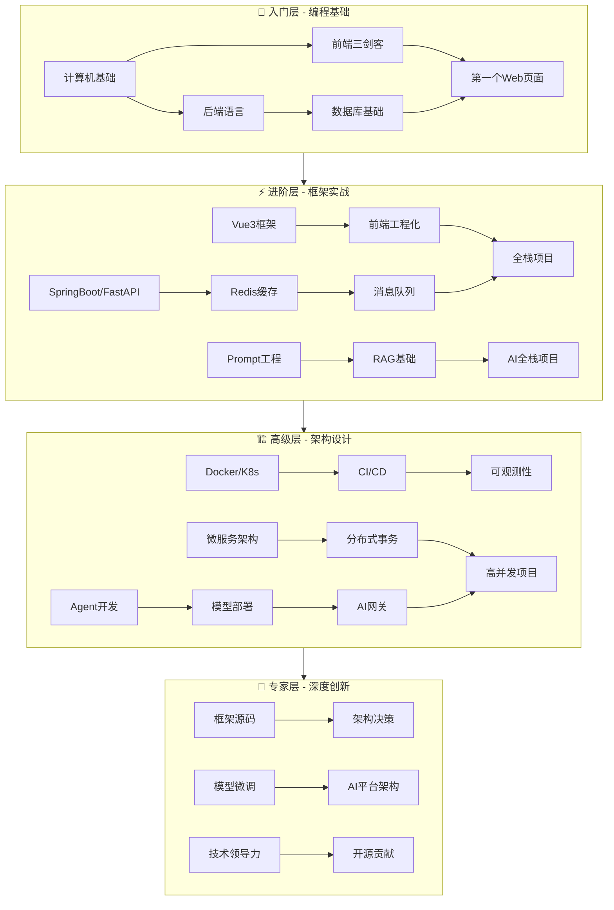

# 🌳 全栈+AI技能树与渐进式学习路线

> **文档说明**：本文档是知识库的技能树总入口，以树形结构展示从零基础到专家级的完整技能体系，每个技能节点标注难度、前置依赖和对应笔记。按照"基础→框架→架构→精通"四层递进，确保学习者清晰知道"先学什么、再学什么、学到什么程度"。
>
> **核心理念**：技能树是学习的地图，每个节点都是一个可达成的小目标。从根节点出发，沿分支逐步深入，每完成一个节点就在对应笔记标记`#状态/已掌握`。
>
> **使用方式**：从🌱入门层开始，按依赖关系逐层解锁，每完成一层做对应项目验证，通过后进入下一层。

---

## 技能树全景图



---

## 🌱 第一层：入门筑基（0-4个月）

> **目标**：建立编程思维，掌握前后端基础，能独立开发简单Web应用，理解AI基本概念。
> **验收**：完成个人主页项目（含前后端+数据库+AI聊天功能）

### 1.1 计算机基础（前置：无）

| 技能节点 | 难度 | 前置 | 对应笔记 | 验收标准 |
|---------|------|------|---------|---------|
| 命令行操作 | 🟢入门 | 无 | [[Linux-运维常用命令手册]] · [[WindowsTerminal与PowerShell]] | 能用命令行完成文件管理、进程查看 |
| Git版本控制 | 🟢入门 | 无 | [[Git-高级命令与底层原理]] · [[Git-Hooks自动化]] | 能独立commit/branch/merge/rebase |
| 计算机网络 | 🟢入门 | 无 | [[HTTP1.1-2-3演进]] · [[TCPIP协议栈详解]] | 理解HTTP请求响应，能用DevTools抓包 |
| 开发环境 | 🟢入门 | 命令行 | [[VSCode-核心配置与插件]] · [[WSL2-开发环境配置]] | 搭建完整开发环境 |
| 操作系统基础 | 🟡进阶 | 无 | [[进程线程与协程]] · [[内存管理与虚拟内存]] | 理解进程线程区别、内存管理 |

### 1.2 前端三剑客（前置：计算机基础）

| 技能节点 | 难度 | 前置 | 对应笔记 | 验收标准 |
|---------|------|------|---------|---------|
| HTML5语义化 | 🟢入门 | 无 | [[HTML5与CSS3基础入门]] | 能写出语义化页面结构 |
| CSS3布局 | 🟢入门 | HTML | [[CSS3布局与样式基础]] · [[CSS 进阶知识点系统梳理_优化版]] | 掌握Flexbox/Grid，实现响应式 |
| JavaScript基础 | 🟢入门 | HTML | [[JavaScript核心语法与ES6+]] | 掌握变量/函数/数组/对象/DOM |
| JavaScript异步 | 🟡进阶 | JS基础 | [[JavaScript 核心知识点系统梳理_优化版]] | 掌握Promise/async/事件循环 |
| TypeScript入门 | 🟡进阶 | JS基础 | [[Vue3+TypeScript核心知识点总结_优化版]] | 理解类型系统，能写类型安全代码 |

### 1.3 后端语言（前置：计算机基础，Java/Python二选一）

**Java路线：**
| 技能节点 | 难度 | 前置 | 对应笔记 | 验收标准 |
|---------|------|------|---------|---------|
| Java语法与OOP | 🟢入门 | 无 | [[Java知识点完整整合大全_优化版]] | 掌握语法/面向对象/集合/异常 |
| Java高级特性 | 🟡进阶 | Java基础 | [[Java-语法进阶与StreamAPI]] | 掌握Stream/Lambda/并发基础 |
| Maven构建 | 🟢入门 | Java基础 | [[Maven-多模块与依赖管理]] | 能创建Maven项目管理依赖 |

**Python路线：**
| 技能节点 | 难度 | 前置 | 对应笔记 | 验收标准 |
|---------|------|------|---------|---------|
| Python语法基础 | 🟢入门 | 无 | [[Python-语法基础与数据结构]] | 掌握语法/数据结构/面向对象 |
| Python高级特性 | 🟡进阶 | Python基础 | [[Python-装饰器与上下文管理器]] | 掌握装饰器/生成器/异步 |
| 包管理 | 🟢入门 | Python基础 | [[Poetry-依赖与虚拟环境管理]] | 能管理项目依赖和虚拟环境 |

### 1.4 数据库基础（前置：后端语言）

| 技能节点 | 难度 | 前置 | 对应笔记 | 验收标准 |
|---------|------|------|---------|---------|
| SQL基础 | 🟢入门 | 无 | [[关系型数据库索引原理]] | 掌握CRUD/联表查询/聚合 |
| 索引与事务 | 🟡进阶 | SQL | [[事务隔离级别与MVCC]] | 理解索引原理、事务隔离级别 |

### 1.5 AI概念启蒙（前置：后端语言）

| 技能节点 | 难度 | 前置 | 对应笔记 | 验收标准 |
|---------|------|------|---------|---------|
| LLM基本概念 | 🟢入门 | 无 | [[LLM大模型入门概念]] · [[主流大模型对比与选型]] | 理解大模型能做什么、不能做什么 |
| 第一个AI API | 🟢入门 | 后端语言 | [[AI-API调用入门实战]] · [[LLM接口封装与统一SDK]] | 能调用AI API实现简单对话 |
| Prompt基础 | 🟢入门 | AI API | [[Prompt工程基础入门]] | 能写出有效的Prompt |

### ✅ 第一层验收项目
- **个人主页**：HTML/CSS/JS前端 + Java/Python后端 + MySQL数据库 + AI聊天功能
- **验收标准**：能独立部署、功能完整、代码规范

---

## ⚡ 第二层：进阶实战（4-9个月）

> **目标**：掌握主流框架，能独立开发完整全栈应用，系统学习RAG和AI应用开发。
> **验收**：完成后台管理系统 + RAG知识库问答项目

### 2.1 前端框架（前置：前端三剑客）

| 技能节点 | 难度 | 前置 | 对应笔记 | 验收标准 |
|---------|------|------|---------|---------|
| Vue3核心 | 🟡进阶 | JS基础 | [[Vue3快速上手_优化版]] · [[Vue3 知识点系统梳理_优化版]] | 掌握Composition API/响应式/组件通信 |
| 路由与状态 | 🟡进阶 | Vue3 | [[VueRouter-动态路由与权限]] · [[Pinia-状态管理核心]] | 掌握路由配置/导航守卫/状态管理 |
| UI组件库 | 🟡进阶 | Vue3 | [[ElementPlus-二次封装]] | 能使用和封装UI组件 |
| 工程化 | 🟡进阶 | Vue3 | [[Vite-构建原理与插件开发]] · [[ESLint+Prettier+Stylelint规范]] | 能搭建工程化项目，配置代码规范 |

### 2.2 后端框架（前置：后端语言+数据库）

**SpringBoot路线：**
| 技能节点 | 难度 | 前置 | 对应笔记 | 验收标准 |
|---------|------|------|---------|---------|
| SpringBoot核心 | 🟡进阶 | Java | [[SpringBoot-自动装配原理]] · [[SpringBoot-Web层设计]] | 能开发RESTful API |
| 数据访问 | 🟡进阶 | SpringBoot | [[SpringDataJPA与MyBatis对比]] · [[MyBatis-Plus高效开发]] | 掌握ORM框架使用 |
| 安全认证 | 🟡进阶 | SpringBoot | [[SpringSecurity-认证授权]] · [[JWT-令牌认证机制]] | 实现JWT认证+权限控制 |

**FastAPI路线：**
| 技能节点 | 难度 | 前置 | 对应笔记 | 验收标准 |
|---------|------|------|---------|---------|
| FastAPI核心 | 🟡进阶 | Python | [[FastAPI-路由与依赖注入]] · [[FastAPI-中间件与异常处理]] | 能开发RESTful API |
| 数据库ORM | 🟡进阶 | FastAPI | [[SQLAlchemy-ORM核心原理]] · [[Alembic-数据库迁移]] | 掌握ORM和数据库迁移 |
| 安全部署 | 🟡进阶 | FastAPI | [[Python安全防护知识点系统梳理_优化版]] | 实现认证授权和安全部署 |

### 2.3 缓存与消息队列（前置：后端框架）

| 技能节点 | 难度 | 前置 | 对应笔记 | 验收标准 |
|---------|------|------|---------|---------|
| Redis缓存 | 🟡进阶 | 数据库 | [[Redis数据结构与应用场景]] · [[Redis-分布式锁与缓存穿透]] | 掌握5种数据结构和缓存策略 |
| 消息队列 | 🟡进阶 | 后端框架 | [[RabbitMQ-消息中间件]] · [[Kafka-消息队列与消费模型]] | 理解消息队列场景，能基本使用 |

### 2.4 AI应用开发（前置：AI概念启蒙）

| 技能节点 | 难度 | 前置 | 对应笔记 | 验收标准 |
|---------|------|------|---------|---------|
| Prompt工程 | 🟡进阶 | Prompt基础 | [[提示词工程方法论]] · [[Prompt工程知识点系统梳理_优化版]] | 掌握结构化Prompt/Few-shot/CoT |
| RAG基础 | 🟡进阶 | Prompt | [[RAG架构设计与流程]] · [[文本分块策略对比]] · [[Chroma-轻量向量库]] | 能搭建RAG问答系统 |
| AI框架 | 🟡进阶 | RAG | [[LangChain-核心抽象与链]] | 能用LangChain构建AI应用 |
| AI前端交互 | 🟡进阶 | Vue3 | [[SSE-流式响应对接LLM]] · [[对话式UI组件设计]] | 实现流式输出AI对话界面 |

### ✅ 第二层验收项目
- **后台管理系统**：Vue3 + SpringBoot/FastAPI + MySQL + Redis + JWT权限
- **RAG知识库问答**：LangChain + 向量库 + FastAPI + Vue3流式前端

---

## 🏗️ 第三层：高级架构（9-15个月）

> **目标**：从"能开发"到"能设计"，掌握微服务和分布式系统，深入AI工程化。
> **验收**：完成微服务电商系统 + AI Agent平台

### 3.1 微服务架构（前置：后端框架+缓存+MQ）

| 技能节点 | 难度 | 前置 | 对应笔记 | 验收标准 |
|---------|------|------|---------|---------|
| 服务注册发现 | 🔴高级 | 后端框架 | [[Nacos-注册中心与配置中心]] | 能搭建微服务骨架 |
| API网关 | 🔴高级 | 微服务 | [[Gateway-网关路由与鉴权]] | 掌握路由/过滤/限流 |
| 服务间通信 | 🔴高级 | 微服务 | [[OpenFeign-服务间调用]] · [[gRPC协议与Protobuf]] | 理解同步/异步通信 |
| 分布式事务 | 🔴高级 | 微服务 | [[Seata-分布式事务]] · [[RocketMQ-事务消息]] | 理解TCC/SAGA/最终一致性 |
| 流量控制 | 🔴高级 | 微服务 | [[Sentinel-流量控制与熔断]] | 掌握限流/熔断/降级 |

### 3.2 云原生与DevOps（前置：微服务）

| 技能节点 | 难度 | 前置 | 对应笔记 | 验收标准 |
|---------|------|------|---------|---------|
| Docker容器化 | 🔴高级 | Linux | [[Docker-核心原理与镜像优化]] · [[Dockerfile最佳实践]] | 掌握容器化部署和镜像优化 |
| Kubernetes | 🔴高级 | Docker | [[K8s-核心概念与架构]] · [[Pod与控制器Deployment]] · [[Service与Ingress]] | 能在K8s部署应用 |
| CI/CD流水线 | 🔴高级 | Git | [[GitHub-Actions流水线设计]] · [[ArgoCD-GitOps持续部署]] | 搭建自动化部署流水线 |
| 可观测性 | 🔴高级 | K8s | [[Prometheus-指标采集]] · [[Grafana-可视化看板]] · [[ELK-日志聚合]] · [[SkyWalking-分布式链路追踪]] | 建立监控+日志+链路体系 |

### 3.3 高并发与数据库进阶（前置：微服务）

| 技能节点 | 难度 | 前置 | 对应笔记 | 验收标准 |
|---------|------|------|---------|---------|
| 高并发设计 | 🔴高级 | 微服务 | [[Java-高并发系统设计]] · [[秒杀系统架构设计]] | 掌握高并发系统设计方法 |
| 分库分表 | 🔴高级 | 数据库 | [[数据库分库分表策略]] · [[数据库主从复制与读写分离]] | 理解分片策略和读写分离 |
| 架构设计 | 🔴高级 | 全部前置 | [[DDD领域驱动设计实战]] · [[高可用架构设计]] | 能进行系统架构设计 |

### 3.4 AI工程化（前置：AI应用开发）

| 技能节点 | 难度 | 前置 | 对应笔记 | 验收标准 |
|---------|------|------|---------|---------|
| Agent核心 | 🔴高级 | RAG | [[Agent核心概念-ReAct规划]] · [[Agent工具调用FunctionCalling]] · [[Agent记忆机制设计]] | 理解Agent工作原理 |
| Agent框架 | 🔴高级 | Agent核心 | [[LangGraph-状态机Agent]] · [[CrewAI-角色化多Agent]] · [[AutoGen-多Agent框架]] | 能用框架构建Agent系统 |
| 模型部署 | 🔴高级 | AI基础 | [[vLLM-高吞吐推理引擎]] · [[Ollama-本地模型部署]] · [[模型服务化-OpenAI兼容API]] | 能部署和服务化模型 |
| AI网关 | 🔴高级 | 模型部署 | [[AI网关与多模型路由]] · [[统一AI网关设计与实现]] | 设计多模型路由网关 |
| AI可观测 | 🔴高级 | Agent | [[AI应用可观测性-Langfuse]] · [[AI应用测试与LLM输出评估]] | 建立AI应用监控评估体系 |
| AI安全 | 🔴高级 | AI应用 | [[Prompt注入攻击与防护]] · [[RAG安全与防注入]] · [[Agent安全与护栏设计]] | 掌握AI安全防护 |

### ✅ 第三层验收项目
- **微服务电商系统**：SpringCloud + Vue3 + MySQL + Redis + RocketMQ + Elasticsearch + K8s
- **AI Agent平台**：LangGraph + 多模型 + AI网关 + 可观测性 + Vue3前端

---

## 👑 第四层：专家精通（15-24个月）

> **目标**：从"能设计"到"能创新"，深入技术底层，具备架构决策和技术领导力。
> **验收**：有技术输出（博客/开源/分享），能主导复杂系统设计

### 4.1 底层原理与源码（前置：高级层全部）

| 技能节点 | 难度 | 前置 | 对应笔记 | 验收标准 |
|---------|------|------|---------|---------|
| JVM深度 | 👑专家 | Java | [[JVM-内存模型与GC调优]] · [[JVM-调优工具实战-Arthas]] · [[JVM 知识点系统梳理_优化版]] | 能进行JVM性能调优 |
| Spring源码 | 👑专家 | SpringBoot | [[Spring-IOCAOP核心机制]] · [[SpringBoot-自动装配原理]] | 理解Spring核心源码 |
| Vue3源码 | 👑专家 | Vue3 | [[Vue3-响应式原理Proxy]] | 理解响应式和编译优化源码 |
| 分布式原理 | 👑专家 | 微服务 | [[Raft共识算法详解]] · [[哈希表与一致性哈希]] · [[分布式锁原理与实现]] | 理解分布式一致性算法 |
| 数据库内核 | 👑专家 | 数据库 | [[关系型数据库索引原理]]（深入） · [[事务隔离级别与MVCC]]（深入） | 理解数据库内核实现 |

### 4.2 架构师能力（前置：底层原理）

| 技能节点 | 难度 | 前置 | 对应笔记 | 验收标准 |
|---------|------|------|---------|---------|
| 架构设计方法论 | 👑专家 | 架构设计 | [[架构设计原则-SOLID]] · [[DDD领域驱动设计基础]] · [[23种设计模式分类速查]] | 能运用方法论指导设计 |
| 高可用架构 | 👑专家 | 架构设计 | [[高可用架构设计]] · [[混沌工程-ChaosMesh]] | 能设计高可用系统 |
| 技术选型 | 👑专家 | 全部 | [[技术选型决策记录-ADR]] · [[技术债务管理]] | 能做技术选型决策 |
| 团队与流程 | 👑专家 | 技术选型 | [[代码评审规范]] · [[语义化版本与CHANGELOG]] | 能建立团队工程规范 |

### 4.3 AI深度（前置：AI工程化）

| 技能节点 | 难度 | 前置 | 对应笔记 | 验收标准 |
|---------|------|------|---------|---------|
| 模型训练 | 👑专家 | 模型部署 | [[大模型训练范式-PT-SFT-RLHF]] · [[SFT监督微调实战]] | 能进行模型微调 |
| 参数高效微调 | 👑专家 | 模型训练 | [[LoRA-QLoRA参数高效微调]] · [[DPO直接偏好优化]] | 掌握LoRA/QLoRA/DPO |
| Transformer深度 | 👑专家 | AI基础 | [[Transformer架构核心]]（源码级） · [[注意力机制详解]] · [[位置编码进阶-RoPE-ALiBi]] | 深入理解Transformer |
| AI平台架构 | 👑专家 | AI网关 | [[模型服务网格与多模型管理]] · [[AI成本控制与Token计费优化]] | 能设计企业级AI平台 |

### 4.4 技术领导力（前置：架构师能力）

- 主导复杂系统架构设计
- 技术团队管理与Code Review
- 技术分享与知识输出（博客/开源/演讲）
- 面试与人才培养
- 持续跟踪技术趋势

### ✅ 第四层验收标准
- [ ] 深入理解至少一个框架源码
- [ ] 主导复杂系统架构设计
- [ ] 完成模型微调实践
- [ ] 有技术输出（≥3篇博客/1个开源项目）
- [ ] 具备技术团队协作能力

---

## 📊 学习进度追踪

### 按层进度统计

```dataview
TABLE difficulty AS 难度, status AS 状态
FROM #状态/已掌握 OR #状态/学习中 OR #状态/待学习
SORT difficulty ASC
```

### 手动追踪模板

| 层级 | 技能节点数 | 已掌握 | 学习中 | 待学习 | 完成率 |
|------|-----------|--------|--------|--------|--------|
| 🌱 入门层 | 18 | 0 | 0 | 18 | 0% |
| ⚡ 进阶层 | 22 | 0 | 0 | 22 | 0% |
| 🏗️ 高级层 | 24 | 0 | 0 | 24 | 0% |
| 👑 专家层 | 14 | 0 | 0 | 14 | 0% |
| **总计** | **78** | **0** | **0** | **78** | **0%** |

---

## 🎯 关键里程碑

| 里程碑 | 时间点 | 标志 | 对应项目 |
|--------|--------|------|---------|
| M1 第一个网页 | 第1月 | 能写静态HTML页面 | 个人简介页 |
| M2 第一个API | 第3月 | 能写RESTful API | 待办事项后端 |
| M3 第一个全栈应用 | 第4月 | 前后端+数据库联通 | 个人主页 |
| M4 第一个AI功能 | 第4月 | 集成AI API | AI聊天功能 |
| M5 框架精通 | 第7月 | 独立开发完整应用 | 后台管理系统 |
| M6 RAG应用 | 第8月 | 搭建RAG问答系统 | 知识库问答 |
| M7 微服务入门 | 第11月 | 搭建微服务骨架 | 微服务Demo |
| M8 云原生部署 | 第13月 | K8s部署+CI/CD | 自动化部署 |
| M9 Agent系统 | 第14月 | 构建Agent应用 | Agent平台 |
| M10 架构设计 | 第18月 | 主导系统设计 | 架构设计文档 |
| M11 模型微调 | 第20月 | 完成SFT/LoRA | 微调模型 |
| M12 技术输出 | 第24月 | 博客/开源/分享 | 技术作品集 |

---

## 🔗 关联文档

### 学习路线
- [[全栈+AI工程双轨融合学习路线图]] — 主线学习路线（推荐）
- [[全栈开发从入门到精通学习路径指南]] — 纯全栈路线
- [[第一阶段-入门筑基学习指南]] — 第一阶段详细指南
- [[第二阶段-进阶实战学习指南]] — 第二阶段详细指南
- [[第三阶段-高级架构学习指南]] — 第三阶段详细指南
- [[第四阶段-专家精通学习指南]] — 第四阶段详细指南
- [[阶段过渡桥梁指南]] — 阶段过渡指导

### 学习辅助
- [[学习依赖图谱与前置知识导航]] — 知识点依赖关系
- [[分阶段项目实战递进路线]] — 项目学习顺序
- [[核心必读笔记清单与质量分级]] — 必读笔记优先级
- [[四阶段自检题答案与解析]] — 自测题与解析
- [[新手第一天入门指南]] — 从零开始
- [[Obsidian学习进度追踪体系]] — 进度管理工具

### 技术索引
- [[全栈技术知识点系统梳理大全_优化版]] — 全技术栈知识点索引
- [[MOC-综合导航]] — 综合导航入口
- [[MOC-前端开发]] · [[MOC-后端开发]] · [[MOC-AI与效率工具]] — 各领域MOC

---

> 💡 **使用建议**：将本文档设为Obsidian启动页或收藏到侧边栏。每完成一个技能节点，在对应笔记中添加`#状态/已掌握`标签。每月更新进度统计表，每季度回顾学习路线并调整计划。遇到卡点先查[[知识库体系评审与补充目录]]中的排查方法，再搜索社区资源。
