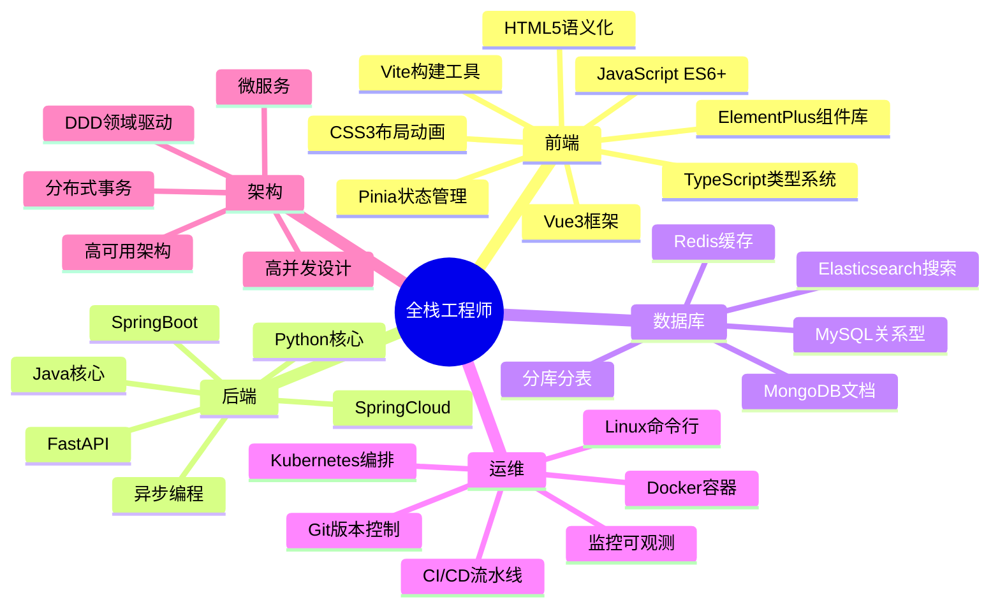
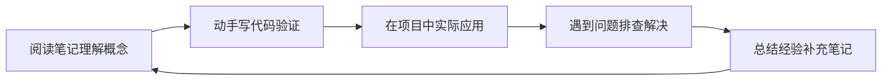

# 全栈开发从入门到精通学习路径指南

> **文档说明**：本指南聚焦纯全栈工程能力培养，覆盖前端、后端、数据库、运维四大领域，设计从零基础到资深全栈工程师的完整成长路径。与[[全栈+AI工程双轨融合学习路线图]]互补，本指南侧重传统Web全栈技术栈的系统性掌握，适合希望先打好工程基础再扩展AI能力的学习者。
>
> **适用人群**：零基础新手、转行开发者、希望系统掌握全栈开发的工程师
>
> **总学习周期**：10-18个月（每日3-4小时有效学习）
>
> **核心理念**：前端是脸，后端是脑，数据库是记忆，运维是骨架。四者缺一不可，按"基础→框架→架构→精通"四阶段递进。

---

## 学习阶段总览

四阶段成长路径 · 全栈工程能力递进

🌱

基础筑基

编程基础 前端三剑客 后端语言+数据库

0-3个月

⚡

框架精通

Vue3+SpringBoot Redis+消息队列 全栈项目实战

3-7个月

🏗️

架构进阶

微服务+分布式 Docker+K8s 高并发高可用

7-12个月

👑

专家精通

源码深度 架构设计 技术领导力

12-18个月

### 四阶段能力矩阵

| 维度 | 基础筑基 | 框架精通 | 架构进阶 | 专家精通 |
|------|---------|---------|---------|---------|
| 前端 | HTML/CSS/JS基础 | Vue3+工程化 | 微前端+性能优化 | 框架源码+架构设计 |
| 后端 | 语言核心+API | SpringBoot/FastAPI | 微服务+分布式 | 源码+JVM/CPython深度 |
| 数据库 | SQL+索引 | Redis+优化 | 分库分表+集群 | 数据库内核原理 |
| 运维 | Git+Linux | Docker+CI/CD | K8s+可观测性 | 混沌工程+SRE |
| 项目 | 个人主页 | 后台管理系统 | 微服务电商 | 架构设计+开源 |

---

## 第一阶段：基础筑基（0-3个月）

> **阶段定位**：从零建立编程思维，掌握前端三剑客和一门后端语言，能独立开发简单的Web应用。此阶段重基础不重框架，每个知识点都要动手写代码验证。

## 第1月：计算机基础与开发环境

### 周计划

| 周次 | 知识点 | 对应笔记 | 验收目标 |
|------|--------|---------|---------|
| W1 | 命令行与操作系统 | [[Linux-运维常用命令手册]] · [[WindowsTerminal与PowerShell]] · [[WSL2-开发环境配置]] | 能用命令行完成文件管理、进程查看、环境变量配置 |
| W1 | Git版本控制 | [[Git-高级命令与底层原理]] · [[Git-Hooks自动化]] · [[Git-Worktree多分支并行]] | 能独立完成commit/branch/merge/rebase，解决合并冲突 |
| W2 | 计算机网络基础 | [[HTTP1.1-2-3演进]] · [[TCPIP协议栈详解]] · [[HTTPS与TLS握手]] · [[DNS解析原理]] | 理解HTTP请求响应流程，能用浏览器DevTools抓包分析 |
| W2 | 开发环境搭建 | [[VSCode-核心配置与插件]] · [[JetBrains-IDEA高效配置]] | 搭建完整开发环境（IDE+JDK/Python+Node+Git+MySQL） |
| W3-4 | 计算机基础概念 | [[进程线程与协程]] · [[内存管理与虚拟内存]] · [[IO模型与零拷贝]] | 理解进程线程区别、内存管理基本概念、IO模型分类 |

### 本月项目：命令行工具 + 个人静态主页

- 用Python/Java写一个文件批量重命名命令行工具
- 用HTML+CSS写一个个人简介静态页面，部署到GitHub Pages

## 第2月：前端基础（HTML/CSS/JavaScript）

### 周计划

| 周次 | 知识点 | 对应笔记 | 验收目标 |
|------|--------|---------|---------|
| W5 | HTML5语义化 | [[HTML5与CSS3基础入门]] | 能写出语义化的HTML页面结构，理解表单、多媒体标签 |
| W5-6 | CSS3布局与动画 | [[CSS3布局与样式基础]] · [[CSS 进阶知识点系统梳理_优化版]] | 掌握Flexbox/Grid布局，能实现响应式页面和CSS动画 |
| W6-8 | JavaScript ES6+ | [[JavaScript核心语法与ES6+]] · [[JavaScript 核心知识点系统梳理_优化版]] | 掌握变量、函数、数组、对象、异步(Promise/async/await)、DOM操作、事件循环 |

### 本月项目：交互式待办事项应用

- 纯HTML+CSS+JavaScript实现
- 功能：增删改查、本地存储(localStorage)、筛选排序、拖拽排序
- 要求：响应式布局、动画过渡、错误处理

## 第3月：后端语言 + 数据库

### Java路线

| 周次 | 知识点 | 对应笔记 | 验收目标 |
|------|--------|---------|---------|
| W9-10 | Java语法与OOP | [[Java知识点完整整合大全_优化版]] | 掌握语法、面向对象、集合框架、异常处理、泛型 |
| W11 | Java高级特性 | [[Java-语法进阶与StreamAPI]] · [[Java-并发编程JUC]] | 掌握Stream API、Lambda、函数式接口、并发基础 |
| W12 | Maven与MySQL | [[Maven-多模块与依赖管理]] · [[关系型数据库索引原理]] · [[事务隔离级别与MVCC]] | 能创建Maven项目，用JDBC连接MySQL完成CRUD |

### Python路线

| 周次 | 知识点 | 对应笔记 | 验收目标 |
|------|--------|---------|---------|
| W9-10 | Python语法基础 | [[Python-语法基础与数据结构]] · [[Python-面向对象与元类]] | 掌握语法、数据结构、面向对象、模块导入 |
| W11 | Python高级特性 | [[Python-装饰器与上下文管理器]] · [[Python-异步编程asyncio]] | 掌握装饰器、生成器、上下文管理器、异步编程 |
| W12 | 包管理与MySQL | [[Poetry-依赖与虚拟环境管理]] · [[SQLAlchemy-ORM核心原理]] | 能管理项目依赖，用SQLAlchemy操作MySQL |

### 本月项目：RESTful API服务

- 用Java(Servlet+JDBC)或Python(Flask基础)实现
- 功能：用户注册登录、文章CRUD、JWT认证、参数校验
- 要求：RESTful设计规范、统一响应格式、错误处理

## 第一阶段验收标准

- [ ] 能独立搭建开发环境，使用Git管理代码
- [ ] 能写出语义化HTML页面，掌握CSS Flexbox/Grid布局
- [ ] 掌握JavaScript ES6+核心特性，理解异步编程和事件循环
- [ ] 掌握一门后端语言核心语法和面向对象
- [ ] 掌握MySQL基本SQL操作，理解索引和事务
- [ ] 完成3个阶段项目（命令行工具、待办应用、REST API）

---

## 第二阶段：框架精通（3-7个月）

> **阶段定位**：深入掌握主流前后端框架，具备独立开发完整全栈应用的能力。此阶段重项目实战，每个知识点都要在项目中验证和应用。

## 第4月：前端框架Vue3

| 周次 | 知识点 | 对应笔记 | 验收目标 |
|------|--------|---------|---------|
| W13-14 | Vue3核心 | [[Vue3快速上手_优化版]] · [[Vue3 知识点系统梳理_优化版]] · [[Vue3-组合式API设计模式]] | 掌握Composition API、响应式原理、组件通信、生命周期 |
| W15 | 路由与状态管理 | [[VueRouter-动态路由与权限]] · [[Pinia-状态管理核心]] | 掌握路由配置、导航守卫、状态管理、持久化 |
| W16 | 工程化与UI库 | [[Vite-构建原理与插件开发]] · [[ElementPlus-二次封装]] · [[ESLint+Prettier+Stylelint规范]] | 能搭建Vue3工程化项目，配置代码规范和CI |

## 第5-6月：后端框架

### SpringBoot路线

| 周次 | 知识点 | 对应笔记 |
|------|--------|---------|
| W17-18 | SpringBoot核心 | [[SpringBoot-自动装配原理]] · [[SpringBoot-Web层设计]] · [[SpringBoot-配置管理与多环境]] |
| W19-20 | 数据访问 | [[SpringDataJPA与MyBatis对比]] · [[MyBatis-Plus高效开发]] · [[数据库性能优化实战]] |
| W21-22 | 安全与验证 | [[SpringSecurity-认证授权]] · [[SpringValidation-参数校验]] · [[JWT-令牌认证机制]] |

### FastAPI路线

| 周次 | 知识点 | 对应笔记 |
|------|--------|---------|
| W17-18 | FastAPI核心 | [[FastAPI-路由与依赖注入]] · [[FastAPI-中间件与异常处理]] · [[FastAPI-SSE流式响应实现]] |
| W19-20 | 数据库与缓存 | [[SQLAlchemy-ORM核心原理]] · [[Redis-Python客户端与缓存策略]] · [[Alembic-数据库迁移]] |
| W21-22 | 安全与部署 | [[Python-异常处理与错误体系]] · [[Python-日志规范与结构化日志]] · [[Python-接口设计与RESTful规范]] |

## 第7月：缓存与消息队列 + 全栈项目

| 周次 | 知识点 | 对应笔记 | 验收目标 |
|------|--------|---------|---------|
| W25-26 | Redis | [[Redis数据结构与应用场景]] · [[Redis-分布式锁与缓存穿透]] | 掌握Redis五种数据结构、缓存策略、分布式锁 |
| W27-28 | 消息队列 | [[RabbitMQ-消息中间件]] · [[Kafka-消息队列与消费模型]] · [[Celery-异步任务队列]] | 理解消息队列应用场景，能实现异步任务和解耦 |
| W28 | 全栈项目 | [[实战-FastAPI+Vue3后台管理系统]] / [[实战-SpringBoot+Vue3权限管理系统]] | 独立完成完整全栈项目 |

### 第二阶段核心项目：企业级后台管理系统

**技术栈**：Vue3 + Pinia + ElementPlus + SpringBoot/FastAPI + MySQL + Redis

**功能模块**：
- 用户管理（注册、登录、权限、角色）
- 数据管理（CRUD、批量操作、导入导出）
- 系统监控（在线用户、操作日志、系统配置）
- 文件管理（上传、下载、预览、图片处理）

**技术要求**：
- 前后端分离，RESTful API
- JWT认证 + RBAC权限控制
- Redis缓存热点数据
- 统一异常处理和响应格式
- Docker Compose一键部署

---

## 第三阶段：架构进阶（7-12个月）

> **阶段定位**：从"能开发"进阶到"能设计"，掌握微服务架构和分布式系统，具备云原生部署和高可用设计能力。此阶段重架构思维和工程化能力。

## 第8-9月：微服务架构

| 知识点 | 对应笔记 | 验收目标 |
|--------|---------|---------|
| SpringCloud Alibaba | [[SpringCloud-Alibaba组件体系]] · [[Nacos-注册中心与配置中心]] · [[Gateway-网关路由与鉴权]] | 能搭建微服务骨架，理解服务注册发现和配置中心 |
| 服务间通信 | [[OpenFeign-服务间调用]] · [[gRPC协议与Protobuf]] · [[Dubbo-高性能RPC框架]] | 理解同步/异步通信，能实现服务间调用 |
| 分布式事务 | [[Seata-分布式事务]] · [[RocketMQ-事务消息]] · [[分布式事务方案对比]] | 理解分布式事务问题，掌握TCC/SAGA/最终一致性方案 |
| 流量控制 | [[Sentinel-流量控制与熔断]] · [[Hystrix-服务降级]] | 掌握限流、熔断、降级、热点参数限流 |

## 第10-11月：云原生与DevOps

| 知识点 | 对应笔记 | 验收目标 |
|--------|---------|---------|
| Docker | [[Docker-核心原理与镜像优化]] · [[Dockerfile最佳实践]] · [[Docker-Compose编排]] | 掌握容器化部署，能编写优化的Dockerfile |
| Kubernetes | [[K8s-核心概念与架构]] · [[Pod与控制器Deployment]] · [[Service与Ingress]] · [[K8s-资源限制与HPA]] | 能在K8s部署应用，理解Pod/Service/Deployment |
| CI/CD | [[GitHub-Actions流水线设计]] · [[Jenkins流水线实战]] · [[ArgoCD-GitOps持续部署]] | 搭建自动化流水线，实现代码提交自动部署 |
| 可观测性 | [[Prometheus-指标采集]] · [[Grafana-可视化看板]] · [[ELK-日志聚合]] · [[SkyWalking-分布式链路追踪]] | 建立监控+日志+链路追踪三位一体可观测体系 |

## 第12月：高级架构与性能

| 知识点 | 对应笔记 |
|--------|---------|
| 高并发设计 | [[Java-高并发系统设计]] · [[秒杀系统架构设计]] · [[高并发系统设计案例]] |
| 数据库进阶 | [[数据库分库分表策略]] · [[数据库主从复制与读写分离]] · [[数据库执行计划分析]] |
| 架构设计 | [[DDD领域驱动设计实战]] · [[云原生架构设计]] · [[高可用架构设计]] |
| 项目实战 | [[实战-SpringCloud微服务电商系统]] |

### 第三阶段核心项目：微服务电商系统

**架构**：SpringCloud Alibaba + Vue3 + MySQL + Redis + RocketMQ + Elasticsearch + K8s

**服务拆分**：
- 用户服务（注册、登录、权限）
- 商品服务（商品管理、分类、搜索）
- 订单服务（下单、支付、状态机）
- 库存服务（库存扣减、预占、回滚）
- 网关服务（路由、鉴权、限流）

**技术挑战**：
- 分布式事务（订单+库存一致性）
- 高并发秒杀（限流+缓存+异步）
- 全文检索（Elasticsearch商品搜索）
- 服务治理（熔断降级+链路追踪）

---

## 第四阶段：专家精通（12-18个月）

> **阶段定位**：从"能设计"进阶到"能创新"，深入技术底层原理，具备架构决策、技术选型和团队领导能力。此阶段重源码深度和技术影响力。

## 第13-15月：底层原理与源码

| 方向 | 知识点 | 对应笔记 |
|------|--------|---------|
| JVM深度 | [[JVM-内存模型与GC调优]] · [[JVM-调优工具实战-Arthas]] · [[JVM 知识点系统梳理_优化版]] |
| Spring源码 | [[Spring-IOCAOP核心机制]] · [[SpringBoot-自动装配原理]]（源码级） · [[Spring事务传播机制]] |
| 数据库内核 | [[关系型数据库索引原理]]（深入B+树实现） · [[事务隔离级别与MVCC]]（深入实现） |
| 分布式原理 | [[哈希表与一致性哈希]] · [[Raft共识算法详解]] · [[分布式锁原理与实现]] |
| 网络深度 | [[HTTP1.1-2-3演进]]（深入QUIC） · [[IO模型与零拷贝]]（深入epoll） |
| Vue3源码 | [[Vue3-响应式原理Proxy]]（源码级） · [[Vue3-编译优化]]（虚拟DOM diff） |

## 第16-17月：架构师能力

| 知识点 | 对应笔记 |
|--------|---------|
| 架构设计方法论 | [[架构设计原则-SOLID]] · [[DDD领域驱动设计基础]] · [[23种设计模式分类速查]] |
| 高可用架构 | [[高可用架构设计]] · [[混沌工程-ChaosMesh]] · [[数据库备份与恢复策略]] |
| 技术选型 | [[技术选型决策记录-ADR]] · [[技术债务管理]] · [[微服务拆分策略]] |
| 团队与流程 | [[代码评审规范]] · [[语义化版本与CHANGELOG]] · [[API设计规范]] |
| 产品思维 | [[需求分析与用户故事]] · [[产品原型设计方法]] · [[从0到1产品落地路径]] |

## 第18月：技术领导力

- 主导复杂系统架构设计和技术选型
- 技术团队管理与Code Review体系建设
- 技术分享与知识输出（博客/开源/演讲）
- 面试与人才培养（见[[面试准备与求职指南]]）
- 持续学习与技术趋势跟踪

## 第四阶段验收标准

- [ ] 深入理解至少一个框架的源码实现（Spring/Vue3/JVM）
- [ ] 能主导复杂系统架构设计和技术选型决策
- [ ] 掌握分布式系统核心原理（共识算法、一致性、CAP）
- [ ] 具备性能调优和问题排查能力
- [ ] 有技术输出（博客文章/开源项目/技术分享）
- [ ] 具备团队协作和技术领导力

---

## 全栈技术栈全景图

---

## 学习方法论

### 每个知识点的学习闭环

### 时间分配建议

| 活动 | 占比 | 说明 |
|------|------|------|
| 理论学习 | 25% | 阅读笔记、看视频、理解概念原理 |
| 动手实践 | 45% | 写代码、做项目、解决实际问题 |
| 复盘总结 | 20% | 整理笔记、写博客、知识输出 |
| 休息调整 | 10% | 避免burnout，保持持续学习节奏 |

### 避坑指南

1. **不要只看不练**：每个知识点必须写代码验证，看懂不等于会用
2. **不要跳级学习**：基础不牢直接上框架，遇到问题无法排查
3. **不要频繁切换**：选定Java或Python为主线，学透再扩展第二语言
4. **不要忽视基础**：计算机基础（网络/操作系统/数据结构）决定技术上限
5. **不要孤立学习**：加入社区、参与讨论、输出分享，教是最好的学
6. **不要追求完美**：先跑通最小示例，再逐步优化和深入

---

## 关联文档

### 阶段学习指南
- [[第一阶段-入门筑基学习指南]] — 0-4个月详细技能清单
- [[第二阶段-进阶实战学习指南]] — 4-9个月框架精通
- [[第三阶段-高级架构学习指南]] — 9-15个月微服务架构
- [[第四阶段-专家精通学习指南]] — 15-24个月源码深度
- [[阶段过渡桥梁指南]] — 阶段间思维转变

### 配套导航
- [[全栈+AI工程双轨融合学习路线图]] — 全栈+AI融合路线（推荐主线）
- [[全栈技术知识点系统梳理大全_优化版]] — 全技术栈知识点索引
- [[分阶段项目实战递进路线]] — 项目学习顺序
- [[学习依赖图谱与前置知识导航]] — 学习顺序指引
- [[新手第一天入门指南]] — 从零开始第一步
- [[核心必读笔记清单与质量分级]] — 必读笔记优先级

---

> 💡 **使用建议**：本指南是纯全栈路线，建议与[[全栈+AI工程双轨融合学习路线图]]配合使用。先按本指南打好全栈工程基础，再在对应阶段融入AI能力。每完成一个知识点在对应笔记中标记`#状态/已掌握`，使用Dataview查询学习进度。
