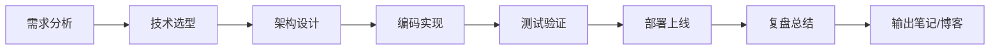

# 分阶段项目实战递进路线

> **文档说明**：将知识库中38个项目实战笔记按学习阶段重新组织，设计从入门到专家的项目递进路线。每个项目明确技能覆盖、难度等级、前置知识和验收标准，让学习者通过项目驱动式学习逐步成长。
>
> **核心理念**：项目是最好的老师。每个阶段选择1-2个核心项目深入完成，比浅尝辄止10个项目更有价值。

---

## 项目难度分级

| 等级 | 标识 | 适合阶段 | 项目特征 |
|------|------|---------|---------|
| L1 入门 | 🌱 | 0-4个月 | 单页面/单接口，CRUD为主，1-2周完成 |
| L2 进阶 | ⚡ | 4-9个月 | 全栈应用，含缓存/消息队列，2-4周完成 |
| L3 高级 | 🚀 | 9-15个月 | 微服务/分布式/AI系统，1-2月完成 |
| L4 专家 | 👑 | 15-24个月 | 架构设计/平台级/开源级，2月+完成 |

---

## 第一阶段项目（入门筑基期）

> **目标**：通过项目巩固基础语法，理解前后端交互，建立工程化思维。

## 项目1：个人主页（L1 🌱）

**对应笔记**：[[实战-FastAPI+Vue3后台管理系统]]（简化版）

**技能覆盖**：
- 前端：HTML/CSS/JavaScript基础、Vue3基础
- 后端：REST API基础、数据库CRUD
- 数据库：MySQL基本操作
- AI：调用AI API实现简单对话

**前置知识**：
- [[Python-语法基础与数据结构]] 或 Java语法基础
- [[Vue3-组合式API设计模式]]
- [[关系型数据库索引原理]]

**项目功能**：
- [ ] 个人信息展示页面（关于我、技能、项目）
- [ ] 留言板功能（前后端联调）
- [ ] AI聊天小部件（调用大模型API）
- [ ] 响应式布局（手机/电脑适配）

**验收标准**：
- [ ] 能独立部署到云服务器
- [ ] 代码提交到GitHub
- [ ] 写一篇项目复盘笔记

**预计耗时**：1-2周

---

## 项目2：待办事项应用（L1 🌱）

**技能覆盖**：
- 前端：组件化、状态管理、本地存储
- 后端：RESTful API设计、数据持久化
- 全栈：前后端联调、错误处理

**项目功能**：
- [ ] 添加/编辑/删除待办
- [ ] 分类和标签管理
- [ ] 截止日期和提醒
- [ ] 数据持久化（本地存储+后端同步）

**验收标准**：
- [ ] 支持离线使用（本地存储）
- [ ] API设计符合RESTful规范
- [ ] 有基本的错误处理和用户提示

**预计耗时**：1周

---

## 第二阶段项目（进阶实战期）

> **目标**：掌握主流框架，构建完整全栈应用，融入AI能力。

## 项目3：后台管理系统（L2 ⚡）

**对应笔记**：[[实战-FastAPI+Vue3后台管理系统]] / [[实战-SpringBoot+Vue3权限管理系统]]

**技能覆盖**：
- 前端：Vue3 + Pinia + VueRouter + ElementPlus
- 后端：SpringBoot/FastAPI + MyBatis/SQLAlchemy
- 数据库：MySQL + Redis缓存
- 安全：JWT认证 + 权限控制
- 工程化：Docker部署 + Nginx反向代理

**前置知识**：
- [[Vue3-组合式API设计模式]]
- [[Pinia-状态管理核心]]
- [[SpringBoot-Web层设计]] 或 [[FastAPI-路由与依赖注入]]
- [[SpringSecurity-认证授权]] 或 [[Python-异常处理与错误体系]]
- [[Redis-Python客户端与缓存策略]]

**项目功能**：
- [ ] 用户管理（增删改查、角色权限）
- [ ] 菜单管理（动态路由）
- [ ] 操作日志
- [ ] 文件上传
- [ ] 数据导入导出
- [ ] Redis缓存热点数据

**验收标准**：
- [ ] RBAC权限模型完整实现
- [ ] 接口文档自动生成（Swagger/OpenAPI）
- [ ] Docker Compose一键部署
- [ ] 有基本的单元测试

**预计耗时**：3-4周

---

## 项目4：RAG知识库问答系统（L2 ⚡）

**对应笔记**：[[实战-RAG企业知识库问答系统]] · [[实战-FastAPI+RAG知识库问答]]

**技能覆盖**：
- AI：RAG全流程、向量数据库、Embedding
- 前端：流式输出、Markdown渲染、引用展示
- 后端：FastAPI + LangChain + 向量检索
- 全栈：SSE流式通信、文件上传解析

**前置知识**：
- [[RAG架构设计与流程]]
- [[Chroma-轻量向量库]] 或 [[PgVector-PostgreSQL向量扩展]]
- [[Embedding模型选型]]
- [[SSE-流式响应对接LLM]]
- [[Markdown渲染与代码高亮]]

**项目功能**：
- [ ] 文档上传（PDF/Markdown/Word）
- [ ] 自动分块和向量化
- [ ] 语义检索 + 大模型回答
- [ ] 流式输出 + 引用来源展示
- [ ] 对话历史管理

**验收标准**：
- [ ] 回答准确率可评估（有标注数据集测试）
- [ ] 支持多种文档格式
- [ ] 响应时间<3秒（首token）
- [ ] 有基本的RAG评估指标

**预计耗时**：2-3周

---

## 项目5：数据可视化平台（L2 ⚡）

**对应笔记**：[[实战-Streamlit数据分析仪表盘]] · [[实战-Python爬虫+数据可视化平台]]

**技能覆盖**：
- 数据：爬虫、数据清洗、数据分析
- 可视化：ECharts、交互式图表
- 后端：数据API、定时任务
- 部署：定时爬虫 + 数据更新

**项目功能**：
- [ ] 定时爬取数据（如天气/新闻/股票）
- [ ] 数据清洗和存储
- [ ] 多维度可视化图表
- [ ] 数据导出功能

**预计耗时**：2周

---

## 第三阶段项目（高级架构期）

> **目标**：掌握分布式架构和AI工程化，构建企业级系统。

## 项目6：微服务电商系统（L3 🚀）

**对应笔记**：[[实战-SpringCloud微服务电商系统]] · [[秒杀系统架构设计]]

**技能覆盖**：
- 微服务：SpringCloud Alibaba + Nacos + Gateway
- 分布式：Seata分布式事务 + RocketMQ事务消息
- 高并发：Sentinel限流熔断 + Redis缓存
- 数据：分库分表 + 读写分离
- 运维：Docker + K8s + Prometheus监控

**前置知识**：
- [[SpringCloud-Alibaba组件体系]]
- [[Nacos-注册中心与配置中心]]
- [[Gateway-网关路由与鉴权]]
- [[Seata-分布式事务]]
- [[Sentinel-流量控制与熔断]]
- [[数据库分库分表策略]]

**项目功能**：
- [ ] 商品服务、订单服务、用户服务、支付服务
- [ ] 服务间调用（Feign）
- [ ] 分布式事务（下单扣库存）
- [ ] 秒杀功能（限流+缓存+异步）
- [ ] API网关统一入口
- [ ] 链路追踪（SkyWalking）

**验收标准**：
- [ ] 支持1000+ QPS秒杀场景
- [ ] 分布式事务一致性保证
- [ ] 服务熔断降级正常工作
- [ ] 完整的监控告警体系

**预计耗时**：1-2个月

---

## 项目7：AI Agent平台（L3 🚀）

**对应笔记**：[[实战-SpringBoot+AI Agent平台]] · [[实战-Agent自动化办公助手]]

**技能覆盖**：
- AI：Agent框架、工具调用、多轮对话、记忆机制
- 工程：AI网关、多模型路由、流式响应
- 前端：Agent思考链展示、任务进度可视化
- 后端：Java/Python混合架构、消息队列

**前置知识**：
- [[Agent核心概念-ReAct规划]]
- [[Agent工具调用FunctionCalling]]
- [[Agent记忆机制设计]]
- [[AI网关与多模型路由]]
- [[LangGraph-状态机Agent]] 或 [[SpringAI-FunctionCalling工具调用]]

**项目功能**：
- [ ] 多模型支持（GPT/Claude/开源模型）
- [ ] 工具调用（搜索/代码执行/文件操作）
- [ ] Agent思考链可视化
- [ ] 多Agent协作
- [ ] 对话记忆管理
- [ ] AI网关统一接入

**验收标准**：
- [ ] Agent能自主完成复杂任务（如"帮我分析这个数据并生成报告"）
- [ ] 工具调用成功率>90%
- [ ] 支持多模型切换和降级
- [ ] 有完整的调用日志和可观测性

**预计耗时**：1-2个月

---

## 项目8：统一AI网关（L3 🚀）

**对应笔记**：[[统一AI网关设计与实现]] · [[多模型路由与流式响应跨语言传递]] · [[Python+Java混合AI架构实战]]

**技能覆盖**：
- 架构：API网关、多模型路由、负载均衡
- AI：流式响应、Token计费、缓存
- 工程：高可用、限流熔断、可观测性
- 混合：Python+Java跨语言协作

**项目功能**：
- [ ] 统一OpenAI兼容API
- [ ] 多模型路由（按成本/延迟/能力）
- [ ] Token计费和用量统计
- [ ] 请求缓存（相同问题复用回答）
- [ ] 限流和熔断
- [ ] 流式响应透传

**预计耗时**：3-4周

---

## 第四阶段项目（专家精通期）

> **目标**：架构设计能力、技术深度、创新能力。

## 项目9：多模态内容生成平台（L4 👑）

**对应笔记**：[[实战-多模态内容生成平台]]

**技能覆盖**：
- AI：文生图、文生视频、语音合成、多模态RAG
- 架构：任务队列、异步处理、结果回调
- 工程：大规模文件处理、CDN分发
- 前端：实时进度、预览、编辑器

**项目功能**：
- [ ] 文本生成（LLM）
- [ ] 图像生成（Stable Diffusion/DALL-E）
- [ ] 语音合成（TTS）
- [ ] 多模态内容编辑
- [ ] 任务队列和异步处理
- [ ] 内容管理和分享

**预计耗时**：2个月+

---

## 项目10：AI代码审查工具（L4 👑）

**对应笔记**：[[实战-AI代码审查工具]]

**技能覆盖**：
- AI：代码理解、AST分析、LLM审查
- 工程：CI/CD集成、IDE插件、规则引擎
- 架构：可扩展的审查规则、自定义规则

**项目功能**：
- [ ] 代码静态分析 + AI审查
- [ ] GitHub/GitLab CI集成
- [ ] 自定义审查规则
- [ ] 审查报告生成
- [ ] IDE插件实时提示

**预计耗时**：2个月+

---

## 项目11：开源级项目（L4 👑）

**自选方向**：
- 自研轻量级AI框架
- 开源工具库
- 技术博客/文档站点
- 开发者效率工具

**要求**：
- [ ] 完整的README和文档
- [ ] 单元测试覆盖率>80%
- [ ] CI/CD自动化
- [ ] 开源到GitHub并获得Star
- [ ] 持续维护和迭代

---

## 项目学习方法论

### 每个项目的完成标准



### 项目复盘模板

每个项目完成后，在Obsidian中创建复盘笔记：

```markdown
# 项目复盘：[项目名]

## 项目概述
- 项目目标：
- 技术栈：
- 耗时：
- 完成度：

## 学到了什么
### 新技术
- 

### 踩过的坑
- 

### 最佳实践
- 

## 可以改进的地方
- 

## 关联笔记
- [[相关笔记1]]
- [[相关笔记2]]
```

### 项目组合建议

| 阶段 | 必做项目 | 选做项目 | 产出 |
|------|---------|---------|------|
| 入门 | 个人主页 | 待办事项 | GitHub仓库 + 复盘笔记 |
| 进阶 | 后台管理 + RAG问答 | 数据可视化 | 2个完整项目 + 技术博客 |
| 高级 | 微服务电商 + AI Agent | AI网关 | 架构设计文档 + 演示视频 |
| 专家 | 多模态平台/代码审查 | 开源项目 | 开源贡献 + 技术影响力 |

---

## 关联文档

- [[全栈+AI工程双轨融合学习路线图]]
- [[新手第一天入门指南]]
- [[Obsidian学习进度追踪体系]]
- [[四级框架总索引]]

---

> 💡 **建议**：不要同时做多个项目。专注完成一个，深度比广度重要。每个项目完成后必须写复盘笔记，这是从"做过"到"掌握"的关键一步。
