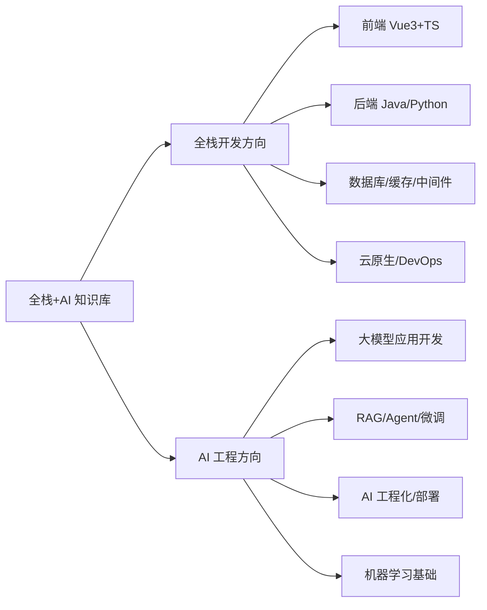
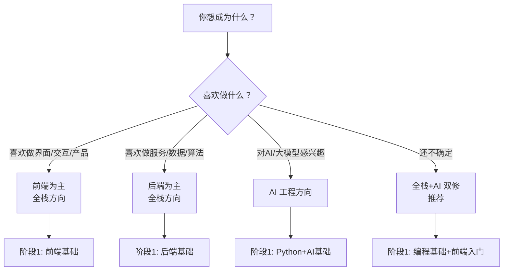
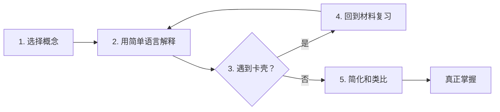

# 新手第一天入门指南

> **文档说明**：面向完全零基础的新手，提供第一天进入本知识库的完整学习指南，包括环境准备、知识库导航、学习路径选择、第一个学习任务，以及如何使用 Obsidian 高效学习。
>
> **适用人群**：零基础编程新手、转行入门者、想系统学习全栈+AI 的自学者
>
> **前置知识**：无（从零开始）

---

## 一、你现在在哪里

欢迎来到**全栈+AI 工程知识库**！这是一个从零基础到资深工程师的完整学习体系，涵盖两大方向：



**这个知识库的特点**：
- 📚 **600+ 篇**技术笔记，覆盖全栈+AI 全领域
- 🗺️ **从入门到专家**的四阶段学习路径
- 🔗 **双向链接**，知识点互相关联
- 📊 **进度追踪体系**，量化学习成果
- 💡 **实战项目驱动**，边学边练

---

## 二、第一步：准备学习环境（30 分钟）

### 1. 安装 Obsidian

本知识库基于 **Obsidian** 构建，Obsidian 是一款本地优先的 Markdown 笔记软件，支持双向链接、关系图谱、插件扩展。

**下载安装**：
1. 访问 [obsidian.md](https://obsidian.md/) 下载对应系统版本
2. 安装后打开，选择"打开本地文件夹"
3. 选择本知识库所在文件夹

**必装插件**：

| 插件 | 作用 | 安装方式 |
|------|------|---------|
| **Dataview** | 动态查询笔记，生成进度表格 | 社区插件搜索安装 |
| **Templater** | 笔记模板，快速创建规范笔记 | 社区插件搜索安装 |
| **Calendar** | 日历视图，查看每日学习记录 | 社区插件搜索安装 |
| **Excalidraw** | 手绘风格图表，画架构图 | 社区插件搜索安装 |
| **Admonition** | 提示框/警告框美化 | 社区插件搜索安装 |

**基础设置**：
- 设置 → 编辑器 → 开启"实时预览"
- 设置 → 文件与链接 → 新文件存放位置：指定 Inbox 文件夹
- 设置 → 外观 → 主题：推荐 Minimal 或 Things

### 2. 安装开发工具

根据你选择的方向，安装对应的开发工具：

#### 全栈方向（推荐先装这些）

| 工具 | 用途 | 下载 |
|------|------|------|
| **VS Code** | 代码编辑器 | code.visualstudio.com |
| **Node.js (LTS)** | 前端开发运行时 | nodejs.org |
| **JDK 17** | Java 开发环境 | adoptium.net |
| **Python 3.11+** | Python 开发环境 | python.org |
| **Docker Desktop** | 容器化运行数据库/中间件 | docker.com |
| **Postman** | API 调试工具 | postman.com |
| **Git** | 版本控制 | git-scm.com |

#### AI 方向（额外安装）

| 工具 | 用途 |
|------|------|
| **Anaconda / Miniconda** | Python 环境管理 |
| **CUDA Toolkit**（如有 NVIDIA GPU） | GPU 加速 |
| **Ollama** | 本地运行大模型 |

### 3. 验证环境

打开终端（VS Code 中按 `` Ctrl+` ``），依次输入：

```bash
# 验证 Node.js
node --version    # 应显示 v18.x.x 或更高
npm --version     # 应显示 9.x.x 或更高

# 验证 Java
java -version     # 应显示 17.x.x
mvn --version     # 如安装 Maven

# 验证 Python
python --version  # 应显示 3.11.x 或更高
pip --version

# 验证 Git
git --version

# 验证 Docker
docker --version
```

> 全部显示版本号即说明环境准备完成。如有报错，先解决环境问题再继续。

---

## 三、第二步：了解知识库结构（15 分钟）

### 1. 顶层目录导航

打开知识库后，你会看到以下目录结构：

```text
全栈工程MarkDown文档/
├── 00-综合导航/          ← 从这里开始！学习路线、进度追踪
├── 01-前端开发/          ← Vue3、TypeScript、工程化
├── 02-后端开发/          ← Java、Spring、微服务
├── 03-数据库与缓存/      ← MySQL、Redis、MongoDB
├── 04-分布式与中间件/    ← 消息队列、分布式事务
├── 05-云原生与运维/      ← Docker、K8s、CI/CD
├── 06-计算机基础/        ← 网络、操作系统、数据结构
├── 07-通用工具/          ← Git、Linux、开发工具
├── 08-Python全栈/        ← Python、FastAPI、Django
├── 09-AI与效率工具/      ← 大模型、RAG、Agent、AI工程化
├── 99-项目实战/          ← 实战项目案例
└── Inbox/                ← 临时笔记存放
```

### 2. 必读导航文档

在开始学习前，先阅读以下导航文档（按顺序）：

| 序号 | 文档 | 位置 | 阅读时间 | 作用 |
|------|------|------|---------|------|
| 1 | [[全栈+AI工程双轨融合学习路线图]] | 00-综合导航 | 15 分钟 | 了解整体学习路径和四阶段划分 |
| 2 | [[Obsidian学习进度追踪体系]] | 00-综合导航 | 10 分钟 | 学会如何记录和追踪学习进度 |
| 3 | [[分阶段项目实战递进路线]] | 00-综合导航 | 10 分钟 | 了解各阶段的实战项目 |

### 3. 如何使用双向链接

知识库中大量使用 `[[笔记名称]]` 格式的双向链接：

- **点击链接**：跳转到对应笔记
- **悬停预览**：鼠标悬停可预览笔记内容
- **反向链接**：笔记底部显示哪些笔记链接了当前笔记
- **关系图谱**：左侧边栏 → 关系图谱，可视化知识网络

> 💡 **学习技巧**：阅读时遇到不理解的概念，点击 `[[]]` 链接跳转到对应笔记学习，学完后返回继续。这就是"按需深入"的学习方式。

---

## 四、第三步：选择你的学习路径（10 分钟）

### 1. 两条主线



### 2. 四阶段学习体系

无论选择哪条路径，都遵循**四阶段递进**：

| 阶段 | 名称 | 目标 | 周期 | 验收标准 |
|------|------|------|------|---------|
| **阶段1** | 🌱 入门 | 掌握基础语法和工具，能写简单程序 | 1-2 个月 | 完成 3 个基础小项目 |
| **阶段2** | 🌿 进阶 | 掌握框架和核心技术，能独立开发模块 | 2-4 个月 | 完成 2 个中型项目 |
| **阶段3** | 🌳 高级 | 掌握架构设计和性能优化，能设计系统 | 3-6 个月 | 完成 1 个完整系统设计 |
| **阶段4** | 🏔️ 专家 | 深入源码和底层原理，能解决疑难问题 | 持续学习 | 技术博客/开源贡献 |

### 3. 推荐起点（零基础）

如果你完全没有编程基础，建议从这里开始：

**第 1 周：编程思维 + Python 入门**
1. 阅读 [[编程思维与算法入门]]
2. 学习 [[Python-语法基础与数据结构]]
3. 完成练习：写一个简单的计算器、猜数字游戏

**第 2-4 周：前端入门**
1. 学习 [[HTML-CSS-JavaScript基础]]
2. 学习 [[Vue3-组合式API设计模式]]
3. 完成项目：个人简历页面、TodoList 应用

**第 2 个月：后端入门**
1. 学习 [[Java核心语法]] 或继续深入 Python
2. 学习 [[SpringBoot-Web开发与RESTful]]
3. 完成项目：简单的 RESTful API 服务

> 💡 **建议**：前 3 个月以全栈基础为主，第 4 个月再决定是否深入 AI 方向。AI 工程需要一定的编程基础，不建议零基础直接学 AI。

---

## 五、第四步：今天的第一个学习任务（1-2 小时）

### 任务：创建你的第一个学习笔记

按照以下步骤，完成你的第一个学习笔记：

#### Step 1：创建学习笔记（5 分钟）

1. 在 Obsidian 中，按 `Ctrl+N` 新建笔记
2. 保存到 `Inbox/` 文件夹，命名为 `学习日志-2026-08-27`
3. 复制以下模板：

```markdown
---
title: 学习日志
date: 2026-08-27
tags: [学习日志]
duration: 2h
---

# 学习日志 - 2026-08-27

## 今日学习内容
- [ ] 安装 Obsidian 和开发环境
- [ ] 阅读知识库导航文档
- [ ] 学习 [[Python-语法基础与数据结构]] 第1-2节

## 学到的知识点
1. 
2. 
3. 

## 遇到的问题
- 

## 明日计划
- 
```

#### Step 2：阅读一篇核心笔记（30 分钟）

阅读 [[Python-语法基础与数据结构]]，重点关注：
- 变量与数据类型
- 列表/字典/集合的基本用法
- 函数定义

阅读时：
- 遇到不懂的概念，点击 `[[]]` 链接深入
- 在学习日志中记录学到的 3 个知识点
- 把不懂的问题记在"遇到的问题"中

#### Step 3：动手练习（30 分钟）

打开 VS Code，创建 `hello.py`，完成以下练习：

```python
# 练习1：定义变量并打印
name = "你的名字"
age = 20
print(f"我叫{name}，今年{age}岁")

# 练习2：列表操作
fruits = ["苹果", "香蕉", "橙子"]
fruits.append("葡萄")
for fruit in fruits:
    print(fruit)

# 练习3：字典操作
student = {"name": "张三", "age": 20, "score": 95}
print(f"{student['name']}的成绩是{student['score']}")

# 练习4：写一个函数
def add(a, b):
    return a + b
print(f"3 + 5 = {add(3, 5)}")
```

运行：`python hello.py`，确认输出正确。

#### Step 4：更新学习日志（10 分钟）

- 勾选完成的任务
- 填写学到的知识点
- 记录遇到的问题和解决方案
- 制定明天的学习计划

---

## 六、高效学习方法

### 1. 费曼学习法



**在知识库中的应用**：
1. 学完一篇笔记后，用自己的话在学习日志中总结
2. 尝试给别人讲（或写出来），讲不清楚的地方就是没掌握的
3. 回到原笔记复习卡壳的部分
4. 用类比加深理解（如"Redis 像图书馆的前台索引"）

### 2. 间隔重复

| 时间点 | 复习内容 |
|--------|---------|
| 学习当天 | 做练习，写总结 |
| 第 2 天 | 快速回顾笔记，重做错题 |
| 第 7 天 | 不看笔记默写核心概念 |
| 第 30 天 | 做综合项目，应用所学 |

> 💡 在 Obsidian 中，可以用 Calendar 插件或 Dataview 查询创建"待复习"列表。

### 3. 项目驱动学习

**不要只看笔记不动手**。每个知识点学完后：
- 写一个最小可运行示例
- 改一改参数，观察变化
- 故意制造错误，理解报错信息
- 组合多个知识点做小项目

### 4. 学习时间建议

| 时间段 | 学习内容 | 时长 |
|--------|---------|------|
| 工作日晚上 | 新知识学习 + 练习 | 1.5-2 小时 |
| 周末上午 | 项目实战 + 复习 | 3-4 小时 |
| 周末下午 | 整理笔记 + 总结 | 1-2 小时 |
| 碎片时间 | 看笔记/听技术播客 | 灵活 |

> 🎯 **最低目标**：每天至少 1 小时，每周至少 10 小时。坚持 3 个月可见明显成效。

---

## 七、常见问题

### Q1：我完全零基础，能学会吗？
**能**。本知识库从最基础的变量、循环开始讲起，不需要任何前置知识。关键是**坚持动手练习**，不要只看不练。

### Q2：先学前端还是后端？
**推荐先学前端**。前端能快速看到效果（页面变化），更容易获得成就感和学习动力。有了前端基础后，再学后端会更容易理解前后端交互。

### Q3：AI 方向需要数学基础吗？
**应用层不需要**。如果只是调用大模型 API、做 RAG/Agent 开发，高中数学足够。如果要做模型训练/算法研究，需要线性代数、概率论、微积分。建议先从应用层入门，再决定是否深入算法。

### Q4：学完能找到工作吗？
**阶段2（进阶）完成后**可以投递初级开发岗位。**阶段3（高级）完成后**可以投递中高级岗位。关键是要有**可展示的项目作品**，知识库中的 [[分阶段项目实战递进路线]] 提供了完整的项目路线。

### Q5：笔记太多，不知道从哪开始？
**按照 [[全栈+AI工程双轨融合学习路线图]] 的顺序学习**。不要随机浏览笔记，那样会碎片化。每学完一个模块，做对应的练习和项目，再进入下一个模块。

### Q6：遇到问题怎么办？
1. 先看报错信息，复制关键错误词搜索
2. 查知识库中对应的 [[常见问题与排查]] 章节
3. 在学习日志中记录问题，第二天复习时解决
4. 加入技术社区（Stack Overflow、掘金、GitHub Issues）提问

---

## 八、今日 Checklist

完成以下所有项，你就成功迈出了第一步：

- [ ] 安装 Obsidian 并打开本知识库
- [ ] 安装 Dataview、Templater 等必装插件
- [ ] 安装 VS Code、Node.js、Python、Git
- [ ] 验证开发环境（所有命令显示版本号）
- [ ] 阅读 [[全栈+AI工程双轨融合学习路线图]]
- [ ] 阅读 [[Obsidian学习进度追踪体系]]
- [ ] 创建第一篇学习日志笔记
- [ ] 阅读 [[Python-语法基础与数据结构]] 前两节
- [ ] 完成 hello.py 练习并成功运行
- [ ] 更新学习日志，记录知识点和问题
- [ ] 制定明天的学习计划

---

## 九、关联笔记

### 学习导航
- [[全栈+AI工程双轨融合学习路线图]] · [[分阶段项目实战递进路线]]
- [[Obsidian学习进度追踪体系]] · [[MOC-知识管理方法论-四级展开]]

### 入门基础
- [[编程思维与算法入门]] · [[Python-语法基础与数据结构]]
- [[HTML-CSS-JavaScript基础]] · [[Git版本控制基础]]

### 学习方法
- [[高效学习方法论]] · [[技术笔记写作规范]] · [[费曼学习法实践]]

### 导航
- [[Home]] · [[MOC-综合导航]] · [[全栈+AI工程双轨融合学习路线图]]

> **下一步**：完成今天的任务后，明天开始学习 [[Python-语法基础与数据结构]] 的完整内容，配合练习巩固。记住：**动手是最好的学习**。
