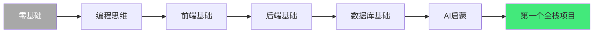
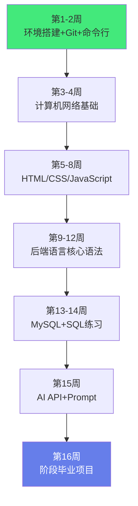
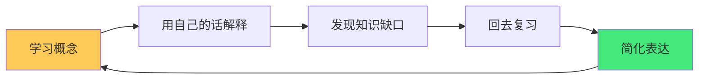

# 🌱 第一阶段：入门筑基学习指南

> **阶段定位**：0-4 个月，从零建立编程思维。此阶段的目标不是「学很多」，而是「建立信心、养成习惯、跑通第一个项目」。
>
> **核心理念**：先跑通，再优化；先模仿，再理解；先广度，再深度。
>
> **适用人群**：零基础新手、转行入门者、想系统建立全栈+AI 基础的学习者

---

## 一、这个阶段你将获得什么

完成本阶段后，你将具备以下能力：

- ✅ 能独立搭建开发环境，用 Git 管理代码
- ✅ 能写出静态网页，理解浏览器渲染原理
- ✅ 掌握一门后端语言核心语法，能写简单 API
- ✅ 能用 SQL 操作数据库，理解基本表设计
- ✅ 能调用 AI API 实现简单功能
- ✅ 完成第一个全栈+AI 小项目
- ✅ 建立每日学习习惯，掌握自学方法



---

## 二、技能清单（学完必须掌握）

### 2.1 工具与环境（必须 100% 掌握）

| 技能 | 掌握标准 | 对应笔记 |
|------|---------|---------|
| **命令行** | 能用 cd/ls/cp/mv/grep/find 完成日常操作 | [[Linux系统管理与常用命令]] |
| **Git** | commit/branch/merge/rebase/解决冲突/pull request | [[Git-高级命令与底层原理]] |
| **VSCode** | 插件配置、调试、快捷键、工作区 | [[VSCode-核心配置与插件]] |
| **浏览器 DevTools** | 查看网络请求、调试 JS、检查元素、性能面板 | [[HTTP协议完整指南]] |
| **包管理器** | npm/pnpm 或 pip/Poetry 基本使用 | [[pnpm-monorepo架构]] · [[Poetry-依赖与虚拟环境管理]] |

### 2.2 前端基础

| 技能 | 掌握标准 | 对应笔记 |
|------|---------|---------|
| **HTML5** | 语义化标签、表单、多媒体、SEO 基础 | [[HTML5与CSS3基础入门]] |
| **CSS3** | Flexbox/Grid、响应式、动画、选择器优先级 | [[HTML5与CSS3基础入门]] · [[CSS3布局与样式基础]] |
| **JavaScript** | 变量/函数/数组/对象/Promise/async/DOM 操作/事件 | [[JavaScript核心语法与ES6+]] |
| **浏览器原理** | 渲染流程、事件循环、同源策略、跨域 | [[浏览器渲染原理]] |

### 2.3 后端语言（Java 或 Python 二选一）

> **选择建议**：想做 AI 方向选 Python，想做企业级开发选 Java。不要同时学两门。

**Python 路线**（推荐 AI 方向初学者）：

| 技能 | 掌握标准 | 对应笔记 |
|------|---------|---------|
| **语法基础** | 数据类型/控制流/函数/模块/包 | [[Python-语法基础与数据结构]] |
| **面向对象** | 类/继承/多态/魔术方法 | [[Python-面向对象与元类]] |
| **高级特性** | 装饰器/生成器/上下文管理器 | [[Python-装饰器与上下文管理器]] |
| **包管理** | pip/venv/Poetry | [[Poetry-依赖与虚拟环境管理]] |
| **Web 框架入门** | Flask 或 FastAPI 写简单接口 | [[FastAPI快速入门]] |

**Java 路线**（推荐企业级开发方向）：

| 技能 | 掌握标准 | 对应笔记 |
|------|---------|---------|
| **语法基础** | 数据类型/控制流/面向对象/集合框架 | [[Java知识点完整整合大全_优化版]] |
| **高级特性** | Stream/Lambda/异常处理/Optional | [[Java-语法进阶与StreamAPI]] |
| **并发基础** | 线程/线程池/synchronized 基本概念 | [[Java-并发编程JUC]] |
| **构建工具** | Maven 依赖管理/生命周期 | [[Maven-多模块与依赖管理]] |
| **Web 入门** | Servlet/Spring Boot 基础 | [[SpringBoot快速入门]] |

### 2.4 数据库

| 技能 | 掌握标准 | 对应笔记 |
|------|---------|---------|
| **SQL 基础** | SELECT/WHERE/JOIN/GROUP BY/子查询/ORDER BY | [[MySQL基础与SQL实战]] |
| **表设计** | 主键/外键/索引/三大范式/ER 图 | [[索引原理与SQL优化]] |
| **事务** | ACID/隔离级别基本概念 | [[事务隔离级别与MVCC详解]] |
| **数据库连接** | 能用后端语言连接 MySQL 执行 SQL | [[MySQL基础与SQL实战]] |

### 2.5 AI 启蒙

| 技能 | 掌握标准 | 对应笔记 |
|------|---------|---------|
| **AI 概念** | 理解 LLM 能做什么、不能做什么、适用场景 | [[主流大模型对比与选型]] |
| **API 调用** | 能用代码调用 OpenAI 兼容 API，处理流式输出 | [[LLM接口封装与统一SDK]] · [[流式响应与SSE]] |
| **Prompt 基础** | 能写出清晰有效的 Prompt，理解角色/任务/格式 | [[提示词工程方法论]] |
| **AI 安全意识** | 理解提示注入、数据隐私、API Key 保护 | [[AI安全与对齐]] |

---

## 三、推荐学习顺序（16 周）



### 3.1 每周节奏建议

| 时间 | 安排 | 说明 |
|------|------|------|
| **周一至周五** | 每天 2-3 小时 | 学新知识 + 写代码练习 |
| **周六** | 3-4 小时 | 做小练习，巩固本周内容 |
| **周日** | 1-2 小时 | 复盘总结，写学习笔记，调整下周计划 |

> **关键原则**：每天写一点代码，比一周学一次但学 10 小时有效得多。 consistency > intensity。

### 3.2 每日学习模板

```markdown
## 今日学习（日期）
- 学习内容：XXX
- 练习代码：写了 XXX 行
- 遇到的问题：XXX
- 解决方法：XXX
- 明日计划：XXX
- 心得总结：XXX
```

---

## 四、项目里程碑

### 项目 1：个人主页（第 8 周）

- **技术栈**：纯 HTML/CSS/JS
- **功能**：个人介绍、技能展示、联系方式、项目展示
- **要求**：响应式布局、有动画效果、语义化 HTML
- **验收标准**：能在浏览器正常显示，手机端也能正常浏览
- **对应技能**：HTML5 + CSS3 + JavaScript + Git

### 项目 2：命令行工具（第 12 周）

- **技术栈**：后端语言（Python 或 Java）
- **功能**：实用小工具（待办事项 CLI、文件批量重命名、天气查询、笔记管理等）
- **要求**：有参数解析、错误处理、帮助文档、配置文件
- **验收标准**：能在命令行正常运行，有基本的用户体验
- **对应技能**：后端语言语法 + 文件操作 + 错误处理

### 项目 3：全栈个人主页 + AI 聊天（第 16 周，阶段毕业项目）

- **技术栈**：前端 HTML/CSS/JS + 后端 API + MySQL + AI API
- **功能**：
  - 前端：个人主页 + AI 聊天界面
  - 后端：REST API（用户注册/登录、聊天记录保存）
  - 数据库：MySQL 存储用户信息和聊天记录
  - AI：集成 AI 聊天功能（调用大模型 API）
- **要求**：从前端到后端到数据库到 AI 全链路打通
- **验收标准**：能完整运行，用户可以注册、登录、和 AI 聊天、查看历史记录
- **对应技能**：全栈整合 + AI 集成 + 数据库 + 部署

---

## 五、自检题（能答出 80% 就可以进入下一阶段）

> 答案见 [[四阶段自检题答案与解析]]

### 工具与环境

1. Git 中 `merge` 和 `rebase` 的区别是什么？什么时候用哪个？
2. 如何用命令行查找包含特定内容的文件？（grep/find）
3. VSCode 中如何配置代码格式化保存时自动执行？
4. 浏览器 DevTools 的 Network 面板能看到哪些信息？

### 前端

5. CSS 中 `display: flex` 和 `display: grid` 分别适合什么场景？
6. JavaScript 中 `let`、`const`、`var` 的区别？
7. `Promise` 和 `async/await` 的关系是什么？
8. 什么是事件循环（Event Loop）？宏任务和微任务的执行顺序？
9. 什么是跨域？如何解决？

### 后端

10. 面向对象的三大特性是什么？各举一个实际例子。
11. 装饰器（Python）或注解（Java）的作用是什么？
12. 什么是异常处理？为什么不能只 catch 不处理？
13. REST API 的基本设计原则是什么？

### 数据库

14. `INNER JOIN` 和 `LEFT JOIN` 的区别？
15. 什么是索引？为什么索引能加速查询？索引的代价是什么？
16. 事务的 ACID 分别指什么？
17. 什么是 SQL 注入？如何防止？

### AI

18. 调用 AI API 时，`temperature` 参数控制什么？
19. 什么是 Prompt？一个好的 Prompt 应该包含哪些要素？
20. 什么是 Token？为什么要关注 Token 用量？

---

## 六、学习方法与技巧

### 6.1 费曼学习法



1. **学习**：学一个知识点
2. **解释**：用自己的话向别人（或想象中的别人）解释
3. **发现缺口**：解释不下去的地方就是没理解的地方
4. **复习**：回去重新学习缺口部分
5. **简化**：用更简单的语言重新解释

> 在 Obsidian 中写学习笔记就是费曼学习法的实践——用自己的话整理知识。

### 6.2 刻意练习

- **针对性**：每次练习聚焦一个具体技能点
- **反馈**：写完代码立刻运行看结果，错误就是最好的反馈
- **走出舒适区**：练习比当前水平稍难一点的题目
- **重复**：同一个概念用不同方式练习多次

### 6.3 调试能力培养

新手最缺的不是知识，是调试能力。培养调试能力的方法：

1. **读错误信息**：不要看到红字就慌，仔细读错误信息和堆栈
2. **打印调试**：在关键位置加 `console.log` / `print` 看变量值
3. **二分法**：注释掉一半代码，定位问题在哪一半
4. **最小复现**：把问题简化到最小可复现的代码
5. **搜索引擎**：把错误信息复制到搜索引擎，90% 的问题别人遇到过
6. **AI 辅助**：用 AI 解释错误信息，但要理解 AI 给的答案

### 6.4 利用 AI 学习

AI 是最好的学习伙伴，但要用对：

| 用法 | 示例 |
|------|------|
| **解释概念** | 「用小白能听懂的话解释什么是事件循环」 |
| **代码审查** | 「帮我看这段代码有什么问题」 |
| **生成练习** | 「给我出 5 道关于 Python 列表的练习题」 |
| **调试帮助** | 「这个错误是什么意思：XXX」 |
| **对比总结** | 「比较 merge 和 rebase 的区别」 |

> **注意**：AI 给的答案要自己验证，不要盲目相信。AI 会「一本正经地胡说八道」。

---

## 七、常见坑与避坑指南

| 坑 | 表现 | 解决方案 |
|----|------|---------|
| **教程地狱** | 一直在看教程，从不自己写 | 每学一个知识点立刻写代码验证，哪怕只有 5 行 |
| **同时学太多** | 又学 Python 又学 Java 又学 Go | 选定一门主语言学透，第二门等进阶阶段再学 |
| **忽视基础** | 直接学框架，不懂底层 | 花时间学语法和计算机基础，框架只是工具 |
| **完美主义** | 第一个项目想做到完美 | 先跑通最小版本，再迭代优化 |
| **不做笔记** | 学完就忘 | 每学完一个知识点写自己的总结笔记（用 Obsidian） |
| **不提问** | 卡住就放弃 | 学会用搜索引擎、AI、社区提问 |
| **只看不练** | 看了很多书和视频，代码写得少 | 学习和练习时间比至少 1:3 |
| **追新技术** | 什么火学什么，什么都不精 | 先把一门技术学深，再扩展广度 |
| **忽视英语** | 遇到英文文档就头疼 | 每天读一点英文技术文档，积累词汇 |
| **不做项目** | 学了很多知识点但不会整合 | 每个阶段结束必须做一个整合项目 |

---

## 八、推荐资源

### 8.1 免费在线课程

| 资源 | 方向 | 说明 |
|------|------|------|
| MDN Web Docs | 前端 | 最权威的前端文档，边查边学 |
| freeCodeCamp | 全栈 | 免费交互式编程学习 |
| 廖雪峰 Python/Java 教程 | 后端 | 中文入门经典 |
| SQLBolt | 数据库 | 交互式 SQL 教程 |
| Prompt Engineering Guide | AI | Prompt 工程权威指南 |

### 8.2 书籍推荐

| 书籍 | 方向 | 阶段 |
|------|------|------|
| 《JavaScript 高级程序设计》 | 前端 | 入门→进阶 |
| 《Python 编程：从入门到实践》 | Python | 入门 |
| 《Java 核心技术卷 I》 | Java | 入门→进阶 |
| 《SQL 必知必会》 | 数据库 | 入门 |
| 《程序员的自我修养》 | 通用 | 入门后 |

### 8.3 练习平台

| 平台 | 用途 |
|------|------|
| LeetCode | 算法练习（入门先做简单题） |
| Codewars | 编程练习（有各种语言） |
| Frontend Mentor | 前端项目练习 |
| Exercism | 多语言练习（有导师审核） |

---

## 九、准备好进入第二阶段了吗？

全部满足即可进入进阶阶段：

- [ ] 完成了 3 个阶段项目（个人主页 / CLI 工具 / 全栈+AI 项目）
- [ ] 自检题正确率 ≥ 80%
- [ ] 能独立排查并解决常见的编程错误
- [ ] 建立了每日学习习惯（至少坚持 4 周）
- [ ] 对至少一个技术领域产生了深入学习的兴趣
- [ ] 理解了「全栈」的含义（前端 + 后端 + 数据库 + 部署）
- [ ] 能用 AI API 实现一个简单功能
- [ ] 在 Obsidian 中建立了自己的学习笔记体系

> 💡 **如果没全部满足也没关系**，可以在薄弱环节多花 1-2 周。这个阶段的基础打得越牢，后面越轻松。不要为了赶进度而跳过基础。

---

## 十、关键笔记阅读清单

按优先级排序，这些是本阶段必读的笔记：

### 必学（优先级最高）

1. [[新手第一天入门指南]] — 从零开始第一步
2. [[Linux系统管理与常用命令]] — 命令行基础
3. [[HTML5与CSS3基础入门]] — 前端入门
4. [[JavaScript核心语法与ES6+]] — JS 核心
5. [[Python-语法基础与数据结构]] 或 [[Java知识点完整整合大全_优化版]] — 后端语言
6. [[MySQL基础与SQL实战]] — 数据库入门

### 重要（学完必学后阅读）

7. [[Git-高级命令与底层原理]] — 版本控制
8. [[VSCode-核心配置与插件]] — 开发工具
9. [[HTTP协议完整指南]] — 网络基础
10. [[LLM接口封装与统一SDK]] — AI API 调用
11. [[提示词工程方法论]] — Prompt 基础
12. [[浏览器渲染原理]] — 前端底层

### 拓展（有余力时阅读）

13. [[CSS3布局与样式基础]] — CSS 进阶
14. [[FastAPI快速入门]] 或 [[SpringBoot快速入门]] — Web 框架
15. [[索引原理与SQL优化]] — 数据库进阶
16. [[主流大模型对比与选型]] — AI 模型认知

---

## 十一、关联文档

- [[全栈+AI工程双轨融合学习路线图]] — 总路线图
- [[第二阶段-进阶实战学习指南]] — 下一阶段
- [[第三阶段-高级深化学习指南]] — 高级阶段
- [[第四阶段-专家架构学习指南]] — 专家阶段
- [[分阶段项目实战递进路线]] — 项目路线
- [[Obsidian学习进度追踪体系]] — 进度管理
- [[模板-每周学习计划]] — 计划模板
- [[四阶段自检题答案与解析]] — 自检题答案

---

> 🔍 **阶段核心认知**
>
> **作用**：入门筑基阶段解决的是「如何从零建立编程思维、掌握全栈+AI 的基础技能、建立可持续的学习习惯，为后续进阶打下坚实基础」的核心问题——入门阶段最大的风险不是难度，而是放弃和走弯路。
>
> **底层原理**：①入门阶段的核心矛盾是「知识的无限性」和「时间精力的有限性」——技术知识点无穷无尽，初学者很容易陷入「什么都想学，什么都学不深」的困境。解决方案是「先广度后深度」——先建立全栈+AI 的全景认知（每个领域知道基本概念和能做什么），再在后续阶段逐步深入。这个阶段不要求精通任何一个领域，只要求「能跑通」。②「先跑通再优化」是入门阶段最重要的学习策略——很多初学者卡在「想写出完美的代码」，结果一行都写不出来。正确的做法是：先写能运行的代码（哪怕很丑），再逐步优化。跑通带来的成就感是坚持下去的动力，完美主义是放弃的催化剂。③「项目驱动学习」是最有效的入门方式——单纯学语法很容易遗忘，但通过做项目来学习，知识会被「用」起来，形成长期记忆。每个阶段的项目里程碑就是为了这个目的——把零散的知识点整合为一个完整的产品，在这个过程中理解知识之间的联系。④「每日学习习惯」比「单次学习时长」更重要——大脑的学习机制是「间隔重复」，每天接触一点比一周学一次效果好得多。21 天可以养成一个习惯，4 个月（16 周）足够让编程学习成为生活的一部分。⑤AI 是这个时代最好的学习助手——AI 可以解释概念、生成练习、审查代码、帮助调试，大大降低了入门门槛。但要注意「AI 辅助而非替代」——用 AI 学习，但要自己理解和验证，不要直接复制粘贴 AI 的代码而不思考。
>
> **用法要点**：① 阶段周期：0-4个月(16周)，目标是建立信心+养成习惯+跑通第一个项目 ② 五大模块：工具环境(100%掌握)/前端基础/后端语言(Python或Java二选一)/数据库/AI启蒙 ③ 学习顺序：第1-2周环境+Git→第3-4周网络→第5-8周前端→第9-12周后端→第13-14周数据库→第15周AI→第16周毕业项目 ④ 每周节奏：周一至周五每天2-3小时学+练/周六3-4小时练习/周日1-2小时复盘 ⑤ 三个项目：个人主页(第8周)/CLI工具(第12周)/全栈+AI聊天(第16周毕业项目) ⑥ 自检标准：15-20道题答对80%可进入下一阶段 ⑦ 学习方法：费曼学习法(用自己的话解释)/刻意练习(针对性+反馈+走出舒适区)/调试能力(读错误+打印+二分法+搜索+AI)/AI辅助学习(解释+审查+出题+调试) ⑧ 避坑：教程地狱(立刻写代码)/同时学太多(选一门)/忽视基础(先学语法)/完美主义(先跑通)/不做笔记(写Obsidian笔记)/不提问(学会搜索)/只看不练(1:3比例)/追新技术(先学深一门)/忽视英语(每天读一点)/不做项目(每阶段必做) ⑨ 资源：MDN/freeCodeCamp/廖雪峰/SQLBolt/Prompt Engineering Guide + 经典书籍 + LeetCode/Codewars练习平台 ⑩ 进阶条件：3个项目完成+自检80%+独立调试+每日习惯4周+对某领域有兴趣+理解全栈含义+会用AI API+建立笔记体系。

> 💡 **深度讲解**：入门筑基阶段最核心的智慧是「先完成再完美——跑通比完美重要，坚持比速度重要，习惯比天赋重要」——很多人学编程失败不是因为笨，而是因为「完美主义」和「教程地狱」。完美主义让你不敢写代码（觉得写得丑），教程地狱让你一直在看（觉得还没准备好），结果就是「学了半年还没写过一个完整项目」。破解方法就是「先跑通」——不管代码多丑，先让它运行起来，看到结果，获得成就感，然后再优化。这个阶段的三个项目里程碑就是「先跑通」的具体实践——个人主页不需要设计精美，能显示就行；CLI 工具不需要功能强大，能运行就行；毕业项目不需要高并发，能全链路打通就行。跑通之后，你会发现「优化」是自然而然的事情——当你看到自己的代码能运行，你会想让它更好看、更高效、更健壮。另一个关键是「不要同时学太多」——全栈+AI 的知识体系很庞大，但入门阶段不需要什么都学。选一门后端语言（Python 或 Java），学透基础，再学其他。前端基础是必须的（HTML/CSS/JS），数据库是必须的（MySQL），AI 启蒙是必须的（API 调用+Prompt）。其他的（框架、中间件、分布式、微服务）都是后续阶段的内容。在 AI 时代，入门变得更容易了——AI 可以帮你解释概念、生成练习、调试代码，以前需要导师才能获得的反馈现在随时可以获得。但 AI 也带来了新的挑战——「AI 依赖症」：什么都问 AI，自己不思考，结果是「看起来学会了，其实没理解」。正确的用法是「AI 辅助而非替代」——先自己思考，卡住了再问 AI，问完之后要自己理解和复现，不要直接复制粘贴。Obsidian 知识库是这个阶段最好的学习工具——用费曼学习法写笔记，用双向链接建立知识关联，用标签和图谱看到知识的全貌。每学一个知识点就写一篇原子笔记，每完成一个项目就写一篇项目复盘，4 个月后你会拥有一个属于自己的知识体系——这比任何证书都有价值。记住：入门阶段最大的敌人不是难度，是放弃。每天写一点代码，比一周学一次但学 10 小时有效得多。坚持 16 周，你会看到一个完全不同的自己。

> 📝 **精简总结**：第一阶段入门筑基=0-4个月建立编程思维。五大模块：工具环境(Git/命令行/VSCode/DevTools)/前端(HTML/CSS/JS)/后端(Python或Java二选一)/数据库(MySQL)/AI启蒙(API+Prompt)。16周学习顺序：环境→网络→前端→后端→数据库→AI→毕业项目。三个项目：个人主页(第8周)/CLI工具(第12周)/全栈+AI聊天(第16周)。学习方法：费曼学习法/刻意练习/调试能力培养/AI辅助。避坑：教程地狱/同时学太多/完美主义/不做笔记/只看不练。进阶条件：3项目+自检80%+独立调试+每日习惯+全栈认知。核心理念：先跑通再优化，先模仿再理解，先广度再深度。

> 🎯 **记住**：入门阶段最大的敌人不是难度，是放弃。每天写一点代码，比一周学一次但学 10 小时有效得多。 consistency > intensity。

---

> **入门筑基阶段最核心的智慧是「先完成再完美——跑通比完美重要，坚持比速度重要，习惯比天赋重要」——很多人学编程失败不是因为笨，而是因为完美主义和教程地狱。完美主义让你不敢写代码（觉得写得丑），教程地狱让你一直在看（觉得还没准备好），结果学了半年还没写过一个完整项目。破解方法就是先跑通——不管代码多丑，先让它运行起来，看到结果获得成就感，然后再优化。这个阶段的三个项目里程碑就是先跑通的具体实践：个人主页能显示就行，CLI 工具能运行就行，毕业项目能全链路打通就行。跑通之后你会发现优化是自然而然的事情。另一个关键是不要同时学太多——全栈+AI 知识体系庞大，但入门阶段选一门后端语言学透基础，前端+数据库+AI 启蒙是必须的，框架中间件分布式都是后续内容。AI 时代入门更容易了——AI 可以解释概念、生成练习、调试代码，但也要警惕 AI 依赖症：什么都问 AI 自己不思考，看起来学会了其实没理解。正确用法是 AI 辅助而非替代——先自己思考，卡住再问 AI，问完要理解复现，不要直接复制粘贴。Obsidian 是最好的学习工具——用费曼法写笔记，用双向链接建关联，用标签图谱看全貌，每学一个知识点写原子笔记，每完成一个项目写复盘，4 个月后你会拥有自己的知识体系，这比任何证书都有价值。记住：入门阶段最大的敌人不是难度，是放弃。每天写一点代码，比一周学一次但学 10 小时有效得多。坚持 16 周，你会看到一个完全不同的自己。如果你现在是零基础，不要犹豫——今天就开始，先把开发环境搭起来，写第一行 Hello World，这就是从 0 到 1 的第一步。**
