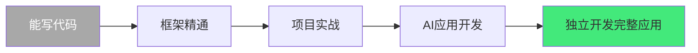
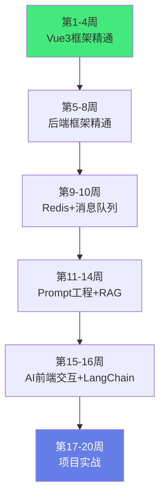
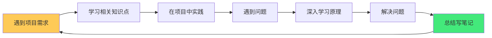

# 🚀 第二阶段：进阶实战学习指南

> **阶段定位**：4-9 个月，从「能写代码」到「能开发完整应用」。此阶段的核心是**框架精通 + 项目实战 + AI 应用开发**。
>
> **核心理念**：以项目驱动学习，每个知识点都要在项目中用一次才算真正掌握。
>
> **关键转变**：从「实现功能」到「设计系统」——开始思考代码的可维护性、可扩展性、可测试性。
>
> **适用人群**：完成第一阶段入门、具备编程基础、想独立开发完整应用的学习者

---

## 一、这个阶段你将获得什么

完成本阶段后，你将具备以下能力：

- ✅ 能用 Vue3 开发中后台前端应用（组件化、状态管理、路由权限）
- ✅ 能用 SpringBoot / FastAPI 开发完整后端服务（REST API、安全、缓存）
- ✅ 掌握 Redis 缓存和消息队列（缓存策略、异步处理）
- ✅ 能设计和实现 RAG 检索增强系统（文档问答、知识库）
- ✅ 掌握 Prompt 工程，能优化 AI 输出质量
- ✅ 完成至少 2 个全栈 + AI 融合项目
- ✅ 具备独立开发中小型应用的能力
- ✅ 理解工程化的含义（规范、自动化、可维护）

---

## 二、技能清单

### 2.1 前端框架（Vue3）

| 技能 | 掌握标准 | 对应笔记 |
|------|---------|---------|
| **Composition API** | setup/ref/reactive/computed/watch/watchEffect | [[Vue3-组合式API]] |
| **响应式原理** | Proxy 依赖收集、ref vs reactive、浅层响应 | [[Vue3-响应式原理Proxy]] |
| **组件通信** | props/emits/provide/inject/Pinia/事件总线 | [[Vue3-组件通信与插槽]] |
| **路由** | 动态路由、导航守卫、权限控制、懒加载 | [[VueRouter-动态路由与权限]] |
| **状态管理** | Pinia store、持久化、模块化、插件 | [[Pinia-状态管理核心]] |
| **工程化** | Vite 构建、ESLint/Prettier、环境变量、CI/CD | [[Vite构建工具原理]] · [[环境变量与多环境构建]] |
| **UI 组件库** | Element Plus 使用与二次封装 | [[ElementPlus-二次封装]] |
| **自定义 Hooks** | 封装可复用逻辑（useRequest/useTable/usePermission） | [[Vue3-自定义Hooks封装_backup_skeleton]] |
| **TypeScript** | 类型体操、泛型、严格模式 | [[TS-严格模式与类型体操]] |

### 2.2 后端框架

**FastAPI 路线**（推荐 AI 方向）：

| 技能 | 掌握标准 | 对应笔记 |
|------|---------|---------|
| **路由与依赖注入** | APIRouter/Depends/路径参数/查询参数 | [[FastAPI快速入门]] |
| **中间件与异常** | 全局异常处理、CORS、请求日志 | [[FastAPI中间件与异常处理]] |
| **ORM** | SQLAlchemy 模型/查询/迁移/Alembic | [[SQLAlchemy-ORM核心原理]] |
| **缓存** | Redis 连接、缓存策略、分布式锁 | [[Redis缓存与队列]] |
| **异步任务** | Celery 异步任务、定时任务 | [[Celery-异步任务队列]] |
| **认证** | JWT、OAuth2、API Key | [[JWT认证机制]] |

**SpringBoot 路线**（推荐企业级方向）：

| 技能 | 掌握标准 | 对应笔记 |
|------|---------|---------|
| **自动装配** | starter 原理、条件注解、SPI 机制 | [[SpringBoot自动装配原理]] |
| **Web 层** | Controller/拦截器/参数校验/统一返回 | [[SpringBootWeb层设计]] |
| **数据访问** | MyBatis/JPA、事务管理、连接池 | [[SpringDataJPA与MyBatis对比]] |
| **安全** | SpringSecurity 认证授权、JWT 集成 | [[SpringSecurity安全框架]] |
| **配置管理** | 多环境配置、配置中心、@Value/@ConfigurationProperties | [[SpringBoot配置管理]] |
| **缓存** | RedisTemplate、缓存注解、分布式锁 | [[Redis缓存与队列]] |

### 2.3 缓存与消息队列

| 技能 | 掌握标准 | 对应笔记 |
|------|---------|---------|
| **Redis 数据结构** | String/Hash/List/Set/ZSet 使用场景与选型 | [[Redis数据结构与应用场景]] |
| **缓存策略** | 缓存穿透/击穿/雪崩解决方案、缓存更新策略 | [[Redis分布式锁与缓存穿透]] |
| **分布式锁** | Redisson、锁超时、可重入 | [[Redis分布式锁实现]] |
| **消息队列** | 生产者/消费者、消息确认、死信队列、幂等性 | [[RabbitMQ消息中间件]] · [[Kafka消息队列]] |
| **异步处理** | 异步任务、定时任务、任务调度 | [[Celery-异步任务队列]] · [[Spring定时任务]] |

### 2.4 AI 应用开发

| 技能 | 掌握标准 | 对应笔记 |
|------|---------|---------|
| **Prompt 工程** | Few-shot/CoT/角色设定/输出格式控制/迭代优化 | [[提示词工程方法论]] |
| **RAG 基础** | 文档分块/向量化/检索/生成全流程 | [[RAG检索增强生成]] |
| **向量数据库** | Chroma/PgVector/Milvus 基本使用与选型 | [[向量数据库选型与实践]] |
| **AI 前端交互** | SSE 流式输出、Markdown 渲染、对话 UI | [[流式响应与SSE]] · [[Markdown渲染与代码高亮]] |
| **LangChain** | Chain/Agent/Tool/Retrieval 基本使用 | [[LangChain核心概念]] |
| **多模态** | 图片理解、语音识别、文件上传 | [[文件上传与多模态交互]] |
| **AI 服务架构** | 模型路由、降级、限流、成本控制 | [[LLM服务架构]] |

---

## 三、推荐学习顺序（20 周）

### 3.1 每周节奏建议

| 时间 | 安排 | 说明 |
|------|------|------|
| **周一至周四** | 每天 2-3 小时 | 学框架知识 + 写练习代码 |
| **周五** | 2-3 小时 | 整合本周知识，做小 Demo |
| **周六** | 4-6 小时 | 项目开发（核心时间） |
| **周日** | 2 小时 | 复盘总结、写笔记、调整计划 |

> **进阶阶段关键**：周末的项目时间比工作日更重要——工作日学知识点，周末用项目把知识点串起来。

### 3.2 并行学习建议

- **前端 + 后端并行**：第 1-8 周可以前端和后端交替学习，避免单一领域疲劳
- **AI 贯穿始终**：从第 1 周就可以开始用 AI API 做小练习，不要等到第 11 周
- **项目驱动**：每个知识点学完立刻在项目中用一次，不用等于没学

---

## 四、项目里程碑

### 项目 1：后台管理系统（第 12 周）

- **技术栈**：Vue3 + Element Plus + Pinia + FastAPI/SpringBoot + MySQL + Redis
- **核心功能**：
  - 用户注册/登录（JWT 认证）
  - 用户管理（CRUD + 分页 + 搜索）
  - 角色权限管理（RBAC + 菜单权限 + 按钮权限）
  - 文件上传（头像/附件）
  - 数据表格（排序、筛选、导出）
  - 操作日志
- **验收标准**：
  - 完整的 CRUD + 权限控制
  - JWT 登录 + Token 刷新
  - 前端路由守卫 + 按钮级权限
  - Redis 缓存用户信息和热点数据
  - 统一异常处理 + 统一返回格式
  - 代码有基本的单元测试
- **对应技能**：Vue3 全家桶 + 后端框架 + Redis + JWT + 权限控制

### 项目 2：RAG 知识库问答（第 16 周）

- **技术栈**：Vue3 对话 UI + FastAPI + LangChain + 向量数据库 + LLM API
- **核心功能**：
  - 文档上传（PDF/Word/Markdown/TXT）
  - 文档解析与分块
  - 向量化与存储
  - 检索增强问答
  - 引用来源展示
  - 对话历史
  - 流式输出
- **验收标准**：
  - 上传文档后能基于文档内容回答问题
  - 回答有引用来源标注
  - 支持多轮对话
  - 流式输出体验流畅
  - 能处理至少 100 页的文档
  - 有基本的回答质量评估
- **对应技能**：RAG 全流程 + Prompt 工程 + 向量数据库 + AI 前端交互

### 项目 3：AI 智能客服（第 20 周，阶段毕业项目）

- **技术栈**：全栈 + AI + 消息队列 + 缓存
- **核心功能**：
  - 用户端：对话式客服界面
  - 管理端：知识库管理、对话记录、人工接管
  - AI 能力：RAG 问答 + 多轮对话 + 意图识别
  - 工单系统：AI 无法回答时转人工
  - 常见问题自动推荐
  - 对话质量评估
- **验收标准**：
  - 能处理 80% 的常见问题（基于知识库）
  - 能识别用户意图并转人工
  - 有完整的对话历史和工单系统
  - 管理端能管理知识库和查看数据
  - 系统能支持至少 100 并发用户
  - 有基本的监控和日志
- **对应技能**：全栈整合 + AI 应用 + 消息队列 + 缓存 + 项目架构

---

## 五、进阶阶段学习方法

### 5.1 从「调用框架」到「理解原理」

入门阶段你学会了「怎么用框架」，进阶阶段要理解「框架为什么这样设计」：

| 入门阶段 | 进阶阶段 |
|---------|---------|
| 会用 ref/reactive | 理解 Proxy 依赖收集原理 |
| 会写 Controller | 理解 SpringBoot 自动装配流程 |
| 会用 Redis 缓存 | 理解缓存穿透/击穿/雪崩 |
| 会调用 LLM API | 理解 Token、上下文、温度参数 |
| 会写 SQL | 理解索引原理和执行计划 |

> **方法**：遇到问题时先想「框架底层做了什么」，而不是立刻搜答案。读源码、看官方文档、画流程图。

### 5.2 项目驱动学习法

- 不要「先学完再做项目」——学不完的，边做边学
- 项目中遇到的问题是最好的学习动力
- 每个项目结束后写复盘笔记：做了什么、学到了什么、哪里可以改进

### 5.3 代码质量意识

进阶阶段开始关注代码质量：

- **可读性**：变量命名清晰、函数短小、注释适量
- **可维护性**：模块化、低耦合、配置化
- **可测试性**：核心逻辑写单元测试
- **可扩展性**：预留扩展点、不写死逻辑
- **错误处理**：统一异常处理、有意义的错误信息
- **安全意识**：输入校验、权限检查、密钥保护

### 5.4 利用 AI 辅助学习

进阶阶段 AI 是最好的学习伙伴：

| 用法 | 示例 Prompt |
|------|------------|
| **代码审查** | 「审查这段代码，从性能、安全、可读性角度给出建议」 |
| **原理讲解** | 「用通俗的语言解释 Vue3 的响应式原理」 |
| **最佳实践** | 「FastAPI 项目的最佳目录结构是什么样的」 |
| **调试帮助** | 「这个错误是什么原因：XXX」 |
| **架构建议** | 「我要做一个 RAG 系统，给我架构建议」 |

> **注意**：AI 给的建议要自己验证，不要盲目复制。理解 AI 的答案比得到答案更重要。

---

## 六、自检题（能答出 80% 进入下一阶段）

> 答案见 [[四阶段自检题答案与解析]]

### 前端

1. Vue3 的响应式原理是什么？ref 和 reactive 的区别？
2. 为什么 Vue3 的组件通信不推荐用 props 层层传递？provide/inject 解决了什么？
3. Pinia 和 Vuex 的区别？Pinia 的优势是什么？
4. Vite 为什么比 Webpack 快？HMR 的原理是什么？
5. 前端权限控制有哪几层？如何实现按钮级权限？
6. 什么是虚拟列表？什么时候需要用？

### 后端

7. 依赖注入（DI）解决了什么问题？SpringBoot 的 DI 原理是什么？
8. ORM 的优缺点是什么？什么时候应该用原生 SQL？
9. 什么是 RESTful API 设计规范？GET/POST/PUT/DELETE 的语义？
10. 如何设计一个安全的用户认证系统？JWT 的优缺点？
11. 数据库索引的原理是什么？什么情况下索引会失效？
12. 如何处理高并发场景？有哪些常用手段？

### 缓存与 MQ

13. Redis 的五种数据结构各适合什么场景？
14. 缓存穿透、击穿、雪崩的区别和解决方案？
15. 消息队列解决了什么问题？什么场景下不该用 MQ？
16. 如何保证消息不丢失？如何处理重复消息？
17. 分布式锁的实现方式有哪些？Redis 分布式锁有什么问题？

### AI

18. RAG 的完整流程是什么？每个环节的关键参数有哪些？
19. 文档分块大小如何选择？太大或太小有什么问题？
20. Prompt 工程中，Few-shot 和 Zero-shot 的区别？CoT 是什么？
21. 如何评估一个 RAG 系统的效果？有哪些评估指标？
22. LLM 的 Token 限制如何处理长文档？有哪些策略？
23. 如何降低 LLM 应用的成本？有哪些优化手段？

---

## 七、常见坑与避坑指南

| 坑 | 表现 | 解决方案 |
|----|------|---------|
| **框架调用者** | 只会用框架，不懂原理，遇到问题就懵 | 遇到问题先想「框架底层做了什么」，读源码 |
| **过度工程** | 简单项目用微服务+各种中间件 | 先用最简单的方案，需要时再升级 |
| **忽视错误处理** | 到处 try-catch 吞异常，错误无信息 | 定义统一异常处理，错误信息要有意义 |
| **RAG 效果差** | 回答不准确就怪模型 | 先检查分块/检索/Prompt，模型通常不是瓶颈 |
| **不写测试** | 改一处坏三处，不敢重构 | 核心逻辑必须写单元测试，培养测试习惯 |
| **安全意识弱** | API 密钥硬编码、SQL 拼接、不校验输入 | 用环境变量、参数化查询、输入校验 |
| **性能优化过早** | 用户量还很小就搞分布式 | 先做功能，性能瓶颈出现再优化 |
| **文档缺失** | 代码写完没有文档，自己都看不懂 | 每个项目写 README，关键逻辑写注释 |
| **不做 Code Review** | 一个人写代码，问题发现不了 | 用 AI 做代码审查，或找朋友互相 review |
| **追新技术** | 什么火学什么，什么都不精 | 先把当前技术栈学深，再扩展 |

---

## 八、推荐资源

### 8.1 文档与教程

| 资源 | 方向 | 说明 |
|------|------|------|
| Vue3 官方文档 | 前端 | 最权威的 Vue3 学习资源 |
| FastAPI 官方文档 | 后端 | 交互式文档，边学边练 |
| SpringBoot 官方指南 | 后端 | 官方 Guides 覆盖常见场景 |
| Redis 官方文档 | 缓存 | 数据结构和命令的权威参考 |
| LangChain 文档 | AI | AI 应用开发框架 |
| Prompt Engineering Guide | AI | Prompt 工程权威指南 |

### 8.2 书籍推荐

| 书籍 | 方向 | 阶段 |
|------|------|------|
| 《Vue.js 设计与实现》 | 前端 | 进阶原理 |
| 《深入理解计算机系统》 | 基础 | 进阶→高级 |
| 《设计模式》 | 通用 | 进阶 |
| 《重构：改善既有代码的设计》 | 通用 | 进阶 |
| 《Building LLM Applications》 | AI | 进阶 |

### 8.3 项目参考

| 项目 | 说明 |
|------|------|
| Vue Element Admin | 后台管理系统参考 |
| FastAPI Best Practices | FastAPI 最佳实践 |
| LangChain Chatbot | AI 对话项目参考 |
| Quivr | 开源 RAG 知识库参考 |

---

## 九、准备好进入第三阶段了吗？

全部满足即可进入高级阶段：

- [ ] 完成了 3 个阶段项目，代码在 GitHub 上展示
- [ ] 自检题正确率 ≥ 80%
- [ ] 能独立排查前后端联调问题（跨域、鉴权、数据格式）
- [ ] 理解了「工程化」的含义（规范、自动化、可维护）
- [ ] 能根据需求选择合适的技术方案
- [ ] 对微服务/分布式产生了学习兴趣
- [ ] 能独立设计一个中小型应用的架构
- [ ] 代码有基本的测试和文档

> 💡 **进阶阶段的关键转变**：从「实现功能」到「设计系统」。开始思考代码的可维护性、可扩展性、可测试性。这是从「码农」到「工程师」的关键一步。

---

## 十、关键笔记阅读清单

按优先级排序，这些是本阶段必读的笔记：

### 必学（优先级最高）

1. [[Vue3-组合式API]] · [[Vue3-响应式原理Proxy]] — Vue3 核心
2. [[Pinia-状态管理核心]] · [[VueRouter-动态路由与权限]] — 前端工程
3. [[FastAPI快速入门]] 或 [[SpringBoot快速入门]] — 后端框架
4. [[Redis数据结构与应用场景]] · [[Redis分布式锁与缓存穿透]] — 缓存
5. [[RAG检索增强生成]] · [[RAG文本分块策略]] — AI 核心
6. [[提示词工程方法论]] · [[流式响应与SSE]] — AI 应用

### 重要（学完必学后阅读）

7. [[ElementPlus-二次封装]] · [[Vue3-自定义Hooks封装_backup_skeleton]] — 前端进阶
8. [[JWT认证机制]] · [[菜单与按钮级权限控制]] — 安全与权限
9. [[SQLAlchemy-ORM核心原理]] 或 [[MyBatis进阶]] — 数据访问
10. [[RabbitMQ消息中间件]] · [[Celery-异步任务队列]] — 异步处理
11. [[Markdown渲染与代码高亮]] · [[对话式UI组件设计]] — AI 前端
12. [[Vitest-单元测试与组件测试]] — 测试（进阶开始重视）

### 拓展（有余力时阅读）

13. [[TypeScript-类型系统进阶]] · [[TS-严格模式与类型体操]] — TS 深化
14. [[Vite构建工具原理]] · [[环境变量与多环境构建]] — 工程化
15. [[LLM服务架构]] · [[Java AI Agent开发知识点系统梳理_优化版]] — AI 进阶
16. [[Docker容器化]] · [[CI-CD持续集成与部署]] — 部署与运维

---

## 十一、关联文档

- [[第一阶段-入门筑基学习指南]] — 上一阶段
- [[第三阶段-高级深化学习指南]] — 下一阶段
- [[第四阶段-专家架构学习指南]] — 专家阶段
- [[全栈+AI工程双轨融合学习路线图]] — 总路线图
- [[分阶段项目实战递进路线]] — 项目路线
- [[算法刷题指南与题型模板]] — 算法辅助
- [[Obsidian学习进度追踪体系]] — 进度管理
- [[模板-每周学习计划]] — 计划模板

---

> 🔍 **阶段核心认知**
>
> **作用**：进阶实战阶段解决的是「如何从能写代码的初学者成长为能独立开发完整应用的工程师，掌握框架、工程化、AI 应用开发的核心能力」的关键问题——这是学习路径中最重要的阶段，决定了能否从「爱好者」转变为「专业开发者」。
>
> **底层原理**：①进阶阶段的核心矛盾是「知识广度」和「项目深度」的平衡——全栈+AI 的知识体系很庞大，但项目实战需要深度。解决方案是「项目驱动学习」——以项目为线索，遇到什么学什么，每个知识点在项目中用一次才算掌握。这种「做中学」的方式比「先学完再做」高效得多，因为知识只有在使用中才能真正理解和记忆。②「从实现功能到设计系统」是进阶阶段的关键认知转变——入门阶段关注「怎么实现」，进阶阶段关注「怎么设计得更好」。这个转变体现在：开始关注代码可维护性（模块化、低耦合）、可扩展性（预留扩展点）、可测试性（写单元测试）、性能（缓存、异步）、安全（认证、授权、输入校验）。这种思维方式的转变比具体技术更重要。③框架精通的标志是「理解原理而非只会调用」——会用 Vue3 的 ref 是入门，理解 Proxy 依赖收集是进阶；会用 SpringBoot 的 @Autowired 是入门，理解自动装配和 Bean 生命周期是进阶。原理理解了，遇到问题才能快速定位，换框架也能快速上手。④RAG 是 AI 应用开发的核心技能——RAG（检索增强生成）是目前最实用、最广泛的 LLM 应用模式，它解决了 LLM 的知识截止和幻觉问题。掌握 RAG 的完整流程（文档解析→分块→向量化→存储→检索→生成）是 AI 应用开发者的必备技能。RAG 的效果优化主要在分块策略、检索质量和 Prompt 设计，而不是换更大的模型。⑤工程化是进阶阶段的「软实力」——ESLint/Prettier 代码规范、Git 工作流、CI/CD 自动化、环境变量管理、日志监控、错误追踪。这些不直接产生功能，但决定了项目的可维护性和团队协作效率。工程化能力是区分「个人项目」和「生产级项目」的关键。⑥AI 辅助学习在进阶阶段更加重要——AI 可以做代码审查、原理讲解、最佳实践建议、调试帮助。但进阶阶段要注意「不要依赖 AI 写代码」——用 AI 学习和审查，但核心代码要自己写，理解每一行。AI 是「导师」不是「替身」。
>
> **用法要点**：① 阶段周期：4-9个月(20周)，核心是框架精通+项目实战+AI应用 ② 四大模块：Vue3前端(Composition API/响应式/组件通信/路由/Pinia/工程化/UI库/Hooks/TS)/后端(FastAPI或SpringBoot二选一)/缓存与MQ(Redis+RabbitMQ或Kafka)/AI应用(Prompt/RAG/向量库/前端交互/LangChain/多模态/服务架构) ③ 学习顺序：第1-4周Vue3→第5-8周后端→第9-10周Redis+MQ→第11-14周Prompt+RAG→第15-16周AI前端+LangChain→第17-20周项目实战 ④ 三个项目：后台管理系统(第12周，Vue3+后端+MySQL+Redis+JWT+权限)/RAG知识库(第16周，对话UI+FastAPI+LangChain+向量库+流式)/AI智能客服(第20周毕业项目，全栈+AI+MQ+缓存+工单) ⑤ 学习方法：从调用框架到理解原理/项目驱动(边做边学)/代码质量意识(可读可维护可测试)/AI辅助(审查+讲解+调试，但自己写) ⑥ 自检：前端6题+后端6题+缓存MQ5题+AI6题，80%正确进入下一阶段 ⑦ 避坑：框架调用者(学原理)/过度工程(简单方案)/忽视错误处理(统一异常)/RAG效果差(查分块检索)/不写测试(核心逻辑测)/安全意识弱(校验+密钥)/过早优化(先功能)/文档缺失(README+注释)/不做Review(AI审查)/追新技术(先学深) ⑧ 资源：Vue3/FastAPI/SpringBoot/Redis/LangChain官方文档+设计模式/重构等书籍+开源项目参考 ⑨ 进阶条件：3项目+自检80%+独立排错+理解工程化+技术选型+对分布式感兴趣+独立架构+测试文档 ⑩ 关键转变：从实现功能→设计系统，从码农→工程师。

> 💡 **深度讲解**：进阶实战阶段是学习路径中「最关键也最容易放弃」的阶段——入门阶段有新鲜感，每天都能学到新东西；高级阶段有深度，每个知识点都值得深挖；但进阶阶段容易陷入「高不成低不就」的困境——简单的觉得没意思，难的又搞不定，项目做了一半就放弃。突破这个阶段的关键是「项目驱动」——不要「先学完框架再做项目」，而是「做项目时遇到什么学什么」。比如做后台管理系统时，遇到权限管理就学路由守卫，遇到状态管理就学 Pinia，遇到缓存就学 Redis——这样学的每个知识点都立刻被使用，记忆深刻且有成就感。另一个关键是「接受不完美」——进阶阶段的项目不需要完美，能跑通核心流程就够了。很多人卡在「想做一个完美的项目」，结果永远在准备，永远不开始。先做一个「能跑但粗糙」的版本，再逐步优化，这比「想清楚再做」高效 10 倍。RAG 是这个阶段最有价值的 AI 技能——它是目前最实用、最容易落地的 LLM 应用模式。掌握 RAG 后，你可以做知识库问答、智能客服、文档分析、代码助手等各种应用。RAG 的优化重点不是换更大的模型，而是分块策略（太大丢失细节，太小丢失上下文）、检索质量（向量检索+关键词检索混合）、Prompt 设计（如何让模型基于检索内容回答）。工程化是进阶阶段容易被忽视但最重要的「软实力」——代码规范、Git 工作流、CI/CD、日志监控，这些不直接产生功能，但决定了项目能不能长期维护。一个没有工程化的项目，3 个月后自己都不敢改；有工程化的项目，团队协作效率高 10 倍。在 AI 时代，进阶阶段的目标是成为「能独立交付 AI 应用的全栈工程师」——不仅会写前后端代码，还能设计 AI 功能、优化 Prompt、控制成本、保障安全。这是目前市场上最稀缺的人才类型。

> 📝 **精简总结**：第二阶段进阶实战=4-9个月，从能写代码到能开发完整应用。四大模块：Vue3前端(Composition API/响应式/路由/Pinia/工程化/UI库/Hooks/TS)/后端(FastAPI或SpringBoot)/缓存MQ(Redis+RabbitMQ/Kafka)/AI应用(Prompt/RAG/向量库/LangChain/多模态)。20周学习：Vue3→后端→Redis+MQ→Prompt+RAG→AI前端+LangChain→项目实战。三个项目：后台管理系统(第12周)/RAG知识库(第16周)/AI智能客服(第20周毕业)。学习方法：项目驱动/理解原理/代码质量/AI辅助。关键转变：从实现功能→设计系统，从码农→工程师。避坑：框架调用者/过度工程/忽视错误处理/RAG怪模型/不写测试/安全弱/过早优化。进阶条件：3项目+自检80%+工程化理解+独立架构。

> 🎯 **进阶阶段的标志**：你开始不满足于「能跑就行」，会主动思考「怎么写更好」。这是从码农到工程师的关键转变。

---

> **进阶实战阶段是学习路径中最关键也最容易放弃的阶段——入门有新鲜感，高级有深度，进阶容易陷入高不成低不就的困境：简单的觉得没意思，难的又搞不定，项目做一半就放弃。突破关键是项目驱动——不要先学完框架再做项目，而是做项目时遇到什么学什么，每个知识点立刻被使用，记忆深刻有成就感。另一个关键是接受不完美——进阶阶段的项目不需要完美，能跑通核心流程就够了，先做能跑但粗糙的版本再逐步优化，比想清楚再做高效 10 倍。RAG 是这个阶段最有价值的 AI 技能——最实用最容易落地的 LLM 应用模式，掌握后可做知识库问答、智能客服、文档分析、代码助手，优化重点是分块策略、检索质量、Prompt 设计而非换更大模型。工程化是最容易被忽视但最重要的软实力——代码规范、Git 工作流、CI/CD、日志监控，不直接产生功能但决定项目能否长期维护，没有工程化的项目 3 个月后自己都不敢改。AI 时代进阶阶段的目标是成为能独立交付 AI 应用的全栈工程师——不仅会写前后端，还能设计 AI 功能、优化 Prompt、控制成本、保障安全，这是目前市场最稀缺的人才。如果你正在进阶阶段感到迷茫，不要想太多，选一个项目开始做——做的过程中你自然会知道该学什么。**
