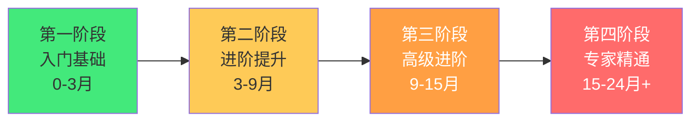
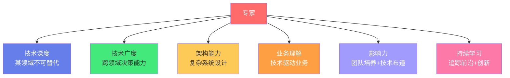
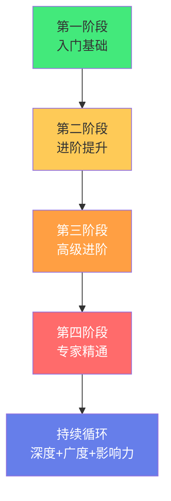

# 🎯 第四阶段：专家精通学习指南

> **阶段定位**：15-24 个月，从「能设计」到「能创新」。此阶段没有固定的学习路径，更多是**深度钻研 + 技术影响力 + 持续创新**。
>
> **核心理念**：专家不是「什么都懂」，而是在某个领域有**不可替代的深度**，同时有足够的**广度**做出正确的技术决策。
>
> **适用人群**：已完成前三阶段学习、具备独立设计和交付中大型系统能力、希望向架构师/技术专家/技术负责人方向发展的工程师。
>
> **前置知识**：[[第三阶段-高级架构学习指南]] · [[第二阶段-进阶提升学习指南]] · [[第一阶段-入门基础学习指南]]

---

## 一、阶段总览

### 1.1 四阶段成长曲线



| 阶段 | 核心目标 | 能力关键词 | 产出标准 |
|------|---------|-----------|---------|
| 第一阶段 | 能写代码 | 语法/基础工具/简单项目 | 独立完成小功能 |
| 第二阶段 | 能做项目 | 框架/数据库/协作/部署 | 独立完成完整项目 |
| 第三阶段 | 能做设计 | 架构/性能/高可用/AI应用 | 设计中大型系统 |
| **第四阶段** | **能创新** | **技术深度/影响力/架构决策/团队培养** | **定义技术方向，解决未知问题** |

### 1.2 专家的核心特征



**专家 vs 高级工程师的本质区别**：

| 维度 | 高级工程师 | 专家/架构师 |
|------|-----------|------------|
| **解决问题** | 已知问题的最优解 | 定义和解决未知问题 |
| **技术决策** | 在给定方案内实现 | 选择/定义技术方向 |
| **影响力** | 影响自己和小团队 | 影响团队/部门/行业 |
| **学习方式** | 学即用的技术 | 研究底层原理+预判趋势 |
| **价值衡量** | 交付功能 | 创造技术资产+培养人才 |
| **时间分配** | 80% 编码 | 40% 编码 + 30% 设计 + 30% 影响力 |

---

## 二、专家能力模型

### 2.1 六大核心能力

#### 能力一：技术深度（T 型的竖）

在**至少一个领域**达到「能读源码、能改框架、能解决疑难杂症」的深度：

| 深度方向 | 精通标准 |
|---------|---------|
| **JVM/Java 底层** | 能调优 JVM、排查 OOM、理解 GC 算法、阅读 Spring 源码 |
| **前端引擎** | 理解 V8 引擎、浏览器渲染原理、能优化框架性能 |
| **数据库内核** | 理解 InnoDB 实现、能优化慢 SQL、懂锁和 MVCC |
| **分布式系统** | 理解 CAP/BASE、Raft/Paxos、能设计一致性方案 |
| **AI/大模型** | 理解 Transformer 架构、能微调模型、设计 RAG/Agent 系统 |
| **云原生** | 理解 Kubernetes 源码、能设计 Operator、排查网络问题 |

**深度学习方法**：
1. **读源码**：选择一个核心框架（Spring/Vue/React/K8s），通读核心模块源码
2. **写原理文章**：把理解输出为深度技术文章，倒逼自己搞透
3. **造轮子**：自己实现一个简化版（如手写一个简易 Spring IoC、简易 React）
4. **排查疑难问题**：主动接复杂的线上问题，在解决中深化理解

#### 能力二：技术广度（T 型的横）

在多个领域有「能对话、能决策」的广度：

- **全栈广度**：前端/后端/数据库/运维/安全都有实践经验
- **AI 广度**：大模型/RAG/Agent/向量数据库/模型部署都有落地经验
- **跨语言**：至少精通 2 门语言，了解 3-4 门
- **非技术**：产品思维、项目管理、团队协作、商业理解

> 专家的广度不是「什么都学一点」，而是「能在不同技术领域之间建立连接，做出最优的技术选型」。

#### 能力三：架构设计能力

- 能设计**百万级并发**的系统架构
- 能在**一致性、可用性、分区容错**之间做权衡
- 能识别和规避**架构腐化**（大泥球、分布式单体）
- 能主导**架构演进**（单体→微服务→服务网格）
- 能做**技术选型决策**（有清晰的评估框架和决策记录）

详见 [[软件架构设计原则]] · [[分布式系统设计]] · [[高并发系统设计案例_backup_skeleton]]

#### 能力四：业务理解与技术驱动

- 能从**业务目标**推导技术方案（而非为技术而技术）
- 能识别**技术债务**并制定偿还计划（见 [[技术债务管理]]）
- 能用**技术创新**驱动业务增长（如 AI 降本增效）
- 能和产品/业务方**平等对话**，用技术语言翻译业务需求

#### 能力五：技术影响力

- **团队培养**：能培养中级工程师到高级，建立团队技术能力矩阵
- **技术布道**：内部分享、外部演讲、技术博客、开源贡献
- **标准制定**：制定团队编码规范、架构规范、流程规范
- **知识沉淀**：建立团队知识库、最佳实践库、案例库

#### 能力六：持续学习与创新

- 能**预判技术趋势**（如 AI Agent、边缘计算、WebAssembly）
- 能**快速学习新技术**并评估其价值（不盲目追新）
- 能**创新应用**（将 A 领域的技术应用到 B 领域）
- 有**个人技术品牌**（博客/开源项目/社区影响力）

---

## 三、全栈方向专家路径

### 3.1 架构设计深度

| 主题 | 学习内容 | 实践目标 |
|------|---------|---------|
| **架构模式** | 微服务/事件驱动/DDD/CQRS/六边形架构 | 为一个复杂业务设计 DDD 分层架构 |
| **分布式理论** | CAP/BASE/一致性算法/分布式事务/幂等 | 设计一个分布式订单系统 |
| **高可用设计** | 限流/熔断/降级/负载均衡/容灾备份 | 实现一个全链路高可用方案 |
| **高并发设计** | 缓存/异步/分库分表/读写分离/CDN | 设计支撑 10 万 QPS 的系统 |
| **可观测性** | 日志/指标/链路追踪/告警/SLO | 搭建完整的可观测性体系 |
| **架构演进** | 单体拆分/绞杀者模式/服务网格/平台工程 | 主导一次架构升级 |

### 3.2 性能优化深度

- **前端性能**：Core Web Vitals、渲染优化、包体积优化、首屏优化
- **后端性能**：JVM 调优、连接池、SQL 优化、缓存策略
- **数据库性能**：索引优化、分库分表、读写分离、慢查询治理
- **系统性能**：压测方法、性能瓶颈定位、全链路优化
- **性能建模**：排队论、容量规划、成本优化

### 3.3 工程效能深度

- **CI/CD 深度**：流水线设计、构建加速、灰度发布、蓝绿部署
- **DevOps 平台**：内部开发者平台（IDP）、GitOps、平台工程
- **代码质量**：静态分析、代码审查体系、技术债务量化
- **研发效能度量**：DORA 指标、流动效率、价值流映射

---

## 四、AI 工程方向专家路径

### 4.1 大模型应用架构

| 主题 | 学习内容 | 实践目标 |
|------|---------|---------|
| **RAG 深度** | 检索优化/重排序/混合检索/RAG 评估/多模态 RAG | 设计一个企业级 RAG 系统 |
| **Agent 框架** | ReAct/Plan-and-Execute/多 Agent/工具调用 | 搭建一个复杂任务 Agent |
| **Prompt 工程** | 高级 Prompt 模式/思维链/自一致性/Prompt 评估 | 建立团队 Prompt 规范和评估体系 |
| **模型微调** | LoRA/QLoRA/全参数微调/领域适配/数据准备 | 微调一个领域专用模型 |
| **模型部署** | vLLM/TensorRT-LLM/量化/推理优化/服务化 | 部署一个高吞吐推理服务 |
| **AI 安全** | Prompt 注入防护/数据隐私/输出审核/合规 | 设计 AI 应用安全方案 |

### 4.2 AI 工程化深度

- **AI 应用架构**：AI 原生应用设计模式、人机协作流程、AI 网关
- **向量数据库**：Milvus/Pinecone/Weaviate 原理与选型、索引优化
- **LLMOps**：模型版本管理、A/B 测试、监控告警、成本控制
- **AI 评估体系**：自动化评估、人工评估、业务指标对齐
- **多模态**：图文理解、语音交互、视频生成的工程化

### 4.3 AI + 全栈融合创新

这是双轨知识库的**核心差异化方向**：

| 融合方向 | 说明 | 创新点 |
|---------|------|--------|
| **AI 辅助开发** | AI 代码生成/审查/测试/文档 | 提升研发效能 30%+ |
| **智能应用** | 自然语言界面/智能推荐/自动化流程 | 重新定义产品交互 |
| **AI 原生架构** | 以 LLM 为核心的应用架构（非传统 CRUD+AI） | 全新的系统设计范式 |
| **数据智能** | AI 驱动的数据分析/可视化/决策支持 | 让数据产生业务价值 |
| **AI 平台工程** | 企业级 AI 平台/模型管理/应用编排 | 降低 AI 落地门槛 |

---

## 五、专家阶段学习方法

### 5.1 从「学」到「研」

| 初级学习 | 专家学习 |
|---------|---------|
| 看教程/视频 | 读论文/源码/标准文档 |
| 跟着做项目 | 造轮子/做研究/写原理 |
| 解决已知问题 | 定义和探索未知问题 |
| 学即用的技术 | 研究 2-3 年后的技术趋势 |
| 输入为主 | 输出为主（文章/分享/开源） |

### 5.2 源码阅读方法论

1. **先读文档**：理解设计理念和整体架构
2. **画架构图**：理清模块划分和调用关系
3. **从入口读**：从 main 函数/启动流程开始
4. **抓核心流程**：先读主流程，再读分支和异常
5. **调试跟踪**：打断点/加日志，观察实际执行
6. **输出笔记**：每读一个模块写一篇原理笔记
7. **动手修改**：改一个小功能或加一个特性

> 推荐源码阅读清单：Spring Framework、Vue 3、React、Kubernetes、Redis、MySQL（InnoDB）、LangChain

### 5.3 论文研读方法论

1. **选论文**：顶会论文（ICML/NeurIPS/SOSP/OSDI）、经典论文
2. **三遍读法**：
   - 第一遍：读标题/摘要/引言/结论，判断是否值得深读
   - 第二遍：读图表和核心论证，理解主要贡献
   - 第三遍：精读实现细节，尝试复现
3. **做笔记**：用自己的话总结核心思想、创新点、局限性
4. **联系实践**：思考这个研究如何应用到实际项目中

### 5.4 开源贡献路径

1. **使用**：深度使用一个开源项目，熟悉其功能和问题
2. **提 Issue**：报告 Bug、提出功能建议
3. **修小 Bug**：从 good first issue 开始
4. **贡献功能**：实现小的功能特性
5. **成为维护者**：持续贡献，获得 committer 权限

### 5.5 技术布道方法

- **内部**：技术分享会、代码审查、设计评审、导师制
- **外部**：技术博客、开源项目、社区演讲、技术书籍
- **原则**：输出倒逼输入，分享是最好的学习

---

## 六、专家阶段项目实战

### 6.1 必做项目

| 项目 | 目标 | 验收标准 |
|------|------|---------|
| **高并发系统设计** | 设计支撑 10 万 QPS 的系统 | 完整架构文档+压测报告+容灾方案 |
| **AI 平台搭建** | 企业级 AI 应用开发平台 | 支持模型管理/RAG/Agent/部署/监控 |
| **架构演进** | 主导一次单体到微服务的拆分 | 零停机迁移+性能提升+文档完整 |
| **技术债务治理** | 量化并偿还系统技术债务 | 债务比率下降 50%+，交付速度提升 |
| **开源项目** | 主导或核心贡献一个开源项目 | 100+ Star，有外部用户和贡献者 |

### 6.2 创新项目

- **AI 原生应用**：设计一个以 LLM 为核心的全新产品（非传统应用+AI 插件）
- **跨领域创新**：将 A 领域技术应用到 B 领域（如用游戏引擎做数据可视化）
- **效率工具**：打造一个提升团队效率的内部工具/平台
- **技术预研**：研究一个前沿技术（如 AI Agent、WebGPU、边缘 AI）并输出可行性报告

---

## 七、专家的衡量标准

### 7.1 技术影响力指标

| 维度 | 初级指标 | 专家指标 |
|------|---------|---------|
| **代码** | 提交代码 | 定义架构和规范，他人遵循 |
| **问题** | 解决分配的问题 | 主动发现和定义问题 |
| **团队** | 自己做好 | 培养他人做好 |
| **决策** | 执行决策 | 做出技术决策并承担责任 |
| **创新** | 应用新技术 | 创造新技术/新方案 |
| **影响** | 影响自己 | 影响团队/部门/行业 |

### 7.2 验收目标

完成第四阶段后，你应该能够：

- [ ] 在至少一个技术领域达到「源码级」深度
- [ ] 独立设计和交付百万级并发系统
- [ ] 设计并落地一个企业级 AI 应用
- [ ] 培养至少 2 名中级工程师到高级
- [ ] 有外部技术影响力（博客/开源/演讲）
- [ ] 能主导技术选型和架构决策
- [ ] 建立个人技术品牌和知识体系

---

## 八、专家常见陷阱

| 陷阱 | 表现 | 规避方法 |
|------|------|---------|
| **技术完美主义** | 过度设计，为技术而技术，忽视业务价值 | 始终从业务价值出发，用最简单方案解决问题 |
| **闭门造车** | 只钻研技术，不关注业务和团队 | 定期和产品/业务沟通，参与需求讨论 |
| **停止学习** | 觉得自己是专家了，不再追新技术 | 保持学习习惯，每年研究 1-2 个新领域 |
| **全而不精** | 什么都懂一点，但没有深度 | 选定 1-2 个方向深耕，建立不可替代性 |
| **忽视软技能** | 只会技术，不会沟通和领导 | 刻意练习表达、协作、领导力 |
| **单打独斗** | 什么都自己做，不授权不培养 | 学会 delegation，通过团队放大影响力 |
| **追新焦虑** | 什么新技术都想学，精力分散 | 建立技术雷达，有选择地深入 |

---

## 九、专家持续成长路径

### 9.1 技术雷达

建立个人/团队的**技术雷达**，定期评估技术：

```text
采纳（Adopt）：生产环境推荐使用
试验（Trial）：小范围验证，值得关注
评估（Assess）：值得研究，暂不投入
暂缓（Hold）：不推荐使用，逐步替换
```

每季度更新一次，避免盲目追新，也避免技术僵化。

### 9.2 知识体系维护

- **定期重构知识库**：每季度回顾和更新笔记，保持知识新鲜
- **输出深度文章**：每月至少 1 篇深度技术文章
- **参与技术社区**：参加 Meetup、Conference，保持和行业连接
- **跨领域学习**：每年学习一个非技术领域（如设计、商业、心理学）

### 9.3 从专家到技术领袖

专家之后的成长方向：

| 方向 | 说明 | 核心能力 |
|------|------|---------|
| **技术专家（IC）** | 深耕技术，成为领域权威 | 技术深度+创新能力 |
| **架构师** | 负责系统架构和技术决策 | 架构能力+业务理解+沟通 |
| **技术管理者** | 带团队，做技术规划 | 领导力+战略思维+人才培养 |
| **技术创业者** | 用技术创造产品和商业价值 | 产品+商业+技术+领导力 |
| **技术布道师** | 传播技术，影响行业 | 表达能力+技术广度+个人品牌 |

---

## 十、学习资源推荐

### 10.1 经典书籍

| 领域 | 书籍 |
|------|------|
| **架构** | 《设计数据密集型应用》《企业应用架构模式》《领域驱动设计》 |
| **分布式** | 《分布式系统概念与设计》《数据库系统概念》 |
| **性能** | 《性能之巅》《Java 性能优化权威指南》 |
| **AI** | 《深度学习》（花书）《Transformer 原理与实践》 |
| **工程** | 《代码大全》《重构》《程序员修炼之道》 |
| **管理** | 《人月神话》《人件》《精益创业》 |

### 10.2 论文与社区

- **论文**：arXiv、Google Scholar、Papers with Code
- **社区**：GitHub Trending、Hacker News、InfoQ、掘金、知乎技术专栏
- **播客**：技术播客（如《津津乐道》《代码时间》）
- **课程**：MIT 6.824（分布式）、Stanford CS224N（NLP）、CMU 15-445（数据库）

---

## 十一、与前三阶段的衔接



- **第一阶段**打基础：语法、工具、简单项目
- **第二阶段**提能力：框架、数据库、协作、部署
- **第三阶段**学设计：架构、性能、高可用、AI 应用
- **第四阶段**求创新：技术深度、影响力、架构决策、团队培养

> 第四阶段不是终点，而是「持续成长」的起点——专家之路没有终点，只有不断深化和拓展。

---

## 十二、关联笔记

### 学习路线
- [[第一阶段-入门基础学习指南]] · [[第二阶段-进阶提升学习指南]] · [[第三阶段-高级架构学习指南]]
- [[学习路线总览]] · [[全栈+AI双轨融合路线图]]

### 技术深度
- [[软件架构设计原则]] · [[分布式系统设计]] · [[高并发系统设计案例_backup_skeleton]]
- [[JVM调优与性能分析]] · [[MySQL基础与SQL实战]] · [[Redis缓存设计]]
- [[大模型应用架构]] · [[RAG检索增强生成]] · [[AI-Agent设计与实现]]

### 工程与管理
- [[技术债务管理]] · [[代码审查与质量保障]] · [[CI-CD流水线设计]]
- [[团队协作与沟通]] · [[项目管理方法论]]

### 导航
- [[MOC-综合导航]] · [[MOC-学习路线]] · [[Home]]

> 🔍 **知识点深度解析**
>
> **作用**：第四阶段专家精通学习指南解决的是「从中高级工程师到专家/架构师，应该学什么、怎么学、如何衡量成长」的方向性问题——前三阶段有明确的知识清单和技能树，但专家阶段没有固定路径，需要从「跟随学习」转向「自主钻研」，从「实现功能」转向「定义方向」，从「个人贡献」转向「团队影响力」。本文档提供专家阶段的能力模型、学习方法、实战项目和衡量标准，帮助学习者找到自己的专家之路。
>
> **底层原理**：①专家成长的核心是「T 型人才」模型——在一个领域有不可替代的深度（竖），同时有足够的广度做跨领域决策（横）。深度建立「不可替代性」，广度建立「决策正确性」。只有深度没有广度容易「钻牛角尖」，只有广度没有深度就是「万金油」。②从「学」到「研」的转变是专家阶段的核心方法论——初级学习者看教程、跟着做、解决已知问题；专家读论文/源码、造轮子、定义未知问题。这种转变的本质是从「消费者」到「生产者」：不再只是吸收他人创造的知识，而是自己创造新知识、新方案、新工具。③技术影响力是专家价值的放大器——一个人的编码能力是线性的（1 天写 1000 行代码），但通过培养团队、制定规范、技术布道，影响力是指数级的（10 个人遵循你的规范，效率提升 20% = 2 个人的产出）。专家的核心价值不是「自己写更多代码」，而是「让团队写更好的代码」。④业务理解是技术专家的「天花板」——很多技术专家卡在「只会技术不懂业务」，导致技术方案和业务需求脱节。真正的专家能用技术语言翻译业务需求，能用技术创新驱动业务增长，能在技术决策中考虑业务成本和收益。技术深度决定你的下限，业务理解决定你的上限。⑤持续学习是专家阶段的「生存法则」——技术领域变化极快（AI 领域更是月级变化），停止学习意味着开始落后。但专家的学习不是「什么都学」，而是「有选择地深入」——通过技术雷达评估技术价值，把有限的精力投入到最有潜力的方向。⑥从专家到技术领袖是「能力维度的扩展」——技术专家（IC）深耕技术，架构师负责系统设计，技术管理者带团队做规划，技术创业者用技术创造商业价值。这些方向没有高低之分，只有适合与否，关键是找到自己的热情和优势所在。
>
> **用法要点**：① 专家定位：15-24月，从能设计到能创新，无固定路径，核心是深度钻研+影响力+持续创新 ② 六大能力：技术深度(T型竖/源码级)/技术广度(T型横/跨领域决策)/架构设计(高并发高可用)/业务理解(技术驱动业务)/技术影响力(团队培养+布道)/持续学习(预判趋势) ③ 全栈专家路径：架构设计(微服务/DDD/分布式)/性能优化(前后端+数据库+系统)/工程效能(CI-CD/DevOps/质量) ④ AI专家路径：大模型应用(RAG/Agent/Prompt/微调/部署)/AI工程化(LLMOps/向量库/评估)/AI+全栈融合创新(AI原生架构/智能应用) ⑤ 学习方法：从学到研，源码阅读(文档→架构图→入口→核心流程→调试→输出→修改)，论文三遍读法，开源贡献(使用→Issue→修Bug→功能→维护者)，技术布道(输出倒逼输入) ⑥ 实战项目：高并发系统/AI平台/架构演进/技术债务治理/开源项目，创新项目(AI原生应用/跨领域创新) ⑦ 衡量标准：技术影响力(代码→规范/问题→定义/团队→培养/决策→做出/创新→创造)，验收目标(源码级深度/百万并发/企业AI/培养2人/外部影响力) ⑧ 常见陷阱：技术完美主义/闭门造车/停止学习/全而不精/忽视软技能/单打独斗/追新焦虑 ⑨ 持续成长：技术雷达(采纳/试验/评估/暂缓)，知识体系维护，从专家到技术领袖(IC/架构师/管理者/创业者/布道师) ⑩ 核心：专家不是什么都懂，而是某领域不可替代+跨领域决策正确。

> 💡 **深度讲解**：第四阶段专家精通最核心的智慧是「从『跟随者』到『定义者』的身份转变——前三阶段你在学习他人创造的知识，第四阶段你要开始创造知识、定义方向、影响他人」——很多人学技术到了中高级水平就遇到了「天花板」：技术栈都会了，项目也能做，但不知道下一步该学什么、怎么成长。这是因为他们还在用「初级思维」做「专家阶段」的事——还在找教程、还在学即用的技术、还在等别人分配任务。专家阶段的核心是「自主驱动」：你需要自己找到值得深入的方向，自己定义学习路径，自己创造价值。这种转变是痛苦的，因为没有了「标准答案」和「明确的教材」，但也是自由的，因为你开始真正掌控自己的技术成长。专家阶段的另一个深层智慧是「影响力 > 个人能力」——一个人再强，一天也只有 24 小时；但通过培养团队、制定规范、技术布道，你的影响力可以放大 10 倍、100 倍。很多技术人不愿意做这些「非编码」的事，觉得「写代码才是正经工作」，但这正是「高级工程师」和「专家/架构师」的分水岭。专家的价值不在于「自己写了多少代码」，而在于「通过你的影响，团队的整体能力提升了多少」。在 AI 时代，专家的定义也在变化——AI 可以写代码、可以查资料、甚至可以做基础的架构设计，但 AI 不能做的是「定义问题」「做出技术决策」「培养团队」「创造新技术」。这些恰恰是专家的核心价值。未来的专家不是「比 AI 更会写代码的人」，而是「能驾驭 AI、定义方向、创造价值的人」。理解了这一点，你就理解了第四阶段的真正意义——不是学更多技术，而是成为「技术的主人」而非「技术的工人」。

> 📝 **精简总结**：第四阶段专家精通=15-24月，从能设计到能创新，无固定路径，核心是深度钻研+技术影响力+持续创新。六大能力：技术深度(T型竖/源码级)/技术广度(T型横)/架构设计(高并发高可用)/业务理解(技术驱动业务)/技术影响力(团队培养+布道)/持续学习(预判趋势)。全栈路径：架构设计/性能优化/工程效能。AI路径：大模型应用(RAG/Agent/微调/部署)/AI工程化/AI+全栈融合创新。学习方法：从学到研，源码阅读，论文三遍读法，开源贡献，技术布道。实战：高并发系统/AI平台/架构演进/技术债务治理/开源项目。衡量：技术影响力(代码→规范/问题→定义/团队→培养)。陷阱：技术完美主义/闭门造车/停止学习/全而不精/忽视软技能。持续成长：技术雷达，从专家到技术领袖(IC/架构师/管理者/创业者)。核心：专家不是什么都懂，而是某领域不可替代+跨领域决策正确，从跟随者到定义者。

> **学习路径建议**：确认已完成 [[第三阶段-高级架构学习指南]] → 选择 1-2 个深度方向（如分布式系统或 AI 工程）→ 开始源码阅读（选一个核心框架通读）→ 实践：主导一个中大型系统的架构设计 → 开始技术输出（写深度博客/做内部分享）→ 学习 [[软件架构设计原则]] 和 [[分布式系统设计]] 深化架构能力 → 学习 AI 工程高级主题（RAG 优化/Agent 框架/模型微调）→ 实践：设计并落地一个企业级 AI 应用 → 开始培养团队（带新人/做 Code Review）→ 参与开源项目 → 建立个人技术品牌 → 持续循环：深度+广度+影响力。

---

> **第四阶段专家精通的本质是「从『技术的使用者』升级为『技术的定义者』——不再满足于学会他人创造的知识，而是开始创造知识、定义方向、影响行业」——技术学习的前三个阶段是「收敛」的：有明确的教材、清晰的技能树、可量化的验收标准。你知道学完 Spring 就能做后端，学完 Vue 就能做前端，学完 RAG 就能做 AI 应用。但第四阶段是「发散」的：没有固定教材，没有标准答案，没有人告诉你该学什么。这种「无指引」的状态让很多人感到迷茫——「我都会了，然后呢？」答案是：**然后你开始创造**。你开始读源码而不是教程，开始写文章而不是只做笔记，开始设计架构而不是实现功能，开始培养他人而不是只做好自己，开始定义技术方向而不是跟随潮流。这就是「专家」和「高级工程师」的本质区别：高级工程师是「优秀的执行者」，专家是「方向的定义者」。在 AI 快速发展的今天，专家的定义也在进化——AI 可以写代码、可以查文档、可以做基础设计，但 AI 不能「定义问题」「做出价值判断」「培养团队」「创造新技术」。这些恰恰是专家的不可替代性。未来的技术专家，不是「比 AI 更会写代码的人」，而是「能提出好问题、做出好决策、创造好价值的人」。第四阶段没有终点，因为技术在不断进化，专家之路就是「终身学习+持续创造」之路。当你不再问「我该学什么」，而是开始问「我该创造什么」时，你就真正进入了专家阶段。愿你在这条路上，既有深度的技术造诣，也有宽广的技术视野，更有影响他人的技术温度——技术的终极价值，不是写出多牛的代码，而是通过技术让世界变得更好一点。**
