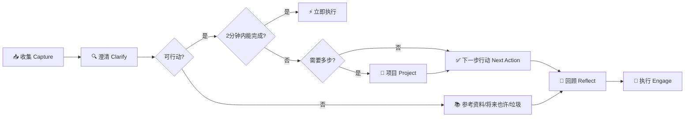
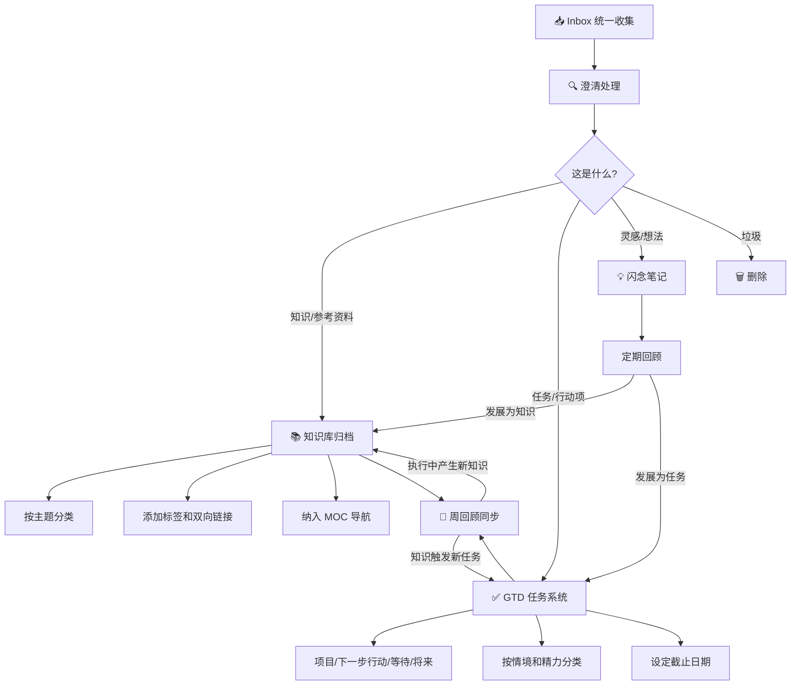
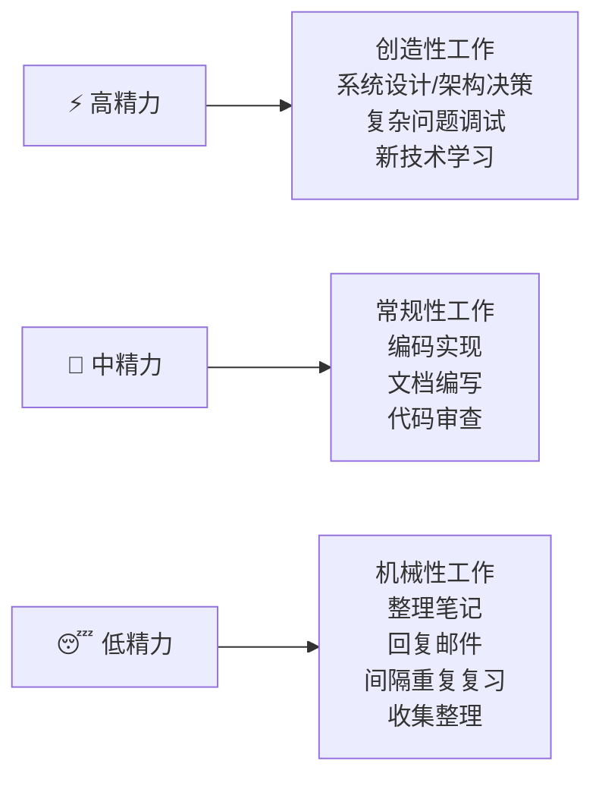

# ⏰ GTD 时间管理与知识管理结合

> **文档说明**：系统讲解 GTD（Getting Things Done）时间管理方法论与知识管理体系的深度结合，涵盖 GTD 五步流程、知识与任务的分流机制、Obsidian 工具链实现、每日/每周工作流、PARA 与 GTD 的融合、精力管理策略和常见问题排查。帮助学习者建立从信息收集到任务执行再到知识沉淀的完整闭环。
>
> **适用人群**：知识工作者、全栈/AI 工程师、需要同时管理大量学习任务和技术笔记的学习者、Obsidian 深度用户
>
> **前置知识**：[[PARA-项目领域资源归档]] · [[间隔重复与记忆巩固]] · [[费曼学习法笔记实践]]

---

## 一、概述

### 1.1 什么是 GTD

GTD（Getting Things Done）是由 David Allen 提出的任务管理方法论，核心思想是**将所有待办事项从大脑中清空，放入一个可信赖的外部系统**，让大脑专注于执行而非记忆。GTD 的五步流程为：收集（Capture）→ 澄清（Clarify）→ 组织（Organize）→ 回顾（Reflect）→ 执行（Engage）。

### 1.2 GTD 与知识管理结合的核心价值

传统 GTD 只管理任务，传统知识管理只管理资料。两者结合后形成**信息→知识→任务→成果**的完整闭环：

| 维度 | 单独 GTD | 单独知识管理 | GTD + 知识管理 |
|------|---------|------------|--------------|
| 信息收集 | 只收任务 | 只收资料 | 统一 Inbox，自动分流 |
| 处理方式 | 2分钟规则/项目/等待 | 归档/标签/链接 | 知识归档 + 任务执行双轨 |
| 回顾机制 | 周回顾任务 | 定期重构笔记 | 任务+知识同步回顾 |
| 执行效率 | 高（专注行动） | 低（容易只收藏不行动） | 知识驱动行动，行动沉淀知识 |
| 长期价值 | 任务完成即结束 | 知识积累但不落地 | 可复用的知识资产 + 可追踪的成果 |

### 1.3 核心应用场景

- **技术学习**：收集到的技术文章/教程 → 判断是知识（归档到知识库）还是任务（安排学习计划）→ 学习后产出笔记和项目
- **项目管理**：项目相关的需求文档/技术方案 → 知识归档（参考资料）+ 任务拆解（下一步行动）→ 执行中持续更新知识库
- **日常工作**：会议纪要/邮件/聊天记录 → 提取知识（决策记录/技术方案）+ 提取任务（待办事项）→ 周回顾同步
- **个人成长**：读书/课程/灵感 → 知识沉淀（读书笔记/概念卡片）+ 行动转化（实践项目/习惯养成）→ 定期复盘

### 1.4 核心优势

| 优势 | 说明 |
|------|------|
| **大脑减负** | 所有信息进入外部系统，大脑专注于思考和执行 |
| **信息不丢失** | 统一 Inbox 收集，知识和任务都有归宿 |
| **行动导向** | 知识不只是收藏，而是转化为可执行的任务 |
| **知识沉淀** | 任务执行过程中产生的经验自动沉淀为知识 |
| **闭环可追踪** | 从信息输入到成果输出，全流程可回顾和优化 |
| **工具统一** | Obsidian 同时承载知识库和任务系统，无需切换工具 |

---

## 二、底层原理

### 2.1 GTD 五步流程详解



**第一步：收集（Capture）**
- 将所有想法、任务、资料、灵感全部放入统一的 Inbox
- 原则：大脑是用来思考的，不是用来记忆的
- 工具：Obsidian Inbox 文件夹、手机备忘录、语音速记

**第二步：澄清（Clarify）**
- 逐条处理 Inbox 中的每一项，问自己三个问题：
  1. 这是什么？（明确含义）
  2. 可行动吗？（需要采取行动吗）
  3. 如果可行动，下一步具体做什么？（明确到可执行的动作）

**第三步：组织（Organize）**
- 不可行动的 → 参考资料（归档到知识库）/ 将来也许（Someday/Maybe）/ 垃圾（删除）
- 可行动且 2 分钟内完成 → 立即执行
- 可行动且需要多步 → 归入项目（Project），并拆解出下一步行动
- 可行动且单步 → 归入下一步行动（Next Action），按情境/精力分类
- 等待他人 → 归入等待（Waiting For）

**第四步：回顾（Reflect）**
- 每日回顾：查看今日任务和日历
- 每周回顾：清空 Inbox、更新项目状态、检查等待事项、规划下周
- 每月回顾：评估目标进度、调整优先级、更新知识库

**第五步：执行（Engage）**
- 根据情境（地点/工具）、精力（高/中/低）、优先级选择任务
- 原则：在正确的时间做正确的事，而不是按列表顺序机械执行

### 2.2 知识与任务的分流机制

GTD 与知识管理结合的核心是**在澄清阶段进行知识/任务分流**：



**分流判断标准**：

| 信息类型 | 判断标准 | 去向 | 示例 |
|---------|---------|------|------|
| **知识** | 不需要立即行动，未来可能参考 | 知识库归档 | 技术文档、概念解释、最佳实践 |
| **任务** | 需要采取具体行动，有明确下一步 | GTD 任务系统 | "学习 React Hooks"、"修复 Bug #123" |
| **灵感** | 模糊的想法，尚未明确 | 闪念笔记 | "可以做一个 AI 代码审查工具" |
| **项目** | 需要多步完成的目标 | 项目 + 拆解下一步 | "构建个人博客系统" |
| **等待** | 依赖他人，暂时无法行动 | 等待列表 | "等待后端提供 API 文档" |
| **将来** | 有兴趣但暂时不做 | Someday/Maybe | "学习 Rust 语言" |

### 2.3 闭环反馈机制

GTD 与知识管理结合后形成**双向反馈闭环**：

1. **知识 → 任务**：学习新知识后，转化为实践任务（如学了 Docker → 任务：用 Docker 部署项目）
2. **任务 → 知识**：执行任务过程中，遇到的问题和解决方案沉淀为知识（如部署中遇到端口冲突 → 笔记：Docker 端口映射常见问题）
3. **回顾 → 优化**：周回顾时同步检查任务完成情况和知识库更新，发现知识缺口并补充学习任务

---

## 三、实操示例

### 3.1 每日工作流

```markdown
## 📅 每日流程（建议 30 分钟）

### 早晨（5分钟）- 日计划
1. 查看今日日历和任务列表
2. 根据精力状态选择今日重点任务（不超过3个）
3. 快速浏览 Inbox，处理 2 分钟内能完成的事项

### 工作中（随时）- 收集与执行
1. 新想法/任务/资料 → 立即放入 Inbox（不中断当前工作）
2. 按情境和精力执行任务
3. 执行中产生的新知识 → 随手记录到对应笔记

### 晚上（10分钟）- 日复盘
1. 清空今日 Inbox（快速分流）
2. 标记完成的任务，未完成的移到明天
3. 记录今日学到的新知识（1-3条）
4. 更新相关笔记的状态
```

### 3.2 Obsidian + Tasks 插件实现

**任务标记语法**：

```markdown
## ✅ 任务列表示例

### 🔥 今日重点
- [ ] 完成 RAG 系统设计文档 📅 2026-08-30 #项目/AI平台 ⏫
- [x] 学习 LangChain 基础概念 ✅ 2026-08-26 #学习/AI

### 📁 项目：AI 知识库平台
- [ ] 设计向量数据库选型方案 📅 2026-09-01 #项目/AI平台
- [ ] 实现文档解析模块 #项目/AI平台
- [ ] 等待：后端提供 API 文档 ⏳ 2026-08-28 #等待

### 📚 学习任务
- [ ] 阅读《设计数据密集型应用》第3章 #将来/阅读 📅 2026-09-15
- [ ] 完成 Kubernetes 认证课程 #学习/云原生

### 💡 闪念
- [ ] 可以做一个 AI 代码审查工具 #闪念
- [ ] 研究一下 MCP 协议的实际应用 #闪念
```

**Dataview 任务看板查询**：

```markdown
## 📊 今日任务看板（Dataview）

\`\`\`dataview
TASK
FROM ""
WHERE !completed AND due <= date(today)
SORT priority DESC
GROUP BY file.link
\`\`\`

## 📁 进行中的项目

\`\`\`dataview
TABLE length(filter(file.tasks, (t) => !t.completed)) AS "待办数"
FROM #项目
WHERE contains(file.tasks, "")
SORT file.mtime DESC
\`\`\`
```

### 3.3 每周回顾模板

```markdown
# 📋 周回顾 - 2026-W35（8.25-8.31）

## 一、本周完成
- [x] 完成 RAG 系统设计文档
- [x] 学习 LangChain 基础概念
- [x] 重写 7 篇知识库薄文档（第29批）

## 二、任务状态更新
| 项目 | 状态 | 进度 | 下周计划 |
|------|------|------|---------|
| AI 知识库平台 | 进行中 | 40% | 完成向量数据库选型 |
| K8s 学习 | 进行中 | 60% | 完成认证课程 |
| 知识库维护 | 持续 | - | 第30批重写 |

## 三、知识库更新
- 新增文档：3篇
- 重写文档：7篇（第29批）
- 清理死链：15个
- 本周学到的新知识：
  1. GTD 与知识管理的分流机制
  2. Obsidian Dataview 任务查询语法
  3. 间隔重复的 SM-2 算法原理

## 四、Inbox 清空
- [ ] 所有 Inbox 条目已分流
- [ ] 闪念笔记已回顾（发展为知识/任务/删除）
- [ ] 等待事项已检查

## 五、下周计划
### 重点任务（不超过3个）
1. [ ] 完成向量数据库选型方案
2. [ ] 第30批薄文档重写（7篇）
3. [ ] 学习 Elasticsearch 向量检索

### 知识补充
- [ ] 补充 AI 安全与对齐笔记
- [ ] 更新学习路线图

## 六、反思与调整
- 本周效率如何？有什么可以改进的？
- 任务优先级是否合理？
- 知识库是否有需要调整的地方？
```

### 3.4 知识与任务联动示例

**场景：学习新技术时的 GTD + 知识管理流程**

```markdown
## 步骤1：收集
Inbox 中放入一篇文章：《RAG 检索增强生成实战教程》

## 步骤2：澄清
- 这是什么？→ RAG 技术教程
- 可行动吗？→ 是，需要学习并实践
- 下一步具体做什么？→ 阅读文章并搭建 RAG Demo

## 步骤3：组织（分流）
### 知识侧（归档到知识库）
- 创建笔记：[[RAG检索增强生成]]
- 归档到：09-AI与效率工具/05-RAG与向量库/
- 添加标签：#RAG #检索增强 #LLM应用
- 关联笔记：[[向量数据库选型]]、[[Embedding模型]]、[[LangChain基础]]

### 任务侧（进入GTD系统）
- 项目：[[RAG系统实战项目]]
  - 下一步行动：阅读 RAG 教程文章 📅 2026-08-28
  - 下一步行动：搭建 RAG Demo（用 LangChain + Chroma）📅 2026-08-30
  - 下一步行动：写 RAG 实战笔记 📅 2026-09-01

## 步骤4：执行
- 阅读文章时，将关键概念补充到 [[RAG检索增强生成]] 笔记
- 搭建 Demo 时，将遇到的问题和解决方案记录到笔记
- 完成后，更新项目状态和笔记内容

## 步骤5：回顾（周回顾）
- 检查 RAG 项目进度
- 回顾 [[RAG检索增强生成]] 笔记，补充遗漏的知识点
- 如果 Demo 成功，将经验沉淀为 [[RAG实战踩坑记录]]
- 如果遇到困难，转化为新的学习任务
```

---

## 四、常见问题与排查

| 问题现象 | 可能原因 | 解决方案 |
|---------|---------|---------|
| **Inbox 严重堆积** | 收集太频繁但不处理；澄清耗时太长 | 每日固定 10 分钟清空 Inbox；严格执行 2 分钟规则；批量处理同类事项 |
| **知识和任务混淆** | 分流标准不清晰；习惯性把所有东西都归档 | 明确区分：知识=参考资料（不需要行动），任务=行动项（需要做某事）；在澄清阶段强制问"需要我做什么吗？" |
| **周回顾经常中断** | 回顾时间不固定；回顾流程太复杂；看不到回顾的价值 | 固定每周日同一时间，建立仪式感；使用模板简化流程；回顾后立即规划下周，形成正反馈 |
| **任务太多做不完** | 优先级不清晰；高估了自己的时间；不会拒绝 | 每日重点任务不超过 3 个；按精力和情境选择任务；学会说"不"，将不重要的任务移到 Someday/Maybe |
| **知识只收藏不消化** | 归档后就不管了；没有转化为行动 | 归档时强制问"这个知识能用来做什么？"；将知识转化为实践任务；用间隔重复定期复习 |
| **项目拆解不彻底** | 项目太大无法下手；下一步行动不够具体 | 每个项目必须有至少一个"下一步行动"；下一步行动必须具体到可直接执行（动词开头）；如果卡住，问"我现在能做的最小一步是什么？" |
| **等待事项被遗忘** | 没有专门的等待列表；没有定期检查 | 建立 Waiting For 列表，记录等待对象和日期；周回顾时必须检查所有等待事项；超过预期时间主动跟进 |
| **工具切换成本高** | 任务用一个工具，知识用另一个工具 | 统一到 Obsidian，用 Tasks 插件管理任务，用文件夹和标签管理知识；Dataview 实现任务看板和知识统计 |
| **精力不足时效率低** | 按任务列表顺序机械执行，不考虑精力状态 | 高精力时做创造性/复杂任务（设计、学习）；中精力时做常规任务（编码、写文档）；低精力时做简单任务（整理、复习、收集） |
| **回顾变成形式主义** | 只是打勾，不反思和调整 | 每次回顾必须回答三个问题：什么做得好？什么需要改进？下周有什么调整？；根据回顾结果实际调整任务和知识库 |
| **闪念笔记泛滥** | 什么都记，不筛选；定期不回顾 | 闪念笔记只记原始想法，不展开；每周回顾时处理：发展为知识/任务/删除；超过 1 个月未处理的自动删除 |
| **知识库和任务系统脱节** | 知识归档后不关联任务；任务执行中不更新知识 | 每个项目笔记关联相关知识笔记；执行任务时随手更新知识库；周回顾时同步检查两者 |

---

## 五、进阶与最佳实践

### 5.1 PARA 与 GTD 的深度融合

PARA（Projects/Areas/Resources/Archives）是知识管理的分类方法，GTD 是任务管理方法，两者天然互补：

| PARA 类别 | GTD 对应 | 说明 | 示例 |
|-----------|---------|------|------|
| **Projects 项目** | GTD 项目 | 有明确目标和截止日期，需要多步完成 | "构建 AI 知识库平台"、"通过 K8s 认证" |
| **Areas 领域** | GTD 职责 | 长期持续维护的领域，没有终点 | "健康"、"职业发展"、"知识库维护" |
| **Resources 资源** | GTD 参考资料 | 主题相关的知识和资料 | "Python 异步编程"、"RAG 技术"、"Docker" |
| **Archives 归档** | GTD 归档 | 已完成的项目和不再活跃的资料 | "2025 年项目"、"已淘汰的技术" |

**融合原则**：
- 项目（Projects）同时存在于任务系统和知识库：任务侧跟踪进度，知识侧沉淀资料
- 领域（Areas）对应长期职责：每个领域有对应的知识板块和持续任务
- 资源（Resources）是纯知识：不需要行动，但需要可检索和可关联
- 归档（Archives）定期清理：项目完成后归档，过时知识移入归档

### 5.2 精力管理策略

GTD 管理的是"做什么"，精力管理决定的是"什么时候做、能做多好"：



**实操建议**：
- 记录自己的精力曲线（大多数人上午高精力，下午中精力，傍晚低精力）
- 将最重要的任务安排在高精力时段
- 低精力时段做知识整理和复习，既不浪费时间又能维护知识库
- 精力不足时不要强迫做复杂任务，效率低且容易出错

### 5.3 工具链最佳实践

| 工具 | 用途 | 配置建议 |
|------|------|---------|
| **Obsidian** | 知识库 + 任务系统统一载体 | 开启 Tasks、Dataview、Calendar、Templater 插件 |
| **Tasks 插件** | GTD 任务管理 | 配置任务状态（待办/进行中/已完成/已取消）；设置优先级标签 |
| **Dataview** | 任务看板 + 知识统计 | 创建今日任务、进行中项目、等待事项、本周完成等看板 |
| **Calendar** | 日历视图 + 每日笔记 | 点击日期创建每日笔记；在日历上显示任务截止日期 |
| **Templater** | 模板自动化 | 周回顾模板、每日笔记模板、项目笔记模板一键插入 |
| **Periodic Notes** | 周期笔记管理 | 统一管理每日/每周/每月/每年笔记 |
| **手机端** | 随时随地收集 | Obsidian 手机端 + 语音速记，快速捕获闪念 |

### 5.4 生产环境（长期使用）最佳实践

1. **Inbox 零容忍**：Inbox 只做临时收集，每晚必须清空，不允许过夜堆积
2. **2 分钟规则**：澄清时如果 2 分钟内能完成，立即执行，不要放入任务系统
3. **下一步行动必须具体**：每个任务必须是动词开头的具体动作（"写 RAG 设计文档"而不是"RAG 项目"）
4. **每周回顾不可跳过**：这是 GTD 的核心，跳过回顾 = 系统失效
5. **知识与任务双向链接**：项目笔记链接相关知识，知识笔记标注关联的实践项目
6. **定期归档**：每月归档已完成项目和过时资料，保持系统清爽
7. **少即是多**：不要同时进行超过 5 个活跃项目；任务列表保持精简
8. **持续优化**：每月回顾 GTD 系统本身的效率，调整流程和工具配置

### 5.5 与知识库维护的结合

GTD 方法论可以直接应用于知识库维护本身：

- **项目**："知识库质量深化"（当前活跃项目，包含薄文档重写批次）
- **下一步行动**："重写第30批第1篇 GTD 时间管理笔记"
- **等待**：无（自主项目）
- **周回顾**：检查本周重写进度，规划下周批次
- **知识沉淀**：每批重写后更新《知识库维护报告与健康度》

---

## 六、关联笔记

### 知识管理方法论
- [[PARA-项目领域资源归档]] · [[间隔重复与记忆巩固]] · [[费曼学习法笔记实践]]
- [[从输入到输出的知识转化]] · [[闪念笔记捕获工作流]] · [[定期回顾与笔记重构]]

### 知识库维护
- [[知识库维护报告与健康度]] · [[知识库持续优化机制]] · [[知识库健康度评估指标]]
- [[质量校验规则]]

### 模板与规范
- [[知识库文档统一编写标准v2]] · [[标签命名规范]]

### 导航
- [[MOC-知识管理方法论-四级展开]] · [[MOC-综合导航]] · [[Home]]

> 💡 **深度讲解**：GTD 与知识管理结合的本质是建立一个**自驱动的学习闭环**。传统学习是"输入→遗忘"，GTD+知识管理是"输入→分流→行动→沉淀→回顾→再输入"。关键在于：① 不要让信息停留在 Inbox，必须分流；② 不要让知识停留在归档，必须转化为行动；③ 不要让行动停留在完成，必须沉淀为知识。这个闭环运转起来后，知识库会自然生长，学习效率会持续提升。

> 📝 **精简总结**：GTD 五步（收集→澄清→组织→回顾→执行）+ 知识管理（归档→标签→链接→复习）= 信息闭环。核心是在澄清阶段做知识/任务分流，在周回顾阶段做双向同步。用 Obsidian + Tasks + Dataview 实现统一工具链，按精力分配任务，让知识库成为行动的燃料，让行动成为知识库的养分。

> **学习路径建议**：先阅读 [[PARA-项目领域资源归档]] 建立知识分类体系 → 学习本文档 GTD 与知识管理结合方法 → 参考 [[间隔重复与记忆巩固]] 设计复习机制 → 用 [[费曼学习法笔记实践]] 深化理解 → 按照 [[知识库维护报告与健康度]] 中的定期维护流程实践 → 从每日 10 分钟开始，逐步建立完整的 GTD+知识管理工作流。

---

> **GTD 不是让你做更多的事，而是让你在正确的时间做正确的事，并且知道什么可以不做。与知识管理结合后，每一次行动都在积累知识资产，每一份知识都在驱动下一步行动。**
