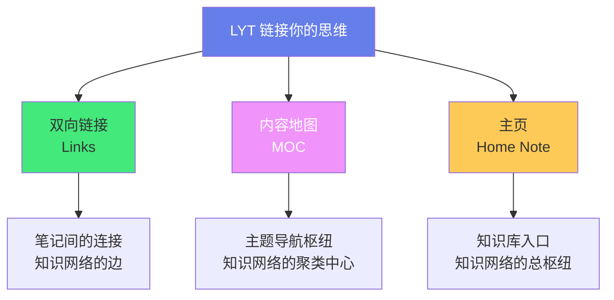
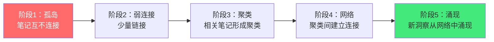
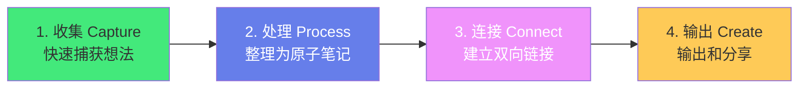
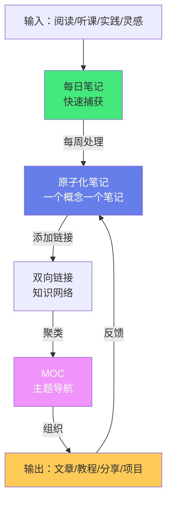

# 🔗 LYT 链接你的思维

> **文档说明**：系统讲解 LYT（Linking Your Thinking）知识管理方法论的完整体系，涵盖 LYT 核心思想（从文件夹到链接、从存储到网络）、LYT 与传统笔记的区别、MOC（Map of Content）设计原则与实践、笔记的四种链接类型、知识网络的构建与维护、LYT 工作流（收集→处理→连接→输出）、从线性笔记到网状思维的转变、LYT 文件夹结构（MOC/Atlas/Spaces）、Obsidian 中的 LYT 实践配置、常见问题与最佳实践。
>
> **适用人群**：知识工作者、终身学习者、Obsidian 用户、笔记爱好者、希望提升知识管理能力的人
>
> **前置知识**：[[知识管理方法论总览]] · [[Obsidian知识库构建]] · [[读书笔记拆解法]]

---

## 一、概述

### 1.1 什么是 LYT

LYT（Linking Your Thinking，链接你的思维）是由 Nick Milo 提出的知识管理方法论，核心思想是**通过双向链接将笔记连接成知识网络，用 MOC（内容地图）作为导航枢纽，让知识从孤立的文件变成有机的网络**。

**LYT 的核心理念**：
| 传统笔记 | LYT 笔记 |
|---------|---------|
| 文件夹分类（树状结构） | 链接关联（网状结构） |
| 笔记是孤立的文件 | 笔记是网络中的节点 |
| 按主题存储 | 按关系连接 |
| 一个笔记只属于一个文件夹 | 一个笔记可以链接到任意多个主题 |
| 找笔记靠文件夹导航 | 找笔记靠链接和图谱导航 |
| 知识是静态的 | 知识是动态生长的网络 |

> **核心洞察**：人类的思维不是树状的，而是网状的——一个概念可以同时属于多个领域，与多个概念相关。LYT 方法论就是要让笔记结构匹配思维结构，用链接代替文件夹，用网络代替树状。

### 1.2 LYT 的三个核心概念



| 概念 | 说明 | 作用 |
|------|------|------|
| **双向链接（Links）** | 笔记 A 链接到笔记 B，笔记 B 自动显示被 A 链接（反向链接） | 构建知识网络，发现概念间的关系 |
| **MOC（Map of Content）** | 一个主题的内容地图，链接该主题下的所有相关笔记 | 主题导航枢纽，聚类相关知识，提供结构化入口 |
| **Home Note（主页）** | 知识库的总入口，链接所有 MOC 和重要笔记 | 知识库首页，全局导航，学习路径入口 |

### 1.3 LYT vs 其他笔记方法

| 方法 | 核心思想 | 特点 | 与 LYT 的关系 |
|------|---------|------|--------------|
| **Zettelkasten（卡片盒）** | 原子化笔记 + 双向链接，卢曼发明 | 强调原子化和序列号，链接是核心 | LYT 借鉴了 Zettelkasten 的链接思想，但更强调 MOC 和实用性 |
| **PARA** | Projects/Areas/Resources/Archives 四分类 | 按行动性分类，文件夹结构 | LYT 不排斥 PARA，可以在 LYT 框架内使用 PARA 分类 |
| **Johnny.Decimal** | 数字编号分类系统 | 严格的数字编号，文件夹结构 | 与 LYT 的链接思维相反，适合需要严格分类的场景 |
| **Building a Second Brain（BASB）** | 捕获→组织→提炼→表达（CODE） | 强调行动和输出，渐进式总结 | LYT 可以与 BASB 结合，LYT 提供结构，BASB 提供流程 |
| **LYT** | 链接 + MOC + 主页，网状知识网络 | 强调链接和导航，灵活不严格 | 本文档主题 |

> **LYT 的定位**：LYT 不是一个严格的分类系统，而是一套「链接优先」的思维方式和工作流。它不要求你放弃文件夹，而是要求你**不要只依赖文件夹**——用链接构建知识网络，用 MOC 做主题导航，用主页做全局入口。文件夹可以作为粗略的组织方式，但链接才是知识的真正结构。

---

## 二、双向链接与知识网络

### 2.1 双向链接的力量

**单向链接 vs 双向链接**：
| 维度 | 单向链接（传统网页） | 双向链接（Obsidian 等） |
|------|-------------------|----------------------|
| 链接方向 | A → B（A 知道 B，B 不知道 A） | A ↔ B（A 链接 B，B 自动显示被 A 链接） |
| 反向链接 | 无（需要手动维护） | 自动生成（B 的反向链接面板显示所有链接到 B 的笔记） |
| 发现关系 | 困难（需要手动查找） | 容易（反向链接自动显示相关笔记） |
| 知识网络 | 弱（链接是单向的） | 强（链接是双向的，网络自然形成） |

**双向链接的价值**：
1. **发现意外连接**：当你写新笔记时，反向链接面板会显示哪些已有笔记链接到了当前笔记的概念，帮助你发现意外的关联
2. **知识自然聚类**：相关的笔记通过链接自然聚集，不需要手动分类
3. **降低分类负担**：不需要纠结一个笔记属于哪个文件夹，链接可以指向任意多个主题
4. **知识可视化**：关系图谱（Graph View）将链接可视化，直观展示知识网络的结构
5. **渐进式理解**：随着链接增多，你对一个概念的理解会不断深化（每次看到新的反向链接都是一次新视角）

### 2.2 四种链接类型

LYT 方法论将笔记间的链接分为四种类型：

| 类型 | 说明 | 示例 | 作用 |
|------|------|------|------|
| **结构链接（Structural）** | 表示层级/包含关系，类似目录 | MOC 链接到子笔记，主页链接到 MOC | 提供导航结构，从宏观到微观 |
| **概念链接（Conceptual）** | 表示概念间的关联（相似/对比/因果） | 「费曼技巧」链接到「主动回忆」「间隔重复」 | 构建知识网络，发现概念间关系 |
| **上下文链接（Contextual）** | 表示在特定上下文中的引用 | 某篇读书笔记中引用了某个概念 | 记录知识的来源和应用场景 |
| **压缩链接（Compressed）** | 用一个链接代替一段解释 | 正文中直接用 `[[MOC]]` 代替详细解释 | 保持笔记简洁，详情在被链接的笔记中 |

**链接使用示例**：
```markdown
# 费曼技巧

费曼技巧是一种通过「教别人」来深化理解的学习方法，
与[[主动回忆]]和[[间隔重复与记忆巩固]]的原理相通（概念链接）。

## 学习路径
- 入门：[[学习科学入门]]（结构链接，MOC）
- 进阶：[[认知心理学基础]]（概念链接）

## 应用
在[[技术学习路径]]中，费曼技巧可以用来检验每个知识点的掌握程度（上下文链接）。

> 详见 [[MOC-学习科学]]（压缩链接，用 MOC 代替罗列所有相关笔记）
```

### 2.3 如何建立有意义的链接

**链接的原则**：
1. **链接要有意义**：不是为了链接而链接，每个链接都应该代表一个真实的概念关联
2. **在正文中自然链接**：不要只在末尾罗列链接，要在正文中自然地嵌入链接（如「这与[[XX]]的原理相似」）
3. **链接到具体概念**：链接到具体的概念笔记，而不是宽泛的 MOC（MOC 用于导航，具体概念用于知识连接）
4. **利用反向链接发现连接**：写新笔记时，查看反向链接面板，发现已有笔记中哪些提到了当前概念
5. **定期回顾和添加链接**：每周回顾新笔记，主动寻找可以建立的连接
6. **不要过度链接**：一个笔记链接 3-10 个相关概念就够了，链接太多反而失去重点

**建立链接的时机**：
- 写新笔记时：主动思考这个概念与哪些已有概念相关
- 阅读旧笔记时：发现可以添加的新链接
- 每周回顾时：批量检查新笔记的链接情况
- 做主题研究时：围绕一个主题建立密集的链接网络

> **LYT 的核心实践**：每次写笔记时，至少添加 3 个有意义的双向链接。这是构建知识网络的基础——没有链接，笔记就是孤岛；有了链接，笔记就是网络中的节点，价值随连接数增长。

### 2.4 知识网络的生长

知识网络不是一次性建成的，而是渐进式生长的：



| 阶段 | 特征 | 你的感受 |
|------|------|---------|
| **孤岛** | 笔记互不连接，靠文件夹分类 | 「笔记写了很多但用不上」 |
| **弱连接** | 少量链接，开始发现关联 | 「好像有些笔记是相关的」 |
| **聚类** | 相关笔记通过链接形成聚类，MOC 出现 | 「这个主题的笔记都连起来了」 |
| **网络** | 聚类间建立连接，全局知识网络形成 | 「不同领域的知识开始交叉」 |
| **涌现** | 新洞察、新想法从网络中自然涌现 | 「原来这两个概念是这样关联的！」 |

> **关键洞察**：知识网络的价值是非线性的——当连接数达到某个临界点时，网络会产生「涌现」效应，新的洞察和想法会自然出现。这就是为什么 LYT 强调「链接优先」——每添加一个链接，都在让网络更接近那个临界点。

---

## 三、MOC（Map of Content）

### 3.1 什么是 MOC

MOC（Map of Content，内容地图）是一个主题的导航枢纽笔记，它链接该主题下的所有相关笔记，提供结构化的入口和概览。

**MOC 的作用**：
| 作用 | 说明 |
|------|------|
| **导航枢纽** | 一个主题的入口，从这里可以找到该主题的所有笔记 |
| **聚类中心** | 将相关笔记聚集在一起，形成知识网络的聚类 |
| **结构化概览** | 按逻辑组织相关笔记，提供该主题的知识框架 |
| **学习路径** | 按从易到难排列笔记，指导学习顺序 |
| **思维工具** | 创建 MOC 的过程就是对该主题进行结构化思考的过程 |

**MOC vs 文件夹**：
| 维度 | 文件夹 | MOC |
|------|--------|-----|
| 性质 | 物理分类（文件系统结构） | 逻辑导航（笔记内容） |
| 灵活性 | 一个文件只能在一个文件夹 | 一个笔记可以被多个 MOC 链接 |
| 可注释 | 不能（文件夹只是容器） | 可以（MOC 是笔记，可以写说明、排序、分组） |
| 可链接 | 不能（文件夹不能被链接） | 可以（MOC 可以被其他笔记链接） |
| 可视化 | 文件树 | 关系图谱中的聚类中心 |

> **MOC 是 LYT 的核心创新**：传统笔记用文件夹做分类，但文件夹是刚性的（一个文件只能在一个地方）。MOC 是柔性的——一个笔记可以同时出现在多个 MOC 中（因为 MOC 只是链接，不是移动文件）。这解决了「一个概念属于多个主题」的分类难题。

### 3.2 MOC 的结构

**标准 MOC 模板**：
```markdown
---
title: MOC-学习科学
tags: [MOC, 学习科学, 枢纽笔记]
category: 知识管理
created: 2026-08-28
---

# 🧠 MOC - 学习科学

> 一句话定义：学习科学是研究人类如何学习的交叉学科。

## 核心概念
- [[主动回忆]] —— 通过提取来强化记忆
- [[间隔重复与记忆巩固]] —— 分散复习比集中复习效果好
- [[费曼技巧]] —— 以教为学，用简单语言解释概念
- [[认知负荷]] —— 工作记忆容量有限
- [[交错练习]] —— 混合练习比单一练习效果好
- [[生成效应]] —— 自己生成的信息记忆更牢

## 方法论
- [[拆解阅读法]] —— 将书拆解为知识单元
- [[SQ3R阅读法]] —— 浏览/提问/阅读/复述/复习
- [[Zettelkasten-卡片盒笔记法]] —— 原子化笔记+双向链接

## 应用场景
- [[技术学习路径]] —— 如何高效学习新技术
- [[考试复习策略]] —— 如何高效备考

## 学习路径
入门：[[学习科学入门]] → [[认知心理学基础]]
进阶：[[记忆的神经机制]] → [[迁移学习]]
专家：[[教学设计原理]]

## 关联 MOC
- [[MOC-知识管理方法论-四级展开]] · [[MOC-认知科学]] · [[MOC-教育技术]]
```

**MOC 的核心元素**：
1. **标题**：`MOC-主题名`，明确标识这是一个 MOC
2. **一句话定义**：用一句话说明这个主题是什么
3. **分类组织**：按子主题/类型/难度将相关笔记分组（核心概念、方法论、应用场景等）
4. **简短说明**：每个链接可以加一句简短说明（用 `——` 分隔），帮助理解
5. **学习路径**：按从易到难排列，指导学习顺序
6. **关联 MOC**：链接到相关的其他 MOC，构建 MOC 间的网络

### 3.3 MOC 的创建时机

| 时机 | 说明 |
|------|------|
| **笔记数量达到 10-15 篇** | 当一个主题下的笔记达到 10-15 篇时，创建 MOC 来组织它们 |
| **开始研究新主题时** | 研究新主题时，先创建一个空 MOC，随着笔记增多逐步填充 |
| **发现笔记聚类时** | 在关系图谱中发现一组笔记紧密连接时，为它们创建 MOC |
| **需要学习路径时** | 当你想系统学习一个主题时，创建 MOC 来规划学习路径 |
| **输出/分享时** | 当你想输出或分享一个主题的知识时，MOC 是很好的组织形式 |

> **不要过早创建 MOC**：如果一个主题只有 2-3 篇笔记，不需要 MOC——直接用标签或文件夹就够了。MOC 的价值在于组织和导航，笔记太少时 MOC 反而增加负担。等笔记积累到 10 篇以上，MOC 的价值才会显现。

### 3.4 MOC 的维护

MOC 不是一次性创建的，需要持续维护：

| 维护动作 | 频率 | 说明 |
|---------|------|------|
| **添加新笔记** | 每次写新笔记时 | 新笔记属于哪个 MOC，就添加到哪个 MOC |
| **重新组织** | 每月 | 检查 MOC 的分组和排序是否合理，调整结构 |
| **添加说明** | 不定期 | 为链接添加简短说明，提升导航体验 |
| **拆分/合并** | 不定期 | MOC 太大时拆分为子 MOC，太小的 MOC 可以合并 |
| **检查死链** | 每月 | 检查 MOC 中的链接是否都有效，清理死链 |
| **更新学习路径** | 不定期 | 根据学习进展更新学习路径部分 |

---

## 四、LYT 工作流

### 4.1 LYT 的四步工作流



| 步骤 | 说明 | 关键动作 |
|------|------|---------|
| **1. 收集（Capture）** | 快速捕获想法、灵感、阅读摘录，不纠结格式 | 用每日笔记/快速捕获工具，先记下来再说 |
| **2. 处理（Process）** | 将收集的内容整理为原子化笔记，用自己的话重述 | 一个笔记一个概念，标准格式，添加标签和 Frontmatter |
| **3. 连接（Connect）** | 为笔记建立双向链接，添加到 MOC，构建知识网络 | 每篇笔记至少 3 个链接，查看反向链接发现新连接 |
| **4. 输出（Create）** | 基于知识网络输出文章、教程、分享、项目 | 从 MOC 出发，组织知识为输出，输出倒逼输入 |

### 4.2 每日笔记与快速捕获

LYT 推荐使用**每日笔记（Daily Notes）**作为快速捕获的入口——每天一个笔记，随时记录想法、灵感、阅读摘录，不需要分类和格式。

**每日笔记的用法**：
```markdown
# 2026-08-28

## 灵感
- 费曼技巧和主动回忆的关系可以写一篇对比笔记

## 阅读摘录
- 《认知天性》：「检索练习是最有效的学习策略之一」→ [[主动回忆]]

## 任务
- [ ] 整理学习科学 MOC
- [ ] 写费曼技巧笔记

## 随手记
- 今天想到：LYT 的 MOC 概念和数据库的索引很像
```

**处理每日笔记**：
- 每周回顾每日笔记，将有价值的内容提取为独立的原子化笔记
- 提取后在每日笔记中留下链接（如「→ [[费曼技巧]]」），保持可追溯
- 不需要保留的内容可以删除或归档

> **核心原则**：收集时不纠结（快速捕获），处理时不马虎（认真整理为原子笔记）。每日笔记是「收件箱」，原子笔记是「档案馆」，MOC 是「图书馆索引」。

### 4.3 从收集到输出的完整流程



---

## 五、LYT 文件夹结构

### 5.1 LYT 推荐的文件夹结构

LYT 不严格规定文件夹结构，但推荐以下灵活的组织方式：

```text
知识库/
├── 00-Home/                  # 主页和全局导航
│   ├── Home.md               # 知识库首页
│   ├── MOC-综合导航.md       # 总 MOC
│   └── 学习路线图.md         # 全局学习路径
├── 01-Atlas/                 # MOC 集合（所有主题 MOC）
│   ├── MOC-全栈开发.md
│   ├── MOC-AI工程.md
│   ├── MOC-计算机基础.md
│   └── ...
├── 02-Spaces/                # 知识空间（按大领域分类）
│   ├── 全栈开发/
│   │   ├── 前端/
│   │   ├── 后端/
│   │   └── 数据库/
│   ├── AI工程/
│   ├── 云原生与运维/
│   └── 计算机基础/
├── 03-Daily/                 # 每日笔记
│   ├── 2026-08-28.md
│   └── ...
├── 04-Inbox/                 # 收件箱（未处理的笔记）
├── 05-Projects/              # 项目笔记（有明确目标和截止日期）
├── 06-Areas/                 # 领域笔记（持续关注的领域）
├── 07-Resources/             # 资源笔记（参考资料）
├── 08-Archives/              # 归档（不再活跃的笔记）
└── 99-Attachments/           # 附件（图片/PDF等）
```

**文件夹的作用**：
- **粗略组织**：文件夹提供粗略的物理分类，方便批量操作和备份
- **不是唯一结构**：文件夹只是组织方式之一，链接和 MOC 才是知识的真正结构
- **可以灵活调整**：不需要严格遵循某个结构，根据自己的需求调整

> **LYT 的文件夹哲学**：文件夹是「书架」，MOC 是「索引」，链接是「交叉引用」。你可以把书放在书架上（文件夹），但真正找到书靠的是索引（MOC）和交叉引用（链接）。不要把书锁在书架里——让它通过链接和 MOC 被发现。

### 5.2 主页（Home Note）

主页是知识库的总入口，类似于网站的首页，链接所有 MOC 和重要笔记，提供全局导航。

**主页模板**：
```markdown
# 🏠 Home - 我的知识库

> 欢迎来到我的知识库，这里是全栈工程与 AI 工程的学习笔记集合。

## 🚀 快速导航
- [[学习路线图]] —— 从新手到专家的完整学习路径
- [[MOC-综合导航]] —— 所有主题 MOC 的总览
- [[本周学习]] —— 本周学习计划和进度

## 📚 主题 MOC
### 全栈开发
- [[MOC-前端开发]] · [[MOC-后端开发]] · [[MOC-数据库与缓存]]
- [[MOC-全栈项目]] · [[MOC-系统设计]]

### AI 工程
- [[MOC-大模型技术]] · [[MOC-AI应用开发]] · [[MOC-RAG检索]]
- [[MOC-AI Agent]] · [[MOC-机器学习]]

### 计算机基础
- [[MOC-操作系统]] · [[MOC-计算机网络]] · [[MOC-算法与数据结构]]
- [[MOC-数据库原理]] · [[MOC-编译原理]]

### 云原生与运维
- [[MOC-容器化]] · [[MOC-K8s编排]] · [[MOC-监控可观测]]
- [[MOC-CI-CD]] · [[MOC-基础设施即代码]]

### 知识管理
- [[MOC-知识管理方法论-四级展开]] · [[MOC-Obsidian]] · [[MOC-学习科学]]

## 📖 最近更新
<!-- 可以用 Dataview 插件自动生成最近更新的笔记列表 -->

## 🎯 学习进度
- 全栈开发：⬜⬜⬜⬜⬜ 60%
- AI 工程：⬜⬜⬜⬜⬜ 40%
- 计算机基础：⬜⬜⬜⬜⬜ 70%

## 🔗 重要链接
- [[读书笔记拆解法]] · [[LYT-链接你的思维]] · [[Zettelkasten-卡片盒笔记法]]
- [[费曼技巧]] · [[间隔重复与记忆巩固]] · [[主动回忆]]
```

> **主页的价值**：主页是你每次打开 Obsidian 看到的第一个页面，它应该让你一眼看到知识库的全貌和当前的学习重点。把主页设置为 Obsidian 的启动页（Settings → General → Default location for new notes / Startup note），每次打开都从主页开始导航。

---

## 六、Obsidian 中的 LYT 实践

### 6.1 核心插件

| 插件 | 功能 | LYT 中的作用 |
|------|------|-------------|
| **双向链接（内置）** | `[[笔记名]]` 语法，自动生成反向链接 | LYT 的基础 |
| **关系图谱（内置）** | 可视化笔记间的链接网络 | 直观展示知识网络结构，发现聚类和孤立节点 |
| **标签面板（内置）** | 按标签浏览笔记 | 辅助分类和筛选 |
| **搜索（内置）** | 全文搜索 | 快速找到笔记 |
| **Dataview** | 用类 SQL 查询笔记，动态生成列表/表格 | 自动生成 MOC 中的笔记列表、最近更新、学习进度 |
| **Templater** | 模板引擎，快速创建标准化笔记 | 原子笔记模板、MOC 模板、每日笔记模板 |
| **Excalidraw** | 手绘图表 | 画概念图、知识图谱、思维导图 |
| **Mind Map** | 将笔记大纲转为思维导图 | 可视化笔记结构 |
| **Graph Analysis** | 图谱分析，分析连接密度、中心节点 | 分析知识网络的健康度 |
| **QuickAdd** | 快速添加笔记和任务 | 快速捕获，减少摩擦 |
| **Periodic Notes** | 日记/周记/月记 | 每日笔记的进阶版 |
| **Calendar** | 日历视图 | 快速跳转到某日的每日笔记 |

### 6.2 Dataview 动态 MOC

用 Dataview 插件可以让 MOC 动态生成笔记列表，不需要手动维护：

````markdown
# 🧠 MOC - 学习科学

## 核心概念
```
TABLE difficulty as "难度", created as "创建日期"
FROM #学习科学/核心概念
SORT created ASC
```

## 方法论
```
LIST
FROM #学习科学/方法论
SORT file.name ASC
```

## 最近更新
```
TABLE updated as "更新日期", length(file.inlinks) as "入链数"
FROM #学习科学
SORT updated DESC
LIMIT 10
```
````

> **Dataview 的优势**：不需要手动维护 MOC 中的笔记列表，添加了新笔记（带对应标签）后自动出现在 MOC 中。但 Dataview 列表不能加简短说明，也不能手动排序——所以 LYT 推荐「静态 MOC（手动组织，可加说明和排序）+ Dataview（动态补充，如最近更新）」结合使用。

### 6.3 关系图谱的使用

Obsidian 的关系图谱（Graph View）是 LYT 的重要工具，它将笔记和链接可视化：

**图谱能告诉你什么**：
| 视觉特征 | 含义 | 行动 |
|---------|------|------|
| **紧密连接的聚类** | 一个主题的笔记已经形成网络 | 为这个聚类创建 MOC |
| **孤立的节点** | 没有链接的笔记 | 为这些笔记添加链接，或检查是否需要保留 |
| **中心节点（大节点）** | 被很多笔记链接的核心概念 | 这是知识网络的枢纽，重点维护 |
| **薄弱连接** | 两个聚类之间只有少量连接 | 可以主动建立更多跨领域连接 |
| **死链（虚线）** | 链接到不存在的笔记 | 创建该笔记或删除死链 |

**图谱设置建议**：
- 开启「分组」：按文件夹或标签分组着色，直观看到知识结构
- 调整「力导向」参数：增加斥力减少节点重叠，增加链接长度让结构更清晰
- 开启「箭头」：显示链接方向
- 用「筛选」过滤：只显示特定标签或文件夹的笔记，聚焦某个主题

### 6.4 LYT 配置清单

```mermaid
Obsidian 设置：
- 编辑器：开启「严格换行」「实时预览」
- 文件与链接：开启「自动更新内部链接」「使用 [[Wikilinks]]」
- 核心插件：开启「关系图谱」「标签面板」「搜索」「每日笔记」
- 第三方插件：
  - Dataview（动态查询）
  - Templater（模板）
  - Excalidraw（手绘图表）
  - QuickAdd（快速添加）
  - Periodic Notes（周期笔记）
  - Calendar（日历）
  - Graph Analysis（图谱分析）

模板：
- 原子化笔记模板（标准 Frontmatter + 六段结构）
- MOC 模板（定义 + 分类 + 学习路径 + 关联 MOC）
- 每日笔记模板（灵感 + 摘录 + 任务 + 随手记）
- 读书笔记模板（书籍信息 + 核心观点 + 章节笔记 + 拆解笔记）

启动页：
- 设置 Home.md 为启动笔记（每次打开 Obsidian 从主页开始）
```

---

## 七、常见问题与最佳实践

### 7.1 常见问题

| 问题 | 原因 | 解决方案 |
|------|------|---------|
| **不知道链接什么** | 对概念间的关系不敏感 | 写笔记时主动问「这个概念和什么相似/相反/相关？」，查看反向链接面板 |
| **链接太多太乱** | 为了链接而链接，没有筛选 | 每篇笔记 3-10 个有意义的链接，只链接真正相关的概念 |
| **MOC 太多太杂** | 过早创建 MOC，主题划分太细 | 一个主题笔记达到 10+ 篇再创建 MOC，合并过小的 MOC |
| **笔记还是找不到** | 只靠文件夹导航，没有用 MOC 和搜索 | 用主页→MOC→笔记的导航路径，用搜索快速定位 |
| **关系图谱太乱** | 节点太多，参数没调好 | 调整力导向参数，用筛选聚焦主题，按文件夹/标签分组着色 |
| **每日笔记堆积** | 收集了但不处理 | 每周固定时间处理每日笔记，提取原子笔记，清理不需要的内容 |
| **笔记写了不用** | 没有输出环节 | 定期基于 MOC 输出文章/教程/分享，输出倒逼输入和连接 |
| **死链太多** | 链接了不存在的笔记，或笔记被重命名/删除 | 定期检查死链（Graph Analysis 插件），创建笔记或删除死链 |
| **不知道从哪开始** | 知识库太大，无从下手 | 从主页开始，按 MOC 和学习路径逐步学习，不要试图一次看完 |
| **完美主义拖延** | 想把笔记写得完美再发布 | 笔记是活的，可以迭代完善，先写草稿再逐步优化 |

### 7.2 最佳实践

1. **链接优先**：每篇笔记至少添加 3 个有意义的双向链接，链接是知识网络的基础
2. **MOC 导航**：为每个积累了 10+ 篇笔记的主题创建 MOC，用 MOC 做主题导航
3. **主页入口**：设置主页为启动页，从主页→MOC→笔记的路径导航
4. **原子化笔记**：一个笔记一个概念，300-1000 字，标准格式，便于连接和复用
5. **每日笔记捕获**：用每日笔记快速捕获想法，每周处理提取为原子笔记
6. **在正文中链接**：不要只在末尾罗列链接，在正文中自然地嵌入链接
7. **利用反向链接**：写新笔记时查看反向链接面板，发现意外的关联
8. **定期维护 MOC**：每月检查和调整 MOC 的结构，添加新笔记，清理死链
9. **输出倒逼输入**：定期基于 MOC 输出文章/教程，输出过程中会发现知识缺口和新连接
10. **不要完美主义**：笔记是迭代的，先写草稿再完善，不要追求一次写好
11. **关系图谱定期查看**：每周看一次关系图谱，发现孤立节点、薄弱连接、新聚类
12. **标签辅助分类**：用标签从多个维度分类笔记（领域/类型/难度/状态），辅助 MOC 和搜索
13. **渐进式学习**：从主页和 MOC 出发，按学习路径逐步学习，不要跳跃
14. **跨领域连接**：主动建立不同领域间的连接（如「费曼技巧」和「技术写作」），跨领域连接最有价值
15. **备份和同步**：用 Git/iCloud/OneDrive 等备份知识库，防止数据丢失

---

## 八、关联笔记

### 知识管理方法论
- [[知识管理方法论总览]] · [[读书笔记拆解法]] · [[Zettelkasten-卡片盒笔记法]]
- [[费曼技巧]] · [[间隔重复与记忆巩固]] · [[主动回忆]]
- [[原子化笔记规范]] · [[MOC设计原则]]

### Obsidian 实践
- [[Obsidian知识库构建]] · [[Obsidian关系图谱优化]] · [[Obsidian-AI插件对比]]
- [[Obsidian模板与工作流]]

### 学习科学
- [[学习科学入门]] · [[认知负荷理论]] · [[高效学习方法论]]
- [[学习路线设计]] · [[复盘方法论]]

### 导航
- [[MOC-知识管理方法论-四级展开]] · [[MOC-综合导航]] · [[Home]]

> 🔍 **知识点深度解析**
>
> **作用**：LYT（Linking Your Thinking）解决的是「如何组织和管理大量笔记，让知识从孤立的文件变成有机的网络」问题——传统笔记用文件夹分类（树状结构），但人类的思维是网状的（一个概念可以属于多个领域，与多个概念相关），文件夹的刚性分类无法匹配思维的网状结构。LYT 通过双向链接构建知识网络（笔记是节点，链接是边），用 MOC（内容地图）作为主题导航枢纽（聚类中心），用主页作为全局入口，让知识结构匹配思维结构，从而提升知识的可发现性、可连接性和可输出性。
>
> **底层原理**：LYT 的理论基础来自多个领域：①「联结主义」（Connectionism）——人类的知识表征不是树状的层级结构，而是神经网络式的联结结构，概念间的连接越多，理解越深，越容易迁移和创造；②「卡片盒笔记法」（Zettelkasten）——卢曼的卡片盒方法论证明，原子化笔记+双向链接可以产生「对话」效应，新想法从笔记间的连接中涌现；③「涌现」（Emergence）——复杂系统理论表明，当节点间的连接数达到临界点时，系统会产生涌现效应（整体大于部分之和），知识网络也是如此——当链接足够多时，新的洞察和想法会自然涌现；④「渐进式总结」（Progressive Summarization）——BASB 方法论中的渐进式总结，通过多层提炼让笔记从原始摘录逐步升华为可输出的知识；⑤「地图不等于疆域」（Map is not Territory）——MOC 是知识的地图（导航结构），不是知识本身（疆域），MOC 的价值在于导航和组织，而不是替代具体的笔记。LYT 将这些原理整合为一套可操作的方法论：双向链接（构建网络）+ MOC（聚类和导航）+ 主页（全局入口）+ 四步工作流（收集→处理→连接→输出）。
>
> **用法要点**：① 三大核心：双向链接（`[[笔记名]]`，每篇至少 3 个有意义的链接）、MOC（主题导航枢纽，笔记 10+ 篇时创建，包含定义/分类/学习路径/关联 MOC）、主页（全局入口，链接所有 MOC，设为启动页） ② 四种链接类型：结构链接（层级/MOC导航）、概念链接（相似/对比/因果）、上下文链接（特定场景引用）、压缩链接（用链接代替解释） ③ 四步工作流：收集（每日笔记快速捕获）→ 处理（整理为原子化笔记，一个概念一个笔记）→ 连接（添加双向链接，查看反向链接发现新连接）→ 输出（基于 MOC 输出文章/教程，输出倒逼输入） ④ 文件夹结构：Home（主页）+ Atlas（MOC集合）+ Spaces（知识空间，按领域）+ Daily（每日笔记）+ Inbox（收件箱），文件夹是粗略组织，链接和 MOC 才是真正结构 ⑤ MOC 实践：不要过早创建（10+ 篇再建）、静态组织（手动排序+加说明）+ Dataview 动态补充（最近更新）、定期维护（添加新笔记/调整结构/清理死链）、MOC 间也要链接（构建 MOC 网络） ⑥ 链接实践：在正文中自然嵌入链接（不是末尾罗列）、链接到具体概念（不是宽泛 MOC）、利用反向链接发现意外连接、每篇 3-10 个链接（不要太多也不要太少） ⑦ 关系图谱：定期查看发现孤立节点/薄弱连接/新聚类、调整力导向参数减少重叠、按文件夹/标签分组着色、用筛选聚焦主题 ⑧ 每日笔记：快速捕获不纠结格式、每周处理提取原子笔记、处理后留链接保持可追溯 ⑨ 常见坑：不知道链接什么（主动问相关性）、链接太乱（只链接真正相关的）、MOC 太多（10+ 篇再建）、笔记找不到（主页→MOC→笔记导航）、死链多（定期检查）、完美主义（先草稿再迭代） ⑩ 最佳实践：链接优先、MOC 导航、主页入口、原子化笔记、每日笔记捕获、正文链接、反向链接发现、定期维护 MOC、输出倒逼输入、关系图谱定期查看、跨领域连接（最有价值）、备份同步。

> 💡 **深度讲解**：LYT 最核心的智慧是「链接优先于分类」。传统笔记的核心动作是「分类」——每写一篇笔记，就要决定它放在哪个文件夹里。但分类有两个根本问题：① 一个概念可能属于多个分类（如「费曼技巧」既属于「学习方法」又属于「教学技巧」又属于「认知心理学」），文件夹只能选一个，导致分类焦虑和信息丢失；② 分类是静态的——你今天的分类方式可能不适合明天的需求，重新分类成本很高。LYT 用「链接」代替「分类」——一个笔记可以链接到任意多个主题，不需要决定它「属于」哪个文件夹，它可以同时出现在多个 MOC 中（因为 MOC 只是链接，不是移动文件）。这解决了分类的两个根本问题：① 多归属（一个笔记可以属于多个主题，通过链接实现）；② 灵活性（链接可以随时添加和删除，不需要移动文件）。另一个关键点是「MOC 作为思维工具」。很多人以为 MOC 只是一个「目录」或「索引」，但 LYT 认为创建 MOC 的过程本身就是一种深度思考——当你试图把一个主题的所有笔记组织成一个结构化的 MOC 时，你必须思考这个主题的核心概念是什么、概念间的关系是什么、学习路径应该怎么设计、哪些是基础哪些是进阶。这个组织过程会让你发现知识缺口（某个子主题没有笔记）、发现概念间的新关系（原来 A 和 B 是这样关联的）、深化对主题的整体理解。所以 MOC 不只是「导航工具」，更是「思维工具」——创建 MOC 的过程就是对主题进行结构化思考和深度理解的过程。「涌现」是 LYT 最迷人的部分。当你的知识网络还很小时（几十篇笔记，少量链接），你感觉不到网络的力量——笔记还是孤立的，找笔记还是靠搜索和文件夹。但当笔记积累到几百篇、链接达到几千条时，网络会产生「涌现」效应——你会在写新笔记时意外发现「这个概念我之前在另一个领域也提到过」，会在关系图谱中看到「原来这两个主题有这么多连接」，会在输出时「自然而然地把不同领域的知识融合在一起产生新洞察」。这种涌现不是你刻意追求的，而是网络连接足够多时自然产生的。这就是为什么 LYT 强调「每篇笔记至少 3 个链接」——每添加一个链接，都在让网络更接近那个涌现的临界点。

> 📝 **精简总结**：LYT = Linking Your Thinking，用双向链接+MOC+主页构建网状知识网络。三大核心：双向链接（`[[]]`，每篇至少3个，正文自然嵌入，利用反向链接）、MOC（内容地图，主题导航枢纽，10+篇笔记时创建，含定义/分类/学习路径/关联MOC，创建过程=深度思考）、主页（全局入口，链接所有MOC，设为启动页）。四种链接：结构/概念/上下文/压缩。四步工作流：收集（每日笔记）→处理（原子化笔记）→连接（双向链接）→输出（文章/教程）。文件夹：Home+Atlas(MOC)+Spaces(领域)+Daily+Inbox，文件夹粗略组织，链接和MOC是真正结构。原理：联结主义+Zettelkasten+涌现+地图不等于疆域。实践：链接优先、MOC导航、主页入口、原子化笔记、每日笔记捕获、正文链接、反向链接发现、定期维护MOC、输出倒逼输入、关系图谱定期查看、跨领域连接。常见坑：不知道链接什么、链接太乱、MOC太多、笔记找不到、死链多、完美主义。

> **学习路径建议**：先学习 [[知识管理方法论总览]] 了解知识管理全貌 → 学习 [[Obsidian知识库构建]] 掌握工具基础 → 学习本文档掌握 LYT 方法论 → 学习 [[读书笔记拆解法]] 和 [[Zettelkasten-卡片盒笔记法]] 深入笔记方法 → 学习 [[费曼技巧]] 和 [[间隔重复与记忆巩固]] 理解学习科学 → 实践：设置主页→创建第一个 MOC→为每篇笔记添加链接→每周处理每日笔记→定期查看关系图谱 → 学习 [[MOC设计原则]] 进阶 MOC 设计 → 基于 MOC 输出第一篇文章。

---

> **LYT 的本质是「让知识结构匹配思维结构」——我们的大脑不是按文件夹组织知识的，而是通过神经元之间的联结来存储和提取知识。一个概念激活时，与之相关的概念也会被激活（扩散激活），这就是联想和创造的神经基础。LYT 方法论就是要在数字世界中模拟这种神经网络结构——笔记是神经元，双向链接是突触，MOC 是脑区，主页是前额叶（全局调度）。当你的知识网络足够密集、连接足够有意义时，它就会像大脑一样产生「联想」和「涌现」——你会在写 A 时想到 B，在研究 C 时发现 D 的应用，在输出 E 时融合 F 和 G 产生新洞察。这就是 LYT 的终极价值：不是管理笔记，而是**扩展你的思维**——让你的数字知识库成为你大脑的延伸，让知识在网络中流动、连接、碰撞、涌现，最终让你成为一个更有创造力、更有洞察力的思考者。**
