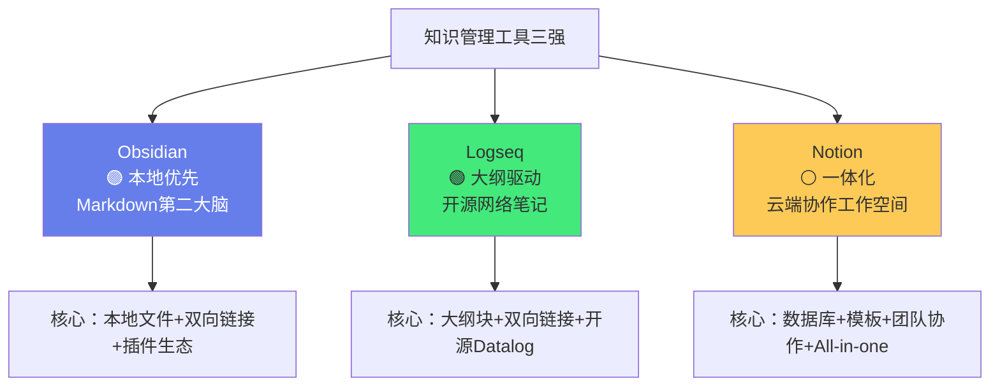
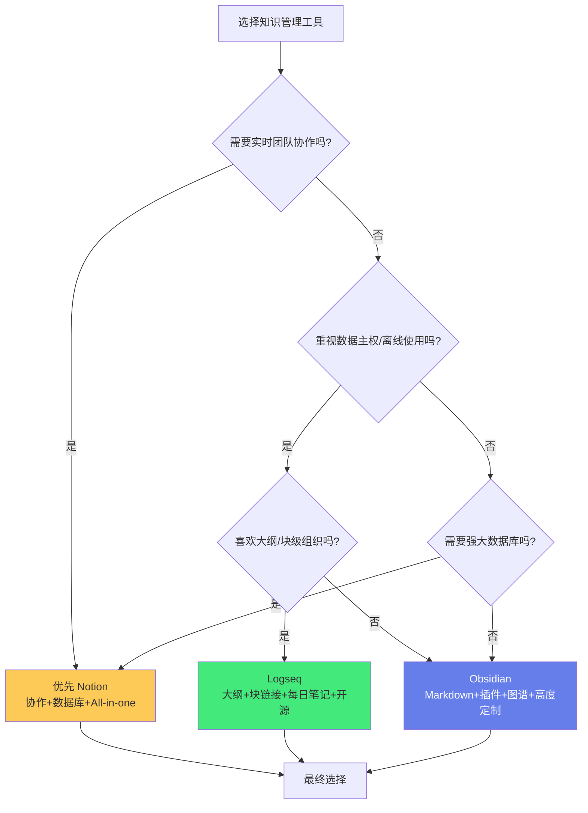

# ⚔️ Obsidian vs Logseq vs Notion

> **文档说明**：系统对比三款主流知识管理工具 Obsidian、Logseq、Notion 的核心理念、架构差异、功能特性、优劣势与适用场景，帮助学习者根据自身需求选择最合适的工具组合。涵盖三款工具的核心理念与定位（Obsidian=本地优先的Markdown第二大脑/Logseq=大纲驱动的开源网络笔记/Notion=一体化的云端协作工作空间）、底层架构差异（本地纯文本Markdown文件 vs 本地Datalog数据库 vs 云端专有数据库）、核心功能深度对比（双向链接/关系图谱/数据库视图/模板系统/插件生态/移动端体验/实时协作/同步方案/搜索能力/导出能力）、各自的核心优势与劣势、适用人群与典型使用场景、工具选择决策树（根据核心需求/技术偏好/协作需求/数据主权/预算等维度）、从一款工具迁移到另一款的方法与注意事项、三款工具的组合使用策略（Notion做团队协作+Obsidian做个人知识库/Logseq做每日笔记+Obsidian做长期沉淀等）、全栈+AI学习者的工具推荐与配置建议、常见误区（功能堆砌/频繁换工具/忽视数据主权/混淆工具与方法）、三款工具的最新发展动态（2025-2026）、常见问题与最佳实践。
>
> **适用人群**：知识管理实践者、终身学习者、全栈开发者、AI工程师、学生、研究者、正在选择笔记工具的人
>
> **前置知识**：[[原子笔记原则与实践]] · [[MOC内容地图]] · [[LYT-链接你的思维]]

---

## 一、概述

### 1.1 三款工具的定位

| 工具 | 一句话定位 | 核心理念 | 开发商 | 首次发布 |
|------|-----------|---------|--------|---------|
| **Obsidian** | 本地优先的 Markdown 第二大脑 | 你的数据永远属于你，纯文本文件，工具只是入口 | Dynalist 团队 | 2020 |
| **Logseq** | 大纲驱动的开源网络笔记 | 块级双向链接，日常笔记驱动知识网络 | 开源社区 | 2020 |
| **Notion** | 一体化的云端协作工作空间 | All-in-one，笔记+数据库+Wiki+项目管理，团队协作优先 | Notion Labs | 2016 |

### 1.2 为什么需要对比这三款

这三款工具代表了知识管理工具的三种不同范式：
- **Obsidian** 代表「本地优先 + 纯文本 + 插件生态」范式——数据主权至上，高度可定制
- **Logseq** 代表「大纲驱动 + 块级链接 + 开源」范式——日常笔记驱动，知识网络自动生长
- **Notion** 代表「云端一体化 + 数据库 + 团队协作」范式——All-in-one，协作优先

没有「最好的工具」，只有「最适合你的工具」——选择取决于你的核心需求、使用场景、技术偏好和协作方式。

> **核心洞察**：工具是「手段」不是「目的」——知识管理的核心是「方法」（原子笔记/双向链接/MOC/持续迭代），工具只是实现方法的载体。三款工具都能实现原子笔记和双向链接，差异在于「实现方式」和「使用体验」。不要陷入「工具崇拜」，而要关注「方法实践」。

---

## 二、底层架构差异

### 2.1 数据存储架构

| 维度 | Obsidian | Logseq | Notion |
|------|---------|--------|--------|
| **数据格式** | 纯文本 Markdown (.md) | Markdown + 本地 Datalog 数据库索引 | 云端专有数据库（非纯文本） |
| **存储位置** | 本地文件夹（用户完全控制） | 本地文件夹（Markdown文件 + 索引） | 云端服务器（Notion 控制） |
| **数据主权** | ✅ 完全拥有（纯文本文件） | ✅ 完全拥有（Markdown文件） | ⚠️ 数据在Notion服务器，需导出才能离线 |
| **离线使用** | ✅ 完全离线可用 | ✅ 完全离线可用 | ⚠️ 需要网络（桌面端有有限离线缓存） |
| **文件可读性** | ✅ 任何文本编辑器可打开 | ✅ Markdown部分可直接打开 | ❌ 专有格式，需通过Notion界面访问 |
| **版本历史** | ✅ 基于Git或文件系统 | ✅ 基于Git或文件系统 | ✅ 内置版本历史（付费版） |
| **备份方式** | 任意文件备份工具/Git/云盘 | 任意文件备份工具/Git/云盘 | Notion导出（Markdown/PDF/HTML） |

### 2.2 架构差异的影响

**Obsidian/Logseq（本地纯文本）的优势**：
- 数据永远属于你，工具消失了文件还在
- 可以用任何文本编辑器/工具处理（VSCode/Git/Pandoc等）
- 完全离线可用，不依赖网络
- 性能好（本地文件，不需要网络请求）
- 可以用 Git 做版本控制和协作

**Obsidian/Logseq（本地纯文本）的劣势**：
- 多设备同步需要自己配置（iCloud/OneDrive/Git/Syncthing等）
- 实时协作能力弱（不如Notion）
- 初始配置需要一定技术能力

**Notion（云端数据库）的优势**：
- 多设备自动同步，开箱即用
- 强大的实时团队协作（多人同时编辑）
- 数据库功能强大（多维视图/关联/公式/自动化）
- 模板生态丰富，开箱即用的模板多
- 分享和发布方便（公开页面/嵌入）

**Notion（云端数据库）的劣势**：
- 数据在Notion服务器，数据主权弱
- 离线能力弱
- 性能受网络影响（大页面加载慢）
- 导出能力有限（Markdown导出格式不完美）
- 免费版有功能限制（块数/上传大小/版本历史）

---

## 三、核心功能对比

### 3.1 功能对比总表

| 功能维度 | Obsidian | Logseq | Notion |
|---------|---------|--------|--------|
| **双向链接** | ✅ 笔记级 `[[]]` | ✅ 块级 `(())` + 笔记级 `[[]]` | ✅ 笔记级 `@`/`[[]]` |
| **关系图谱** | ✅ 强大（全局/局部/筛选/分组） | ✅ 有（全局/局部） | ⚠️ 简单（仅链接关系，功能弱） |
| **大纲/块编辑** | ⚠️ 基础（标题/列表，非块级） | ✅ 原生块级大纲（核心特性） | ✅ 块级编辑 |
| **数据库** | ⚠️ 通过Dataview插件（查询型，非原生） | ⚠️ 通过查询（Datalog） | ✅ 原生强大数据库（多维视图） |
| **模板系统** | ✅ 核心模板+Templater插件（强大） | ✅ 原生模板 | ✅ 原生模板+模板按钮（强大） |
| **插件生态** | ✅ 极丰富（2000+社区插件） | ⚠️ 有但较少（开源社区） | ⚠️ 有限（API+集成，非插件系统） |
| **主题/外观** | ✅ 极丰富（社区主题+CSS自定义） | ✅ 有主题+CSS | ✅ 有限（内置主题） |
| **每日笔记** | ✅ 插件（Daily Notes/Periodic Notes） | ✅ 原生核心（Daily Journal） | ⚠️ 需模板/数据库实现 |
| **移动端** | ✅ 原生iOS/Android（功能较全） | ✅ 原生iOS/Android | ✅ 原生iOS/Android（体验好） |
| **同步方案** | ⚠️ 需自建（iCloud/OneDrive/Git/Syncthing/付费Sync） | ⚠️ 需自建（iCloud/Git等） | ✅ 自动云端同步 |
| **团队协作** | ⚠️ 弱（基于Git/共享文件夹，非实时） | ⚠️ 弱 | ✅ 强大（实时多人协作/权限/评论） |
| **搜索** | ✅ 强大（全文+正则+标签+路径筛选） | ✅ 强大（全文+查询） | ✅ 强大（全文+数据库筛选） |
| **导出** | ✅ 丰富（Markdown/PDF/HTML/Pandoc） | ✅ Markdown/EDN | ⚠️ 有限（Markdown/PDF/HTML/CSV，格式不完美） |
| **API/自动化** | ✅ REST API（付费）+ 插件 | ✅ 开源可扩展 | ✅ 官方API+集成（Zapier/Make等） |
| **价格** | 个人免费，同步/发布付费 | 完全免费开源 | 免费版有限，Plus/Team/Business付费 |

### 3.2 核心功能深度解析

**双向链接**：
- **Obsidian**：笔记级双向链接，`[[笔记名]]`，支持别名、标题链接、块链接（较新）
- **Logseq**：块级双向链接是核心，`((块ID))` 链接到具体块，`[[页面名]]` 链接到页面，引用会在被引用处显示上下文
- **Notion**：`@` 提及或 `[[]]` 链接到页面，支持反向链接面板，但块级链接能力较弱

**关系图谱**：
- **Obsidian**：最强的图谱功能——全局图谱、局部图谱、力导向布局、按文件夹/标签/搜索分组着色、节点大小按入度、筛选器、预设保存
- **Logseq**：有全局和局部图谱，功能基本但足够
- **Notion**：仅有简单的链接关系视图，不能算真正的「知识图谱」

**数据库**：
- **Obsidian**：没有原生数据库，但 Dataview 插件可以用类似 SQL 的语法查询 Markdown 文件的 Frontmatter 和内容，生成动态表格/列表/任务视图。是「查询型」而非「编辑型」数据库
- **Logseq**：基于 Datalog 的查询功能，可以查询块和页面的属性，功能强大但学习曲线陡
- **Notion**：原生数据库是核心竞争力——支持表格/看板/日历/画廊/列表/时间线六种视图，支持属性（文本/数字/日期/单选/多选/人员/关联/公式/按钮等），支持关联、回滚、公式、自动化。是「编辑型」数据库，功能最强大

**每日笔记**：
- **Obsidian**：通过 Daily Notes 核心插件或 Periodic Notes 社区插件实现，支持日/周/月/季/年笔记，模板自定义
- **Logseq**：每日笔记是原生核心——打开 Logseq 默认就是今日页面，所有块都可以链接，日常记录驱动知识网络自动生长
- **Notion**：没有原生每日笔记，需要用模板+数据库手动实现，体验不如前两者

**插件生态**：
- **Obsidian**：2000+ 社区插件，覆盖几乎所有需求——Dataview（数据库查询）、Templater（高级模板）、Excalidraw（手绘图表）、Tasks（任务管理）、Calendar（日历）、Spaced Repetition（间隔重复）、Git（版本控制）等。生态最丰富
- **Logseq**：有社区插件但数量较少，核心功能（大纲/块链接/每日笔记/查询）原生内置
- **Notion**：没有传统意义的插件系统，但有丰富的第三方集成（Zapier/Make/Slack/Google Drive等）和 API，以及 Notion API 可以自定义开发

---

## 四、各自的核心优势与劣势

### 4.1 Obsidian

**核心优势**：
| 优势 | 说明 |
|------|------|
| **数据主权** | 纯文本 Markdown 文件，完全属于你，工具消失了文件还在 |
| **插件生态** | 2000+ 社区插件，几乎可以实现任何功能 |
| **高度可定制** | CSS 主题、插件、配置文件，完全按自己的方式打造 |
| **关系图谱** | 最强的图谱可视化和分析能力 |
| **性能优秀** | 本地文件，打开快，搜索快，不依赖网络 |
| **Markdown 标准** | 标准 Markdown 格式，可被任何工具处理 |
| **离线优先** | 完全离线可用，不依赖网络 |
| **社区活跃** | 活跃的社区、论坛、YouTube 教程、模板分享 |

**核心劣势**：
| 劣势 | 说明 |
|------|------|
| **学习曲线** | 插件和配置多，初始设置需要时间和技术能力 |
| **同步需自建** | 多设备同步需要自己配置（iCloud/OneDrive/Git/付费Sync） |
| **团队协作弱** | 不适合实时多人协作（基于Git的协作非实时） |
| **无原生数据库** | 数据库功能依赖Dataview插件（查询型，非编辑型） |
| **移动端功能** | 移动端功能较全但不如桌面端，部分插件不支持 |
| **外观初始朴素** | 默认外观较朴素，需要配置主题和CSS才能美观 |

### 4.2 Logseq

**核心优势**：
| 优势 | 说明 |
|------|------|
| **块级双向链接** | 块级链接是核心，引用具体块，上下文自动显示 |
| **大纲驱动** | 原生大纲编辑，块可以无限嵌套，拖拽排序 |
| **每日笔记原生** | 打开就是今日页面，日常记录驱动知识网络 |
| **开源免费** | 完全开源免费，无付费墙 |
| **Datalog查询** | 强大的逻辑查询语言，可以查询块和页面属性 |
| **白板式思维导图** | 内置 Whiteboard 功能，思维导图式组织 |
| **数据主权** | Markdown 文件本地存储，数据属于你 |

**核心劣势**：
| 劣势 | 说明 |
|------|------|
| **学习曲线陡** | 大纲思维、块链接、Datalog查询需要适应 |
| **插件生态较小** | 相比Obsidian，插件数量少很多 |
| **性能问题** | 大库（数千页面）可能有性能问题 |
| **移动端体验** | 移动端功能不如桌面端，体验一般 |
| **同步需自建** | 同Obsidian，多设备同步需自己配置 |
| **非标准Markdown** | 块ID、专有语法导致Markdown不完全标准 |
| **团队协作弱** | 不适合团队协作 |
| **开发节奏** | 开源项目，开发节奏可能不如商业产品稳定 |

### 4.3 Notion

**核心优势**：
| 优势 | 说明 |
|------|------|
| **All-in-one** | 笔记+数据库+Wiki+项目管理+文档+日历，一个工具搞定 |
| **原生数据库** | 最强大的原生数据库——六视图、丰富属性、关联、公式、自动化 |
| **团队协作** | 实时多人协作、评论、权限管理、团队工作空间 |
| **开箱即用** | 不需要配置，注册即用，模板丰富 |
| **美观易用** | 界面美观，交互流畅，学习曲线平缓 |
| **多端同步** | 自动云端同步，所有设备实时一致 |
| **分享发布** | 一键公开分享，嵌入网页，团队Wiki |
| **模板生态** | 丰富的官方和社区模板，覆盖各种场景 |
| **集成丰富** | 与Slack/GitHub/Figma/Zapier等大量工具集成 |

**核心劣势**：
| 劣势 | 说明 |
|------|------|
| **数据主权弱** | 数据在Notion服务器，离线能力弱，导出不完美 |
| **离线能力差** | 需要网络，桌面端仅有有限缓存 |
| **性能问题** | 大页面/大数据库加载慢，受网络影响 |
| **双向链接弱** | 有反向链接但功能弱，无真正的知识图谱 |
| **块导出问题** | Markdown导出格式不完美，块结构可能丢失 |
| **免费版限制** | 免费版有块数限制（已取消但有其他限制）、上传大小限制、版本历史短 |
| **价格** | 个人Plus $8/月，Team $10/人/月，长期成本不低 |
| **定制性弱** | 相比Obsidian，外观和功能定制性弱 |
| **依赖厂商** | Notion倒闭/涨价/改政策，数据迁移成本高 |

---

## 五、适用人群与场景

### 5.1 谁适合用 Obsidian

| 人群 | 原因 |
|------|------|
| **知识管理重度用户** | 纯文本+插件生态+图谱，打造个人第二大脑的最佳选择 |
| **技术人员/开发者** | Markdown/Git/本地文件/插件，符合技术人员习惯 |
| **数据主权重视者** | 纯文本本地文件，数据完全属于你 |
| **研究者/写作者** | 双向链接+图谱+长文写作，适合研究和写作 |
| **离线工作者** | 完全离线可用，不依赖网络 |
| **喜欢定制的人** | 2000+插件+CSS主题，完全按自己的方式打造 |
| **全栈+AI学习者** | 可以管理大量技术笔记，建立知识网络，插件支持代码/图表/间隔重复 |

**典型使用场景**：
- 个人知识库/第二大脑
- 技术学习笔记（编程/AI/数学）
- 研究笔记和文献管理
- 长文写作和书籍创作
- 项目笔记和个人Wiki
- 日记和每日反思

### 5.2 谁适合用 Logseq

| 人群 | 原因 |
|------|------|
| **大纲思维者** | 原生大纲编辑，块级组织，适合喜欢大纲的人 |
| **每日笔记驱动者** | 打开就是今日页面，日常记录驱动知识网络 |
| **开源爱好者** | 完全开源免费，无付费墙 |
| **GTD/任务管理** | 块级任务管理，查询功能强大 |
| **思维导图用户** | 内置Whiteboard，思维导图式组织 |
| **隐私重视者** | 本地存储，开源可审计 |

**典型使用场景**：
- 每日日志和反思
- 任务管理和GTD
- 会议记录（大纲式）
- 读书摘录和笔记
- 项目规划（思维导图式）
- 个人知识管理（块链接驱动）

### 5.3 谁适合用 Notion

| 人群 | 原因 |
|------|------|
| **团队/企业** | 实时协作、权限管理、团队Wiki、项目管理 |
| **非技术用户** | 开箱即用，界面美观，学习曲线平缓 |
| **项目管理者** | 数据库+看板+日历+时间线，强大的项目管理 |
| **内容创作者** | 美观的页面，方便分享和发布 |
| **All-in-one追求者** | 笔记+数据库+项目+文档+日历，一个工具搞定 |
| **学生** | 课程笔记、作业管理、复习计划、团队项目 |
| **小团队/创业公司** | 团队Wiki、产品文档、项目管理、招聘管理 |

**典型使用场景**：
- 团队Wiki和知识库
- 项目管理（看板/甘特图/日历）
- 产品文档和技术文档
- 个人/团队任务管理
- 内容创作和发布
- 客户关系管理（轻量CRM）
- 招聘管理和人才库
- 个人/团队仪表盘

---

## 六、工具选择决策树

### 6.1 决策流程图

### 6.2 按核心需求选择

| 你的核心需求 | 推荐工具 | 原因 |
|------------|---------|------|
| **个人第二大脑/知识网络** | Obsidian | 双向链接+图谱+插件生态+纯文本，最适合个人知识管理 |
| **团队协作/团队Wiki** | Notion | 实时协作+权限+数据库+All-in-one，团队场景最强 |
| **每日笔记/大纲记录** | Logseq | 原生每日笔记+大纲+块链接，日常记录体验最好 |
| **项目管理/看板/甘特图** | Notion | 原生数据库+六视图，项目管理最强大 |
| **数据主权/离线/纯文本** | Obsidian/Logseq | 本地Markdown文件，数据完全属于你 |
| **开源免费** | Logseq | 完全开源免费，无付费墙 |
| **高度可定制/插件生态** | Obsidian | 2000+插件+CSS主题，定制性最强 |
| **开箱即用/美观易用** | Notion | 界面美观，注册即用，模板丰富 |
| **技术学习笔记/代码笔记** | Obsidian | Markdown标准+代码高亮+插件（Git/Excalidraw/Dataview） |
| **AI辅助笔记** | Obsidian | 丰富的AI插件（Smart Connections/Text Generator等） |
| **写作/长文创作** | Obsidian | 专注写作模式+长文管理+发布插件 |
| **GTD/任务管理** | Logseq | 块级任务+查询+每日笔记，GTD体验好 |

### 6.3 全栈+AI学习者的推荐

对于全栈+AI方向的学习者，**强烈推荐 Obsidian**，原因：
1. **纯文本Markdown**：技术笔记包含大量代码、公式、图表，标准Markdown格式最适合
2. **插件生态**：
   - Git：版本控制，笔记可以用Git管理和协作
   - Excalidraw：手绘技术架构图、流程图
   - Dataview：动态查询笔记，生成学习进度报告、知识清单
   - Spaced Repetition：间隔重复复习技术概念
   - Templater：高级模板，快速创建标准化技术笔记
   - Smart Connections：AI驱动的笔记关联和问答
   - Code Emitter：在笔记中运行代码
3. **关系图谱**：可视化技术知识网络，发现知识盲区和连接
4. **数据主权**：技术笔记是长期资产，纯文本文件最安全
5. **离线使用**：学习时不需要网络，专注不被打扰

**辅助工具建议**：
- 团队协作/项目管理 → 用 Notion（团队共享文档、项目看板）
- 每日快速记录 → 可以用 Logseq 或 Obsidian Daily Notes
- 组合策略：**Obsidian 做个人知识库（核心）+ Notion 做团队协作（辅助）**

---

## 七、工具迁移方法

### 7.1 迁移注意事项

无论从哪款工具迁移到另一款，都需要注意：
1. **双向链接可能丢失**：不同工具的链接语法不同，迁移后需要修复链接
2. **块结构可能丢失**：Logseq的块级结构迁移到Obsidian/Notion可能变成普通段落
3. **数据库可能丢失**：Notion的数据库迁移到Obsidian需要用Dataview重建
4. **附件需要单独处理**：图片/文件附件需要单独导出和导入
5. **先备份再迁移**：迁移前务必备份原始数据
6. **小批量测试**：先迁移一小部分测试，确认没问题再全量迁移
7. **保留原工具一段时间**：迁移后不要立即删除原工具，并行使用一段时间确认无问题

### 7.2 常见迁移路径

**Notion → Obsidian**：
1. Notion 导出：设置 → 导出所有工作空间内容 → Markdown & CSV
2. 解压导出文件，将Markdown文件放入Obsidian库
3. 用插件修复链接（如 Obsidian Importer 插件）
4. 重建数据库（用Dataview查询Frontmatter）
5. 注意：Notion的数据库导出为CSV，需要手动转换为Markdown+Frontmatter

**Obsidian → Notion**：
1. 方法一：用 Notion 官方导入功能（支持导入文本/Word/CSV，不直接支持Markdown批量导入）
2. 方法二：用第三方工具（如 Notionfy、csv2notion）批量导入Markdown
3. 方法三：手动复制粘贴（适合少量笔记）
4. 注意：Obsidian的双向链接 `[[]]` 需要转换为Notion的 `@` 提及
5. 注意：Dataview查询无法迁移，需要用Notion数据库重建

**Obsidian ↔ Logseq**：
1. 两者都使用本地Markdown文件，可以直接指向同一个文件夹
2. 注意：Logseq的块ID和专有语法在Obsidian中显示为普通文本
3. 注意：Obsidian的某些插件语法在Logseq中不生效
4. 建议：如果要同时使用，使用标准Markdown语法，避免工具专有语法

---

## 八、组合使用策略

### 8.1 为什么要组合使用

没有一款工具能完美满足所有需求。组合使用可以发挥各工具的优势：
- **Obsidian** 擅长个人知识管理，但团队协作弱
- **Notion** 擅长团队协作和数据库，但数据主权弱
- **Logseq** 擅长每日笔记和大纲，但插件生态小

### 8.2 常见组合策略

| 组合 | 分工 | 适合人群 |
|------|------|---------|
| **Obsidian + Notion** | Obsidian=个人知识库/技术笔记/写作；Notion=团队协作/项目管理/共享文档 | 个人开发者+小团队 |
| **Obsidian + Logseq** | Obsidian=长期知识沉淀/深度笔记；Logseq=每日快速记录/任务管理 | 个人知识管理重度用户 |
| **Notion + Obsidian** | Notion=团队Wiki/项目管理/客户管理；Obsidian=个人学习笔记/研究笔记 | 团队中的个人 |
| **Logseq + Obsidian** | Logseq=每日日志/GTD/会议记录；Obsidian=知识网络/写作/研究 | 喜欢大纲+知识网络的人 |
| **Obsidian + Notion + Git** | Obsidian=个人笔记（Git版本控制）；Notion=团队共享；Git=协作和备份 | 技术团队 |

### 8.3 组合使用的注意事项

- **避免重复维护**：明确每个工具的职责，不要在两个工具中维护同一份内容
- **确定「真相来源」**：某类内容以哪个工具为准，其他工具只是引用或副本
- **同步机制**：如果需要在工具间同步，使用API/自动化/手动复制
- **不要过度工具化**：2-3个工具足够，不要陷入「工具收集癖」
- **方法 > 工具**：无论用什么工具，核心是知识管理方法（原子笔记/双向链接/持续迭代）

---

## 九、常见误区

### 9.1 误区一：功能堆砌

**表现**：安装几十个插件、开启所有功能、配置复杂的工作流，但实际只用了10%的功能。

**问题**：
- 工具变慢、变卡
- 学习成本高，花在配置上的时间比学习多
- 复杂工作流难以维护，容易出问题
- 偏离了「知识管理」的核心

**解决**：
- 从核心功能开始，只用真正需要的插件
- 每安装一个插件，问自己「这个插件解决了什么实际问题？」
- 定期清理不用的插件和功能
- 「少即是多」——简单稳定的工作流胜过复杂但脆弱的工作流

### 9.2 误区二：频繁换工具

**表现**：每隔几个月就从一款工具换到另一款，每次迁移花费大量时间，知识管理却没有实质进步。

**问题**：
- 迁移耗时耗力，链接/格式/数据库可能丢失
- 永远在「适应新工具」，没有时间「深化知识管理方法」
- 工具差异被夸大，方法才是核心
- 「工具焦虑」——总觉得「下一个工具更好」

**解决**：
- 选择一款工具后，至少坚持使用6个月再考虑更换
- 把时间花在「方法实践」上，而非「工具探索」上
- 三款工具都能实现原子笔记和双向链接，差异没有想象中大
- 如果确实需要换工具，先明确「新工具解决了什么旧工具无法解决的问题」

### 9.3 误区三：忽视数据主权

**表现**：把所有知识都放在云端工具（如Notion），不备份、不导出，忽视数据安全风险。

**问题**：
- 工具厂商倒闭/涨价/改政策，数据迁移成本高
- 云端服务中断，无法访问笔记
- 账号被封/被盗，数据丢失
- 导出格式不完美，迁移时丢失格式/链接/数据库

**解决**：
- 重要数据定期导出备份（Markdown/PDF/HTML）
- 优先选择纯文本/开放格式的工具（Obsidian/Logseq）
- 如果使用Notion，定期导出备份
- 用Git做版本控制（Obsidian/Logseq支持）
- 遵循「3-2-1备份原则」：3份备份，2种介质，1份异地

### 9.4 误区四：混淆工具与方法

**表现**：以为「用了Obsidian/Logseq/Notion就等于做好了知识管理」，忽视方法实践。

**问题**：
- 工具只是载体，方法才是核心
- 没有原子笔记/双向链接/持续迭代，再好的工具也是「数字垃圾堆」
- 「工具崇拜」——以为换个工具就能解决所有问题

**解决**：
- 学习知识管理方法（原子笔记/Zettelkasten/MOC/PARA/费曼学习法）
- 无论用什么工具，都实践「一篇一个概念+双向链接+持续迭代」
- 工具是「手段」，方法是「目的」
- 参考 [[原子笔记原则与实践]] [[MOC内容地图]] [[费曼学习法笔记实践]]

### 9.5 误区五：追求完美配置

**表现**：花大量时间配置主题、CSS、插件、工作流，追求「完美的Obsidian配置」，却不写笔记。

**问题**：
- 配置是「无止境」的——永远可以更美观、更高效
- 花在配置上的时间挤占了「写笔记」和「学习」的时间
- 完美配置 ≠ 好的知识库——内容和连接才是核心

**解决**：
- 「完成比完美重要」——先用默认配置开始写笔记
- 配置优化放在「周末/闲暇时间」，不要占用学习时间
- 每篇笔记的内容质量 > 工具的外观美观
- 当知识库有了100+篇笔记后，再考虑深度优化配置

---

## 十、2025-2026 最新发展动态

### 10.1 Obsidian 最新动态

- **Obsidian 1.5+**：属性（Properties）面板改进、Canvas增强、移动端性能优化
- **Obsidian Sync**：官方同步服务持续优化，支持端到端加密
- **Obsidian Publish**：发布服务增强，支持更多自定义
- **插件生态**：AI相关插件快速增长（Smart Connections/Text Generator/Copilot等）
- **Bsky/ActivityPub集成**：部分插件支持联邦宇宙社交
- **Canvas**：白板功能持续增强，支持更多元素和交互

### 10.2 Logseq 最新动态

- **Logseq 0.10+**：性能优化、Whiteboard增强、移动端改进
- **Logseq Sync**：官方同步服务（付费）
- **开源社区**：社区驱动开发，插件和主题持续增长
- **AI集成**：社区开发AI插件，支持问答和自动链接
- **移动端**：iOS/Android应用持续优化

### 10.3 Notion 最新动态

- **Notion AI**：原生AI助手，支持写作/总结/翻译/问答（付费功能）
- **Notion Calendar**：收购Cron后推出的日历应用，与Notion深度集成
- **Notion Sites**：网站建设功能，用Notion页面构建网站
- **数据库增强**：按钮属性、公式增强、自动化改进
- **Notion Mail**：邮件客户端（测试中），向All-in-one工作空间迈进
- **离线模式**：桌面端离线能力有所增强（但仍有限）
- **企业版**：高级安全、合规、审计功能

---

## 十一、常见问题与最佳实践

### 11.1 常见问题

| 问题 | 回答 |
|------|------|
| **三款工具哪个最好？** | 没有「最好」，只有「最适合」。个人知识管理推荐Obsidian，团队协作推荐Notion，大纲+每日笔记推荐Logseq。 |
| **我应该从哪款开始？** | 如果你是个人学习者/技术人员，从Obsidian开始；如果你需要团队协作，从Notion开始；如果你喜欢大纲和每日笔记，从Logseq开始。 |
| **Obsidian和Logseq可以同时用吗？** | 可以，两者都使用本地Markdown文件，可以指向同一个库。但要注意避免使用工具专有语法，建议以标准Markdown为主。 |
| **Notion的数据能导出为Markdown吗？** | 可以，但导出格式不完美——数据库导出为CSV，块结构可能丢失，双向链接可能需要修复。建议定期导出备份。 |
| **Obsidian需要付费吗？** | 个人使用完全免费。付费功能包括Obsidian Sync（同步）、Obsidian Publish（发布）、商业支持。同步可以用免费的iCloud/OneDrive/Git替代。 |
| **Logseq真的完全免费吗？** | 是的，Logseq是开源软件，核心功能完全免费。官方同步服务是付费的，但可以用免费的iCloud/Git等同步。 |
| **Notion免费版够用吗？** | 个人轻度使用基本够用，但有上传大小限制（5MB/文件）、版本历史短（7天）、无AI功能。重度用户建议升级Plus版（$8/月）。 |
| **我已经用了一款工具，需要换吗？** | 除非当前工具严重无法满足核心需求，否则不建议频繁更换。把时间花在深化知识管理方法上，比换工具更有价值。 |
| **三款工具支持代码高亮吗？** | 都支持。Obsidian和Logseq基于Markdown，代码高亮效果好；Notion也支持代码块和多种语言高亮。 |
| **哪款适合写技术博客？** | Obsidian最适合——纯Markdown、代码高亮、插件（发布到博客/静态网站生成）、Git版本控制。很多技术博主用Obsidian写博客然后发布。 |

### 11.2 最佳实践

**1. 方法第一，工具第二**
- 先学习知识管理方法（原子笔记/双向链接/MOC/费曼学习法）
- 工具只是实现方法的载体
- 无论用什么工具，核心方法是相通的
- 不要陷入「工具崇拜」

**2. 从简单开始，逐步深化**
- 不要一开始就配置复杂的工作流和几十个插件
- 先用默认配置+核心功能开始写笔记
- 有了100+篇笔记后，再根据实际需求优化配置
- 「完成比完美重要」

**3. 重视数据主权和备份**
- 优先选择纯文本/开放格式（Obsidian/Logseq）
- 定期导出备份（尤其是使用Notion时）
- 用Git做版本控制（技术人员推荐）
- 遵循3-2-1备份原则

**4. 明确工具分工，避免重复维护**
- 如果使用多款工具，明确每款工具的职责
- 确定「真相来源」，避免在两个工具中维护同一份内容
- 个人知识库用Obsidian，团队协作用Notion，是常见的高效组合

**5. 定期清理和优化**
- 定期清理不用的插件和功能
- 定期回顾笔记结构和链接
- 定期更新工具到最新稳定版
- 保持工作流简单、稳定、可维护

**6. 关注内容和连接，而非外观**
- 笔记的内容质量和连接密度 > 工具的外观美观
- 关系图谱的价值在于发现知识结构，而非「好看」
- 花时间写好每篇笔记，比花时间配置主题更有价值
- 「内容为王，连接为后，工具为载体」

**7. 利用工具特性强化方法**
- Obsidian：用Dataview生成学习进度报告，用Excalidraw画技术架构图，用Git做版本控制
- Logseq：用每日笔记驱动知识网络，用块链接建立精准关联，用查询管理任务
- Notion：用数据库管理项目和任务，用模板标准化文档，用协作功能团队共享
- 让工具特性服务于知识管理方法，而非为了用工具而用工具

**8. 保持开放心态，持续学习**
- 工具在不断进化，定期关注新功能和新插件
- 但不要盲目追新，评估「新功能是否解决了实际问题」
- 与其他知识管理爱好者交流，学习最佳实践
- 知识管理是「终身实践」，工具和方法都会持续进化

---

## 十二、关联笔记

### 知识管理方法论
- [[原子笔记原则与实践]] · [[MOC内容地图]] · [[LYT-链接你的思维]]
- [[费曼学习法笔记实践]] · [[知识折旧与更新机制]] · [[定期回顾与笔记重构]]
- [[标签与文件夹的边界]] · [[笔记标题命名策略]] · [[PARA方法]]
- [[Zettelkasten-卡片盒笔记法]] · [[常青笔记-EvergreenNotes]]

### 工具与效率
- [[Obsidian高效使用]] · [[Obsidian-AI插件对比]] · [[Obsidian关系图谱优化]]
- [[VSCode-核心配置与插件]] · [[JetBrains-IDEA高效配置]]

### 导航
- [[MOC-综合导航]] · [[MOC-知识管理方法论-四级展开]] · [[Home]] · [[学习路线总览]]

> 🔍 **知识点深度解析**
>
> **作用**：Obsidian vs Logseq vs Notion 对比解决的是「知识管理工具选择困难症」——面对三款主流工具，很多人陷入「选择焦虑」：不知道哪款最好、频繁换工具、在配置上花太多时间而忽视了知识管理本身。本文档通过系统对比三款工具的核心理念、底层架构、功能特性、优劣势、适用场景，提供「工具选择决策树」和「组合使用策略」，帮助学习者根据自身需求做出理性选择，避免「工具崇拜」和「频繁换工具」的误区，把精力放在真正重要的「知识管理方法实践」上。
>
> **底层原理**：①三款工具代表了知识管理的三种范式——Obsidian代表「本地优先+纯文本+插件生态」（数据主权至上，高度可定制，适合个人深度知识管理）；Logseq代表「大纲驱动+块级链接+开源」（日常笔记驱动，块级精准关联，适合大纲思维者）；Notion代表「云端一体化+数据库+团队协作」（All-in-one，协作优先，适合团队和项目管理）。这三种范式没有优劣之分，只有「适合不适合」——选择取决于核心需求、使用场景、技术偏好和协作方式。②底层架构决定了工具的核心能力和局限——Obsidian/Logseq基于本地纯文本Markdown，优势是数据主权、离线可用、性能好、可被任何工具处理，局限是同步需自建、协作弱；Notion基于云端专有数据库，优势是自动同步、实时协作、强大数据库、开箱即用，局限是数据主权弱、离线差、导出不完美、依赖厂商。架构差异是「根本性」的，不是靠功能更新能弥补的——选择工具时首先要考虑「你能接受哪种架构的局限」。③工具选择的核心是「需求匹配」而非「功能对比」——很多人对比工具时陷入「功能清单对比」的误区，以为功能越多越好。但实际上，你只用到工具20%的功能，剩下80%可能永远不用。正确的选择方法是「先明确核心需求，再找最匹配的工具」——如果你最看重「个人知识网络+数据主权」，Obsidian最匹配；如果你最看重「团队协作+项目管理」，Notion最匹配；如果你最看重「大纲+每日笔记+开源免费」，Logseq最匹配。核心需求匹配度 > 功能数量。④「方法 > 工具」是知识管理的第一原则——三款工具都能实现原子笔记、双向链接、MOC、持续迭代等核心方法，差异在于「实现方式」和「使用体验」，而非「能不能实现」。很多人以为「换个工具就能做好知识管理」，但实际上，没有方法支撑的工具只是「数字垃圾堆」——无论用Obsidian还是Notion，不实践原子笔记和双向链接，笔记都是散乱的。所以，工具选择是「次要矛盾」，方法实践是「主要矛盾」——先学好方法，再选工具，甚至用最简单的文本编辑器+文件夹也能做好知识管理。⑤组合使用的本质是「优势互补」——没有一款工具能完美满足所有需求，组合使用可以发挥各工具的优势。最常见的组合是「Obsidian（个人知识库）+ Notion（团队协作）」——Obsidian负责个人深度知识管理（数据主权+插件+图谱），Notion负责团队共享和项目管理（协作+数据库+All-in-one），两者通过手动复制/API/自动化同步。组合使用的关键是「明确分工，避免重复维护」——确定每类内容的「真相来源」，不要在两个工具中维护同一份内容。
>
> **用法要点**：① 三款工具定位：Obsidian=本地优先Markdown第二大脑(数据主权+插件生态+图谱)/Logseq=大纲驱动开源网络笔记(块链接+每日笔记+免费)/Notion=一体化云端协作工作空间(数据库+协作+All-in-one) ② 架构差异：Obsidian/Logseq=本地纯文本Markdown(数据主权/离线/性能好/同步需自建/协作弱)；Notion=云端专有数据库(自动同步/实时协作/数据库强/数据主权弱/离线差) ③ 核心功能对比：双向链接(Obsidian笔记级/Logseq块级/Notion笔记级弱)、图谱(Obsidian最强/Logseq有/Notion弱)、数据库(Obsidian靠Dataview查询型/Logseq靠Datalog/Notion原生编辑型最强)、模板(都强)、插件(Obsidian 2000+最多/Logseq少/Notion集成多)、每日笔记(Obsidian插件/Logseq原生/Notion需自建)、协作(Obsidian弱/Logseq弱/Notion强)、价格(Obsidian个人免费/Logseq全免费/Notion免费有限付费$8+/月) ④ 适用人群：Obsidian=知识管理重度用户/开发者/研究者/数据主权重视者/全栈AI学习者；Logseq=大纲思维者/每日笔记驱动者/开源爱好者/GTD用户；Notion=团队/企业/非技术用户/项目经理/内容创作者/学生 ⑤ 选择决策：需要实时团队协作→Notion；重视数据主权/离线+喜欢大纲→Logseq；重视数据主权/离线+喜欢Markdown+插件+图谱→Obsidian；需要强大数据库→Notion；全栈AI学习者强烈推荐Obsidian ⑥ 迁移注意：先备份/小批量测试/双向链接可能丢失/块结构可能丢失/数据库可能丢失/保留原工具一段时间 ⑦ 组合策略：Obsidian(个人知识库)+Notion(团队协作)最常见；明确分工避免重复维护；确定真相来源；2-3款足够不要工具收集癖 ⑧ 五大误区：功能堆砌(少即是多)/频繁换工具(至少坚持6个月)/忽视数据主权(定期备份3-2-1)/混淆工具与方法(方法第一工具第二)/追求完美配置(完成比完美重要内容>外观) ⑨ 全栈AI学习者推荐：Obsidian为核心(纯文本/代码/插件Git+Excalidraw+Dataview+Spaced Repetition+AI插件/图谱/数据主权/离线)，Notion辅助团队协作 ⑩ 最佳实践：方法第一工具第二/从简单开始逐步深化/重视数据主权备份/明确工具分工/定期清理优化/关注内容连接而非外观/利用工具特性强化方法/保持开放心态持续学习。

> 💡 **深度讲解**：工具对比最核心的智慧是「没有最好的工具，只有最适合你的工具——而『适合』的判断标准是你的核心需求，不是工具的功能清单」——很多人选工具时陷入「功能对比陷阱」：列出三款工具的所有功能，打分比较，选功能最多的那个。但这是错误的选择方法，因为：①你永远用不到所有功能——研究表明，大多数用户只用到软件20%的功能，剩下80%可能永远不用；②功能多 ≠ 适合你——一款工具功能再多，如果它的核心范式（本地vs云端/个人vs团队/大纲vs文档）不匹配你的需求，那些额外功能对你毫无价值；③「满足核心需求」比「功能最多」重要10倍——如果你最看重「数据主权」，Notion功能再多也不适合；如果你最看重「团队协作」，Obsidian插件再多也不适合。正确的选择方法是「需求驱动」：先问自己「我用知识管理工具最核心的3个需求是什么？」（比如：个人知识网络/数据主权/代码笔记），然后找「最匹配这3个核心需求」的工具，而不是「功能最多」的工具。这就像选车——如果你需要越野，跑车功能再多也不适合；如果你需要城市通勤，越野车再强悍也不适合。「核心需求匹配度」才是选择的唯一标准。理解了这一点，你就不会在「Obsidian和Notion哪个好」这种问题上纠结——它们针对不同的核心需求，没有可比性，就像「锤子和剪刀哪个好」一样，取决于你要做什么。「工具是手段，方法是目的——不要让工具的『丰富功能』掩盖了知识管理的『核心方法』」——Obsidian有2000+插件，Notion有强大的数据库和自动化，Logseq有块级链接和查询，这些工具的功能越来越丰富，让人眼花缭乱。但很多人陷入了「工具把玩」的误区：花大量时间研究插件、配置主题、搭建复杂工作流，却很少真正写笔记、建立链接、深化理解。这就像「买了最贵的画笔和颜料，却从不画画」——工具再高级，没有内容和方法，也是空的。知识管理的核心方法其实很简单，三款工具都能实现：①原子笔记（一篇一个概念）；②双向链接（概念之间建立关联）；③MOC（内容地图组织主题）；④持续迭代（笔记随理解深化不断更新）。这四点是知识管理的「本质」，工具只是「实现这些本质的载体」。无论用Obsidian还是Notion，不实践这四点，笔记就是「数字垃圾堆」；实践了这四点，哪怕用最简单的文本编辑器+文件夹，也能构建有价值的知识库。所以，选工具时不要被「丰富功能」迷惑，要问自己「这款工具能帮我更好地实践原子笔记/双向链接/MOC/持续迭代吗？」——如果能，它就是好工具；如果不能，功能再多也没用。记住：你是在「管理知识」，不是在「把玩工具」。「数据主权是知识管理的『长期主义』——今天你选择的工具，可能决定了5年、10年后你的知识资产是否还属于你」——很多人选工具时只看「当下体验」：界面好不好看、功能强不强、免不免费，却忽视了「长期数据安全」。但知识管理是「长期事业」——你今天写的笔记，5年、10年后可能仍然有价值（尤其是技术基础、方法论、个人思考）。如果你的知识都存在Notion这样的云端专有格式工具中，5年后可能面临：①Notion倒闭或被收购，服务终止；②Notion大幅涨价，你无法承受；③Notion改变政策，限制导出或访问；④你的账号被封或被盗，数据无法找回。这些不是「杞人忧天」——历史上无数云端服务（Google Reader/Evernote功能缩减/各种笔记工具倒闭）都证明了「厂商依赖」的风险。而Obsidian/Logseq这样的「本地纯文本Markdown」工具，你的知识就是你电脑里的一堆.md文件——工具消失了，文件还在；任何文本编辑器都能打开；10年后的AI可以直接读取和分析。这就是「数据主权」的长期价值——它不是「当下的功能」，而是「未来的保障」。对于全栈+AI学习者来说，这一点尤其重要：技术笔记是长期资产，今天学的Java基础、算法、操作系统原理，10年后仍然有价值；AI领域的笔记虽然折旧快，但「学习过程和思考」有长期价值。把这些长期资产放在「纯文本本地文件」中，是对自己未来的负责。当然，这不是说Notion不好——Notion在团队协作和项目管理上的价值是Obsidian无法替代的。关键是「分工」：**个人长期知识资产用Obsidian（数据主权），团队协作和项目管理用Notion（协作效率）**——这样既享受了Notion的协作便利，又保障了个人知识的长期安全。这就是「工具组合的智慧」：不是「二选一」，而是「各取所长，分工协作」。

> 📝 **精简总结**：Obsidian vs Logseq vs Notion=三款主流知识管理工具的系统对比与选择指南。三款定位：Obsidian(本地优先Markdown第二大脑/数据主权+插件+图谱)、Logseq(大纲驱动开源网络笔记/块链接+每日笔记+免费)、Notion(一体化云端协作工作空间/数据库+协作+All-in-one)。架构差异：Obsidian/Logseq本地纯文本(数据主权/离线/性能好/同步需自建/协作弱) vs Notion云端数据库(自动同步/实时协作/数据库强/数据主权弱/离线差)。核心功能：双向链接(Obsidian笔记级/Logseq块级/Notion弱)、图谱(Obsidian最强/Logseq有/Notion弱)、数据库(Obsidian Dataview查询型/Logseq Datalog/Notion原生最强)、插件(Obsidian 2000+最多/Logseq少/Notion集成多)、协作(Obsidian弱/Logseq弱/Notion强)、价格(Obsidian个人免费/Logseq全免费/Notion免费有限$8+/月)。适用：Obsidian=个人知识管理/开发者/研究者/全栈AI学习者；Logseq=大纲思维/每日笔记/开源爱好者；Notion=团队/企业/项目管理/非技术用户。选择决策：团队协作→Notion；数据主权+大纲→Logseq；数据主权+Markdown+插件+图谱→Obsidian。全栈AI学习者强烈推荐Obsidian。组合策略：Obsidian(个人知识库)+Notion(团队协作)最常见。五大误区：功能堆砌/频繁换工具/忽视数据主权/混淆工具与方法/追求完美配置。核心原则：方法第一工具第二，数据主权是长期主义，没有最好只有最适合。

> **学习路径建议**：先学习 [[原子笔记原则与实践]] 理解知识管理的核心方法 → 学习 [[MOC内容地图]] 和 [[LYT-链接你的思维]] 理解知识组织 → 阅读本文档了解三款工具的差异 → 实践：根据你的核心需求选择一款工具（推荐Obsidian），先用默认配置开始写笔记 → 学习 [[Obsidian高效使用]] 和 [[Obsidian-AI插件对比]]，逐步掌握核心插件（Dataview/Templater/Excalidraw/Git） → 实践：用原子笔记原则写30篇技术笔记，建立双向链接 → 学习 [[费曼学习法笔记实践]] 和 [[知识折旧与更新机制]]，深化笔记质量 → 实践：创建第一个MOC，组织一个主题的笔记 → 如果你需要团队协作，学习Notion基础，建立「Obsidian个人+Notion团队」的组合工作流 → 持续实践，定期回顾和优化你的知识管理体系 → 记住：工具是手段，方法是目的，持续实践比频繁换工具更有价值。

---

> **Obsidian vs Logseq vs Notion 对比的本质是「在『数据主权、协作效率、使用体验』三者之间找到最适合你的平衡点」——这三款工具代表了知识管理工具的三种不同哲学：Obsidian信仰「数据属于你自己」，用本地纯文本和插件生态换取最高的数据主权和定制性，但牺牲了开箱即用的协作便利；Notion信仰「All-in-one协作」，用云端数据库和实时协作换取最高的团队效率和易用性，但牺牲了数据主权和离线能力；Logseq信仰「开源免费+大纲驱动」，用块级链接和每日笔记换取独特的大纲体验和完全免费，但牺牲了插件生态和成熟度。这三种哲学没有对错，只有「适合不适合」——就像「租房 vs 买房」：租房（Notion）灵活方便、拎包入住、房东负责维修，但房子不是你的，房东可以涨租或收房；买房（Obsidian/Logseq）房子是你的、可以随意装修、长期安全，但需要自己维护、装修耗时、搬家（同步）麻烦。选择哪款工具，本质上是选择「你愿意为哪种价值付出哪种代价」——重视数据主权和长期安全，就接受Obsidian的配置成本和协作弱势；重视团队协作和开箱即用，就接受Notion的数据主权风险和订阅费用。没有「完美的工具」，只有「适合你的权衡」。更重要的是，无论你选择哪款工具，知识管理的核心方法（原子笔记/双向链接/MOC/持续迭代）都是相通的——工具只是「容器」，方法才是「灵魂」。一个用Obsidian但不实践原子笔记的人，知识库是散乱的；一个用Notion但认真实践双向链接和MOC的人，知识库同样可以很有价值。所以，不要在「选工具」上花太多时间——选一款最匹配你核心需求的工具，然后把90%的精力放在「实践知识管理方法」上。记住：**最好的工具，是你真正会持续使用、并且能帮你建立知识网络的那个工具**——不是功能最多的，不是最流行的，而是「最适合你、你能坚持用」的那个。当你真正开始持续写笔记、建立链接、深化理解时，你会发现：工具的差异越来越不重要，方法和内容的价值越来越凸显——这就是「从工具崇拜到方法实践」的成长，也是知识管理的终极智慧。**
