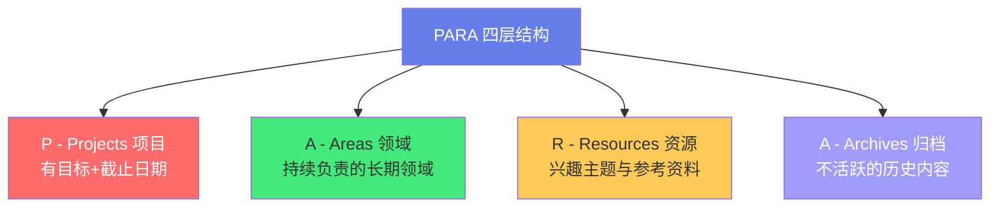
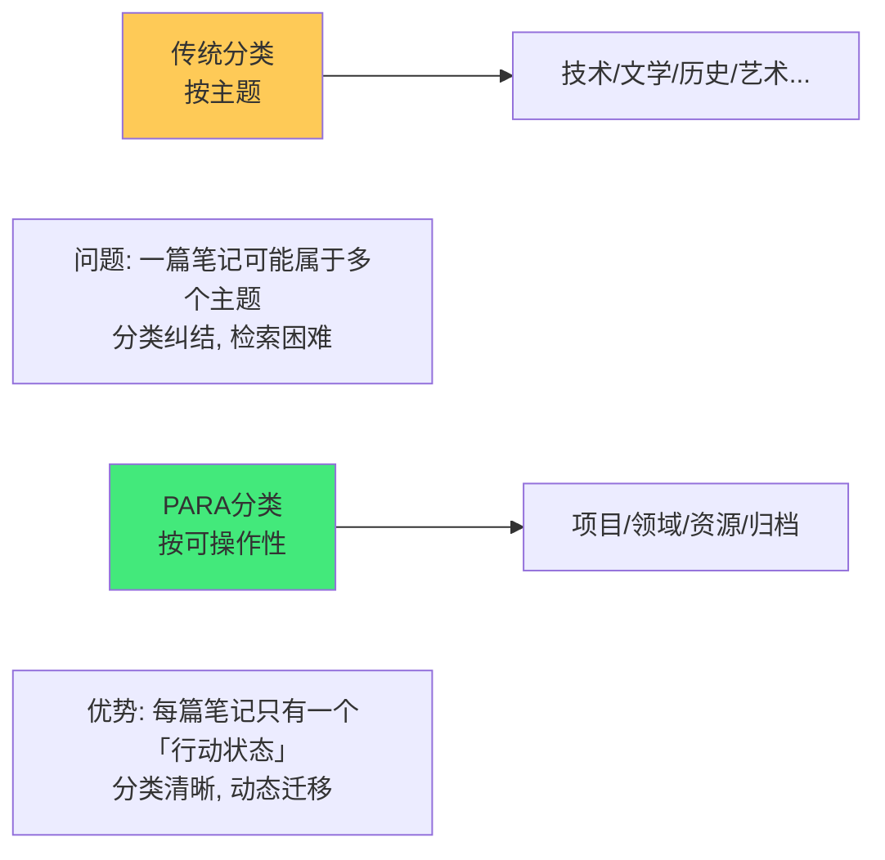
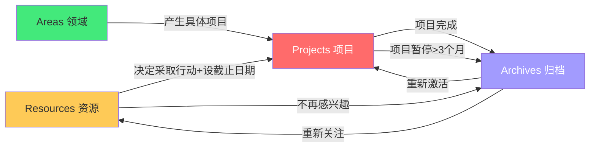
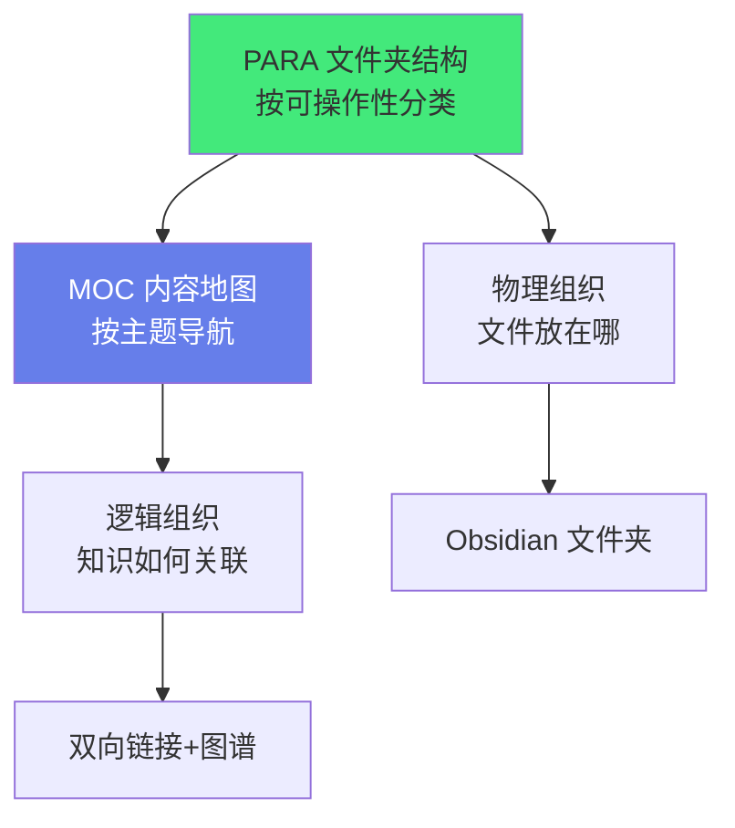

# 📂 PARA：项目·领域·资源·归档

> **文档说明**：系统讲解 PARA 知识管理方法的核心理念、四类目录的定义与判断标准、动态迁移机制、在 Obsidian 中的实操实现与维护节奏，涵盖 PARA 的起源（Tiago Forte 在《Building a Second Brain》中提出的通用信息组织方法）、PARA 四个字母的含义（**P**rojects 项目 / **A**reas 领域 / **R**esources 资源 / **A**rchives 归档）、每一类的精确定义与判断标准（项目=有明确目标和截止日期的短期努力/领域=持续负责的长期领域/资源=感兴趣的主题和参考资料/归档=不活跃的历史内容）、PARA 的核心原则（按「可操作性」而非「主题」分类、行动导向、动态迁移、4 类足够）、PARA 与传统按主题分类的本质区别、PARA 与 GTD/Johnny.Decimal/MOC 的对比与结合、如何在 Obsidian 中实现 PARA（四层文件夹结构/项目模板/领域仪表盘/资源标签/归档机制）、项目管理详解（项目定义三要素：目标+截止日期+可交付成果/项目笔记结构/项目看板/项目完成后的归档流程）、领域管理详解（领域=持续负责无截止日期/领域标准与目标/领域仪表盘/领域笔记）、资源管理详解（资源=兴趣主题与参考资料/资源笔记/灵感收集/资源升级为项目的触发条件）、归档管理详解（归档=完成或不活跃的内容/归档的价值/归档的检索/定期归档）、PARA 的动态迁移机制（项目完成→归档、资源积累→升级为项目、领域变化→调整、归档内容→重新激活）、PARA 的实施步骤（从零搭建/从现有结构迁移/渐进式改造）、PARA 的维护节奏（每周项目回顾/每月领域检查/每季度归档清理/每年大整理）、PARA 的常见误区（分类过度/归档不及时/项目和领域混淆/资源堆积/把 PARA 当主题分类）、PARA 在全栈+AI 知识库中的适配方案、PARA 与 MOC 双链体系的结合、常见问题与最佳实践。
>
> **适用人群**：知识管理实践者、项目管理者、内容创作者、开发者、Obsidian 用户、第二大脑构建者
>
> **前置知识**：[[第二大脑-BuildingSecondBrain]] · [[MOC内容地图]] · [[原子笔记原则与实践]] · [[GTD-搞定任务管理]]

---

## 一、概述

### 1.1 什么是 PARA

**PARA** 是由 **Tiago Forte** 在《Building a Second Brain（打造第二大脑）》中提出的**通用信息组织方法**，用四个顶层文件夹管理所有数字信息：



| 类别 | 全称 | 定义 | 例子 |
|------|------|------|------|
| **P** | Projects（项目） | 有明确目标和截止日期的短期努力 | 开发个人博客、准备面试、写一本书 |
| **A** | Areas（领域） | 持续负责、无截止日期的长期领域 | 健康、财务、职业发展、家庭 |
| **R** | Resources（资源） | 感兴趣的主题和参考资料 | 设计灵感、技术文章、菜谱、旅行攻略 |
| **A** | Archives（归档） | 完成或不活跃的历史内容 | 已完成的项目、旧工作资料、过期信息 |

### 1.2 PARA 的核心洞察

PARA 最核心的创新是**按「可操作性」分类，而非按「主题」分类**：



**传统按主题分类的问题**：
- 一篇笔记可能属于多个主题（如「React 性能优化」既属于「前端」又属于「性能」）
- 分类纠结：这篇笔记放哪个文件夹？
- 检索困难：找笔记时想不起放在哪个主题下

**PARA 按可操作性分类的优势**：
- 每篇笔记只有一个「行动状态」（正在做的项目/持续关注的领域/参考资料/已完成归档）
- 分类简单：问自己「我现在要对这个信息采取什么行动？」
- 动态迁移：信息的行动状态变化时，在四类间移动
- 检索靠搜索和链接，而非靠文件夹记忆

### 1.3 PARA 的适用范围

PARA 是**通用信息组织方法**，不仅适用于笔记，还适用于：
- 文件系统（电脑文件夹）
- 云盘（Google Drive/OneDrive）
- 任务管理（Todoist/Notion）
- 书签管理
- 邮箱文件夹

> **核心价值**：PARA 让你在所有数字工具中使用统一的组织框架，减少认知负担。

---

## 二、四类详解

```text
### 2.1 P - Projects（项目）

**定义**：有明确目标和截止日期的短期努力，完成后即结束。

**项目三要素**（缺一不可）：
```
1. **明确目标**：要达成什么具体结果？
2. **截止日期**：什么时候完成？
3. **可交付成果**：完成的标志是什么？

| 是项目 | 不是项目（是领域） |
|--------|------------------|
| 「3个月内开发完成个人博客网站」 | 「学习前端开发」（无截止日期，持续进行） |
| 「准备10月的AWS认证考试」 | 「云计算」（持续关注的领域） |
| 「写完《Python入门》系列10篇文章」 | 「写作」（长期习惯） |
| 「2周内完成公司Q3报告」 | 「工作」（持续负责） |

**项目笔记结构**：
```text
01-Projects/
└── 个人博客开发/
    ├── 项目主页.md          # 项目目标、进度、看板
    ├── 需求文档.md
    ├── 技术选型.md
    ├── 开发日志/
    │   ├── 2026-08-01.md
    │   └── 2026-08-15.md
    └── 参考资料/
        └── Next.js最佳实践.md
```

**项目主页模板**：
```markdown
---
title: 项目名称
status: 🚀 进行中  # 📋计划中/🚀进行中/✅已完成/⏸️暂停/❌取消
deadline: 2026-12-31
progress: 60%
tags: [项目]
---

# 项目名称

## 目标
（要达成什么？）

## 可交付成果
- [ ] 成果1
- [ ] 成果2

## 里程碑
| 里程碑 | 截止日期 | 状态 |
|--------|---------|------|
| M1: 需求确认 | 2026-09-01 | ✅ |
| M2: 原型开发 | 2026-10-01 | 🚀 |

## 相关笔记
- [[技术选型]]
- [[开发日志索引]]
```

```text
### 2.2 A - Areas（领域）

**定义**：持续负责、维护标准、无明确截止日期的长期领域。

**领域的特征**：
```
- 没有「完成」的概念（你不会「完成」健康，只会持续维护）
- 有一个「标准」（你希望维持的水平）
- 长期持续，可能伴随数年甚至一生

| 个人领域 | 工作领域 |
|---------|---------|
| 健康（健身/饮食/睡眠） | 前端开发能力 |
| 财务（储蓄/投资/预算） | 团队管理 |
| 家庭（关系/育儿） | 产品质量 |
| 学习（全栈/AI/英语） | 技术债务管理 |
| 职业发展 | 客户关系 |

**领域笔记结构**：
```text
02-Areas/
├── 健康/
│   ├── 领域仪表盘.md      # 健康标准、当前状态、目标
│   ├── 健身计划.md
│   └── 饮食记录.md
├── 全栈开发/
│   ├── 领域仪表盘.md
│   ├── 技能矩阵.md
│   └── 学习路线.md
└── 财务/
    ├── 领域仪表盘.md
    └── 投资笔记.md
```

**领域仪表盘模板**：
```markdown
---
title: 领域名称 - 仪表盘
tags: [领域, 仪表盘]
updated: 2026-08-28
---

# 领域名称

## 维护标准
（我希望在这个领域维持什么水平？）

## 当前状态
- 指标1: 当前值 / 目标值
- 指标2: 当前值 / 目标值

## 本季度目标
- [ ] 目标1
- [ ] 目标2

## 相关项目
- [[进行中的相关项目]]

## 相关资源
- [[资源笔记1]]
- [[资源笔记2]]
```

```text
### 2.3 R - Resources（资源）

**定义**：感兴趣的主题、参考资料、灵感收集，目前没有具体项目但可能未来有用。

**资源的特征**：
```
- 没有明确的行动计划
- 是「潜在的」项目素材或领域知识
- 按主题组织（这是 PARA 中唯一按主题分类的层级）
- 可以随时「升级」为项目

**资源例子**：
- 设计灵感收集
- 机器学习论文笔记
- 旅行攻略
- 菜谱
- 工具评测
- 读书笔记（非项目驱动的阅读）

**资源笔记结构**：
```text
03-Resources/
├── 前端技术/
│   ├── React性能优化.md
│   ├── CSS新特性.md
│   └── Vite原理.md
├── AI工程/
│   ├── Prompt工程技巧.md
│   ├── RAG架构.md
│   └── Agent设计模式.md
└── 生活灵感/
    ├── 旅行攻略.md
    └── 菜谱收集.md
```

> **资源 vs 项目**：资源是「我对这个主题感兴趣」，项目是「我要在这个主题上完成 X  by Y 日期」。当你决定对某个资源采取行动并设定截止日期时，它就从 Resources 升级为 Projects。

```text
### 2.4 A - Archives（归档）

**定义**：完成的项目、不活跃的领域、不再需要的资源、历史记录。

**归档的内容**：
```
- ✅ 已完成的项目
- ⏸️ 暂停超过 3 个月的项目
- 不再关注的领域
- 过期的资源
- 历史版本/旧资料

**归档的价值**：
- 保持活跃目录的精简（只放当前需要关注的内容）
- 保留历史记录（需要时可以检索和恢复）
- 心理上的「完成感」（项目归档=正式结束）

**归档结构**：
```text
04-Archives/
├── 2026/
│   ├── 已完成项目/
│   │   └── 个人博客开发/
│   └── 旧资源/
└── 2025/
    └── ...
```

> **归档不是删除**：归档的内容仍然可以搜索和引用，只是从活跃目录移到归档目录，减少干扰。

---

## 三、PARA 的动态迁移机制

PARA 最强大的特性是**信息在四类间动态迁移**：



| 迁移方向 | 触发条件 | 操作 |
|---------|---------|------|
| **Resources → Projects** | 对某个资源主题决定采取行动，设定目标和截止日期 | 移到 Projects，创建项目主页 |
| **Projects → Archives** | 项目完成、取消、或暂停超过 3 个月 | 移到 Archives，标记完成状态 |
| **Areas → Projects** | 某个领域产生了具体的短期目标 | 在 Projects 中创建项目，关联领域 |
| **Projects → Areas** | 项目完成后，经验沉淀为领域知识 | 将项目成果总结到领域笔记 |
| **Resources → Archives** | 资源不再感兴趣或已过时 | 移到 Archives |
| **Archives → Projects/Resources** | 归档内容重新需要 | 从归档移回对应目录 |

**迁移时机**：
- **每周回顾**：检查项目状态，完成的归档
- **每月回顾**：检查资源，升级为项目或归档
- **每季度回顾**：检查领域，调整标准和目标

---

## 四、在 Obsidian 中实现 PARA

### 4.1 文件夹结构

```text
知识库根目录/
├── 01-Projects/           # 项目（按项目名建子文件夹）
│   ├── 项目A/
│   └── 项目B/
├── 02-Areas/              # 领域（按领域名建子文件夹）
│   ├── 全栈开发/
│   ├── AI工程/
│   └── 健康/
├── 03-Resources/          # 资源（按主题建子文件夹）
│   ├── 前端技术/
│   ├── 后端技术/
│   └── 生活灵感/
└── 04-Archives/           # 归档（按年份建子文件夹）
    ├── 2026/
    └── 2025/
```

> **编号前缀（01-04）**：确保文件夹按 PARA 顺序排列，而非字母顺序。

### 4.2 与 MOC 的结合

PARA 管「文件夹结构」，MOC 管「内容导航」，两者互补：



**实践**：
- 物理上用 PARA 四层文件夹组织文件
- 逻辑上用 MOC 笔记和双向链接组织知识网络
- 一个 MOC 可以跨 PARA 类别引用笔记（如「全栈开发 MOC」引用 Projects 中的项目笔记和 Resources 中的技术笔记）

### 4.3 标签体系

PARA 用文件夹管「行动状态」，用标签管「主题和属性」：

```yaml
tags:
  - 项目/进行中        # 项目状态
  - 领域/全栈开发      # 领域标签
  - 资源/前端技术      # 资源主题
  - 难度/⭐⭐⭐         # 难度等级
  - 类型/原子笔记      # 笔记类型
```

### 4.4 模板与自动化

- **项目主页模板**：用 Templater 插件自动生成项目结构
- **每周回顾模板**：自动生成项目回顾清单
- **Dataview 查询**：自动列出「进行中的项目」「本月完成的项目」「待归档项目」

**Dataview 示例——进行中的项目**：
```dataview
TABLE deadline AS "截止日期", progress AS "进度", status AS "状态"
FROM "01-Projects"
WHERE status = "🚀 进行中"
SORT deadline ASC
```

---

## 五、PARA 与其他方法的对比

### 5.1 PARA vs GTD

| 维度 | PARA | GTD（搞定） |
|------|------|------------|
| **核心** | 信息组织 | 任务管理 |
| **分类** | 项目/领域/资源/归档 | 收集/理清/组织/回顾/执行 |
| **粒度** | 信息（笔记/文件/资料） | 任务（下一步行动） |
| **关系** | PARA 管「知识和资料」，GTD 管「行动和任务」 | 互补，可同时使用 |

> **最佳实践**：用 PARA 组织知识和资料，用 GTD（或 Todoist）管理任务和行动。项目笔记放在 PARA 的 Projects 中，具体任务放在任务管理工具中。

### 5.2 PARA vs Johnny.Decimal

| 维度 | PARA | Johnny.Decimal |
|------|------|---------------|
| **分类数** | 4 类 | 10 个区 × 10 类 = 100 类 |
| **编号** | 可选（01-04） | 强制数字编号（12.03） |
| **灵活性** | 高，动态迁移 | 低，编号固定 |
| **适用** | 个人知识管理 | 文件系统/档案管理 |
| **学习成本** | 低 | 中 |

### 5.3 PARA vs 按主题分类

| 维度 | PARA | 按主题分类 |
|------|------|-----------|
| **分类依据** | 可操作性（行动状态） | 内容主题 |
| **分类纠结** | 少（只有4类） | 多（一篇笔记可能多主题） |
| **动态性** | 高（信息状态变化时迁移） | 低（主题一般不变） |
| **检索方式** | 搜索+链接 | 文件夹记忆 |
| **适合规模** | 任意规模 | 小规模（>100篇开始混乱） |

---

## 六、实施步骤

### 6.1 从零开始搭建

1. **创建四层文件夹**：`01-Projects` `02-Areas` `03-Resources` `04-Archives`
2. **列出当前项目**：所有进行中的项目，每个建一个文件夹+项目主页
3. **列出核心领域**：你持续负责的 3-7 个领域
4. **整理资源**：将现有笔记按主题放入 Resources
5. **归档旧内容**：不活跃的内容移入 Archives
6. **建立回顾节奏**：每周/每月/每季度整理

### 6.2 从现有结构迁移

1. **不要一次性大重构**：渐进式迁移，每周处理一个文件夹
2. **先建四层框架**：创建 PARA 文件夹，旧结构暂时保留
3. **新笔记用 PARA**：新创建的笔记直接放入正确的 PARA 目录
4. **旧笔记逐步迁移**：每次访问旧笔记时，顺手移到 PARA 对应目录
5. **3 个月后清理**：旧结构中剩余的未访问笔记直接归档

### 6.3 全栈+AI 知识库的 PARA 适配

对于「全栈工程+AI工程」知识库，PARA 可以这样适配：

```text
01-Projects/
├── 个人博客开发(全栈)
├── AI客服机器人(AI)
└── 面试准备(综合)

02-Areas/
├── 全栈开发能力/
│   ├── 前端/
│   ├── 后端/
│   └── 运维/
├── AI工程能力/
│   ├── LLM应用/
│   ├── RAG/
│   └── Agent/
└── 职业发展/

03-Resources/
├── 前端技术/
├── 后端技术/
├── 云原生/
├── AI基础/
└── 工具效率/

04-Archives/
└── 2026/
```

---

## 七、维护节奏

| 频率 | 动作 | 时间 |
|------|------|------|
| **每日** | 新笔记放入正确目录；项目笔记更新进度 | 2 分钟 |
| **每周** | 项目回顾：完成的项目归档，更新项目进度 | 15 分钟 |
| **每月** | 资源整理：升级为项目或归档；领域检查：更新领域仪表盘 | 30 分钟 |
| **每季度** | 大整理：清理 Archives，调整 Areas，重构 MOC | 1 小时 |
| **每年** | 年度回顾：全年项目总结，领域评估，归档年度内容 | 2 小时 |

---

## 八、常见误区

| 误区 | 问题 | 正确做法 |
|------|------|---------|
| **分类过度** | 在 PARA 下建太多子文件夹，结构复杂 | PARA 只有4层，子文件夹不超过2层 |
| **归档不及时** | 完成的项目一直留在 Projects，目录臃肿 | 每周回顾，完成即归档 |
| **项目和领域混淆** | 把「学习前端」当项目（无截止日期） | 有目标+截止日期=项目，持续维护=领域 |
| **资源堆积** | Resources 变成「收藏夹」，只存不用 | 每月整理，3个月没动的资源归档或升级 |
| **把 PARA 当主题分类** | 在 Projects 下按「前端/后端」分类 | Projects 下按「具体项目」分类，主题放 Resources |
| **归档=删除** | 归档后再也不看 | 归档内容仍可搜索引用，是「冷存储」而非「删除」 |
| **追求完美结构** | 花大量时间调整分类而非使用 | PARA 是「够用就好」，重点在内容和行动 |

---

## 九、常见问题

| 问题 | 回答 |
|------|------|
| **PARA 只有4类够吗？** | 够。PARA 的设计哲学是「4类足够」，更多分类会增加认知负担。主题细分用子文件夹和标签 |
| **一篇笔记属于多个项目怎么办？** | 物理放在一个项目文件夹，用双向链接关联到其他项目 |
| **领域和资源怎么区分？** | 领域是「你持续负责的」（有维护标准），资源是「你感兴趣的」（无行动义务） |
| **PARA 和 MOC 冲突吗？** | 不冲突。PARA 管物理文件夹，MOC 管逻辑导航，两者互补 |
| **项目完成后笔记怎么办？** | 整个项目文件夹移入 Archives，经验总结到 Areas 的对应领域笔记 |
| **可以只用 PARA 不用标签吗？** | 可以，但标签能提供更灵活的跨目录检索，建议结合使用 |
| **PARA 适合团队吗？** | PARA 主要为个人设计，团队可参考其思想但需调整协作流程 |
| **归档的笔记还能被双链引用吗？** | 可以。Obsidian 的双链不依赖文件夹位置，归档后链接仍然有效 |

---

## 十、关联笔记

### 知识管理方法论
- [[第二大脑-BuildingSecondBrain]] · [[MOC内容地图]] · [[原子笔记原则与实践]]
- [[GTD-搞定任务管理]] · [[LYT-链接你的思维]] · [[笔记标题命名策略]]
- [[标签与文件夹的边界]] · [[定期回顾与笔记重构]]

### 工具与实践
- [[Obsidian高效使用]] · [[Obsidian-AI插件对比]] · [[知识管理工具迁移指南]]

### 导航
- [[MOC-综合导航]] · [[MOC-知识管理方法论-四级展开]] · [[Home]] · [[学习路线总览]]

> 🔍 **知识点深度解析**
>
> **作用**：PARA（项目·领域·资源·归档）解决的是「如何用最简单的四层结构组织所有数字信息，避免分类纠结和目录混乱，让信息按『可操作性』动态流动」的核心问题——传统的按主题分类在笔记数量超过 100 篇后会陷入「分类纠结」（一篇笔记属于多个主题）和「检索困难」（想不起放在哪个文件夹）。PARA 用「按可操作性分类」替代「按主题分类」，只用四个顶层文件夹就能管理任意规模的信息，并通过动态迁移机制让信息随行动状态变化自然流动。
>
> **底层原理**：①PARA 的核心洞察是「按可操作性分类而非按主题分类」——主题分类的根本问题是「一篇信息可以属于多个主题」，导致分类纠结和重复；而「可操作性」是信息的单一属性——一条信息要么是「正在做的项目」，要么是「持续关注的领域」，要么是「参考资源」，要么是「已完成归档」，四者必居其一。这种分类方式消除了分类纠结，因为判断「我现在要对这个信息做什么」比判断「这个信息属于什么主题」简单得多。②PARA 的动态迁移机制基于「信息的行动状态是变化的」——一个资源主题（如「React 性能优化」）在你只是感兴趣时属于 Resources，当你决定做一个性能优化项目并设定截止日期时升级为 Projects，项目完成后归档为 Archives，经验沉淀到 Areas。信息在四类间的自然流动反映了「认知和行动的变化」，这是静态主题分类无法做到的。③PARA 的「4类足够」设计哲学基于「认知负荷理论」——分类越多，决策成本越高。Tiago Forte 经过大量实践发现4类是「分类能力」和「认知负荷」的最佳平衡点：少于4类不够区分，多于4类增加负担。子分类（子文件夹和标签）处理主题细分，顶层保持极简。④PARA 与 MOC 的互补关系基于「物理组织 vs 逻辑组织」的分离——PARA 管「文件放在哪个文件夹」（物理组织），MOC 管「知识如何关联和导航」（逻辑组织）。物理上用 PARA 保持目录精简，逻辑上用 MOC 和双链构建知识网络，两者各司其职。这解决了「文件夹分类」和「知识网络」的冲突——你不需要在文件夹结构中表达所有知识关系，那是链接和 MOC 的事。⑤归档的心理学价值是「完成感」和「注意力管理」——将完成的项目从活跃目录移到归档，不仅是整理，更是心理上的「正式结束」，释放注意力给新项目。同时归档保留了历史记录，需要时可以检索，实现「精简活跃工作区」和「保留完整历史」的平衡。
>
> **用法要点**：① 四类定义：Projects(有目标+截止日期+可交付成果的短期努力)/Areas(持续负责无截止日期的长期领域,有维护标准)/Resources(感兴趣的主题和参考资料,无行动义务)/Archives(完成或不活跃的历史内容) ② 项目三要素：明确目标+截止日期+可交付成果，缺一不可；「学习前端」是领域不是项目 ③ 核心原则：按可操作性分类而非主题；4类足够；动态迁移；归档不是删除 ④ Obsidian实现：01-Projects/02-Areas/03-Resources/04-Archives四层文件夹，编号前缀保序，项目用文件夹+主页模板，领域用仪表盘，资源按主题，归档按年份 ⑤ 动态迁移：Resources→Projects(决定行动+设截止)/Projects→Archives(完成/暂停>3月)/Areas→Projects(领域产生具体目标)/Projects→Areas(经验沉淀)/Archives→活跃(重新需要) ⑥ 维护节奏：每日2分钟放对目录/每周15分钟项目回顾归档/每月30分钟资源+领域整理/每季1小时大整理/每年2小时年度回顾 ⑦ 与MOC结合：PARA管物理文件夹，MOC管逻辑导航，双链跨目录引用，标签管主题和属性 ⑧ 与GTD结合：PARA管知识资料，GTD管任务行动，互补不冲突 ⑨ 常见误区：分类过度(子文件夹不超2层)/归档不及时(每周回顾)/项目领域混淆(有截止=项目)/资源堆积(每月整理)/当主题分类(Projects下按具体项目非主题)/归档=删除(冷存储非删除)/追求完美(够用就好) ⑩ 实施：从零建四层→列项目→列领域→整理资源→归档旧内容→建回顾节奏；迁移用渐进式(新笔记用PARA,旧笔记顺手移,3月后清理剩余)。

> 💡 **深度讲解**：PARA 最核心的智慧是「用『行动状态』替代『内容主题』作为分类依据，用『动态迁移』替代『静态归档』，让信息系统随你的行动自然演化」——大多数人组织信息的第一反应是「按主题分类」：技术、文学、历史、艺术、工作、生活……但这种分类方式有一个致命缺陷：**一篇信息可以属于多个主题**。一篇关于「React 性能优化」的笔记，既属于「前端技术」，又属于「性能优化」，还可能属于「项目参考」。当你纠结「这篇笔记放哪个文件夹」时，分类系统已经失败了——因为分类的目的是「快速找到信息」，而不是「为分类而分类」。PARA 的革命性在于换了一个分类维度：不问「这篇笔记是关于什么的？」（主题），而问「我现在要对这篇笔记做什么？」（可操作性）。答案只有四种可能：正在做的项目、持续关注的领域、参考的资源、已完成的归档。这个问题的答案是唯一的、明确的、不需要纠结的。更妙的是，「行动状态」是动态变化的——一个资源主题在你决定采取行动时变成项目，项目完成后变成归档，经验沉淀到领域。PARA 的四层结构不是「四个固定的盒子」，而是「四个流动的状态」，信息在其中自然流动，反映你认知和行动的变化。这种「动态系统」的思想比「静态分类」高级得多——它承认信息的价值不是固定的，而是随你的行动和兴趣变化的。PARA 的另一个智慧是「极简即力量」——只有四个顶层文件夹，任何人都能在 5 分钟内理解并开始使用。Tiago Forte 刻意没有设计更复杂的分类（如 Johnny.Decimal 的 100 类），因为他知道「分类系统越复杂，维护成本越高，越容易被放弃」。PARA 的成功恰恰在于它的「简单到不可能失败」——你不需要学习复杂的编号规则，不需要纠结分类，只需要问自己「这个信息我现在要做什么？」然后放进对应的文件夹。这种「低门槛+高适应性」让 PARA 成为过去十年最流行的个人知识管理方法之一。

> 📝 **精简总结**：PARA=项目(Projects)/领域(Areas)/资源(Resources)/归档(Archives)四层信息组织法，Tiago Forte提出。核心：按可操作性分类而非主题，4类足够，动态迁移。Projects=有目标+截止日期+可交付成果的短期努力；Areas=持续负责无截止日期的长期领域(有维护标准)；Resources=感兴趣的主题和参考资料(无行动义务)；Archives=完成或不活跃的历史内容。动态迁移：资源→项目(决定行动)、项目→归档(完成)、项目→领域(经验沉淀)、归档→活跃(重新需要)。Obsidian实现：01-Projects/02-Areas/03-Resources/04-Archives四层文件夹，项目用主页模板，领域用仪表盘，资源按主题，归档按年份。与MOC互补(PARA管物理文件夹,MOC管逻辑导航)，与GTD互补(PARA管知识,GTD管任务)。维护：每日2分/每周15分项目回顾/每月30分资源领域整理/每季1小时大整理。误区：分类过度/归档不及时/项目领域混淆/资源堆积/当主题分类/归档=删除/追求完美。

> **学习路径建议**：先阅读 [[第二大脑-BuildingSecondBrain]] 理解 PARA 的理论背景 → 学习本文档掌握 PARA 四类定义和动态迁移 → 实践：在 Obsidian 中创建四层文件夹结构 → 列出当前所有项目，放入 Projects 并创建项目主页 → 列出 3-7 个核心领域，放入 Areas 并创建仪表盘 → 将现有笔记按主题整理到 Resources → 完成的项目和旧资料移入 Archives → 建立每周/每月回顾节奏 → 学习 [[MOC内容地图]]，在 PARA 物理结构上构建逻辑导航 → 学习 [[GTD-搞定任务管理]]，将知识管理和任务管理结合 → 长期实践，每季度优化结构。

---

> **PARA 的本质是「用最简单的四层结构，让你的信息系统随你的行动自然演化，而非让你去适应一个僵化的分类体系」——我们积累的信息越来越多：笔记、文章、文件、截图、书签、聊天记录……如果没有一个好的组织方法，这些信息会变成「数字垃圾场」——存的时候很积极，找的时候找不到，用的时候想不起来。传统的「按主题分类」在信息少时还能用，信息一多就崩溃：分类纠结、重复存放、检索困难。PARA 的智慧在于它不试图「完美分类」（这是不可能的），而是「按行动状态组织」——你现在要对这个信息做什么？正在做的放项目，持续关注的放领域，参考用的放资源，做完的放归档。这个问题的答案永远是明确的，而且会随你的行动自然变化。更重要的是，PARA 教会我们一个更深层的道理：**信息的价值不在于「存了多少」，而在于「用了多少」**。Projects 里的信息是你正在用的，Areas 里的信息是你持续维护的，Resources 里的信息是你可能会用的，Archives 里的信息是你用过的。当你定期回顾并在四类间迁移信息时，你实际上是在定期审视「我把注意力放在了哪里」「我真正在推进什么」「什么已经可以放下了」。PARA 不仅是信息组织方法，更是「注意力管理」和「行动反思」的工具——它让你的知识系统和你的人生行动保持同步。从今天开始，用 PARA 重新组织你的信息，你会发现：不是信息更多了，而是「能用的信息」更多了；不是分类更复杂了，而是「找东西」更简单了；不是整理更花时间了，而是「行动」更清晰了。**
