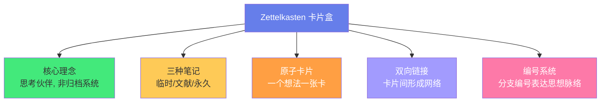
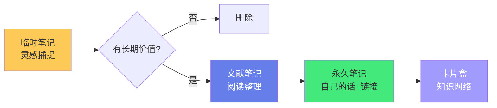
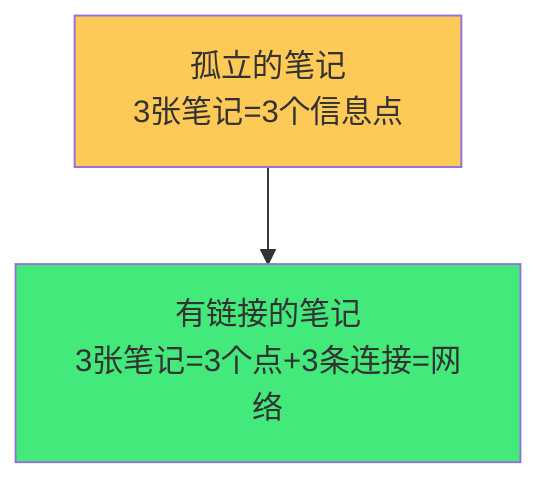
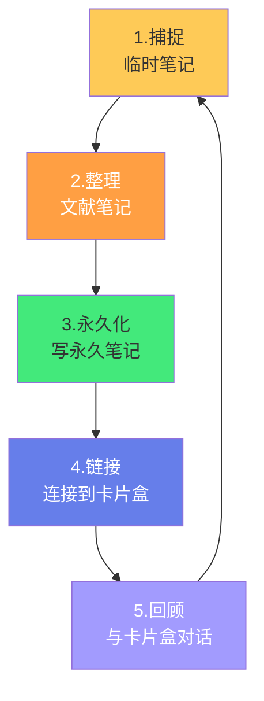

# 🗂️ Zettelkasten 卡片盒笔记法

> **文档说明**：系统讲解 Zettelkasten（卡片盒笔记法）的起源、核心理念、操作流程、数字时代实现与常见误区，涵盖 Zettelkasten 的起源与传奇（德国社会学家尼克拉斯·卢曼 Niklas Luhmann 用 9 万张卡片写出 70 本书和近 400 篇论文）、Zettelkasten 的核心哲学（卡片盒是「思考伙伴」而非「归档系统」/ 网络思维替代层级思维 / 知识通过连接产生价值 / 原子性与自主性）、三种笔记类型（临时笔记 Fleeting Notes / 文献笔记 Literature Notes / 永久笔记 Permanent Notes）及其转化流程、卡片的标准格式（唯一标识符 ID / 标题即论点 / 正文用自己的话 / 来源引用 / 双向链接）、卢曼的编号系统（分支编号如 1 / 1a / 1a1 / 1b，表达思想的分支与延续）、链接的建立方式（双向链接 / 标签索引 / 主题入口笔记 / 卡片间的对话关系）、Zettelkasten 的完整工作流（捕捉灵感 → 文献笔记 → 转化永久笔记 → 建立链接 → 定期回顾与对话）、Zettelkasten 与传统笔记的本质区别（归档 vs 对话 / 分类 vs 连接 / 存储 vs 生成）、数字时代的 Zettelkasten（Obsidian / Logseq / Roam Research 的实现方式）、数字 Zettelkasten 的最佳实践（文件命名 / 双链使用 / 图谱利用 / 避免文件夹依赖）、Zettelkasten 的九大核心原则（原子性 / 自主性 / 用自己的话 / 一个卡片一个想法 / 链接到已有卡片 / 不删除只连接 / 解释链接原因 / 添加来源 / 定期回顾）、Zettelkasten 与原子笔记 / 常青笔记 / MOC 的关系与区别、常见误区（只收集不链接 / 按主题分类 / 追求完美格式 / 数量崇拜 / 把卡片盒当数据库）、如何从零开始建立你的 Zettelkasten、卢曼的工作方式揭秘、常见问题与最佳实践。
>
> **适用人群**：知识管理实践者、研究者、写作者、终身学习者、Obsidian/Logseq 用户、第二大脑构建者
>
> **前置知识**：[[原子笔记原则与实践]] · [[常青笔记-EvergreenNotes]] · [[MOC内容地图]] · [[跨领域知识连接方法]]

---

## 一、概述

### 1.1 什么是 Zettelkasten

**Zettelkasten**（德语，意为「卡片盒」）是由德国社会学家 **尼克拉斯·卢曼（Niklas Luhmann，1927-1998）** 发明并实践的笔记方法。他用这个方法积累了约 **9 万张卡片**，产出了 **70 多本书**和近 **400 篇学术论文**，成为 20 世纪最重要的社会学家之一。



**卢曼的原话**：
> "我不是在思考，我是和我的卡片盒一起思考。"
> （"Ich denke nicht, ich denke mit meinem Zettelkasten."）

**核心洞察**：Zettelkasten 不是「笔记归档系统」，而是「外部思考系统」——你不是把笔记存进去就完事，而是和卡片盒「对话」，在对话中产生新想法。

### 1.2 Zettelkasten 的革命性

传统笔记 vs Zettelkasten：

| 维度 | 传统笔记 | Zettelkasten |
|------|---------|-------------|
| **目的** | 存储信息，方便查阅 | 产生新想法，辅助思考 |
| **组织** | 按主题/类别分层归档 | 按链接形成网络 |
| **卡片关系** | 孤立（属于某个文件夹） | 互联（双向链接到其他卡片） |
| **使用方式** | 需要时搜索查阅 | 定期「对话」，漫游发现关联 |
| **价值来源** | 存储的信息量 | 卡片间的连接和涌现 |
| **类比** | 图书馆（分类存储） | 大脑（神经元连接） |

> **核心区别**：传统笔记是「仓库」——你存东西进去，需要时取出来；Zettelkasten 是「生态系统」——卡片之间相互连接，产生你从未想过的新想法。

---

## 二、三种笔记类型

### 2.1 临时笔记（Fleeting Notes）

**定义**：随时随地快速捕捉的灵感、想法、疑问，不追求格式和完整。

**特征**：
- 快速记录，不整理
- 可以是半句话、一个词、一个问号
- 写在便签、手机备忘录、任何随手可得的地方
- **1-3 天内必须处理**——转化为永久笔记或删除

**示例**：
```text
- 缓存和记忆的关系？
- React 的 fiber 架构好像和操作系统进程调度有点像
- 今天会议想到：用户流失可能不是因为功能少，而是因为首屏太慢
```

### 2.2 文献笔记（Literature Notes）

**定义**：阅读书籍、文章、听课时记录的要点，按来源组织。

**特征**：
- 记录核心论点、关键证据、重要引用
- 保留来源信息（书名/作者/页码/链接）
- 可以用原文，但要标注引用
- 是「输入的整理」，不是「输出的创造」

**文献笔记模板**：
```markdown
---
title: 《书名》文献笔记
source: 书名/作者/页码
created: YYYY-MM-DD
type: 文献笔记
---

## 核心论点
（作者的核心观点是什么？）

## 关键要点
- 要点1（页码）
- 要点2（页码）

## 重要引用
> "原文引用"（页码）

## 个人思考
（我的想法、疑问、关联——这些将转化为永久笔记）

## 可转化的永久笔记
- [[概念1]]
- [[概念2]]
```

### 2.3 永久笔记（Permanent Notes）

**定义**：经过深度思考、用自己的话表达、可独立理解、与其他卡片建立链接的「知识原子」。

**特征**：
- 一个卡片一个核心想法（原子性）
- 用自己的话，不复制原文
- 可以独立理解（自主性）
- 包含来源引用
- 与已有卡片建立双向链接
- **永远不删除**，只添加和连接

**永久笔记格式**：
```markdown
---
id: 20260828120000    # 唯一标识符（时间戳或卢曼编号）
title: 论点式标题
tags: [标签1, 标签2]
created: 2026-08-28
sources: [来源1, 来源2]
links: [[相关卡片1]], [[相关卡片2]]
---

# 论点式标题

正文：用自己的话完整表达这个想法，
不需要参考上下文就能理解。
可以包含例子、类比、推理过程。

## 来源
- 《书名》p.123
- 文章链接

## 关联
- [[相关卡片1]] — 为什么相关
- [[相关卡片2]] — 对比/延伸/反例
```

### 2.4 转化流程



> **关键原则**：临时笔记和文献笔记都是「原材料」，最终要转化为永久笔记。永久笔记才是卡片盒的真正居民。

---

## 三、卡片的标准格式

### 3.1 唯一标识符（ID）

每张卡片需要一个**唯一且稳定的标识符**，用于引用和链接。

| 编号方式 | 示例 | 优点 | 缺点 |
|---------|------|------|------|
| **时间戳** | `20260828120000` | 唯一、自动生成、按时间排序 | 看不出思想关联 |
| **卢曼编号** | `1a / 1a1 / 1b` | 表达思想分支和延续 | 需要手动管理 |
| **UUID** | `a1b2c3d4-...` | 全局唯一 | 不友好、不可读 |
| **标题即ID** | `线程池通过复用线程减少开销` | 可读、语义化 | 标题修改会断链 |

**卢曼的编号系统**：
```text
1        — 第一个想法
1a       — 1的分支/补充
1a1      — 1a的分支
1a1a     — 继续分支
1b       — 1的另一个分支
2        — 第二个独立想法
2a       — 2的分支
```

> 卢曼编号的智慧：编号本身就表达了「思想的脉络」——1a 是 1 的延续或补充，1b 是 1 的另一个方向。这是一种「线性编号中的非线性表达」。

**数字时代的选择**：Obsidian 等工具用「文件名」作为 ID，推荐用「论点式标题」作为文件名（如 `线程池通过复用线程减少开销.md`），配合双链 `[[]]` 引用。标题修改时 Obsidian 会自动更新链接。

### 3.2 标题即论点

Zettelkasten 的卡片标题不是「主题词」，而是「完整的论点陈述」：

| 主题式标题（不好） | 论点式标题（好） |
|------------------|----------------|
| 线程池 | 线程池通过复用线程减少创建销毁的系统开销 |
| 缓存 | 缓存基于局部性原理，用空间换时间提升读取性能 |
| 双向链接 | 双向链接通过显式关联让知识从点变成网络 |
| 原子笔记 | 原子笔记通过聚焦单一概念实现可复用和可链接 |

> **为什么标题即论点重要**：扫一眼卡片标题列表，就能复习所有核心观点；链接时能精准判断相关性；标题本身就是「知识的浓缩」。

### 3.3 正文：用自己的话

- 永久笔记必须用**自己的话**写，不能复制粘贴原文
- 假设读者是「聪明但不了解这个特定主题的人」
- 不需要参考上下文就能理解（自主性）
- 可以包含例子、类比、推理、反例

### 3.4 来源与链接

- **来源**：标注想法来自哪里（书/文章/课程/自己的思考）
- **链接**：每张卡片至少链接 1-2 张已有卡片
- **解释链接**：不要只放链接，要说明「为什么相关」（对比/延伸/因果/反例）

---

## 四、链接：Zettelkasten 的灵魂

### 4.1 为什么链接最重要

卢曼的卡片盒之所以能产生新想法，核心在于**链接**：



- 孤立的笔记只是「信息碎片」
- 有链接的笔记形成「知识网络」
- 网络的价值随连接数指数增长（梅特卡夫定律）
- 新想法往往产生于「原本不相关的两个想法的连接」

### 4.2 如何建立链接

**1. 创建新卡片时**：
- 思考「这个想法和已有哪些想法相关？」
- 至少链接 1-2 张已有卡片
- 说明链接原因（对比/延伸/因果/反例）

**2. 定期回顾时**：
- 翻阅卡片盒，发现新的关联
- 在关系图谱中漫游，找到意外连接
- 为旧卡片补充新链接

**3. 写作时**：
- 从一张卡片出发，沿着链接漫游
- 把相关卡片串联起来，形成文章/论文的大纲
- 这就是卢曼「和卡片盒对话」的过程

### 4.3 链接的类型

| 类型 | 说明 | 示例 |
|------|------|------|
| **延伸** | 这个想法是另一个的深入 | [[缓存]] → [[缓存一致性问题]] |
| **对比** | 两个想法相似或相反 | [[进程]] ↔ [[线程]] |
| **因果** | A 导致 B | [[CPU缓存未命中]] → [[程序性能下降]] |
| **类比** | 跨领域的相似性 | [[计算机缓存]] ~ [[人类记忆]] |
| **反例** | 反驳或限制 | [[缓存提升性能]] → [[缓存穿透导致性能下降]] |
| **组成** | 部分与整体 | [[CPU]] ⊂ [[计算机体系结构]] |

---

## 五、完整工作流

### 5.1 五步工作流



| 步骤 | 动作 | 频率 | 时间 |
|------|------|------|------|
| **1. 捕捉** | 随手记录灵感和想法 | 随时 | 几秒 |
| **2. 整理** | 阅读时做文献笔记 | 阅读时 | 随阅读 |
| **3. 永久化** | 将有价值的想法转化为永久笔记 | 每日/每周 | 15-30分钟 |
| **4. 链接** | 为新卡片建立双向链接 | 写永久笔记时 | 5分钟 |
| **5. 回顾** | 翻阅卡片盒，发现新关联，产生新想法 | 每周 | 15-30分钟 |

### 5.2 卢曼的日常工作方式

1. **阅读时**：在卡片上做文献笔记，标注来源
2. **思考时**：将想法写为永久笔记，用自己的话
3. **归档时**：为新卡片编号，链接到已有卡片
4. **写作时**：从卡片盒中提取相关卡片，串联成文章
5. **回顾时**：翻阅卡片盒，与卡片「对话」，发现新关联

> 卢曼每天花大量时间在卡片盒中，不是「整理笔记」，而是「和卡片对话」——他会随机抽几张卡片，思考它们之间的关系，这种「漫游」经常产生新的研究思路。

---

## 六、数字时代的 Zettelkasten

### 6.1 工具对比

| 工具 | Zettelkasten 友好度 | 特点 |
|------|-------------------|------|
| **Obsidian** | ⭐⭐⭐⭐⭐ | 本地 Markdown、双链、关系图谱、插件丰富 |
| **Logseq** | ⭐⭐⭐⭐⭐ | 大纲式、本地 Markdown、双链、块引用 |
| **Roam Research** | ⭐⭐⭐⭐ | 双链鼻祖、块引用、但云端付费 |
| **Notion** | ⭐⭐ | 数据库强，但双链弱、非本地优先 |
| **纸质卡片** | ⭐⭐⭐ | 卢曼原版，但检索和链接不便 |

### 6.2 Obsidian 中的 Zettelkasten 实践

**文件夹结构**：
```text
知识库/
├── 00-收集箱/          # 临时笔记
├── 01-文献笔记/        # 文献笔记（按来源）
├── 02-永久笔记/        # 永久笔记（卡片盒核心）
├── 03-入口笔记/        # 主题入口/MOC
└── 04-输出/            # 文章/论文/项目
```

**核心实践**：
- 永久笔记用「论点式标题」命名
- 用 `[[]]` 双向链接
- 用关系图谱观察知识网络
- 用标签做辅助分类（不依赖文件夹）
- 用 MOC（内容地图）做主题入口

> **注意**：数字 Zettelkasten 不要过度依赖文件夹分类——文件夹是「物理组织」，链接才是「知识网络」。卢曼的卡片盒只有一个盒子（没有分类），所有关联都靠链接。

### 6.3 数字 Zettelkasten 的优势

- **搜索**：瞬间找到任何卡片（纸质需要翻找）
- **双向链接**：自动显示反向链接（纸质需要手动写）
- **关系图谱**：可视化知识网络（纸质无法直观看到）
- **复制修改**：轻松修改和重构（纸质卡片修改困难）
- **备份同步**：多设备同步、Git 版本控制

---

## 七、九大核心原则

### 7.1 原则一：原子性（Atomicity）

一张卡片只包含一个核心想法。如果一张卡片可以分成两个独立的想法，就拆成两张。

### 7.2 原则二：自主性（Autonomy）

一张卡片单独拿出来就能理解，不需要参考其他卡片或上下文。

### 7.3 原则三：用自己的话（Own Words）

永久笔记必须用自己的语言表达，复制原文不算「你的知识」。

### 7.4 原则四：标题即论点（Title as Claim）

标题是完整的论点陈述，不是主题词。

### 7.5 原则五：链接到已有卡片（Link to Existing）

创建新卡片时，主动链接到已有卡片，解释为什么相关。

### 7.6 原则六：不删除只连接（Never Delete, Only Connect）

永久笔记不删除。如果想法变了，写一张新卡片链接到旧卡片，说明修正或发展。

### 7.7 原则七：解释链接原因（Explain Links）

不要只放链接，要说明两张卡片的关系（对比/延伸/因果/反例）。

### 7.8 原则八：添加来源（Add Sources）

标注想法的来源，便于追溯和验证。

### 7.9 原则九：定期回顾（Review Regularly）

定期翻阅卡片盒，与卡片「对话」，发现新关联。这是 Zettelkasten 产生新想法的关键。

---

## 八、常见误区

| 误区 | 问题 | 正确做法 |
|------|------|---------|
| **只收集不链接** | 卡片盒变成「信息垃圾场」 | 每张卡片至少链接1-2张已有卡片 |
| **按主题分类** | 退回传统归档思维，失去网络价值 | 少用文件夹，多用链接和标签 |
| **追求完美格式** | 花大量时间排版，不产生想法 | 内容和链接比格式重要 |
| **数量崇拜** | 以「写了多少张」为目标 | 以「连接密度和想法质量」为目标 |
| **把卡片盒当数据库** | 只存不读，不与卡片对话 | 定期回顾，漫游卡片盒 |
| **复制原文** | 没有自己的思考，不是永久笔记 | 用自己的话重写，加入理解 |
| **大而全的卡片** | 一张卡片写几千字，无法复用 | 拆分原子卡片，一个想法一张 |
| **链接泛滥** | 为了链接而链接，降低链接质量 | 只链接真正相关的，说明原因 |

---

## 九、Zettelkasten 与其他方法的关系

### 9.1 Zettelkasten vs 原子笔记

| 维度 | Zettelkasten | 原子笔记 |
|------|-------------|---------|
| **起源** | 卢曼（1960s） | Zettelkasten 的继承和发展 |
| **侧重** | 卡片盒整体方法论（流程+链接+对话） | 单篇笔记的粒度规范 |
| **重叠** | 都强调一个想法一个卡片、用自己的话 | 同左 |
| **关系** | Zettelkasten 包含原子笔记的概念 | 原子笔记是 Zettelkasten 的基础单元 |

### 9.2 Zettelkasten vs 常青笔记

| 维度 | Zettelkasten | 常青笔记 |
|------|-------------|---------|
| **侧重** | 链接网络、对话、想法生成 | 持续进化、概念导向、自主可读 |
| **更新** | 卡片写好后较少修改 | 持续更新、反复迭代 |
| **重叠** | 都强调原子性、自主性、链接 | 同左 |
| **关系** | 常青笔记是 Zettelkasten 在数字时代的进化 | 常青笔记吸收了 Zettelkasten 的核心思想 |

### 9.3 Zettelkasten vs MOC

- **Zettelkasten**：原子卡片 + 双向链接形成的「知识网络」
- **MOC（内容地图）**：主题入口笔记，作为进入知识网络的「导航枢纽」
- **关系**：MOC 是 Zettelkasten 的「入口层」——从 MOC 出发，沿着链接深入卡片网络

> 参考：[[MOC内容地图]] · [[原子笔记原则与实践]] · [[常青笔记-EvergreenNotes]]

---

## 十、如何从零开始

### 10.1 第一步：不要想太多，开始写

- 不需要完美的系统，先开始记录
- 从你正在读的书/正在学的技术开始
- 每天写 1-3 张永久笔记即可

### 10.2 第二步：建立链接习惯

- 每张新卡片写好后，花 2 分钟思考「和什么有关」
- 至少链接 1 张已有卡片
- 用搜索找到相关卡片

### 10.3 第三步：定期回顾

- 每周花 15 分钟翻阅卡片盒
- 在关系图谱中漫游
- 发现新关联就补充链接

### 10.4 第四步：用卡片盒写作

- 当你要写文章/做分享时，从卡片盒中提取相关卡片
- 把卡片串联成大纲，再展开为文章
- 这是 Zettelkasten 的「终极价值验证」——你的卡片盒能不能帮你产出？

---

## 十一、常见问题

| 问题 | 回答 |
|------|------|
| **Zettelkasten 适合非学术人员吗？** | 适合。任何需要深度思考和知识积累的人都可以用（开发者、写作者、产品经理等） |
| **需要多少张卡片才有效？** | 质量比数量重要。100 张有良好链接的卡片 > 1000 张孤立卡片 |
| **数字工具还需要编号吗？** | 不需要。数字工具用文件名和双链即可，卢曼编号是纸质时代的产物 |
| **卡片盒和文件夹怎么平衡？** | 文件夹做粗分类（如临时/文献/永久），具体关联靠链接。不要用文件夹做主题分类 |
| **怎么知道链接建对了？** | 回顾时如果发现链接「不相关」或「太泛」，就修正。链接是迭代出来的 |
| **Zettelkasten 和第二大脑是什么关系？** | Zettelkasten 是第二大脑的核心方法论之一。第二大脑是更宽泛的概念，包含 PARA、CODE 等 |
| **我坚持不下来怎么办？** | 降低门槛：每天只写 1 张，每周只回顾 10 分钟。习惯比强度重要 |
| **卡片太多了找不到怎么办？** | 用搜索（数字工具）+ MOC 入口笔记 + 标签。Zettelkasten 不靠记忆靠链接和搜索 |

---

## 十二、关联笔记

### 知识管理方法论
- [[原子笔记原则与实践]] · [[常青笔记-EvergreenNotes]] · [[MOC内容地图]]
- [[LYT-链接你的思维]] · [[跨领域知识连接方法]] · [[PARA-项目领域资源归档]]
- [[第二大脑-BuildingSecondBrain]] · [[费曼学习法笔记实践]]
- [[笔记标题命名策略]] · [[标签与文件夹的边界]]

### 工具与实践
- [[Obsidian高效使用]] · [[Obsidian关系图谱优化]] · [[Obsidian-AI插件对比]]
- [[知识管理工具迁移指南]] · [[定期回顾与笔记重构]]

### 导航
- [[MOC-综合导航]] · [[MOC-知识管理方法论-四级展开]] · [[Home]] · [[学习路线总览]]

> 🔍 **知识点深度解析**
>
> **作用**：Zettelkasten 卡片盒笔记法解决的是「如何让笔记从『静态的信息归档』升级为『动态的思考伙伴』，通过卡片间的连接产生新想法」的核心问题——传统笔记方法（按主题分类、归档存储）只能帮你「记住信息」，而 Zettelkasten 通过原子卡片 + 双向链接 + 定期对话的方法，让笔记系统成为「外部大脑」，不仅存储知识，更能**产生新知识**。卢曼用这个方法写出了 70 本书，证明了「和卡片盒一起思考」的威力。
>
> **底层原理**：①Zettelkasten 的核心认知科学基础是「连接主义（Connectionism）」——知识不是存储在孤立的单元中，而是存在于单元之间的连接中。大脑的记忆和创造力来自神经元的连接模式，Zettelkasten 模拟了这一机制：每张卡片是一个「神经元」，双向链接是「突触」，卡片网络是「外部大脑皮层」。当你在卡片间建立新连接时，就像大脑中形成新的神经通路，产生新的想法。②「原子性+自主性」的设计源于「知识的可组合性」——只有当每个知识单元足够小（原子性）且独立可读（自主性）时，它们才能在不同上下文中被自由组合和复用。大而全的笔记就像「硬编码的模块」，无法复用；原子笔记就像「函数库」，可以在不同文章和项目中自由组合。③「用自己的话」背后是「生成效应」——被动复制原文只是「信息接触」，用自己的话重写是「主动生成」，后者的记忆和理解深度是前者的数倍。卢曼要求永久笔记必须用自己的话，本质是强制「深度加工」。④「定期回顾和对话」背后是「间隔重复」和「创意漫游」——定期回顾卡片盒不仅是复习（间隔重复强化记忆），更是「创意漫游」——随机翻阅不同主题的卡片，意外发现跨领域关联，这是创造力的重要来源。卢曼说「我和卡片盒一起思考」，正是因为在漫游中产生的意外连接触发了新的研究思路。⑤「不删除只连接」背后是「知识的进化论」——知识不是线性积累的，而是不断修正和发展的。旧的想法不是「错误」，而是「认知发展的一个阶段」。通过链接新想法到旧想法（而非删除旧想法），你保留了认知发展的完整轨迹，这本身就是有价值的知识。⑥卢曼编号系统的智慧是「在线性存储中表达非线性思想」——纸质卡片只能线性排列，但通过分支编号（1/1a/1a1/1b），卢曼在一维的卡片盒中表达了二维的思想网络：1a 是 1 的延续，1b 是 1 的另一个方向，1a1 是 1a 的深入。数字工具用双向链接和图谱更直观地实现了这一点，但卢曼编号的「思想脉络表达」仍然值得借鉴。
>
> **用法要点**：① 三种笔记：临时笔记(灵感/1-3天处理)、文献笔记(阅读要点/按来源)、永久笔记(自己的话+链接/卡片盒核心) ② 永久笔记格式：唯一ID+论点式标题+自己的话正文+来源+双向链接(说明链接原因) ③ 原子性：一张卡片一个想法，可拆分就拆分 ④ 自主性：单独拿出来能看懂，不依赖上下文 ⑤ 链接：每张至少链接1-2张已有卡片，说明关系(延伸/对比/因果/类比/反例/组成) ⑥ 工作流：捕捉(随时)→文献笔记(阅读时)→永久化(每日15分)→链接(写笔记时)→回顾(每周15分漫游) ⑦ 数字实现：Obsidian/Logseq，用论点式标题命名+[[]]双链+关系图谱，少用文件夹多用链接 ⑧ 九大原则：原子性/自主性/自己的话/标题即论点/链接已有/不删除只连接/解释链接原因/添加来源/定期回顾 ⑨ 常见误区：只收集不链接/按主题分类/追求完美格式/数量崇拜/当数据库/复制原文/大而全/链接泛滥 ⑩ 与其他方法：原子笔记(粒度规范)是Zettelkasten的基础单元，常青笔记(持续进化)是数字时代的进化，MOC(入口导航)是进入卡片网络的枢纽 ⑪ 从零开始：先写起来(每天1-3张)→建链接习惯(每张至少1链接)→定期回顾(每周漫游)→用卡片盒写作(提取串联成文章) ⑫ 卢曼核心：「我不是在思考，我是和我的卡片盒一起思考」——卡片盒是思考伙伴，不是归档系统。

> 💡 **深度讲解**：Zettelkasten 最核心的智慧是「笔记的价值不在于存储了多少信息，而在于建立了多少连接——知识网络的创造力来自连接，而非节点」——我们从小被教育的笔记方法是「分类归档」：语文笔记放语文文件夹，数学笔记放数学文件夹，技术笔记放技术文件夹。这种方法的隐含假设是「知识是按领域分割的」，但真正的创造力往往来自「跨领域的连接」——卢曼作为社会学家，他的理论大量借鉴了生物学（系统论）、计算机科学（控制论）、数学（博弈论），这些跨领域连接正是在卡片盒的「漫游」中发现的。传统的分类归档把知识关进了「领域的笼子」，而 Zettelkasten 的链接网络让知识可以自由地跨领域连接，这就是它能产生新想法的根本原因。Zettelkasten 的另一个深层智慧是「将思考外部化」——人的工作记忆极其有限（只能同时处理 4-7 个信息块），面对复杂问题时，大脑的「内存」不够用。Zettelkasten 将想法外部化为卡片，让你可以「看到」自己的思考，在卡片之间移动、连接、重组——这就像给大脑加了「外置内存」和「可视化工作区」。卢曼说「我和卡片盒一起思考」，字面意思就是：他的思考过程不是完全在大脑里进行的，而是在「大脑+卡片盒」的扩展系统中进行的。这种「扩展认知（Extended Cognition）」的思想在今天被 AI 工具进一步放大——Cursor、ChatGPT 等 AI 工具本质上也是「外部思考伙伴」，和 Zettelkasten 的哲学一脉相承。理解了 Zettelkasten，你就理解了「第二大脑」和「AI 辅助思考」的深层逻辑：不是用工具替代大脑，而是用工具扩展大脑的能力边界。

> 📝 **精简总结**：Zettelkasten卡片盒笔记法=卢曼发明的「思考伙伴」笔记系统，用9万张卡片产出70本书。核心：卡片盒是对话伙伴非归档系统，知识在连接中产生价值。三种笔记：临时(灵感)/文献(阅读要点)/永久(自己的话+链接,卡片盒核心)。永久笔记格式：唯一ID+论点式标题+自己的话+来源+双向链接(说明原因)。原子性(一卡一想)+自主性(独立可读)+链接(至少1-2张)。工作流：捕捉→文献笔记→永久化→链接→每周回顾漫游。数字实现：Obsidian/Logseq，论点标题+[[]]双链+图谱，少文件夹多链接。九大原则：原子/自主/自己的话/标题论点/链接已有/不删只连/解释链接/加来源/定期回顾。误区：只收集不链接/按主题分类/追求格式/数量崇拜/当数据库/复制原文/大而全。与原子笔记(粒度)/常青笔记(进化)/MOC(入口)互补。卢曼核心：「我和卡片盒一起思考」。

> **学习路径建议**：先阅读 [[原子笔记原则与实践]] 理解笔记的基本单元 → 学习本文档掌握 Zettelkasten 方法论 → 实践：从当前阅读的书开始，写 10 张永久笔记并建立链接 → 学习 [[MOC内容地图]] 和 [[LYT-链接你的思维]] 构建知识网络入口 → 学习 [[常青笔记-EvergreenNotes]] 理解持续进化的笔记观 → 实践：每周回顾卡片盒，在图谱中漫游发现新连接 → 实践：用卡片盒写一篇文章（提取相关卡片→串联成大纲→展开） → 长期坚持，让卡片盒成为你的「外部大脑」。

---

> **Zettelkasten 卡片盒笔记法的本质是「将思考外部化为可连接、可漫游、可对话的卡片网络，让笔记从『信息的坟墓』变成『想法的孵化器』」——大多数人的笔记是「单向的」：写进去，就再也不看了。笔记变成了「信息的坟墓」——埋葬了曾经读过的书、听过的课、闪过的灵感，但从未产生新的价值。卢曼的 Zettelkasten 彻底改变了这个范式：笔记不是「存进去就完事」，而是「存进去后要不断连接、回顾、对话」。每张卡片不是终点，而是新想法的起点——当你把「缓存」和「人类记忆」连接起来，你可能会想到「计算机缓存和人类记忆都基于局部性原理」；当你把「线程池」和「团队管理」连接起来，你可能会发现「线程复用和团队复用是同一个资源调度问题」。这些跨领域连接，正是创造力的源泉。更妙的是，Zettelkasten 模拟了大脑的工作方式：大脑的记忆不在单个神经元中，而在神经元的连接模式中；创造力不是来自单个想法，而来自想法的意外连接。Zettelkasten 就是你的「外部大脑皮层」——你给它喂入想法（卡片），建立连接（双链），定期漫游（回顾），它就会回馈你意想不到的新想法。卢曼用这个方法写出了 70 本书，不是因为他比别人聪明，而是因为他有一个「永不疲倦、永远连接、随时对话」的思考伙伴。在数字时代，Obsidian/Logseq 等工具让 Zettelkasten 比卢曼的纸质卡片盒强大 100 倍——搜索、双向链接、关系图谱、插件生态。但工具再强大，核心不变：**写原子卡片、建立有意义的连接、定期与卡片盒对话**。从今天开始，不要只「记笔记」，开始「养卡片盒」——给它喂入想法，帮它建立连接，定期和它对话，假以时日，它会成为你最有价值的「思考伙伴」和「第二大脑」。**
