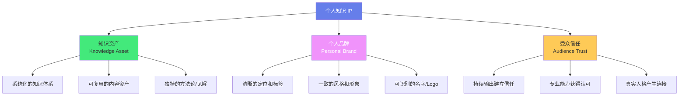
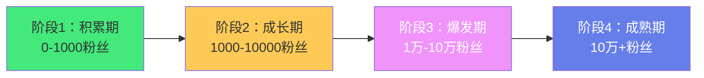
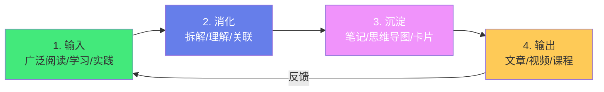
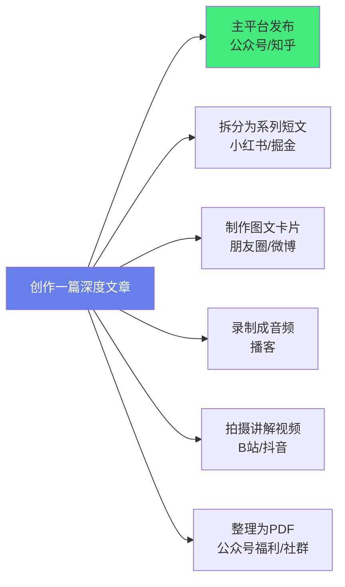

# 🎯 个人知识 IP 构建

> **文档说明**：系统讲解个人知识 IP（Intellectual Property）构建的完整方法论，涵盖个人知识 IP 的核心概念与价值、IP 定位与差异化、知识体系构建与沉淀、内容创作与输出策略、平台选择与运营、粉丝增长与社群运营、知识变现路径（课程/咨询/付费社群/出版/广告）、个人品牌建设、从 0 到 1 的执行路线图、常见误区与最佳实践、工具与资源推荐。
>
> **适用人群**：知识工作者、技术人员、领域专家、希望通过知识变现的人、自由职业者、内容创作者
>
> **前置知识**：[[知识管理方法论总览]] · [[读书笔记拆解法]] · [[LYT-链接你的思维]]

---

## 一、概述

### 1.1 什么是个人知识 IP

**个人知识 IP** 是指个人通过持续输出特定领域的专业知识，建立起的具有辨识度和影响力的个人品牌，其核心是「知识资产 + 个人品牌 + 受众信任」的三位一体。

**个人知识 IP 的三个核心要素**：


| 要素 | 说明 | 关键问题 |
|------|------|---------|
| **知识资产** | 你拥有的系统化知识、方法论、见解、内容 | 你在什么领域有深入的知识和独特见解？ |
| **个人品牌** | 你的名字、形象、风格、标签在受众心中的认知 | 别人提到你时会想到什么？你的标签是什么？ |
| **受众信任** | 受众对你的专业能力和人品的信任程度 | 受众为什么愿意听你的、买你的、推荐你？ |

> **核心洞察**：个人知识 IP 不是「网红」，而是「在特定领域有专业知识和影响力的人」。它的核心是知识和信任，不是流量和炒作。有知识没品牌是「怀才不遇」，有品牌没知识是「昙花一现」，知识+品牌+信任才是可持续的个人 IP。

### 1.2 为什么要构建个人知识 IP

| 价值 | 说明 |
|------|------|
| **职业护城河** | 个人 IP 是你的「数字名片」，让机会主动找到你（猎头、合作、邀约） |
| **知识变现** | 将知识转化为收入（课程、咨询、付费社群、出版、广告等） |
| **职业自由** | 有了个人 IP 和受众，可以选择自由职业、远程工作、创业 |
| **倒逼输入** | 输出倒逼输入，为了持续输出你会持续学习，知识体系不断深化 |
| **影响力放大** | 你的观点和知识可以影响更多人，获得行业话语权 |
| **抗风险能力** | 不依赖单一雇主，即使失业也有收入来源和职业机会 |
| **人脉扩展** | 通过内容吸引同频的人，建立高质量的人脉网络 |
| **自我实现** | 通过分享知识帮助他人，获得成就感和自我价值实现 |

> **关键认知**：在互联网时代，「你是谁」比「你在哪家公司」更重要。公司的 title 是暂时的，个人 IP 是终身的。构建个人知识 IP 是对自己的长期投资，复利效应显著——前期投入大、回报慢，后期回报指数级增长。

### 1.3 个人知识 IP 的阶段



| 阶段 | 粉丝量 | 核心目标 | 关键动作 | 变现 |
|------|--------|---------|---------|------|
| **积累期** | 0-1000 | 找到定位，持续输出，积累第一批粉丝 | 确定领域、持续输出、优化内容、互动 | 几乎没有，专注积累 |
| **成长期** | 1000-1万 | 建立个人品牌，扩大影响力，形成内容体系 | 内容系列化、打造爆款、多平台分发、社群 | 小额变现（赞赏、小额咨询、低价课程） |
| **爆发期** | 1万-10万 | 知识变现，建立商业模式，团队化运营 | 推出产品（课程/社群）、品牌合作、团队协作 | 主要收入来源（课程/咨询/社群/广告） |
| **成熟期** | 10万+ | 品牌升级，多元化变现，行业影响力 | 出版书籍、线下活动、投资、IP授权、企业服务 | 多元化高收入，被动收入占比高 |

> **重要提醒**：不要急于变现。积累期和成长期的核心是「提供价值、建立信任」，而不是「赚钱」。信任建立起来了，变现是水到渠成的事。过早变现会透支信任，得不偿失。

---

## 二、IP 定位与差异化

### 2.1 定位的核心三问

好的定位是个人 IP 成功的一半。定位需要回答三个核心问题：

| 问题 | 说明 | 示例 |
|------|------|------|
| **你是谁？** | 你的身份、背景、专业领域 | 「5 年全栈工程师，专注 Java 后端和云原生」 |
| **为谁服务？** | 你的目标受众是谁，他们有什么痛点 | 「帮助想转行全栈开发的程序员系统学习」 |
| **提供什么独特价值？** | 你和别人有什么不同，为什么选你 | 「用项目驱动的方式教学，学完就能做项目」 |

**定位公式**：
```text
我是【身份/背景】，帮助【目标受众】，通过【独特方法】，解决【核心痛点】，实现【理想结果】。
```

**示例**：
- 「我是 8 年 Java 架构师，帮助初中级 Java 工程师，通过源码阅读+项目实战，突破技术瓶颈，晋升高级工程师。」
- 「我是 AI 应用开发者，帮助非技术背景的产品经理，通过低代码工具+提示词工程，快速构建 AI 应用，提升工作效率。」
- 「我是 Obsidian 知识管理专家，帮助知识工作者，通过 PARA+LYT 方法论，构建个人知识库，提升学习和工作效率。」

### 2.2 找到你的差异化

在信息过载的时代，「什么都讲」等于「什么都没讲」。差异化是个人 IP 的核心竞争力。

**差异化的四个维度**：
| 维度 | 说明 | 方法 |
|------|------|------|
| **领域差异化** | 选择一个细分领域，而不是大而全 | 「全栈开发」→「Java 全栈+云原生」→「Spring Boot+K8s 微服务实战」 |
| **视角差异化** | 用独特的视角解读常见话题 | 「从源码角度讲 Spring」「从面试角度讲算法」「从踩坑角度讲 Docker」 |
| **方法差异化** | 有独特的方法论或教学方式 | 「项目驱动学习」「费曼技巧教学」「对比式学习」 |
| **人格差异化** | 展现真实的人格和风格 | 幽默风趣、严谨专业、温暖鼓励、犀利直接 |

**差异化定位矩阵**：
```text
        大众领域
           ↑
           |
  竞争激烈  |  蓝海机会
  (红海)    |  (细分+差异化)
-----------+-----------→ 细分领域
  无人问津  |  精准定位
  (太小)    |  (小而美)
           |
        小众领域
```

> **定位策略**：选择「大众领域 × 细分视角」——领域足够大（有足够受众），但视角足够细分（竞争少、有辨识度）。例如「全栈开发」是大众领域，但「从 0 到 1 构建全栈知识库」就是细分视角。

### 2.3 定位的常见误区

| 误区 | 说明 | 纠正 |
|------|------|------|
| **定位太宽** | 「我要讲编程」「我要做知识分享」 | 缩小到具体领域和受众，「Java 后端面试」「前端性能优化」 |
| **定位太窄** | 「我只讲 Java 8 的 Stream API」 | 确保领域足够大，有持续输出空间和足够受众 |
| **追热点** | 什么火讲什么，没有持续方向 | 选择自己有积累且感兴趣的领域，长期深耕 |
| **模仿别人** | 完全照搬别人的定位和风格 | 借鉴方法，但要有自己的独特视角和人格 |
| **追求完美** | 想等「准备好」再开始 | 先开始再优化，定位是迭代出来的，不是想出来的 |
| **频繁换定位** | 做了几个月没效果就换领域 | 至少坚持 6 个月再评估，积累需要时间 |
| **只看竞争不看需求** | 只看别人在做什么，不看受众需要什么 | 从受众痛点出发，而不是从竞争出发 |

---

## 三、知识体系构建与沉淀

### 3.1 构建个人知识体系

个人知识 IP 的基础是「知识资产」——你需要有系统化的知识体系，而不是零散的知识点。

**知识体系构建的四步法**：


| 步骤 | 说明 | 方法 |
|------|------|------|
| **输入** | 广泛阅读书籍、论文、博客、文档，听课，实践项目 | 主题阅读、跟进行业前沿、动手实践 |
| **消化** | 将输入的知识拆解、理解、与已有知识关联 | 费曼技巧、思维导图、概念关联、对比分析 |
| **沉淀** | 将消化后的知识以结构化的方式记录下来 | 原子化笔记、MOC、知识库、卡片盒 |
| **输出** | 将沉淀的知识转化为面向受众的内容 | 文章、视频、课程、演讲、开源项目 |

**知识体系的结构**：
```text
个人知识体系
├── 核心领域（深耕）
│   ├── 基础概念（必须掌握的底层概念）
│   ├── 核心技能（可复用的方法和技术）
│   ├── 最佳实践（经过验证的实践经验）
│   ├── 常见问题（踩坑和解决方案）
│   └── 前沿动态（行业最新趋势）
├── 关联领域（了解）
│   ├── 与核心领域相关的周边知识
│   └── 跨领域的交叉知识
└── 通用能力（基础）
    ├── 学习能力、思考能力、表达能力
    ├── 工具使用、项目管理、沟通协作
    └── 个人品牌、内容创作、商业思维
```

### 3.2 用 Obsidian 沉淀知识资产

Obsidian 是构建个人知识体系和沉淀知识资产的最佳工具之一。

**Obsidian 知识库结构（面向 IP 构建）**：
```text
知识库/
├── 00-Inbox/                    # 收件箱（快速捕获）
├── 01-知识体系/                  # 系统化的知识笔记
│   ├── 核心领域/
│   │   ├── 基础概念/
│   │   ├── 核心技能/
│   │   ├── 最佳实践/
│   │   └── 常见问题/
│   └── 关联领域/
├── 02-MOC/                       # 内容地图（主题导航）
├── 03-内容创作/                   # 输出的内容（文章/视频脚本）
│   ├── 已发布/
│   ├── 草稿/
│   └── 选题库/
├── 04-读书笔记/                   # 读书笔记
├── 05-项目笔记/                   # 项目实践笔记
├── 06-每日笔记/                   # 每日笔记/灵感
└── 99-模板/                       # 笔记模板
```

**关键实践**：
1. **原子化笔记**：一个笔记一个概念，便于引用和复用
2. **双向链接**：建立概念间的关联，形成知识网络
3. **MOC 导航**：为每个主题创建 MOC，作为内容创作的素材库
4. **标签体系**：用标签从多个维度分类笔记（领域/类型/状态/可输出）
5. **模板标准化**：用统一的笔记模板，保证质量和效率
6. **定期回顾**：每周回顾笔记，添加链接，发现可输出的主题

> **核心洞察**：你的 Obsidian 知识库就是个人 IP 的「素材库」和「生产线」——每一篇原子化笔记都是内容素材，MOC 是内容的组织结构，从知识库到内容输出是一个自然的流水线。当你的知识库足够丰富时，内容创作就是「从知识库中提取和组织」，而不是「从零开始写」。

### 3.3 从知识到内容的转化

知识笔记 ≠ 面向受众的内容。知识笔记是给自己看的（准确、完整、结构化），内容是给受众看的（易懂、有趣、有价值、有故事）。

**知识笔记 → 内容的转化方法**：
| 维度 | 知识笔记 | 面向受众的内容 |
|------|---------|--------------|
| **目的** | 自己理解和记忆 | 帮助受众理解和行动 |
| **语言** | 专业术语、简洁 | 通俗易懂、生动 |
| **结构** | 概念定义→原理→示例 | 痛点引入→故事→方法→行动 |
| **详略** | 全面完整 | 聚焦核心，有所取舍 |
| **互动** | 无 | 提问、练习、作业、评论区互动 |
| **情感** | 理性客观 | 有温度、有共鸣、有鼓励 |

**转化公式**：
```text
一篇好内容 = 一个核心观点 + 一个生动故事/案例 + 一套可操作方法 + 一个明确行动
```

**示例**：
- 知识笔记：「CAS（Compare-And-Swap）是一种原子操作，比较内存中的值与预期值，如果相等则更新为新值，返回是否成功。CAS 是无锁编程的基础。」
- 面向受众的内容：「你写的 i++ 为什么在多线程下结果不对？因为它不是原子操作！今天用一个生活中的例子讲清楚 CAS——就像你去超市买最后一瓶牛奶，你看到货架上有（预期值），拿起来去结账（更新），但如果别人先拿走了（值变了），你就买不到了（CAS 失败）。这就是 CAS 的核心思想……（然后讲原理、代码示例、在 Java 中的应用、面试考点）」

---

## 四、内容创作与输出策略

### 4.1 内容形式选择

| 形式 | 优点 | 缺点 | 适合人群 | 平台 |
|------|------|------|---------|------|
| **图文（文章）** | 深度表达、SEO 友好、可复用、制作成本中等 | 阅读门槛高、传播性中等 | 擅长写作、有深度内容 | 公众号、知乎、掘金、博客、小红书 |
| **短视频** | 传播快、受众广、算法推荐强 | 制作成本高、内容浅、竞争激烈 | 表现力强、擅长讲解 | 抖音、B站、视频号、小红书 |
| **中长视频** | 深度内容、粉丝粘性高、变现能力强 | 制作成本高、周期长 | 擅长系统讲解、有耐心 | B站、YouTube、视频号 |
| **音频（播客）** | 伴随性强、制作成本低、粉丝忠诚 | 受众相对小、变现慢 | 声音好听、擅长聊天 | 小宇宙、喜马拉雅、Apple Podcast |
| **直播** | 互动性强、即时反馈、变现快 | 时间固定、需要持续 | 擅长互动、有时间 | 视频号、抖音、B站、知识星球 |
| **图文卡片** | 制作快、传播性强、适合碎片化阅读 | 内容浅、需要设计能力 | 擅长提炼、有设计感 | 小红书、微博、朋友圈 |
| **代码/开源项目** | 建立技术影响力、可复用、长期价值 | 见效慢、需要持续维护 | 技术人员 | GitHub、Gitee |

> **选择策略**：选择 1 个主形式（你最擅长且能持续输出的）+ 1-2 个辅助形式（将主形式内容二次分发）。例如主形式是「技术文章」，辅助形式是「将文章要点做成图文卡片发小红书」和「将文章录制成音频发播客」。不要一开始就做所有形式，精力分散会导致每个都做不好。

### 4.2 内容选题方法

持续输出的最大挑战是「不知道写什么」。建立系统化的选题方法可以解决这个问题。

**选题来源**：
| 来源 | 说明 | 示例 |
|------|------|------|
| **受众痛点** | 受众在评论区/社群/私信中问的问题 | 「Spring Boot 如何集成 Redis？」「面试被问 CAS 怎么回答？」 |
| **学习笔记** | 你正在学习的知识，学完就输出 | 「我刚学了 K8s Operator，这是我的理解」 |
| **踩坑经验** | 你在工作中遇到的问题和解决方案 | 「Docker 构建慢的 5 个优化技巧」 |
| **行业热点** | 行业最新动态和你的解读 | 「OpenAI 发布了新模型，对开发者意味着什么？」 |
| **对比分析** | 两个或多个技术/方法的对比 | 「Redis vs Memcached，缓存该怎么选？」 |
| **入门教程** | 面向新手的系统教程 | 「从零开始学 Docker，一篇就够了」 |
| **深度解析** | 对某个概念/技术的深入讲解 | 「JVM 垃圾回收器深度解析」 |
| **项目实战** | 完整项目的开发过程 | 「用 Spring Boot + Vue3 做一个博客系统」 |
| **书单/工具推荐** | 你用过的好书/好工具推荐 | 「全栈开发者必备的 10 个工具」 |
| **职业发展** | 面试、简历、晋升、职业规划 | 「3 年 Java 经验如何准备大厂面试？」 |

**选题库管理**：
- 在 Obsidian 中建立「选题库」笔记，随时记录灵感
- 每个选题标注：标题、核心观点、目标受众、内容形式、优先级、状态（待写/写作中/已发布）
- 每周从选题库中选 2-3 个进行创作
- 已发布的内容标注发布日期、平台、数据反馈

### 4.3 内容结构模板

好的内容有清晰的结构，使用模板可以提升写作效率和质量。

**技术文章结构模板**：
```markdown
# 标题（包含关键词，吸引点击）

> 一句话摘要：这篇文章讲什么，读者能获得什么

## 一、为什么需要这个（痛点引入）
- 描述受众面临的问题/痛点
- 说明这个技术/方法解决什么问题
- 用一个生动的例子或故事引入

## 二、核心概念（是什么）
- 定义和基本概念
- 核心原理和工作机制
- 关键术语解释
- 配合示意图/流程图

## 三、实操示例（怎么用）
- 环境准备
- 完整的代码示例（可运行）
- 逐步讲解
- 常见配置和参数说明

## 四、进阶用法（深入）
- 高级特性和技巧
- 最佳实践
- 性能优化
- 与其他技术的集成

## 五、常见问题与坑（避坑）
- 常见错误和解决方案
- 性能陷阱
- 兼容性问题
- 调试技巧

## 六、总结
- 核心要点回顾
- 适用场景总结
- 学习路径建议
- 下一步行动

## 参考资料
- 相关文档和链接
```

**短视频脚本结构模板**：
```text
【0-3秒】钩子：抛出一个痛点/问题/反常识观点，抓住注意力
【3-15秒】背景：简要说明这个问题的影响和重要性
【15-60秒】核心：讲解核心方法/原理/步骤（1-3个要点）
【60-90秒】示例：一个具体的例子/演示，让观众理解
【90-120秒】总结+行动：回顾要点，给出明确行动，引导关注/评论/收藏
```

### 4.4 持续输出的节奏

| 阶段 | 输出频率 | 内容深度 | 说明 |
|------|---------|---------|------|
| **积累期** | 每周 1-2 篇 | 中等（入门教程、学习笔记） | 建立输出习惯，不要追求篇篇爆款 |
| **成长期** | 每周 2-3 篇 | 中高（深度解析、项目实战） | 提升内容质量，打造爆款 |
| **爆发期** | 每周 3-5 篇 + 视频 | 高（系列教程、课程） | 多形式输出，团队化协作 |
| **成熟期** | 每周 1-2 篇精品 | 极高（行业洞察、方法论） | 少而精，注重质量和影响力 |

> **关键原则**：质量 > 数量。一篇深度好文的价值远大于 10 篇水文。但在积累期，「持续输出」比「篇篇精品」更重要——先建立习惯和节奏，再逐步提升质量。

---

## 五、平台选择与运营

### 5.1 主流内容平台对比

| 平台 | 类型 | 受众特征 | 算法特点 | 变现能力 | 适合内容 |
|------|------|---------|---------|---------|---------|
| **微信公众号** | 图文 | 泛人群、粉丝粘性高 | 订阅制+推荐，私域流量强 | 强（赞赏/广告/付费阅读/课程） | 深度文章、行业洞察 |
| **知乎** | 图文问答 | 高知人群、技术人群多 | 问答推荐+搜索流量 | 中（盐选/咨询/广告） | 技术问答、深度解析、经验分享 |
| **掘金** | 技术图文 | 前端/后端开发者 | 技术社区推荐+热度 | 弱（社区活动） | 技术教程、项目实战 |
| **CSDN** | 技术图文 | 全栈开发者、学生 | 搜索流量大 | 中（VIP/广告/课程） | 技术教程、入门指南 |
| **小红书** | 图文/短视频 | 年轻女性为主、泛人群 | 算法推荐强、搜索增长快 | 强（广告/带货/薯店） | 学习方法、工具推荐、效率技巧 |
| **B站** | 中长视频 | 年轻人、学习人群 | 推荐+搜索，粉丝粘性高 | 强（充电/广告/课程/直播） | 系统教程、技术讲解、学习vlog |
| **抖音** | 短视频 | 泛人群、流量大 | 算法推荐极强 | 强（广告/带货/直播/课程） | 知识科普、技巧分享、效率工具 |
| **视频号** | 短视频/直播 | 微信生态、中年人群 | 社交推荐+算法 | 中（广告/直播/课程） | 泛知识、职业发展、生活技巧 |
| **YouTube** | 中长视频 | 全球受众 | 推荐+搜索 | 强（广告/会员/赞助） | 英文内容、技术教程 |
| **GitHub** | 代码/项目 | 开发者 | 项目质量+star数 | 弱（赞助/外包机会） | 开源项目、代码示例 |
| **个人博客** | 图文 | 精准受众 | SEO+直接访问 | 弱（需自己引流） | 深度文章、作品集 |
| **知识星球** | 付费社群 | 付费粉丝、高粘性 | 私域社群 | 强（社群费/课程/咨询） | 深度内容、问答、社群运营 |

### 5.2 平台选择策略

**选择原则**：
1. **主平台 1 个**：选择你目标受众最集中、你最擅长的形式的平台，作为主阵地
2. **辅助平台 2-3 个**：将主平台内容二次分发到辅助平台，扩大影响力
3. **私域沉淀**：无论在哪个平台，最终都要将粉丝沉淀到私域（公众号/社群/邮件列表）

**技术人员推荐组合**：
| 目标 | 主平台 | 辅助平台 | 私域 |
|------|--------|---------|------|
| 技术影响力 | 掘金/知乎 | GitHub、CSDN、公众号 | 公众号 |
| 知识变现 | 公众号 | 知乎、B站、小红书 | 知识星球/社群 |
| 求职/职业发展 | 知乎+GitHub | 掘金、LinkedIn | — |
| 泛知识/学习方法 | 小红书+B站 | 公众号、抖音 | 公众号/社群 |

> **重要提醒**：不要一开始就全平台运营。先在一个平台做到 1000 粉丝，验证了内容方向和受众反馈后，再扩展到其他平台。全平台运营会分散精力，导致每个平台都做不好。

### 5.3 多平台分发策略

**一次创作，多次分发**：


**分发注意事项**：
- 各平台有不同的内容风格和格式要求，需要适当调整（不是简单复制粘贴）
- 主平台首发，24-48 小时后再分发到辅助平台（避免主平台判定为非原创）
- 每个平台的标题、封面、开头需要根据平台特点优化
- 在辅助平台的内容中引导关注主平台/私域

---

## 六、知识变现路径

### 6.1 变现方式对比

| 变现方式 | 说明 | 门槛 | 收入潜力 | 适合阶段 | 被动收入 |
|---------|------|------|---------|---------|---------|
| **广告/流量主** | 平台广告分成、品牌广告 | 中（需要一定粉丝量） | 中低 | 成长期+ | 是 |
| **赞赏/打赏** | 读者自愿打赏 | 低 | 低 | 积累期+ | 否 |
| **付费咨询** | 一对一咨询/答疑 | 中（需要专业能力） | 中高 | 成长期+ | 否 |
| **付费社群** | 知识星球/微信群，年费/月费 | 中高（需要持续运营） | 高 | 爆发期+ | 部分 |
| **在线课程** | 录制系统课程，一次制作多次销售 | 高（需要系统内容和制作） | 很高 | 爆发期+ | 是 |
| **出版书籍** | 实体书/电子书出版 | 高（需要深度内容和出版社） | 中高 | 成熟期+ | 是 |
| **企业培训/演讲** | 为企业提供内训/演讲 | 高（需要行业影响力） | 很高 | 成熟期+ | 否 |
| **开源赞助** | GitHub Sponsors/爱发电 | 低 | 低 | 积累期+ | 是 |
| **带货/分销** | 推荐产品/课程，获得佣金 | 低 | 中 | 成长期+ | 是 |
| **IP授权/合作** | 品牌合作、IP联名、内容授权 | 很高 | 很高 | 成熟期+ | 是 |
| **自由职业/外包** | 通过个人IP获得项目/工作机会 | 中 | 中高 | 成长期+ | 否 |

### 6.2 变现阶段建议

| 阶段 | 粉丝量 | 推荐变现方式 | 核心策略 |
|------|--------|------------|---------|
| **积累期** | 0-1000 | 几乎不变现，或小额赞赏 | 专注内容质量和粉丝积累，建立信任 |
| **成长期** | 1000-1万 | 赞赏、小额咨询、低价产品（9.9-99元）、广告 | 验证变现模式，推出低价产品测试需求 |
| **爆发期** | 1万-10万 | 课程（99-999元）、付费社群（199-599元/年）、咨询（500-2000元/次）、广告 | 推出核心产品，建立变现体系，品牌合作 |
| **成熟期** | 10万+ | 高阶课程（999-9999元）、企业培训（1万+/天）、出版、IP授权、投资 | 多元化变现，被动收入占比提升，团队化运营 |

> **变现的核心原则**：
> 1. **先提供价值，再考虑变现**——信任是变现的基础
> 2. **产品要与定位匹配**——你的受众需要什么，你就提供什么
> 3. **从低价到高价逐步升级**——先验证需求，再推出高价产品
> 4. **被动收入优先**——课程、书籍、广告等被动收入比咨询/培训更可持续
> 5. **不要透支信任**——每一次变现都要保证产品质量，劣质产品会毁掉长期积累的信任

### 6.3 知识产品设计

**在线课程设计框架**：
```text
课程 = 明确的目标受众 + 清晰的学习目标 + 系统的内容结构 + 可操作的练习 + 可衡量的成果

课程结构：
1. 入门篇（为什么学、能获得什么、环境准备）—— 5-10%
2. 基础篇（核心概念、基本用法）—— 20-30%
3. 进阶篇（高级特性、最佳实践）—— 30-40%
4. 实战篇（完整项目、综合应用）—— 20-30%
5. 总结篇（回顾、学习路径、下一步）—— 5%
```

**付费社群运营框架**：
| 要素 | 说明 |
|------|------|
| **定位** | 明确社群解决什么问题、面向什么人 |
| **价值** | 持续提供的价值（每日分享/问答/资源/直播） |
| **规则** | 社群规则（禁止广告、鼓励分享等） |
| **活动** | 定期活动（每周分享/每月直播/线下聚会） |
| **服务** | 会员专属服务（作业点评/1v1答疑/简历修改） |
| **续费** | 续费激励（老会员优惠、持续更新内容） |

---

## 七、从 0 到 1 执行路线图

### 7.1 第一个月：定位与准备

| 周 | 任务 | 产出 |
|----|------|------|
| 第1周 | 自我盘点：列出你的专业领域、兴趣、经验、优势；研究同领域的 IP 案例 | 个人盘点清单、竞品分析 |
| 第2周 | 确定定位：用定位公式确定你的 IP 定位；选择主平台和辅助平台 | 定位文档、平台账号注册 |
| 第3周 | 搭建基础设施：Obsidian 知识库、内容模板、选题库、个人简介/头像/封面 | 知识库结构、模板、选题库（20+ 选题） |
| 第4周 | 创作第一批内容：写 3-5 篇储备文章，确定内容风格和质量标准 | 3-5 篇储备内容 |

### 7.2 前三个月：持续输出

| 月 | 目标 | 关键动作 |
|----|------|---------|
| 第1个月 | 建立输出习惯，发布 4-8 篇内容 | 每周 1-2 篇，主平台发布，收集反馈 |
| 第2个月 | 优化内容质量，尝试不同内容形式 | 分析数据，优化标题和结构，尝试 1-2 种新形式 |
| 第3个月 | 打造第一个爆款，粉丝破 500-1000 | 研究爆款规律，投入更多精力做 1-2 篇深度内容 |

### 7.3 半年到一年：成长与变现

| 阶段 | 目标 | 关键动作 |
|------|------|---------|
| 3-6个月 | 粉丝破 1000-5000，建立个人品牌 | 内容系列化，多平台分发，开始社群运营，小额变现测试 |
| 6-12个月 | 粉丝破 5000-1万，验证变现模式 | 推出第一个付费产品（课程/社群），建立变现体系，考虑团队协作 |

> **关键心态**：
> - **长期主义**：个人 IP 是长期投资，不要期望 3 个月就有大回报
> - **持续迭代**：定位、内容、平台都可以迭代，不要怕调整
> - **数据驱动**：定期分析内容数据（阅读量、互动、涨粉），优化策略
> - **真实做自己**：不要模仿别人的人设，展现真实的自己，真实才有长期信任
> - **帮助他人**：核心是「提供价值」，而不是「自我表达」，始终从受众需求出发

---

## 八、常见误区与最佳实践

### 8.1 常见误区

| 误区 | 说明 | 纠正 |
|------|------|------|
| **急于变现** | 刚开始就想赚钱，发广告、卖课程 | 先积累信任，变现是水到渠成的事 |
| **追求完美** | 想等「准备好」再开始，永远在准备 | 先完成再完美，发布就是最好的学习 |
| **追热点** | 什么火讲什么，没有持续方向 | 选择自己有积累的领域，长期深耕 |
| **只看数量** | 追求日更，内容质量下降 | 质量 > 数量，一篇深度文胜过十篇水文 |
| **忽视互动** | 只发内容不回复评论和私信 | 互动建立信任，回复每一条评论和私信 |
| **全平台运营** | 一开始就在所有平台发内容 | 先做好一个主平台，再扩展 |
| **模仿别人** | 完全照搬别人的定位和风格 | 借鉴方法，但要有自己的独特视角和人格 |
| **频繁换定位** | 做了几个月没效果就换领域 | 至少坚持 6 个月，积累需要时间 |
| **忽视私域** | 只在公域平台运营，不沉淀粉丝 | 将粉丝沉淀到公众号/社群，私域才是真正的资产 |
| **内容太干** | 只讲技术不讲故事，阅读体验差 | 加入故事、案例、个人经历，让内容有温度 |
| **不做复盘** | 发完就不管，不分析数据 | 定期复盘内容数据，优化策略 |
| **单打独斗** | 什么都自己做，效率低 | 达到一定规模后考虑团队协作或工具自动化 |

### 8.2 最佳实践

1. **明确定位**：用定位公式确定清晰的定位，一句话说清「你是谁、为谁服务、提供什么价值」
2. **持续输出**：建立固定的输出节奏（每周 1-2 篇），持续比爆发更重要
3. **质量优先**：每篇内容都要提供真实价值，不发水文
4. **受众思维**：始终从受众需求出发，而不是「我想讲什么」
5. **故事化表达**：用故事、案例、个人经历让内容生动有温度
6. **结构化内容**：用清晰的标题层级、列表、代码块提升可读性
7. **多平台分发**：一次创作多次分发，扩大影响力
8. **私域沉淀**：将公域粉丝沉淀到私域（公众号/社群）
9. **数据复盘**：定期分析内容数据，优化选题和表达方式
10. **真实人格**：展现真实的自己，包括缺点和成长过程，真实建立信任
11. **长期主义**：把个人 IP 当作 5-10 年的长期投资，不追求短期回报
12. **持续学习**：输出倒逼输入，保持学习，知识体系不断深化
13. **建立素材库**：用 Obsidian 建立知识库和选题库，内容创作有源源不断的素材
14. **系列化内容**：做系列教程（如「Docker 入门到实战 10 讲」），系列内容涨粉效果好
15. **借力合作**：与同领域的 IP 互推、合作，快速扩大影响力

---

## 九、工具与资源

### 9.1 内容创作工具

| 类型 | 工具 | 说明 |
|------|------|------|
| **写作** | Obsidian、Typora、Notion、语雀 | Markdown 写作，知识库管理 |
| **思维导图** | XMind、MindMaster、Excalidraw | 知识梳理、内容结构设计 |
| **图片设计** | Canva、Figma、创客贴、稿定设计 | 封面图、图文卡片、信息图 |
| **视频剪辑** | 剪映、Premiere、Final Cut、DaVinci | 视频剪辑、字幕、特效 |
| **屏幕录制** | OBS、Camtasia、QuickTime | 教程录制、直播 |
| **音频处理** | Audacity、Adobe Audition | 播客录制、音频剪辑 |
| **排版** | 壹伴、秀米、Markdown Nice | 公众号排版 |
| **数据分析** | 新榜、蝉妈妈、灰豚数据 | 平台数据分析、竞品分析 |
| **AI 辅助** | ChatGPT、Claude、GitHub Copilot | 选题、写作、润色、代码 |

### 9.2 学习资源

| 类型 | 资源 | 说明 |
|------|------|------|
| **书籍** | 《影响力》《定位》《超级个体》《知识变现》 | 个人品牌和知识变现经典 |
| **课程** | 生财有术、群响、运营研究社 | 商业和运营学习社群 |
| **案例** | 关注同领域的头部 IP，分析他们的内容和运营 | 学习最佳实践 |
| **社区** | 知识星球、即刻、小红书、知乎 | 行业交流和灵感来源 |

---

## 十、关联笔记

### 知识管理
- [[知识管理方法论总览]] · [[读书笔记拆解法]] · [[LYT-链接你的思维]]
- [[Zettelkasten-卡片盒笔记法]] · [[费曼技巧]] · [[原子化笔记规范]]
- [[Obsidian知识库构建]]

### 学习与成长
- [[高效学习方法论]] · [[学习路线设计]] · [[复盘方法论]]
- [[时间管理与精力管理]] · [[职业发展规划]]

### 内容创作
- [[技术写作指南]] · [[Markdown语法与最佳实践]] · [[文档自动生成工具]]
- [[公开演讲与表达]]

### 导航
- [[MOC-知识管理方法论-四级展开]] · [[MOC-个人成长]] · [[MOC-综合导航]] · [[Home]]

> 🔍 **知识点深度解析**
>
> **作用**：个人知识 IP 构建解决的是「如何将个人知识转化为影响力和收入，实现职业自由和自我价值」问题——在互联网时代，个人可以通过持续输出专业知识建立个人品牌，获得影响力、人脉、机会和收入，不再完全依赖雇主。个人知识 IP 的核心是「知识资产 + 个人品牌 + 受众信任」三位一体——知识资产是基础（你有什么系统化的知识和独特见解），个人品牌是标识（别人提到你时想到什么），受众信任是关键（受众为什么愿意听你的、买你的）。三者结合形成可持续的个人 IP，实现从「打工者」到「超级个体」的转变。
>
> **底层原理**：个人知识 IP 的理论基础来自多个领域：①「定位理论」（特劳特）——品牌要在受众心智中占据一个独特的位置，个人 IP 也是如此，需要清晰的定位和差异化；②「信任经济」——在信息过载的时代，信任是最稀缺的资源，个人 IP 的核心是建立受众信任，信任来自持续输出价值、专业能力证明和真实人格；③「复利效应」——个人 IP 是长期投资，前期投入大回报慢（积累期），后期回报指数级增长（爆发期/成熟期），内容资产和粉丝资产都有复利效应；④「注意力经济」——在信息过载时代，注意力是稀缺资源，个人 IP 通过持续提供有价值的内容吸引和保持受众注意力；⑤「知识付费」——随着消费升级和终身学习需求增长，人们愿意为高质量的知识和服务付费，个人 IP 可以通过课程、咨询、社群等方式将知识变现；⑥「私域流量」——公域平台的粉丝不是你的资产（平台可以限流、封号），私域（公众号/社群/邮件列表）的粉丝才是真正的资产，可以反复触达和变现；⑦「内容复用」——一次创作可以多次分发（文章→视频→音频→课程→书籍），最大化内容资产的价值。
>
> **用法要点**：① 定位三问：你是谁（身份/背景）、为谁服务（目标受众/痛点）、提供什么独特价值（差异化/方法/结果），用定位公式「我是【身份】，帮助【受众】，通过【方法】，解决【痛点】，实现【结果】」 ② 差异化四维度：领域（细分而非大而全）、视角（独特解读角度）、方法（独特方法论）、人格（真实风格），选择「大众领域×细分视角」 ③ 知识体系构建：输入（广泛学习）→消化（拆解理解关联）→沉淀（原子化笔记/MOC/知识库）→输出（文章/视频/课程），用 Obsidian 构建「素材库+生产线」 ④ 内容转化：知识笔记（给自己看，准确完整）≠ 面向受众的内容（给受众看，易懂有趣有行动），转化公式「一个核心观点+一个生动故事+一套可操作方法+一个明确行动」 ⑤ 内容形式：选 1 个主形式（最擅长且能持续）+1-2 个辅助形式（二次分发），不要一开始全平台 ⑥ 选题方法：受众痛点/学习笔记/踩坑经验/行业热点/对比分析/入门教程/深度解析/项目实战/工具推荐/职业发展，建立选题库随时记录 ⑦ 平台策略：主平台 1 个（目标受众最集中）+辅助 2-3 个（二次分发）+私域沉淀（公众号/社群），技术人员推荐「掘金/知乎主+GitHub+公众号私域」 ⑧ 变现路径：积累期（0-1000粉，不变现专注积累）→成长期（1000-1万，赞赏/小额咨询/低价产品）→爆发期（1万-10万，课程/社群/咨询/广告）→成熟期（10万+，高阶课程/企业培训/出版/IP授权），核心原则「先提供价值再变现、产品与定位匹配、从低价到高价、被动收入优先、不透支信任」 ⑨ 执行路线：第1月（定位+准备：自我盘点/确定定位/搭建Obsidian/写3-5篇储备）→前3月（持续输出：每周1-2篇/优化质量/打造爆款）→半年到1年（成长变现：内容系列化/多平台分发/推出第一个付费产品） ⑩ 常见坑：急于变现/追求完美/追热点/只看数量/忽视互动/全平台运营/模仿别人/频繁换定位/忽视私域/内容太干/不做复盘，最佳实践：明确定位/持续输出/质量优先/受众思维/故事化表达/结构化内容/多平台分发/私域沉淀/数据复盘/真实人格/长期主义/持续学习/素材库/系列化内容/借力合作。

> 💡 **深度讲解**：个人知识 IP 最核心的智慧是「先提供价值，再收获回报」。很多人做个人 IP 的出发点是「我想赚钱」「我想出名」，但这个出发点是错的——个人 IP 的本质是「信任的积累」，而信任只能通过「持续提供价值」来建立。当你持续输出有价值的内容，帮助受众解决问题，信任自然会建立，影响力自然会增长，变现自然会水到渠成。反过来，如果一开始就想着变现，发广告、卖课程，受众会感受到你的「功利心」，反而不会信任你。这就是「无欲则刚」在个人 IP 中的体现——当你不急于回报时，回报反而会来得更快更多。另一个关键点是「真实人格的力量」。在信息过载的时代，受众不缺信息，缺的是「可信的人」。技术文章到处都有，但「那个用踩坑经验讲 Docker、幽默风趣、会分享自己失败经历的人」只有一个。真实人格是个人 IP 最大的差异化——你可以模仿别人的内容结构，但你模仿不了别人的人格和经历。所以不要试图打造一个「完美人设」，而是展现真实的自己——包括你的缺点、你的成长过程、你的踩坑经历。真实产生连接，连接产生信任，信任产生影响力。这就是为什么很多「普通人」的 IP 反而比「专家」的 IP 更受欢迎——因为普通人更真实，更有共鸣，更让受众觉得「他和我一样，他能做到我也能做到」。「内容资产的复利效应」是个人 IP 最迷人的部分。你写的每一篇文章、做的每一个视频，都是一个「数字资产」——它会持续被搜索、被阅读、被分享，持续为你带来新的粉丝和机会。一篇爆款文章可能在发布后 3 年还在持续带来流量。这就是内容资产的复利——前期投入时间创作，后期持续获得回报。当你的内容资产积累到 50 篇、100 篇、500 篇时，它们会形成一个「内容矩阵」，持续为你带来被动流量和影响力。这就是为什么「持续输出」如此重要——每一篇内容都是在为你的「内容资产库」添砖加瓦，积累到一定程度后，即使你停止输出，已有的内容资产也会持续为你工作。

> 📝 **精简总结**：个人知识 IP = 知识资产 + 个人品牌 + 受众信任。定位三问：你是谁/为谁服务/提供什么独特价值，公式「我是【身份】，帮助【受众】，通过【方法】，解决【痛点】，实现【结果】」。差异化：领域细分/独特视角/独特方法/真实人格，选「大众领域×细分视角」。知识体系：输入→消化→沉淀（Obsidian原子化笔记+MOC）→输出，知识库=素材库+生产线。内容转化：知识笔记≠面向受众内容，公式「核心观点+生动故事+可操作方法+明确行动」。形式：1主+1-2辅，不要全平台。选题：痛点/笔记/踩坑/热点/对比/教程/解析/实战/工具/职业。平台：主1+辅2-3+私域沉淀，技术推荐掘金/知乎+GitHub+公众号。变现：积累期(0-1k)不变现→成长期(1k-1w)小额→爆发期(1w-10w)课程/社群/咨询→成熟期(10w+)高阶/培训/出版/授权，原则「先价值后变现、匹配定位、低价到高价、被动收入优先、不透支信任」。执行：第1月定位准备→前3月持续输出→半年到1年成长变现。坑：急于变现/完美主义/追热点/全平台/模仿/换定位/忽视私域/内容太干。最佳实践：明确定位/持续输出/质量优先/受众思维/故事化/结构化/多平台分发/私域沉淀/数据复盘/真实人格/长期主义/内容复利。

> **学习路径建议**：先学习 [[知识管理方法论总览]] 和 [[Obsidian知识库构建]] 搭建知识资产基础 → 学习 [[读书笔记拆解法]] 和 [[LYT-链接你的思维]] 深化知识管理 → 学习 [[技术写作指南]] 提升内容创作能力 → 学习 [[高效学习方法论]] 和 [[费曼技巧]] 提升输入和输出能力 → 实践：确定定位→搭建Obsidian知识库→持续输出3个月→分析数据优化→尝试多平台分发→推出第一个付费产品 → 学习 [[职业发展规划]] 和 [[时间管理与精力管理]] 支撑长期运营 → 阅读《影响力》《定位》《超级个体》深化个人品牌认知。

---

> **个人知识 IP 的本质是「将你的知识转化为可复用的数字资产，通过持续提供价值建立信任，最终实现影响力和收入的复利增长」。它不是「当网红」，不是「割韭菜」，而是「用你的专业知识帮助更多人，同时获得应有的回报」。在这个过程中，你会因为输出而持续学习（输出倒逼输入），因为帮助他人而获得成就感（自我实现），因为影响力而获得更多机会（职业自由）。个人知识 IP 是对自己的终身投资——它不依赖任何公司或平台，完全属于你自己，随着时间推移价值越来越大。最重要的是「开始」——不要等「准备好」，不要怕「做不好」，先发布第一篇内容，先积累第一个粉丝，先建立第一个连接。完美是完成的敌人，完成是完美的开始。当你持续输出 100 篇内容后，你会发现自己已经从「知识消费者」变成了「知识创造者」，从「打工者」变成了「超级个体」。这就是个人知识 IP 的力量——它不仅改变你的收入，更改变你的学习方式、思维方式和人生轨迹。**
