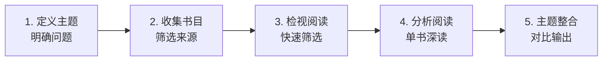
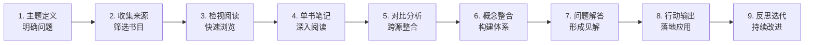

# 主题阅读笔记模板

> **文档说明**：提供完整可复用的主题阅读（Syntopical Reading）笔记模板，涵盖主题定义、书目选择、阅读计划、单书笔记、跨书对比、概念整合、问题解答、行动输出等完整流程，含填写示例、使用说明和不同主题类型的适配方案，帮助读者系统化地围绕一个主题进行多源阅读和知识整合。
>
> **适用人群**：知识工作者、学生、需要系统学习某主题的全栈工程师、个人知识管理实践者
>
> **前置知识**：[[原子笔记原则与实践]]、[[费曼学习法笔记实践]]、[[渐进式总结-ProgressiveSummarization]]

---

## 一、概述

### 1. 什么是主题阅读

主题阅读（Syntopical Reading）是《如何阅读一本书》中提出的**最高层次阅读方法**，指围绕一个特定主题，同时阅读多本书/多篇文章/多个来源，进行对比、分析、整合，形成自己对该主题的系统性理解。

| 阅读层次 | 特点 | 目标 | 输出 |
|---------|------|------|------|
| **基础阅读** | 认字、理解句子 | 读懂文字 | 无 |
| **检视阅读** | 快速浏览、抓重点 | 判断是否值得深读 | 读书笔记 |
| **分析阅读** | 深入理解单本书 | 吃透一本书 | 详细书评 |
| **主题阅读** | 多书对比、整合 | 形成自己的体系 | 主题笔记+知识体系 |

**主题阅读 vs 普通阅读**：

| 维度 | 普通阅读 | 主题阅读 |
|------|---------|---------|
| 阅读对象 | 单本书/单篇文章 | 多本书/多篇文章/多个来源 |
| 阅读顺序 | 从头读到尾 | 带着问题找答案，跳读、选读 |
| 核心动作 | 理解作者观点 | 对比不同作者观点，提出自己的见解 |
| 输出 | 读书笔记/书评 | 主题知识体系、概念地图、行动方案 |
| 难度 | 中 | 高（需要主动思考和整合） |

### 2. 主题阅读的价值

| 价值 | 说明 |
|------|------|
| **避免盲人摸象** | 单一来源有偏见和局限，多源对比才能看到全貌 |
| **建立知识体系** | 不是零散的知识点，而是结构化的知识网络 |
| **培养批判性思维** | 不同作者观点冲突时，需要独立判断和取舍 |
| **提升学习效率** | 带着问题阅读，目的性强，记忆更深刻 |
| **产生原创见解** | 整合多源信息后，能产生属于自己的新观点 |
| **解决复杂问题** | 复杂问题往往需要跨领域、跨学科的知识整合 |

### 3. 什么时候用主题阅读

| 场景 | 示例 |
|------|------|
| **系统学习新技术** | 学习"微服务架构"，读 3-5 本相关书籍+官方文档+博客 |
| **研究复杂问题** | 研究"如何提升个人生产力"，读时间管理、精力管理、习惯养成等多类书籍 |
| **做技术选型** | 选择前端框架，对比 Vue/React/Angular 的官方文档、社区评价、性能基准 |
| **写深度文章** | 写"数据库分库分表方案对比"，阅读多篇技术博客和论文 |
| **职业规划** | 研究"全栈工程师的职业发展路径"，阅读多本职业规划书籍和行业报告 |
| **解决线上问题** | 排查"JVM 内存泄漏"，阅读 JVM 规范、调优指南、类似案例 |

### 4. 主题阅读的五个步骤



| 步骤 | 核心动作 | 产出 | 时间占比 |
|------|---------|------|---------|
| **1. 定义主题** | 明确研究主题、核心问题、阅读目标 | 主题定义文档 | 5% |
| **2. 收集书目** | 搜索、推荐、筛选阅读来源 | 书目清单 | 10% |
| **3. 检视阅读** | 快速浏览每本书，判断价值和重点 | 每本书的检视笔记 | 15% |
| **4. 分析阅读** | 深入阅读重点章节，做单书笔记 | 每本书的详细笔记 | 40% |
| **5. 主题整合** | 对比分析、概念整合、问题解答、行动输出 | 主题阅读笔记（本文档） | 30% |

---

## 二、完整模板

以下是完整的主题阅读笔记模板，可直接复制使用。

---

```markdown
# 主题阅读笔记：[主题名称]

| 文档版本 | v1.0 |
|---------|------|
| 创建日期 | 2026-09-07 |
| 最后更新 | 2026-09-07 |
| 阅读周期 | [开始日期] ~ [结束日期] |
| 阅读时长 | [总时长，如 20 小时] |
| 阅读来源 | [数量] 本书 + [数量] 篇文章 + [数量] 个视频 |
| 笔记状态 | 🟡 进行中 / 🟢 已完成 / 🔴 已暂停 |

---

## 1. 主题定义

### 1.1 主题描述

[用 1-2 段话清晰描述这个主题是什么、为什么要研究它、希望解决什么问题]

**示例**：
> 本主题研究"个人知识管理体系的构建"，旨在解决知识零散、记了就忘、无法应用的问题。通过阅读知识管理、笔记方法、学习科学等领域的经典书籍和文章，构建一套适合自己的、可落地的个人知识管理体系。

### 1.2 核心问题

> 主题阅读的关键：带着问题去阅读，而不是漫无目的地读

1. [核心问题1：最想搞清楚的问题]
2. [核心问题2]
3. [核心问题3]
4. [核心问题4]
5. [核心问题5]

**示例**：
1. 什么是有效的知识管理？它的核心原则是什么？
2. 如何构建个人知识管理体系？有哪些成熟的方法论？
3. 笔记工具（Obsidian/Notion/Logseq）如何选择？各自的优劣势？
4. 如何让笔记真正被复用和应用，而不是记了就忘？
5. 如何平衡知识输入和知识输出？

### 1.3 阅读目标

| 目标编号 | 目标描述 | 衡量标准 |
|---------|---------|---------|
| G1 | [具体目标] | [如何衡量达成] |
| G2 | [具体目标] | [如何衡量达成] |
| G3 | [具体目标] | [如何衡量达成] |

### 1.4 主题范围

**包含**：
- [范围1]
- [范围2]

**不包含**：
- [范围1]（后续单独研究）
- [范围2]

---

## 2. 阅读来源清单

### 2.1 书籍

| 编号 | 书名 | 作者 | 类型 | 优先级 | 阅读状态 | 核心价值 | 评分 |
|------|------|------|------|--------|---------|---------|------|
| B01 | [书名] | [作者] | 理论/实战/工具 | 高/中/低 | ✅已读/🟡在读/⬜待读 | [这本书的核心价值] | ⭐⭐⭐⭐⭐ |
| B02 | [书名] | [作者] | [类型] | [优先级] | [状态] | [价值] | [评分] |

### 2.2 文章/博客

| 编号 | 标题 | 作者/来源 | 链接 | 阅读状态 | 核心价值 |
|------|------|----------|------|---------|---------|
| A01 | [标题] | [来源] | [链接] | ✅/🟡/⬜ | [价值] |

### 2.3 视频/课程

| 编号 | 标题 | 平台/作者 | 时长 | 观看状态 | 核心价值 |
|------|------|----------|------|---------|---------|
| V01 | [标题] | [平台] | [时长] | ✅/🟡/⬜ | [价值] |

### 2.4 其他来源

| 编号 | 类型 | 标题/描述 | 来源 | 状态 |
|------|------|----------|------|------|
| O01 | 论文/官方文档/播客/访谈 | [描述] | [来源] | ✅/🟡/⬜ |

### 2.5 来源筛选记录

> 记录为什么选择这些来源，以及排除了哪些来源、为什么

**选择标准**：
- [标准1，如"豆瓣评分 > 8.0"]
- [标准2，如"作者有实战经验"]
- [标准3，如"近 5 年出版"]

**排除的来源及原因**：
| 来源 | 排除原因 |
|------|---------|
| [来源1] | [原因，如"内容过时"/"评价一般"/"与主题关联度低"] |

---

## 3. 单书/单源笔记摘要

> 对每个重要来源做简要摘要，详细笔记放在单独的原子笔记中，这里只记录核心观点和关键引用

### 3.1 [书籍/来源名称]

**基本信息**：
- 作者：[作者]
- 类型：[理论/实战/工具]
- 阅读日期：[日期]
- 评分：⭐⭐⭐⭐⭐
- 详细笔记：[[链接到详细的原子笔记]]

**核心观点**：
1. [观点1]
2. [观点2]
3. [观点3]

**关键引用**：
> "[原文引用]" —— 第 X 章

**与主题的关联**：
- [这本书对核心问题的贡献]
- [这本书的独特视角]

**评价与反思**：
- 优点：[优点]
- 局限：[局限/偏见]
- 我的看法：[我的评价和思考]

### 3.2 [书籍/来源名称]

[同上结构]

---

## 4. 跨来源对比分析

> 主题阅读的核心：对比不同来源对同一问题的不同看法，找出共识和分歧

### 4.1 概念定义对比

| 概念 | 来源A定义 | 来源B定义 | 来源C定义 | 我的整合定义 |
|------|----------|----------|----------|------------|
| [概念1] | [定义] | [定义] | [定义] | [我的定义] |
| [概念2] | [定义] | [定义] | [定义] | [我的定义] |

### 4.2 观点对比矩阵

| 问题/议题 | 来源A观点 | 来源B观点 | 来源C观点 | 共识/分歧 | 我的立场 |
|----------|----------|----------|----------|----------|---------|
| [问题1] | [观点] | [观点] | [观点] | ✅共识/❌分歧 | [我的立场和理由] |
| [问题2] | [观点] | [观点] | [观点] | [共识/分歧] | [我的立场] |

### 4.3 方法论对比

| 方法论 | 来源 | 核心步骤 | 优点 | 缺点 | 适用场景 | 我的评价 |
|--------|------|---------|------|------|---------|---------|
| [方法1] | [来源] | [步骤] | [优点] | [缺点] | [场景] | [评价] |
| [方法2] | [来源] | [步骤] | [优点] | [缺点] | [场景] | [评价] |

### 4.4 工具对比

| 工具 | 来源 | 核心功能 | 优点 | 缺点 | 价格 | 我的选择 |
|------|------|---------|------|------|------|---------|
| [工具1] | [来源] | [功能] | [优点] | [缺点] | [价格] | ✅选用/❌不选 |
| [工具2] | [来源] | [功能] | [优点] | [缺点] | [价格] | [选择] |

---

## 5. 核心概念整合

> 将多来源的概念整合为自己的知识体系，建立概念之间的关联

### 5.1 概念地图

```
graph TB
    A[核心概念1] --> B[子概念1]
    A --> C[子概念2]
    B --> D[子子概念]
    C --> D
    E[核心概念2] --> C
    E --> F[子概念3]
```css

### 5.2 概念清单

| 概念 | 定义（我的话） | 来源 | 相关概念 | 应用场景 |
|------|---------------|------|---------|---------|
| [概念1] | [用自己的话定义] | [来源A/B] | [[相关概念]] | [场景] |
| [概念2] | [定义] | [来源] | [[相关概念]] | [场景] |

### 5.3 原则提炼

> 从多来源中提炼出自己认同的核心原则

1. **[原则1]**：[解释和来源依据]
2. **[原则2]**：[解释]
3. **[原则3]**：[解释]
4. **[原则4]**：[解释]
5. **[原则5]**：[解释]

### 5.4 框架/模型构建

> 基于整合的知识，构建自己的分析框架或模型

**[框架名称]**：

```
[用文字或图表描述你的框架]
```json

**框架说明**：
- [组成部分1]：[说明]
- [组成部分2]：[说明]
- [组成部分3]：[说明]

**来源依据**：
- 整合了 [来源A] 的 [观点]
- 借鉴了 [来源B] 的 [方法]
- 补充了 [来源C] 的 [视角]

---

## 6. 核心问题解答

> 回到第 1 节的核心问题，基于阅读和整合给出自己的答案

### 问题1：[核心问题1]

**我的答案**：
[基于多来源整合后的回答]

**答案依据**：
- 来源A认为：[观点]
- 来源B认为：[观点]
- 我的整合：[为什么这样回答]

### 问题2：[核心问题2]

**我的答案**：
[回答]

**答案依据**：
[依据]

### 问题3：[核心问题3]

**我的答案**：
[回答]

---

## 7. 行动输出

> 主题阅读的最终目的是应用，将知识转化为行动

### 7.1 立即行动（1 周内）

- [ ] [行动1]：[具体做什么、怎么做]
- [ ] [行动2]：[具体做什么]
- [ ] [行动3]：[具体做什么]

### 7.2 短期计划（1 个月内）

- [ ] [计划1]
- [ ] [计划2]

### 7.3 长期目标（3-6 个月）

- [ ] [目标1]
- [ ] [目标2]

### 7.4 需要创建的原子笔记

> 将主题阅读中产生的新概念、新想法拆分为独立的原子笔记

- [ ] [[原子笔记1]]：[主题]
- [ ] [[原子笔记2]]：[主题]
- [ ] [[原子笔记3]]：[主题]

### 7.5 需要更新的现有笔记

- [ ] [[现有笔记1]]：[更新内容]
- [ ] [[现有笔记2]]：[更新内容]

### 7.6 输出计划

| 输出类型 | 主题 | 计划时间 | 发布平台 |
|---------|------|---------|---------|
| 博客文章 | [主题] | [日期] | [平台] |
| 分享演讲 | [主题] | [日期] | [场合] |
| 视频/播客 | [主题] | [日期] | [平台] |
| 开源项目 | [主题] | [日期] | [平台] |

---

## 8. 反思与迭代

### 8.1 阅读过程反思

| 维度 | 做得好的 | 做得不好的 | 下次改进 |
|------|---------|-----------|---------|
| 主题定义 | [好的] | [不好的] | [改进] |
| 来源选择 | [好的] | [不好的] | [改进] |
| 阅读方法 | [好的] | [不好的] | [改进] |
| 笔记方法 | [好的] | [不好的] | [改进] |
| 整合输出 | [好的] | [不好的] | [改进] |

### 8.2 认知变化

> 记录阅读前后对这个主题的认知变化

**阅读前的认知**：
- [认知1]
- [认知2]

**阅读后的认知**：
- [认知1（变化后）]
- [认知2（变化后）]

**最大的认知颠覆**：
- [哪个观点彻底改变了你的看法？为什么？]

### 8.3 遗留问题

> 阅读后仍然没有解决的问题，需要后续继续研究

1. [问题1]
2. [问题2]
3. [问题3]

### 8.4 后续阅读计划

| 主题 | 原因 | 计划时间 |
|------|------|---------|
| [后续主题1] | [为什么要继续研究] | [时间] |
| [后续主题2] | [原因] | [时间] |

---

## 9. 附录

### 9.1 金句收集

> 收集阅读中遇到的精彩句子

1. "[金句1]" —— [来源]
2. "[金句2]" —— [来源]
3. "[金句3]" —— [来源]

### 9.2 数据/案例收集

> 收集有说服力的数据和案例

| 数据/案例 | 来源 | 说明 |
|----------|------|------|
| [数据1] | [来源] | [说明] |

### 9.3 参考资料完整列表

[按格式列出所有参考资料，如 GB/T 7714 格式]

### 9.4 变更记录

| 版本 | 日期 | 修改人 | 修改内容 |
|------|------|--------|---------|
| v1.0 | 2026-09-07 | [姓名] | 初始版本 |
```

---

## 三、使用说明

### 1. 填写顺序建议



### 2. 不同主题类型的适配

| 主题类型 | 侧重点 | 调整建议 |
|---------|--------|---------|
| **技术主题**（如"微服务架构"） | 技术方案对比、工具选型、实战案例 | 增加"技术方案对比"和"代码示例"模块，减少"金句收集" |
| **管理主题**（如"团队管理"） | 方法论对比、案例分析、行动方案 | 增加"案例分析"和"团队落地计划"模块 |
| **学习主题**（如"学习方法论"） | 认知科学、方法对比、个人实验 | 增加"个人实验记录"和"效果追踪"模块 |
| **历史主题**（如"技术发展史"） | 时间线、因果分析、趋势总结 | 增加"时间线"和"因果分析"模块 |
| **哲学主题**（如"技术伦理"） | 观点思辨、学派对比、立场选择 | 增加"学派对比"和"思想实验"模块 |

### 3. 阅读技巧

#### 检视阅读技巧（快速判断一本书的价值）

1. **看书名和副标题**：判断主题和定位
2. **看目录**：了解全书结构和核心议题
3. **看序言/前言**：了解作者意图和核心观点
4. **看索引**：了解涉及的概念和范围
5. **随机翻几页**：感受写作风格和内容深度
6. **看结论章节**：了解作者的最终观点
7. **看书评**：了解他人的评价和争议点

**检视阅读输出**：每本书用 15-30 分钟，输出 3-5 句话的摘要，判断是否需要深读。

#### 分析阅读技巧（深入理解一本书）

1. **找出全书的核心问题**：作者在回答什么问题？
2. **找出核心论点**：作者的主要观点是什么？
3. **找出论证结构**：作者用什么论据和逻辑支撑观点？
4. **做笔记**：用自己的话复述核心观点，标注关键引用
5. **评价**：同意什么？不同意什么？为什么？
6. **关联**：与其他书、其他知识、个人经验关联

#### 主题阅读技巧（多源整合）

1. **带着问题读**：不是从头读到尾，而是找特定问题的答案
2. **让作者们对话**：把不同作者对同一问题的观点放在一起对比
3. **建立中立的词汇**：用自己的概念框架来理解不同作者的术语
4. **界定问题**：明确要讨论的问题范围，避免跑题
5. **分析讨论**：梳理不同观点的论据和逻辑，评估优劣
6. **形成自己的见解**：不是简单选边站，而是整合出自己的观点

### 4. 笔记方法建议

| 笔记类型 | 工具/方法 | 说明 |
|---------|----------|------|
| **划线/高亮** | 电子书阅读器/微信读书 | 第一遍阅读时标记重要内容 |
| **闪念笔记** | 手机备忘录/Inbox | 阅读中突然产生的想法，快速记录 |
| **文献笔记** | 单独的读书笔记 | 用自己的话复述书中观点，标注页码 |
| **原子笔记** | Obsidian/Notion | 将核心概念拆分为独立的、可复用的笔记 |
| **主题笔记** | 本文档 | 整合多源信息，形成体系化理解 |
| **渐进式总结** | 多层高亮 | 第一层划线，第二层加粗，第三层总结 |

**推荐工作流**：
1. 阅读时划线/高亮
2. 阅读后整理文献笔记（每本书一份）
3. 将核心概念拆分为原子笔记
4. 用本文档进行主题整合
5. 定期回顾和更新

### 5. 常见问题

| 问题 | 解决方案 |
|------|---------|
| 读不完所有书 | 主题阅读不需要每本书都从头读到尾，带着问题跳读、选读即可 |
| 观点太多记不住 | 用对比表格整理，聚焦核心问题，不要试图记住所有细节 |
| 不知道选什么书 | 参考豆瓣/Goodreads 评分、领域专家推荐、书籍引用网络、同主题书单 |
| 读完了不会用 | 强制输出：写文章、做分享、在项目中实践、教给别人 |
| 不同作者观点冲突 | 这是好事！分析冲突的原因（前提假设不同？证据不同？价值观不同？），形成自己的判断 |
| 花了很多时间但感觉没收获 | 检查是否在"被动阅读"而非"主动阅读"，是否带着问题，是否做笔记和输出 |
| 主题太大无法聚焦 | 拆分为多个子主题，逐个研究；先从最核心的问题开始 |

---

## 四、关联笔记

### 知识管理
- [[原子笔记原则与实践]] · [[常青笔记-EvergreenNotes]] · [[渐进式总结-ProgressiveSummarization]]
- [[Zettelkasten-卡片盒笔记法]] · [[PARA-项目领域资源归档]] · [[LYT-链接你的思维]]

### 学习方法
- [[费曼学习法笔记实践]] · [[间隔重复与记忆巩固]] · [[高效学习方法论]]
- [[从输入到输出的知识转化]] · [[学习科学入门]] · [[主动回忆]]

### 阅读相关
- [[如何阅读一本书]] · [[主题阅读法]] · [[拆解阅读法]]
- [[SQ3R阅读法]] · [[读书笔记拆解法]]

### 工具
- [[Obsidian知识库构建]] · [[Obsidian高效使用]] · [[Obsidian-双向链接与关系图谱]]
- [[Templater-模板自动化]] · [[Dataview-数据查询与可视化]]

### 导航
- [[MOC-知识管理方法论-四级展开]] · [[知识管理-方法论枢纽]] · [[MOC-认知科学]]

> **学习路径建议**：先掌握 [[原子笔记原则与实践]] 理解笔记的基本单位 → 学习 [[渐进式总结-ProgressiveSummarization]] 掌握多层笔记方法 → 使用本文模板进行第一次主题阅读实践 → 结合 [[费曼学习法笔记实践]] 进行输出 → 长期实践中不断优化自己的阅读和笔记体系。
