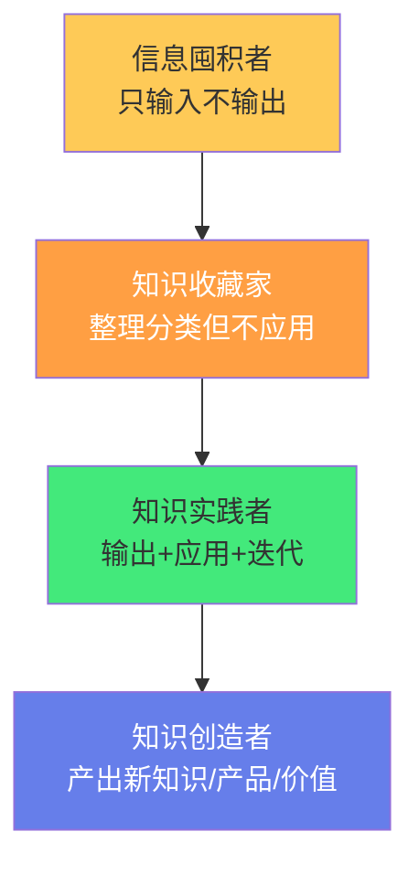
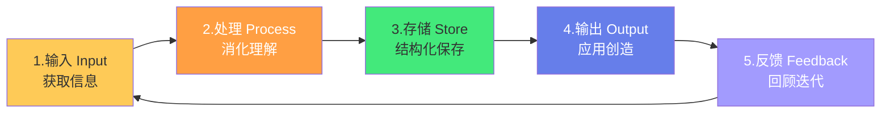
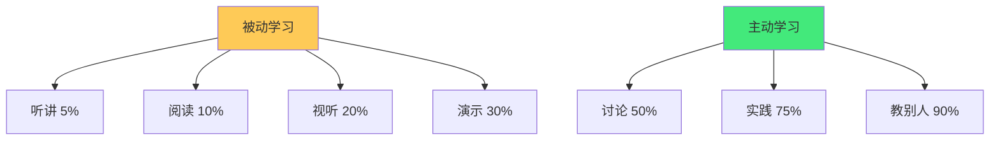
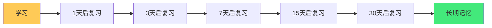
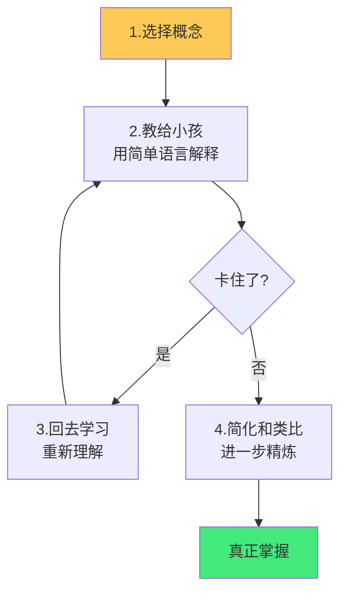
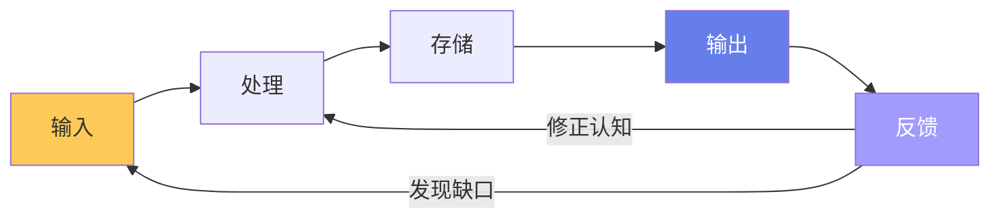
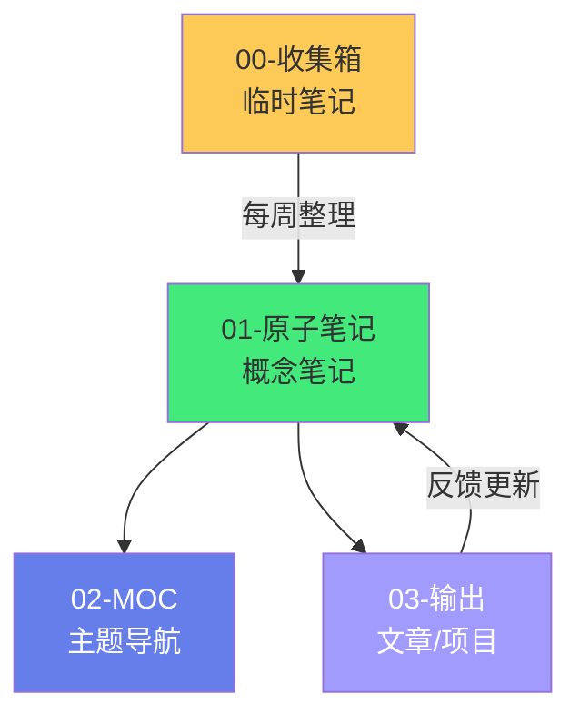
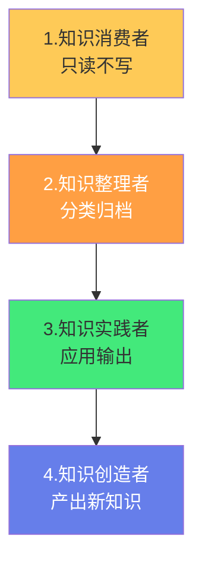

# 🔄 从输入到输出的知识转化

> **文档说明**：系统讲解知识从「输入」到「输出」的完整转化链路、认知科学基础、各阶段实操方法与常见障碍突破，涵盖知识转化的五阶段模型（输入 Input → 处理 Process → 存储 Store → 输出 Output → 反馈 Feedback）、输入阶段（信息源选择/主动阅读/快速捕捉/临时笔记/信息过滤）、处理阶段（消化理解/用自己的话/费曼技巧/建立关联/概念映射）、存储阶段（原子笔记/常青笔记/MOC 组织/标签分类/关系图谱）、输出阶段（写作/分享/教学/项目实践/代码实现/公开演讲）、反馈阶段（回顾反思/间隔重复/迭代更新/测试验证）、知识转化的认知科学基础（生成效应 Generation Effect / 间隔重复 Spaced Repetition / 精细编码 Elaborative Encoding / 测试效应 Testing Effect / 交错练习 Interleaved Practice / 必要难度 Desirable Difficulty）、学习金字塔（被动学习 5%-30% 留存率 vs 主动学习 50%-90% 留存率）、输入输出比的黄金法则（输出倒逼输入/以教为学/做中学）、知识转化的六大常见障碍（信息囤积症/收藏即学习/只输入不输出/完美主义拖延/碎片化无体系/学用脱节）、输出的八种形式（文章/教程/演讲/代码/项目/问答/思维导图/视频）、如何建立可持续的输入输出闭环（每日输入+每周输出+每月回顾）、个人知识管理的终极目标（从「知识收藏家」到「知识创造者」/知识复利效应）、知识变现路径（内容创作/课程/咨询/产品/开源）、与 Obsidian 结合的实操工作流、常见问题与最佳实践。
>
> **适用人群**：终身学习者、知识管理实践者、内容创作者、开发者、学生、希望将知识转化为能力和价值的人
>
> **前置知识**：[[费曼学习法笔记实践]] · [[原子笔记原则与实践]] · [[常青笔记-EvergreenNotes]] · [[间隔重复与记忆系统]]

---

## 一、概述

### 1.1 为什么知识转化是核心

大多数人的知识管理停留在「输入」阶段：收藏文章、下载电子书、记课堂笔记、保存代码片段……但**收藏 ≠ 学习，记录 ≠ 掌握**。没有经过「转化」的知识，只是「信息囤积」，无法成为你的能力和价值。



**知识转化的本质**：将「外部信息」通过「主动加工」转化为「内部能力」，再通过「输出应用」转化为「外部价值」的过程。

### 1.2 五阶段转化模型



| 阶段 | 核心动作 | 关键问题 | 产出 |
|------|---------|---------|------|
| **1. 输入** | 阅读/听课/观察/实践 | 学什么？从哪学？ | 临时笔记、摘录、灵感 |
| **2. 处理** | 理解/关联/用自己的话 | 懂了吗？和什么有关？ | 概念笔记、思维导图 |
| **3. 存储** | 原子化/分类/链接 | 放哪？怎么找？ | 原子笔记、MOC、标签 |
| **4. 输出** | 写作/教学/项目/代码 | 能用吗？能创造吗？ | 文章、项目、产品、演讲 |
| **5. 反馈** | 回顾/测试/迭代/更新 | 对吗？更好的方式？ | 更新笔记、修正认知 |

> **核心洞察**：大多数人在 1→2→3 阶段投入了 90% 的精力，在 4→5 阶段几乎为零。但**真正的学习发生在输出和反馈阶段**——输出倒逼输入，反馈深化理解。

---

## 二、认知科学基础

### 2.1 学习金字塔

美国国家训练实验室的「学习金字塔」研究显示了不同学习方式的平均留存率：



| 学习方式 | 留存率 | 类型 |
|---------|--------|------|
| 听讲 | 5% | 被动 |
| 阅读 | 10% | 被动 |
| 视听 | 20% | 被动 |
| 演示 | 30% | 被动 |
| 讨论 | 50% | 主动 |
| 实践（做中学） | 75% | 主动 |
| 教别人（立即应用） | 90% | 主动 |

> **核心启示**：「教别人」的留存率是「听讲」的 18 倍。输出（写作/教学/实践）是最高效的学习方式。

### 2.2 生成效应（Generation Effect）

**生成效应**：自己生成（写出来/说出来/做出来）的信息，比被动阅读的信息记忆更牢固。

- 被动阅读：「哦，原来如此」→ 一周后忘记 80%
- 主动生成：用自己的话写出来/讲出来 → 一周后记住 80%

**实践**：读完一章后，合上书，用自己的话写摘要，比反复阅读高效 3 倍。

### 2.3 测试效应（Testing Effect）

**测试效应**：主动回忆（测试/问答）比重复阅读更能强化记忆。

- 重复阅读 4 次：记忆提升有限，产生「熟悉感幻觉」
- 阅读 1 次 + 自测 3 次：记忆大幅提升

**实践**：用 Anki/间隔重复系统，将笔记转化为问答卡片，定期自测。

### 2.4 间隔重复（Spaced Repetition）

**艾宾浩斯遗忘曲线**：学习后遗忘立即开始，先快后慢。在遗忘临界点复习，记忆效果最佳。



### 2.5 必要难度（Desirable Difficulty）

**必要难度**：学习时增加「合理的难度」（如间隔、交错、生成），虽然当下感觉更难，但长期记忆和迁移效果更好。

- 容易的学习（反复阅读/划重点）→ 感觉好但效果差
- 有难度的学习（自测/用自己的话/交错练习）→ 感觉差但效果好

> 参考：[[间隔重复与记忆系统]]

---

## 三、输入阶段

### 3.1 信息源选择

**质量 > 数量**：选择高质量信息源，减少低质量信息摄入。

| 信息类型 | 推荐来源 | 避免 |
|---------|---------|------|
| **书籍** | 经典著作、领域专家著作 | 速成/鸡汤/拼凑书 |
| **课程** | 系统化课程、大学公开课 | 碎片化短视频 |
| **文章** | 官方文档、技术博客、深度长文 | 标题党、洗稿、营销文 |
| **论文** | 顶会论文、综述论文 | 低质量预印本 |
| **实践** | 真实项目、开源贡献、工作任务 | 纯理论不实践 |

**输入原则**：
- **主题聚焦**：一段时间聚焦一个主题，不要同时学 10 个方向
- **经典优先**：先读领域经典，建立框架，再读前沿
- **主动选择**：算法推荐的内容被动消费，主动搜索和选择更有价值
- **控制数量**：每天输入 1-2 小时高质量内容，胜过 8 小时碎片化浏览

### 3.2 主动阅读法

| 方法 | 说明 |
|------|------|
| **SQ3R** | Survey（浏览）→ Question（提问）→ Read（阅读）→ Recite（复述）→ Review（复习） |
| **如何读一本书** | 封面/目录/序言快速了解 → 精读核心章节 → 做笔记 → 输出摘要 |
| **主题阅读** | 同一主题读多本书，对比不同观点，形成自己的理解 |
| **批注式阅读** | 在书上/电子书上做批注，写「我同意因为…」「我不同意因为…」 |

### 3.3 快速捕捉（临时笔记）

输入时的目标不是「整理好笔记」，而是「快速捕捉有价值的信息」：

- **工具**：手机备忘录、Flomo、Obsidian 快速捕获、语音转文字
- **内容**：原文关键句 + 自己的想法 + 来源标注
- **原则**：不要在输入时花太多时间格式化，先捕捉，后整理

**临时笔记模板**：
```text
- 原文：「核心观点或金句」（来源：书名/文章/页码）
- 想法：我的理解/联想/疑问/应用场景
- 关联：和[[已有笔记]]的关系
```

### 3.4 信息过滤

**信息过载时代，过滤比收集更重要**：

- **收藏前问自己**：这和我当前的学习主题相关吗？我会在 1 周内看吗？
- **定期清理**：每月清理「待读」列表，超过 1 个月没读的直接删除
- **取消订阅**：取关低质量公众号/博客/Newsletter，只保留高质量信息源
- **设定时间**：每天限定信息摄入时间（如 1 小时），避免无限浏览

---

## 四、处理阶段

### 4.1 消化理解

输入的信息必须经过「主动加工」才能成为知识：

| 加工方式 | 说明 |
|---------|------|
| **用自己的话复述** | 合上书，用自己的话解释这个概念 |
| **举例子** | 为抽象概念找 2-3 个具体例子 |
| **打比方** | 用熟悉的事物类比新概念 |
| **找关联** | 这个概念和我已知的什么知识有关？ |
| **问为什么** | 追问 3 层「为什么」，挖到本质 |
| **画图示** | 用思维导图/流程图可视化概念关系 |

### 4.2 费曼技巧

**费曼技巧**是最有效的知识转化方法之一：



**四步法**：
1. **选择概念**：选一个你想理解的概念
2. **教给小孩**：用最简单的语言解释，假设听众是 12 岁小孩
3. **发现缺口**：解释不下去的地方就是你没懂的地方，回去重新学习
4. **简化和类比**：用更简单的语言和类比精炼解释

> 参考：[[费曼学习法笔记实践]]

### 4.3 建立关联

知识的价值在于「连接」——孤立的知识点容易遗忘，连接成网络的知识才能迁移和应用。

**关联方法**：
- **纵向关联**：这个概念的前置知识是什么？延伸知识是什么？
- **横向关联**：其他领域有类似的概念吗？（如「缓存」在计算机和管理学中都存在）
- **应用关联**：这个概念能用在什么实际场景？
- **对比关联**：这个概念和相似概念有什么区别？（如「进程 vs 线程」）

> 参考：[[跨领域知识连接方法]]

---

## 五、存储阶段

### 5.1 原子化笔记

将处理后的知识整理为**原子笔记**：一篇笔记一个概念，用自己的话，可独立理解。

> 参考：[[原子笔记原则与实践]] · [[常青笔记-EvergreenNotes]]

### 5.2 结构化组织

| 组织方式 | 说明 | 工具 |
|---------|------|------|
| **文件夹** | 按领域/主题粗分类 | Obsidian 文件夹 |
| **标签** | 跨文件夹的细粒度标记 | `#领域/子领域` |
| **MOC** | 内容地图，一个主题的导航页 | [[MOC内容地图]] |
| **双向链接** | 笔记间的关联 | `[[]]` |
| **关系图谱** | 可视化知识网络 | Obsidian Graph View |

### 5.3 存储不是终点

**存储只是「知识的休息站」，不是「终点」**——很多人把笔记整理得井井有条就以为学会了，但从不输出和应用。存储的目的是「为了将来能快速检索和复用」，最终目的还是输出。

---

## 六、输出阶段

### 6.1 输出的八种形式

| 输出形式 | 说明 | 难度 | 价值 |
|---------|------|------|------|
| **文章/笔记** | 写博客、公众号、技术文章 | ⭐⭐ | 高（梳理+传播） |
| **教程/课程** | 系统化教学内容 | ⭐⭐⭐⭐ | 极高（深度梳理+影响力） |
| **演讲/分享** | 技术分享、读书会、直播 | ⭐⭐⭐ | 高（即时反馈+影响力） |
| **代码/项目** | 开源项目、工具、产品 | ⭐⭐⭐⭐ | 极高（实践+作品） |
| **问答** | 在 Stack Overflow/知乎/社群回答问题 | ⭐⭐ | 中（巩固+帮助他人） |
| **思维导图** | 可视化知识结构 | ⭐⭐ | 中（结构化理解） |
| **视频/播客** | 视频教程、播客节目 | ⭐⭐⭐⭐ | 高（多媒介影响力） |
| **工作应用** | 在实际工作/项目中应用知识 | ⭐⭐⭐ | 极高（真正掌握） |

### 6.2 输出倒逼输入

**输出是最好的输入过滤器**：

- 当你要写一篇「React 性能优化」文章时，你会主动去读官方文档、源码、最佳实践
- 当你要做一次「微服务架构」分享时，你会系统梳理自己的知识，发现缺口
- 当你要开发一个「CLI 工具」时，你会去学 Node.js、文件系统、打包发布

**输出让输入有了明确的目标和方向**，避免「什么都想学，什么都不精」。

### 6.3 以教为学

「教别人」是留存率最高的学习方式（90%）：

- **教的过程就是深度梳理的过程**——你必须把零散的知识组织成有条理的内容
- **教的过程会暴露知识缺口**——讲不下去的地方就是没懂的地方
- **教的过程获得反馈**——听众的提问和质疑会修正你的认知
- **教的过程建立影响力**——分享知识是建立个人品牌的最佳方式

**从「教自己」开始**：写笔记就是教未来的自己；写文章就是教陌生人；做分享就是教听众。

---

## 七、反馈阶段

### 7.1 回顾与迭代

输出不是终点，**反馈和迭代才让知识真正内化**：

| 反馈来源 | 说明 |
|---------|------|
| **自我回顾** | 定期重读自己的笔记和文章，修正错误、补充新理解 |
| **他人反馈** | 文章评论、分享问答、代码 review |
| **实践检验** | 在项目中应用，看是否真的管用 |
| **测试验证** | 用面试题、自测、项目检验掌握程度 |
| **间隔重复** | 定期复习笔记，对抗遗忘 |

### 7.2 知识更新

知识不是静态的——技术在演进，理解在深化，笔记需要持续更新：

- 学到新理解时，更新对应笔记
- 发现错误时，修正笔记
- 实践中遇到新例子时，补充到笔记
- 技术版本更新时，更新过时内容

> 参考：[[知识折旧与更新机制]] · [[定期回顾与笔记重构]]

### 7.3 完整闭环



反馈阶段同时连接「输入」（发现新的学习需求）和「处理」（修正已有认知），形成完整的学习闭环。

---

## 八、常见障碍与突破

### 8.1 六大障碍

| 障碍 | 表现 | 突破方法 |
|------|------|---------|
| **信息囤积症** | 收藏了几百篇文章从不看 | 「收藏即删除」——收藏后 1 周内必须处理，否则删除 |
| **收藏即学习** | 以为收藏了就是学会了 | 收藏后必须写至少 3 句自己的理解 |
| **只输入不输出** | 读了很多书但从不写/分享 | 设定输出目标：每读 1 本书写 1 篇文章 |
| **完美主义拖延** | 「还没学好，等学好了再输出」 | 「完成比完美重要」——先输出 60 分的内容，再迭代 |
| **碎片化无体系** | 东学一点西学一点，没有框架 | 先建立知识框架（MOC），再往框架里填内容 |
| **学用脱节** | 学了很多但工作中用不上 | 「以项目带学习」——找一个真实项目，边做边学 |

### 8.2 完美主义的破解

**「先完成，再完美」**：

- 第一篇文章不需要是爆款，能发出来就是胜利
- 第一次分享不需要完美，能讲完就是进步
- 第一个项目不需要是产品，能跑通就是学习
- 输出的价值在于「过程」，不在于「结果」——梳理的过程已经让你掌握了知识

---

## 九、建立可持续的输入输出闭环

### 9.1 节奏建议

| 频率 | 动作 | 说明 |
|------|------|------|
| **每日** | 输入 30-60 分钟 + 临时笔记 | 阅读/听课/实践，快速捕捉 |
| **每周** | 整理临时笔记 + 1 篇输出 | 将临时笔记转化为原子笔记，写一篇文章/笔记 |
| **每月** | 回顾 + 主题阅读 + 1 个小项目 | 回顾本月学习，确定下月主题，做一个小项目实践 |
| **每季** | 知识体系重构 + 深度输出 | 重构 MOC，写一篇深度文章/做一次分享 |
| **每年** | 年度回顾 + 知识变现评估 | 回顾全年学习，评估知识转化为价值的效果 |

### 9.2 Obsidian 工作流



**实操步骤**：
1. **收集箱**：所有输入的临时笔记放 `00-收集箱/`
2. **每周整理**：将收集箱的笔记转化为原子笔记，放入对应领域文件夹
3. **建立链接**：为新笔记添加双向链接，关联到 MOC
4. **输出**：每周从原子笔记中组合出一篇文章或一个项目
5. **反馈更新**：输出过程中发现的新理解和错误，更新回原子笔记

---

## 十、知识的终极目标：从收藏到创造

### 10.1 四个阶段



| 阶段 | 特征 | 产出 |
|------|------|------|
| **消费者** | 读书、听课、收藏 | 无（只有输入） |
| **整理者** | 做笔记、分类、建知识库 | 笔记（但不输出） |
| **实践者** | 写文章、做项目、教别人 | 文章、项目、分享 |
| **创造者** | 提出新观点、创造新产品/工具 | 原创知识、产品、影响力 |

### 10.2 知识复利

知识转化的终极价值是**复利效应**：

- 每一篇输出都在建立你的个人品牌
- 每一个项目都在积累你的作品集
- 每一次分享都在扩大你的影响力
- 每一个概念的深入理解都在强化你的知识网络
- **时间越长，知识的价值越大**——这就是知识复利

### 10.3 知识变现路径（可选）

如果你想将知识转化为经济价值：

| 路径 | 说明 | 门槛 |
|------|------|------|
| **内容创作** | 博客/公众号/视频/播客，广告/赞助 | 低（起步易，做大难） |
| **课程/培训** | 在线课程/企业培训/付费社群 | 中（需要体系化内容） |
| **咨询/顾问** | 技术咨询/架构设计/团队培训 | 高（需要行业经验和口碑） |
| **产品/工具** | SaaS/开源商业化/模板/插件 | 高（需要产品能力） |
| **开源/影响力** | 开源项目→工作机会/演讲/投资 | 中（长期积累） |

> 变现不是必须的，但「能变现」是知识真正有价值的证明之一。

---

## 十一、常见问题

| 问题 | 回答 |
|------|------|
| **输入多但输出少怎么办？** | 设定强制输出目标（如每周1篇），用「输出倒逼输入」 |
| **不知道输出什么？** | 从你最近学的知识开始，写「XX入门指南」「XX学习笔记」 |
| **输出质量差不敢发？** | 先发给自己看（写笔记），再发给朋友看，最后公开发布 |
| **学了就忘怎么办？** | 用间隔重复系统（Anki/Obsidian间隔重复插件）定期复习 |
| **知识太散不成体系？** | 建立 MOC（内容地图），用主题框架组织知识 |
| **没有时间输出？** | 利用碎片时间写提纲，用整块时间写正文；每周固定 2 小时输出时间 |
| **输出了没人看怎么办？** | 输出首先是为了自己学习，其次才是影响力。坚持 1 年再看效果 |
| **怎么知道自己真的掌握了？** | 能教给别人、能在项目中应用、能回答相关问题，就是真掌握了 |

---

## 十二、关联笔记

### 学习方法论
- [[费曼学习法笔记实践]] · [[间隔重复与记忆系统]] · [[知识折旧与更新机制]]
- [[定期回顾与笔记重构]] · [[跨领域知识连接方法]]

### 知识管理
- [[原子笔记原则与实践]] · [[常青笔记-EvergreenNotes]] · [[MOC内容地图]]
- [[PARA-项目领域资源归档]] · [[Zettelkasten-卡片盒笔记法]]
- [[第二大脑-BuildingSecondBrain]]

### 导航
- [[MOC-综合导航]] · [[MOC-知识管理方法论-四级展开]] · [[Home]] · [[学习路线总览]]

> 🔍 **知识点深度解析**
>
> **作用**：从输入到输出的知识转化解决的是「如何将『读过/收藏过的信息』真正转化为『自己的能力和可输出的价值』，避免陷入『信息囤积』和『收藏即学习』的陷阱」的核心问题——大多数人的知识管理只完成了「输入→存储」的前半段，却忽视了「处理→输出→反馈」的后半段，导致学了很多却用不出来、记不住、创造不了价值。本文档提供从输入到输出的完整转化链路、认知科学基础和实操方法，帮助建立可持续的学习闭环。
>
> **底层原理**：①知识转化的认知科学基础是「主动学习优于被动学习」——学习金字塔显示「教别人」留存率 90%，「实践」75%，而「听讲」只有 5%、「阅读」10%。这背后是「生成效应」（自己生成的信息记忆更牢）、「测试效应」（主动回忆比重复阅读更有效）、「必要难度」（学习时增加合理难度长期效果更好）的共同作用。被动输入（阅读/听讲）只是「信息接触」，主动输出（写作/教学/实践）才是「知识内化」。②「输出倒逼输入」是知识转化的核心机制——当你有明确的输出目标（写文章/做分享/做项目）时，输入会变得有方向、有重点、有深度。没有输出目标的输入是「漫游式学习」，容易碎片化和浅尝辄止；有输出目标的输入是「目标导向学习」，会主动深挖、主动关联、刻意练习。③「反馈」是知识闭环的关键——没有反馈的输出是「单向广播」，有反馈的输出才是「迭代学习」。反馈来源包括：自我回顾（重读自己的输出发现错误和不足）、他人反馈（评论/问答/质疑）、实践检验（在真实项目中应用看是否管用）。反馈修正认知、发现知识缺口、触发新的输入，形成「输入→处理→存储→输出→反馈→再输入」的完整闭环。④「知识复利」是长期知识转化的终极价值——每一次输出都在积累「个人品牌+作品集+知识网络+影响力」，这些资产随时间复利增长。短期看输出可能「没人看」「没收益」，但长期坚持 1-3 年后，知识的复利效应会显著显现：更好的工作机会、咨询收入、产品机会、行业影响力。⑤「从消费者到创造者」是知识管理的终极进化——消费者只读不写，整理者只存不用，实践者开始输出应用，创造者产出原创知识和产品。大多数人停留在前两个阶段，真正的价值在后两个阶段。
>
> **用法要点**：① 五阶段模型：输入(获取信息)→处理(消化理解/自己的话/费曼)→存储(原子笔记/MOC/链接)→输出(写作/教学/项目/代码)→反馈(回顾/测试/迭代/更新) ② 认知科学：学习金字塔(教90%/实践75%/讨论50% vs 听讲5%)、生成效应(自己写>被动读)、测试效应(自测>重读)、间隔重复(遗忘临界点复习)、必要难度(有难度的学习长期效果好) ③ 输入：质量>数量，主题聚焦，经典优先，快速捕捉临时笔记，信息过滤(收藏1周内必须处理) ④ 处理：用自己的话复述、举例子、打比方、找关联、费曼技巧(教小孩→发现缺口→回去学→简化) ⑤ 存储：原子笔记(一篇一概念)+MOC(主题导航)+双向链接+标签，存储是休息站不是终点 ⑥ 输出八形式：文章/教程/演讲/代码项目/问答/思维导图/视频/工作应用，输出倒逼输入，以教为学(留存率最高) ⑦ 反馈：自我回顾+他人反馈+实践检验+间隔重复，反馈修正认知触发新输入形成闭环 ⑧ 六大障碍：信息囤积(收藏即删除)/收藏即学习(写3句理解)/只输入不输出(每读1书写1文)/完美主义(先完成再完美)/碎片化(先建框架)/学用脱节(项目带学习) ⑨ 节奏：每日输入30-60分+临时笔记，每周整理+1篇输出，每月回顾+小项目，每季重构+深度输出，每年年度回顾 ⑩ Obsidian工作流：00-收集箱→每周整理→原子笔记+MOC→输出→反馈更新笔记 ⑪ 终极目标：从知识消费者→整理者→实践者→创造者，知识复利，变现可选(内容/课程/咨询/产品/开源)。

> 💡 **深度讲解**：从输入到输出的知识转化最核心的智慧是「学习不是『收集信息』，而是『改变行为和创造价值』——输出是检验学习的唯一标准」——我们生活在一个「信息过载」的时代，获取知识的成本几乎为零（搜索引擎、免费课程、开源文档），但「掌握知识」的成本并没有降低——因为掌握需要「主动加工+输出应用+反馈迭代」，这是无法外包给算法和工具的。很多人陷入「学习的幻觉」：读了一本书觉得「懂了」，收藏了一篇文章觉得「学会了」，听了一门课觉得「掌握了」——但一周后让他写出来、讲出来、做出来，却发现什么都没有。这就是「熟悉感幻觉」：被动输入产生的「我懂了」的感觉，和真正的掌握之间有巨大的鸿沟。跨越这个鸿沟的唯一方法是「输出」——写出来、讲出来、做出来。当你试图用自己的话解释一个概念时，你会立刻发现哪些地方是「自以为懂了其实没懂」；当你试图在项目中应用一个技术时，你会立刻发现哪些细节是「纸上谈兵」。输出就像一面镜子，照出你知识的真实面貌。更重要的是，「输出倒逼输入」是一个强大的学习引擎——当你决定写一篇「React 性能优化」的文章时，你会主动去读官方文档、看源码、研究最佳实践、对比不同方案，这种「目标导向的输入」远比「随便看看」高效和深入。所以，不要问「我该学什么」，要问「我要输出什么」——有了输出目标，输入自然有了方向和动力。从今天开始，给自己设定一个输出目标：每周写一篇笔记，每月做一个小项目，每季做一次分享——你会发现，学习效率和知识掌握程度会有质的飞跃。

> 📝 **精简总结**：从输入到输出的知识转化=将信息转化为能力和价值的完整闭环。五阶段：输入(高质量信息源+主动阅读+快速捕捉)→处理(自己的话+费曼技巧+建立关联)→存储(原子笔记+MOC+链接)→输出(文章/教学/项目/代码)→反馈(回顾+测试+迭代)。认知科学：学习金字塔(教90%>实践75%>阅读10%)、生成效应、测试效应、间隔重复、必要难度。核心：输出倒逼输入，以教为学，反馈形成闭环。六大障碍：信息囤积/收藏即学习/只输入不输出/完美主义/碎片化/学用脱节。节奏：每日输入+每周输出+每月项目+每季重构。Obsidian工作流：收集箱→原子笔记→MOC→输出→反馈更新。终极目标：从知识消费者→创造者，知识复利。核心心法：输出是检验学习的唯一标准，先完成再完美。

> **学习路径建议**：先学习 [[费曼学习法笔记实践]] 和 [[间隔重复与记忆系统]] 掌握学习方法 → 学习 [[原子笔记原则与实践]] 和 [[常青笔记-EvergreenNotes]] 掌握笔记方法 → 设定一个输出目标（如每周1篇技术文章） → 实践「输出倒逼输入」：为了写文章而系统学习 → 建立输入输出闭环（每日输入+每周输出+每月回顾） → 学习 [[MOC内容地图]] 构建知识体系 → 尝试项目实践和公开分享 → 长期坚持，享受知识复利 → 探索知识变现路径（内容/课程/产品）。

---

> **从输入到输出的知识转化的本质是「将『被动接触的信息』通过『主动加工和输出应用』转化为『真正属于你的能力和价值』」——在这个信息爆炸的时代，我们最不缺的就是「输入」：每天刷到的文章、视频、课程、帖子，信息量超过了任何一个时代。但我们最缺的是「转化」——将这些信息真正内化为自己的知识、能力和价值。很多人花了大量时间「学习」，却依然觉得「什么都没学会」「学了也用不上」，根本原因就是只做了「输入」这一步，跳过了「处理→输出→反馈」的关键环节。输入只是「播种」，输出才是「收获」——没有输出的输入，就像只播种不收割，最终颗粒无收。输出的形式不重要（写文章/做项目/教别人/写代码都可以），重要的是「主动生成」这个动作——它强迫你将零散的信息组织成体系、将模糊的理解清晰化、将纸上的知识落地为实践。更妙的是，输出会形成「复利」：每一篇文章、每一个项目、每一次分享，都在积累你的知识网络、作品集和个人品牌，时间越长价值越大。所以，不要问「我该学什么」，要问「我要创造什么」——让输出成为你学习的引擎，让知识从「收藏夹里的信息」变成「你身上的能力」和「世界中的价值」。从今天开始，设定一个小小的输出目标，坚持下去——一年后，你会感谢现在开始输出的自己。**
