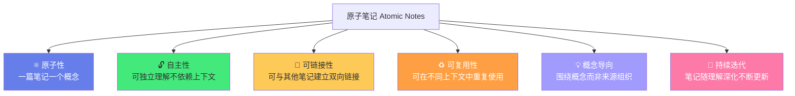
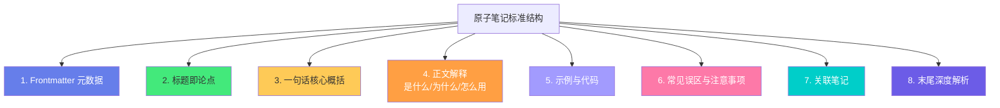
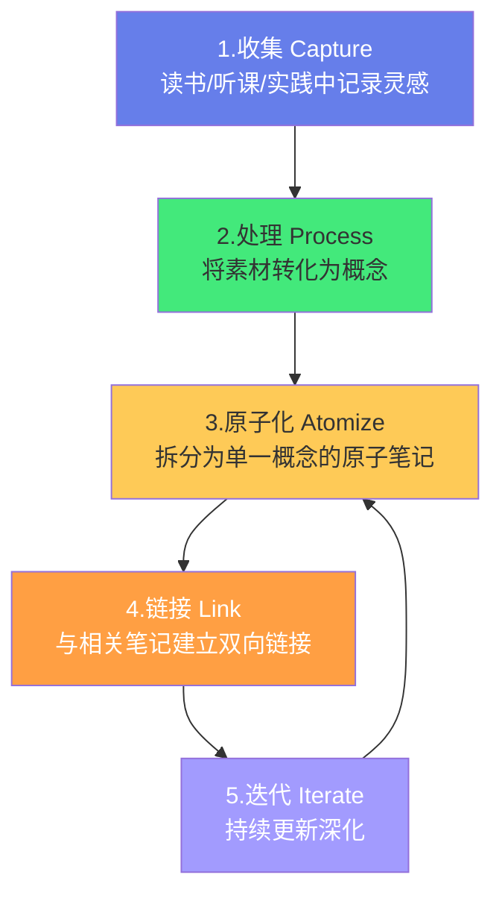
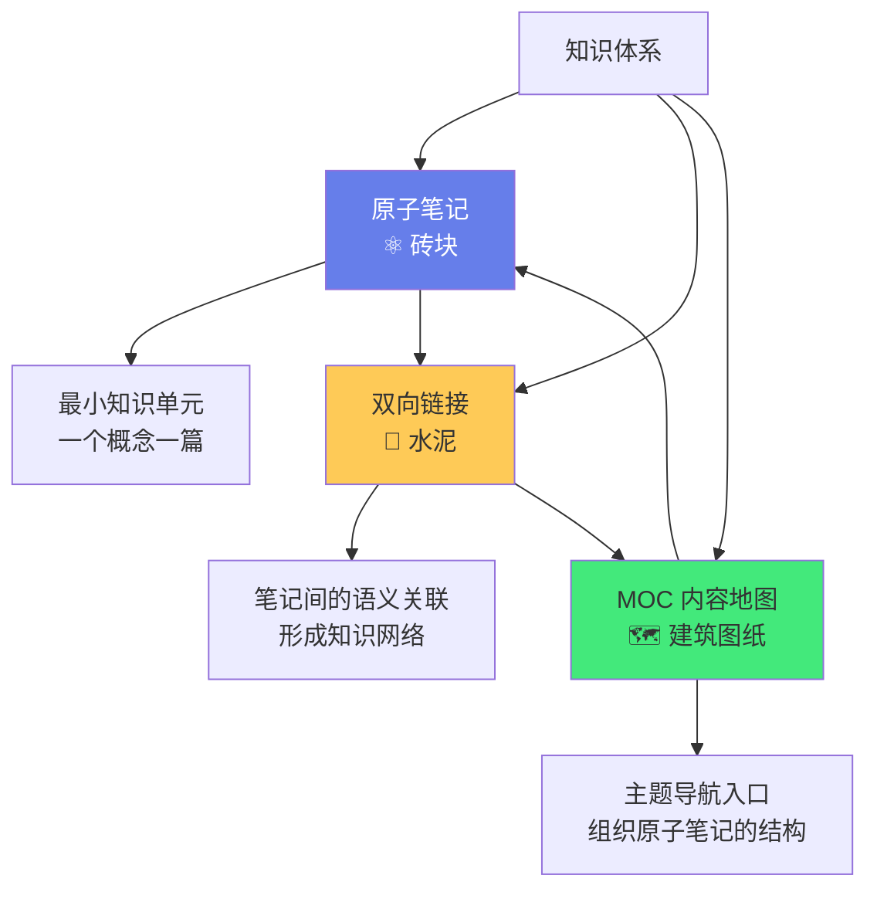

# ⚛️ 原子笔记原则与实践

> **文档说明**：系统讲解原子笔记（Atomic Notes）的核心理念、原则、写作方法与在 Obsidian 中的实操实践，涵盖原子笔记的起源（尼克拉斯·卢曼的 Zettelkasten 卡片盒笔记法）、原子笔记的核心定义（一篇笔记一个核心概念/可独立理解/可复用/可链接）、原子笔记的六大核心原则（原子性/自主性/可链接性/概念导向/持续迭代/双向链接）、原子笔记与传统笔记的本质区别、原子笔记的标准结构（标题即论点/正文解释/示例/关联笔记/元数据）、如何写好原子笔记的标题（标题即论点原则）、原子笔记的写作流程（收集→处理→原子化→链接→迭代）、从大笔记拆分原子笔记的具体方法、原子笔记的粒度判断标准（什么时候该拆/什么时候该合/粒度的黄金法则）、原子笔记与 MOC 的关系（原子笔记是砖块/MOC 是建筑图纸/双向链接是水泥）、原子笔记与双向链接的协同效应、原子笔记的质量评估标准（原子性检查清单）、原子笔记在全栈+AI学习中的应用案例（Java并发/前端响应式/AI-RAG等如何拆分为原子笔记）、常见误区（笔记太大/笔记太小/标题模糊/不链接/只收集不处理/复制粘贴不消化）、原子笔记的进阶技巧（常青笔记进化/概念图谱构建/知识合成与创新）、与其他笔记方法的对比（Zettelkasten/PARA/LYT/常青笔记）、常见问题与最佳实践。
>
> **适用人群**：知识管理实践者、Obsidian 用户、终身学习者、全栈开发者、AI工程师、学生、研究者、知识工作者
>
> **前置知识**：[[MOC内容地图]] · [[LYT-链接你的思维]] · [[标签与文件夹的边界]]

---

## 一、概述

### 1.1 什么是原子笔记

**原子笔记（Atomic Notes）** 是指「每篇笔记只聚焦一个核心概念，且可以被独立理解、独立复用、独立链接的最小知识单元」。



**「原子」一词的来源**：
- 物理学中，原子是「不可再分的最小物质单元」
- 在笔记法中，原子笔记是「不可再分的最小知识单元」
- 如果一篇笔记可以拆成两个独立的概念，那它还不够「原子」

**原子笔记的核心特征**：
| 特征 | 说明 | 反例 |
|------|------|------|
| **一个概念** | 每篇笔记只讲一个核心概念 | 「Java多线程」包含了线程状态、同步、线程池、并发容器等多个概念 |
| **可独立理解** | 单独拿出来也能看懂，不需要上下文 | 「如上所述」「参见前文」这种依赖上下文的表述 |
| **可复用** | 可以在不同的文章/项目/上下文中引用 | 只在特定场景下有意义的笔记 |
| **可链接** | 可以与其他相关笔记建立双向链接 | 孤立的、与其他笔记无关的笔记 |
| **标题即论点** | 标题本身就是一个完整的陈述或观点 | 「线程池」（只是主题，不是论点）vs 「线程池通过复用线程减少创建销毁开销」（论点） |

### 1.2 原子笔记的起源：卢曼的 Zettelkasten

原子笔记的思想来源于德国社会学家**尼克拉斯·卢曼（Niklas Luhmann）**的**卡片盒笔记法（Zettelkasten）**。

**卢曼的成就**：
- 一生出版了 70 多本书、近 400 篇文章
- 涉及社会学、法律、经济、政治、艺术等多个领域
- 他的秘密武器就是「卡片盒笔记法」

**卢曼的卡片盒方法**：
1. 每张卡片只写一个想法（原子性）
2. 卡片编号可以引用其他卡片（链接性）
3. 卡片之间通过编号建立网络（知识网络）
4. 写作时从卡片盒中「发现」想法的连接，而非凭空创造
5. 卡片盒成为他的「第二大脑」，持续生长和进化

> **卢曼的原话**：「我从未强迫自己做任何事情，只是在卡片盒的引导下，想法自然涌现。」

**从 Zettelkasten 到原子笔记**：
- 卢曼的纸质卡片 → Obsidian 中的 Markdown 笔记
- 卡片编号引用 → `[[]]` 双向链接
- 手动编号网络 → 自动关系图谱
- 原子性原则 → 原子笔记的核心原则

### 1.3 为什么需要原子笔记

| 传统笔记的问题 | 原子笔记的解决方案 |
|--------------|------------------|
| **笔记太大**：一篇笔记包含多个概念，难以复用 | 一篇一个概念，每个概念都可以独立引用 |
| **难以搜索**：大笔记中包含很多内容，搜索结果不精准 | 小笔记聚焦一个概念，搜索精准定位 |
| **难以链接**：大笔记之间难以建立精准的概念级链接 | 原子笔记之间可以建立精准的概念级双向链接 |
| **难以更新**：大笔记的一部分过时了，不知道改哪里 | 原子笔记粒度小，更新精准，不影响其他 |
| **难以复用**：大笔记只能整篇引用，不能部分引用 | 原子笔记可以在不同上下文中独立引用 |
| **知识碎片化**：笔记之间没有连接，是信息孤岛 | 原子笔记通过双向链接形成知识网络 |
| **写作困难**：写文章时不知道从哪里开始 | 原子笔记已经是「半成品」，组合链接即可成文 |

> **核心洞察**：原子笔记的本质是「将知识拆解为最小可组合单元，通过链接形成网络，从而实现知识的复用、连接和创新」。就像乐高积木——每块积木是一个原子单元，通过组合可以搭建出无限种结构。

---

## 二、原子笔记的六大核心原则

### 2.1 原则一：原子性（Atomicity）

**定义**：每篇笔记只包含一个核心概念、一个想法、一个论点。

**判断标准**：
- 如果笔记标题中有「和」「与」「及」等连接词，可能包含多个概念，需要拆分
- 如果笔记可以分成两个独立的部分，每部分都能独立成篇，那它不够原子
- 如果笔记中出现「另外」「同时」「另一方面」等转折，可能在讲第二个概念

**粒度的黄金法则**：
> 一篇笔记应该小到「可以用一句话概括核心论点」，大到「不需要依赖其他笔记就能理解这个论点」。

**示例**：
| 不够原子（太大） | 原子化拆分后 |
|----------------|------------|
| 「Java多线程」（包含线程状态、同步、线程池、并发容器） | 「Java线程的六种状态及转换」「synchronized的实现原理」「线程池的核心参数及工作流程」「ConcurrentHashMap的分段锁机制」 |
| 「React Hooks」（包含useState/useEffect/useMemo/自定义Hooks） | 「useState的工作原理」「useEffect的依赖数组与执行时机」「useMemo与useCallback的区别与使用场景」「自定义Hook的设计原则与实践」 |

### 2.2 原则二：自主性（Autonomy）

**定义**：每篇笔记都可以被独立理解，不需要依赖其他笔记或上下文就能明白它在说什么。

**实现方法**：
- 不要使用「如上所述」「参见前文」「这个」「那个」等依赖上下文的表述
- 如果需要引用其他笔记的概念，用 `[[]]` 链接，并简要说明
- 笔记的开头用一句话概括核心论点（让读者一眼知道这篇笔记讲什么）
- 必要的背景知识可以简要提及，或链接到相关笔记

**反例 vs 正例**：

| 反例（不自主） | 正例（自主） |
|--------------|------------|
| 「这个机制的优点是可以减少开销」 | 「线程池机制的核心优点是通过复用已创建的线程，减少线程创建和销毁的系统开销」 |
| 「如上所述，它有三种状态」 | 「Java线程有六种生命周期状态：新建、可运行、运行、阻塞、等待、终止」 |
| 「这个和那个的区别是...」 | 「`==` 与 `equals()` 的核心区别是：`==` 比较引用地址，`equals()` 比较内容（需重写）」 |

### 2.3 原则三：可链接性（Linkability）

**定义**：每篇笔记都可以与其他相关笔记建立双向链接，形成知识网络。

**实现方法**：
- 每篇笔记至少有 3-5 个出站链接（引用相关概念）
- 每篇笔记应该努力获得入站链接（被其他笔记引用）
- 在笔记的「关联笔记」部分，分类列出相关笔记（同领域/前置/后续/跨领域）
- 链接要精准——链接到具体的原子笔记，而非大而全的笔记
- 发现相关概念时，立即建立链接，不要「以后再说」

**链接的类型**：
| 链接类型 | 说明 | 示例 |
|---------|------|------|
| **前置知识** | 理解这篇笔记需要先掌握的概念 | 「线程池」← 「Java线程的生命周期」 |
| **后续延伸** | 这篇笔记的进阶或延伸概念 | 「线程池」→ 「线程池的拒绝策略」 |
| **同领域相关** | 同一领域的其他相关概念 | 「线程池」↔ 「CompletableFuture」 |
| **跨领域连接** | 不同领域但原理相通的概念 | 「线程池」↔ 「数据库连接池」↔ 「对象池模式」 |
| **对比关系** | 容易混淆或需要对比的概念 | 「synchronized」↔ 「ReentrantLock」 |

### 2.4 原则四：概念导向（Concept-Oriented）

**定义**：原子笔记围绕「概念」组织，而非围绕「来源」（书/课程/文章）组织。

**来源导向 vs 概念导向**：
| 来源导向（传统） | 概念导向（原子笔记） |
|----------------|-------------------|
| 「《Java并发编程实战》读书笔记」 | 「线程池的核心参数及工作流程」 |
| 「Vue3官方文档笔记」 | 「Vue3响应式系统的Proxy实现原理」 |
| 「某课程第3章笔记」 | 「RAG检索增强生成的工作流程」 |

**为什么概念导向更优**：
- 概念是「可复用的」——同一概念可以来自多本书、多门课
- 概念导向的笔记可以整合多个来源的理解，更全面
- 概念导向便于建立链接——概念之间有天然的关联
- 概念导向便于搜索——搜索概念名即可找到
- 来源导向的笔记容易变成「摘抄」，概念导向的笔记是「理解」

**实践方法**：
- 读书/听课时，不要按章节记笔记，要按「概念」记笔记
- 读到一个新概念，创建一篇原子笔记，标注来源
- 同一概念在不同来源中有不同解释，整合到同一篇原子笔记中
- 笔记的标题是「概念」，不是「第X章」或「书名」

### 2.5 原则五：持续迭代（Continuous Iteration）

**定义**：原子笔记不是「写完就完」的静态文档，而是随着理解深化不断更新、迭代、进化的「活知识」。

**迭代的时机**：
- 学到新的理解或发现时，更新对应笔记
- 实践中发现笔记有错误或遗漏时，修正
- 相关领域有新版本/新方法时，更新
- 回顾时发现笔记可以更深入时，深化
- 与其他笔记建立新连接时，补充关联

**迭代的方式**：
- 补充新的示例、类比、解释
- 修正错误或不准确的表述
- 增加新的关联笔记
- 调整结构，让逻辑更清晰
- 从「入门级」深化为「进阶级」

> **卢曼的智慧**：他的卡片盒不是「档案库」，而是「对话伙伴」——他持续与卡片盒对话，不断添加新卡片、建立新连接、修正旧理解。卡片盒在持续生长，他的知识也在持续进化。

### 2.6 原则六：用自己的话（In Your Own Words）

**定义**：原子笔记必须用自己的语言重新表述，而不是复制粘贴原文。

**为什么必须用自己的话**：
- 用自己的话 = 主动思考 = 深度学习（生成效应）
- 复制粘贴 = 被动接收 = 浅层记忆（熟悉感 ≠ 理解）
- 用自己的话才能检验是否真的理解了（费曼学习法）
- 自己的话才能与已有知识建立连接（精细编码）
- 复制粘贴的笔记无法「自主」——它依赖原文的上下文

**实践方法**：
- 读完一段后，合上书，用自己的话写下来
- 不要看原文写，写完后再对照原文检查是否准确
- 可以引用原文的关键句，但要用自己的话解释
- 加入自己的理解、类比、示例、疑问
- 标注来源，但内容是自己的

---

## 三、原子笔记的标准结构

### 3.1 结构总览



### 3.2 各部分详解

**1. Frontmatter 元数据**
```yaml
---
title: 线程池通过复用线程减少创建销毁开销
tags: [Java, 并发, 线程池, 多线程]
difficulty: ⭐⭐⭐
created: 2026-08-01
updated: 2026-08-28
status: ✅ 内容已完善
category: Java全栈
pre: ["Java线程的生命周期"]
priority: 核心
---
```

**2. 标题即论点**
- 标题不是「主题」，而是「完整的论点陈述」
- ❌「线程池」（只是主题）
- ✅「线程池通过复用线程减少创建销毁的系统开销」（完整论点）
- 好的标题让读者不看正文就知道核心观点

**3. 一句话核心概括**
- 正文开头用一句话（或一个引用块）概括核心论点
- 让读者 3 秒内抓住重点
- 也作为「自主性」的保障——单独看这句话也能理解

**4. 正文解释**
- **是什么**：概念的定义、核心特征
- **为什么**：解决什么问题、设计动机、与其他方案的对比
- **怎么用**：核心参数、工作流程、使用场景、最佳实践
- 用自己的话解释，不用专业术语堆砌

**5. 示例与代码**
- 具体的代码示例（带注释）
- 真实的使用场景
- 输入输出示例
- 类比和生活化例子

**6. 常见误区与注意事项**
- 初学者容易踩的坑
- 容易混淆的概念
- 使用时的注意事项
- 性能/安全/兼容性提醒

**7. 关联笔记**
```markdown
## 🔗 关联笔记
### 前置知识
- [[Java线程的生命周期]]
### 同领域相关
- [[线程池的七种拒绝策略]]
- [[CompletableFuture异步编程]]
### 跨领域连接
- [[数据库连接池原理]] ↔ 池化模式通用
```

**8. 末尾深度解析**（编写标准 v2）
- 🔍 知识点深度解析（作用/底层原理/用法要点）
- 💡 深度讲解（核心智慧/设计哲学）
- 📝 精简总结
- 学习路径建议

### 3.3 原子笔记模板

```markdown
---
title: 用论点陈述的标题
tags: [领域标签, 主题标签, 类型标签]
difficulty: ⭐⭐⭐
created: YYYY-MM-DD
updated: YYYY-MM-DD
status: ✅ 内容已完善
category: 所属领域
pre: [前置笔记]
priority: 核心/重要/一般
---

# 用论点陈述的标题

> **一句话概括**：用一句话说清楚这篇笔记的核心论点。

## 一、是什么
（概念定义、核心特征）

## 二、为什么
（解决什么问题、设计动机、对比优势）

## 三、怎么用
（核心参数、工作流程、使用场景、代码示例）

## 四、常见误区
（容易踩的坑、注意事项）

## 🔗 关联笔记
### 前置知识
- [[...]]
### 同领域相关
- [[...]]
### 跨领域连接
- [[...]]

> 🔍 **知识点深度解析**
> **作用**：...
> **底层原理**：...
> **用法要点**：...

> 💡 **深度讲解**：...

> 📝 **精简总结**：...

> **学习路径建议**：...
```

---

## 四、如何写好原子笔记的标题

### 4.1 标题即论点原则

**核心思想**：标题不是「这篇笔记讲什么主题」，而是「这篇笔记的核心论点是什么」。

| 主题式标题（不好） | 论点式标题（好） |
|------------------|----------------|
| 「线程池」 | 「线程池通过复用线程减少创建销毁开销」 |
| 「Redis缓存」 | 「Redis通过内存存储实现微秒级数据读取」 |
| 「Vue响应式」 | 「Vue3通过Proxy拦截实现响应式数据更新」 |
| 「索引」 | 「数据库索引通过B+树结构将查找从O(n)优化到O(log n)」 |
| 「Docker」 | 「Docker通过Namespace和Cgroups实现进程级隔离」 |

### 4.2 好标题的特征

- ✅ **完整的句子**：有主语、谓语、宾语，是一个完整的陈述
- ✅ **包含核心概念**：标题中出现这篇笔记的核心概念
- ✅ **表达观点/结论**：标题本身就是一个观点或结论，不只是主题
- ✅ **可独立理解**：不看正文也能知道核心论点
- ✅ **便于搜索**：包含关键词，搜索时容易找到
- ✅ **区分度高**：与其他笔记的标题不混淆

### 4.3 标题写作技巧

**技巧一：用「通过...实现...」句式**
- 「线程池通过复用线程减少创建销毁开销」
- 「Redis通过内存存储实现高速读取」

**技巧二：用「将...优化为...」句式**
- 「索引将全表扫描优化为二分查找」
- 「缓存将磁盘IO优化为内存读取」

**技巧三：用「是...」定义句式**
- 「原子笔记是聚焦单一概念的最小可复用知识单元」
- 「双向链接是笔记之间语义关联的显式表达」

**技巧四：用「解决...问题」句式**
- 「连接池解决频繁创建销毁数据库连接的性能问题」
- 「熔断解决分布式系统中的级联故障问题」

**技巧五：从笔记内容中提炼**
- 写完笔记后，问自己「这篇笔记的核心结论是什么？」
- 用一句话回答这个问题，就是标题
- 如果一句话说不清楚，说明笔记可能不够原子，需要拆分

---

## 五、原子笔记的写作流程

### 5.1 五步流程



### 5.2 各步骤详解

**步骤1：收集（Capture）**
- 读书、听课、看文章、实践中，记录灵感和想法
- 快速记录到 inbox/收集箱，不需要组织
- 记录时标注来源和上下文
- 工具：Obsidian 快速笔记、手机备忘录、语音记录

**步骤2：处理（Process）**
- 定期（日/周回顾）处理收集箱中的素材
- 问自己：「这个素材的核心概念是什么？」
- 将素材从「来源导向」转化为「概念导向」
- 丢弃无价值的素材，保留有价值的

**步骤3：原子化（Atomize）**
- 将一个大主题拆分为多个单一概念的原子笔记
- 每篇笔记用「标题即论点」原则命名
- 用自己的话重新表述，不复制粘贴
- 按照原子笔记标准结构写作
- 检查粒度：是否可以再拆？是否需要合并？

**步骤4：链接（Link）**
- 为新笔记添加出站链接（引用相关概念）
- 在相关笔记中添加指向新笔记的链接（入站链接）
- 更新相关 MOC 的入口
- 问自己：「这篇笔记和哪些已有概念有关？」
- 链接要精准，不要为了链接而链接

**步骤5：迭代（Iterate）**
- 随着学习深入，持续更新原子笔记
- 补充新的理解、示例、关联
- 修正错误，深化解释
- 原子笔记是「活的」，不是「写完就归档」的

### 5.3 从大笔记拆分原子笔记

**拆分方法**：
1. 通读大笔记，识别其中的核心概念
2. 每个核心概念创建一篇新的原子笔记
3. 将大笔记中对应概念的内容迁移到新笔记（用自己的话重写）
4. 在大笔记中保留「索引」，链接到各原子笔记
5. 大笔记可以转化为 MOC（内容地图）

**示例**：
- 大笔记「Java多线程」
- 拆分为：
  - 「Java线程的六种状态及转换」
  - 「synchronized的实现原理与使用」
  - 「volatile的可见性与禁止重排序」
  - 「线程池的核心参数及工作流程」
  - 「ThreadLocal的实现原理与内存泄漏」
- 原「Java多线程」笔记转化为 MOC，链接以上原子笔记

---

## 六、原子笔记的粒度判断

### 6.1 粒度的黄金法则

> **一篇原子笔记应该小到「可以用一句话概括核心论点」，大到「不需要依赖其他笔记就能理解这个论点」。**

### 6.2 判断是否需要拆分

| 信号 | 说明 | 行动 |
|------|------|------|
| 标题中有「和」「与」「及」 | 可能包含两个概念 | 考虑拆分为两篇 |
| 正文中有多个二级标题讲不同概念 | 每个二级标题可能是一个原子笔记 | 按二级标题拆分 |
| 笔记超过 2000 字（技术笔记） | 可能包含多个概念 | 检查是否可以拆分 |
| 无法用一句话概括核心论点 | 说明笔记不够聚焦 | 识别核心概念，拆分 |
| 正文中出现「另外」「同时」「另一方面」 | 可能在讲第二个概念 | 检查转折后的内容是否独立成篇 |

### 6.3 判断是否需要合并

| 信号 | 说明 | 行动 |
|------|------|------|
| 两篇笔记标题几乎相同 | 重复笔记 | 合并为一篇 |
| 一篇笔记只有一两句话 | 内容太少，可能是更大概念的一部分 | 考虑合并到相关笔记 |
| 两篇笔记总是被同时引用 | 可能属于同一概念的不同方面 | 考虑合并或建立强关联 |
| 一篇笔记无法独立理解 | 必须依赖另一篇笔记才有意义 | 考虑合并，或补充背景知识 |

### 6.4 粒度的相对性

原子笔记的粒度不是绝对的，而是相对的：
- **初学者**：概念理解不深，笔记可以稍大（包含更多背景）
- **资深者**：概念理解深入，笔记可以更小（假设读者有基础）
- **核心概念**：可以拆得更细（因为经常被引用）
- **边缘概念**：可以稍大（因为不常被单独引用）
- **随着理解深化**：笔记会越来越小（因为能区分更细的概念）

> **关键原则**：粒度不是「越小越好」，而是「刚好能独立表达一个完整论点」。太小的笔记（只有一句话）无法独立理解，太大的笔记（多个概念）无法精准引用。找到「黄金分割点」是原子笔记实践的核心技能。

---

## 七、原子笔记与 MOC、双向链接的关系

### 7.1 三者的协作关系



| 组件 | 类比 | 职责 | 关系 |
|------|------|------|------|
| **原子笔记** | 砖块 | 最小知识单元，承载具体概念 | 基础材料 |
| **双向链接** | 水泥 | 连接原子笔记，形成知识网络 | 连接材料 |
| **MOC** | 建筑图纸 | 组织原子笔记，提供主题导航 | 组织结构 |

**三者协作的意义**：
- 只有原子笔记没有链接 → 信息孤岛（一堆散落的砖块）
- 只有链接没有原子笔记 → 空洞的网络（没有内容的连接）
- 只有原子笔记和链接没有 MOC → 混乱的网络（有砖块和水泥，但没有图纸，不知道建什么）
- 三者结合 → 有序的知识体系（砖块+水泥+图纸 = 建筑）

### 7.2 原子笔记 → MOC 的自底向上构建

MOC 不是「先设计再填充」，而是「自底向上涌现」的：
1. 先写大量原子笔记
2. 当某个主题的原子笔记足够多时（如 10+ 篇）
3. 创建一篇 MOC，聚合这些原子笔记
4. MOC 提供该主题的导航、学习路径、核心概念索引
5. 随着原子笔记增加，MOC 持续更新

> **关键原则**：MOC 是「涌现」的，不是「设计」的。先有原子笔记，再有 MOC。不要在还没有原子笔记时就创建一堆空 MOC。

---

## 八、原子笔记质量评估

### 8.1 原子性检查清单

写完一篇原子笔记后，逐项检查：

- [ ] **一个概念**：这篇笔记只讲一个核心概念吗？
- [ ] **标题即论点**：标题是完整的论点陈述，而不只是主题？
- [ ] **可独立理解**：不看其他笔记，能看懂这篇笔记吗？
- [ ] **用自己的话**：内容是用自己的话写的，不是复制粘贴？
- [ ] **有出站链接**：至少链接了 3-5 个相关概念？
- [ ] **有示例**：有具体的代码示例或使用场景？
- [ ] **有常见误区**：指出了初学者容易踩的坑？
- [ ] **有关联笔记**：末尾有分类的关联笔记列表？
- [ ] **粒度合适**：不能再拆成两个独立概念，也不需要合并？
- [ ] **元数据完整**：Frontmatter 包含 title/tags/difficulty/created/updated/status？

### 8.2 质量等级

| 等级 | 描述 | 标准 |
|------|------|------|
| **S（标杆）** | 完美的原子笔记，可作为模板 | 全部检查项通过，内容深入，示例丰富，链接精准 |
| **A（优秀）** | 高质量原子笔记 | 90% 以上检查项通过，内容完整 |
| **B（良好）** | 基本合格的原子笔记 | 70% 检查项通过，核心内容完整 |
| **C（合格）** | 勉强合格，需要优化 | 50% 检查项通过，内容有但不够深入 |
| **D（待重构）** | 不符合原子笔记原则 | 大部分检查项不通过，需要拆分/重写 |

---

## 九、全栈+AI学习中的原子笔记应用案例

### 9.1 Java 并发编程的原子化

| 大主题 | 原子笔记拆分 |
|--------|------------|
| Java多线程 | 「Java线程的六种状态及转换」「start()与run()的区别」「守护线程的作用与设置」 |
| 同步机制 | 「synchronized的实现原理与锁升级」「volatile的可见性与禁止重排序」「ReentrantLock与synchronized的对比」「CAS的原理与ABA问题」 |
| 线程池 | 「线程池的核心参数及工作流程」「线程池的七种拒绝策略」「线程池大小的计算方法」「Executors四种线程池的区别」 |
| 并发容器 | 「ConcurrentHashMap的分段锁机制」「BlockingQueue的实现与使用」「CopyOnWriteArrayList的写时复制」 |
| 异步编程 | 「CompletableFuture的链式调用与组合」「Future与CompletableFuture的区别」 |

### 9.2 前端响应式的原子化

| 大主题 | 原子笔记拆分 |
|--------|------------|
| Vue响应式 | 「Vue3通过Proxy拦截实现响应式」「ref与reactive的区别与使用场景」「computed的缓存机制」「watch与watchEffect的区别」 |
| React Hooks | 「useState的工作原理与批量更新」「useEffect的依赖数组与执行时机」「useMemo与useCallback的区别」「自定义Hook的设计原则」 |
| 状态管理 | 「Pinia的核心概念与使用」「Vuex与Pinia的对比」「前端状态管理的演进历程」 |

### 9.3 AI 工程的原子化

| 大主题 | 原子笔记拆分 |
|--------|------------|
| RAG | 「RAG通过检索增强生成减少大模型幻觉」「向量数据库的相似度检索原理」「Embedding的作用与常用模型」「RAG的完整工作流程」「Chunking策略对检索效果的影响」 |
| Agent | 「AI Agent通过规划-执行-反思循环完成复杂任务」「ReAct模式的推理与行动结合」「多Agent协作的角色分工」「Agent的工具调用机制」 |
| 提示词工程 | 「提示词通过上下文引导大模型输出」「Few-shot与Zero-shot的区别」「思维链CoT提升推理能力」「提示词的结构化设计原则」 |

---

## 十、常见误区

### 10.1 误区一：笔记太大

**表现**：一篇笔记包含多个概念，几千字甚至上万字。

**问题**：
- 难以精准引用（只能整篇引用，不能引用某个概念）
- 难以更新（一部分过时了，不知道改哪里）
- 难以搜索（搜索结果不精准）
- 难以链接（其他笔记无法链接到具体概念）

**解决**：按照「标题即论点」和「一个概念」原则拆分为原子笔记。

### 10.2 误区二：笔记太小

**表现**：一篇笔记只有一两句话，无法独立理解。

**问题**：
- 无法独立理解（必须依赖其他笔记）
- 信息密度太低（大量笔记但内容很少）
- 管理成本高（笔记数量爆炸）

**解决**：将过小的笔记合并到相关笔记中，或补充内容使其能独立理解。

### 10.3 误区三：标题模糊

**表现**：标题只是主题词，不是论点陈述（如「线程池」「缓存」「索引」）。

**问题**：
- 无法从标题知道核心观点
- 搜索时难以区分（很多笔记都叫「XX原理」）
- 不符合「标题即论点」原则

**解决**：将主题式标题改为论点式标题，用完整句子表达核心观点。

### 10.4 误区四：不链接

**表现**：原子笔记写完就完了，不与其他笔记建立链接。

**问题**：
- 笔记变成信息孤岛
- 无法形成知识网络
- 失去了原子笔记最大的价值（可组合、可连接）
- 关系图谱中是孤立节点

**解决**：每篇笔记至少添加 3-5 个出站链接，在相关笔记中添加入站链接，更新 MOC。

### 10.5 误区五：只收集不处理

**表现**：收集箱里堆满了素材，但从不处理成原子笔记。

**问题**：
- 素材永远是素材，不会变成知识
- 收集箱越来越乱，最终放弃
- 「收集癖」代替了「学习」

**解决**：设定「收集箱清零」目标，日/周回顾中必须处理收集箱，将素材转化为原子笔记。

### 10.6 误区六：复制粘贴不消化

**表现**：原子笔记的内容是从书/文章中复制粘贴的，没有用自己的话重写。

**问题**：
- 没有真正理解（熟悉感 ≠ 理解）
- 无法独立理解（依赖原文上下文）
- 无法建立知识连接（没有与已有知识整合）
- 违反「用自己的话」原则

**解决**：合上书，用自己的话重写，写完后对照原文检查准确性。

### 10.7 误区七：追求完美不敢写

**表现**：觉得自己理解不够深入，不敢写原子笔记，总觉得「等我完全理解了再写」。

**问题**：
- 永远不会「完全理解」——理解是持续深化的
- 不写就无法通过「输出」检验理解
- 不写就无法建立知识网络
- 完美主义导致拖延

**解决**：先写「足够好」的版本，标记为「待深化」，随着理解深入持续迭代。原子笔记是「活的」，可以不断进化。

---

## 十一、与其他笔记方法的对比

### 11.1 原子笔记 vs Zettelkasten

| 维度 | Zettelkasten（卢曼卡片盒） | 原子笔记（现代实践） |
|------|---------------------------|-------------------|
| 载体 | 纸质卡片 | 数字笔记（Markdown） |
| 链接方式 | 手动编号引用 | `[[]]` 双向链接 |
| 可视化 | 无（需要手动翻阅） | 关系图谱自动生成 |
| 核心原则 | 原子性 + 链接性 | 原子性 + 自主性 + 可链接性 + 概念导向 + 持续迭代 + 自己的话 |
| 搜索 | 手动翻找 | 全文搜索 + 标签 + 图谱 |

**关系**：原子笔记是 Zettelkasten 在数字时代的进化和扩展。

### 11.2 原子笔记 vs PARA

| 维度 | PARA（项目/领域/资源/归档） | 原子笔记 |
|------|---------------------------|---------|
| 核心 | 按「行动性」分类组织 | 按「概念」原子化 + 链接 |
| 组织方式 | 文件夹层级 | 双向链接网络 + MOC |
| 粒度 | 不规定笔记粒度 | 严格的原子粒度 |
| 适用 | 项目管理、行动导向 | 知识管理、学习导向 |

**关系**：两者互补——PARA 解决「笔记放在哪里」的分类问题，原子笔记解决「笔记怎么写」的粒度问题。可以用 PARA 组织文件夹，用原子笔记原则写内容。

### 11.3 原子笔记 vs LYT（链接你的思维）

| 维度 | LYT（Linking Your Thinking） | 原子笔记 |
|------|---------------------------|---------|
| 核心 | MOC + 链接构建知识网络 | 原子化 + 链接构建知识网络 |
| 重点 | MOC 的设计和使用 | 笔记的原子粒度和写作 |
| 关系 | MOC 是组织原子笔记的结构 | 原子笔记是 MOC 的内容基础 |

**关系**：LYT 是原子笔记的「上层建筑」——原子笔记提供内容单元，LYT 提供组织框架（MOC）。两者结合是最佳实践。

### 11.4 原子笔记 vs 常青笔记（Evergreen Notes）

| 维度 | 常青笔记（Evergreen） | 原子笔记 |
|------|---------------------|---------|
| 核心 | 持续生长、概念导向、可复用 | 单一概念、可独立理解、可链接 |
| 重点 | 「常青」——持续迭代进化 | 「原子」——最小不可再分单元 |
| 关系 | 常青笔记通常是原子的 | 原子笔记随着迭代可以成为常青笔记 |

**关系**：高度重叠。常青笔记强调「持续生长」，原子笔记强调「最小单元」。最佳实践是「原子化的常青笔记」——既最小单元，又持续生长。

---

## 十二、常见问题与最佳实践

### 12.1 常见问题

| 问题 | 回答 |
|------|------|
| **所有笔记都必须原子化吗？** | 不需要。核心概念、频繁引用的笔记值得原子化。临时记录、会议纪要、读书笔记可以不严格原子化，但其中有价值的概念应该提炼为原子笔记。 |
| **原子笔记写多长合适？** | 技术笔记通常 500-2000 字。太短（<200字）可能无法独立理解，太长（>3000字）可能包含多个概念。但字数不是硬标准，「一个概念」才是。 |
| **拆分后笔记太多了，管理不过来怎么办？** | 这就是 MOC 和双向链接的价值——笔记数量多不怕，因为有 MOC 导航和链接网络。关键是质量，不是数量。100篇高质量原子笔记 > 10篇大而全的笔记。 |
| **怎么判断一个概念是否值得单独成篇？** | 问自己：①这个概念会被其他笔记引用吗？②这个概念可以独立理解吗？③这个概念有自己的核心论点吗？三个都是→单独成篇；否则→合并到相关笔记。 |
| **原子笔记和卡片笔记是一回事吗？** | 基本是。原子笔记是数字时代对「卡片笔记」（Zettelkasten）的进化和扩展，核心原则（原子性、链接性）一致，但数字工具提供了更多能力（双向链接、图谱、搜索）。 |
| **初学者怎么开始实践原子笔记？** | ①先从「标题即论点」开始，把现有笔记的标题改为论点式；②选一个你最熟悉的主题，尝试拆分为3-5篇原子笔记；③每篇笔记至少加3个链接；④体验到好处后，逐渐扩展到其他主题。 |
| **原子笔记会让写作变慢吗？** | 短期会（写每篇笔记都要思考粒度、标题、链接），但长期会大大加快——因为原子笔记是「半成品」，写文章时组合链接即可，而不是从零开始。卢曼用卡片盒写了70本书，就是证明。 |

### 12.2 最佳实践

**1. 从标题即论点开始**
- 这是最容易实践、收益最大的原则
- 把现有笔记的标题改为论点式
- 新笔记从论点式标题开始写
- 标题写好了，内容自然会聚焦

**2. 先求有，再求精**
- 不要追求第一篇原子笔记就完美
- 先写「足够好」的版本，标记为「待深化」
- 随着学习深入持续迭代
- 完美主义是原子笔记实践的最大敌人

**3. 每篇笔记至少3个链接**
- 写完笔记后，强制自己至少加3个出站链接
- 问自己：「这个概念和哪些已有概念相关？」
- 在相关笔记中添加反向链接
- 链接是原子笔记的「灵魂」——没有链接的原子笔记只是孤立的卡片

**4. 用 MOC 组织原子笔记**
- 当某个主题有 5+ 篇原子笔记时，创建 MOC
- MOC 提供导航、学习路径、核心概念索引
- MOC 是「涌现」的，不是「设计」的
- 参考 [[MOC内容地图]] 学习 MOC 设计

**5. 定期回顾和迭代**
- 日/周回顾中处理收集箱，将素材转化为原子笔记
- 月/季度回顾中检查原子笔记质量，拆分过大的，合并过小的
- 持续更新笔记内容，深化理解
- 原子笔记是「活的」，不是「写完就归档」的

**6. 用自己的话，不复制粘贴**
- 合上书，用自己的话写
- 写完后对照原文检查准确性
- 加入自己的理解、类比、示例
- 这是深度学习的关键，也是「自主性」的保障

**7. 建立原子笔记模板**
- 使用本文档的标准结构作为模板
- 在 Obsidian 中设置模板，一键创建
- 模板确保结构一致性，减少思考成本
- 但不要被模板束缚——内容比形式重要

**8. 从熟悉的领域开始实践**
- 选一个你最熟悉、最感兴趣的主题
- 尝试将其拆分为原子笔记
- 体验到好处后，扩展到其他领域
- 熟悉的领域能让你专注于「方法」而非「内容」

**9. 用关系图谱检验**
- 定期打开关系图谱，观察原子笔记的连接情况
- 孤立节点 → 需要建立链接
- 节点聚集 → 可能需要 MOC 组织
- 桥接节点 → 跨领域连接的关键，值得深化
- 图谱是原子笔记质量的「可视化检验」

**10. 享受知识涌现的乐趣**
- 原子笔记最大的乐趣是「知识涌现」——当笔记足够多、链接足够密时，新的想法和洞见会自然涌现
- 卢曼说「想法从卡片盒中涌现」，这不是比喻，是真实的体验
- 不要只把原子笔记当作「记录工具」，要把它当作「对话伙伴」和「创意源泉」
- 享受这个持续生长、持续进化的知识生态系统

---

## 十三、关联笔记

### 知识管理方法论
- [[MOC内容地图]] · [[LYT-链接你的思维]] · [[标签与文件夹的边界]]
- [[笔记标题命名策略]] · [[定期回顾与笔记重构]] · [[费曼学习法笔记实践]]
- [[知识折旧与更新机制]] · [[冗余检测与合并策略]] · [[跨领域知识连接方法]]
- [[常青笔记-EvergreenNotes]] · [[PARA方法]] · [[Zettelkasten-卡片盒笔记法]]

### 知识库维护
- [[知识库健康度检查]] · [[知识图谱分析与优化]] · [[知识库文档统一编写标准v2]]
- [[Obsidian高效使用]] · [[Obsidian-AI插件对比]]

### 导航
- [[MOC-综合导航]] · [[MOC-知识管理方法论-四级展开]] · [[Home]] · [[学习路线总览]]

> 🔍 **知识点深度解析**
>
> **作用**：原子笔记原则与实践解决的是「如何将知识拆解为最小可组合单元，通过双向链接形成知识网络，从而实现知识的复用、连接、创新和持续进化」的核心问题——传统笔记法的根本缺陷是「笔记太大、太散、太静态」：大笔记包含多个概念难以复用，散笔记之间没有连接形成信息孤岛，静态笔记写完就归档不再进化。原子笔记通过「一篇一个概念」的原子性原则解决「太大」的问题，通过「可独立理解」的自主性原则解决「上下文依赖」的问题，通过「双向链接」的可链接性原则解决「太散」的问题，通过「持续迭代」的进化原则解决「太静态」的问题，通过「概念导向」的组织原则解决「来源导向的摘抄问题」，通过「用自己的话」的生成原则解决「复制粘贴的假懂问题」。这六大原则共同构成了一套完整的「知识原子化方法论」，让知识库从「信息的仓库」升级为「可组合、可连接、可进化的活知识网络」。
>
> **底层原理**：①原子性的认知科学基础是「组块化（Chunking）」——认知心理学发现，人类工作记忆的容量有限（约7±2个组块），但通过将信息组块化，可以大幅提升信息处理效率。原子笔记就是「知识的组块」——每个原子笔记是一个有意义的、可独立处理的知识组块，通过组合这些组块，可以构建复杂的知识结构。这就像乐高积木——每块积木是一个原子组块，通过组合可以搭建无限种结构。②链接性的网络科学基础是「梅特卡夫定律」——网络的价值与节点数的平方成正比。原子笔记是节点，双向链接是边，当笔记足够多、链接足够密时，知识网络的价值呈指数增长。更重要的是，「弱连接理论」告诉我们，跨领域的弱连接（桥接节点）能带来新信息和新视角，是创新的源泉。原子笔记通过精准的概念级链接，让知识网络的价值最大化。③概念导向的学习科学基础是「知识迁移（Transfer）」——学习的终极目标不是记住特定来源的信息，而是掌握可迁移的概念。概念导向的笔记围绕「概念」组织，而非「来源」组织，因为概念是可迁移的——同一概念可以出现在多本书、多门课、多个项目中。概念导向的笔记可以整合多个来源的理解，更全面、更深入，也便于在不同上下文中复用。④持续迭代的认识论基础是「建构主义（Constructivism）」——知识不是被动接收的，而是主动建构的，且随着经验积累不断重构。原子笔记的「持续迭代」原则正是建构主义的体现——笔记不是「写完就完」的静态档案，而是随着理解深化不断重构的「活知识」。每次迭代都是一次知识的主动建构和重构，让理解越来越深入、越来越系统。⑤用自己的话的记忆科学基础是「生成效应（Generation Effect）」——认知心理学发现，自己生成的信息比被动接收的信息记忆更牢固。用自己的话写笔记就是「生成」的过程——你需要主动思考、组织语言、与已有知识建立连接，这比复制粘贴（被动接收）的记忆效果好得多。同时，「用自己的话」也是「检验理解」的手段——如果你无法用自己的话表达，说明你还没真正理解（费曼学习法）。⑥标题即论点的沟通理论基础是「BLUF（Bottom Line Up Front）」——高效沟通原则要求「结论先行」，让受众第一时间抓住核心信息。原子笔记的「标题即论点」原则就是 BLUF 在笔记写作中的应用——标题本身就是核心结论，读者不看正文就知道这篇笔记的核心观点。这不仅提升了笔记的「可扫描性」，也强制写作者「想清楚核心论点再写」——如果你无法用一句话概括核心论点，说明你还没想清楚。
>
> **用法要点**：① 六大核心原则：原子性(一篇一个概念/标题有「和」就要拆)、自主性(可独立理解/不用「如上所述」)、可链接性(每篇至少3-5出站链接/精准链接到原子笔记)、概念导向(围绕概念而非来源组织/不按章节记笔记)、持续迭代(写完不是结束/随理解深化不断更新)、用自己的话(合书写/不复制粘贴/加入自己的理解类比示例) ② 标准结构：Frontmatter元数据 + 标题即论点 + 一句话核心概括 + 正文(是什么/为什么/怎么用) + 示例代码 + 常见误区 + 关联笔记(前置/同领域/跨领域) + 末尾深度解析(🔍/💡/📝/学习路径) ③ 标题写作：标题是完整论点陈述不是主题词/用「通过...实现...」「将...优化为...」「是...」「解决...问题」等句式/从内容中提炼核心结论 ④ 写作流程：收集(快速记录到inbox)→处理(日/周回顾转化为概念)→原子化(拆分为单一概念/用自己的话/标准结构)→链接(出站+入站+更新MOC)→迭代(持续更新深化) ⑤ 粒度判断：黄金法则=小到一句话概括+大到独立理解/标题有「和」就要拆/正文多个二级标题讲不同概念就要拆/只有一两句话无法独立理解就要合/粒度是相对的(初学者稍大/资深者稍小) ⑥ 与MOC和链接的关系：原子笔记=砖块/双向链接=水泥/MOC=建筑图纸/三者协作构建知识体系/MOC是自底向上涌现的不是先设计的 ⑦ 质量评估：原子性检查清单(11项)/质量等级S/A/B/C/D ⑧ 全栈+AI应用：Java并发/前端响应式/AI工程(RAG/Agent/提示词)的原子化拆分示例 ⑨ 七大误区：笔记太大/笔记太小/标题模糊/不链接/只收集不处理/复制粘贴不消化/追求完美不敢写 ⑩ 与其他方法对比：Zettelkasten(纸质→数字进化)/PARA(分类互补)/LYT(MOC上层建筑)/常青笔记(持续生长重叠) ⑪ 最佳实践：从标题即论点开始/先求有再求精/每篇至少3链接/用MOC组织/定期回顾迭代/用自己的话/建立模板/从熟悉领域开始/用图谱检验/享受知识涌现。

> 💡 **深度讲解**：原子笔记最核心的智慧是「知识的价值不在于『收集了多少信息』，而在于『建立了多少有意义的连接』——原子化是为了更好地连接，连接是为了涌现创新」——很多人记笔记的误区是「贪多求全」：恨不得把整本书都抄下来，觉得「记得越多=学得越多」。但原子笔记的哲学恰恰相反：它要求你「做减法」——把大而全的笔记拆解为最小的概念单元，每篇笔记只讲一个概念。为什么要做减法？因为「只有原子化的知识才能被精准地连接」——如果一篇笔记包含了「线程状态+同步+线程池+并发容器」四个概念，其他笔记想引用「线程池」时，只能链接到这篇大笔记，而读者需要在大笔记中翻找「线程池」在哪里；但如果拆分为四篇原子笔记，其他笔记可以精准链接到「线程池的核心参数及工作流程」这篇，读者点开就看到核心内容。原子化的目的不是「为了小而小」，而是「为了精准连接而小」——每篇原子笔记是一个「可被精准引用的知识节点」，通过双向链接与其他节点形成知识网络。当知识网络足够密集时，神奇的事情发生了：「知识涌现」——新的想法、洞见、创新会从笔记的连接中自然涌现，而不是你凭空创造。卢曼用卡片盒写了70本书，不是因为他记忆力好或特别聪明，而是因为他的卡片盒中已经有了大量原子化的笔记和密集的连接，写作时他只需要「从卡片盒中发现想法的连接，然后组合成文」——想法不是他创造的，是从卡片盒的连接网络中「涌现」的。这就是原子笔记的终极智慧：「你不是在『记笔记』，你是在『培育一个知识生态系统』——每篇原子笔记是一个物种，双向链接是物种间的关系，当生态系统足够丰富和连接时，新的物种（想法、洞见、创新）会自然进化出来。」理解了这一点，你就不会把原子笔记当作「记录工具」，而是当作「第二大脑」和「创意伙伴」——你持续喂养它（添加原子笔记）、培育它（建立连接）、进化它（持续迭代），它会回馈你以「涌现的智慧」。「标题即论点是原子笔记的『灵魂』——它不仅是一个命名规范，更是一种『强制深度思考』的认知工具」——很多人写笔记的标题很随意：「线程池」「缓存」「索引」——这些只是「主题词」，告诉你这篇笔记「讲什么主题」，但不告诉你「核心观点是什么」。原子笔记要求「标题即论点」——标题不是主题词，而是一个完整的论点陈述：「线程池通过复用线程减少创建销毁开销」「Redis通过内存存储实现微秒级读取」「数据库索引通过B+树将查找从O(n)优化到O(log n)」。这个要求看似只是「命名规范」，实则是「强制深度思考」的认知工具——如果你无法用一句话概括这篇笔记的核心论点，说明你还没想清楚这个概念；如果你能写出论点式标题，说明你已经抓住了核心。这就像学术论文的标题——好的论文标题不是「关于XX的研究」（主题），而是「XX通过YY机制实现ZZ效果」（论点）。论点式标题有三个好处：①「强制思考」——写标题时必须想清楚核心论点，这本身就是深度学习；②「可扫描性」——读者不看正文就知道核心观点，快速判断是否需要细读；③「搜索精准」——搜索关键词时，论点式标题更容易被精准匹配，且搜索结果一目了然。更重要的是，「标题即论点」与「原子性」是相辅相成的——如果一篇笔记包含多个概念，你就无法用一个论点概括标题（因为有多个论点）；当你写出了论点式标题，说明这篇笔记确实只讲一个概念。所以，「标题即论点」不仅是命名规范，更是「原子性的检验标准」——写不出论点式标题的笔记，大概率不够原子，需要拆分。理解了这一点，你就不会把「标题即论点」当作「形式主义」，而是当作「深度思考的催化剂」——每次写标题，都是一次「我真的理解了吗」的自我检验。「原子笔记的粒度是『艺术』而非『科学』——没有绝对的标准，只有『适合自己当前理解水平』的相对最优」——很多初学者问：「原子笔记到底写多长？500字还是1000字？」「这个概念要不要拆？」这些问题没有标准答案，因为原子笔记的粒度是「相对的」，取决于你的理解水平、笔记的用途、概念的复杂度。①「理解水平」：初学者对概念理解不深，无法区分更细的子概念，笔记可以稍大（包含更多背景和解释）；资深者理解深入，能区分更细的子概念，笔记可以更小（假设读者有基础）。②「用途」：频繁被引用的核心概念值得拆得更细（因为精准引用的价值大）；边缘概念可以稍大（因为不常被单独引用）。③「概念复杂度」：简单概念（如「什么是线程」）一篇就够；复杂概念（如「Java并发编程」）需要拆分为十几篇甚至几十篇。④「进化」：随着你理解的深入，笔记会越来越小——你会发现原来以为是「一个概念」的东西，其实包含了多个子概念，于是继续拆分。这就是「知识的分形」——越深入，越能看到更细的结构。所以，不要纠结「我的笔记够不够原子」，而要问「我的笔记在当前理解水平下，是否能独立表达一个完整论点？」如果是，就足够原子了；随着理解深入，自然会继续拆分。接受「粒度是相对的、会进化的」，你就不会在「完美粒度」上浪费时间，而是专注于「持续写、持续链接、持续迭代」——时间会帮你把粒度调整到最优。这就像种树：你不需要一开始就知道树会长成什么形状，你只需要持续浇水、施肥、修剪，树自然会长成它该有的样子。你的知识生态系统也是如此——持续添加原子笔记、建立链接、迭代内容，它自然会进化到最优的粒度和结构。

> 📝 **精简总结**：原子笔记原则与实践=将知识拆解为最小可组合单元并通过链接形成网络的方法论。起源：卢曼Zettelkasten卡片盒笔记法。六大原则：原子性(一篇一个概念)、自主性(可独立理解)、可链接性(双向链接)、概念导向(围绕概念非来源)、持续迭代(活知识)、用自己的话(生成效应)。标准结构：Frontmatter+标题即论点+一句话概括+正文(是什么/为什么/怎么用)+示例+常见误区+关联笔记+末尾深度解析。标题即论点：标题是完整论点陈述不是主题词，用「通过...实现...」等句式。写作流程：收集→处理→原子化→链接→迭代。粒度黄金法则：小到一句话概括+大到独立理解；标题有「和」就要拆，只有一两句话就要合。与MOC关系：原子笔记=砖块/链接=水泥/MOC=图纸，MOC自底向上涌现。质量评估：11项原子性检查清单+S/A/B/C/D等级。七大误区：太大/太小/标题模糊/不链接/只收集不处理/复制粘贴/追求完美。与其他方法：Zettelkasten(进化)/PARA(互补)/LYT(上层建筑)/常青笔记(重叠)。最佳实践：从标题即论点开始/先求有再求精/每篇至少3链接/MOC组织/定期迭代/用自己的话/模板/从熟悉领域开始/图谱检验/享受涌现。

> **学习路径建议**：先学习 [[MOC内容地图]] 理解知识组织框架 → 学习 [[LYT-链接你的思维]] 理解双向链接和MOC → 学习本文档掌握原子笔记六大原则和写作方法 → 实践：将3-5篇现有大笔记拆分为原子笔记，练习「标题即论点」 → 学习 [[笔记标题命名策略]] 深化标题写作 → 实践：为每篇原子笔记添加至少3个双向链接 → 学习 [[标签与文件夹的边界]] 理解分类体系 → 实践：当某个主题有5+篇原子笔记时，创建第一篇MOC → 学习 [[费曼学习法笔记实践]]，用「用自己的话」原则深化笔记 → 学习 [[定期回顾与笔记重构]]，将原子笔记迭代纳入回顾流程 → 持续实践，享受知识涌现的乐趣 → 进阶：学习 [[常青笔记-EvergreenNotes]] 和 [[Zettelkasten-卡片盒笔记法]]，深化方法论理解。

---

> **原子笔记的本质是「将知识从『静态的档案』转化为『动态的、可组合的、持续进化的活知识单元』，通过双向链接构建一个能持续涌现智慧的知识生态系统」——我们从小被教育「好记性不如烂笔头」，于是我们记了很多笔记：课堂笔记、读书笔记、会议笔记、项目笔记……但大多数人的笔记最终变成了「写过就再也不看的档案」——记的时候很认真，写完就归档，需要的时候找不到，找到了也过时了。为什么？因为传统笔记是「静态的」——它是某个时间点、某个来源、某个上下文的「快照」，写完就固定了，不会生长、不会连接、不会进化。原子笔记颠覆了这个范式：它不是「快照」，而是「活的细胞」——每篇原子笔记是一个最小的知识单元，它可以独立存在（自主性）、可以与其他细胞连接（可链接性）、可以分裂为更细的单元（原子化拆分）、可以与其他细胞融合（合并）、可以持续生长和进化（持续迭代）。当大量原子笔记通过双向链接形成密集的网络时，这个网络就不再是「笔记的集合」，而是一个「知识生态系统」——它有自己的结构（社群、桥接节点、核心枢纽）、有自己的动态（新笔记加入、旧笔记迭代、连接不断建立）、有自己的「涌现特性」（新的想法和洞见从连接中自然产生）。卢曼的卡片盒就是这样一个生态系统——他持续喂养它（添加卡片）、培育它（建立连接），最终它回馈卢曼以「涌现的智慧」——70本书和近400篇文章，不是卢曼「写」出来的，而是从卡片盒的连接网络中「涌现」出来的。这就是原子笔记的终极价值：它不是「帮你记得更多」，而是「帮你想得更深、连接更广、创新更多」。当你真正实践原子笔记，培育出自己的知识生态系统时，你会发现：学习不再是「被动接收信息」，而是「主动培育一个与你共同进化的第二大脑」；写作不再是「从零开始创造」，而是「从知识网络中发现已有的连接，然后组合成文」；创新不再是「凭空想象」，而是「在跨领域的连接中自然涌现的洞见」。这就是原子笔记的魔法——它将「记笔记」从一项「枯燥的记录工作」升华为「一场与知识共同进化的奇妙旅程」。所以，从今天开始，不要只是「记笔记」，要「培育你的知识生态系统」——每篇原子笔记是一个种子，每个双向链接是一条根，每次迭代是一次生长。假以时日，你会拥有一个属于自己的、持续生长的、能涌现智慧的「第二大脑」——这就是原子笔记原则与实践的终极意义。**
