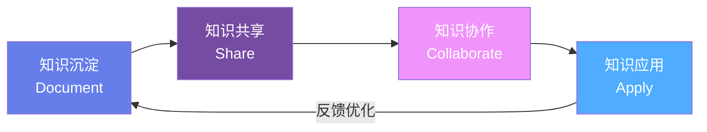
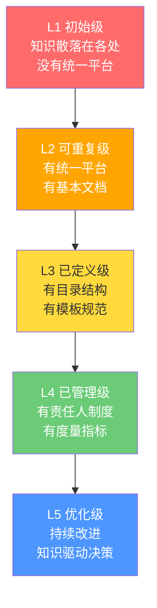
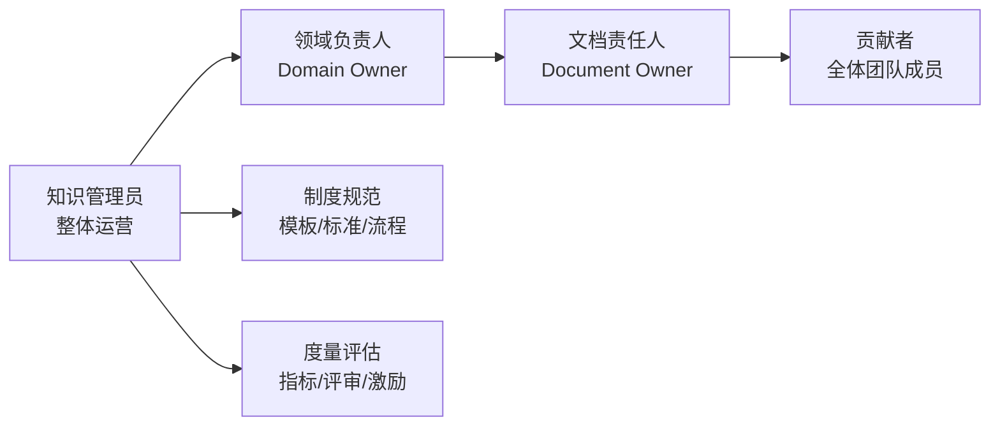
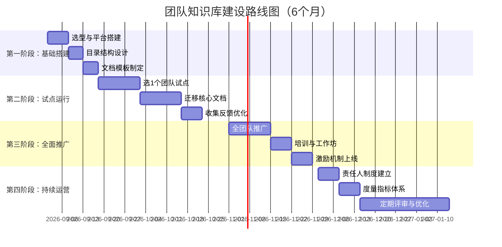

# 🏢 团队知识库建设方法论

> **文档说明**：系统讲解团队知识库从 0 到 1 建设的完整方法论，涵盖知识管理四阶段（沉淀→共享→协作→应用）、知识库目录结构设计、文档模板规范、激励机制设计、知识治理体系、ADR 架构决策记录、故障复盘模板、Docs as Code 实践、工具选型对比、度量指标体系和常见问题解决方案。团队知识库是组织效率和知识传承的基础设施，建设质量直接决定团队的协作效率和新人成长速度。
>
> **适用人群**：技术负责人、团队 Leader、知识管理员、希望提升团队协作效率的工程师
>
> **前置知识**：[[个人知识IP构建]] · [[组织级知识沉淀与传承]] · [[知识管理-方法论枢纽]]

---

## 一、概述

### 1.1 为什么需要团队知识库

团队知识库是**组织知识的集中沉淀和共享平台**，解决的核心问题是：

- **知识流失**：核心员工离职带走关键知识，新人重新踩坑
- **重复劳动**：同样的问题被不同人反复解决，浪费时间
- **信息孤岛**：知识散落在个人电脑、聊天记录、邮件中，难以查找
- **新人上手慢**：没有系统的学习路径，靠口口相传效率低
- **决策无依据**：历史决策没有记录，重复讨论同样的问题

> **一句话定义**：团队知识库 = 组织记忆 + 协作平台 + 学习资源，让团队的每一次经验都不浪费，每一个问题只被解决一次。

### 1.2 团队知识库 vs 个人知识库

| 维度 | 个人知识库 | 团队知识库 |
|------|-----------|-----------|
| **目标** | 个人学习成长 | 组织效率和传承 |
| **内容** | 个人笔记、学习记录 | 项目文档、技术规范、决策记录 |
| **受众** | 自己 | 团队所有人 |
| **质量要求** | 自己能看懂即可 | 结构化、可搜索、可维护 |
| **更新机制** | 个人自觉 | 责任人制度 + 评审机制 |
| **工具** | Obsidian/Notion 个人版 | 飞书/Confluence/Notion 团队版 |
| **核心挑战** | 坚持记录 | 激励贡献 + 保持更新 |

### 1.3 知识管理四阶段模型



| 阶段 | 核心动作 | 关键产出 | 衡量指标 |
|------|---------|---------|---------|
| **知识沉淀** | 将隐性知识显性化，文档化记录 | 技术文档、FAQ、复盘、规范 | 文档数量、覆盖率 |
| **知识共享** | 让知识可搜索、可访问、可发现 | 目录结构、搜索、标签、推送 | 搜索命中率、访问量 |
| **知识协作** | 多人共同编辑、评审、迭代 | 评论、版本、评审记录 | 协作人数、更新频率 |
| **知识应用** | 知识真正用于解决问题、指导决策 | 问题解决、新人上手、决策参考 | 新人上手时间、问题重复率 |

### 1.4 核心应用场景

| 场景 | 知识库价值 | 典型内容 |
|------|-----------|---------|
| **新人入职** | 系统化学习路径，减少 mentor 负担 | Onboarding 指南、技术栈介绍、开发环境搭建 |
| **项目开发** | 需求/设计/复盘全流程记录 | 需求文档、技术方案、API 文档、项目复盘 |
| **技术决策** | 记录决策背景和原因，避免重复讨论 | ADR 架构决策记录、技术选型对比 |
| **故障处理** | 沉淀故障经验，避免重复踩坑 | 故障复盘（5 Whys）、Runbook、应急预案 |
| **日常开发** | 统一规范，减少沟通成本 | 编码规范、代码评审标准、部署流程 |
| **问题排查** | 常见问题快速定位 | FAQ、问题库、排查手册 |
| **跨团队协作** | 信息透明，减少信息差 | 架构图、接口文档、团队介绍 |

---

## 二、底层原理

### 2.1 知识转化理论（SECI 模型）

野中郁次郎的 SECI 模型是知识管理的经典理论，描述了隐性知识和显性知识的相互转化：

| 转化模式 | 过程 | 说明 | 团队知识库中的应用 |
|---------|------|------|-------------------|
| **社会化（Socialization）** | 隐性→隐性 | 通过观察、模仿、实践传递经验 | 师徒制、结对编程、Code Review |
| **外化（Externalization）** | 隐性→显性 | 将经验和想法转化为文档 | 写技术文档、复盘、FAQ（知识库核心） |
| **组合（Combination）** | 显性→显性 | 将分散的知识整合为系统 | 整理目录、建立索引、知识图谱 |
| **内化（Internalization）** | 显性→隐性 | 通过学习和实践将知识变为能力 | 阅读文档、动手实践、培训分享 |

> **团队知识库的核心价值**：促进「外化」和「组合」，让个人的隐性知识变成组织的显性知识，并系统化组织起来。

### 2.2 知识库建设的核心挑战

| 挑战 | 本质 | 解决方向 |
|------|------|---------|
| **没人写** | 贡献成本高、激励不足、不知道写什么 | 降低门槛（模板+示例）、激励机制、领导带头 |
| **写了没人看** | 找不到、不好搜、与工作脱节 | 优化搜索、主动推送、与工作流集成 |
| **内容过时** | 没有责任人、没有更新机制 | 责任人制度、过期提醒、定期评审 |
| **信息孤岛** | 各团队各自为政、平台不统一 | 统一平台、跨团队链接、知识地图 |
| **质量参差** | 没有标准、没有评审 | 文档模板、质量标准、评审机制 |
| **信息过载** | 内容太多太杂，找不到重点 | 分类清晰、标签规范、搜索优化、精华推荐 |

### 2.3 知识库成熟度模型



| 级别 | 特征 | 关键标志 |
|------|------|---------|
| **L1 初始级** | 知识散落在个人电脑、聊天记录中 | 没有统一平台，新人靠口口相传 |
| **L2 可重复级** | 有统一平台，有基本文档 | 有 Wiki/飞书空间，有一些项目文档 |
| **L3 已定义级** | 有目录结构和模板规范 | 文档分类清晰，有统一模板，新人有 Onboarding |
| **L4 已管理级** | 有责任人制度和度量指标 | 每个领域有 Owner，定期评审，有质量指标 |
| **L5 优化级** | 持续改进，知识驱动决策 | 知识库与工作流深度集成，数据驱动优化 |

### 2.4 知识治理体系

知识治理是确保知识库持续有效运行的组织和制度保障：



| 角色 | 职责 | 投入 |
|------|------|------|
| **知识管理员** | 整体运营、目录维护、模板更新、培训推广 | 兼职 20% 时间 |
| **领域负责人** | 负责某领域知识质量、审核更新、技术准确性 | 兼职 10% 时间 |
| **文档责任人** | 单篇文档的维护和更新 | 写文档时指定 |
| **贡献者** | 日常贡献文档、参与评审 | 全体成员 |

---

## 三、实操示例

### 3.1 团队知识库目录结构设计

```markdown
# 团队知识库目录结构（推荐模板）

00-新人入门（Onboarding）
├── 01-团队介绍.md          # 团队成员、职责、文化
├── 02-技术栈总览.md        # 用到的技术和工具
├── 03-开发环境搭建.md      # 环境配置步骤
├── 04-代码规范.md          # 编码规范、Git 规范
├── 05-第一个PR.md          # 新人第一个任务指南
└── 06-学习路径.md          # 30/60/90天学习计划

01-项目文档
├── 项目A/
│   ├── 00-项目概述.md
│   ├── 01-需求文档/
│   ├── 02-技术方案/
│   ├── 03-API文档/
│   └── 04-项目复盘/
└── 项目B/

02-技术文档
├── 01-架构设计/            # 系统架构图、模块设计
├── 02-技术规范/            # 编码规范、设计规范
├── 03-最佳实践/            # 各技术领域最佳实践
├── 04-工具指南/            # 开发工具使用指南
└── 05-技术分享/            # 内部分享记录

03-流程规范
├── 01-开发流程.md          # 需求→开发→测试→发布
├── 02-代码评审规范.md      # CR 标准和流程
├── 03-发布流程.md          # 发布步骤和回滚
├── 04-故障处理流程.md      # 故障响应和处理
└── 05-会议规范.md          # 站会/周会/复盘会

04-问题库
├── 01-FAQ/                 # 常见问题
├── 02-故障复盘/            # 故障复盘文档
├── 03-Runbook/             # 运维操作手册
└── 04-排查手册/            # 常见问题排查步骤

05-决策记录
├── ADR-001-数据库选型.md
├── ADR-002-微服务拆分.md
└── ADR-索引.md

06-团队管理
├── 01-OKR与目标.md
├── 02-绩效与成长.md
├── 03-会议纪要/
└── 04-团队文化.md
```

### 3.2 文档模板规范

#### 技术方案文档模板

```markdown
---
title: 技术方案-XXX
tags: [技术方案, 评审中/已通过]
author: 张三
reviewers: [李四, 王五]
created: 2026-08-28
updated: 2026-08-28
status: 草稿/评审中/已通过/已废弃
---

# XXX 技术方案

## 1. 背景与目标
- 业务背景：为什么要做
- 目标：要解决什么问题
- 非目标：不做什么

## 2. 现状分析
- 当前架构/方案
- 存在的问题

## 3. 方案设计
### 3.1 整体架构
（架构图）

### 3.2 核心模块
- 模块A：职责、接口、实现
- 模块B：职责、接口、实现

### 3.3 数据设计
- 表结构/数据模型
- 数据流转

### 3.4 接口设计
- API 列表
- 请求/响应示例

## 4. 备选方案对比
| 方案 | 优点 | 缺点 | 结论 |
|------|------|------|------|

## 5. 风险与应对
| 风险 | 影响 | 概率 | 应对措施 |
|------|------|------|---------|

## 6. 排期与里程碑
| 阶段 | 时间 | 负责人 | 交付物 |
|------|------|--------|--------|

## 7. 参考资料
- 相关文档链接
```

#### ADR（架构决策记录）模板

```markdown
---
title: ADR-001-数据库选型
date: 2026-08-28
status: 已接受  # 提议中/已接受/已废弃/已替代
deciders: 张三, 李四
---

# ADR-001: 数据库选型

## 背景
我们需要为新项目选择数据库，当前面临 MySQL 和 PostgreSQL 的选择。

## 决策
选择 PostgreSQL 作为主数据库。

## 原因
1. PostgreSQL 支持更丰富的数据类型（JSONB、数组、全文搜索）
2. 项目需要复杂查询和事务，PostgreSQL 性能更优
3. 团队有 PostgreSQL 使用经验

## 后果
### 正面
- 可以利用 JSONB 存储灵活数据
- 复杂查询性能更好

### 负面
- 需要学习 PostgreSQL 特有语法
- 部分运维工具需要适配

## 参考
- 技术方案文档链接
- 性能测试报告
```

#### 故障复盘模板

```markdown
---
title: 故障复盘-XXX服务不可用
date: 2026-08-28
severity: P0/P1/P2/P3
duration: 30分钟
author: 张三
---

# 故障复盘：XXX 服务不可用

## 1. 故障概要
- 发生时间：2026-08-28 14:00 - 14:30
- 影响范围：XXX 功能不可用，影响约 1 万用户
- 严重等级：P1

## 2. 故障时间线
| 时间 | 事件 | 处理人 |
|------|------|--------|
| 14:00 | 监控告警，服务错误率飙升 | 系统 |
| 14:02 | 值班人员确认故障 | 张三 |
| 14:05 | 定位到数据库连接池满 | 张三 |
| 14:10 | 重启服务，临时恢复 | 李四 |
| 14:30 | 根因修复，服务完全恢复 | 张三 |

## 3. 根因分析（5 Whys）
1. 为什么服务不可用？→ 数据库连接池满，获取连接超时
2. 为什么连接池满？→ 慢查询占用连接不释放
3. 为什么有慢查询？→ 新增查询没有加索引
4. 为什么没加索引？→ 代码评审没有检查 SQL
5. 为什么没检查？→ 没有 SQL 评审规范和工具

**根本原因**：缺少 SQL 评审机制，慢查询上线导致连接池耗尽。

## 4. 改进措施
| 措施 | 负责人 | 截止时间 | 状态 |
|------|--------|---------|------|
| 增加慢查询监控告警 | 张三 | 2026-09-01 | 进行中 |
| 建立 SQL 评审规范 | 李四 | 2026-09-05 | 未开始 |
| 接入 SQL 审核工具 | 王五 | 2026-09-10 | 未开始 |
| 数据库连接池调优 | 张三 | 2026-08-29 | 已完成 |

## 5. 经验教训
- 上线前必须检查 SQL 性能
- 连接池需要监控和告警
- 故障处理流程需要优化（定位花了 5 分钟）
```

### 3.3 激励机制设计

```markdown
# 知识库贡献激励机制

## 1. 物质激励
- 月度知识贡献之星：奖励 500 元 + 公开表彰
- 季度最佳文档：奖励 1000 元
- 知识贡献纳入绩效考评（占比 5-10%）

## 2. 精神激励
- 知识库首页展示贡献排行榜
- 优秀文档在团队周会分享
- 新员工入职时介绍知识库贡献者
- 年度知识管理贡献奖

## 3. 成长激励
- 知识贡献作为晋升参考依据
- 优秀文档作者有机会做技术分享
- 知识管理员作为管理能力培养路径

## 4. 降低门槛
- 提供丰富的文档模板（填空式）
- 「写文档」作为任务的 DoD（完成定义）
- 代码评审时检查是否有对应文档
- 每周固定 1 小时「知识沉淀时间」
```

### 3.4 Docs as Code 实践

```markdown
# Docs as Code：文档即代码

## 核心理念
用管理代码的方式管理文档：版本控制、CI 检查、代码评审、自动部署。

## 实践方式
1. 文档存储在 Git 仓库（Markdown 格式）
2. 文档变更走 PR + Code Review
3. CI 自动检查：链接有效性、格式规范、拼写
4. 自动构建和部署（MkDocs / GitBook / VitePress）
5. 文档版本与代码版本对应

## 工具链
- 写作：Obsidian / VSCode
- 版本控制：Git
- 检查：markdownlint / textlint
- 构建：MkDocs / VitePress / Docusaurus
- 部署：GitHub Pages / 内网静态站点
- 搜索：Algolia / 本地全文搜索

## CI 检查示例（GitHub Actions）
```
name: Docs Check
on: [pull_request]
jobs:
  lint:
    runs-on: ubuntu-latest
    steps:
      - uses: actions/checkout@v4
      - name: Markdown Lint
        uses: DavidAnson/markdownlint-cli2-action@v10
        with:
          globs: 'docs/**/*.md'
      - name: Check Links
        uses: lycheeverse/lychee-action@v1
        with:
          args: --verbose --no-progress './docs/**/*.md'
```
```

### 3.5 知识库度量指标

```markdown
# 知识库度量指标体系

## 1. 内容指标
- 文档总数：衡量知识沉淀量
- 文档覆盖率：核心领域是否都有文档
- 文档质量评分：定期评审打分
- 过期文档比例：超过 N 天未更新的文档占比

## 2. 使用指标
- 日活/月活用户数
- 搜索次数和搜索命中率
- 文档访问量（PV/UV）
- 平均停留时间
- 新人上手时间（从入职到独立产出）

## 3. 贡献指标
- 月度新增/更新文档数
- 贡献者人数和比例
- 人均贡献文档数
- 文档评审参与率

## 4. 效果指标
- 重复问题发生率（同样的问题是否反复出现）
- 故障平均恢复时间（MTTR）
- 新人培训成本（mentor 投入时间）
- 跨团队协作效率（沟通成本）

## 5. 健康度评分（示例）
| 维度 | 权重 | 评分 | 得分 |
|------|------|------|------|
| 内容完整性 | 30% | 80 | 24 |
| 内容质量 | 25% | 75 | 18.75 |
| 使用活跃度 | 20% | 85 | 17 |
| 贡献活跃度 | 15% | 70 | 10.5 |
| 时效性 | 10% | 60 | 6 |
| **总分** | **100%** | - | **76.25** |
```

---

## 四、常见问题与排查

| 问题现象 | 可能原因 | 解决方案 |
|---------|---------|---------|
| **没人愿意写文档** | 贡献成本高；没有激励；觉得写文档浪费时间 | 提供模板降低门槛；领导带头写；知识贡献纳入绩效；写文档作为任务 DoD |
| **写了文档没人看** | 文档找不到；搜索不好用；内容与工作脱节 | 优化目录和标签；与工作流集成（IDE 插件/聊天机器人推送）；主动推送相关文档 |
| **内容过时没人更新** | 没有责任人；没有更新机制；不知道该更新 | 每篇文档指定 Owner；设置过期提醒（如 90 天未更新提醒 Owner）；定期评审清理 |
| **信息孤岛，各团队各自为政** | 没有统一平台；目录不统一；缺乏跨团队链接 | 统一知识库平台；制定全局目录规范；建立跨团队知识地图；鼓励互相引用 |
| **文档质量参差不齐** | 没有标准；没有评审；新人不知道怎么写 | 提供文档模板和写作指南；建立评审机制（PR/Review）；优秀文档作为范例 |
| **搜索不到想要的内容** | 标题不规范；没有标签；内容太散；搜索功能弱 | 统一命名规范；强制标签；建立索引页；升级搜索工具（Algolia/Elasticsearch） |
| **知识库变成垃圾场** | 什么都往里放；没有分类；没有清理机制 | 制定收录标准；定期清理废弃文档；区分「正式文档」和「草稿/临时」 |
| **新人不知道从哪看起** | 没有学习路径；内容太多太杂；没有入门引导 | 设计 Onboarding 学习路径（30/60/90天）；首页推荐精华文档；mentor 指导 |
| **文档与代码不同步** | 文档和代码分开维护；更新代码忘记更新文档 | Docs as Code（文档和代码同仓库）；API 文档自动生成；代码评审检查文档 |
| **知识库迁移困难** | 平台锁定；格式不兼容；链接失效 | 用 Markdown 纯文本格式；定期导出备份；迁移时用脚本转换和修复链接 |
| **敏感信息泄露** | 权限管理不严；文档包含密码/密钥；外部分享 | 分级权限管理；敏感信息脱敏；定期审计；禁止在文档中写明文密码 |
| **知识管理员 burnout** | 一个人扛所有事；没有团队参与；投入产出不明确 | 建立领域负责人制度；分摊维护责任；量化知识库价值，争取资源 |
| **重复文档，内容冲突** | 多人写了同主题文档；没有合并机制 | 建立去重机制；搜索时提示相似文档；定期合并重复内容；指定唯一权威文档 |

---

## 五、进阶与最佳实践

### 5.1 工具选型对比

| 工具 | 优点 | 缺点 | 适用场景 |
|------|------|------|---------|
| **飞书知识库** | 国内访问快；与飞书生态集成；权限完善；支持多人协作 | 导出不便；Markdown 支持有限；定制化弱 | 国内团队，飞书用户 |
| **Notion** | 界面美观；数据库功能强；模板丰富；协作体验好 | 国内访问慢；大文档性能差；导出格式有限 | 中小团队，注重体验 |
| **Confluence** | 企业级功能；权限完善；与 Jira 集成；插件丰富 | 界面老旧；配置复杂；价格贵 | 大型企业，Jira 用户 |
| **Obsidian + Git** | 纯 Markdown；本地优先；插件丰富；关系图谱；完全可控 | 协作需要 Git；没有在线编辑；需要技术能力 | 技术团队，注重数据所有权 |
| **MkDocs/VitePress** | Docs as Code；静态站点；搜索好；版本管理 | 需要开发维护；非技术人员使用门槛高 | 开源项目、技术文档 |
| **语雀** | 国内产品；体验好；支持多种格式；团队协作 | 企业版收费；导出有限 | 国内中小团队 |
| **GitBook** | 界面美观；Git 集成；适合技术文档 | 免费版功能有限；国内访问一般 | 开源项目文档 |

> **推荐**：技术团队优先选择「Obsidian + Git」或「飞书知识库」。前者适合技术深度和数据自主，后者适合协作便捷和企业集成。

### 5.2 知识库建设路线图



### 5.3 知识库运营 SOP

```markdown
# 知识库运营标准流程（SOP）

## 日常运营（每周）
- 周一：检查新增文档，审核质量
- 周三：回复文档评论和问题
- 周五：更新贡献排行榜，推送精华文档

## 月度运营（每月）
- 月度知识贡献之星评选
- 过期文档提醒（超过 90 天未更新）
- 文档质量抽查（随机 5 篇评审）
- 月度数据报告（访问量/贡献量/搜索命中率）

## 季度运营（每季度）
- 知识库健康度评估
- 目录结构优化
- 模板更新
- 知识贡献激励发放
- 季度复盘和改进计划

## 年度运营（每年）
- 知识库年度报告
- 大规模内容清理和重构
- 工具评估和升级
- 知识管理战略规划
```

### 5.4 与 AI 结合的知识库

```markdown
# AI 增强的团队知识库

## 1. AI 辅助写作
- 根据会议纪要自动生成文档草稿
- 代码变更自动生成/更新 API 文档
- AI 润色和格式化文档

## 2. AI 智能搜索
- 自然语言问答（RAG 检索增强生成）
- 语义搜索（不只是关键词匹配）
- 自动推荐相关文档

## 3. AI 知识治理
- 自动检测过期文档和死链
- 自动分类和打标签
- 自动发现重复文档
- 文档质量自动评分

## 4. AI 新人助手
- 根据新人角色推荐学习路径
- 回答常见问题（基于知识库）
- 自动生成学习计划

## 工具推荐
- Dify / FastGPT：搭建知识库问答机器人
- Obsidian + Smart Connections：本地 AI 知识关联
- 飞书智能问答：飞书知识库 AI 搜索
```

### 5.5 生产环境最佳实践 Checklist

| 类别 | 最佳实践 | 说明 |
|------|---------|------|
| **规划** | 先试点再推广 | 选 1 个团队跑通，再全面推广 |
| **规划** | 明确目标和度量 | 知道为什么建，怎么衡量成功 |
| **结构** | 目录不超过 3 层 | 太深找不到，太浅太杂乱 |
| **结构** | 一个主题一个文档 | 避免文档过大或过碎 |
| **模板** | 提供丰富模板 | 降低贡献门槛，保证质量 |
| **模板** | 强制 Frontmatter | 统一元数据（作者/日期/状态/标签） |
| **质量** | 文档评审机制 | PR/Review，确保准确性 |
| **质量** | 责任人制度 | 每篇文档有 Owner，定期更新 |
| **质量** | 过期提醒 | 超过 N 天未更新自动提醒 Owner |
| **激励** | 领导带头 | 管理者先写，树立榜样 |
| **激励** | 贡献纳入绩效 | 让写文档有回报 |
| **激励** | 降低门槛 | 模板+示例+固定时间 |
| **搜索** | 统一命名规范 | 标题可预测，便于搜索 |
| **搜索** | 标签体系 | 多维度分类，提升检索 |
| **搜索** | 索引页/MOC | 人工组织知识网络 |
| **协作** | 评论和反馈 | 文档可评论，持续迭代 |
| **协作** | 版本历史 | 可追溯，可回滚 |
| **安全** | 权限分级 | 公开/团队/个人，敏感信息隔离 |
| **安全** | 敏感信息脱敏 | 不写明文密码/密钥 |
| **运营** | 定期评审 | 月度/季度检查内容质量 |
| **运营** | 数据驱动 | 监控访问/搜索/贡献指标 |
| **运营** | 持续改进 | 根据反馈不断优化 |
| **技术** | Docs as Code | Git 版本控制 + CI 检查 |
| **技术** | 自动生成 | API 文档从代码自动生成 |
| **技术** | 备份导出 | 定期备份，防止平台锁定 |

---

## 六、关联笔记

### 知识管理
- [[个人知识IP构建]] · [[组织级知识沉淀与传承]] · [[知识管理-方法论枢纽]]
- [[知识库文档统一编写标准v2]] · [[标签命名规范]] · [[知识库健康度评估指标]]

### 知识库运营
- [[知识库维护报告与健康度]] · [[知识库持续优化机制]] · [[知识库覆盖扫描与补全清单_优化版]]
- [[质量校验规则]] · [[间隔重复与记忆巩固]]

### 工具与实践
- [[Obsidian知识库构建]] · [[MOC-综合导航]] · [[Home]]

> 🔍 **知识点深度解析**
>
> **作用**：团队知识库建设方法论解决的是「如何让组织知识有效沉淀、共享、协作和应用」的问题，是团队从「人治」走向「知识驱动」的基础设施。
>
> **底层原理**：基于 SECI 知识转化模型（社会化→外化→组合→内化），团队知识库的核心是促进「外化」（隐性知识变显性文档）和「组合」（分散知识系统化）。建设的核心挑战不是技术，而是人和制度：激励贡献、保持更新、保证质量。成熟度从 L1（散落）到 L5（优化）逐级提升，每级都有明确的标志和要求。
>
> **用法要点**：① 先试点再推广，选 1 个团队跑通 ② 目录结构不超过 3 层，一个主题一个文档 ③ 提供丰富模板降低贡献门槛 ④ 领导带头 + 激励机制（绩效/表彰） ⑤ 责任人制度 + 过期提醒保证内容新鲜 ⑥ 度量指标驱动（访问量/搜索命中率/新人上手时间） ⑦ Docs as Code + CI 检查 ⑧ 定期评审清理，防止变成垃圾场。

> 💡 **深度讲解**：团队知识库建设最大的坑是「重建设、轻运营」。很多团队花了很多时间搭建平台、迁移文档，但上线后没人维护，很快变成垃圾场。知识库的价值不在于有多少文档，而在于文档是否被使用、是否解决问题。成功的知识库一定是「运营驱动」的：有专人负责、有制度保障、有数据度量、有持续改进。另一个坑是「追求大而全」，一开始就想覆盖所有领域，结果哪里都做不好。正确的做法是从最高频的场景切入（如新人 Onboarding、故障复盘、FAQ），做出价值后再逐步扩展。记住：**知识库不是目的，解决问题才是目的**。

> 📝 **精简总结**：团队知识库 = 组织记忆 + 协作平台。四阶段：沉淀（文档化）→共享（可搜索）→协作（共编辑）→应用（解问题）。三大挑战：没人写（模板+激励+领导带头）、写了没人看（搜索+推送+工作流集成）、内容过时（责任人+过期提醒+定期评审）。建设路径：试点→模板→推广→运营→度量。核心工具：飞书/Notion/Confluence/Obsidian+Git。进阶：Docs as Code、ADR 决策记录、故障复盘 5 Whys、AI 增强搜索。

> **学习路径建议**：先阅读 [[知识管理-方法论枢纽]] 建立全局认知 → 学习本文档掌握建设方法论 → 参考 [[知识库文档统一编写标准v2]] 制定文档规范 → 学习 [[Obsidian知识库构建]] 选择工具 → 在团队中试点运行，持续迭代优化。

---

> **最好的知识库不是最大的，而是最有用的。每一篇文档都应该能回答一个具体的问题，每一次搜索都应该能快速找到答案。**
