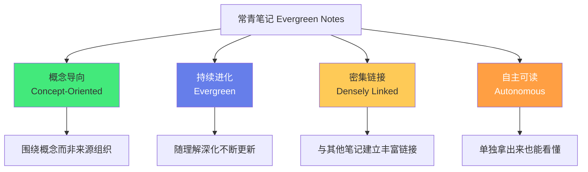
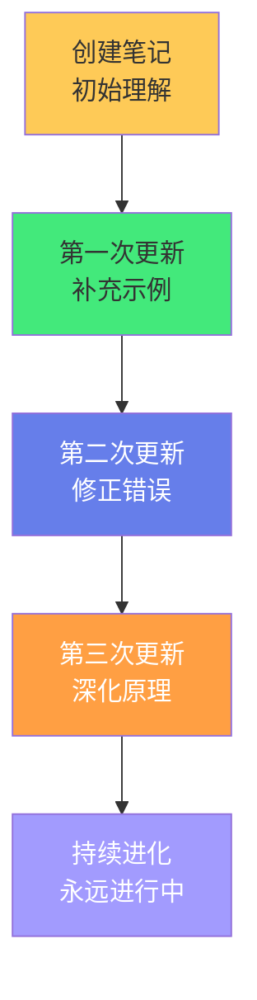
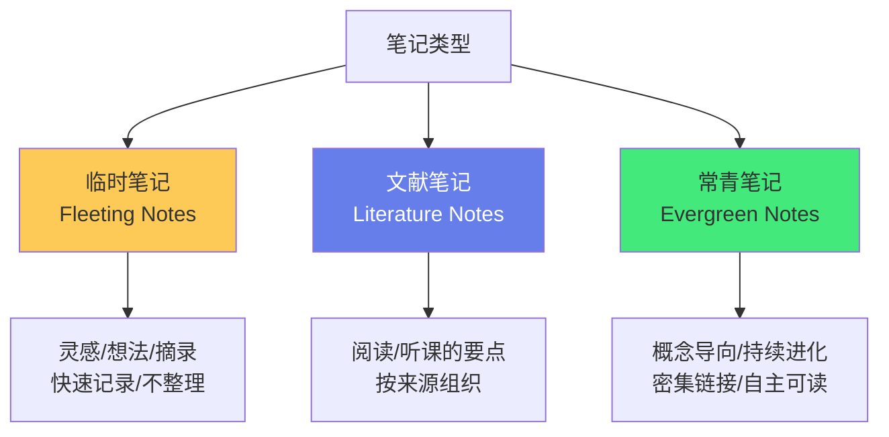
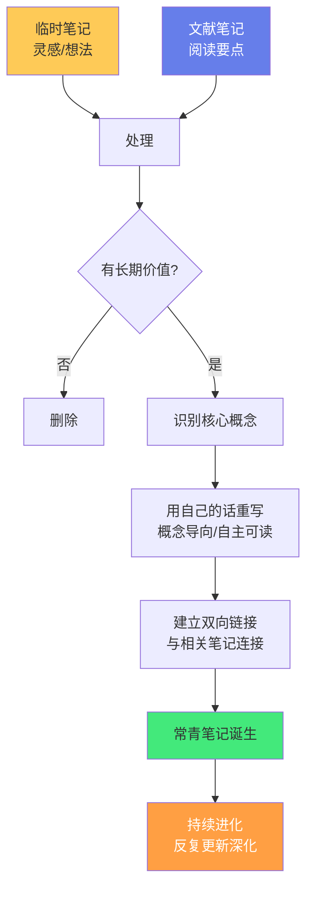
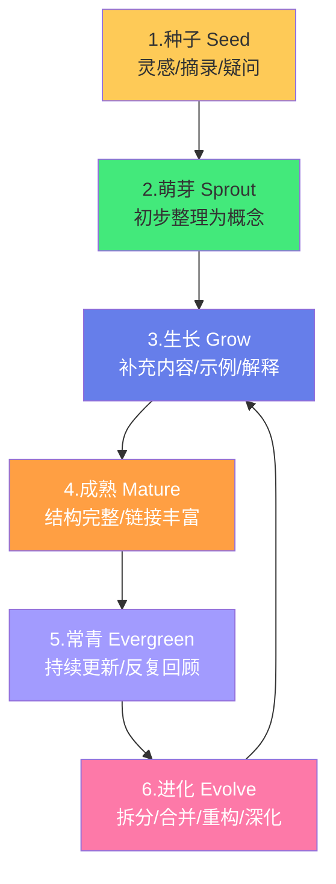

# 🌲 常青笔记 Evergreen Notes

> **文档说明**：系统讲解常青笔记（Evergreen Notes）的核心理念、写作原则、生命周期与在 Obsidian 中的实践方法，涵盖常青笔记的起源（Andy Matuschak 的工作笔记方法论）、核心定义（持续生长、概念导向、密集链接、自主可读的活笔记）、常青笔记的四大核心特征（概念导向 Concept-Oriented / 持续进化 Evergreen / 密集链接 Densely Linked / 自主可读 Autonomous）、常青笔记与临时笔记（Fleeting Notes）、文献笔记（Literature Notes）的区别与转化流程、常青笔记的写作原则（标题即论点/一个概念一篇/用自己的话/持续更新/拒绝完美主义）、常青笔记的完整生命周期（种子→萌芽→生长→成熟→常青→进化）、如何将日常灵感和阅读笔记转化为常青笔记、常青笔记与原子笔记的关系（高度重叠但侧重不同：原子性 vs 生长性）、常青笔记与 Zettelkasten 卡片盒的关系（继承与发展）、常青笔记的质量评估标准（标题质量/概念清晰度/链接密度/更新频率/自主可读性）、常青笔记在 Obsidian 中的实操（模板/标签/图谱/回顾）、常见误区（写完就归档/不更新/不链接/标题模糊/追求完美/数量崇拜）、常青笔记的培养习惯（每日浇灌/定期回顾/链接漫游/持续迭代）、与其他笔记方法的对比、常见问题与最佳实践。
>
> **适用人群**：知识管理实践者、终身学习者、研究者、写作者、开发者、Obsidian 用户、第二大脑构建者
>
> **前置知识**：[[原子笔记原则与实践]] · [[Zettelkasten-卡片盒笔记法]] · [[LYT-链接你的思维]] · [[MOC内容地图]]

---

## 一、概述

### 1.1 什么是常青笔记

**常青笔记（Evergreen Notes）** 是由研究者 **Andy Matuschak** 提出并实践的笔记方法论，核心思想是：**笔记应该像常青树一样持续生长，而不是写完就归档的静态文档**。



**Andy Matuschak 的原话**：
> "Evergreen notes are written and evolved over time, rather than being written once and archived. They are concept-oriented, densely linked, and written to be read on their own."
> （常青笔记是随时间持续写作和进化的，而非写完就归档。它们是概念导向的、密集链接的、且被写成可以独立阅读的。）

**核心洞察**：
- 大多数人的笔记是「一次性的」——写完就再也不看，变成数字垃圾
- 常青笔记是「活的」——随着你的理解深化，笔记也在不断生长、更新、连接
- 常青笔记的目标不是「记录信息」，而是「培育一个持续生长的知识生态系统」

### 1.2 常青笔记的起源

常青笔记方法论的发展脉络：


| 阶段 | 人物/方法 | 核心贡献 |
|------|----------|---------|
| **起源** | 尼克拉斯·卢曼（Zettelkasten） | 卡片盒笔记法，原子化+链接，用卡片盒写了70本书 |
| **发展** | Andy Matuschak（常青笔记） | 提出「常青笔记」概念，强调持续进化、概念导向、密集链接 |
| **普及** | Tiago Forte（第二大脑）、Maggie Appleton（数字花园） | 将常青笔记思想普及到大众，提出CODE方法和数字花园隐喻 |
| **实践** | Obsidian/Logseq 等工具 | 双向链接+关系图谱让常青笔记的密集链接成为可能 |

**Andy Matuschak 的背景**：
- 苹果前工程师，参与设计 Swift 编程语言
- 研究者，专注于「记忆系统」和「学习科学」
- 他的工作笔记全部是常青笔记，公开在 his website 上
- 他用常青笔记的方式写研究笔记，持续迭代了十几年

### 1.3 为什么需要常青笔记

| 传统笔记的问题 | 常青笔记的解决方案 |
|--------------|-------------------|
| **写完就忘**：笔记写完就归档，再也不看 | **持续进化**：笔记随理解深化不断更新，反复回顾 |
| **信息堆积**：按来源/时间组织，难以复用 | **概念导向**：按概念组织，同一概念的笔记聚合在一起 |
| **信息孤岛**：笔记之间没有链接，无法发现关联 | **密集链接**：笔记之间丰富链接，形成知识网络 |
| **上下文依赖**：笔记依赖原始来源，单独看不懂 | **自主可读**：笔记写成可以独立理解的完整单元 |
| **静态不变**：笔记是某个时间点的快照，不更新 | **常青生长**：笔记是活的，持续生长、修正、深化 |
| **数量崇拜**：以「写了多少篇」为目标 | **质量优先**：以「笔记的深度和连接密度」为目标 |

> **核心洞察**：常青笔记的本质是「将笔记从『静态的信息记录』升级为『动态的、持续生长的知识单元』」——就像种树，不是「砍一棵树做成家具」（一次性使用），而是「种下一棵树，持续浇水施肥，让它长成参天大树」（持续生长）。

---

## 二、常青笔记的四大核心特征

### 2.1 特征一：概念导向（Concept-Oriented）

**定义**：常青笔记围绕「概念」组织，而非围绕「来源」（书名/课程/文章）或「时间」组织。

| 来源导向（传统） | 概念导向（常青） |
|----------------|----------------|
| 《Java并发编程实战》读书笔记 | 线程池通过复用线程减少创建销毁开销 |
| 某课程第3章笔记 | 互斥锁通过排他访问保证线程安全 |
| 2026-08-15 阅读笔记 | 可见性问题由CPU缓存和指令重排序导致 |

**为什么概念导向重要**：
- 概念是「可迁移的」——同一概念可以来自多本书、多门课、多个项目
- 概念导向的笔记可以整合多个来源的理解，更全面
- 概念导向便于建立链接——概念之间有天然的关联
- 概念导向便于复用——需要时可以直接引用某个概念笔记

**实践方法**：
- 读书/听课时，不要按章节记笔记，要按「概念」记笔记
- 读到一个新概念，创建一篇常青笔记，标注来源
- 同一概念在不同来源中有不同解释，整合到同一篇常青笔记中
- 笔记标题是「概念的论点陈述」，不是「书名+章节」

### 2.2 特征二：持续进化（Evergreen）

**定义**：常青笔记不是「写完就完」的静态文档，而是随理解深化持续更新、修正、生长的「活笔记」。



**持续进化的表现**：
- **补充新理解**：学到新东西时，补充到对应笔记
- **修正错误**：发现之前理解有误时，修正笔记
- **深化解释**：理解更深入时，重写解释部分
- **增加示例**：实践中遇到新例子时，添加到笔记
- **建立新链接**：发现新概念关联时，添加双向链接
- **重构结构**：笔记内容增长后，重新组织结构或拆分

**Andy Matuschak 的实践**：
- 他的常青笔记有些已经持续更新了十几年
- 每篇笔记都有「创建时间」和「最后更新时间」
- 他会反复重读自己的笔记，不断修正和深化
- 笔记的「版本历史」就是他的「认知进化史」

### 2.3 特征三：密集链接（Densely Linked）

**定义**：常青笔记之间建立丰富的双向链接，形成密集的知识网络，而非孤立的信息点。

**为什么密集链接重要**：
- 链接让笔记从「点」变成「网」——网络的价值随连接数指数增长（梅特卡夫定律）
- 链接帮助发现「意外关联」——跨领域连接往往是创新的源泉
- 链接强化记忆——通过关联记忆，比孤立记忆更牢固
- 链接实现「知识漫游」——从一个概念出发，探索相关知识
- 链接让笔记「活起来」——新笔记加入时，自动与已有知识建立关联

**实践方法**：
- 每篇常青笔记至少链接 3-5 篇相关笔记
- 写笔记时，主动思考「这个概念和哪些已有概念相关」
- 定期在关系图谱中漫游，发现新的连接机会
- 使用「关联笔记」部分，分类列出相关笔记（前置/同领域/跨领域）
- 链接要精准——链接到具体的概念笔记，而非大而全的笔记

> **参考**：[[跨领域知识连接方法]] 详细讲解了如何建立高质量的跨领域链接。

### 2.4 特征四：自主可读（Autonomous）

**定义**：每篇常青笔记都可以被「独立理解」——不需要参考原始来源或上下文，单独拿出来就能看懂。

**为什么自主可读重要**：
- 笔记可能在几个月/几年后才被再次阅读——那时你可能忘了原始上下文
- 笔记可能被其他人阅读（分享/协作）——他们没有你的背景知识
- 自主可读的笔记可以被「引用」和「复用」——在不同上下文中都有意义
- 自主可读迫使你「真正理解」——如果写不清楚，说明你还没懂

**实践方法**：
- 不要使用「如上所述」「参见前文」「这个」「那个」等依赖上下文的表述
- 笔记开头用一句话概括核心论点
- 必要的背景知识简要提及，或链接到相关笔记
- 用自己的话解释，不照抄原文
- 假设读者是「聪明但不了解这个特定主题的人」

---

## 三、三种笔记类型与转化

### 3.1 三种笔记类型

常青笔记方法论将笔记分为三种类型：



| 类型 | 别名 | 目的 | 特点 | 生命周期 |
|------|------|------|------|---------|
| **临时笔记** | Fleeting / Quick Notes | 快速捕捉灵感和想法 | 不整理、不规范、随时记录 | 短期，1-3天内处理或丢弃 |
| **文献笔记** | Literature Notes | 记录阅读/听课的要点 | 按来源组织，保留原文要点 | 中期，用于转化为常青笔记 |
| **常青笔记** | Evergreen / Permanent Notes | 沉淀核心概念和理解 | 概念导向、持续进化、密集链接 | 长期，持续生长 |

### 3.2 临时笔记（Fleeting Notes）

**定义**：快速捕捉灵感、想法、疑问、摘录的笔记，不追求格式和完整。

**特征**：
- 随时随地快速记录（手机备忘录/语音/便签）
- 不整理、不分类、不追求格式
- 内容可能是半句话、一个词、一个疑问
- 是「思维的草稿」，不是「最终作品」

**处理方式**：
- 每天/每周回顾临时笔记
- 有价值的灵感 → 转化为文献笔记或常青笔记
- 无价值的 → 删除
- 临时笔记的价值在于「捕捉」，不在于「保存」

### 3.3 文献笔记（Literature Notes）

**定义**：阅读书籍/文章/听课时记录的要点笔记，按来源组织。

**特征**：
- 按来源（书名/文章/课程）组织
- 记录核心论点、关键证据、重要引用
- 保留原文的页码/位置，便于回溯
- 是「输入的整理」，不是「输出的创造」

**文献笔记模板**：
```markdown
---
title: 《书名》文献笔记
tags: [文献笔记, 阅读]
source: 书名/作者/链接
created: YYYY-MM-DD
---

# 《书名》文献笔记

## 核心论点
（作者的核心观点是什么？）

## 关键要点
- 要点1
- 要点2

## 重要引用
> "原文引用"（页码）

## 个人思考
（我的想法、疑问、关联）

## 可转化为常青笔记的概念
- [[概念1]]
- [[概念2]]
```

### 3.4 从临时/文献笔记到常青笔记的转化



**转化步骤**：
1. **回顾**：定期回顾临时笔记和文献笔记
2. **识别概念**：找出有长期价值的核心概念
3. **重写**：用自己的话，以概念为导向，写成自主可读的笔记
4. **链接**：与已有常青笔记建立双向链接
5. **进化**：持续更新和深化

> **关键原则**：转化不是「复制粘贴」，而是「重新创造」——用自己的理解重新组织和表达，这才是深度学习的过程。

---

## 四、常青笔记的写作原则

### 4.1 原则一：标题即论点

**定义**：常青笔记的标题不是「主题词」，而是「完整的论点陈述」。

| 主题式标题（不好） | 论点式标题（好） |
|------------------|----------------|
| 线程池 | 线程池通过复用线程减少创建销毁的系统开销 |
| 缓存 | 缓存基于局部性原理，用空间换时间提升读取性能 |
| 反向代理 | 反向代理通过隐藏后端和分发请求提升安全性与可用性 |
| 原子笔记 | 原子笔记通过聚焦单一概念实现可复用和可链接 |

**为什么标题即论点重要**：
- 标题是笔记的「第一印象」——论点式标题让读者立刻知道核心观点
- 论点式标题强制你「想清楚核心观点」——写不出论点说明还没理解
- 论点式标题便于搜索和引用——搜索关键词时更容易精准匹配
- 论点式标题本身就是「知识的浓缩」——扫一眼标题列表就能复习核心概念

> **参考**：[[原子笔记原则与实践]] 中「如何写好原子笔记的标题」一节有详细讲解。

### 4.2 原则二：一个概念一篇

**定义**：每篇常青笔记只聚焦一个核心概念，如果包含多个概念，就拆分为多篇。

**判断方法**：
- 如果标题中有「和」「与」「及」，可能包含多个概念，需要拆分
- 如果笔记可以分成两个独立部分，每部分都能独立成篇，需要拆分
- 如果无法用一句话概括核心论点，可能概念太多，需要拆分

**拆分示例**：
- 「Java并发编程」→ 拆分为「线程的六种状态」「synchronized的实现原理」「线程池的核心参数」「volatile的可见性保证」等多篇

### 4.3 原则三：用自己的话

**定义**：常青笔记必须用自己的语言重新表达，而非复制粘贴原文。

**为什么用自己的话重要**：
- 用自己的话 = 主动思考 = 深度学习（生成效应）
- 复制粘贴 = 被动接收 = 浅层记忆（熟悉感 ≠ 理解）
- 自己的话才能「自主可读」——原文依赖其上下文
- 自己的话才能检验是否真懂——说不清楚就是没懂

**实践方法**：
- 读完一段后，合上书，用自己的话写下来
- 写完后对照原文检查准确性
- 可以引用原文的关键句，但要用自己的话解释
- 加入自己的理解、类比、示例、疑问

### 4.4 原则四：持续更新

**定义**：常青笔记写完不是结束，而是开始——随理解深化持续更新。

**更新时机**：
- 学到新理解时 → 补充到笔记
- 发现错误时 → 修正笔记
- 实践中遇到新例子时 → 添加示例
- 发现新关联时 → 添加链接
- 定期回顾时 → 深化和重构

**更新心态**：
- 不要追求「一次写完美」——常青笔记永远在进化
- 每一次更新都是「认知升级」的记录
- 笔记的「更新频率」反映了你对这个概念的理解深度
- 长期不更新的笔记可能是「死笔记」——需要回顾和激活

### 4.5 原则五：拒绝完美主义

**定义**：不要等到「完全理解」才写常青笔记，先写「足够好」的版本，再持续迭代。

**为什么拒绝完美主义**：
- 「完全理解」是不存在的——理解是无限深化的过程
- 等待完美 = 永远不开始 = 没有笔记
- 先写「足够好」的版本，再持续更新，比「等待完美」高效得多
- 常青笔记的价值在于「持续进化」，而非「一次完美」

**实践方法**：
- 先写初稿（可能只有几句话），标记为「待深化」
- 每次回顾时补充一点，逐渐完善
- 接受「现在的理解可能不完整」——未来会修正
- 重点是「开始写」和「持续更新」，不是「一次写好」

---

## 五、常青笔记的生命周期

### 5.1 六个阶段



| 阶段 | 特征 | 操作 |
|------|------|------|
| **1. 种子（Seed）** | 临时笔记/文献笔记中的灵感、摘录、疑问 | 快速捕捉，不整理 |
| **2. 萌芽（Sprout）** | 识别出有价值的概念，初步写成笔记 | 用自己的话重写，建立基本链接 |
| **3. 生长（Grow）** | 补充解释、示例、类比、原理 | 深化内容，增加链接，完善结构 |
| **4. 成熟（Mature）** | 结构完整、解释清晰、链接丰富 | 符合常青笔记四大特征，质量达标 |
| **5. 常青（Evergreen）** | 持续更新、反复回顾、不断修正 | 定期回顾，随理解深化持续迭代 |
| **6. 进化（Evolve）** | 笔记内容增长后需要拆分/合并/重构 | 拆分为多个概念、合并重复笔记、重构结构 |

### 5.2 各阶段的判断标准

| 阶段 | 判断标准 |
|------|---------|
| **种子→萌芽** | 这个概念有长期价值吗？能用自己的话写出来吗？ |
| **萌芽→生长** | 有核心论点吗？有基本解释吗？有至少1个链接吗？ |
| **生长→成熟** | 符合四大特征吗？（概念导向/持续进化/密集链接/自主可读） |
| **成熟→常青** | 会持续更新吗？会反复回顾吗？ |
| **常青→进化** | 内容是否太长需要拆分？是否与其他笔记重复？结构是否需要重构？ |

---

## 六、常青笔记与其他方法的关系

### 6.1 常青笔记 vs 原子笔记

| 维度 | 原子笔记（Atomic Notes） | 常青笔记（Evergreen Notes） |
|------|------------------------|--------------------------|
| **核心侧重** | 「原子性」——一篇一个概念，最小可复用单元 | 「生长性」——持续进化，活的笔记 |
| **起源** | Zettelkasten 卡片盒笔记法 | Andy Matuschak 的工作笔记 |
| **强调** | 粒度、可复用性、可链接性 | 持续更新、概念导向、自主可读 |
| **重叠** | 都强调一篇一个概念、用自己的话、双向链接 | 同左 |
| **关系** | 原子笔记是常青笔记的「基础单元」 | 常青笔记是原子笔记的「进化形态」 |

> **理解**：原子笔记和常青笔记高度重叠，是同一思想的不同侧重——原子笔记强调「粒度和可复用」，常青笔记强调「持续生长和进化」。最佳实践是「原子化的常青笔记」——既保持单一概念的原子粒度，又持续更新生长。

### 6.2 常青笔记 vs Zettelkasten

| 维度 | Zettelkasten（卢曼卡片盒） | 常青笔记（Evergreen） |
|------|--------------------------|---------------------|
| **载体** | 纸质卡片 | 数字笔记（Obsidian等） |
| **链接方式** | 手动编号引用 | 自动双向链接 + 关系图谱 |
| **核心** | 原子化 + 链接网络 | 概念导向 + 持续进化 + 密集链接 + 自主可读 |
| **更新** | 卡片写好后较少修改，主要通过新卡片补充 | 笔记持续更新、修正、重构 |
| **关系** | 常青笔记继承并发展了 Zettelkasten 的核心思想 | 常青笔记是 Zettelkasten 在数字时代的进化 |

### 6.3 常青笔记 vs 数字花园（Digital Garden）

**数字花园**是一种「持续生长的个人知识空间」隐喻，与常青笔记高度契合：
- 数字花园中的「植物」就是常青笔记
- 「浇水施肥」就是持续更新和回顾
- 「生长」就是笔记的进化和链接的建立
- 数字花园是「公开的常青笔记集」——将常青笔记发布到网上，持续生长

---

## 七、常青笔记的质量评估

### 7.1 评估维度

| 维度 | 评估标准 | 权重 |
|------|---------|------|
| **标题质量** | 标题是论点陈述而非主题词？一句话能概括核心？ | 20% |
| **概念清晰度** | 是否只讲一个概念？概念定义清晰？ | 20% |
| **自主可读性** | 单独拿出来能看懂？不依赖上下文？ | 15% |
| **链接密度** | 至少3-5个出站链接？链接精准相关？ | 15% |
| **内容深度** | 有原理解释？有示例？有常见误区？ | 15% |
| **更新频率** | 最近3个月内有更新？持续进化？ | 10% |
| **用自己的话** | 不是复制粘贴？有个人理解和类比？ | 5% |

### 7.2 质量等级

| 等级 | 描述 | 标准 |
|------|------|------|
| **S（标杆常青）** | 完美的常青笔记，可作为模板 | 全部维度优秀，持续更新1年+，链接丰富 |
| **A（成熟常青）** | 高质量常青笔记 | 80%以上维度达标，持续更新 |
| **B（生长中）** | 正在生长的笔记 | 基本达标，但内容或链接还需补充 |
| **C（萌芽）** | 初步创建的笔记 | 有核心概念，但内容和链接不足 |
| **D（种子/死笔记）** | 临时笔记或长期不更新的笔记 | 不符合常青笔记特征，需要转化或激活 |

---

## 八、在 Obsidian 中实践常青笔记

### 8.1 标签体系

```yaml
tags:
  - 常青笔记          # 标记为常青笔记
  - 常青/萌芽         # 生命周期阶段
  - 常青/生长中
  - 常青/成熟
  - 常青/待深化       # 需要补充内容
  - 常青/待链接       # 需要建立链接
```

### 8.2 Frontmatter 模板

```yaml
---
title: 论点式标题
tags: [领域标签, 常青笔记, 常青/成熟]
difficulty: ⭐⭐⭐
created: 2026-01-01        # 创建时间
updated: 2026-08-28        # 最后更新时间
status: ✅ 内容已完善
category: 所属领域
pre: [前置笔记]
priority: 核心
# 常青笔记特有字段
evergreen: true             # 标记为常青笔记
growth_stage: mature        # 生命周期阶段：seed/sprout/grow/mature/evergreen
last_reviewed: 2026-08-28   # 最后回顾时间
review_cycle: quarterly     # 回顾周期
source: [来源1, 来源2]      # 概念来源
---
```

### 8.3 常青笔记模板

```markdown
---
（Frontmatter如上）
---

# 论点式标题

> **一句话概括**：用一句话说清楚核心论点。

## 概念定义
（这个概念是什么？）

## 核心原理
（为什么是这样？底层原理是什么？）

## 示例与应用
（具体例子、使用场景）

## 常见误区
（容易误解的地方、踩坑点）

## 🔗 关联笔记
### 前置知识
- [[...]]
### 同领域相关
- [[...]]
### 跨领域连接
- [[...]]

> 🔍 **知识点深度解析**
> **作用**：...
> **底层原理**：...
> **用法要点**：...

> 💡 **深度讲解**：...

> 📝 **精简总结**：...

> **学习路径建议**：...
```

### 8.4 Dataview 常青笔记管理

**查询待深化的常青笔记**：
```dataview
TABLE growth_stage AS "阶段", updated AS "更新时间", length(file.outlinks) AS "出站链接"
FROM "知识库"
WHERE contains(tags, "常青/待深化") OR contains(tags, "常青/萌芽")
SORT updated ASC
```

**查询长期未更新的常青笔记**：
```dataview
TABLE updated AS "最后更新", growth_stage AS "阶段", length(file.outlinks) AS "链接数"
FROM "知识库"
WHERE evergreen = true AND updated < date(today) - dur(90 days)
SORT updated ASC
```

**各阶段常青笔记统计**：
```dataview
TABLE length(rows) AS "笔记数"
FROM "知识库"
WHERE evergreen = true
GROUP BY growth_stage
```

### 8.5 关系图谱中的常青笔记

- 常青笔记应该是关系图谱中的「核心节点」——入度高、连接丰富
- 定期在图谱中观察常青笔记的连接情况
- 孤立的常青笔记需要补充链接
- 连接密集的区域是「知识森林」——值得深入耕耘

---

## 九、常见误区

### 9.1 误区一：写完就归档

**表现**：笔记写完就再也不看，不更新、不回顾。

**问题**：笔记变成「死笔记」，失去常青的意义。

**解决**：
- 建立定期回顾机制（月/季度回顾常青笔记）
- 学到新东西时，主动更新对应笔记
- 用 Dataview 查询长期未更新的笔记，安排回顾

### 9.2 误区二：不链接

**表现**：每篇笔记都是孤立的，没有与其他笔记建立链接。

**问题**：笔记变成「信息孤岛」，无法形成知识网络，价值大打折扣。

**解决**：
- 每篇常青笔记至少链接 3-5 篇相关笔记
- 写笔记时主动思考「这个概念和哪些已有概念相关」
- 定期在关系图谱中漫游，发现新连接
- 参考 [[跨领域知识连接方法]]

### 9.3 误区三：标题模糊

**表现**：标题只是主题词（如「线程池」「缓存」），不是论点陈述。

**问题**：无法从标题知道核心观点，搜索和复习效率低。

**解决**：
- 将主题式标题改为论点式标题
- 参考 [[原子笔记原则与实践]] 的标题写作方法
- 标题 = 完整的论点陈述

### 9.4 误区四：追求完美

**表现**：总觉得「还没完全理解」，迟迟不写常青笔记，或者写了又删。

**问题**：永远没有「完美」的笔记，等待完美 = 永远不开始。

**解决**：
- 先写「足够好」的初稿，标记为「萌芽」或「生长中」
- 持续更新，逐步完善
- 常青笔记的价值在于「持续进化」，不是「一次完美」

### 9.5 误区五：数量崇拜

**表现**：以「写了多少篇笔记」为目标，追求数量，忽视质量。

**问题**：大量低质量笔记 = 数字垃圾，增加管理负担，降低知识库价值。

**解决**：
- 以「质量和连接密度」为目标，而非数量
- 一篇高质量的常青笔记 > 一百篇低质量笔记
- 定期清理和合并低质量笔记

### 9.6 误区六：复制粘贴

**表现**：笔记内容是从书/文章中复制粘贴的，没有用自己的话重写。

**问题**：没有真正理解（生成效应缺失），无法自主可读，依赖原文上下文。

**解决**：
- 合上书，用自己的话写
- 可以引用关键句，但要用自己的话解释
- 写不清楚的地方就是没懂的地方，回去重新学习

---

## 十、常青笔记的培养习惯

### 10.1 每日习惯

| 习惯 | 时间 | 说明 |
|------|------|------|
| **捕捉灵感** | 随时 | 用临时笔记快速记录想法和疑问 |
| **浇灌1篇** | 5-10分钟 | 每天选择1篇常青笔记，补充一点内容或链接 |
| **转化1篇** | 10-15分钟 | 每天将1篇临时/文献笔记转化为常青笔记 |

### 10.2 每周习惯

| 习惯 | 时间 | 说明 |
|------|------|------|
| **清理临时笔记** | 15分钟 | 处理本周临时笔记，有价值的转化，无价值的删除 |
| **链接漫游** | 10分钟 | 在关系图谱中漫游，发现和建立新连接 |
| **回顾萌芽笔记** | 15分钟 | 检查「萌芽」阶段的笔记，推动其向「生长」「成熟」进化 |

### 10.3 每月习惯

| 习惯 | 时间 | 说明 |
|------|------|------|
| **常青笔记体检** | 30分钟 | 用Dataview查询长期未更新、待深化、待链接的笔记 |
| **质量评估** | 30分钟 | 抽查几篇常青笔记，对照质量标准评估，制定改进计划 |
| **进化操作** | 30分钟 | 拆分过大的笔记、合并重复的笔记、重构结构混乱的笔记 |

### 10.4 核心理念

> **常青笔记的培养就像园艺——每天浇一点水（更新）、每周除一点草（清理）、每月修一次枝（重构），假以时日，就能长成一片茂密的知识森林。**

---

## 十一、常见问题与最佳实践

### 11.1 常见问题

| 问题 | 回答 |
|------|------|
| **常青笔记和原子笔记是一回事吗？** | 高度重叠但侧重不同。原子笔记强调「粒度和可复用」，常青笔记强调「持续生长和进化」。最佳实践是「原子化的常青笔记」。 |
| **我需要把所有笔记都变成常青笔记吗？** | 不需要。临时笔记（灵感/摘录）和文献笔记（阅读要点）有其价值。常青笔记是「核心概念」的沉淀，大约占笔记总量的20-30%。 |
| **常青笔记要写多长？** | 没有固定长度。概念简单的可能几百字，复杂的可能几千字。关键是「一个概念+自主可读+持续更新」，不是字数。 |
| **怎么知道一篇笔记是否「常青」？** | 检查四大特征：概念导向？持续进化？密集链接？自主可读？全部符合就是常青笔记。 |
| **常青笔记需要公开吗？** | 不一定。Andy Matuschak 公开了他的常青笔记，但这是个人选择。大多数人的常青笔记是私有的，用于个人知识管理。 |
| **常青笔记和「第二大脑」是什么关系？** | 常青笔记是「第二大脑」的核心组成单元——第二大脑是整个知识管理系统，常青笔记是其中持续生长的核心概念笔记。 |
| **我刚开始，没有多少笔记，能实践常青笔记吗？** | 当然可以。从第一篇开始就用常青笔记的原则写，比后期改造容易得多。关键是「从现在开始，持续更新」。 |
| **常青笔记会不会越来越多，管理不过来？** | 不会。常青笔记是「概念导向」的，概念的数量是有限的（核心概念就那些）。而且通过MOC和链接组织，笔记越多，知识网络越有价值。 |

### 11.2 最佳实践

**1. 从核心概念开始**
- 不要试图把所有笔记都变成常青笔记
- 先从你最常使用、最核心的概念开始
- 体验到好处后，逐渐扩展到其他概念

**2. 建立「转化」习惯**
- 每次阅读/学习后，将有价值的概念转化为常青笔记
- 不要让临时笔记堆积——定期清理和转化
- 转化过程就是深度学习的过程

**3. 持续「浇灌」**
- 每天花5-10分钟更新1篇常青笔记
- 学到新东西时，第一时间更新对应笔记
- 笔记的「更新频率」就是你认知进化的速度

**4. 密集链接**
- 每篇常青笔记至少链接3-5篇相关笔记
- 定期在图谱中漫游，发现新连接
- 链接是常青笔记的「根系」——越密集，笔记越「活」

**5. 拒绝完美主义**
- 先写「足够好」的初稿，再持续迭代
- 接受「现在的理解可能不完整」
- 常青笔记的美在于「生长过程」，不是「最终状态」

**6. 定期回顾和进化**
- 月度回顾：检查未更新、待深化、待链接的笔记
- 季度进化：拆分过大笔记、合并重复笔记、重构结构
- 回顾和进化让常青笔记「永葆青春」

**7. 用工具辅助**
- Obsidian 双向链接和关系图谱
- Dataview 查询管理笔记状态
- Review 插件设置回顾提醒
- Git 版本控制记录笔记的进化史

**8. 享受「知识生长」的乐趣**
- 看着笔记从「种子」长成「参天大树」，是很有成就感的
- 看着知识网络越来越密集，发现意外关联，是很有趣的
- 常青笔记不仅是「工具」，更是「思维的伙伴」和「认知的镜子」

---

## 十二、关联笔记

### 知识管理方法论
- [[原子笔记原则与实践]] · [[Zettelkasten-卡片盒笔记法]] · [[LYT-链接你的思维]]
- [[MOC内容地图]] · [[跨领域知识连接方法]] · [[费曼学习法笔记实践]]
- [[知识折旧与更新机制]] · [[定期回顾与笔记重构]] · [[PARA方法]]
- [[笔记标题命名策略]] · [[标签与文件夹的边界]]

### 工具与实践
- [[Obsidian高效使用]] · [[Obsidian-AI插件对比]] · [[Obsidian关系图谱优化]]
- [[Obsidian-vs-Logseq-vs-Notion]] · [[知识管理工具迁移指南]]

### 导航
- [[MOC-综合导航]] · [[MOC-知识管理方法论-四级展开]] · [[Home]] · [[学习路线总览]]

> 🔍 **知识点深度解析**
>
> **作用**：常青笔记（Evergreen Notes）解决的是「如何让笔记从『写完就忘的静态记录』升级为『持续生长的活知识单元』」的核心问题——大多数人的笔记是「一次性的」：写完就归档，再也不看，变成数字垃圾。常青笔记方法论通过四大核心特征（概念导向/持续进化/密集链接/自主可读）和完整的生命周期（种子→萌芽→生长→成熟→常青→进化），将笔记从「静态的信息快照」转变为「动态的、持续生长的知识单元」，让每篇笔记都像一棵树一样持续生长，最终形成一片「知识森林」。常青笔记不仅是「笔记方法」，更是「认知进化的方法论」——笔记的持续更新过程，就是你对概念理解不断深化的过程。
>
> **底层原理**：①常青笔记的认知科学基础是「生成效应+间隔重复+精细编码」——用自己的话写笔记（生成效应）、持续回顾和更新（间隔重复）、建立丰富链接（精细编码），这三种高效学习机制的结合，让常青笔记不仅是「记录」，更是「深度学习的工具」。每一次更新笔记，都是一次主动回忆和精细编码，强化记忆和理解。②「持续进化」的认识论基础是「建构主义」——知识不是被动接收的固定真理，而是主动建构且随经验不断重构的。常青笔记的「持续更新」正是建构主义的体现——你的理解在深化，笔记也在重构。笔记的「版本历史」就是你的「认知进化史」。③「密集链接」的网络科学基础是「梅特卡夫定律+弱连接理论」——网络价值随节点数平方增长，跨领域弱连接带来新信息和创新。常青笔记的密集链接让知识从「孤立的点」变成「有价值的网络」，链接越密集，知识网络的价值越高，跨领域连接（弱连接）越能带来创新洞见。④「概念导向」的学习科学基础是「知识迁移」——可迁移的是「概念」而非「来源信息」。按概念组织笔记，能整合多个来源的理解，形成更全面、更深入的概念理解，且概念可以在不同上下文中复用。按来源组织的笔记则无法迁移和整合。⑤「自主可读」的沟通理论基础是「知识的诅咒」——一旦理解了某个概念，就很难想象不理解它的人的视角，导致笔记依赖原始上下文，未来的自己或他人无法看懂。「自主可读」强制你打破知识的诅咒，用完整、独立的语言表达，这不仅让笔记可复用，也强制你真正理解概念（说不清楚就是没懂）。⑥「拒绝完美主义」的心理学基础是「过早优化陷阱」——追求完美会导致「分析瘫痪」，永远不开始。常青笔记强调「先完成再完美」，先写足够好的初稿，再持续迭代，这符合「敏捷开发」和「迭代优化」的思想——价值在于持续交付和改进，而非一次完美。
>
> **用法要点**：① 四大核心特征：概念导向(按概念而非来源组织)/持续进化(随理解深化不断更新)/密集链接(每篇至少3-5个双向链接)/自主可读(单独拿出来能看懂) ② 三种笔记类型：临时笔记(灵感/快速记录/1-3天处理)、文献笔记(阅读要点/按来源组织/用于转化)、常青笔记(概念导向/持续进化/密集链接/长期生长) ③ 转化流程：回顾临时/文献笔记→识别有价值概念→用自己的话重写(概念导向/自主可读)→建立双向链接→常青笔记诞生→持续进化 ④ 写作五原则：标题即论点(论点式标题非主题词)/一个概念一篇(有「和」就要拆)/用自己的话(合书重写非复制粘贴)/持续更新(学到新东西就更新)/拒绝完美主义(先写初稿再迭代) ⑤ 生命周期六阶段：种子(灵感)→萌芽(初步整理)→生长(补充内容)→成熟(四大特征达标)→常青(持续更新)→进化(拆分/合并/重构) ⑥ 与原子笔记关系：高度重叠，原子笔记侧重「粒度可复用」，常青笔记侧重「持续生长」，最佳实践是「原子化的常青笔记」 ⑦ 质量评估七维度：标题质量20%/概念清晰度20%/自主可读15%/链接密度15%/内容深度15%/更新频率10%/自己的话5%；S/A/B/C/D五级 ⑧ Obsidian实践：标签体系(常青笔记/阶段标记)、Frontmatter(evergreen/growth_stage/last_reviewed/review_cycle/source)、标准模板、Dataview查询(待深化/长期未更新/各阶段统计)、关系图谱观察 ⑨ 六大误区：写完就归档(死笔记)/不链接(信息孤岛)/标题模糊(主题词非论点)/追求完美(永远不开始)/数量崇拜(低质量垃圾)/复制粘贴(没真懂) ⑩ 培养习惯：每日(捕捉灵感/浇灌1篇/转化1篇)、每周(清理临时笔记/链接漫游/回顾萌芽)、每月(体检/质量评估/进化操作) ⑪ 最佳实践：从核心概念开始/建立转化习惯/持续浇灌/密集链接/拒绝完美主义/定期回顾进化/用工具辅助/享受知识生长的乐趣。

> 💡 **深度讲解**：常青笔记最核心的智慧是「笔记不是『写完就完的档案』，而是『持续生长的有机体』——你的认知在进化，你的笔记也应该同步进化」——大多数人对待笔记的态度是「存档」：写完一篇笔记，就像把一份文件放进档案柜，再也不打开。这种态度下，笔记只是「某个时间点的认知快照」，随着时间推移，它会越来越过时、越来越脱离你当前的理解，最终变成「数字化石」——记录的是过去的你，而非现在的你。常青笔记颠覆了这个范式：它认为笔记应该是「活的」——就像一棵树，从种子开始，持续生长、分枝、开花、结果，永远在变化。你的理解深化了，笔记就更新；你发现错误了，笔记就修正；你发现新关联了，笔记就链接。笔记的「生长史」就是你的「认知进化史」——几年后回头看，你能清晰地看到自己对一个概念的理解是如何一步步深化的，这比任何「学习日志」都更真实、更有价值。这种「活笔记」的思想不仅适用于笔记，也适用于「知识管理系统」甚至「个人成长」——不要追求「一次到位的完美」，而要追求「持续生长的进化」。Andy Matuschak 把这个思想做到了极致——他的有些常青笔记已经持续更新了十几年，每一篇都是一部「微型认知进化史」。理解了「笔记是活的」，你就不会再「写完就归档」，而是会「写完就开始培育」——每天浇一点水，每周除一点草，每月修一次枝，假以时日，你的笔记会从「零散的种子」长成「茂密的知识森林」。「概念导向而非来源导向是常青笔记的『基因重组』——它让笔记从『来源的附庸』变成『概念的主人』」——传统笔记按「来源」组织：《XX书读书笔记》《XX课第3章笔记》《XX文章摘录》。这种组织方式的问题是：同一个概念可能出现在多本书、多门课、多篇文章中，但你按来源记笔记，导致这个概念的理解散落在各个来源笔记里，无法整合，也无法复用。常青笔记的「概念导向」是一次「基因重组」——它把「来源」从笔记的「组织维度」降级为「属性标注」，把「概念」提升为组织维度。这样，无论你从哪本书、哪门课、哪个项目中学到了同一个概念，都整合到同一篇常青笔记里，形成「这个概念的完整理解」。这就像「从按出版社分类图书」变成「按主题分类图书」——按出版社找书很别扭（我要找心理学的书，难道要记住每个出版社出了什么心理学书？），按主题找书才自然（直接去心理学书架）。概念导向的笔记也是如此——你需要「线程池」的知识时，直接打开「线程池通过复用线程减少创建销毁开销」这篇常青笔记，里面整合了你从《Java并发编程实战》《深入理解Java虚拟机》、线上课程、项目实践中学到的所有关于线程池的理解，这才是「你的线程池知识」，而不是「某本书里的线程池知识」。这种「基因重组」让笔记真正成为「你的知识」，而非「来源的副本」。「密集链接是常青笔记的『根系』——没有链接的笔记是漂浮的浮萍，有密集链接的笔记是深根的大树」——一棵大树能屹立不倒，靠的是深入地下的密集根系；一篇常青笔记能持续生长，靠的是与其他笔记的密集链接。链接就是常青笔记的「根系」——它从其他笔记中吸收「养分」（相关概念、对比视角、应用场景），也向其他笔记输送「养分」（这个概念的理解可以启发其他概念）。没有链接的笔记，就像没有根系的浮萍，随波逐流，无法生长，最终枯萎（被遗忘）。有密集链接的笔记，就像深根的大树，从整个知识网络中吸收养分，持续生长，越长越茂盛。这就是为什么「密集链接」是常青笔记四大特征之一——它不是「可选的装饰」，而是「必需的根系」。每篇常青笔记至少链接3-5篇相关笔记，不是「为了链接而链接」，而是「为了让笔记扎根于知识网络，获得持续生长的养分」。当你写一篇新的常青笔记时，第一件事应该是「找根系」——这个概念和哪些已有概念相关？把这些链接建立起来，新笔记就「扎根」了，开始从知识网络中吸收养分，持续生长。理解了「链接=根系」，你就不会把链接当作「形式主义」，而是会认真对待每一个链接——因为每一个链接都是你知识森林中的一条根，根越深越密，你的知识森林就越茂盛。

> 📝 **精简总结**：常青笔记Evergreen Notes=持续生长的活笔记方法论。起源：Andy Matuschak在Zettelkasten基础上发展。四大特征：概念导向(按概念非来源)/持续进化(随理解深化更新)/密集链接(每篇3-5+双向链接)/自主可读(单独能看懂)。三种笔记：临时笔记(灵感/短期)、文献笔记(阅读要点/中期)、常青笔记(概念/长期生长)。转化流程：回顾→识别概念→自己话重写→建立链接→持续进化。写作五原则：标题即论点/一个概念一篇/用自己的话/持续更新/拒绝完美主义。生命周期：种子→萌芽→生长→成熟→常青→进化。与原子笔记关系：高度重叠，原子侧重粒度可复用，常青侧重持续生长，最佳是「原子化的常青笔记」。质量评估：标题/概念/自主/链接/深度/更新/自己的话七维度，S/A/B/C/D五级。Obsidian实践：标签/Frontmatter(evergreen/growth_stage)/模板/Dataview查询/图谱。六大误区：写完归档/不链接/标题模糊/追求完美/数量崇拜/复制粘贴。培养习惯：每日浇灌转化/每周清理漫游/每月体检进化。核心理念：笔记是持续生长的有机体，像园艺一样培育知识森林。

> **学习路径建议**：先学习 [[原子笔记原则与实践]] 理解笔记的基本单元 → 学习 [[Zettelkasten-卡片盒笔记法]] 理解起源 → 学习本文档掌握常青笔记方法论 → 实践：将3-5篇核心概念笔记改造为常青笔记（论点标题+自己的话+链接） → 学习 [[LYT-链接你的思维]] 和 [[跨领域知识连接方法]] 建立密集链接 → 实践：建立临时笔记→文献笔记→常青笔记的转化流程 → 学习 [[定期回顾与笔记重构]] 和 [[知识折旧与更新机制]]，建立持续更新习惯 → 实践：用Dataview建立常青笔记管理视图（待深化/未更新/各阶段统计） → 学习 [[MOC内容地图]]，用MOC组织常青笔记 → 持续实践，享受知识生长的乐趣 → 进阶：将部分常青笔记公开为「数字花园」，与他人交流进化。

---

> **常青笔记的本质是「将笔记从『静态的档案』转变为『动态的、持续生长的认知伙伴』，让每一篇笔记都成为你认知进化的活记录」——我们从小被教育「好记性不如烂笔头」，于是我们记了很多笔记：课堂笔记、读书笔记、会议笔记、项目笔记……但大多数笔记的命运是「写完就被遗忘在角落」——它们是某个时间点的「认知快照」，记录的是过去的你，而非现在的你。随着时间推移，这些快照越来越过时，越来越脱离你当前的理解，最终变成「数字化石」。常青笔记的革命性在于：它认为笔记不应该是「快照」，而应该是「活的有机体」——你的认知在进化，你的笔记也应该同步进化。你对一个概念的理解深化了，笔记就更新；你发现之前理解错了，笔记就修正；你发现这个概念和另一个概念有关联，笔记就链接。几年后，这篇笔记的「版本历史」就是你对这个概念的「认知进化史」——你能清晰地看到自己是如何从「一知半解」到「深入理解」的，这比任何「学习日志」都更真实、更有价值。更重要的是，常青笔记的「持续生长」不是「负担」，而是「乐趣」——就像园艺，每天浇一点水（更新）、每周除一点草（清理）、每月修一次枝（重构），看着笔记从「种子」长成「参天大树」，看着知识森林越来越茂密，这本身就是一种极大的成就感和乐趣。Andy Matuschak 说他的常青笔记是他「最好的思考伙伴」——因为当他思考一个问题时，他可以打开相关的常青笔记，看到自己过去的思考、建立的链接、积累的理解，然后在这个基础上继续思考，笔记不再是「被动的记录」，而是「主动的对话伙伴」。这就是常青笔记的终极价值：它不仅帮你「记住知识」，更帮你「深化思考」——每一次更新笔记，都是一次与「过去的自己」的对话，都是一次认知的升级。当你真正实践常青笔记方法论，培育出属于自己的「知识森林」时，你会发现：你不再是「在记笔记」，而是「在培育一个与你共同生长的第二大脑」——它记录你的认知进化，也反哺你的思考创新，最终成为你最宝贵的「知识资产」和「思维伙伴」。这就是常青笔记的魔法：它让笔记从「死的档案」变成「活的伙伴」，让知识管理从「负担」变成「乐趣」，让学习从「被动接收」变成「主动生长」。从今天开始，把你的笔记当作「种子」种下，持续浇灌，耐心等待——假以时日，你会拥有一片属于自己的、持续生长的、茂密的知识森林。**
