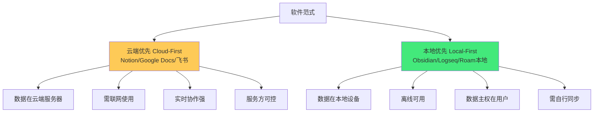
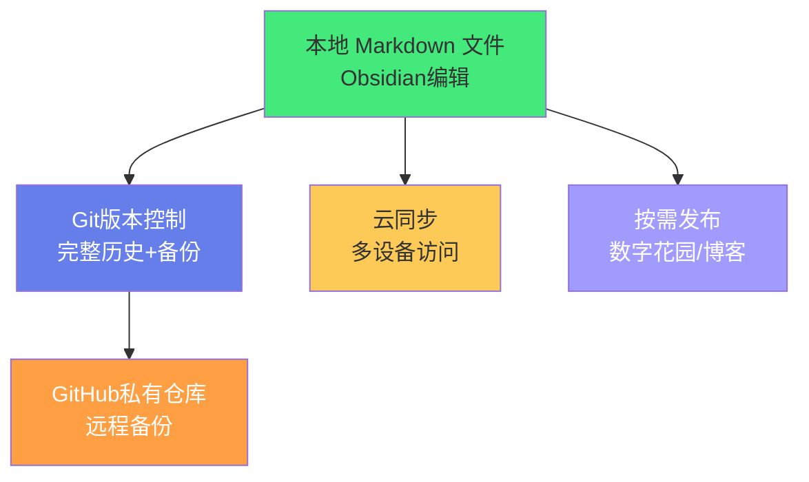
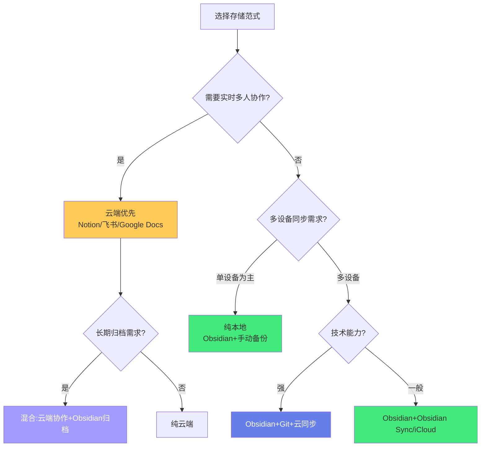

# ⚖️ 本地优先与云端协作权衡

> **文档说明**：系统讲解「本地优先（Local-First）」与「云端协作」两种软件范式的核心理念、优势劣势、技术实现与权衡选择，涵盖本地优先（Local-First）的起源与七大原则（Ink & Switch 研究室 2019 年提出）、本地优先的核心优势（瞬时响应/离线可用/数据主权/长期可访问/用户自主权）、云端协作的核心优势（多设备无缝同步/实时多人协作/在线分享/自动备份/低维护成本）、两者的六维权衡对比（速度/离线能力/数据主权/协作能力/长期可访问/维护成本）、本地优先软件的七大原则详解（No spinners: your work at your fingertips / Your work is not trapped on one device / The network is optional / Seamless collaboration without compromising ownership / The long now / Content is data / You retain agency）、冲突解决技术（CRDT 无冲突复制数据类型 / OT 操作转换 / 版本树 / 手动合并 / Last-Write-Wins）、同步策略分类（全量同步/增量同步/选择性同步/端到端加密同步/对等同步 P2P）、Obsidian 的七种同步方案对比（Obsidian Sync 官方 / iCloud / OneDrive / Dropbox / Git / Syncthing / Remotely Save 插件，从速度/冲突处理/成本/跨平台/安全性/易用性六维度对比）、团队协作场景下的本地优先实践（Git-based 协作流程 / 共享文件夹 + 锁定 / 评论与建议系统 / 版本控制）、云端工具的「出口」风险（数据可移植性 / 服务关闭 / 格式锁定 / 订阅涨价）、混合架构设计（本地存储 + 云端同步 + 端到端加密 + Git 版本控制）、如何根据场景选择方案（个人单设备/个人多设备/小团队协作/大团队知识库/跨平台需求）、常见问题（同步冲突/数据丢失/隐私安全/离线编辑）与最佳实践。
>
> **适用人群**：知识管理实践者、Obsidian 用户、工具选型决策者、注重数据主权的用户、需要团队协作的知识工作者
>
> **前置知识**：[[Obsidian高效使用]] · [[知识管理工具迁移指南]] · [[Git-高级命令与底层原理]]

---

## 一、概述

### 1.1 两种软件范式

在软件设计中，存在两种根本不同的范式：



| 维度 | 云端优先（Cloud-First） | 本地优先（Local-First） |
|------|----------------------|----------------------|
| **数据存储** | 云端服务器 | 本地设备 |
| **网络依赖** | 必须联网 | 网络可选 |
| **响应速度** | 取决于网络 | 瞬时（本地操作） |
| **数据主权** | 服务方持有 | 用户持有 |
| **协作能力** | 实时多人协作 | 需同步机制支持 |
| **长期可访问** | 依赖服务存活 | 纯文本可永久访问 |
| **维护成本** | 低（服务方维护） | 中（需自行同步备份） |

### 1.2 本地优先的起源

「本地优先（Local-First）」概念由 **Ink & Switch** 研究室在 2019 年的论文《Local-First Software: You own your data, in spite of the cloud》中正式提出。

**核心主张**：
> 你应该拥有自己的数据，即使软件使用了云服务。本地优先软件结合了云端软件的协作优势和本地软件的所有权优势。

**本地优先不是「反云端」**，而是「本地为主，云端为辅」——数据首先存储在本地，云端只用于同步和协作，而非作为唯一的数据存储。

### 1.3 为什么这个权衡重要

对于知识库这类「长期积累、高价值、可能用几十年」的资产，存储范式的选择直接影响：

- **数据安全**：服务关闭了怎么办？（如 Google Reader、Evernote 限制）
- **长期可访问**：30 年后还能打开今天的笔记吗？
- **迁移自由**：想换工具时数据能完整导出吗？
- **使用体验**：没网的时候能看笔记吗？打开大仓库卡吗？
- **协作需求**：需要和别人一起编辑吗？

---

## 二、本地优先的七大原则

Ink & Switch 提出了本地优先软件的七大原则：

### 2.1 原则一：No spinners — 瞬时响应

> 你的工作触手可及，不需要等待加载圈（spinner）。

- 所有数据在本地，打开即编辑，无需等待网络
- 搜索、切换、编辑都是瞬时的
- 对比：Notion 打开大页面可能需要几秒加载

### 2.2 原则二：Your work is not trapped on one device — 多设备

> 你的工作不被困在一台设备上。

- 数据可以在多设备间同步
- 但同步是「附加功能」，不是「必需条件」
- 每台设备都有完整的数据副本

### 2.3 原则三：The network is optional — 网络可选

> 没有网络也能正常工作。

- 离线时可以正常查看、编辑、搜索
- 联网后自动同步变更
- 对比：Google Docs 离线模式功能受限，Notion 离线几乎不可用

### 2.4 原则四：Seamless collaboration — 无缝协作

> 在不牺牲所有权的前提下实现无缝协作。

- 多人可以同时编辑
- 通过 CRDT/OT 等技术解决冲突
- 但协作不意味着数据交给第三方

### 2.5 原则五：The long now — 长期可访问

> 软件和数据应该能跨越数十年存在。

- 使用开放格式（如 Markdown），不依赖特定软件
- 即使原软件停止开发，数据仍可被其他工具读取
- 对比：Notion 的私有格式，服务关闭数据可能丢失

### 2.6 原则六：Content is data — 内容即数据

> 你的内容是可操作的数据，不是锁定在格式中的黑盒。

- 数据可以被脚本处理、搜索、转换
- 支持 API、批量操作、自动化
- Markdown 文件可以用 grep、Python 脚本等任意工具处理

### 2.7 原则七：You retain agency — 用户自主权

> 你保留对数据和软件的最终控制权。

- 可以随时导出全部数据
- 可以选择同步方式（官方/第三方/自建）
- 不被订阅绑定，不被功能限制

---

## 三、云端协作的优势

客观看待云端协作的不可替代优势：

### 3.1 实时多人协作

- 多人同时编辑同一文档，看到彼此的光标和修改
- 评论、@提及、建议模式
- 这是本地优先工具的弱项（Obsidian 无原生实时协作）

### 3.2 零配置同步

- 登录账号即同步，无需配置
- 手机、平板、电脑自动同步
- 对比：本地优先需要配置同步方案，可能遇到冲突

### 3.3 在线分享与发布

- 一键分享链接给任何人
- 嵌入网页、博客
- 权限管理（查看/编辑/评论）

### 3.4 自动备份与版本历史

- 服务方自动备份，无需担心硬盘损坏
- 完整的版本历史，可随时回滚
- 对比：本地优先需要自行配置备份

### 3.5 低维护成本

- 不需要管理同步、备份、冲突
- 软件自动更新
- 适合非技术用户

---

## 四、六维权衡对比

| 维度 | 本地优先（Obsidian） | 云端优先（Notion） | 权重说明 |
|------|---------------------|-------------------|---------|
| **速度** | ⭐⭐⭐⭐⭐ 瞬时 | ⭐⭐⭐ 取决于网络 | 大仓库差异明显 |
| **离线能力** | ⭐⭐⭐⭐⭐ 完全离线 | ⭐⭐ 有限/不可用 | 移动场景重要 |
| **数据主权** | ⭐⭐⭐⭐⭐ 完全自有 | ⭐⭐ 服务方持有 | 长期资产关键 |
| **实时协作** | ⭐⭐ 需第三方 | ⭐⭐⭐⭐⭐ 原生 | 团队场景关键 |
| **长期可访问** | ⭐⭐⭐⭐⭐ 纯文本 | ⭐⭐ 依赖服务 | 几十年维度 |
| **维护成本** | ⭐⭐⭐ 需配置同步 | ⭐⭐⭐⭐⭐ 零配置 | 非技术用户敏感 |
| **内容可操作性** | ⭐⭐⭐⭐⭐ 可脚本处理 | ⭐⭐⭐ API有限 | 技术用户看重 |
| **分享发布** | ⭐⭐⭐ 需发布工具 | ⭐⭐⭐⭐⭐ 一键分享 | 公开内容场景 |

---

## 五、冲突解决技术

本地优先 + 多设备同步的核心技术难题是「冲突解决」：两人在不同设备上同时修改了同一篇笔记，怎么合并？

### 5.1 常见策略

| 策略 | 原理 | 优点 | 缺点 | 代表工具 |
|------|------|------|------|---------|
| **Last-Write-Wins** | 最后修改的覆盖先修改的 | 简单 | 可能丢失修改 | iCloud/OneDrive |
| **文件锁定** | 一人编辑时锁定，他人只读 | 无冲突 | 协作体验差 | 共享文件夹 |
| **版本树** | 保留所有版本，手动选择合并 | 不丢失数据 | 需手动处理 | Git |
| **OT（操作转换）** | 转换并发操作使其兼容 | 实时协作好 | 实现复杂 | Google Docs |
| **CRDT** | 无冲突复制数据类型，自动合并 | 自动无冲突 | 实现复杂，存储开销 | Yjs/Automerge |

### 5.2 Obsidian 的冲突处理

Obsidian 本身不处理冲突，冲突由同步工具处理：
- **iCloud/OneDrive/Dropbox**：通常 Last-Write-Wins，可能生成冲突副本（`filename (conflicted copy).md`）
- **Git**：保留版本树，手动 merge 解决冲突
- **Obsidian Sync**：官方同步，基于版本历史，冲突时保留两个版本
- **Syncthing**：P2P 同步，冲突时生成冲突文件

> **最佳实践**：避免同一篇笔记在多设备同时编辑。如果需要实时协作，考虑用云端工具（Notion/飞书）做协作，完成后再同步到 Obsidian。

---

## 六、Obsidian 同步方案对比

### 6.1 七种方案

| 方案 | 类型 | 成本 | 速度 | 冲突处理 | 跨平台 | 安全性 | 推荐度 |
|------|------|------|------|---------|--------|--------|--------|
| **Obsidian Sync** | 官方云同步 | $8/月 | 快 | 版本历史 | 全平台 | 端到端加密 | ⭐⭐⭐⭐⭐ |
| **iCloud** | 云存储 | 免费(5GB起) | 中 | LWW+冲突副本 | Apple系 | 中等 | ⭐⭐⭐⭐ |
| **OneDrive** | 云存储 | 免费(5GB) | 中 | LWW+冲突副本 | 全平台 | 中等 | ⭐⭐⭐ |
| **Dropbox** | 云存储 | 免费(2GB) | 快 | 版本历史 | 全平台 | 中等 | ⭐⭐⭐⭐ |
| **Git** | 版本控制 | 免费 | 快 | 手动merge | 全平台 | 高(自建) | ⭐⭐⭐⭐⭐ |
| **Syncthing** | P2P同步 | 免费 | 快 | 冲突文件 | 全平台 | 端到端加密 | ⭐⭐⭐⭐ |
| **Remotely Save** | 插件 | 免费 | 中 | 取决于后端 | 全平台 | 取决于后端 | ⭐⭐⭐ |

### 6.2 各方案详解

**Obsidian Sync（官方推荐）**：
- 官方服务，与 Obsidian 深度集成
- 端到端加密，服务方无法读取内容
- 支持版本历史（最多1年）
- 支持选择性同步（大文件不同步到手机）
- 付费服务，$8/月或$96/年

**Git（技术用户首选）**：
- 完整的版本控制，每次变更都有记录
- 可使用 GitHub/GitLab 私有仓库
- 冲突时手动 merge，不丢失任何修改
- 适合技术用户，非技术用户有学习成本
- 可配合 cron/快捷命令自动提交推送

**iCloud（Apple 用户首选）**：
- Apple 生态内无缝同步
- 免费（基础5GB）
- 注意：iCloud 与 Obsidian 的兼容性曾有问题（文件未及时下载），现已改善
- 仅限 Apple 设备间同步

**Syncthing（隐私优先）**：
- 开源 P2P 同步，不经过中心服务器
- 端到端加密
- 设备间直接同步，无需云存储
- 需要设备同时在线才能同步

### 6.3 推荐组合

| 用户类型 | 推荐方案 |
|---------|---------|
| **非技术用户/Apple全家桶** | iCloud + 定期手动备份 |
| **技术用户/注重版本历史** | Git + GitHub私有仓库 + 自动提交脚本 |
| **跨平台/愿付费** | Obsidian Sync（最省心） |
| **隐私优先/多设备常在线** | Syncthing |
| **大仓库/手机空间有限** | Obsidian Sync（选择性同步） |
| **团队协作** | Git + PR 审查流程，或混合 Notion 协作+Obsidian 归档 |

---

## 七、混合架构：兼得两者优势

最优解往往不是「二选一」，而是「混合架构」：



**推荐的混合架构**：
1. **本地存储**：Markdown 文件存在本地，Obsidian 编辑（本地优先）
2. **Git 版本控制**：所有变更纳入 Git，推送到 GitHub 私有仓库（备份+历史）
3. **云同步**：用 iCloud/OneDrive/Obsidian Sync 实现多设备同步（便利）
4. **按需发布**：部分笔记通过 Quartz/Hugo 等发布为数字花园（分享）

这样既享有本地优先的所有优势（速度/离线/数据主权/长期可访问），又获得了云端的便利（多设备/备份/分享）。

---

## 八、团队协作场景的本地优先

本地优先不是「不能协作」，而是「协作方式不同」：

```text
### 8.1 Git-based 协作
```

适合技术团队：
- 每人本地有完整副本
- 通过 Git 分支 + PR 进行协作
- Code Review 保证质量
- 冲突通过 merge 解决
- 适合：技术文档、API 文档、设计文档

### 8.2 共享文件夹 + 规范

适合非技术小团队：
- 共享网络文件夹或云盘
- 约定「一人编辑一篇时通知他人」
- 文件名加状态标记（`草稿-`/`审核中-`/`已发布-`）
- 定期由专人整理归档

### 8.3 混合协作

最实用的团队模式：
- **协作中** → 用 Notion/飞书（实时协作、评论、@提及）
- **定稿后** → 导出 Markdown 归档到 Obsidian（长期保存、可搜索、可引用）
- **个人知识库** → Obsidian（本地优先、双链、图谱）

---

## 九、云端工具的「出口」风险

选择云端工具时，必须评估「出口能力」：

| 风险 | 说明 | 真实案例 |
|------|------|---------|
| **服务关闭** | 服务商停止运营，数据可能丢失 | Google Reader、Yahoo! 360 |
| **格式锁定** | 导出格式差，迁移损失大 | Notion 数据库导出为 CSV 损失结构 |
| **订阅涨价** | 免费转付费，或价格大幅上涨 | Evernote 多次涨价、限制设备数 |
| **功能限制** | 免费版功能越来越受限 | 多家云笔记缩减免费额度 |
| **账号封禁** | 违反条款（可能误判）导致账号被封 | 多家云服务有用户反馈误封 |

**评估出口能力的问题**：
1. 能一键导出全部数据吗？
2. 导出格式是开放标准（Markdown/CSV）还是私有格式？
3. 导出的数据包含附件、评论、版本历史吗？
4. 没有该软件的客户端，能读取导出的数据吗？

> **核心原则**：对于长期积累的知识库，永远不要把唯一副本放在任何云端服务中。

---

## 十、如何选择

### 10.1 决策树



### 10.2 场景推荐

| 场景 | 推荐方案 |
|------|---------|
| **个人知识库（长期积累）** | Obsidian + Git + 云同步（混合架构） |
| **个人快速笔记/待办** | 云端工具（Apple Notes/Notion 快速捕捉）+ 定期归档到 Obsidian |
| **小团队技术文档** | Obsidian + Git + GitHub Pages 发布 |
| **小团队非技术协作** | 飞书/Notion（协作中）+ 定期导出归档 |
| **公开博客/数字花园** | Obsidian 写作 + Quartz/Hugo 发布 |
| **高敏感/隐私内容** | 纯本地 + 加密存储（VeraCrypt）+ 离线备份 |

---

## 十一、常见问题

| 问题 | 回答 |
|------|------|
| **本地优先会不会丢数据？** | 不会，只要做好备份。推荐 3-2-1 备份原则：3份副本、2种介质、1份异地 |
| **Obsidian 能实时协作吗？** | 原生不支持。可通过 Git 异步协作，或用 Obsidian Sync + 第三方插件实现有限协作 |
| **iCloud 同步 Obsidian 靠谱吗？** | 现在基本靠谱，但偶尔有文件延迟和冲突。重要仓库建议同时用 Git 备份 |
| **Git 同步笔记会不会太技术化？** | 初期有学习成本，但可以写脚本自动 add/commit/push，日常几乎无感 |
| **云端工具的数据能迁移到 Obsidian 吗？** | 可以，参考 [[知识管理工具迁移指南]]，但格式和结构会有损失 |
| **手机上怎么用本地优先？** | Obsidian 有 iOS/Android 客户端，配合云同步可在手机上编辑 |
| **端到端加密有必要吗？** | 敏感内容有必要。Obsidian Sync 和 Syncthing 都支持端到端加密 |
| **多大的仓库算大？** | >5000 篇笔记或 >1GB 附件算大仓库，需要考虑选择性同步和性能优化 |

---

## 十二、最佳实践

### 12.1 3-2-1 备份原则

- **3 份副本**：本地 + 云同步 + Git远程
- **2 种介质**：硬盘 + 云存储
- **1 份异地**：Git 私有仓库在另一个地理位置

### 12.2 定期验证备份

- 每月一次：从 Git 仓库克隆到新目录，验证能正常打开
- 检查附件是否完整
- 检查最近的提交是否正常

### 12.3 避免同步冲突

- 不要在多设备同时编辑同一篇笔记
- 切换设备前等待同步完成
- 大仓库用 Obsidian Sync 的选择性同步（手机只同步核心文件夹）

### 12.4 附件管理

- 大文件（视频/大PDF）不要全部同步到手机
- 用 Obsidian Sync 的「选择性同步」或 Git LFS
- 定期清理无用附件

---

## 十三、关联笔记

### 知识管理方法论
- [[Obsidian高效使用]] · [[知识管理工具迁移指南]] · [[Obsidian-vs-Logseq-vs-Notion]]
- [[原子笔记原则与实践]] · [[常青笔记-EvergreenNotes]] · [[MOC内容地图]]

### 工具与技术
- [[Git-高级命令与底层原理]] · [[Git工作流-GitFlow与Trunk]]
- [[Obsidian-AI插件对比]] · [[Obsidian关系图谱优化]]

### 导航
- [[MOC-综合导航]] · [[MOC-知识管理方法论-四级展开]] · [[Home]] · [[学习路线总览]]

> 🔍 **知识点深度解析**
>
> **作用**：本地优先与云端协作权衡解决的是「知识库这类长期高价值资产应该存储在哪里、如何在『数据主权/离线/速度』和『协作/同步/便利』之间做出明智选择」的核心问题——在云服务盛行的时代，很多人默认把所有数据放在云端，但对于可能使用几十年的知识库，数据主权、长期可访问性、服务关闭风险是必须考虑的问题。本文档系统对比两种范式，提供混合架构方案和具体的同步工具选择，帮助用户根据自身场景做出理性决策。
>
> **底层原理**：①本地优先的核心是「数据存储位置决定用户权力」——数据存在本地，用户拥有完全的控制权（可以用任何工具读取、可以永久保存、不被服务条款约束）；数据存在云端，用户只有「访问权」而非「所有权」（服务可以关闭、涨价、封禁、修改格式）。这不是技术问题，而是「权力关系」问题。②本地优先的七大原则本质是「对用户友好的软件设计准则」——瞬时响应（尊重用户时间）、多设备（尊重用户使用场景）、网络可选（尊重用户环境）、无缝协作（尊重用户社交需求）、长期可访问（尊重用户时间跨度）、内容即数据（尊重用户数据自主权）、用户自主权（尊重用户最终控制权）。这些原则不仅适用于笔记软件，也适用于所有处理用户数据的软件。③冲突解决是本地优先+多设备同步的核心技术难题——当多人/多设备同时修改同一数据时，如何合并？Last-Write-Wins 简单但可能丢数据，OT/CRDT 可以自动合并但实现复杂，Git 的版本树+手动 merge 不丢数据但需人工介入。没有完美方案，只有适合场景的权衡。④混合架构是「兼得」的关键——本地存储保证数据主权和速度，Git 版本控制保证历史和备份，云同步保证多设备便利，按需发布保证分享能力。这种「本地为主、云端为辅」的架构是目前最平衡的方案，也是 Obsidian 社区的主流实践。⑤云端工具的「出口能力」是长期使用的关键风险评估维度——服务可能关闭、格式可能锁定、价格可能上涨、账号可能封禁。对于长期资产，「能不能完整导出」比「现在好不好用」更重要。纯文本 Markdown 是目前最安全的长期格式——它不依赖任何特定软件，30年后的任何文本编辑器都能打开。
>
> **用法要点**：① 本地优先七原则：瞬时响应/多设备不被困/网络可选/无缝协作/长期可访问/内容即数据/用户自主权 ② 六维权衡：速度/离线/数据主权(本地优先强) vs 实时协作/零配置/分享(云端优先强) ③ 冲突解决：LWW(iCloud/OneDrive)/版本树+手动merge(Git)/CRDT(Yjs)/文件锁定 ④ Obsidian同步七方案：Obsidian Sync($8/月,官方推荐)/iCloud(Apple用户)/OneDrive/Dropbox/Git(技术用户首选,完整历史)/Syncthing(P2P隐私)/Remotely Save(插件) ⑤ 推荐组合：非技术+iCloud；技术+Git+GitHub；跨平台付费+Obsidian Sync；隐私+Syncthing；团队+Git PR或混合Notion协作+Obsidian归档 ⑥ 混合架构：本地Markdown(编辑)+Git(版本+备份)+云同步(多设备)+按需发布(分享) ⑦ 团队协作：Git-based(技术团队)/共享文件夹+规范(小团队)/混合(云端协作中+Obsidian归档定稿) ⑧ 出口风险：服务关闭/格式锁定/涨价/封禁，评估导出能力 ⑨ 选择：需要实时协作→云端；个人长期知识库→本地优先+混合架构；技术用户→Git方案；非技术→官方同步/iCloud ⑩ 最佳实践：3-2-1备份(3副本/2介质/1异地)/定期验证备份/避免多设备同编辑一篇/大文件选择性同步 ⑪ 常见：本地不会丢(做好备份)/Obsidian不支持实时协作/iCloud现在基本靠谱/Git可脚本自动化/手机用Obsidian客户端+云同步。

> 💡 **深度讲解**：本地优先与云端协作最核心的智慧是「数据存储位置决定了用户与工具的权力关系，而『本地为主、云端为辅』的混合架构是目前最平衡的选择」——很多人在选择工具时只看「现在好不好用」「功能多不多」，却忽视了「数据存在哪里」这个根本问题。当你把数据存在云端时，你和服务方的关系是「租赁」：你付月租，获得访问权，但数据的实际控制权在服务方手里——服务方可以修改格式、涨价、限制功能、甚至关闭服务，你只能接受或离开（且离开时数据可能无法完整带走）。当你把数据存在本地时，你和工具的关系是「拥有」：数据是你的，工具只是读取器——这个工具不好用了可以换另一个，服务关闭了数据还在，30年后用任何文本编辑器都能打开。对于「可能用几十年的知识库」这种长期资产，「拥有」远比「租赁」重要。但本地优先不是「反云端」——云端的多设备同步、自动备份、在线分享确实便利，完全放弃也不现实。最优解是混合架构：数据存在本地（拥有），用云端做同步和备份（便利），用 Git 做版本控制（历史），按需发布到网上（分享）。这种架构让你同时享有「拥有」的安全感和「云端」的便利性，是目前最成熟的实践。本地优先的另一个深层智慧是「纯文本是最长寿的格式」——Markdown 文件就是带格式的纯文本，它不依赖任何特定软件，不包含二进制数据，几乎可以被任何计算设备读取。对比之下，Notion 的页面存在云端数据库中，OneNote 的格式是私有的，Evernote 的 .enex 转换损失大——这些格式的寿命取决于服务的寿命，而纯文本的寿命取决于存储介质的寿命（远超任何软件服务的寿命）。对于「知识」这种跨越几十年的资产，格式的寿命比功能的丰富更重要。

> 📝 **精简总结**：本地优先与云端协作权衡=长期资产的存储范式选择。本地优先七原则(Ink&Switch)：瞬时响应/多设备/网络可选/无缝协作/长期可访问/内容即数据/用户自主权。云端优势：实时协作/零配置同步/一键分享/自动备份。六维对比：本地强在速度/离线/数据主权/长期可访问，云端强在协作/便利/分享。冲突解决：LWW/版本树(Git)/OT/CRDT。Obsidian同步七方案：Obsidian Sync(官方$8)/iCloud(Apple)/OneDrive/Dropbox/Git(技术首选)/Syncthing(P2P)/Remotely Save。推荐混合架构：本地Markdown+Git版本+云同步+按需发布。团队协作：Git PR或混合(云端协作+Obsidian归档)。出口风险：服务关闭/格式锁定/涨价/封禁，纯文本最安全。选择：实时协作用云端，个人长期知识库用本地优先混合架构。最佳实践：3-2-1备份/定期验证/避免冲突/选择性同步。

> **学习路径建议**：先阅读 [[Obsidian-vs-Logseq-vs-Notion]] 理解工具差异 → 学习 [[知识管理工具迁移指南]] 评估数据可移植性 → 学习 [[Git-高级命令与底层原理]] 掌握 Git 备份方案 → 评估自己的场景（单设备/多设备/协作需求） → 选择同步方案并配置（推荐 Git + 云同步混合） → 实践 3-2-1 备份策略 → 定期验证备份完整性 → 如有团队协作需求，设计 Git-based 或混合协作流程 → 长期关注数据主权和格式开放性。

---

> **本地优先与云端协作的本质是「在『便利』与『主权』之间做出清醒的选择，而不是被默认的云端范式裹挟」——我们生活在一个「云端默认」的时代：新软件默认把数据存在云端，默认需要联网，默认订阅制。这种范式带来了巨大的便利（多设备同步、零配置、实时协作），但也悄悄转移了权力：数据的实际控制权从用户转移到了服务方。对于照片、聊天记录这类「短期消费」内容，云端的便利可能值得这个权力让渡；但对于「可能用几十年、承载个人思想和知识体系」的知识库，权力让渡的代价可能远超想象——服务关闭了怎么办？格式锁定了迁移不了怎么办？30年后还能打开今天的笔记吗？本地优先不是「反云端」，而是「清醒地选择」：数据首先属于你（存在本地、纯文本格式、可被任何工具读取），云端只是「同步和备份的手段」而非「数据的唯一归宿」。更妙的是，通过混合架构（本地存储 + Git 版本 + 云同步 + 按需发布），你可以同时享有本地优先的所有优势（速度、离线、主权、长期可访问）和云端的大部分便利（多设备、备份、分享）——不需要二选一，只需要多一点配置和自律。在这个数据越来越被平台圈占的时代，选择本地优先不仅是技术选择，更是一种「数字自主」的态度：你的知识应该属于你，而不是任何公司。从今天开始，确保你的知识库有一份完整的、纯文本的、存在本地的副本——这是对未来的自己最好的保障。**
