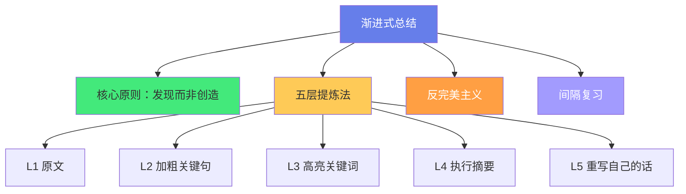
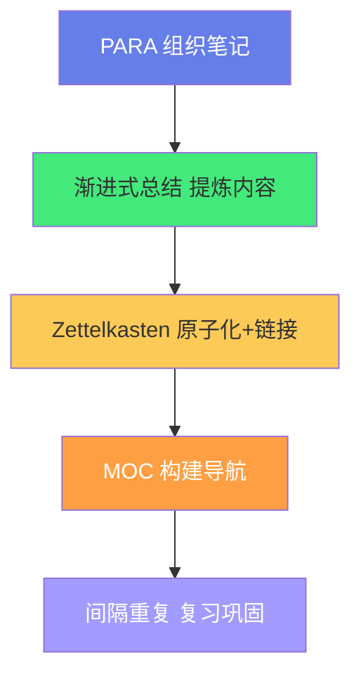

# 📝 渐进式总结（Progressive Summarization）

> **文档说明**：系统讲解由 Tiago Forte（《Building a Second Brain》作者）提出的渐进式总结笔记法，涵盖渐进式总结的概念与起源、核心原理（五层提炼/发现而非创造/反完美主义）、五层操作法详解（第一层：原文摘录 / 第二层：加粗关键句 / 第三层：高亮关键词 / 第四层：执行摘要 / 第五层：重写为自己的话）、与其他笔记法的对比（Zettelkasten 卡片盒 / PARA / MOC 枢纽 / 康奈尔笔记）、在 Obsidian 中的具体实现（Callout 块 / 加粗 / 高亮 / 标签 / 模板）、渐进式总结的工作流（摄入→加粗→高亮→摘要→重写，每层间隔时间）、常见误区（一次做到完美/加粗过多/只收藏不总结/忽视复习）、与间隔重复的结合、最佳实践与实战案例。
>
> **适用人群**：知识工作者、学生、研究者、Obsidian 用户、希望提升笔记质量的学习者
>
> **前置知识**：[[第二大脑-BuildingSecondBrain]] · [[PARA-项目领域资源归档]]

---

## 一、概述

### 1.1 什么是渐进式总结

**渐进式总结（Progressive Summarization）** 是由 Tiago Forte 提出的笔记方法，核心思想是：**不要在第一次阅读时就试图做出完美的总结，而是通过多次、渐进的「加粗和高亮」来逐步提炼笔记的重点**。



**核心洞察**：
- 你不需要在第一次阅读时就理解一切
- 重点是在未来需要时能快速找到关键信息
- 每次复习都是一次「提炼」，逐步逼近精华
- 总结是「发现」已有的重点，而非「创造」新的内容

### 1.2 为什么需要渐进式总结

| 传统笔记的问题 | 渐进式总结的解决 |
|---------------|----------------|
| 一次就要做完美总结，压力大 | 分多次渐进，每次只做一点点 |
| 收藏了大量笔记但从不复习 | 每层提炼都是一次复习 |
| 重点不突出，回顾时要重读全文 | 加粗/高亮让重点一目了然 |
| 不知道哪些内容真正重要 | 多次提炼后，重要内容自然浮现 |
| 完美主义导致拖延 | 「先粗后精」降低启动门槛 |

> Tiago Forte 的名言：「你不需要知道笔记的最终用途，只需要让它在未来被需要时足够有用。」

---

## 二、五层提炼法

### 2.1 五层总览


| 层级 | 操作 | 时机 | 目标 |
|------|------|------|------|
| **L1 原文** | 摘录/复制原文 | 第一次阅读 | 保存原始内容 |
| **L2 加粗** | 加粗关键句子 | 第一次复习（几天后） | 标出重要观点 |
| **L3 高亮** | 高亮关键词/短语 | 第二次复习（几周后） | 标出核心概念 |
| **L4 摘要** | 写执行摘要 | 第三次复习（几月后） | 浓缩为几句话 |
| **L5 重写** | 用自己的话重写 | 需要使用时 | 内化为自己的知识 |

### 2.2 第一层：原文摘录

**操作**：将阅读到的有价值内容复制到笔记中，保留原文。

```markdown
## 原文摘录

> 「渐进式总结的核心是：你不需要在第一次阅读时就理解一切，
> 只需要在未来需要时能快速找到关键信息。通过多次渐进的提炼，
> 重要内容会自然浮现。」
> —— Tiago Forte
```

**要点**：
- 不要改写，保留原文
- 标注来源（书名/文章/作者）
- 可以大段摘录，不用筛选
- 这是「原材料」，后续提炼的基础

### 2.3 第二层：加粗关键句

**操作**：几天后复习时，加粗你认为最重要的句子（约 10-20%）。

```markdown
## 原文摘录

> 「**渐进式总结的核心是：你不需要在第一次阅读时就理解一切**，
> 只需要在未来需要时能快速找到关键信息。**通过多次渐进的提炼，
> 重要内容会自然浮现。**」
> —— Tiago Forte
```

**要点**：
- 只加粗「句子」，不是单个词
- 加粗比例控制在 10-20%（太多就失去重点）
- 问自己：「如果只能记住几句话，是哪些？」
- 这一步不需要完美，直觉判断即可

### 2.4 第三层：高亮关键词

**操作**：几周后复习时，在加粗的句子中，高亮最核心的关键词（约 5-10%）。

```markdown
## 原文摘录

> 「**渐进式总结的核心是：你不需要在第一次阅读时就 ==理解一切==**，
> 只需要在未来需要时能 ==快速找到关键信息==。**通过多次 ==渐进的提炼==，
> 重要内容会自然浮现。**」
> —— Tiago Forte
```

**要点**：
- 只高亮「关键词/短语」，不是整句
- 高亮比例控制在 5-10%
- 问自己：「这篇笔记的核心概念是什么？」
- 高亮后，扫一眼就能抓住核心

### 2.5 第四层：执行摘要

**操作**：几个月后复习时，在笔记顶部写一段「执行摘要」（3-5 句话）。

```markdown
> [!summary] 执行摘要
> 渐进式总结是 Tiago Forte 提出的笔记方法，通过五层渐进提炼
> （原文→加粗→高亮→摘要→重写）逐步提炼笔记重点。核心原则是
> 「发现而非创造」和「反完美主义」——不需要一次做到完美，每次
> 复习都是一次提炼。适合知识工作者在 Obsidian 等工具中实践。
```

**要点**：
- 3-5 句话，不超过 100 字
- 回答：「这篇笔记讲了什么？为什么重要？怎么用？」
- 放在笔记顶部，方便快速浏览
- 这是「给未来自己的快速指南」

### 2.6 第五层：重写自己的话

**操作**：当你真正需要使用这篇笔记时（写文章/做项目/分享），用自己的话重写核心内容。

```markdown
## 我的理解

渐进式总结本质上是一种「反完美主义」的笔记策略。传统方法要求
我们在阅读时就做出完美的笔记，但这既不现实也无必要——我们
无法预知未来哪些内容有用。渐进式总结把「提炼」分散到多次
复习中：第一次只保存原文，第二次加粗，第三次高亮……每次
只花几分钟，但多次叠加后，笔记的精华自然浮现。这和「间隔
重复」有异曲同工之妙——分散的努力比一次性的完美更有效。
```

**要点**：
- 用自己的语言，不要照抄
- 可以加入自己的理解、例子、联想
- 这是「内化」的关键一步
- 只有真正需要时才做这一层，不要强迫

---

## 三、核心原理

### 3.1 发现而非创造

渐进式总结的核心哲学是「**发现（Discover）而非创造（Create）**」：

- 你不需要「创造」一个完美的总结
- 你只需要「发现」原文中已有的重点
- 重点是通过多次提炼「浮现」出来的，不是一次性判断的
- 这降低了心理门槛，减少了拖延

### 3.2 反完美主义

| 完美主义 | 渐进式总结 |
|---------|-----------|
| 一次就要做到最好 | 先做 60 分，以后再优化 |
| 每篇笔记都要完美 | 大部分笔记停在 L2/L3 就够了 |
| 总结不好就不做 | 先做了再说，迭代改进 |
| 压力大，拖延 | 门槛低，容易启动 |

> 「完成比完美更重要。先让笔记存在，再让它变好。」

### 3.3 间隔效应

渐进式总结天然结合了「间隔重复（Spaced Repetition）」：
- L1 → L2：间隔几天
- L2 → L3：间隔几周
- L3 → L4：间隔几月
- L4 → L5：需要时

每次提炼都是一次复习，间隔的复习比集中复习记忆效果更好。

---

## 四、在 Obsidian 中的实现

### 4.1 格式对应

| 层级 | Obsidian 实现 |
|------|--------------|
| L1 原文 | 引用块 `>` 或正常段落 |
| L2 加粗 | `**加粗文字**` |
| L3 高亮 | `==高亮文字==`（需启用高亮语法） |
| L4 摘要 | Callout 块 `> [!summary]` |
| L5 重写 | 单独章节 `## 我的理解` |

### 4.2 完整示例

```markdown
---
title: 渐进式总结
tags: [笔记方法, 知识管理]
created: 2026-08-28
---

# 渐进式总结

> [!summary] 执行摘要（L4）
> 渐进式总结通过五层提炼逐步提取笔记重点，核心是「发现而非创造」
> 和「反完美主义」。适合在 Obsidian 中用加粗/高亮/Callout 实现。

## 原文摘录（L1）

> 「**渐进式总结的核心是：你不需要在第一次阅读时就 ==理解一切==**，
> 只需要在未来需要时能 ==快速找到关键信息==。**通过多次 ==渐进的提炼==，
> 重要内容会自然浮现。**」
> —— Tiago Forte

## 我的理解（L5）

渐进式总结本质是「反完美主义」的笔记策略，把提炼分散到多次复习中……
```

### 4.3 模板

```markdown
---
title: {{title}}
tags: [{{tags}}]
created: {{date}}
source: {{source}}
---

# {{title}}

> [!summary] 执行摘要
> （L4：复习时填写，3-5句话）

## 原文摘录

> （L1：原文内容）
> （L2：复习时加粗关键句 **...**）
> （L3：再复习时高亮关键词 ==...==）

## 我的理解

（L5：需要时用自己的话重写）

## 关联笔记

- [[]]
```

### 4.4 插件辅助

| 插件 | 用途 |
|------|------|
| **Obsidian 自带高亮** | `==文字==` 实现 L3 高亮 |
| **Callout Manager** | 自定义摘要 Callout 样式 |
| **Spaced Repetition** | 结合间隔重复安排复习 |
| **Dataview** | 查询未完成 L2/L3 的笔记 |
| **Templater** | 快速插入渐进式总结模板 |

---

## 五、与其他笔记法对比

### 5.1 对比总览

| 方法 | 核心 | 与渐进式总结的关系 |
|------|------|------------------|
| **Zettelkasten** | 原子笔记+双向链接 | 互补：Zettelkasten 管结构，渐进式总结管内容提炼 |
| **PARA** | 项目/领域/资源/归档 | 互补：PARA 管组织，渐进式总结管单篇笔记质量 |
| **MOC** | 枢纽笔记/地图 | 互补：MOC 管导航，渐进式总结管单篇深度 |
| **康奈尔笔记** | 左关键词右总结 | 类似：都是分层提炼，但康奈尔是一次性的 |
| **思维导图** | 可视化结构 | 不同：思维导图重结构，渐进式总结重内容 |

### 5.2 组合使用



> 最佳实践：PARA 管「放在哪」，渐进式总结管「内容质量」，Zettelkasten 管「怎么连」，MOC 管「怎么找」。

---

## 六、工作流

### 6.1 完整流程


### 6.2 时间安排

| 阶段 | 时间 | 操作 | 耗时 |
|------|------|------|------|
| 摄入 | 当天 | L1 保存原文 | 5 分钟 |
| 第一次复习 | 2-3 天后 | L2 加粗 | 3 分钟 |
| 第二次复习 | 2-3 周后 | L3 高亮 | 2 分钟 |
| 第三次复习 | 2-3 月后 | L4 摘要 | 5 分钟 |
| 使用 | 需要时 | L5 重写 | 10-30 分钟 |

> 大部分笔记停在 L2 或 L3 就够了，只有真正重要的才需要到 L4/L5。

---

## 七、常见误区

| 误区 | 正确做法 |
|------|---------|
| **一次做到五层** | 渐进式，分多次完成 |
| **加粗 80% 的内容** | 加粗 10-20%，突出真正的重点 |
| **只收藏不复习** | 设定复习提醒，至少做到 L2 |
| **每篇都要 L5** | 大部分停在 L2/L3，重要的才 L4/L5 |
| **追求完美措辞** | 先做了再说，迭代改进 |
| **忽视来源标注** | L1 时就标注来源，方便回溯 |
| **不做关联链接** | 提炼时顺便添加 `[[]]` 双向链接 |
| **复习间隔太短** | 遵循间隔效应：几天→几周→几月 |

---

## 八、最佳实践

1. **从 L1+L2 开始**：不要一开始就追求五层，先养成「摘录+加粗」的习惯
2. **控制加粗比例**：10-20% 是黄金比例，太多就失去重点
3. **高亮要克制**：只高亮最核心的 5-10%
4. **摘要放顶部**：L4 执行摘要放在笔记最前面，方便快速浏览
5. **结合间隔重复**：用 Spaced Repetition 插件安排复习
6. **定期回顾**：每周花 15 分钟复习旧笔记，做 L2/L3
7. **不要强迫 L5**：只有真正需要使用时才重写，不要为了完成而完成
8. **标注来源**：L1 时就记录作者/书名/链接，方便回溯
9. **添加关联**：提炼时顺便添加双向链接，构建知识网络
10. **接受不完美**：笔记是工具，不是艺术品，有用比完美更重要

---

## 九、关联笔记

### 知识管理方法论
- [[第二大脑-BuildingSecondBrain]] · [[PARA-项目领域资源归档]]
- [[Zettelkasten-卡片盒笔记法]] · [[从输入到输出的知识转化]]
- [[本地优先与云端协作权衡]]

### 工具与实践
- [[Obsidian入门与配置]] · [[Obsidian-插件推荐]]
- [[间隔重复与记忆系统]] · [[MOC-知识管理方法论-四级展开]]

### 导航
- [[MOC-综合导航]] · [[Home]] · [[学习路线总览]]

> 🔍 **知识点深度解析**
>
> **作用**：渐进式总结解决的是「如何在不增加大量时间负担的前提下，持续提升笔记质量，让收藏的内容真正变成可用的知识」的核心问题——传统笔记方法要么要求一次性做出完美总结（门槛高、易拖延），要么只收藏不提炼（笔记库变成垃圾场）。渐进式总结通过「分多次、渐进式提炼」的策略，把总结的工作量分散到多次复习中，每次只花几分钟，但长期叠加后笔记质量显著提升。
>
> **底层原理**：①渐进式总结的核心哲学是「发现而非创造」——Tiago Forte 认为，笔记的重点不是你「创造」出来的，而是通过多次阅读「发现」的。第一次阅读时你无法判断哪些内容未来有用，所以不要急着总结，先保存原文。随着时间推移和多次复习，真正重要的内容会自然浮现（因为你会反复注意到它）。这种「涌现式」的提炼比一次性判断更准确，也更省力。②「反完美主义」是渐进式总结的另一个核心——传统笔记方法的最大敌人是完美主义：「这篇笔记总结得不够好，所以我不做」。渐进式总结把「完美」拆解为五个渐进的层次，每个层次都有价值，即使只做到 L2（加粗）也比不做好。这种「先完成再完美」的策略大幅降低了启动门槛，减少了拖延。③渐进式总结天然结合了「间隔重复效应（Spaced Repetition）」——认知科学研究表明，分散在多个时间点的复习比一次性集中复习记忆效果好得多。渐进式总结的五层提炼正好对应了递增的间隔（几天→几周→几月），每次提炼都是一次复习，既提升了笔记质量，又巩固了记忆。④「注意力分层」是渐进式总结的认知科学基础——人的注意力是有限的，第一次阅读时要同时理解内容和判断重点，认知负荷太高。渐进式总结把「理解内容」（L1）和「判断重点」（L2/L3）分开，每次只做一件事，认知负荷更低，判断更准确。⑤「可浏览性」是渐进式总结的设计目标——经过五层提炼的笔记，具有清晰的视觉层次：扫一眼高亮（L3）就能抓住核心概念，读加粗（L2）就能理解主要观点，看摘要（L4）就能知道全文讲什么，需要时才读原文（L1）。这种「渐进式披露」让笔记在不同场景下都有用：快速浏览看 L3/L4，深入理解看 L2/L1。
>
> **用法要点**：① 五层提炼：L1原文摘录(保存原材料)→L2加粗关键句(10-20%，几天后)→L3高亮关键词(5-10%，几周后)→L4执行摘要(3-5句放顶部，几月后)→L5重写自己的话(需要时) ② 核心原则：发现而非创造/反完美主义/间隔复习 ③ Obsidian实现：L1用引用块>/L2用**加粗**/L3用==高亮==/L4用> [!summary] Callout/L5用## 我的理解章节 ④ 与其他方法组合：PARA管组织/渐进式总结管内容/Zettelkasten管链接/MOC管导航 ⑤ 工作流：摄入当天L1→几天后L2→几周后L3→几月后L4→需要时L5 ⑥ 常见误区：一次做到五层(错，渐进)/加粗过多(错，10-20%)/只收藏不复习(错，至少L2)/每篇都L5(错，大部分停L2/L3) ⑦ 最佳实践：从L1+L2开始/控制比例/摘要放顶部/结合间隔重复/每周15分钟复习/接受不完美 ⑧ 大部分笔记停在L2/L3就够了，只有真正重要的才到L4/L5。

> 💡 **深度讲解**：渐进式总结最核心的智慧是「把完美拆解为渐进的步骤，让笔记质量在持续使用中自然提升，而非在一次性的努力中强迫达成」——很多人的笔记库陷入两个极端：要么是「收藏夹」（只存不看，变成数字垃圾场），要么是「完美主义陷阱」（每篇都想做到最好，结果大部分根本没开始）。渐进式总结走出了第三条路：「先存下来，再慢慢提炼」。第一次阅读时，你不需要判断哪些内容重要——因为你根本不知道未来会需要什么。你只需要把有价值的原文保存下来（L1）。几天后复习时，你会发现有些句子特别有共鸣，加粗它们（L2）。几周后再看，加粗的句子中有些关键词反复出现，高亮它们（L3）。几个月后，这篇笔记的核心已经非常清晰，写一段摘要（L4）。当你真正需要用这篇笔记时（写文章/做项目），用自己的话重写（L5）。这个过程中，「重要内容」是通过多次复习「涌现」出来的，不是一次性判断的。这和「间隔重复」的原理一致——分散的努力比集中的完美更有效。渐进式总结还蕴含着一个深刻的时间观：笔记不是「一次性产品」，而是「持续生长的有机体」。你今天写的笔记，可能在一年后才被真正使用；在这一年中，它会被多次复习、多次提炼，最终变成你需要的样子。这种「长期主义」的笔记观，和「即时满足」的互联网文化形成鲜明对比。在 AI 时代，渐进式总结有了新的意义——AI 可以帮你快速生成 L4 摘要和 L5 重写，但 L1（原文）和 L2/L3（你的判断）是 AI 无法替代的，因为那反映了你的注意力和价值观。AI 是你的「提炼助手」，但「什么重要」最终由你决定。掌握渐进式总结，就是掌握了「让笔记持续增值」的方法——你的笔记库会越用越有价值，而不是越积越乱。

> 📝 **精简总结**：渐进式总结=Tiago Forte提出的五层渐进笔记提炼法。核心：发现而非创造/反完美主义/间隔复习。五层：L1原文摘录(保存)→L2加粗关键句(10-20%，几天后)→L3高亮关键词(5-10%，几周后)→L4执行摘要(3-5句放顶部，几月后)→L5重写自己的话(需要时)。Obsidian实现：引用块>/**加粗**/==高亮==/> [!summary] Callout/## 我的理解。与PARA/Zettelkasten/MOC互补使用。工作流：摄入→L1→几天后L2→几周后L3→几月后L4→需要时L5。误区：一次做到五层/加粗过多/只收藏不复习/每篇都L5。最佳实践：从L1+L2开始/控制比例/摘要放顶部/结合间隔重复/每周复习/接受不完美。大部分笔记停L2/L3即可。

> **学习路径建议**：先学习 [[第二大脑-BuildingSecondBrain]] 理解知识管理整体框架 → 学习本文档的渐进式总结五层法 → 实践：选 3-5 篇旧笔记，尝试做 L2 加粗 → 学习 [[PARA-项目领域资源归档]] 建立组织体系 → 实践：为新笔记建立 L1+L2 的习惯 → 学习 [[Zettelkasten-卡片盒笔记法]] 建立链接体系 → 实践：几周后对旧笔记做 L3 高亮 → 学习 [[间隔重复与记忆系统]] 结合复习 → 实践：几月后为重要笔记写 L4 摘要 → 形成自己的「渐进式总结+间隔重复」工作流。

---

> **渐进式总结的本质是「用时间换质量，用多次小努力替代一次性大付出，让笔记在持续使用中自然增值」——很多人对待笔记的态度是「要么做到完美，要么不做」，结果就是大部分笔记根本没开始，或者开始了也半途而废。渐进式总结打破了这个二元对立：它不要求你一次做到完美，只要求你「先做一点点」。第一次只保存原文（5分钟），几天后加粗（3分钟），几周后高亮（2分钟），几月后写摘要（5分钟）——每次都不费力，但叠加起来，笔记的质量远超一次性的「完美总结」。这种方法背后有深刻的认知科学支撑：间隔重复效应（分散复习比集中复习效果好）、注意力分层（理解和判断分开做）、涌现式提炼（重点在多次复习中自然浮现）。渐进式总结还蕴含着一种「长期主义」的笔记观——笔记不是一次性产品，而是持续生长的有机体。你今天保存的一段原文，可能在一年后才被真正使用；在这一年中，它会被多次复习、多次提炼，最终变成你需要的样子。在 AI 时代，渐进式总结更加重要——AI 可以帮你快速生成摘要和重写（L4/L5），但「什么内容值得保存」（L1）和「哪些句子/关键词真正重要」（L2/L3）是你的判断，是 AI 无法替代的，因为那反映了你的注意力、经验和价值观。AI 是你的「提炼助手」，但「什么重要」最终由你决定。从今天开始，不要追求完美的笔记——先保存原文，几天后加粗，几周后高亮……让你的笔记库在时间中自然增值，而不是在完美主义中停滞不前。**
