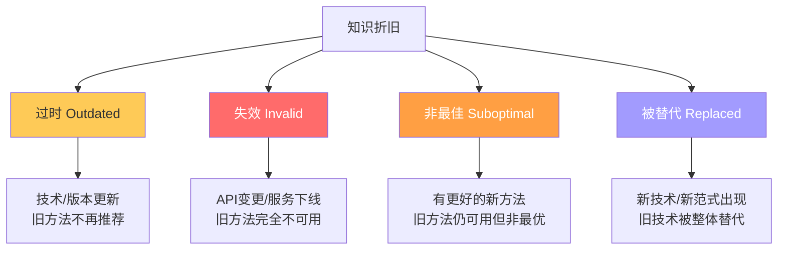
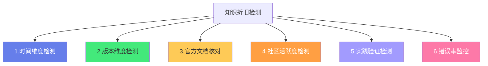
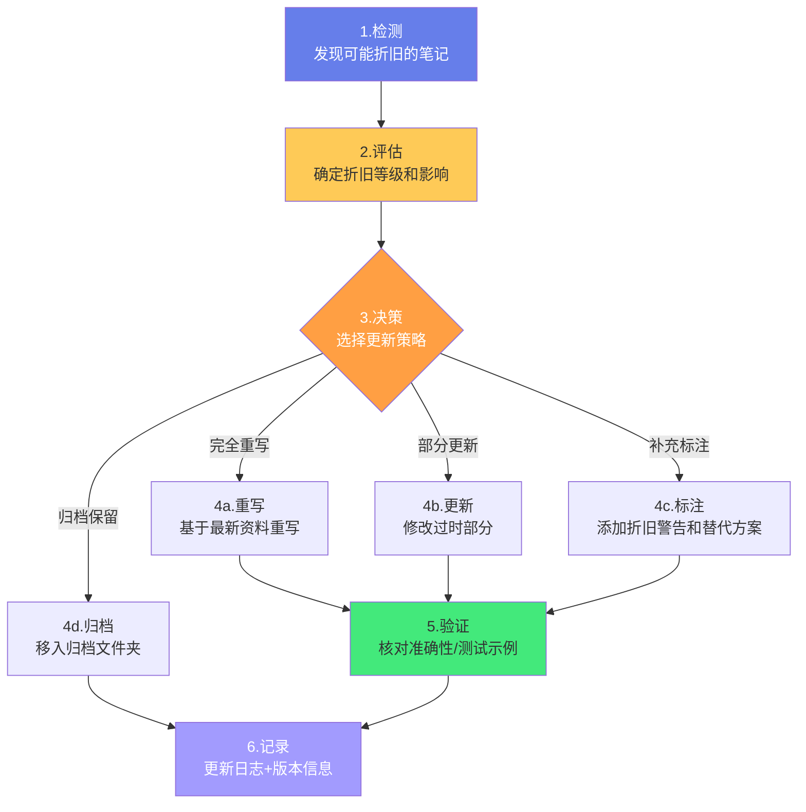

# ⏳ 知识折旧与更新机制

> **文档说明**：系统讲解知识库中知识折旧的识别、评估与系统性更新方法论，涵盖知识折旧的核心概念（知识随时间贬值/过时/失效/不再最佳实践）、知识折旧的根本原因（技术快速迭代/版本重大更新/最佳实践演进/新研究新发现/个人认知升级/行业标准变化）、不同类型知识的折旧速度分级（基础理论极慢/算法数据结构慢/编程语言基础中慢/框架库中/工具配置快/API版本特性很快/技术新闻趋势极快）、知识折旧的危害（使用过时技术/踩已修复的坑/面试被问倒/项目技术债/安全漏洞/性能问题）、知识折旧检测方法论（更新日期检查/版本号对比/官方文档核对/社区活跃度/错误率监控/实践验证）、知识更新机制（定期回顾触发/版本更新触发/实践发现触发/社区讨论触发）、知识更新操作标准流程（检测→评估折旧等级→决策更新策略→执行更新→验证准确性→记录更新日志）、知识更新四大策略（完全重写/部分更新/补充标注/归档保留）、在 Obsidian 中实现知识折旧管理（Frontmatter 字段设计/折旧标签体系/Review 插件/Dataview 折旧报告/版本追踪模板）、全栈+AI各领域知识的更新频率建议、知识折旧与持续学习的关系、常青笔记（Evergreen）与易逝笔记（Ephemeral）的区分与管理、知识更新质量校验标准、常见问题与最佳实践。
>
> **适用人群**：知识管理实践者、全栈开发者、AI工程师、技术学习者、Obsidian用户、知识库维护者
>
> **前置知识**：[[定期回顾与笔记重构]] · [[原子笔记原则与实践]] · [[费曼学习法笔记实践]] · [[MOC-综合导航]]

---

## 一、概述

### 1.1 什么是知识折旧

**知识折旧（Knowledge Depreciation）** 是指「知识随着时间推移而逐渐贬值、过时、失效或不再是最佳实践」的现象。



**知识折旧的四种形态**：
| 形态 | 说明 | 严重程度 | 示例 |
|------|------|---------|------|
| **过时（Outdated）** | 技术或方法有了新版本，旧版本仍可用但不再推荐 | ⚠️ 中等 | Vue 2 → Vue 3，Spring Boot 2.x → 3.x |
| **失效（Invalid）** | API变更、服务下线，旧方法完全不可用 | 🔴 严重 | 某第三方API v1下线，必须迁移到v2 |
| **非最佳（Suboptimal）** | 有更好的新方法，旧方法仍可用但性能/体验差 | 🟡 轻微 | 用 var 代替 let/const，用 == 代替 === |
| **被替代（Replaced）** | 新技术/新范式出现，旧技术被整体替代 | 🔴 严重 | jQuery → 现代框架，SOAP → REST，单体 → 微服务 |

> **核心洞察**：知识折旧不是「知识消失了」，而是「知识的价值下降了」——过时的知识不是「错误的」，而是「不再是最优解」；失效的知识是「完全错误的」，使用会导致问题。区分这四种形态，有助于采取不同的更新策略。

### 1.2 为什么知识会折旧

| 原因 | 说明 | 示例 |
|------|------|------|
| **技术快速迭代** | 技术栈版本更新频繁，新特性/新API不断推出 | React 18 并发特性、Vue 3 Composition API、Java 21 虚拟线程 |
| **最佳实践演进** | 社区对「怎么做最好」的共识随时间变化 | 前端从 MVC → MVVM → 组件化，后端从单体 → 微服务 → 服务网格 |
| **新研究新发现** | 底层原理有了新的研究成果或更优的算法 | 排序算法优化、AI模型架构演进（RNN → Transformer） |
| **行业标准变化** | 行业规范、安全标准、合规要求更新 | TLS 1.0/1.1 被弃用，OAuth 2.0 → OAuth 2.1 |
| **工具生态变迁** | 工具链更新，旧工具被新工具替代 | Webpack → Vite，Jenkins → GitHub Actions，Postman → Apifox |
| **个人认知升级** | 你自己的理解加深了，发现以前的笔记有错误或不够深入 | 初学Java时写的笔记，深入JVM后发现理解有误 |
| **安全漏洞披露** | 旧版本/旧方法存在安全漏洞，必须升级 | Log4j 漏洞、Spring4Shell、各种依赖CVE |

### 1.3 知识折旧的危害

| 危害 | 说明 |
|------|------|
| **使用过时技术** | 项目中使用已被弃用的API或框架，增加维护成本和迁移难度 |
| **踩已修复的坑** | 按照旧笔记的方法操作，踩了新版本中已经修复的坑 |
| **面试被问倒** | 面试时回答过时的技术方案，被面试官认为「技术栈陈旧」 |
| **项目技术债** | 大量过时知识导致项目技术债累积，重构成本越来越高 |
| **安全漏洞风险** | 使用存在已知漏洞的旧版本，面临安全风险 |
| **性能问题** | 旧方法可能存在性能问题，新版本已有更优解 |
| **学习效率低** | 在过时知识上浪费时间，没有学习最新最佳实践 |
| **决策失误** | 基于过时信息做技术选型或架构决策，导致方向错误 |

---

## 二、不同类型知识的折旧速度

### 2.1 折旧速度分级


### 2.2 各类型知识的折旧速度与更新频率

| 知识类型 | 折旧速度 | 更新频率 | 示例 | 说明 |
|---------|---------|---------|------|------|
| **基础理论** | 🟢 极慢（5-10年+） | 年度回顾 | 算法复杂度、操作系统原理、计算机网络基础、数据结构 | 底层理论几乎不变，更新主要是更深入的理解 |
| **编程语言基础** | 🟢 慢（3-5年） | 年度回顾 | Java语法、Python基础、JavaScript核心 | 语言基础稳定，但会有新语法特性（如Java虚拟线程） |
| **算法与数据结构** | 🟢 极慢（5-10年+） | 年度回顾 | 排序算法、树/图、动态规划 | 经典算法几乎不变，新算法较少 |
| **框架/库核心** | 🟡 中（1-3年） | 季度回顾 | Spring核心、Vue/React核心概念、Django | 核心概念稳定，但版本更新可能引入重大变化 |
| **框架API/特性** | 🟠 快（6个月-1年） | 月度回顾 | Spring Boot新特性、Vue3新API、React Hooks | API变化较快，新版本可能弃用旧API |
| **工具/插件/配置** | 🟠 快（6个月-1年） | 月度回顾 | VSCode插件、构建工具配置、CI/CD配置 | 工具更新频繁，配置方式可能变化 |
| **库版本/依赖** | 🔴 很快（3-6个月） | 月度回顾 | npm包版本、Maven依赖版本、Python包 | 依赖更新极快，安全漏洞频繁披露 |
| **API/服务接口** | 🔴 很快（3-6个月） | 月度回顾 | 第三方API、云服务API、SDK接口 | API版本迭代快，旧版本可能下线 |
| **技术新闻/趋势** | 🟣 极快（1-3个月） | 周度回顾 | 新技术发布、行业趋势、融资新闻 | 时效性极强，很快就过时 |
| **最佳实践/规范** | 🟡 中（1-3年） | 季度回顾 | 代码规范、架构模式、安全最佳实践 | 社区共识逐渐演进，不会突变 |
| **安全知识** | 🟠 快（6个月-1年） | 季度回顾 | OWASP Top 10、常见漏洞、安全配置 | 安全威胁不断演变，需要持续更新 |

### 2.3 全栈+AI各领域折旧特点

| 领域 | 整体折旧速度 | 最快折旧部分 | 最慢折旧部分 |
|------|------------|------------|------------|
| **Java全栈** | 🟡 中 | Spring Boot版本特性、依赖版本 | JVM原理、并发编程基础、设计模式 |
| **前端工程** | 🟠 快 | 框架版本、构建工具、新API | JavaScript核心、CSS基础、浏览器原理 |
| **AI工程** | 🔴 很快 | 模型架构、框架版本、新论文 | 机器学习基础、数学原理、优化算法 |
| **Python全栈** | 🟡 中 | 库版本、新框架特性 | Python语法、算法基础 |
| **云原生运维** | 🟠 快 | K8s版本、工具链、云服务特性 | 网络原理、Linux基础、分布式理论 |
| **计算机基础** | 🟢 极慢 | 几乎不折旧 | 全部（数据结构/操作系统/网络/数据库原理） |

> **关键原则**：折旧越快的知识，越需要「轻量级笔记+频繁更新」；折旧越慢的知识，越需要「深度笔记+长期沉淀」。不要把所有笔记都写成同样的深度和更新频率。

---

## 三、知识折旧检测方法论

### 3.1 检测方法总览



### 3.2 时间维度检测

**核心逻辑**：笔记的「最后更新日期」越久远，折旧的可能性越大。

| 最后更新时间 | 折旧风险 | 检测动作 |
|------------|---------|---------|
| < 3个月 | 🟢 低 | 无需特别检查 |
| 3-6个月 | 🟡 中 | 快速浏览，检查是否有版本更新 |
| 6-12个月 | 🟠 高 | 重点检查，核对官方文档和版本 |
| 1-2年 | 🔴 很高 | 深度审查，很可能需要大幅更新 |
| > 2年 | 🔴 极高 | 几乎肯定过时，考虑重写或归档 |

**Obsidian 实现**：用 Dataview 查询长期未更新的笔记：
```dataview
TABLE updated, file.size AS "大小", file.folder AS "领域", tags
FROM "知识库"
WHERE updated < date(today) - dur(180 days) AND file.name != "Home"
SORT updated ASC
```

### 3.3 版本维度检测

**核心逻辑**：如果笔记中提到的技术/框架/库有了新版本，笔记可能需要更新。

**检测方法**：
1. 笔记中记录使用的版本号（如 `Spring Boot 2.7`、`Vue 3.2`）
2. 定期检查官方发布日志，看是否有新版本
3. 重大版本更新（如 2.x → 3.x）很可能包含破坏性变更
4. 小版本更新（如 3.2 → 3.3）通常兼容，但可能有新特性

**版本追踪模板**：
```markdown
## 📦 版本信息
- 当前笔记基于：Spring Boot 2.7.x
- 最新稳定版：Spring Boot 3.2.x（检查日期：2026-08-28）
- 版本差异：3.x 要求 Java 17+，移除了已弃用API，新增AOT支持
- 折旧等级：🔴 高（大版本升级，需要更新）
- 更新计划：2026-09 重写为 Spring Boot 3.x 版本
```

### 3.4 官方文档核对

**核心逻辑**：官方文档是「最权威的真相来源」，定期将笔记与官方文档核对。

**核对清单**：
- [ ] 笔记中的 API 用法是否与官方文档一致？
- [ ] 笔记中的配置参数是否仍然有效？
- [ ] 笔记中的示例代码是否能在最新版本运行？
- [ ] 官方文档是否有「已弃用（Deprecated）」标记？
- [ ] 官方是否有新的最佳实践指南？

**适用场景**：季度回顾中，对高价值/高折旧风险的笔记进行官方文档核对。

### 3.5 社区活跃度检测

**核心逻辑**：如果一个技术/框架/库的社区活跃度下降，可能正在被替代。

**检测指标**：
| 指标 | 活跃 | 衰退 |
|------|------|------|
| GitHub Stars 增长 | 持续增长 | 增长停滞或下降 |
| Issue/PR 活跃度 | 频繁更新 | 长期无更新 |
| 版本发布频率 | 定期发布 | 超过6个月无新版本 |
| Stack Overflow 提问量 | 持续有新问题 | 提问量下降 |
| 技术博客/教程 | 持续有新内容 | 新内容减少 |
| 招聘需求 | 持续有岗位 | 岗位减少 |

**注意**：社区活跃度下降不一定意味着技术过时（如 jQuery 仍广泛使用），但需要警惕。

### 3.6 实践验证检测

**核心逻辑**：「实践是检验真理的唯一标准」——按照笔记的方法操作，如果遇到问题，说明笔记可能折旧了。

**检测信号**：
- 按照笔记的步骤操作，报错了
- 笔记中的配置在新版本中不生效
- 笔记中的示例代码无法运行
- 实际项目中发现笔记的方法不是最优解
- 同事/社区指出笔记中的方法已过时

**行动**：实践中发现问题后，立即更新对应笔记，并记录「折旧发现日志」。

### 3.7 错误率监控

**核心逻辑**：如果某篇笔记相关的问题/错误频繁出现，可能笔记内容有问题或已过时。

**实现方法**：
- 在项目中记录常见错误，关联到对应笔记
- 如果某篇笔记关联的错误频繁出现，检查笔记是否需要更新
- 面试中被问倒的知识点，对应笔记需要加强

---

## 四、知识更新机制

### 4.1 更新触发机制

| 触发方式 | 说明 | 频率 |
|---------|------|------|
| **定期回顾触发** | 在日/周/月/季度回顾中检查折旧 | 按周期 |
| **版本更新触发** | 技术/框架发布新版本时检查相关笔记 | 事件驱动 |
| **实践发现触发** | 实际操作中发现笔记有误或过时 | 事件驱动 |
| **社区讨论触发** | 看到社区讨论某技术过时/有新方法时 | 事件驱动 |
| **安全公告触发** | 收到安全漏洞公告时检查相关依赖笔记 | 事件驱动 |
| **学习触发** | 深入学习某主题后，发现旧笔记理解有误 | 事件驱动 |

### 4.2 定期回顾中的折旧检查

将折旧检查嵌入定期回顾流程：

| 回顾周期 | 折旧检查内容 |
|---------|------------|
| **日回顾** | 当天实践中发现的过时笔记，立即标记更新 |
| **周回顾** | 检查本周技术新闻/版本更新，标记可能受影响的笔记 |
| **月回顾** | 查询超过6个月未更新的笔记，抽样检查折旧情况 |
| **季度回顾** | 对高折旧领域（前端/AI/工具）的笔记进行系统性更新 |
| **年度回顾** | 对所有笔记进行折旧评估，重写或归档严重过时的笔记 |

### 4.3 知识更新操作标准流程



### 4.4 折旧等级评估

| 等级 | 描述 | 判断标准 | 更新策略 |
|------|------|---------|---------|
| 🟢 **无折旧** | 内容仍然准确、最新 | 与官方文档一致，实践验证通过 | 无需更新 |
| 🟡 **轻微折旧** | 有小部分过时，但核心内容正确 | 有新特性但旧方法仍可用，非最佳实践 | 部分更新或补充标注 |
| 🟠 **中度折旧** | 有明显过时内容，需要更新 | 版本升级导致部分API变更，最佳实践变化 | 部分更新或完全重写 |
| 🔴 **严重折旧** | 大部分内容过时或失效 | 大版本升级破坏性变更，技术被整体替代 | 完全重写或归档 |

### 4.5 四大更新策略详解

**策略一：完全重写**
- **适用**：严重折旧（大版本升级、技术被替代、核心内容错误）
- **操作**：基于最新官方文档、最佳实践、个人实践，从头重写笔记
- **注意**：保留旧笔记的有价值内容（只补充不删减），更新 Frontmatter 和版本信息
- **示例**：Spring Boot 2.x 笔记 → 完全重写为 Spring Boot 3.x 版本

**策略二：部分更新**
- **适用**：中度折旧（部分API变更、部分内容过时）
- **操作**：只修改过时的部分，保留仍然有效的内容
- **注意**：在更新处标注「更新于 YYYY-MM-DD，基于 XX 版本」
- **示例**：Vue 3 笔记中更新某个已变更的 API 用法

**策略三：补充标注**
- **适用**：轻微折旧（非最佳实践、有新方法但旧方法仍可用）
- **操作**：不修改原文，在笔记顶部或相关位置添加「折旧警告」和「替代方案」
- **注意**：标注要醒目，让读者一眼看到
- **示例**：
  ```markdown
  > ⚠️ **折旧警告**：本文介绍的 `var` 声明已不推荐使用，请使用 `let`/`const` 替代。
  > 最新最佳实践请参考 [[ES6+变量声明]]。
  ```

**策略四：归档保留**
- **适用**：技术被整体替代、完全失效、不再有学习价值
- **操作**：将笔记移入 `99-归档/旧技术/` 文件夹，保留但不再活跃维护
- **注意**：在笔记顶部标注「已归档」和「替代技术」，在原位置创建指向新技术的链接
- **示例**：Vue 2 笔记 → 归档，创建指向 Vue 3 笔记的链接

---

## 五、在 Obsidian 中实现知识折旧管理

### 5.1 Frontmatter 字段设计

为每篇笔记添加折旧管理相关的 Frontmatter 字段：

```yaml
---
title: 笔记标题
tags: [领域标签, 类型标签]
difficulty: ⭐⭐⭐
created: 2026-01-15
updated: 2026-08-28          # 最后更新日期
status: ✅ 内容已完善          # 内容状态
category: 领域
pre: [前置笔记]
priority: 核心
# ===== 折旧管理字段 =====
version: "Spring Boot 3.2"    # 笔记基于的版本
depreciation_level: 🟢 无折旧  # 折旧等级
last_reviewed: 2026-08-28     # 最后折旧检查日期
next_review: 2026-11-28       # 下次折旧检查日期
review_cycle: quarterly        # 回顾周期：weekly/monthly/quarterly/yearly
---
```

**字段说明**：
| 字段 | 说明 | 可选值 |
|------|------|--------|
| `version` | 笔记基于的技术版本 | 如 `Vue 3.4`、`Java 21` |
| `depreciation_level` | 当前折旧等级 | 🟢无折旧 / 🟡轻微 / 🟠中度 / 🔴严重 |
| `last_reviewed` | 最后折旧检查日期 | YYYY-MM-DD |
| `next_review` | 下次检查日期 | YYYY-MM-DD |
| `review_cycle` | 回顾周期 | weekly/monthly/quarterly/yearly |

### 5.2 折旧标签体系

| 标签 | 说明 |
|------|------|
| `#折旧/无折旧` | 内容最新，无需更新 |
| `#折旧/轻微折旧` | 有小部分过时，需关注 |
| `#折旧/中度折旧` | 有明显过时，需要更新 |
| `#折旧/严重折旧` | 大部分过时，需要重写或归档 |
| `#折旧/已归档` | 已移入归档，不再活跃维护 |
| `#折旧/待更新` | 已检测到折旧，等待更新 |
| `#折旧/已更新` | 最近刚完成更新 |

### 5.3 Review 插件配置

使用 Obsidian 的 **Review** 插件实现折旧回顾提醒：

1. 安装 Review 插件
2. 在 Frontmatter 中添加 `next_review: YYYY-MM-DD` 字段
3. Review 插件会在到期日显示待回顾笔记
4. 回顾后更新 `last_reviewed` 和 `next_review`

**回顾周期设置参考**：
| 知识类型 | review_cycle | next_review 计算 |
|---------|-------------|-----------------|
| 技术新闻/趋势 | weekly | +7天 |
| API/依赖版本 | monthly | +30天 |
| 工具/配置 | monthly | +30天 |
| 框架/库 | quarterly | +90天 |
| 编程语言基础 | yearly | +365天 |
| 基础理论 | yearly | +365天 |

### 5.4 Dataview 折旧报告

用 Dataview 生成知识库折旧健康度报告：

**查询待更新笔记**：
```dataview
TABLE depreciation_level AS "折旧等级", updated AS "最后更新", next_review AS "下次回顾", file.folder AS "领域"
FROM "知识库"
WHERE contains(tags, "待更新") OR next_review <= date(today)
SORT next_review ASC
```

**查询严重折旧笔记**：
```dataview
TABLE depreciation_level AS "等级", updated AS "更新日期", version AS "版本", file.folder AS "领域"
FROM "知识库"
WHERE depreciation_level = "🔴 严重折旧"
SORT updated ASC
```

**查询长期未更新笔记**：
```dataview
TABLE updated AS "最后更新", file.size AS "大小", file.folder AS "领域", depreciation_level AS "等级"
FROM "知识库"
WHERE updated < date(today) - dur(180 days) AND file.name != "Home"
SORT updated ASC
```

**各领域折旧统计**：
```dataview
TABLE length(rows) AS "笔记数", 
      sum(choice(depreciation_level="🔴 严重折旧", 1, 0)) AS "严重折旧",
      sum(choice(depreciation_level="🟠 中度折旧", 1, 0)) AS "中度折旧",
      sum(choice(depreciation_level="🟡 轻微折旧", 1, 0)) AS "轻微折旧"
FROM "知识库"
GROUP BY file.folder
SORT length(rows) DESC
```

### 5.5 折旧警告模板

在折旧笔记顶部添加醒目的警告：

```markdown
> ⚠️ **折旧警告**（更新于 2026-08-28）
> 
> 本文基于 **Spring Boot 2.7.x**，当前最新稳定版为 **Spring Boot 3.2.x**。
> 3.x 版本要求 Java 17+，移除了部分已弃用 API，新增 AOT 和 GraalVM 支持。
> 
> **替代方案**：请参考 [[Spring Boot 3.x 核心特性]]
> **更新计划**：2026-09 完成重写
> **折旧等级**：🔴 严重折旧
```

---

## 六、常青笔记 vs 易逝笔记

### 6.1 概念区分

| 维度 | 常青笔记（Evergreen Notes） | 易逝笔记（Ephemeral Notes） |
|------|---------------------------|---------------------------|
| **定义** | 长期有价值、折旧极慢的知识笔记 | 时效性强、很快过时的笔记 |
| **折旧速度** | 🟢 极慢（5-10年+） | 🔴 极快（1-3个月） |
| **内容类型** | 基础理论、核心概念、原理机制、思维模型 | 技术新闻、版本更新日志、临时问题记录、会议纪要 |
| **更新频率** | 年度回顾，持续深化 | 周度回顾，很快归档或删除 |
| **笔记深度** | 深度、系统、可复用 | 浅度、即时、一次性 |
| **链接价值** | 高，作为知识网络的核心节点 | 低，通常不建立大量链接 |
| **存储位置** | 主知识库，永久保留 | 临时文件夹，定期清理归档 |

### 6.2 管理策略

**常青笔记管理**：
- 放在主知识库的核心文件夹
- 深度写作，符合编写标准 v2
- 建立丰富的双向链接
- 年度回顾，持续深化理解
- 作为知识网络的「枢纽节点」

**易逝笔记管理**：
- 放在 `00-综合导航/04-临时记录/` 或 `inbox/` 文件夹
- 轻量记录，不需要深度写作
- 少量链接，主要关联到相关常青笔记
- 周度回顾，有价值的内容「提炼」到常青笔记后归档
- 超过3个月的易逝笔记批量归档或删除

**提炼流程**（易逝 → 常青）：
1. 定期回顾易逝笔记
2. 发现有长期价值的内容
3. 将其提炼、扩展为常青笔记
4. 在易逝笔记中添加「已提炼到 [[常青笔记]]」的标注
5. 归档或删除易逝笔记

---

## 七、知识更新质量校验

### 7.1 更新后校验清单

更新笔记后，逐项校验：

- [ ] **准确性**：更新后的内容与官方文档一致吗？
- [ ] **完整性**：是否遗漏了重要的新特性或变更？
- [ ] **示例可运行**：更新后的示例代码能在最新版本运行吗？
- [ ] **链接有效**：笔记中的链接是否指向最新的相关笔记？
- [ ] **版本标注**：是否标注了基于哪个版本？
- [ ] **折旧等级更新**：是否更新了折旧等级（更新后应为 🟢 无折旧）？
- [ ] **更新日期**：是否更新了 `updated` 和 `last_reviewed` 字段？
- [ ] **更新日志**：是否记录了更新内容和原因？

### 7.2 更新日志模板

在笔记末尾或单独的变更日志中记录更新历史：

```markdown
## 📝 更新日志

| 日期 | 版本 | 更新内容 | 原因 |
|------|------|---------|------|
| 2026-08-28 | Spring Boot 3.2 | 完全重写，适配3.x版本，新增AOT/GraalVM内容 | 2.x版本已EOL，3.x为当前主流 |
| 2026-03-15 | Spring Boot 2.7 | 更新依赖版本，补充新特性 | 季度回顾更新 |
| 2025-09-01 | Spring Boot 2.5 | 初始版本 | 首次创建 |
```

---

## 八、常见问题与最佳实践

### 8.1 常见问题

| 问题 | 回答 |
|------|------|
| **所有笔记都需要管理折旧吗？** | 不需要。基础理论类笔记折旧极慢，年度回顾即可；重点管理折旧快的笔记（框架/工具/API/依赖）。 |
| **更新笔记太花时间，怎么办？** | 优先更新高价值/高折旧风险的笔记（核心概念、频繁引用、项目中使用的）。低价值笔记可以只标注折旧警告，不深度更新。 |
| **怎么知道技术是否过时了？** | 关注官方博客/发布日志、GitHub Releases、社区讨论（Reddit/HN/掘金/知乎）、技术雷达（ThoughtWorks Technology Radar）。 |
| **旧版本的笔记还有价值吗？** | 有。很多项目仍在使用旧版本，旧版本笔记对维护旧项目仍有价值。建议归档保留，并标注「适用于 XX 版本」。 |
| **更新笔记时要删除旧内容吗？** | 不要。用户要求「只补充不删减」。旧内容可以保留，添加「已弃用」标注和新方法的链接。 |
| **怎么平衡「学习新知识」和「更新旧笔记」？** | 建议 80% 时间学习新知识，20% 时间更新旧笔记。更新旧笔记本身也是深度学习的过程。 |
| **AI 领域知识折旧太快，怎么应对？** | AI领域确实折旧极快（新模型/新论文/新框架每周都有）。建议：①基础理论（机器学习/数学）深度笔记长期保留；②具体模型/框架用轻量级笔记+频繁更新；③关注顶级会议（NeurIPS/ICML）和官方博客；④实践驱动，用过的技术才深度记录。 |

### 8.2 最佳实践

**1. 分层管理，区别对待**
- 不要对所有笔记使用相同的更新频率和深度
- 基础理论：深度笔记 + 年度回顾
- 框架/库：中等深度 + 季度回顾
- 工具/API/依赖：轻量笔记 + 月度回顾
- 技术新闻：极简记录 + 周度归档

**2. 版本标注，清晰明确**
- 每篇技术笔记都标注「基于 XX 版本」
- 更新时标注「更新于 YYYY-MM-DD，适配 XX 版本」
- 让读者一眼知道笔记适用于哪个版本

**3. 折旧警告，醒目及时**
- 发现折旧后立即在笔记顶部添加警告
- 警告包含：折旧等级、基于版本、最新版本、替代方案、更新计划
- 不要等「完全重写」才标注，先警告让读者知道风险

**4. 定期回顾，形成习惯**
- 将折旧检查嵌入定期回顾流程
- 月度：查询6个月未更新的笔记，抽样检查
- 季度：对高折旧领域系统性更新
- 年度：全面评估，重写或归档严重过时笔记

**5. 实践驱动，即时更新**
- 实践中发现笔记过时，立即更新（不要「等以后」）
- 实践是最好的折旧检测器——按照笔记操作遇到问题，就是折旧信号
- 即时更新的笔记质量最高（印象最深、验证最充分）

**6. 关注官方，第一时间更新**
- 订阅核心技术的官方博客/发布日志
- 大版本发布时，第一时间检查相关笔记
- 重大变更（破坏性更新）优先处理

**7. 保留历史，可追溯**
- 使用 Git 管理知识库，每次更新提交
- 笔记中保留更新日志
- 旧版本笔记归档保留，不删除
- 可追溯的历史让你知道「知识是如何演化的」

**8. 提炼升华，从更新到创新**
- 更新笔记不只是「修改过时内容」，更是「深化理解」
- 更新时加入新的实践经验、新的理解、新的跨领域连接
- 每次更新都让笔记比上一版更好
- 长期积累，笔记会从「记录」进化为「个人知识体系的核心」

**9. 接受不完美，持续迭代**
- 不可能让所有笔记都「永远最新」
- 优先保证高价值笔记的时效性
- 低价值笔记标注折旧警告即可
- 重点是「有机制、有节奏地持续更新」，而非「一次完美」

**10. 知识折旧是常态，不是异常**
- 接受「知识会折旧」这个事实，不要因为笔记过时而焦虑
- 建立更新机制，让折旧管理自动化、习惯化
- 折旧并不可怕，可怕的是「不知道折旧了」还在使用过时知识
- 定期检测、及时更新，就能把折旧的影响降到最低

---

## 九、关联笔记

### 知识管理方法论
- [[定期回顾与笔记重构]] · [[原子笔记原则与实践]] · [[费曼学习法笔记实践]]
- [[常青笔记-EvergreenNotes]] · [[冗余检测与合并策略]] · [[跨领域知识连接方法]]
- [[标签与文件夹的边界]] · [[笔记标题命名策略]]

### 知识库维护
- [[知识库健康度检查]] · [[知识图谱分析与优化]] · [[死链清理与修复]]
- [[Obsidian高效使用]] · [[知识库文档统一编写标准v2]] · [[Obsidian-AI插件对比]]

### 导航
- [[MOC-综合导航]] · [[MOC-知识管理方法论-四级展开]] · [[Home]] · [[学习路线总览]]

> 🔍 **知识点深度解析**
>
> **作用**：知识折旧与更新机制解决的是「如何让知识库中的知识保持时效性和准确性，避免使用过时知识导致问题，并建立系统化的检测、评估、更新流程」的核心问题——技术领域知识折旧速度极快（框架6个月-1年、API 3-6个月、AI领域甚至更快），如果不主动管理折旧，知识库会逐渐变成「过时知识的坟墓」：笔记中的方法已弃用、示例代码无法运行、最佳实践已变化，但你可能浑然不觉，继续按照过时笔记操作，导致踩坑、技术债、安全风险。本文档提供了系统化的折旧管理方法论：四种折旧形态（过时/失效/非最佳/被替代）、折旧速度分级（从极慢的基础理论到极快的技术新闻）、六种检测方法（时间/版本/官方文档/社区活跃度/实践验证/错误率）、四种更新策略（完全重写/部分更新/补充标注/归档保留）、标准操作流程（检测→评估→决策→执行→验证→记录）、Obsidian实现方案（Frontmatter字段/标签体系/Review插件/Dataview报告）、常青笔记与易逝笔记的区分管理，以及质量校验和最佳实践，帮助维护者建立「自动化、习惯化、可追溯」的知识更新机制，让知识库始终保持「活的、最新的、可信的」状态。
>
> **底层原理**：①知识折旧的本质是「信息的时效性衰减」——任何基于特定时间、特定版本、特定环境的知识，都会随着时间推移和环境变化而贬值。这不是知识本身「错了」，而是「适用条件变了」——在旧版本中正确的方法，在新版本中可能不再是最优解或完全不可用。理解这一点很重要：折旧不是「知识消失」，而是「知识的适用范围缩小了」。②不同知识折旧速度不同的根源是「抽象层级差异」——越底层、越抽象的知识折旧越慢（算法复杂度、操作系统原理——这些是几十年不变的）；越上层、越具体的知识折旧越快（框架API、工具配置——这些随版本频繁变化）。这是因为底层知识描述的是「不变的规律」，上层知识描述的是「具体的实现」，而实现会不断迭代优化。③知识更新的认知科学基础是「必要难度（Desirable Difficulty）」——更新笔记不是「简单修改」，而是「重新学习和深化理解」的过程。当你发现旧笔记过时，去查阅最新资料、重新理解、更新笔记的过程，本身就是一次深度学习。这比「只读新资料」更有效，因为你有「旧理解」作为锚点，新旧对比能加深理解。④版本管理的核心是「可追溯性」——知识不是「非黑即白」的，旧知识在旧环境中仍然有效。保留版本历史和更新日志，让你知道「这个知识在什么版本下有效、什么时候因为什么更新了」，这比「直接覆盖旧内容」更有价值。这也是为什么「只补充不删减」是正确的原则——保留历史，可追溯。⑤定期回顾的效率基础是「批量处理 vs 即时处理」——对于折旧管理，两种方式结合最优：实践中发现的折旧即时更新（印象最深、验证最充分），定期回顾中批量检测和处理（系统性、不遗漏）。纯即时处理会遗漏（不是所有折旧都能在实践中发现），纯批量处理会延迟（发现时可能已经踩坑），两者结合效果最好。
>
> **用法要点**：① 四种折旧形态：过时(旧版仍可用但不推荐⚠️)、失效(完全不可用🔴)、非最佳(有更好方法🟡)、被替代(新技术整体替代🔴) ② 折旧速度分级：基础理论极慢(5-10年+年度)、编程语言慢(3-5年年度)、框架中(1-3年季度)、工具/API快(6个月-1年月度)、依赖版本很快(3-6个月月度)、技术新闻极快(1-3个月周度) ③ 六种检测方法：时间维度(更新日期>6个月风险高)、版本维度(对比官方最新版本)、官方文档核对(API/配置/示例是否一致)、社区活跃度(GitHub Stars/Issue/版本发布频率)、实践验证(按笔记操作报错=折旧信号)、错误率监控(频繁出错的笔记可能过时) ④ 标准更新流程：检测→评估折旧等级(🟢/🟡/🟠/🔴)→决策策略→执行(完全重写/部分更新/补充标注/归档)→验证(准确性/完整性/示例可运行/链接有效)→记录(更新日志+版本信息) ⑤ 四大更新策略：完全重写(严重折旧/大版本升级)、部分更新(中度折旧/部分API变更)、补充标注(轻微折旧/非最佳实践，加⚠️警告)、归档保留(技术被替代/完全失效，移入99-归档) ⑥ Obsidian实现：Frontmatter字段(version/depreciation_level/last_reviewed/next_review/review_cycle)、折旧标签体系(#折旧/待更新等)、Review插件(到期提醒)、Dataview报告(待更新/严重折旧/长期未更新/各领域统计)、折旧警告模板(醒目⚠️标注) ⑦ 常青vs易逝：常青笔记(基础理论/核心概念，极慢折旧，深度写作，永久保留，年度回顾)、易逝笔记(新闻/临时记录，极快折旧，轻量记录，定期归档提炼，周度回顾)；易逝→常青的提炼流程 ⑧ 更新质量校验：准确性/完整性/示例可运行/链接有效/版本标注/折旧等级更新/更新日期/更新日志 ⑨ 最佳实践：分层管理区别对待/版本标注清晰明确/折旧警告醒目及时/定期回顾形成习惯/实践驱动即时更新/关注官方第一时间/保留历史可追溯/提炼升华从更新到创新/接受不完美持续迭代/知识折旧是常态不是异常 ⑩ 全栈+AI各领域：Java(中折旧，Spring版本特性最快)、前端(快折旧，框架版本和构建工具最快)、AI(很快折旧，模型和框架最快，数学基础最慢)、运维(快折旧，K8s版本和工具链最快)、计算机基础(极慢折旧，几乎不折旧)。

> 💡 **深度讲解**：知识折旧最核心的智慧是「知识不是『写完就完了』的静态资产，而是『需要持续维护的活系统』——接受折旧是常态，建立更新机制，让知识在迭代中增值」——很多人对待笔记的态度是「写完就存档」，觉得「我花了很多时间写的笔记，应该是永久有价值的」。但在技术领域，这个假设是错误的：你今天写的 Spring Boot 笔记，3年后可能大部分API都变了；你今天写的 React 笔记，2年后可能 Hooks 用法都更新了；你今天写的 AI 笔记，6个月后可能模型架构都迭代了。知识折旧是技术领域的「常态」，不是「异常」——就像软件需要持续维护、房子需要定期修缮一样，知识也需要持续更新。接受这个事实，你就不会因为「笔记过时了」而焦虑或沮丧，而是会主动建立更新机制，把折旧管理纳入日常维护流程。更重要的是，「更新笔记」不是「负担」，而是「深度学习的机会」——当你发现旧笔记过时，去查阅最新资料、对比新旧差异、重新理解、更新笔记的过程，本身就是一次高效的深度学习。你有「旧理解」作为锚点，新旧对比能让你更深刻地理解「为什么变了」「新方法好在哪里」「如何迁移」。这比「从零学一个新技术」更有效，因为你是在「已有知识的基础上迭代升级」，而不是「凭空构建」。所以，不要把知识更新看作「维护成本」，而要把它看作「深度学习的契机」——每一次更新，都是一次认知升级。当你建立了「检测→评估→更新→验证」的系统化机制，知识折旧就不再是「威胁」，而是「让你的知识体系持续进化、持续增值的动力」。「分层管理是应对知识折旧的最高效策略——不要对所有笔记一视同仁，要根据折旧速度和价值密度区别对待」——很多人管理知识折旧的误区是「要么全部不管，要么全部深度更新」。全部不管，知识库会变成过时知识的坟墓；全部深度更新，时间精力根本不够（尤其是几百上千篇笔记的大型知识库）。最高效的策略是「分层管理」：根据知识的折旧速度和价值密度，将笔记分为不同层级，每层使用不同的管理策略。①「核心资产层」——基础理论、核心概念、频繁引用的笔记（约占20%）：深度写作，季度/年度回顾，持续深化，这些是知识体系的「压舱石」，折旧极慢但价值极高。②「活跃技术层」——当前项目使用的框架、工具、API（约占30%）：中等深度，月度/季度回顾，版本更新时即时更新，这些是「正在使用的知识」，折旧快但直接影响工作。③「参考资料层」——不常用但可能用到的技术、旧版本笔记（约占30%）：轻量记录，标注版本和折旧等级，需要时再深度更新，这些是「备查知识」，不需要频繁维护。④「临时易逝层」——技术新闻、临时问题、会议纪要（约占20%）：极简记录，周度回顾，有价值的提炼到常青笔记后归档，这些是「一次性知识」，很快就过时。这种分层策略的核心是「把80%的维护精力放在20%的核心资产上」，而不是「平均用力」。就像投资组合一样，高价值、高折旧风险的资产需要重点关注，低价值、低折旧风险的资产可以被动持有。理解了分层管理，你就不会在「更新所有笔记」的不可能任务中耗尽精力，而是能「抓重点、分层次、有节奏」地维护知识库，让有限的精力产生最大的价值。「版本标注和折旧警告是『低成本高收益』的折旧管理手段——不需要完全重写，只需要加几行字，就能让读者避免踩坑」——很多人觉得「管理知识折旧=完全重写过时笔记」，这是一个误区。完全重写确实耗时，但很多时候你不需要完全重写，只需要「版本标注」和「折旧警告」这两个低成本操作，就能大幅降低折旧的危害。①版本标注：在笔记Frontmatter或开头标注「基于 XX 版本」，只需要一行字，但能让读者立刻知道「这篇笔记适用于哪个版本」，避免在新版本中按照旧方法操作。②折旧警告：当你发现笔记部分过时时，不需要立即重写，只需要在笔记顶部加一个⚠️警告块，说明「基于旧版本、最新版本是什么、替代方案在哪里、更新计划是什么」，只需要几句话，但能让读者知道「这篇笔记有过时风险，建议参考替代方案」。这两个操作的成本极低（几分钟），但收益极高（避免读者踩坑、降低过时知识的危害）。完全重写是「终极解决方案」，但版本标注和折旧警告是「过渡方案」——在你没时间完全重写时，先用低成本手段降低风险，等有时间时再深度更新。这种「先警告、后更新」的策略，能让你在有限的时间内，最大化地降低知识折旧的危害。记住：知识折旧管理的目标不是「让所有笔记都永远最新」（这不可能），而是「让读者知道哪些笔记可能过时、避免使用过时知识、在需要时能找到最新替代方案」——版本标注和折旧警告就能实现这个目标，不一定需要完全重写。

> 📝 **精简总结**：知识折旧与更新机制=让知识库保持时效性的系统化方法论。四种折旧形态：过时(⚠️)/失效(🔴)/非最佳(🟡)/被替代(🔴)。折旧原因：技术迭代/最佳实践演进/新研究/标准变化/工具变迁/认知升级/安全漏洞。折旧速度分级：基础理论极慢(年度)、语言基础慢(年度)、框架中(季度)、工具API快(月度)、依赖版本很快(月度)、技术新闻极快(周度)。六种检测：时间维度(更新日期)、版本对比、官方文档核对、社区活跃度、实践验证、错误率监控。标准流程：检测→评估折旧等级(🟢/🟡/🟠/🔴)→决策→执行(完全重写/部分更新/补充标注/归档)→验证→记录。四大策略：完全重写(严重折旧)、部分更新(中度折旧)、补充标注(轻微折旧加⚠️警告)、归档保留(被替代)。Obsidian实现：Frontmatter字段(version/depreciation_level/last_reviewed/next_review/review_cycle)、折旧标签、Review插件、Dataview折旧报告、折旧警告模板。常青vs易逝：常青(基础理论/极慢/深度/永久)、易逝(新闻/极快/轻量/归档提炼)。更新质量校验：准确性/完整性/示例可运行/链接有效/版本标注/更新日志。最佳实践：分层管理区别对待/版本标注清晰/折旧警告醒目/定期回顾形成习惯/实践驱动即时更新/关注官方/保留历史可追溯/提炼升华/接受不完美/折旧是常态。

> **学习路径建议**：先学习 [[定期回顾与笔记重构]] 理解回顾体系 → 学习本文档掌握知识折旧管理方法论 → 实践：为现有笔记添加 version 和 depreciation_level 字段 → 用 Dataview 生成第一份折旧报告，识别高风险笔记 → 实践：为3-5篇过时笔记添加折旧警告 → 学习 [[Obsidian高效使用]] 配置 Review 插件实现自动提醒 → 实践：选择一篇严重折旧的核心笔记，执行完全重写流程 → 学习 [[常青笔记-EvergreenNotes]] 区分常青和易逝笔记 → 建立分层管理体系，为不同层级笔记设置不同回顾周期 → 月度/季度回顾中持续执行折旧检测和更新 → 进阶：建立个人「技术雷达」，持续跟踪核心技术的版本更新和趋势。

---

> **知识折旧与更新机制的本质是「建立知识的『免疫系统』，让知识库在快速变化的技术环境中保持健康、可信、有价值」——我们生活在一个技术爆炸的时代：新框架、新工具、新模型、新API层出不穷，今天的「最佳实践」明天可能就被「更优解」替代，今天的「稳定版本」明天可能就被「安全漏洞」颠覆。在这样的环境中，知识库如果没有「折旧管理机制」，就像一个没有免疫系统的人——随时会被「过时知识的病毒」感染，导致你使用弃用的API、踩已经修复的坑、按照过时的架构做决策。知识折旧与更新机制就是知识库的「免疫系统」：它通过「定期检测」发现「感染」（过时知识），通过「评估等级」判断「感染严重程度」，通过「四大策略」实施「治疗」（重写/更新/标注/归档），通过「质量校验」确保「康复」（更新准确有效），通过「版本标注和折旧警告」建立「预警机制」（让读者知道风险）。这个免疫系统不是「一次性疫苗」，而是「持续运行的防御系统」——它需要你定期回顾、持续维护、不断迭代。但建立这个系统的回报是巨大的：当你的知识库有了健全的折旧管理机制，你就不再担心「笔记过时了怎么办」——因为你知道哪些笔记可能过时、过时到什么程度、替代方案在哪里、什么时候会更新。你的知识库从「可能过时的信息仓库」变成了「可信的、有版本标注的、有预警机制的活知识体系」。更重要的是，知识更新的过程本身就是「深度学习」——每次更新都是一次「新旧对比、重新理解、认知升级」的过程，让你对知识的理解越来越深、越来越系统。记住：在快速变化的时代，「不变的是变化本身」——接受知识会折旧，建立更新机制，让知识在迭代中持续增值，这就是应对技术变化的最佳策略。当你的知识库真正建立了健全的折旧免疫系统，它就不再是「静态的档案」，而是「动态进化的活系统」——与技术共同成长，与时代同步更新，始终为你提供最可信、最有价值的知识支撑。这就是知识折旧与更新机制的终极意义：不是「对抗变化」，而是「拥抱变化，在变化中持续进化」。**
