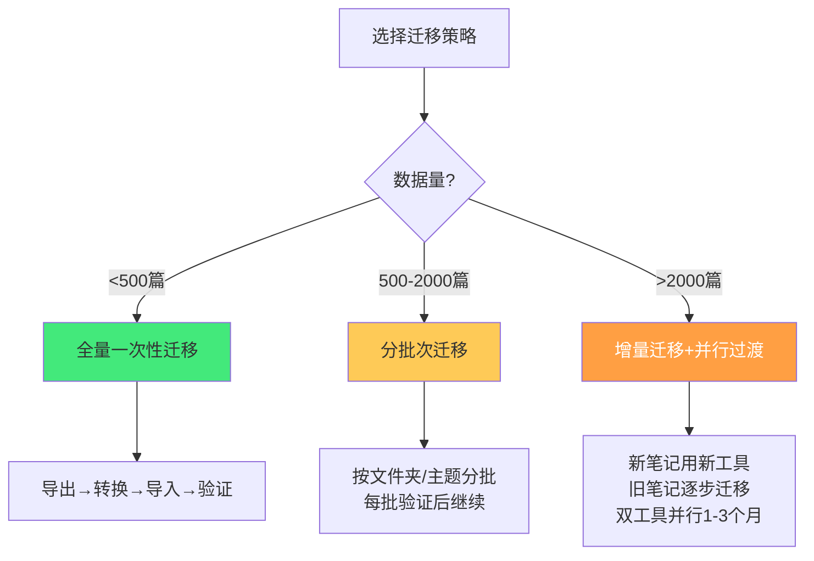
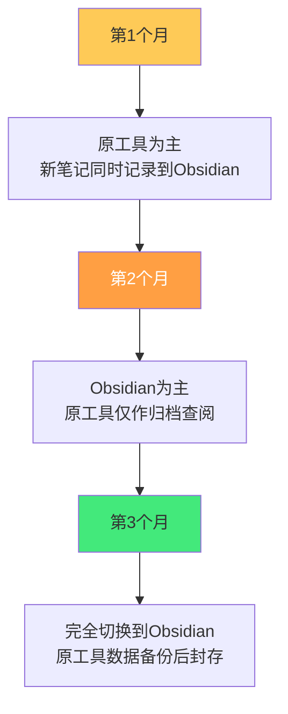

# 🚚 知识管理工具迁移指南

> **文档说明**：系统讲解知识管理工具迁移的完整方法论、主流工具对比、各场景迁移实操步骤与风险规避，涵盖迁移的动因分析（工具锁定/功能不足/性能问题/成本/数据主权/生态变化）、迁移前的评估与准备（数据盘点/格式分析/目标工具评估/迁移策略选择/备份）、主流知识管理工具全景对比（Obsidian/Notion/Logseq/Roam Research/思源笔记/印象笔记Evernote/OneNote/语雀/飞书文档/熊掌记，从数据格式/双向链接/本地优先/导出能力/插件生态/价格六个维度）、各工具的导出格式与能力清单、从 Notion 迁移到 Obsidian 的完整步骤（导出 Markdown & CSV/处理数据库/转换链接/附件路径/Frontmatter 生成）、从印象笔记 Evernote 迁移（导出 HTML/enex/转换为 Markdown/标签处理）、从 OneNote 迁移（导出/转换工具/结构损失）、从 Logseq/Roam Research 迁移（大纲格式转换/块引用处理/双向链接保留）、从语雀/飞书文档迁移（API 导出/Markdown 转换）、Markdown 格式标准化（Frontmatter 统一/链接格式转换 `[[]]` vs `[]()`/标签规范化/附件路径相对化）、双向链接迁移与死链检测修复、附件与媒体文件迁移（图片/PDF/音频/视频的路径处理与去重）、数据库与表格迁移（Notion database → Markdown 表格/CSV/YAML Frontmatter/独立笔记）、标签与文件夹结构迁移策略、迁移后的完整性验证（内容检查/链接有效性/格式一致性/搜索可用性/附件可访问）、迁移风险与规避（数据丢失/格式损坏/链接断裂/编码问题/版本冲突/附件丢失）、迁移后优化（重构目录/建立 MOC/清理冗余/统一编写规范/关系图谱优化）、双工具并行过渡策略（过渡期同时使用/手动同步/自动化同步/逐步切换）、何时不该迁移（沉没成本谬误/迁移成本大于收益/工具满足需求）、常见问题排查与最佳实践。
>
> **适用人群**：考虑从其他知识管理工具迁移到 Obsidian 的用户、正在进行工具迁移的知识工作者、需要评估知识管理工具的研究者、第二大脑构建者
>
> **前置知识**：[[Obsidian高效使用]] · [[原子笔记原则与实践]] · [[MOC内容地图]] · [[笔记标题命名策略]]

---

## 一、概述

### 1.1 为什么需要迁移

知识管理工具迁移是知识工作者的常见需求，核心动因可归为六类：


| 动因 | 典型场景 |
|------|---------|
| **工具锁定** | Notion/印象笔记导出格式差，数据被困在工具中 |
| **功能不足** | 需要双向链接/关系图谱/本地文件，但工具不支持 |
| **性能问题** | 笔记数千篇后 Notion/OneNote 卡顿，搜索慢 |
| **成本问题** | 工具从免费转付费，或订阅费超出预算 |
| **数据主权** | 希望数据存在本地、纯文本、可被任何工具读取 |
| **生态变化** | 工具停止更新（如 Roam Research 热度下降）或需要团队协作 |

### 1.2 迁移的核心原则

| 原则 | 说明 |
|------|------|
| **先备份再操作** | 迁移前完整备份原始数据，任何转换都在副本上进行 |
| **保留原始数据** | 不要删除原始工具的数据，至少保留3个月 |
| **小批量验证** | 先迁移一小部分（如一个文件夹），验证格式和链接后再全量迁移 |
| **内容不删减** | 迁移是「搬家」不是「精简」，所有内容都要保留 |
| **标准化中间格式** | 以 Markdown 为中间格式，便于在工具间转换 |
| **迁移后验证** | 完整性检查（文件数/字数/链接/附件）不可省略 |

### 1.3 迁移策略选择



---

## 二、主流知识管理工具对比

### 2.1 六维度对比

| 工具 | 数据格式 | 双向链接 | 本地优先 | 导出能力 | 插件生态 | 价格 |
|------|---------|---------|---------|---------|---------|------|
| **Obsidian** | 本地 Markdown | ✅ 原生 | ✅ 纯本地 | ✅ 无需导出（就是文件） | ✅ 1000+ 社区插件 | 个人免费/商用$50/年 |
| **Notion** | 云端数据库 | ✅ 原生 | ❌ 纯云端 | ⚠️ Markdown/CSV（格式损失大） | ⚠️ 有限集成 | 免费/Plus $10/月 |
| **Logseq** | 本地 Markdown/Org | ✅ 原生 | ✅ 本地优先 | ✅ 纯文本文件 | ✅ 插件市场 | 免费/赞助 |
| **Roam Research** | 云端大纲 | ✅ 原生 | ❌ 纯云端 | ⚠️ JSON/Markdown | ⚠️ 有限 | $15/月（贵） |
| **思源笔记** | 本地数据块 | ✅ 原生 | ✅ 本地优先 | ⚠️ 导出 Markdown（块结构损失） | ✅ 挂件/模板 | 免费/会员 |
| **印象笔记** | 云端私有格式 | ❌ 弱 | ❌ 云端为主 | ⚠️ HTML/enex（格式差） | ❌ 弱 | 免费/高级会员 |
| **OneNote** | 云端私有格式 | ❌ 无 | ⚠️ 可本地 | ❌ 导出困难 | ❌ 弱 | 免费/365订阅 |
| **语雀** | 云端文档 | ⚠️ 有限 | ❌ 纯云端 | ⚠️ Markdown/PDF | ⚠️ 有限 | 免费/会员 |
| **飞书文档** | 云端文档 | ⚠️ 有限 | ❌ 纯云端 | ⚠️ Markdown/PDF/Word | ✅ 飞书生态 | 免费/企业版 |

### 2.2 为什么选择 Obsidian 作为迁移目标

Obsidian 成为迁移首选的核心理由：
- **纯本地 Markdown**：数据就是 `.md` 文件，不被任何工具锁定，可被任何文本编辑器读取
- **双向链接+关系图谱**：原生支持 `[[]]` 双链和可视化图谱
- **本地优先**：无需联网，数据完全在自己电脑上
- **插件生态**：1000+ 社区插件，几乎可定制任何功能
- **跨平台**：Windows/macOS/Linux/iOS/Android 全平台
- **长期可持续**：纯文本格式不存在「工具关闭数据丢失」的风险

---

## 三、迁移前准备

### 3.1 数据盘点

迁移前先回答以下问题：

| 盘点项 | 说明 |
|--------|------|
| **笔记总数** | 多少篇笔记？（影响迁移策略选择） |
| **附件数量** | 多少图片/PDF/音频？附件总量多大？ |
| **文件夹结构** | 当前目录结构是怎样的？是否需要重构？ |
| **标签系统** | 使用了多少标签？标签命名是否规范？ |
| **链接情况** | 有多少内部链接？是否使用了双向链接？ |
| **数据库/表格** | Notion database、表格等结构化数据有多少？ |
| **特殊格式** | 是否有思维导图、嵌入内容、代码块、数学公式？ |

### 3.2 目标工具评估

在迁移前，先用一小部分真实数据在目标工具中试用：
1. 导出 10-20 篇有代表性的笔记（含图片、链接、表格、代码）
2. 导入目标工具，检查格式是否正确
3. 测试搜索、双向链接、图谱、附件访问
4. 评估日常使用体验（编辑速度、启动速度、移动端）

### 3.3 完整备份

```bash
# 无论从哪个工具迁移，先完整备份
# Notion：导出全部为 Markdown & CSV，下载并解压到备份目录
# 印象笔记：导出 .enex 或 HTML
# 通用：将原始导出文件复制到独立备份目录，命名为 迁移备份_YYYYMMDD
```

> **铁律**：永远不要在原始数据上直接操作。所有转换都在副本上进行，原始数据至少保留3个月。

---

## 四、从 Notion 迁移到 Obsidian

### 4.1 Notion 导出

1. 打开 Notion → 左侧边栏 `设置与成员` → `设置` → `导出所有工作区内容`
2. 选择导出格式：**Markdown & CSV**
3. 勾选「包含内容」「创建子文件夹的当前页面」
4. 等待导出完成（大工作区可能需要几十分钟）
5. 下载导出的 ZIP 文件并解压

**导出结构**：
```text
导出文件夹/
├── 页面名.md              # 普通页面
├── 页面名/                # 有子页面的页面会变成文件夹
│   ├── 子页面1.md
│   └── 子页面2.md
├── 数据库名.csv           # 数据库导出为CSV
└── 附件/                  # 图片和附件
    ├── image.png
    └── document.pdf
```

### 4.2 处理 Notion 导出的问题

Notion 导出的 Markdown 存在以下问题，需要转换：

| 问题 | 说明 | 解决方案 |
|------|------|---------|
| **链接格式** | Notion 用 `[标题](页面名.md)`，Obsidian 用 `[[标题]]` | 批量转换为 `[[]]` 双链 |
| **附件路径** | 图片路径是绝对路径或混乱的相对路径 | 统一附件到 `assets/` 目录，修正路径 |
| **Frontmatter 缺失** | 导出的 md 没有元数据 | 批量添加 Frontmatter（title/tags/created） |
| **数据库** | database 导出为 CSV，不是笔记 | 转换为 Markdown 表格或每一行一篇笔记 |
| **标题层级** | Notion 的 H1 可能变成了粗体文本 | 修正标题层级 |
| **编码问题** | 中文文件名可能乱码 | 确保 UTF-8 编码 |
| **空行过多** | 导出文件有大量多余空行 | 清理多余空行 |

### 4.3 链接格式转换

Notion 链接：`[页面标题](页面标题.md)`
Obsidian 双链：`[[页面标题]]`

**批量转换脚本（Python）**：
```python
import re
import os

def notion_to_obsidian_link(content):
    # 转换 [标题](标题.md) → [[标题]]
    pattern = r'\[([^\]]+)\]\(([^)]+)\.md\)'
    return re.sub(pattern, r'[[\1]]', content)

def process_directory(directory):
    for root, dirs, files in os.walk(directory):
        for file in files:
            if file.endswith('.md'):
                path = os.path.join(root, file)
                with open(path, 'r', encoding='utf-8') as f:
                    content = f.read()
                content = notion_to_obsidian_link(content)
                with open(path, 'w', encoding='utf-8') as f:
                    f.write(content)
                print(f"处理: {path}")

process_directory('./导出文件夹')
```

### 4.4 附件整理

```bash
# 1. 创建统一的附件目录
mkdir -p ObsidianVault/assets

# 2. 将所有图片/PDF移动到assets
find ./导出文件夹 -type f \( -name "*.png" -o -name "*.jpg" -o -name "*.pdf" \) -exec cp {} ./ObsidianVault/assets/ \;

# 3. 修正Markdown中的图片路径为相对路径
# 将  替换为 ![[图片.png]] 或 
```

### 4.5 批量添加 Frontmatter

```python
import os
from datetime import datetime

def add_frontmatter(filepath):
    with open(filepath, 'r', encoding='utf-8') as f:
        content = f.read()
    
    # 已有Frontmatter则跳过
    if content.startswith('---'):
        return
    
    # 从文件名提取标题
    title = os.path.splitext(os.path.basename(filepath))[0]
    created = datetime.fromtimestamp(os.path.getctime(filepath)).strftime('%Y-%m-%d')
    
    frontmatter = f"""---
title: {title}
tags: [待分类]
created: {created}
updated: {created}
status: 📥 迁移待整理
---

"""
    with open(filepath, 'w', encoding='utf-8') as f:
        f.write(frontmatter + content)
```

### 4.6 数据库（Database）处理

Notion database 导出为 CSV，有三种处理方式：

| 方式 | 适用场景 | 操作 |
|------|---------|------|
| **Markdown 表格** | 简单参考表 | CSV → Markdown 表格，作为一篇笔记 |
| **每一行一篇笔记** | 数据库条目是独立概念（如书单/项目） | 每行生成一个 .md 文件，字段转为 Frontmatter |
| **保留 CSV** | 纯数据参考 | 放入 vault，Obsidian 可直接查看 |

**CSV 转独立笔记脚本**：
```python
import csv
import os

def csv_to_notes(csv_path, output_dir, title_column='名称'):
    os.makedirs(output_dir, exist_ok=True)
    with open(csv_path, 'r', encoding='utf-8') as f:
        reader = csv.DictReader(f)
        for row in reader:
            title = row.get(title_column, '未命名')
            # 生成Frontmatter
            fm_lines = ['---']
            for key, value in row.items():
                if key != title_column and value:
                    fm_lines.append(f'{key}: "{value}"')
            fm_lines.append(f'title: "{title}"')
            fm_lines.append('---\n')
            # 写入文件
            safe_title = "".join(c for c in title if c not in '\\/:*?"<>|')
            with open(os.path.join(output_dir, f'{safe_title}.md'), 'w', encoding='utf-8') as out:
                out.write('\n'.join(fm_lines))
```

---

## 五、从印象笔记（Evernote）迁移

### 5.1 导出方式

**方式一：导出为 HTML（推荐，格式保留较好）**
- 印象笔记客户端 → 选中笔记本 → 右键「导出笔记」→ 选择 HTML 格式
- 每篇笔记生成一个 HTML 文件，附件在同目录

**方式二：导出为 .enex（Evernote 私有格式）**
- 导出为 .enex 文件
- 使用转换工具转为 Markdown

### 5.2 转换工具

| 工具 | 说明 |
|------|------|
| **evernote2md** | Node.js 工具，enex → Markdown |
| **yarle** | 功能强大的 Evernote → Obsidian 转换工具，支持标签/附件/链接 |
| **Pandoc** | HTML → Markdown 通用转换 |

**yarle 使用（推荐）**：
```bash
# 安装
npm install -g yarle

# 配置 config.json，指定 enex 文件路径和输出目录
# 运行
yarle --config-file config.json
```

### 5.3 印象笔记迁移注意事项

- **标签**：印象笔记的标签会转为 Markdown 标签或 Frontmatter 中的 tags
- **笔记本结构**：印象笔记的「笔记本」对应 Obsidian 的文件夹
- **网页剪藏**：大量网页剪藏笔记格式混乱，建议迁移后清理
- **附件**：印象笔记的附件（PDF/图片）需要单独处理路径
- **内部链接**：印象笔记的笔记间链接转换后可能成为死链，需要检测修复

---

## 六、从 OneNote 迁移

OneNote 是迁移难度最大的工具之一，因为其格式封闭、导出能力弱。

### 6.1 迁移方法

| 方法 | 说明 | 质量 |
|------|------|------|
| **OneNote 导出为 PDF** | 手动导出每个分区为 PDF | ⚠️ 不可编辑 |
| **使用转换工具** | 如 OneNote Exporter、Convert OneNote to Markdown | ⚠️ 格式损失大 |
| **手动复制** | 逐篇复制到 Obsidian | ✅ 质量高但慢 |
| **Graph API** | 微软 Graph API 编程导出 | ✅ 灵活但需开发 |

### 6.2 推荐方案

对于 OneNote，建议「**手动迁移+选择性迁移**」：
1. 先盘点 OneNote 内容，标记「需要迁移」和「可以放弃」的笔记
2. 需要迁移的笔记逐篇复制到 Obsidian（利用 Obsidian 的粘贴自动转换 Markdown 功能）
3. 大量归档性笔记可导出为 PDF 存入 Obsidian 的 `assets/` 目录
4. 不建议追求 100% 自动迁移——OneNote 格式损失大，手动迁移质量更高

---

## 七、从 Logseq / Roam Research 迁移

### 7.1 Logseq → Obsidian

Logseq 本身就是本地 Markdown，迁移相对简单：

1. 找到 Logseq 的仓库目录（设置 → 仓库路径）
2. 直接将整个目录复制为 Obsidian 的 vault
3. 在 Obsidian 中打开该目录

**需要调整的地方**：
- **大纲格式**：Logseq 是大纲式（每行一个块），Obsidian 是文档式。可保留大纲格式，或用插件转换为段落
- **块引用**：Logseq 的 `((block-id))` 块引用在 Obsidian 中不原生支持，可转为 `[[]]` 链接或安装相关插件
- **journals**：Logseq 的日记文件在 `journals/` 目录，Obsidian 日记插件可配置相同路径
- **属性**：Logseq 的 `key:: value` 属性可转为 Frontmatter

### 7.2 Roam Research → Obsidian

1. Roam 中导出为 Markdown（设置 → Export All → Markdown）
2. 解压导出文件
3. 转换 Roam 的 `[[]]` 链接（格式兼容，通常无需转换）
4. 处理 Roam 的 `{{[[query]]}}`、`{{[[embed]]}}` 等特殊语法（Obsidian 不支持，需手动替换）
5. 导入 Obsidian

---

## 八、从语雀/飞书文档迁移

### 8.1 语雀

- 语雀支持单篇导出为 Markdown
- 批量导出需使用语雀 API 或第三方工具（如「语雀导出助手」）
- 注意：语雀的表格、画板、思维导图导出为 Markdown 后会有损失

### 8.2 飞书文档

- 飞书文档支持导出为 Markdown/PDF/Word
- 批量导出需使用飞书开放平台 API
- 飞书的多维表格导出为 CSV，处理方式同 Notion database

---

## 九、Markdown 格式标准化

迁移后，所有笔记应统一为标准 Markdown 格式：

### 9.1 Frontmatter 统一

```yaml
---
title: 笔记标题
tags: [分类/子分类, 标签1, 标签2]
difficulty: ⭐⭐⭐
created: 2026-01-01
updated: 2026-08-28
status: ✅ 内容已完善
category: 所属分类
pre: [前置笔记1, 前置笔记2]
priority: 核心
---
```

### 9.2 链接格式统一

| 原格式 | 目标格式 | 说明 |
|--------|---------|------|
| `[标题](路径/标题.md)` | `[[标题]]` | 内部链接统一为 Obsidian 双链 |
| `[标题](https://...)` | 保持不变 | 外部链接保持标准 Markdown |
| `` | `![[图片.png]]` | 内部图片用嵌入语法 |
| `((block-id))` | `[[笔记标题#块标题]]` | 块引用转为标题锚点 |

### 9.3 标签规范化

- 统一使用 `#标签` 或 Frontmatter 中的 `tags: [标签]`（二选一，不要混用）
- 标签命名规范：小写、英文、用 `/` 分层（如 `#devops/cicd`）
- 迁移后用 Obsidian 的「标签面板」检查并合并重复标签

### 9.4 附件路径统一

```text
vault/
├── assets/           # 所有附件统一存放
│   ├── images/       # 图片
│   ├── pdf/          # PDF文档
│   └── files/        # 其他文件
└── notes/            # 笔记
```

所有笔记中的附件路径统一为相对路径：`![[xxx.png]]`

---

## 十、双向链接迁移与死链修复

### 10.1 死链检测

迁移后，很多内部链接可能指向不存在的笔记（死链）。

**检测方法**：
- Obsidian 插件：**Dead Links**、**Find unlinked files**
- 命令行：搜索所有 `[[]]` 链接，检查目标文件是否存在

```python
import os
import re

def find_dead_links(vault_path):
    all_files = set()
    for root, dirs, files in os.walk(vault_path):
        for f in files:
            if f.endswith('.md'):
                all_files.add(os.path.splitext(f)[0])
    
    dead_links = []
    for root, dirs, files in os.walk(vault_path):
        for f in files:
            if not f.endswith('.md'):
                continue
            path = os.path.join(root, f)
            with open(path, 'r', encoding='utf-8') as fh:
                content = fh.read()
            links = re.findall(r'\[\[([^\]|#]+)', content)
            for link in links:
                if link not in all_files:
                    dead_links.append((f, link))
    
    return dead_links
```

### 10.2 死链修复策略

| 死链类型 | 修复方式 |
|---------|---------|
| **目标笔记不存在但应该有** | 创建该笔记（至少写标题和概述） |
| **目标笔记名称不匹配** | 修正链接中的标题为实际文件名 |
| **目标笔记已合并/重命名** | 更新链接指向新标题 |
| **无意义的链接** | 删除该链接 |

> **参考**：知识库之前已完成 583 条历史死链清理，迁移后需重新检测新产生的死链。

---

## 十一、迁移后验证

### 11.1 完整性检查清单

| 检查项 | 方法 | 通过标准 |
|--------|------|---------|
| **文件数量** | 对比原始笔记数和迁移后 .md 文件数 | 数量一致（或合理差异，如数据库拆分） |
| **内容完整性** | 随机抽查 20 篇笔记，对比原文 | 文字内容无缺失 |
| **附件可访问** | 点击笔记中的图片/PDF链接 | 所有附件正常打开 |
| **链接有效性** | 死链检测工具扫描 | 无死链（或已记录待创建） |
| **格式一致性** | 抽查标题层级、代码块、表格、列表 | 渲染正常 |
| **搜索可用** | Obsidian 中搜索关键词 | 能搜到迁移的笔记 |
| **编码正确** | 检查中文是否乱码 | 无乱码，全为 UTF-8 |
| **Frontmatter** | 检查是否有统一的元数据 | 每篇笔记有标准 Frontmatter |

### 11.2 验证脚本

```bash
# 统计迁移后的笔记数量
find ./vault -name "*.md" | wc -l

# 统计附件数量
find ./vault/assets -type f | wc -l

# 检查是否有非UTF-8编码的文件
find ./vault -name "*.md" -exec file {} \; | grep -v UTF-8

# 检查空文件（迁移失败的标志）
find ./vault -name "*.md" -empty
```

---

## 十二、迁移风险与规避

| 风险 | 概率 | 影响 | 规避措施 |
|------|------|------|---------|
| **数据丢失** | 低 | 严重 | 迁移前完整备份，原始数据保留3个月 |
| **格式损坏** | 中 | 中 | 小批量验证，使用成熟转换工具，转换后人工抽查 |
| **链接断裂** | 高 | 中 | 迁移后死链检测，批量创建缺失笔记 |
| **附件丢失** | 中 | 中 | 单独统计附件数量，迁移后对比 |
| **编码乱码** | 中 | 低 | 确保所有工具使用 UTF-8，转换后检查中文 |
| **版本冲突** | 低 | 低 | 迁移期间不在原工具中编辑，或迁移后手动合并 |
| **数据库结构损失** | 高 | 中 | Notion database 提前评估，选择合适的转换方式 |
| **时间超预期** | 高 | 低 | 分批迁移，设定合理时间预期，大仓库考虑增量迁移 |

---

## 十三、迁移后优化

迁移完成只是开始，还需要系统性优化：

### 13.1 短期优化（迁移后1-2周）

- [ ] 统一 Frontmatter 格式
- [ ] 修复所有死链
- [ ] 整理附件目录
- [ ] 规范化标签
- [ ] 清理重复笔记

### 13.2 中期优化（迁移后1-3个月）

- [ ] 重构文件夹结构（按主题/领域分类）
- [ ] 建立 MOC（内容地图）导航笔记
- [ ] 为高频笔记添加双向链接
- [ ] 优化关系图谱颜色分组
- [ ] 统一编写标准（参考知识库的「编写标准v2」）

### 13.3 长期优化（持续）

- [ ] 按引用次数对高频笔记做内容深度迭代
- [ ] 定期回顾和更新笔记（常青笔记方法论）
- [ ] 持续清理冗余和过时内容
- [ ] 完善学习路线和进度追踪

> **参考**：[[常青笔记-EvergreenNotes]] · [[定期回顾与笔记重构]] · [[MOC内容地图]]

---

## 十四、双工具并行过渡策略

对于大仓库（>2000篇）或依赖原工具协作的场景，建议采用「双工具并行」过渡：



**并行期间的注意事项**：
- 明确「哪个工具是主」，避免两边都编辑导致冲突
- 新笔记只在 Obsidian 中创建
- 原工具中的旧笔记逐步迁移，不急于一次性完成
- 定期（每周）迁移一批，持续推进

---

## 十五、何时不该迁移

不是所有情况都值得迁移，以下情况建议谨慎：

| 情况 | 建议 |
|------|------|
| **当前工具完全满足需求** | 不要为了「迁移而迁移」，工具是手段不是目的 |
| **团队协作依赖原工具** | 如团队用 Notion/飞书协作，个人迁移会导致协作断裂 |
| **数据量极大且格式复杂** | 迁移成本可能超过收益，考虑「新笔记用新工具，旧笔记保留」 |
| **沉没成本谬误** |「已经用了5年了不能丢」不是迁移理由，评估未来价值而非过去投入 |
| **频繁更换工具** | 如果每半年就换一次工具，问题不在工具而在方法论，先稳定方法论 |

> **核心判断**：迁移的收益（功能/性能/数据主权/成本）是否大于迁移的成本（时间/精力/格式损失/适应期）？如果收益不明显，不要迁移。

---

## 十六、常见问题

| 问题 | 回答 |
|------|------|
| **迁移需要多长时间？** | 500篇以内约1-2天；500-2000篇约1-2周；>2000篇建议1-3个月增量迁移 |
| **图片和附件会丢失吗？** | 只要正确导出和整理附件目录，不会丢失。关键是迁移后逐一检查路径 |
| **Notion 的 database 怎么办？** | 简单表转为 Markdown 表格；条目型数据库每一行转一篇笔记（字段转Frontmatter） |
| **迁移后原工具的数据要删除吗？** | 不要立即删除，至少保留3个月作为备份和回退 |
| **Obsidian 能完全替代 Notion 吗？** | 个人知识管理可以；但 Notion 的数据库/团队协作/在线发布是 Obsidian 的弱项，需评估 |
| **双向链接会保留吗？** | Notion/Logseq/Roam 的 `[[]]` 链接格式与 Obsidian 兼容，通常可保留；其他工具的链接需转换 |
| **有一键迁移工具吗？** | 没有完美的一键工具，每个工具格式不同，都需要一定的手动调整和验证 |
| **迁移后笔记变丑了怎么办？** | 格式损失是正常的，迁移后统一排版和美化即可，参考「编写标准v2」 |

---

## 十七、关联笔记

### 知识管理方法论
- [[Obsidian高效使用]] · [[原子笔记原则与实践]] · [[常青笔记-EvergreenNotes]]
- [[MOC内容地图]] · [[LYT-链接你的思维]] · [[跨领域知识连接方法]]
- [[笔记标题命名策略]] · [[标签与文件夹的边界]] · [[定期回顾与笔记重构]]

### 工具与实践
- [[Obsidian-vs-Logseq-vs-Notion]] · [[Obsidian-AI插件对比]] · [[Obsidian关系图谱优化]]
- [[冗余检测与合并策略]] · [[知识折旧与更新机制]]

### 导航
- [[MOC-综合导航]] · [[MOC-知识管理方法论-四级展开]] · [[Home]] · [[学习路线总览]]

> 🔍 **知识点深度解析**
>
> **作用**：知识管理工具迁移指南解决的是「如何安全、完整、高效地将知识库从一个工具迁移到另一个工具（通常是 Obsidian），避免数据丢失、格式损坏和链接断裂，并在迁移后完成标准化和优化」的问题——工具迁移是知识管理中最容易出问题的环节之一：格式不兼容导致内容损失、链接格式不同导致大量死链、附件路径混乱导致图片打不开、数据库结构无法转换、编码问题导致中文乱码……本指南提供从评估、备份、转换、验证到优化的完整方法论，覆盖主流工具的具体迁移步骤和风险规避，让迁移从「冒险」变成「可控的工程」。
>
> **底层原理**：①工具迁移的本质是「数据格式转换+结构映射」——每个工具有自己的数据模型（Notion 的页面+数据库、印象笔记的笔记+标签、Logseq 的大纲+块、Obsidian 的文件夹+Markdown+双链），迁移就是将源工具的数据模型映射到目标工具的数据模型。映射的完整度决定了迁移质量：简单的文本内容容易映射，复杂结构（数据库/块引用/嵌入内容/权限）映射困难甚至无法映射，这就是为什么没有「完美一键迁移」。②Markdown 作为「中间格式」的价值在于它是「最低公约数」——几乎所有知识管理工具都能导出 Markdown，而 Markdown 是纯文本、人类可读、工具无关，这使得 Markdown 成为迁移的理想中间格式。但 Markdown 也是「最低标准」——它只能表达文本、标题、列表、链接、图片、表格等基础结构，无法表达数据库、块引用、嵌入内容、权限等高级结构，这些高级结构在转换为 Markdown 时会有损失。③双向链接迁移的核心是「链接标识符的映射」——不同工具的内部链接格式不同（Notion 用 `[标题](URL)`，Obsidian 用 `[[标题]]`，Logseq 用 `[[]]`+块ID），迁移时需要将源格式的链接标识符转换为目标格式，并确保目标笔记存在。如果目标笔记不存在，就产生死链。死链修复的本质是「补全链接目标」——要么创建缺失的笔记，要么修正链接指向已有的笔记。④附件迁移的核心是「路径重写」——附件（图片/PDF）在源工具中可能存储在云端或特定目录，迁移到 Obsidian 后需要统一到本地 `assets/` 目录，并将笔记中的附件路径重写为相对路径。路径重写是附件迁移中最容易出错的环节，必须迁移后逐一验证。⑤迁移后验证的本质是「不变量检查」——迁移前后应该保持不变的量：笔记数量、文字内容、附件数量、链接数量（死链除外）、编码格式。通过检查这些不变量，可以快速发现迁移中的问题。⑥「先备份再操作」「小批量验证」「保留原始数据」三大原则的底层逻辑是「降低不可逆操作的风险」——数据转换是不可逆的（格式损失无法恢复），所以必须在副本上操作、先小范围验证、原始数据保留回退选项。
>
> **用法要点**：① 迁移动因六类：工具锁定/功能不足/性能问题/成本/数据主权/生态变化，评估收益是否大于成本 ② 迁移前三步：数据盘点(笔记数/附件/结构/标签/链接/数据库)→目标工具试用(10-20篇验证)→完整备份(原始数据保留3个月) ③ 策略选择：<500篇全量一次性/500-2000篇分批/>2000篇增量+双工具并行 ④ Notion→Obsidian：导出Markdown&CSV→链接转换`[标题](x.md)`→`[[标题]]`→附件统一到assets/→批量加Frontmatter→database转表格或独立笔记 ⑤ 印象笔记：导出HTML或enex→用yarle/evernote2md转Markdown→标签和附件处理 ⑥ OneNote：迁移最难，建议选择性手动迁移，大量归档导出PDF ⑦ Logseq/Roam：本身是Markdown，直接复制目录，调整大纲格式和块引用 ⑧ 格式标准化：统一Frontmatter/链接格式`[[]]`/标签命名/附件相对路径 ⑨ 死链修复：检测所有`[[]]`链接目标是否存在，缺失的创建笔记或修正链接 ⑩ 验证清单：文件数量/内容抽查/附件可访问/链接有效/格式一致/搜索可用/编码UTF-8/Frontmatter完整 ⑪ 风险规避：数据丢失(备份)/格式损坏(小批量验证)/链接断裂(死链检测)/附件丢失(数量对比)/编码乱码(UTF-8) ⑫ 迁移后优化：短期(统一格式/修死链/整理附件)→中期(重构目录/建MOC/加链接)→长期(内容迭代/定期回顾) ⑬ 双工具并行：第1月原工具为主+新笔记同步Obsidian→第2月Obsidian为主→第3月完全切换 ⑭ 不该迁移的情况：当前工具满足需求/团队协作依赖/数据量极大格式复杂/沉没成本谬误/频繁换工具。

> 💡 **深度讲解**：知识管理工具迁移最核心的智慧是「迁移不是『换工具』，而是『数据主权的回归』和『知识体系的重构』」——很多人把工具迁移当作「把笔记从A工具搬到B工具」，搬完就完事了。但真正有价值的迁移，是一次「重新审视自己知识体系」的机会：在迁移过程中，你会发现哪些笔记是真正有价值的（值得花时间整理），哪些是「数字化石」（多年不看的收藏），哪些链接是死的（说明知识网络有缺口），哪些标签是混乱的（说明分类体系有问题）。迁移不应该是「无损搬运」，而应该是「带着批判性眼光的重构」——利用迁移这个契机，清理冗余、统一格式、补全链接、重构目录，让知识库在新工具中以更好的形态重生。这就是为什么本指南强调「迁移后优化」和「小批量验证」——不是因为技术上必须，而是因为迁移的最大价值不在「搬过去」，而在「搬的过程中想清楚自己的知识体系应该是什么样」。工具迁移的另一个深层智慧是「纯文本是数据主权的终极保障」——为什么那么多人从 Notion/印象笔记/OneNote 迁移到 Obsidian？不是因为 Obsidian 的编辑体验一定更好（事实上 Notion 的块编辑更强大），而是因为 Obsidian 的数据是「纯本地 Markdown 文件」——这些文件不依赖任何工具，可以被任何文本编辑器读取，可以用 Git 版本控制，可以用 grep 搜索，可以用脚本批量处理。这种「数据主权」是云端工具无法给予的：Notion 关闭了你的数据就没了，印象笔记涨价了你只能接受，OneNote 格式封闭你无法迁移。纯文本 Markdown 是知识管理的「通用语」，选择基于纯文本的工具，就是选择了「知识永远属于自己」的自由。理解了这一点，你就理解了工具迁移的终极意义——不是追逐新工具，而是夺回对自己知识的控制权。

> 📝 **精简总结**：知识管理工具迁移指南=从评估到优化的完整方法论。动因：工具锁定/功能不足/性能/成本/数据主权/生态变化。原则：先备份/保留原始/小批量验证/内容不删减/Markdown中间格式/迁移后验证。策略：<500全量/500-2000分批/>2000增量并行。主流工具：Obsidian(本地Markdown推荐)/Notion(云端数据库)/Logseq(本地大纲)/印象笔记(封闭)/OneNote(难迁移)。Notion迁移：导出Markdown&CSV→链接转[[]]→附件统一→加Frontmatter→database转表格或笔记。印象笔记：enex/HTML→yarle转换。OneNote：选择性手动迁移。Logseq/Roam：直接复制Markdown目录。标准化：Frontmatter统一/链接[[]]/标签规范/附件相对路径。死链：检测+创建缺失笔记或修正链接。验证：文件数/内容/附件/链接/格式/搜索/编码/Frontmatter。风险：备份/小批量/死链检测/附件对比/UTF-8。优化：短期统一格式→中期重构目录建MOC→长期内容迭代。双工具并行1-3个月过渡。不该迁移：工具满足需求/团队协作/沉没成本。核心：迁移是数据主权回归+知识体系重构，纯文本是终极保障。

> **学习路径建议**：先阅读 [[Obsidian-vs-Logseq-vs-Notion]] 明确工具选择 → 学习 [[Obsidian高效使用]] 掌握目标工具 → 按本指南进行数据盘点和备份 → 小批量迁移（10-20篇）验证格式 → 全量或分批迁移 → 执行格式标准化和死链修复 → 完整性验证 → 迁移后优化（目录重构/MOC/链接） → 学习 [[常青笔记-EvergreenNotes]] 和 [[定期回顾与笔记重构]] 建立持续维护机制 → 学习 [[MOC内容地图]] 和 [[LYT-链接你的思维]] 构建知识导航体系。

---

> **知识管理工具迁移的本质是「将知识从『工具的囚徒』解放为『自己的资产』，在迁移的过程中重新审视和重构自己的知识体系」——我们生活在一个工具爆炸的时代：Notion、Obsidian、Logseq、Roam、印象笔记、OneNote、语雀、飞书……每个工具都承诺「更好的知识管理」，但大多数人在工具间反复横跳，却从未真正建立起自己的知识体系。工具迁移不应该是「追逐下一个更好的工具」，而应该是「夺回对自己知识的控制权」——选择纯文本、本地优先、开放格式的工具，让你的知识不被任何平台锁定，永远属于你自己。更重要的是，迁移是一次「强制审视」的契机：当你一篇篇检查、转换、整理笔记时，你会重新思考「这篇笔记对我还有价值吗？」「这个分类合理吗？」「这个链接为什么是死的？」——这些问题在日常使用中不会被注意到，但在迁移中无法回避。一次好的迁移，应该让知识库在新工具中「重生」：更清晰的结构、更规范的格式、更密集的链接、更少的冗余。而一次差的迁移，只是把混乱从一个工具搬到另一个工具。所以，不要急于「快点搬完」，要利用迁移这个契机，慢下来，重新认识自己的知识——哪些是真正的资产，哪些是数字垃圾，哪些需要补全，哪些需要连接。当你完成迁移时，你得到的不应该只是「换了个工具」，而是「一个更清晰、更有结构、更属于自己的知识体系」。这才是工具迁移的终极意义：不是工具的升级，而是认知的升级。**
