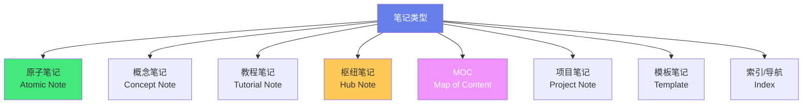

# 📝 笔记标题命名策略

> **文档说明**：系统讲解 Obsidian 知识库中笔记标题（文件名）的命名策略与规范，涵盖笔记命名的核心价值与原则、不同类型笔记的命名规范（原子笔记/枢纽笔记/MOC/概念笔记/教程笔记/项目笔记/模板笔记）、命名格式与结构（主题+限定词/技术栈+版本/问题+解决方案）、中英文命名选择与混排规则、避免命名冲突与歧义的方法、Obsidian 中的命名技巧（Wiki 链接/别名/标题与文件名分离/Frontmatter title）、批量重命名与一致性维护、命名反模式与常见错误、各知识领域的命名示例、与文件夹分类的协同策略。
>
> **适用人群**：Obsidian 用户、知识管理实践者、笔记爱好者、需要构建个人知识库的学习者
>
> **前置知识**：[[Obsidian知识库构建]] · [[原子化笔记规范]] · [[LYT-链接你的思维]]

---

## 一、概述

### 1.1 为什么笔记命名很重要

笔记标题（文件名）是知识库的「第一印象」——它决定了笔记的可发现性、可链接性、可理解性。

| 价值 | 说明 |
|------|------|
| **可发现性** | 好的标题让你在搜索、快速切换（Quick Switcher）时一眼找到目标笔记 |
| **可链接性** | Obsidian 的 Wiki 链接 `[[笔记名]]` 直接使用文件名，好的标题让链接自然流畅 |
| **可理解性** | 标题本身就是笔记内容的高度概括，看到标题就知道笔记讲什么 |
| **一致性** | 统一的命名规范让知识库结构清晰，降低认知负担 |
| **可维护性** | 规范的命名便于批量操作、重命名、迁移和自动化处理 |
| **避免冲突** | 清晰的命名避免同名笔记冲突和歧义 |

**命名混乱的代价**：
- 搜索时找不到目标笔记（标题太模糊）
- 链接时犹豫该链接哪个（多个相似标题）
- 看到标题不知道内容（标题太抽象）
- 同名笔记冲突（Obsidian 会提示歧义）
- 批量处理困难（命名不统一无法用正则匹配）

### 1.2 命名的核心原则

| 原则 | 说明 | 示例 |
|------|------|------|
| **清晰明确** | 标题准确反映笔记内容，不含糊 | ✅ `Docker容器化` ❌ `容器`（太泛） |
| **简洁精炼** | 用最少的字表达最准确的意思 | ✅ `快速排序` ❌ `一种基于分治思想的高效排序算法快速排序详解` |
| **一致性** | 同类型笔记用相同的命名格式 | ✅ `Git基础与核心命令`、`Docker容器化`（都是主题+核心） |
| **可搜索性** | 包含关键词，便于搜索和链接 | ✅ `RESTfulAPI设计规范`（含 RESTful/API/设计/规范） |
| **无歧义** | 避免多个笔记共享相似标题 | ✅ `HTTP状态码` vs `HTTP请求方法`（明确区分） |
| **面向链接** | 标题适合在句子中作为 Wiki 链接使用 | ✅ `语义化版本`（可直接说「遵循[[语义化版本与CHANGELOG]]」） |

### 1.3 标题 vs 文件名

在 Obsidian 中，笔记的「标题」有两层含义：

| 概念 | 说明 | 位置 |
|------|------|------|
| **文件名** | 笔记文件的实际名称（.md 文件名），用于 Wiki 链接和文件系统 | 文件系统 |
| **文档标题** | 笔记正文第一行的 `# 标题`，或 Frontmatter 中的 `title` 字段 | 笔记内容 |

**最佳实践**：
- ✅ **文件名 = 文档标题**：保持一致，避免混淆
- ✅ **用 Frontmatter title 字段**：可以让文件名和显示标题分离（如文件名用英文，显示标题用中文）
- ✅ **Obsidian 别名（alias）**：在 Frontmatter 中设置 `aliases`，支持多个名称链接到同一笔记

```yaml
---
title: 语义化版本与CHANGELOG
aliases: [SemVer, 版本号规范, CHANGELOG编写]
---
```

这样 `[[SemVer]]`、`[[版本号规范]]`、`[[语义化版本与CHANGELOG]]` 都能链接到同一笔记。

---

## 二、不同类型笔记的命名规范

### 2.1 笔记类型分类



### 2.2 原子笔记（Atomic Note）

**特点**：一个笔记只讲一个概念/知识点，内容聚焦，可独立理解。

**命名格式**：`核心概念名` 或 `核心概念+限定词`

| 场景 | 格式 | 示例 |
|------|------|------|
| 纯概念 | `概念名` | `闭包`、`虚拟内存`、`依赖注入` |
| 技术概念 | `技术名-核心点` | `Docker-镜像分层`、`React-Hooks原理` |
| 问题导向 | `问题-解决方案` | `跨域问题与CORS`、`内存泄漏排查` |
| 对比类 | `A与B对比` | `REST与GraphQL对比`、`Merge与Rebase对比` |

**好的原子笔记标题**：
- ✅ `JavaScript事件循环`（明确技术+概念）
- ✅ `TCP三次握手与四次挥手`（明确协议+过程）
- ✅ `Git变基黄金法则`（明确工具+核心原则）

**不好的原子笔记标题**：
- ❌ `笔记1`、`新建笔记`（无意义）
- ❌ `JavaScript`（太泛，JS 有无数知识点）
- ❌ `一些想法`（太抽象，不知道内容）

### 2.3 概念笔记（Concept Note）

**特点**：系统性讲解一个较大的概念/技术领域，内容较丰富，结构完整。

**命名格式**：`技术/领域名 + 核心主题` 或 `技术/领域名 + 完整指南/实战/原理`

| 格式 | 示例 |
|------|------|
| `技术名-核心主题` | `Terraform-基础设施编排`、`Jaeger-分布式链路追踪` |
| `技术名完整指南` | `Docker容器化完整指南`、`K8s核心概念与架构` |
| `技术名实战` | `SpringBoot实战`、`Redis实战` |
| `技术名原理` | `Vite构建原理`、`JVM内存模型原理` |
| `技术名全景对比` | `排序算法全景对比`、`SQL数据库全景对比` |

**本知识库的命名惯例**（参考已有笔记）：
- `技术名-核心主题`：`Terraform-基础设施编排`、`Apifox-接口管理平台`
- `技术名核心主题`：`Docker容器化`、`Git冲突解决与变基`
- `主题与主题`：`WebSocket与SSE原理`、`语义化版本与CHANGELOG`

### 2.4 教程笔记（Tutorial Note）

**特点**： step-by-step 的操作指南，教读者如何做某事。

**命名格式**：`如何+动作` 或 `动作+指南/教程/步骤`

| 格式 | 示例 |
|------|------|
| `如何X` | `如何配置Obsidian关系图谱`、`如何优化Docker镜像体积` |
| `X指南` | `Obsidian知识库构建指南`、`Dockerfile最佳实践指南` |
| `X教程` | `Git入门教程`、`Vim入门教程` |
| `X步骤` | `K8s部署步骤`、`CI-CD配置步骤` |
| `X配置` | `Nginx反向代理配置`、`SSH免密登录配置` |

### 2.5 枢纽笔记（Hub Note）

**特点**：一个主题的中心笔记，链接到该主题下的所有相关笔记，类似目录但更强调链接网络。

**命名格式**：`主题+枢纽` 或 `主题+知识地图` 或直接用主题名（如果该主题只有一个枢纽）

| 格式 | 示例 |
|------|------|
| `MOC-主题` | `MOC-云原生与运维`、`MOC-计算机基础` |
| `主题枢纽` | `Docker知识枢纽`、`React生态枢纽` |
| `主题知识地图` | `Java知识地图`、`前端知识地图` |
| `主题总览` | `K8s生态总览`、`数据库总览` |

**MOC 命名惯例**（本知识库）：
- 顶级 MOC：`MOC-综合导航`、`MOC-云原生与运维`
- 领域 MOC：`MOC-DevOps`、`MOC-算法与数据结构`
- 格式统一：`MOC-领域名`

### 2.6 项目笔记（Project Note）

**特点**：记录一个具体项目的信息、进度、决策、资源。

**命名格式**：`项目名` 或 `项目类型-项目名`

| 格式 | 示例 |
|------|------|
| `项目名` | `全栈知识库构建`、`个人博客开发` |
| `类型-项目名` | `项目-电商平台`、`学习-算法刷题` |
| `年份-项目名` | `2024-毕业设计`、`2025-Q1规划` |

### 2.7 模板笔记（Template）

**特点**：可复用的笔记模板，用于快速创建同类型笔记。

**命名格式**：`模板-类型` 或 `类型模板`，放在 `templates/` 文件夹

| 格式 | 示例 |
|------|------|
| `模板-类型` | `模板-原子笔记`、`模板-会议记录` |
| `类型模板` | `读书笔记模板`、`项目笔记模板` |
| `T-类型` | `T-概念笔记`、`T-教程笔记` |

### 2.8 索引/导航笔记

**特点**：纯导航用途，链接到相关笔记，类似目录。

**命名格式**：`主题+索引` 或 `主题+目录` 或 `主题+导航`

| 格式 | 示例 |
|------|------|
| `主题索引` | `Java知识点索引`、`算法题目索引` |
| `主题目录` | `云原生工具目录`、`前端框架目录` |
| `主题导航` | `DevOps学习导航`、`Python学习导航` |
| `Home`/`首页` | 知识库入口笔记 |

---

## 三、命名格式与结构

### 3.1 常用命名结构

| 结构 | 说明 | 示例 |
|------|------|------|
| **纯主题** | 直接用核心概念/技术名 | `Docker`、`React`、`Kubernetes` |
| **主题+核心点** | 技术名+具体知识点 | `Docker-镜像分层`、`React-Hooks` |
| **主题+类型** | 技术名+笔记类型 | `Docker最佳实践`、`Git入门教程` |
| **A与B** | 两个相关概念的对比/结合 | `Merge与Rebase`、`WebSocket与SSE` |
| **问题+解决方案** | 以问题为导向 | `跨域问题与CORS`、`性能优化方案` |
| **技术栈+版本** | 标注版本号 | `Vue3组合式API`、`Java21虚拟线程` |
| **领域+主题** | 大领域+具体主题 | `云原生-ServiceMesh`、`前端-状态管理` |

### 3.2 技术栈命名

技术类笔记建议包含技术栈名称，便于搜索和分类：

| 技术 | 命名前缀 | 示例 |
|------|---------|------|
| Java | `Java` / `Spring` | `Java集合框架`、`SpringBoot自动配置` |
| Python | `Python` / `Django` / `Flask` | `Python装饰器`、`DjangoORM` |
| JavaScript | `JS` / `JavaScript` / `Node` | `JS事件循环`、`NodeJS流处理` |
| 前端框架 | `Vue` / `React` / `Angular` | `Vue3响应式原理`、`ReactFiber架构` |
| 数据库 | `MySQL` / `Redis` / `MongoDB` | `MySQL索引优化`、`Redis持久化` |
| 运维 | `Docker` / `K8s` / `Nginx` | `Docker网络模式`、`K8s服务发现` |
| 云原生 | `Terraform` / `Prometheus` / `Jaeger` | `Terraform模块设计`、`Prometheus指标采集` |

### 3.3 中英文命名

**选择策略**：

| 策略 | 适用场景 | 示例 |
|------|---------|------|
| **纯中文** | 通用概念、非技术术语 | `快速排序`、`依赖注入`、`事件驱动` |
| **纯英文** | 技术专有名词、缩写 | `Docker`、`Kubernetes`、`CI/CD` |
| **中英混排** | 技术名+中文描述（最常用） | `Docker容器化`、`React Hooks原理` |
| **英文+中文注释** | 英文术语+中文解释 | `SemVer语义化版本`、`IaC基础设施即代码` |

**混排规则**：
- ✅ 技术专有名词保留英文：`Docker`、`Kubernetes`、`React`
- ✅ 通用概念用中文：`容器化`、`核心概念`、`最佳实践`
- ✅ 英文缩写保留：`API`、`CI/CD`、`JVM`、`ORM`
- ✅ 中英文之间不加空格（Obsidian 链接更简洁）：`Docker容器化` 而非 `Docker 容器化`
- ❌ 不要全英文翻译中文概念：`Quick Sort` 不如 `快速排序`
- ❌ 不要全中文翻译技术名：`码头工人` 不如 `Docker`

### 3.4 避免命名冲突

**冲突类型与解决方案**：

| 冲突类型 | 说明 | 解决方案 |
|---------|------|---------|
| **同名笔记** | 两个笔记标题完全相同 | 加限定词区分：`HTTP状态码` vs `HTTP请求方法` |
| **相似标题** | 标题太像，搜索时混淆 | 明确区分核心点：`Docker镜像` vs `Docker容器` vs `Docker网络` |
| **中英文重复** | 同一概念有中英文两个笔记 | 用 alias 别名合并，或统一用一种命名 |
| **单复数** | `设计模式` vs `设计模式们` | 统一用单数或复数，建议单数 |
| **大小写** | `RESTful` vs `Restful` vs `restful` | 统一标准写法（RESTful），Obsidian 链接大小写敏感 |

**Obsidian 歧义处理**：
- 当 `[[笔记名]]` 匹配到多个笔记时，Obsidian 会提示歧义
- 解决：用完整路径 `[[笔记名]]` 或重命名笔记加限定词

---

## 四、Obsidian 命名技巧

### 4.1 Wiki 链接友好命名

Obsidian 的核心是 `[[Wiki 链接]]`，好的标题应该能自然地嵌入句子中：

| 好的标题（可嵌入句子） | 不好的标题（难嵌入） |
|----------------------|---------------------|
| `[[语义化版本与CHANGELOG]]` | `[[关于版本号命名的一些思考]]` |
| `[[Docker容器化]]` | `[[Docker学习笔记整理]]` |
| `[[快速排序]]` | `[[排序算法之快速排序详解]]` |
| `[[事件循环]]` | `[[JavaScript运行机制之事件循环]]` |

**判断方法**：试着把标题放进句子——「这篇文章讲了[[标题]]」，如果读起来通顺，就是好标题。

### 4.2 别名（Aliases）

别名让一个笔记可以通过多个名称被链接到：

```yaml
---
title: 语义化版本与CHANGELOG
aliases:
  - SemVer
  - 版本号规范
  - CHANGELOG编写
  - 语义化版本
---
```

**使用场景**：
- 中英文别名：`Docker` 别名 `容器引擎`
- 缩写别名：`Kubernetes` 别名 `K8s`
- 旧名称：笔记重命名后，旧名称作为别名保持链接有效
- 同义词：`快速排序` 别名 `QuickSort`

**创建别名的方法**：
1. 在 Frontmatter 中添加 `aliases` 字段
2. 链接时输入别名，Obsidian 会自动匹配
3. 重命名笔记时，Obsidian 会自动更新所有链接

### 4.3 标题与文件名分离

有时希望文件名简洁（便于链接），但显示标题更详细：

```yaml
---
title: Docker 容器化完整指南：从入门到生产实践
aliases: [Docker容器化, Docker入门]
---

# Docker 容器化
```

- 文件名：`Docker容器化.md`（简洁，便于 `[[Docker容器化]]` 链接）
- 显示标题：`# Docker 容器化`（笔记正文第一行）
- Frontmatter title：更详细的完整标题（用于搜索和元数据）

### 4.4 文件夹与命名协同

文件夹提供「分类」，文件名提供「识别」，两者协同：

```text
05-云原生与运维/
├── 01-容器化/
│   ├── Docker容器化.md
│   ├── Dockerfile最佳实践.md
│   └── Docker-Compose编排.md
├── 02-K8s编排/
│   ├── K8s-核心概念与架构.md
│   ├── K8s-资源管理.md
│   └── Pod与控制器Deployment.md
└── 04-监控可观测/
    ├── Prometheus-指标采集.md
    └── Jaeger-分布式链路追踪.md
```

**原则**：
- 文件夹已经分类了，文件名不需要重复文件夹名（不需要 `云原生-Docker容器化`）
- 同一文件夹内的笔记命名保持一致风格
- 文件名要能独立识别（看到文件名就知道内容，不依赖文件夹路径）

### 4.5 快速切换（Quick Switcher）

Obsidian 的快速切换（Ctrl+O）通过文件名搜索，好的命名让快速切换更高效：
- 包含关键词：输入 `Docker` 就能列出所有 Docker 相关笔记
- 避免太常见的词：`笔记`、`学习`、`整理` 出现在太多标题中
- 首字母缩写：`K8s`、`CI/CD`、`JVM` 便于快速输入

---

## 五、批量重命名与一致性维护

### 5.1 批量重命名方法

| 方法 | 说明 | 适用场景 |
|------|------|---------|
| **Obsidian 重命名** | 右键笔记 → 重命名，自动更新所有链接 | 单个重命名 |
| **插件：Another Quick Switcher** | 增强快速切换，支持批量操作 | 批量搜索和重命名 |
| **插件：File Explorer Count** | 显示文件数，便于统计 | 统计和管理 |
| **PowerShell 脚本** | 用正则批量重命名文件 | 大规模批量重命名 |
| **VSCode 批量重命名** | 在文件管理器中批量重命名 | 熟悉 VSCode 的用户 |

**PowerShell 批量重命名示例**：
```powershell
# 将所有 "笔记" 后缀的文件去掉 "笔记"
Get-ChildItem -Filter "*笔记.md" | Rename-Item -NewName { $_.Name -replace "笔记", "" }

# 将 "Docker-" 前缀统一为 "Docker"
Get-ChildItem -Filter "Docker-*.md" | Rename-Item -NewName { $_.Name -replace "Docker-", "Docker" }
```

> **注意**：批量重命名前务必备份！Obsidian 重命名会自动更新链接，但文件系统级别的重命名（PowerShell）不会更新笔记内的 Wiki 链接。

### 5.2 一致性检查

定期检查命名一致性：
1. **搜索常见问题词**：搜索 `笔记`、`学习`、`整理`、`新建`、`未命名`，看是否有低质量标题
2. **检查同名/相似**：用快速切换搜索关键词，看是否有歧义
3. **检查中英混排**：确保技术名拼写一致（`RESTful` 而非 `Restful`）
4. **检查前缀一致性**：同类型笔记是否用了相同的命名格式
5. **检查长度**：标题是否过长（建议 < 20 字）或过短（建议 > 2 字）

### 5.3 命名规范文档化

将命名规范写入知识库，便于参考和遵守：
- 本文档就是命名规范的参考
- 在模板笔记中嵌入命名提示
- 在 MOC 中说明该领域的命名惯例

---

## 六、命名反模式

### 6.1 常见错误

| 反模式 | 示例 | 问题 | 改进 |
|--------|------|------|------|
| **无意义标题** | `笔记1`、`新建文档` | 完全无法识别内容 | 用核心概念命名 |
| **过于宽泛** | `Java`、`前端`、`算法` | 一个标题涵盖太多内容 | 拆分为具体主题：`Java集合框架` |
| **过于冗长** | `关于Docker容器化技术的学习笔记整理与总结` | 太长，链接不友好 | 精简为 `Docker容器化` |
| **日期前缀** | `2024-01-15-Docker学习` | 日期在文件名中无意义，用 Frontmatter | 去掉日期，用 `created` 字段 |
| **序号前缀** | `01-Docker基础`、`02-Docker进阶` | 序号会随内容调整而变化，不稳定 | 用文件夹或 MOC 排序，文件名不加序号 |
| **全英文翻译** | `Quick Sort Algorithm` | 中文知识库用英文增加阅读负担 | 用中文：`快速排序` |
| **中英文空格** | `Docker 容器化` | Obsidian 链接需要加空格，不简洁 | 不加空格：`Docker容器化` |
| **特殊字符** | `Docker:容器化?` | 文件名中的特殊字符可能导致问题 | 用连字符或直接连接：`Docker-容器化` |
| **单复数不一** | `设计模式` 和 `设计模式们` | 同一概念两种写法 | 统一用单数：`设计模式` |
| **大小写不一** | `RESTful` 和 `Restful` | 搜索和链接可能匹配不到 | 统一标准写法：`RESTful` |

### 6.2 特殊字符注意

Obsidian 文件名中应避免的字符：
- ❌ `#`：Obsidian 中用于标签，文件名中会有问题
- ❌ `^`：Obsidian 中用于嵌入块
- ❌ `|`：Wiki 链接中用于别名
- ❌ `[` `]`：Wiki 链接语法
- ❌ `/` `\`：文件路径分隔符
- ❌ `:`：Windows 文件名不允许
- ❌ `*` `?` `"` `<` `>`：Windows 文件名不允许

✅ 可以使用：`-`（连字符）、`_`（下划线）、`.`（点）、空格（但不推荐）

---

## 七、各领域命名示例

### 7.1 全栈开发

| 领域 | 好的命名示例 |
|------|------------|
| 前端 | `Vue3响应式原理`、`ReactHooks详解`、`TypeScript高级类型` |
| 后端 | `SpringBoot自动配置`、`NodeJSExpress框架`、`DjangoORM查询` |
| 数据库 | `MySQL索引优化`、`Redis持久化机制`、`MongoDB聚合管道` |
| API | `RESTfulAPI设计规范`、`GraphQL核心概念`、`WebSocket与SSE原理` |
| 安全 | `JWT认证机制`、`OAuth2.0授权流程`、`XSS与CSRF防护` |

### 7.2 AI 工程

| 领域 | 好的命名示例 |
|------|------------|
| 机器学习 | `线性回归原理`、`决策树算法`、`梯度下降优化` |
| 深度学习 | `CNN卷积神经网络`、`Transformer架构`、`注意力机制` |
| LLM | `Prompt工程技巧`、`RAG检索增强生成`、`Agent智能体设计` |
| NLP | `词嵌入Word2Vec`、`BERT预训练模型`、`文本分类` |
| AI 工程 | `模型部署与推理优化`、`向量数据库入门`、`LLM服务编排` |

### 7.3 云原生与运维

| 领域 | 好的命名示例 |
|------|------------|
| 容器 | `Docker容器化`、`Dockerfile最佳实践`、`容器镜像优化` |
| K8s | `K8s-核心概念与架构`、`Pod与控制器Deployment`、`K8s服务发现` |
| CI/CD | `CI-CD流水线`、`ArgoCD-GitOps持续部署`、`GitHubActions配置` |
| 监控 | `Prometheus-指标采集`、`Jaeger-分布式链路追踪`、`Grafana可视化` |
| IaC | `Terraform-基础设施编排`、`Ansible配置管理`、`Helm包管理` |

### 7.4 计算机基础

| 领域 | 好的命名示例 |
|------|------------|
| 网络 | `HTTP协议完整指南`、`TCP三次握手`、`DNS解析原理` |
| 操作系统 | `进程与线程`、`内存管理与虚拟内存`、`锁机制与并发原语` |
| 算法 | `快速排序`、`动态规划入门`、`哈希表与一致性哈希` |
| 数据库原理 | `数据库执行计划分析`、`事务隔离级别`、`索引底层原理` |
| 设计模式 | `单例模式`、`观察者模式`、`工厂模式` |

---

## 八、关联笔记

### 知识管理
- [[Obsidian知识库构建]] · [[原子化笔记规范]] · [[LYT-链接你的思维]]
- [[PARA组织法]] · [[Zettelkasten-卡片盒笔记法]] · [[MOC-综合导航]]

### 工具与效率
- [[Obsidian关系图谱优化]] · [[Obsidian-AI插件对比]] · [[VSCode高效开发]]

### 导航
- [[MOC-综合导航]] · [[MOC-知识管理方法论-四级展开]] · [[Home]]

> 🔍 **知识点深度解析**
>
> **作用**：笔记标题命名策略解决的是「知识库中笔记的可发现性、可链接性和一致性问题」——在 Obsidian 这种基于 Wiki 链接的知识库中，文件名就是链接的目标，也是搜索的关键词，还是笔记内容的第一印象。命名混乱会导致找不到笔记、链接歧义、结构混乱、维护困难；统一的命名规范让知识库「看起来就专业」，搜索高效，链接自然，维护轻松。命名不是「小事」，而是知识库可维护性的基础。
>
> **底层原理**：①Obsidian 的链接机制是「基于文件名的 Wiki 链接」——`[[笔记名]]` 直接匹配文件名，文件名就是链接的唯一标识（除非用路径或别名），所以文件名必须稳定、唯一、可识别。②搜索机制基于文件名和内容索引——文件名中的关键词权重更高，好的命名让搜索更精准。③人类认知的「标签效应」——标题是笔记的「标签」，人们通过标题快速判断内容，好的标题降低认知负担，差的标题增加决策成本。④一致性的「模式识别」——当同类型笔记用相同的命名格式时，大脑能快速识别模式，降低处理成本（如看到 `技术名-核心主题` 就知道是技术概念笔记）。⑤别名（aliases）机制解决「同一概念多个名称」的问题——通过 Frontmatter 的 aliases 字段，一个笔记可以有多个入口名称，既保持文件名统一，又支持多种链接方式。
>
> **用法要点**：① 命名原则：清晰明确（准确反映内容）、简洁精炼（最少的字）、一致性（同类型同格式）、可搜索（含关键词）、无歧义（不与其他笔记混淆）、面向链接（可嵌入句子） ② 笔记类型命名：原子笔记=`核心概念名`；概念笔记=`技术名-核心主题`/`技术名完整指南`；教程笔记=`如何X`/`X指南`/`X配置`；枢纽笔记=`MOC-领域名`/`主题枢纽`；项目笔记=`项目名`；模板=`模板-类型`；索引=`主题索引` ③ 命名结构：纯主题、主题+核心点、主题+类型、A与B、问题+解决方案、技术栈+版本、领域+主题 ④ 中英文：技术专有名词保留英文（Docker/React/K8s），通用概念用中文（容器化/核心概念），中英混排不加空格（`Docker容器化`），英文缩写保留（API/CI-CD/JVM） ⑤ 避免冲突：同名加限定词、相似标题明确区分、用 alias 合并同义词、统一单复数和大小写 ⑥ Obsidian技巧：Wiki链接友好命名（可嵌入句子）、aliases别名（多名称入口）、标题与文件名分离（Frontmatter title）、文件夹与命名协同（文件夹分类+文件名识别）、快速切换高效搜索 ⑦ 批量维护：Obsidian重命名自动更新链接、PowerShell正则批量重命名（先备份）、定期一致性检查（搜索低质量词/同名/大小写）、规范文档化 ⑧ 反模式：无意义标题、过于宽泛、过于冗长、日期前缀、序号前缀、全英文翻译、中英文空格、特殊字符（#^|[]/\:*?"<>）、单复数/大小写不一 ⑨ 特殊字符：文件名避免 # ^ | [ ] / \ : * ? " < >，可用 - _ . ⑩ 各领域示例：前端=`Vue3响应式原理`、后端=`SpringBoot自动配置`、数据库=`MySQL索引优化`、AI=`Transformer架构`、云原生=`K8s-核心概念与架构`、算法=`快速排序`。

> 💡 **深度讲解**：笔记命名最核心的智慧是「命名即思考」——给笔记起一个好名字，不是「随便起一个」，而是「对笔记内容进行高度概括和精准定位」的思考过程。当你犹豫「这个笔记该叫什么名字」时，实际上是在思考「这个笔记的核心是什么？它和其他笔记有什么区别？它应该被如何找到和链接？」。这个思考过程本身就是知识管理的一部分——它迫使你厘清笔记的边界和定位，避免「大杂烩」笔记（一个笔记讲了太多东西，无法命名）。所以，「命名困难」往往是「内容不聚焦」的信号——如果你无法用一个简洁的标题概括笔记内容，说明这个笔记可能包含了多个主题，应该拆分为多个原子笔记。这就是命名的「诊断价值」——它不仅是给笔记贴标签，更是检验笔记质量的工具。「面向链接的命名」是 Obsidian 特有的智慧——在传统文件夹管理中，文件名只要自己能看懂就行；但在 Obsidian 的 Wiki 链接体系中，文件名会出现在其他笔记的正文中，作为链接的一部分。这就要求文件名「能自然地嵌入句子」——比如「这篇文章讲了[[语义化版本与CHANGELOG]]的核心规则」读起来很自然，但「这篇文章讲了[[关于版本号命名的一些思考]]」就很别扭。这种「面向链接」的命名思维，让知识库从「文件的集合」变成「思想的网络」——每个笔记的标题都是网络中的一个节点名称，好的节点名称让网络更易读、更易导航。「一致性是规模的前提」——当知识库只有几十篇笔记时，命名随意也能管理；但当知识库有几百上千篇笔记时，没有统一的命名规范就会陷入混乱——搜索时找不到、链接时犹豫、批量处理无法进行。一致性的命名规范就像「交通规则」——每个人都靠右走，交通就顺畅；没有规则，就会堵成一团。建立命名规范并严格遵守，是知识库从「小作坊」升级到「系统化」的关键一步。这也是为什么大型项目（如编程语言、操作系统）都有严格的命名规范——规模越大，一致性越重要。

> 📝 **精简总结**：笔记命名原则：清晰明确、简洁精炼、一致性、可搜索、无歧义、面向链接。类型命名：原子笔记=核心概念名，概念笔记=技术名-核心主题，教程=如何X/X指南，枢纽=MOC-领域名，模板=模板-类型。中英文：技术名英文+概念中文，不加空格，缩写保留。Obsidian技巧：Wiki链接友好、aliases别名、标题与文件名分离、文件夹协同。避免：无意义/太泛/太长/日期前缀/序号前缀/特殊字符/大小写不一。批量：Obsidian重命名自动更新链接，PowerShell正则批量（先备份）。反模式诊断：命名困难=内容不聚焦，应拆分。

> **学习路径建议**：先学习 [[Obsidian知识库构建]] 理解 Obsidian 基础 → 学习 [[原子化笔记规范]] 理解笔记内容结构 → 学习本文档掌握命名策略 → 实践：审查自己的知识库，重命名低质量标题 → 学习 [[LYT-链接你的思维]] 理解链接网络 → 学习 [[PARA组织法]] 理解文件夹分类 → 学习 [[Zettelkasten-卡片盒笔记法]] 深入知识管理方法论 → 在实践中不断优化命名规范。

---

> **笔记命名的本质是「给知识一个可被找到、可被链接、可被理解的身份」——在数字时代，我们拥有的不是「知识」，而是「记录知识的笔记」；笔记的价值不在于它存在，而在于它能被找到、被链接、被使用。一个好的标题，就是笔记的「身份证」——它让笔记在知识的海洋中不被淹没，在搜索的结果中被一眼识别，在链接的网络中被自然引用。命名不是「小事」，而是「知识管理的基础设施」——就像城市的街道命名，没有统一的命名规范，邮件无法投递，急救无法到达，城市无法运转；知识库也是如此，没有好的命名规范，知识无法被检索，想法无法被连接，学习无法被积累。当你给每一篇笔记都起一个清晰、简洁、一致的名字时，你就在为自己的知识城市修建「可导航的街道」——每一次搜索都是一次导航，每一次链接都是一次出行，好的命名让这一切变得顺畅而高效。这就是命名的终极意义：它不仅仅是「给文件起名字」，更是「构建一个可被有效使用的知识系统」。**
