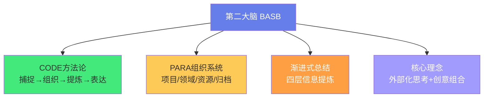
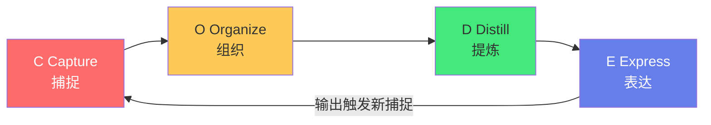
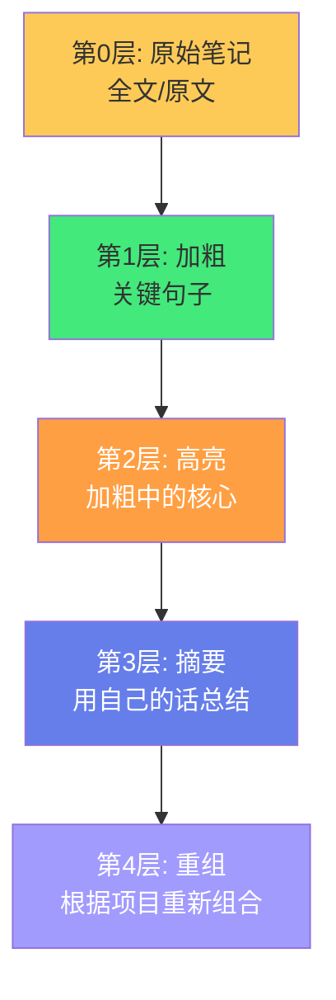
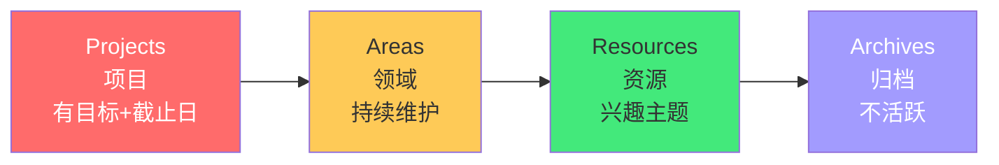

# 🧠 第二大脑（Building a Second Brain）

> **文档说明**：系统讲解 Tiago Forte 提出的「第二大脑（Building a Second Brain, BASB）」方法论，涵盖第二大脑的核心理念（外部化思考/释放认知负荷/知识可复用/创意组合）、CODE 四阶段方法论（Capture 捕捉 / Organize 组织 / Distill 提炼 / Express 表达）、PARA 组织系统（Projects 项目 / Areas 领域 / Resources 资源 / Archives 归档）、渐进式总结（Progressive Summarization，四层加粗→高亮→摘要→重组）、第二大脑与传统笔记的本质区别、数字工具选择（Obsidian/Notion/Logseq/Roam）、第二大脑的实施步骤与日常工作流、常见误区（收集癖/完美主义/工具折腾/只存不用）、与 Zettelkasten/原子笔记/常青笔记/MOC 的关系与区别、CODE 各阶段的实操技巧、第二大脑的衡量标准（可发现性/可复用性/可组合性）、实际应用场景（写作/项目管理/学习/创意工作）、常见问题与最佳实践。
>
> **适用人群**：知识工作者、终身学习者、写作者、产品经理、开发者、研究者、任何想系统化管理知识和提升创造力的人
>
> **前置知识**：[[PARA-项目领域资源归档]] · [[Zettelkasten-卡片盒笔记法]] · [[原子笔记原则与实践]]

---

## 一、概述

### 1.1 什么是第二大脑

**第二大脑（Building a Second Brain, BASB）** 是由美国知识管理专家 **Tiago Forte** 提出的个人知识管理方法论，2017 年开始传播，2022 年出版同名书籍《Building a Second Brain》。



**核心定义**：
> 第二大脑是一个「外部化的、数字化的知识管理系统」，用于存储、组织和提炼你从各种渠道获取的信息，并最终将其转化为创造性的输出。

**Tiago Forte 的原话**：
> "你的大脑是用来产生想法的，不是用来存储想法的。"
> （"Your brain is for having ideas, not for holding them."）

### 1.2 为什么需要第二大脑

| 痛点 | 第二大脑的解决方案 |
|------|------------------|
| 信息过载，读了就忘 | 外部化存储，释放大脑记忆负荷 |
| 笔记零散，找不到 | 统一系统，可搜索可发现 |
| 知识孤立，不会用 | 渐进式总结，可复用可组合 |
| 只输入不输出 | CODE 闭环，以表达为终点 |
| 创意枯竭 | 跨领域知识连接，激发新想法 |

**第二大脑的四个目标**：
1. **可发现性（Discoverable）**：需要时能找到
2. **可复用性（Reusable）**：能在不同场景重复使用
3. **可组合性（Combinable）**：能与其他知识组合产生新价值
4. **可行动性（Actionable）**：能直接转化为输出和行动

---

## 二、CODE 方法论

CODE 是第二大脑的核心工作流，四个字母代表四个阶段：



```text
### 2.1 C - Capture（捕捉）

**定义**：从各种渠道捕捉有价值的信息到你的第二大脑中。

**捕捉原则**：
```
- **只捕捉让你「共鸣」的内容**，不是什么都存
- 捕捉时加一句「为什么这个重要」（个人注解）
- 统一入口（一个收件箱/收集箱），避免分散
- 定期清空收集箱（转化或删除）

**捕捉来源**：
| 来源 | 工具/方式 |
|------|----------|
| 书籍/文章 | 高亮 + 剪藏（Readwise/Obsidian Web Clipper） |
| 播客/视频 | 笔记 + 时间戳 |
| 对话/会议 | 录音转写 + 关键要点 |
| 灵感/想法 | 手机备忘录/快速捕捉 |
| 个人经验 | 复盘笔记 |

**捕捉的「四问」**：
1. 这个信息让我有什么感受？
2. 它让我想起了什么？
3. 我能怎么用它？
4. 它挑战了我的什么假设？

> 不是所有信息都值得捕捉。Tiago 建议捕捉「让你停下来思考」的内容，而非「可能有用」的内容。

```text
### 2.2 O - Organize（组织）

**定义**：将捕捉的信息按「可行动性」组织起来，核心是 **PARA 系统**。
```

> 详见 [[PARA-项目领域资源归档]]

**PARA 四分类**：

| 分类 | 定义 | 示例 | 特点 |
|------|------|------|------|
| **Projects 项目** | 有明确目标和截止日期的努力 | 做一个App/写一本书/准备演讲 | 短期、活跃、有产出 |
| **Areas 领域** | 需要持续维护的责任领域 | 健康/财务/职业/人际关系 | 长期、无终点、需维护 |
| **Resources 资源** | 感兴趣的主题和参考资料 | 设计灵感/技术教程/读书笔记 | 潜在用途、按需取用 |
| **Archives 归档** | 不活跃的项目和资料 | 已完成的项目/过时的笔记 | 冷存储、偶尔查阅 |

**组织原则**：
- 按「可行动性」分类，而非按主题分类
- 一个笔记只属于一个地方（避免重复）
- 项目优先（活跃的东西放最显眼位置）
- 定期整理（项目完成后移到归档）

```text
### 2.3 D - Distill（提炼）

**定义**：通过「渐进式总结（Progressive Summarization）」将信息层层提炼，找到核心价值。

**渐进式总结的四层**：
```



| 层级 | 操作 | 目的 | 时间投入 |
|------|------|------|---------|
| **第0层** | 原始笔记/原文 | 保存完整信息 | 捕捉时 |
| **第1层** | 加粗关键句子 | 快速定位重点 | 第一次回顾 |
| **第2层** | 高亮加粗中的核心 | 找到「重点中的重点」 | 第二次回顾 |
| **第3层** | 用自己的话写摘要 | 深度理解和内化 | 需要时 |
| **第4层** | 根据项目重组 | 为特定输出服务 | 创作时 |

**核心原则**：
- 每次只做一层，不一次做到底
- 只有「被再次访问」的笔记才值得深入提炼
- 提炼是「按需」的，不是「一次性」的
- 用自己的话（第3层）是真正内化的标志

> 渐进式总结的智慧：你不需要把所有笔记都提炼到第4层。大多数笔记停在第1-2层即可，只有真正重要、反复使用的笔记才需要深入到第3-4层。这避免了「完美主义陷阱」。

```text
### 2.4 E - Express（表达）

**定义**：将提炼后的知识转化为创造性输出——这是第二大脑的最终目的。

**表达形式**：
```
- 文章/博客/书籍
- 演讲/分享/课程
- 产品/项目/代码
- 决策/方案/策略
- 对话/教学/指导

**表达原则**：
- **以输出为导向**：捕捉和组织都是为了最终的表达
- **小步快跑**：从最小可行输出开始（如一条朋友圈、一段笔记）
- **复用已有知识**：不要从零开始，从第二大脑中提取素材
- **公开输出**：公开表达能获得反馈，倒逼质量提升

**CODE 的闭环**：
```text
捕捉 → 组织 → 提炼 → 表达 → (输出触发新的捕捉) → ...
```

> 第二大脑不是「笔记库」，而是「创作引擎」。如果你的知识没有转化为输出，它就没有真正发挥价值。

---

## 三、PARA 组织系统

### 3.1 PARA 的核心理念

PARA 按「可行动性」而非「主题」组织信息：



**可行动性递减**：项目（马上要做）> 领域（持续维护）> 资源（可能有用）> 归档（已完成）

### 3.2 PARA 的动态流动

信息不是固定在一个分类里，而是随时间流动：

```text
新项目启动 → 从 Resources/Archives 提取相关笔记 → 放入 Projects
项目进行中 → 持续捕捉和提炼 → 留在 Projects
项目完成 → 项目笔记移入 Archives
持续关注 → 从 Projects 提炼出方法论 → 放入 Areas
发现兴趣 → 收集相关资料 → 放入 Resources
```

> 详见 [[PARA-项目领域资源归档]] 中的完整实施指南。

---

## 四、渐进式总结详解

### 4.1 为什么需要渐进式总结

传统笔记的问题：
- 一次性写完整摘要 → 工作量大，难以坚持
- 不做任何提炼 → 笔记变成「信息垃圾场」，找不到重点
- 过度整理 → 花在整理上的时间比使用还多

渐进式总结的解决方案：**按需、分层、迭代**——每次访问笔记时只做一点点提炼，让最重要的笔记自然浮现。

### 4.2 实操示例

**第0层（原始笔记）**：
```css
《深度工作》读书笔记
...
深度工作的定义：在无干扰的状态下专注进行职业活动，
使个人的认知能力达到极限。这种努力能够创造新价值，
提升技能，而且难以复制。
...
```

**第1层（加粗关键句）**：
```css
《深度工作》读书笔记
...
**深度工作的定义：在无干扰的状态下专注进行职业活动，
使个人的认知能力达到极限。** 这种努力能够创造新价值，
提升技能，而且难以复制。
...
```

**第2层（高亮核心）**：
```css
《深度工作》读书笔记
...
**==深度工作的定义：在无干扰的状态下专注进行职业活动，
使个人的认知能力达到极限。==** 这种努力能够创造新价值，
提升技能，而且难以复制。
...
```

**第3层（自己的摘要）**：
```css
## 我的摘要
深度工作 = 无干扰 + 认知极限 + 创造新价值 + 难以复制。
核心是「专注」和「高认知负荷」，与浅层工作（回复邮件、
开会）相对。要提升深度工作能力，需要：1.减少干扰 2.
训练专注 3.明确高价值任务。
```

**第4层（重组为输出）**：
```css
## 用于「高效工作法」分享的素材
深度工作的四个准则：
1. 工作要深入（选择深度工作哲学）
2. 拥抱无聊（训练专注肌肉）
3. 远离社交媒体（减少浅层刺激）
4. 摒弃浮浅（识别和减少浅层工作）
→ 结合自己的实践：每天上午2小时深度工作，手机放另一个房间
```

---

## 五、第二大脑的实施步骤

### 5.1 第一步：选择工具

| 工具 | 适合人群 | 特点 |
|------|---------|------|
| **Obsidian** | 技术用户/喜欢本地文件/双链 | 本地Markdown、双链、图谱、插件丰富 |
| **Notion** | 非技术用户/团队协作/数据库 | 美观、数据库强、协作好，但双链弱 |
| **Logseq** | 大纲思维/每日笔记 | 大纲式、块引用、本地优先 |
| **Roam Research** | 预算充足/块引用先驱 | 双链鼻祖，但云端付费 |
| **Apple Notes** | 苹果生态/极简 | 简单、同步好，但功能弱 |

> 工具不重要，系统才重要。选一个你愿意长期用的，不要折腾工具。

### 5.2 第二步：建立 PARA 文件夹结构

```text
第二大脑/
├── 01-Projects/        # 项目（有目标+截止日）
│   ├── 项目A/
│   └── 项目B/
├── 02-Areas/           # 领域（持续维护）
│   ├── 健康/
│   ├── 职业/
│   └── 财务/
├── 03-Resources/       # 资源（兴趣主题）
│   ├── 技术/
│   ├── 设计/
│   └── 读书/
└── 04-Archives/        # 归档（不活跃）
    └── 已完成项目/
```

### 5.3 第三步：建立捕捉习惯

- 手机装一个快速捕捉 App（备忘录/Apple Notes/Flomo）
- 浏览器装剪藏插件（Obsidian Web Clipper/Readwise）
- 每天花 5 分钟清空收集箱（归入 PARA 或删除）
- 捕捉时加一句个人注解（「为什么这个重要」）

### 5.4 第四步：开始渐进式总结

- 不要一次整理所有笔记
- 每次访问笔记时，顺手做一层提炼
- 每周回顾一次，找出「被反复访问」的笔记，深入提炼
- 以项目为导向：为当前项目提取和重组素材

### 5.5 第五步：定期输出

- 每月至少有一个「表达」产出（文章/分享/项目）
- 从第二大脑中提取素材，不要从零开始
- 输出后回顾：哪些知识被复用了？哪些没有？调整捕捉策略

---

## 六、常见误区

| 误区 | 问题 | 正确做法 |
|------|------|---------|
| **收集癖** | 什么都存，从不回顾和使用 | 只捕捉让你共鸣的，定期清理 |
| **完美主义** | 追求完美的分类和格式，迟迟不开始 | 先跑起来，再迭代优化 |
| **工具折腾** | 不断换工具/调配置，不用来学习和创作 | 选一个工具，用至少3个月 |
| **只存不用** | 笔记库越来越大，但没有任何输出 | 以输出为导向，CODE 闭环 |
| **按主题分类** | 建几十个主题文件夹，笔记找不到 | 用 PARA（按可行动性）+ 搜索 + 标签 |
| **一次提炼到底** | 每篇笔记都写完整摘要，累到放弃 | 渐进式总结，按需分层 |
| **孤立笔记** | 笔记之间没有连接，无法组合 | 建立双向链接，定期回顾关联 |
| **忽视归档** | 项目完成后笔记留在 Projects，越来越乱 | 项目完成即移入 Archives |

---

## 七、第二大脑与其他方法的关系

### 7.1 BASB vs Zettelkasten

| 维度 | BASB（第二大脑） | Zettelkasten（卡片盒） |
|------|-----------------|---------------------|
| **创始人** | Tiago Forte（2017） | 尼克拉斯·卢曼（1960s） |
| **核心** | CODE 四阶段 + PARA + 渐进式总结 | 原子卡片 + 双向链接 + 对话 |
| **侧重** | 从输入到输出的完整工作流 | 卡片间的连接和想法生成 |
| **组织** | PARA（按可行动性） | 不分类，靠链接和编号 |
| **输出导向** | 强（Express 是核心） | 中（写作是自然结果） |
| **关系** | BASB 吸收了 Zettelkasten 的链接思想 | Zettelkasten 是 BASB 的「提炼」阶段的一种方法 |

> 参考：[[Zettelkasten-卡片盒笔记法]]

### 7.2 BASB vs 原子笔记/常青笔记

- **原子笔记**：单篇笔记的粒度规范（一个笔记一个想法），是 BASB「提炼」阶段的基础
- **常青笔记**：持续进化、概念导向的笔记，是 BASB 中高价值笔记的终极形态
- **MOC**：主题入口笔记，是 BASB 中「组织」和「表达」的导航枢纽

> 参考：[[原子笔记原则与实践]] · [[常青笔记-EvergreenNotes]] · [[MOC内容地图]]

### 7.3 如何组合使用

```text
捕捉（C）→ 收集箱
组织（O）→ PARA 分类 + MOC 导航
提炼（D）→ 原子笔记 + 渐进式总结 + 双向链接（Zettelkasten）
表达（E）→ 从 MOC 和常青笔记中提取素材，创作输出
```

---

## 八、实际应用场景

### 8.1 写作者

- 捕捉：阅读时高亮金句，记录灵感
- 组织：按「写作项目」分类（书/专栏/演讲）
- 提炼：渐进式总结找到核心论点
- 表达：从笔记中提取素材，组合成文章

### 8.2 开发者

- 捕捉：技术文章/错误解决方案/代码片段
- 组织：按「项目」和「技术领域」分类
- 提炼：总结为可复用的代码模板和最佳实践
- 表达：技术博客/开源项目/团队分享

### 8.3 产品经理

- 捕捉：用户反馈/竞品分析/行业动态
- 组织：按「产品项目」分类
- 提炼：总结用户洞察和产品原则
- 表达：需求文档/产品方案/决策记录

### 8.4 学生/终身学习者

- 捕捉：课程笔记/阅读笔记/学习心得
- 组织：按「学习领域」和「学习项目」分类
- 提炼：渐进式总结加深理解
- 表达：学习总结/知识分享/教学他人

---

## 九、常见问题

| 问题 | 回答 |
|------|------|
| **第二大脑需要多少笔记才有效？** | 质量比数量重要。100 篇被反复使用的笔记 > 10000 篇从不回顾的笔记。 |
| **我应该用什么工具？** | 选你愿意长期用的。Obsidian 适合技术用户，Notion 适合非技术用户。不要折腾工具。 |
| **PARA 和主题文件夹冲突吗？** | PARA 是顶层分类，主题可以作为 Resources 下的子文件夹。核心是「项目优先」。 |
| **渐进式总结每层都要做吗？** | 不需要。大多数笔记停在第1-2层，只有真正重要的才做到第3-4层。 |
| **第二大脑和 AI 工具（如 ChatGPT）冲突吗？** | 不冲突，互补。AI 帮你快速捕捉和提炼，第二大脑帮你长期积累和个性化组合。 |
| **我坚持不下来怎么办？** | 降低门槛：每天只捕捉1条，每周只回顾10分钟。习惯比强度重要。 |
| **笔记太多了找不到怎么办？** | 用搜索（数字工具的核心优势）+ MOC 入口 + 标签。不要靠记忆和文件夹。 |
| **第二大脑能替代大脑吗？** | 不能。第二大脑是「外部存储和组合工具」，思考和判断仍然需要你的大脑。 |

---

## 十、关联笔记

### 知识管理方法论
- [[PARA-项目领域资源归档]] · [[Zettelkasten-卡片盒笔记法]] · [[原子笔记原则与实践]]
- [[常青笔记-EvergreenNotes]] · [[MOC内容地图]] · [[LYT-链接你的思维]]
- [[跨领域知识连接方法]] · [[从输入到输出的知识转化]] · [[费曼学习法笔记实践]]
- [[知识折旧与更新机制]] · [[定期回顾与笔记重构]]

### 工具与实践
- [[Obsidian高效使用]] · [[Obsidian-AI插件对比]] · [[知识管理工具迁移指南]]
- [[本地优先与云端协作权衡]]

### 导航
- [[MOC-综合导航]] · [[MOC-知识管理方法论-四级展开]] · [[Home]] · [[学习路线总览]]

> 🔍 **知识点深度解析**
>
> **作用**：第二大脑（BASB）解决的是「如何在信息过载时代系统化地管理知识，并将其转化为创造性输出」的核心问题——传统笔记方法要么只存不用（信息垃圾场），要么过度整理（完美主义陷阱），要么缺乏从输入到输出的闭环。BASB 通过 CODE（捕捉→组织→提炼→表达）四阶段方法论、PARA 组织系统和渐进式总结，提供了一套从「信息摄入」到「知识产出」的完整工作流，让知识真正为你所用。
>
> **底层原理**：①BASB 的认知科学基础是「延伸认知（Extended Cognition）」——人类的认知不局限于大脑内部，工具和外部系统可以成为认知过程的一部分。纸笔、计算器、搜索引擎都是「认知工具」，第二大脑是更系统化的「认知扩展系统」。通过将信息外部化，释放大脑的工作记忆（容量仅 4-7 个信息块），让大脑专注于「产生想法」而非「存储想法」。②CODE 方法论的本质是「信息价值链」——捕捉是「原材料采集」，组织是「原材料分类入库」，提炼是「加工成半成品」，表达是「组装成最终产品」。每个阶段都增加价值，最终产出创造性成果。这和制造业的供应链逻辑一致：没有原材料（捕捉）就没有产品，但只有原材料没有加工（提炼）和组装（表达）也没有价值。③PARA 按「可行动性」分类而非「主题」分类，背后是「情境化知识」的理念——知识的价值取决于它在什么情境下被使用。项目（马上要用）> 领域（持续维护）> 资源（可能有用）> 归档（已完成）。这种分类让你在正确的时间找到正确的知识，而不是在几十个主题文件夹中迷失。④渐进式总结（Progressive Summarization）的核心是「按需投入」和「自然选择」——你不需要把所有笔记都提炼到最高层次，因为大多数笔记不会被反复使用。每次访问笔记时只做一点点提炼，让「被反复访问」的高价值笔记自然浮现到更高层次。这是一种「涌现式」的知识管理，而非「计划式」的——你不需要预先判断哪些笔记重要，使用频率会告诉你答案。⑤「以输出为导向」是 BASB 区别于传统笔记法的关键——传统笔记以「存储」为终点，BASB 以「表达」为终点。Tiago Forte 认为，知识只有转化为输出（文章/产品/决策/分享）才真正实现了价值。这种「输出倒逼输入」的机制让你在捕捉和组织时就思考「这个能用来做什么」，避免无意义的信息囤积。⑥BASB 与 Zettelkasten 的关系是「工作流 vs 连接方法」——BASB 提供从输入到输出的完整工作流（CODE），Zettelkasten 提供卡片间连接和想法生成的方法。两者互补：BASB 的「提炼」阶段可以用 Zettelkasten 的原子卡片和双向链接，Zettelkasten 的「对话」可以作为 BASB「表达」阶段的创意来源。理解了这种互补关系，你就不会陷入「哪种方法更好」的争论，而是组合使用各自的优势。
>
> **用法要点**：① CODE四阶段：Capture捕捉(只存共鸣的+个人注解+统一收集箱)→Organize组织(PARA按可行动性)→Distill提炼(渐进式总结四层)→Express表达(以输出为终点) ② PARA：Projects(有目标+截止日)>Areas(持续维护)>Resources(兴趣主题)>Archives(不活跃)，项目完成即归档 ③ 渐进式总结四层：第0层原始→第1层加粗关键句→第2层高亮核心→第3层自己的摘要→第4层按项目重组，每次只做一层，按需深入 ④ 实施步骤：选工具(Obsidian/Notion)→建PARA文件夹→建立捕捉习惯(每天5分清空收集箱)→开始渐进式总结(访问时顺手做)→定期输出(每月至少一个产出) ⑤ 捕捉四问：什么感受/想起什么/怎么用/挑战什么假设 ⑥ 常见误区：收集癖/完美主义/工具折腾/只存不用/按主题分类/一次提炼到底/孤立笔记/忽视归档 ⑦ 与其他方法：Zettelkasten(连接方法)是BASB提炼阶段的补充，原子笔记是粒度规范，常青笔记是高价值笔记形态，MOC是导航枢纽 ⑧ 工具选择：Obsidian(技术/本地/双链)/Notion(非技术/协作/数据库)/Logseq(大纲)，选一个用至少3个月 ⑨ 衡量标准：可发现性/可复用性/可组合性/可行动性 ⑩ 核心原则：「大脑用来产生想法，不是存储想法」；以输出为导向；按需投入，不追求完美。

> 💡 **深度讲解**：第二大脑最核心的智慧是「知识的价值不在于存储了多少，而在于转化了多少输出——从输入到输出的闭环才是知识管理的终极目的」——很多人把笔记当作「知识的坟墓」：读了书、存了文章、写了笔记，然后就再也不看了。笔记越积越多，但生活和工作没有任何改变。Tiago Forte 的 BASB 彻底改变了这个范式：笔记不是终点，而是「创作的素材」。CODE 的最后一个 E（Express 表达）不是可选的，而是整个系统的目的——捕捉、组织、提炼都是为了最终的表达。这种「输出导向」的思维让知识管理从「收藏癖」变成了「生产力」。BASB 的另一个深层智慧是「反完美主义」——渐进式总结不要求你一次把笔记整理到完美，而是「每次访问时做一点点」。这种设计极大降低了行动门槛，让你不会因为「整理笔记太累」而放弃。同时，它利用了「自然选择」：被反复访问的笔记自然会被提炼到更高层次，不被访问的笔记停在低层也不浪费时间。这是一种「涌现式」而非「计划式」的知识管理——你不需要预先判断哪些知识重要，使用频率会自动筛选。在 AI 时代，第二大脑的价值更加凸显：AI 可以帮你快速捕捉和总结信息，但「哪些知识对你个人有意义」「如何跨领域组合产生创意」「如何转化为你独特的输出」仍然需要你的第二大脑。AI 是「通用知识引擎」，第二大脑是「个性化知识系统」——两者结合，才能在信息爆炸时代保持独特的创造力。理解了 BASB，你就理解了「知识管理」的真正含义：不是管理笔记，而是管理「从信息到价值的转化过程」。

> 📝 **精简总结**：第二大脑(BASB)=Tiago Forte提出的个人知识管理方法论，核心理念「大脑用来产生想法，不是存储想法」。CODE四阶段：Capture捕捉(只存共鸣+个人注解+统一收集箱)→Organize组织(PARA按可行动性)→Distill提炼(渐进式总结四层)→Express表达(以输出为终点)。PARA：Projects(有目标截止日)>Areas(持续维护)>Resources(兴趣主题)>Archives(归档)。渐进式总结：第0层原始→第1层加粗→第2层高亮→第3层自己摘要→第4层重组，每次只做一层按需深入。实施：选工具(Obsidian/Notion)→建PARA→捕捉习惯→渐进总结→定期输出。误区：收集癖/完美主义/工具折腾/只存不用/按主题分类。与Zettelkasten互补(BASB是工作流，Zettelkasten是连接方法)，原子笔记是粒度规范，常青笔记是高价值形态，MOC是导航。核心：以输出为导向，知识转化为创造性成果才有价值。

> **学习路径建议**：先阅读 [[PARA-项目领域资源归档]] 理解组织系统 → 学习本文档掌握 CODE 方法论和渐进式总结 → 实践：选择一个工具（推荐 Obsidian），建立 PARA 文件夹结构 → 实践：建立捕捉习惯，每天清空收集箱 → 学习 [[Zettelkasten-卡片盒笔记法]] 和 [[原子笔记原则与实践]] 深化提炼阶段 → 实践：对 10 篇高频笔记做渐进式总结 → 学习 [[MOC内容地图]] 构建知识导航 → 实践：完成一个「表达」输出（文章/分享/项目），从第二大脑提取素材 → 长期坚持，让第二大脑成为你的「创作引擎」。

---

> **第二大脑的本质是「将知识从『被动存储』升级为『主动创作』，用 CODE 闭环让每一条信息都走向创造性输出」——我们生活在人类历史上信息最丰富的时代，但也是注意力最稀缺、创造力最被低估的时代。每天有无数的文章、视频、播客、课程争夺你的注意力，你读了很多、存了很多、收藏了很多，但真正转化为你自己的知识和产出的有多少？大多数人的笔记系统是「信息的单向坟墓」——输入进去，就再也没有出来。Tiago Forte 的第二大脑方法论提供了一个简单但深刻的框架：CODE——捕捉、组织、提炼、表达。这四个阶段构成了一个完整的闭环，让信息从「原材料」一步步转化为「创造性成果」。更重要的是，BASB 不要求你成为「笔记整理大师」——渐进式总结让你按需投入，PARA 让你按可行动性组织，以输出为导向让你不做无用功。这种「反完美主义」的设计让知识管理变得可持续。在 AI 工具越来越强大的今天，你可能会问：「有了 ChatGPT，我还需要第二大脑吗？」答案是：更需要。AI 可以帮你快速获取和总结信息，但它没有你的个人经历、你的独特视角、你的跨领域连接、你的创作目标。第二大脑是「你的个性化知识系统」——它记录了你认为重要的东西、你产生的想法、你建立的连接、你创作的成果。AI 是「通用知识引擎」，第二大脑是「你独特的认知外延」——两者结合，才能在信息爆炸时代保持独特的价值和创造力。从今天开始，不要只「记笔记」，开始「建第二大脑」——捕捉让你共鸣的，组织成可行动的，提炼出核心的，表达为有价值的。你的大脑是用来产生想法的，不是用来存储想法的——把存储交给第二大脑，把创造留给你自己。**
