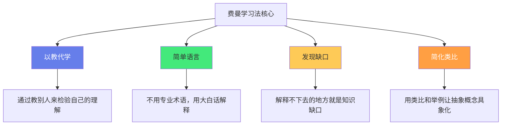
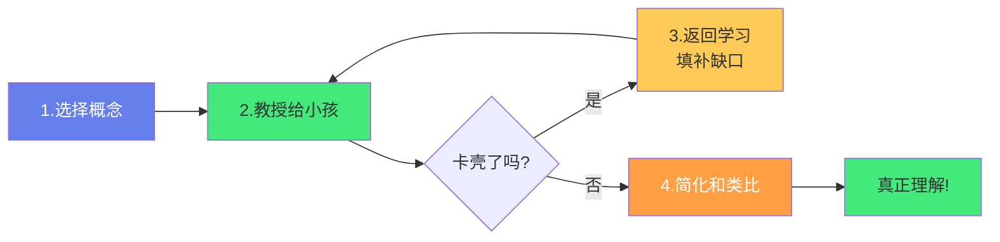
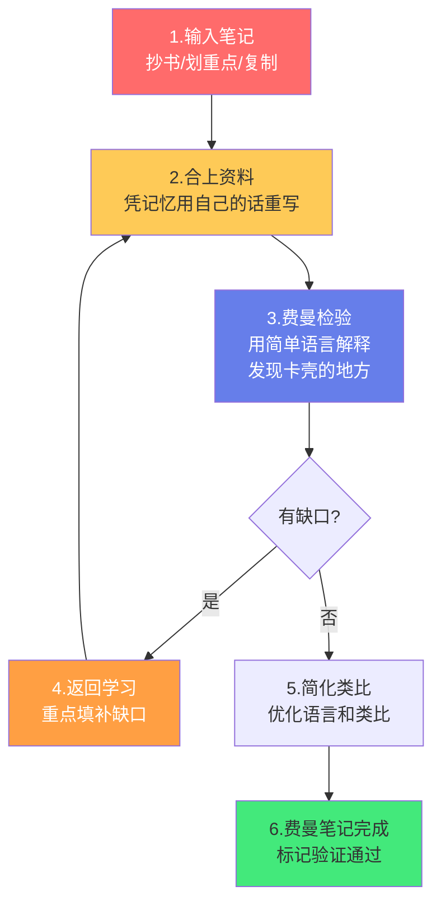

# 🎓 费曼学习法笔记实践

> **文档说明**：系统讲解费曼学习法（Feynman Technique）的核心理念与在 Obsidian 笔记中的实操方法，涵盖费曼学习法的起源与核心思想（理查德·费曼/以教代学/用简单语言解释复杂概念）、费曼学习法四步法（选择概念→教授给小孩→发现缺口返回学习→简化和类比）、费曼学习法的认知科学基础（生成效应/精细编码/检索练习/元认知/知识的自我解释）、在 Obsidian 笔记中实践费曼学习法的具体方法（笔记即教案/用简单语言重写/自问自答/类比和举例/检查缺口）、费曼笔记标准模板、从「输入笔记」到「费曼笔记」的转化流程、费曼学习法与原子笔记的结合（每篇原子笔记都是一个可教授的最小知识单元）、费曼学习法与间隔重复的结合（用费曼笔记做复习材料）、费曼学习法在全栈+AI学习中的应用案例（Java并发编程/前端响应式原理/AI-RAG检索/数据库索引等）、费曼学习法的常见误区（假懂/跳过缺口/语言过于复杂/不练习输出/只输入不输出）、费曼学习法的进阶技巧（录音讲解/写作输出/教学分享/项目实践/同伴互教）、费曼学习法与其他学习方法的对比与结合（SQ3R/主动回忆/间隔重复/思维导图/刻意练习）、学习效果评估方法（能否用简单语言解释/能否举例/能否解决问题）、常见问题与最佳实践。
>
> **适用人群**：终身学习者、全栈开发者、AI工程师、学生、知识工作者、Obsidian用户
>
> **前置知识**：[[原子笔记原则与实践]] · [[定期回顾与笔记重构]] · [[知识折旧与更新机制]] · [[MOC-综合导航]]

---

## 一、概述

### 1.1 什么是费曼学习法

**费曼学习法（Feynman Technique）** 是由诺贝尔物理学奖得主理查德·费曼（Richard Feynman）提出的学习方法，核心思想是**「如果你不能用简单的语言把一个概念解释给一个小孩听，说明你还没有真正理解它」**。



**费曼的原话**：
> "I couldn't reduce it to the freshman level. That means we really don't understand it."
> （如果我不能把它简化到大一新生能理解的程度，说明我们自己也没真正理解。）

**核心洞察**：
- 「我以为我懂了」和「我真的懂了」之间有巨大差距
- 检验是否真懂的最好方法是「尝试教给别人」
- 教的过程中会卡壳的地方，就是你的「知识缺口」
- 填补缺口后再教，直到能流畅地用简单语言解释

### 1.2 为什么费曼学习法有效

| 认知科学原理 | 说明 | 费曼学习法中的体现 |
|------------|------|-------------------|
| **生成效应（Generation Effect）** | 自己生成的信息比被动接收的信息记忆更牢 | 用自己的话重新解释概念，而非照抄原文 |
| **精细编码（Elaborative Encoding）** | 将新知识与已有知识建立越多连接，记忆越牢 | 用类比、举例、生活经验来解释新概念 |
| **检索练习（Retrieval Practice）** | 主动从记忆中提取信息比反复阅读更有效 | 不看资料，凭记忆解释概念，就是检索练习 |
| **元认知（Metacognition）** | 对自己理解程度的认知和监控 | 通过「能否教给小孩」来准确评估自己的理解程度 |
| **知识的自我解释（Self-Explanation）** | 向自己解释「为什么」能加深理解 | 解释概念时不断追问「为什么是这样」 |

> **关键数据**：认知科学研究表明，主动回忆（检索练习）的学习效果是被动阅读的 **3 倍以上**；而费曼学习法同时结合了「主动回忆+精细编码+生成效应+元认知」多种高效学习机制，是公认的最强学习方法之一。

### 1.3 费曼学习法 vs 传统学习

| 维度 | 传统学习 | 费曼学习法 |
|------|---------|-----------|
| **核心动作** | 阅读、记笔记、划重点 | 用简单语言解释、教给别人 |
| **学习方向** | 输入为主 | 输出驱动输入 |
| **理解检验** | 「我觉得我懂了」（主观） | 「我能教给小孩吗」（客观） |
| **知识缺口** | 难以发现，自我感觉良好 | 解释卡壳的地方就是缺口，精准定位 |
| **记忆效果** | 被动接收，遗忘快 | 主动生成+精细编码，记忆牢 |
| **适用阶段** | 初步了解 | 深度理解、查漏补缺 |
| **时间投入** | 看似快（只读不输出） | 看似慢（要写要讲），但实际掌握更牢 |

---

## 二、费曼学习法四步法

### 2.1 四步总览



### 2.2 第一步：选择概念（Choose a Concept）

**目标**：明确你要学习和检验的概念。

**操作要点**：
- 在一张白纸或笔记顶部写下概念名称
- 概念要具体，不要太宽泛
  - ❌ 太宽泛：「Java」「前端」「AI」
  - ✅ 具体：「Java线程池的工作原理」「Vue响应式的Proxy原理」「RAG检索的流程」
- 如果概念太大，拆分成多个子概念，逐个费曼

**在 Obsidian 中的操作**：
- 创建一篇新笔记，标题就是概念名称
- 在 Frontmatter 中标记 `#费曼笔记` 标签
- 写下你目前对这个概念的理解程度（自评 1-5 分）

### 2.3 第二步：教授给小孩（Teach it to a Child）

**目标**：用最简单的语言，假设听众是一个 12 岁的小孩，解释这个概念。

**操作要点**：
- **不用专业术语**：如果必须用术语，先用大白话解释术语本身
- **用生活类比**：将抽象概念类比为日常生活中的事物
- **举具体例子**：用真实的例子说明概念如何工作
- **写下来或说出来**：不要只在脑子里想，必须写出来或说出来（生成效应）
- **假装在教别人**：想象对面坐着一个好奇的小孩，他会不断问「为什么」

**反面示例（太复杂）**：
> Java线程池通过ThreadPoolExecutor实现，核心参数包括corePoolSize、maximumPoolSize、workQueue、keepAliveTime等，任务提交后先尝试核心线程执行，核心线程满了入队列，队列满了创建非核心线程，达到最大线程数后执行拒绝策略。

**正面示例（费曼风格）**：
> 想象你开了一家餐厅。
> - 餐厅里固定有 5 个厨师（核心线程），他们一直在岗
> - 来客人了，先让这 5 个厨师做
> - 如果 5 个厨师都在忙，新来的客人先在等候区排队（任务队列）
> - 如果等候区也满了，餐厅会临时请兼职厨师（非核心线程）来帮忙
> - 兼职厨师最多请到 10 个（最大线程数）
> - 如果 10 个厨师都忙、队列也满了，再来客人就只能说「抱歉，今天客满了」（拒绝策略）
> - 闲下来的时候，兼职厨师等一段时间（keepAliveTime）没活干就下班了，固定厨师还留着
> 
> 这就是线程池——用「固定员工+临时工+等候区」的方式，高效处理大量任务，而不是来一个任务就招一个人（创建线程）。

### 2.4 第三步：发现缺口，返回学习（Identify Gaps, Go Back to Learn）

**目标**：在解释过程中，你会发现有些地方「卡壳了」「说不清楚」「用了术语但解释不了」——这些就是你的知识缺口。返回去学习，填补缺口。

**如何识别缺口**：
| 信号 | 说明 |
|------|------|
| **卡壳了** | 解释到一半突然说不下去，不知道接下来怎么说 |
| **用了术语但解释不了** | 说了一个专业术语，但无法用大白话解释它是什么 |
| **跳过了细节** | 「这个就是这样的」「反正就是这么工作的」——说不清为什么 |
| **类比不下去** | 类比到一半发现对不上，无法继续用类比解释 |
| **被「为什么」问倒** | 想象小孩追问「为什么？」，你回答不上来 |

**填补缺口的方法**：
- 回到原始资料（书籍/文档/教程），重点学习缺口部分
- 搜索相关资料，从不同角度理解
- 看别人是怎么解释这个概念的（视频/文章/问答）
- 画图表、写代码、做实验，通过实践理解
- 填补后回到第二步，重新解释，直到不再卡壳

> **关键原则**：不要跳过缺口！很多人学习时「不懂的地方就跳过」，结果知识体系千疮百孔。费曼学习法的核心价值就是「精准定位缺口，然后填补它」。卡壳的地方恰恰是你最需要学习的地方。

### 2.5 第四步：简化和类比（Simplify and Use Analogies）

**目标**：在填补所有缺口后，进一步简化解释，用更精妙的类比和更流畅的语言，让概念真正「通俗易懂」。

**操作要点**：
- **进一步简化**：删掉所有不必要的术语和复杂句子
- **优化类比**：找到最贴切、最直观的类比
- **梳理逻辑**：确保解释的逻辑链条完整、流畅
- **加入「为什么」**：不仅解释「是什么」，还要解释「为什么这样设计」
- **检验**：再读一遍，问自己「12岁小孩能听懂吗？」如果不能，继续简化

**简化前后对比**：

| 简化前 | 简化后 |
|--------|--------|
| 「Redis是一个基于内存的键值存储系统，支持多种数据结构，具有高性能、持久化、主从复制等特性」 | 「Redis就像一个超级快的笔记本——你把常用的东西写在上面，需要的时候一翻就找到，比去仓库（数据库）里找快得多。它还能把笔记本上的内容抄到仓库里保存（持久化），还能复印几本给别人用（主从复制）」 |

---

## 三、在 Obsidian 笔记中实践费曼学习法

### 3.1 核心理念：笔记即教案

在 Obsidian 中实践费曼学习法的核心是：**把每篇笔记都当作「写给一个 12 岁小孩的教案」来写**。

这意味着：
- 不是「抄资料」，而是「用自己的话解释」
- 不是「堆砌术语」，而是「用大白话+类比+举例」
- 不是「只写结论」，而是「写清楚为什么、怎么来的」
- 不是「写完就完」，而是「写完后用费曼标准检验」

### 3.2 费曼笔记标准模板

```markdown
---
title: 概念名称
tags: [领域标签, 费曼笔记, 难度]
difficulty: ⭐⭐⭐
created: YYYY-MM-DD
updated: YYYY-MM-DD
status: ✅ 费曼验证通过
---

# 概念名称

> **一句话解释**：用一句话说清楚这个概念是什么（12岁小孩能听懂）

## 🎯 这个概念解决什么问题？
（为什么需要这个概念？没有它会怎样？）

## 📖 用大白话解释
（假装在教一个12岁小孩，不用术语，用类比和举例）

### 生活类比
（用日常生活中的事物类比这个概念）

### 具体例子
（举一个真实的、具体的例子说明概念如何工作）

## 🔧 它是怎么工作的？
（核心原理、工作流程、关键步骤）

```
（用图表可视化工作原理）
```css

## ❓ 为什么这样设计？
（设计动机、权衡取舍、与其他方案的对比）

## ⚠️ 常见误区
（初学者容易误解的地方、容易踩的坑）

## 🎓 费曼自检
- [ ] 我能用一句话说清楚它是什么吗？
- [ ] 我能用生活类比解释它吗？
- [ ] 我能举一个具体例子吗？
- [ ] 我能说清楚它为什么这样设计吗？
- [ ] 12岁小孩能听懂我的解释吗？
- [ ] 我在解释过程中没有卡壳吗？

## 🔗 关联笔记
- [[相关概念1]]
- [[相关概念2]]
```

### 3.3 从「输入笔记」到「费曼笔记」的转化流程

很多人写笔记是「输入笔记」——抄书、划重点、复制粘贴。要转化为「费曼笔记」，按以下流程：



**关键步骤详解**：

| 步骤 | 操作 | 为什么重要 |
|------|------|-----------|
| **1. 输入笔记** | 先阅读资料，做初步笔记（可以抄） | 先有输入，才能有输出 |
| **2. 合上资料重写** | 合上书，凭记忆用自己的话重新写一遍 | 这是「检索练习」+「生成效应」，比反复阅读有效3倍 |
| **3. 费曼检验** | 读自己写的，问「12岁小孩能听懂吗？」卡壳的地方标出来 | 精准定位知识缺口 |
| **4. 返回学习** | 针对缺口，重新学习资料的对应部分 | 精准补缺，不是盲目重读 |
| **5. 简化类比** | 进一步简化语言，找到更好的类比 | 深化理解，让解释更通透 |
| **6. 标记完成** | 所有自检项通过，标记「费曼验证通过」 | 建立成就感，区分「真懂」和「假懂」 |

### 3.4 费曼笔记的写作技巧

**1. 开头一句话总结**
- 每篇费曼笔记的第一句话，必须是「一句话说清楚这个概念是什么」
- 如果写不出这句话，说明你还没理解到位
- 这句话就是你「教给小孩」的开场白

**2. 多用类比，少用术语**
- 每个抽象概念都配一个生活类比
- 必须用术语时，先解释术语本身
- 类比要贴切，不能为了类比而强行类比

**3. 举具体例子，不要泛泛而谈**
- 「线程池可以管理线程」→ 泛泛而谈
- 「提交100个任务，核心线程5个，队列10个，最大线程10个，那么……」→ 具体例子
- 具体例子能检验你是否真的理解了参数和流程

**4. 解释「为什么」，不只是「是什么」**
- 「线程池有corePoolSize参数」→ 是什么
- 「为什么需要corePoolSize？因为每次创建线程开销大，固定几个核心线程可以复用，减少创建销毁开销」→ 为什么
- 能解释「为什么」才是真理解

**5. 用图表可视化**
- 工作流程用 Mermaid 流程图
- 结构关系用 Mermaid 类图/架构图
- 对比用表格
- 图表能帮你理清思路，也能帮「小孩」理解

**6. 写「常见误区」**
- 把你自己曾经误解的地方写下来
- 把初学者容易踩的坑写下来
- 能指出「哪里容易错」，说明你理解得足够深

---

## 四、费曼学习法与其他方法的结合

### 4.1 费曼 + 原子笔记

**结合点**：每篇原子笔记都是一个「可教授的最小知识单元」。

| 原子笔记原则 | 费曼学习法中的体现 |
|------------|-------------------|
| 一篇笔记一个概念 | 一次费曼一个概念，概念太大会拆分成多个原子笔记 |
| 标题即论点 | 费曼笔记的标题就是「一句话说清楚概念」 |
| 可独立理解 | 费曼笔记不依赖上下文，单独拿出来也能看懂（因为用了大白话和类比） |
| 可复用 | 费曼笔记可以作为「教案」反复使用，复习时直接看 |

**实践方法**：
- 写原子笔记时，直接用费曼标准来写
- 每篇原子笔记都包含「一句话解释+类比+举例+为什么+费曼自检」
- 原子笔记的质量标准就是「能否通过费曼自检」

### 4.2 费曼 + 间隔重复

**结合点**：费曼笔记是最好的间隔重复复习材料。

| 间隔重复 | 费曼学习法中的体现 |
|---------|-------------------|
| 复习材料 | 费曼笔记本身就是高质量的复习材料（用自己的话写的，有类比有举例） |
| 复习方式 | 复习时不只是「读」笔记，而是「合上笔记，尝试用费曼方式解释」 |
| 复习检验 | 能否流畅地用简单语言解释 = 是否记住了 + 是否理解了 |
| 复习间隔 | 第一次复习可能卡壳 → 返回学习 → 第二次复习更流畅 → 间隔逐渐拉长 |

**实践方法**：
- 用 Review 插件或 Spaced Repetition 插件标记费曼笔记的复习日期
- 复习时：合上笔记 → 尝试口头解释 → 打开笔记对照 → 卡壳的地方重点复习
- 能流畅解释的笔记，拉长复习间隔；卡壳的笔记，缩短间隔并重新费曼

### 4.3 费曼 + 主动回忆

**结合点**：费曼学习法本质上就是「主动回忆的强化版」。

- 主动回忆：合上书本，从记忆中提取信息
- 费曼学习法：合上书本，从记忆中提取信息，**并用简单语言组织成解释**
- 费曼比单纯的主动回忆更有效，因为它不仅要求「提取」，还要求「组织、简化、类比」——更深层的认知加工

### 4.4 费曼 + 思维导图

**结合点**：思维导图帮助梳理概念结构，费曼帮助检验理解深度。

- 先用思维导图梳理概念的结构和关联（是什么/为什么/怎么用/和什么相关）
- 再用费曼学习法逐个解释思维导图中的每个节点
- 两者结合：思维导图给「广度」，费曼给「深度」

### 4.5 费曼 + 刻意练习

**结合点**：费曼学习法定位缺口，刻意练习针对性填补缺口。

- 费曼学习法告诉你「哪里不懂」（缺口定位）
- 刻意练习告诉你「怎么练」（针对缺口，重复练习，获得反馈）
- 两者结合：费曼定位 → 刻意练习补缺 → 再费曼检验 → 循环往复

---

## 五、全栈+AI学习中的费曼应用案例

### 5.1 案例1：Java 线程池

**概念**：Java ThreadPoolExecutor 工作原理

**费曼解释（简化版）**：
> 线程池就像一家餐厅的厨师团队：
> - 固定厨师（核心线程）：一直在岗，来活就干
> - 等候区（任务队列）：厨师都忙时，客人先排队
> - 兼职厨师（非核心线程）：排队太长时，临时请人帮忙
> - 最大厨师数（最大线程数）：兼职最多请到多少人
> - 客满拒绝（拒绝策略）：厨师全忙、队全满，再来客人只能拒绝
> - 兼职下班时间（keepAliveTime）：闲下来多久，兼职就走
> 
> 为什么这样设计？因为创建/销毁线程开销大，用池化复用线程，既控制并发数，又减少开销。

**费曼自检**：
- ✅ 一句话说清楚：线程池是用「固定+临时+排队」管理线程的团队
- ✅ 生活类比：餐厅厨师团队
- ✅ 具体例子：5核心+10队列+10最大的具体执行流程
- ✅ 为什么：减少线程创建销毁开销，控制并发数
- ✅ 12岁能懂：能

### 5.2 案例2：Vue 响应式原理

**概念**：Vue 3 的 Proxy 响应式

**费曼解释（简化版）**：
> 想象你有一个智能笔记本（响应式数据）：
> - 你在笔记本上写了什么（修改数据），笔记本会自动通知所有抄了这页的人（触发组件更新）
> - Vue 2 用的是「提前在每一页上贴通知条」（Object.defineProperty），但新加的页贴不了（新增属性不响应）
> - Vue 3 用的是「给整个笔记本套了个智能外壳」（Proxy），不管你写哪一页、新加哪一页，外壳都能检测到并通知
> - 这个智能外壳就是 Proxy——它拦截了你对笔记本的所有操作（读/写/删除），在操作前后做额外的事情（收集依赖/触发更新）

**费曼自检**：
- ✅ 一句话：Vue响应式是「数据变了自动通知界面更新」的机制
- ✅ 类比：智能笔记本+自动通知
- ✅ 举例：Vue2 defineProperty vs Vue3 Proxy 的区别
- ✅ 为什么：Proxy 能拦截更多操作，支持新增属性，性能更好
- ✅ 12岁能懂：能

### 5.3 案例3：RAG 检索增强生成

**概念**：Retrieval-Augmented Generation

**费曼解释（简化版）**：
> 大语言模型（LLM）就像一个「博学但记忆力有限的学生」：
> - 他学过很多知识（训练数据），但考试时可能记错、记混、或者根本没学过（幻觉/知识截止）
> - RAG 就是「开卷考试」：考试前先让他去图书馆（知识库）查相关资料（检索），把查到的内容和问题一起给他（增强），他再根据资料回答（生成）
> - 这样他就不会「凭空编造」了，因为答案基于查到的真实资料
> - 流程：问题 → 去知识库找相关段落 → 把问题+相关段落给LLM → LLM基于资料生成答案

**费曼自检**：
- ✅ 一句话：RAG是让大模型「开卷考试」，先查资料再回答，减少幻觉
- ✅ 类比：博学但记忆力有限的学生+开卷考试
- ✅ 举例：问「公司年假政策」，先查员工手册，再回答
- ✅ 为什么：解决LLM幻觉和知识截止问题
- ✅ 12岁能懂：能

### 5.4 案例4：数据库索引

**概念**：B+树索引

**费曼解释（简化版）**：
> 想象你要在一本1000页的字典里找「费曼」这个词：
> - 没有索引：从第1页翻到第1000页，逐页找（全表扫描），慢死
> - 有索引：字典前面有「目录」（索引），告诉你「费」在第300页，直接翻到300页找，快得多
> - 数据库索引就是这个「目录」——它是一个单独的数据结构（B+树），存了「关键字→对应数据位置」的映射
> - B+树就像一个多层目录：第一层是大类，第二层是小类，最后一层是具体页码，一层层找下去，很快就能定位
> - 为什么用B+树？因为它分层平衡，不管找什么数据，查找次数都差不多（都是树的高度），而且叶子节点用链表连起来，范围查询很方便

**费曼自检**：
- ✅ 一句话：索引是数据库的「目录」，让查找从逐页翻变成查目录
- ✅ 类比：字典目录
- ✅ 举例：1000页字典找词，无索引vs有索引
- ✅ 为什么：B+树分层平衡，查找稳定，范围查询方便
- ✅ 12岁能懂：能

---

## 六、常见误区

### 6.1 误区一：假懂（Illusion of Knowledge）

**表现**：看完资料觉得「我懂了」，但一合上书就说不清楚，或者只能照本宣科，不能用自己的话解释。

**原因**：
- 「熟悉感」被误认为「理解」——看了很多遍，觉得熟悉，就以为懂了
- 只关注「是什么」，没思考「为什么」
- 没有输出检验，自我评估过于乐观

**解决**：
- 强制输出：合上书写、说出来、教给别人
- 用费曼自检清单逐项检验
- 接受「我可能没懂」的可能性，诚实面对缺口

### 6.2 误区二：跳过缺口

**表现**：解释卡壳了，就「这个不重要」「反正就是这样」，跳过继续，不回去学习。

**原因**：
- 怕麻烦，不想重新学习
- 虚荣心，不愿承认自己不懂
- 没有认识到「缺口就是成长机会」

**解决**：
- 把卡壳的地方标红，这是「金矿」——填补它就是最大的进步
- 每次费曼至少填补一个缺口，不要全跳过
- 记录缺口清单，逐个攻克

### 6.3 误区三：语言过于复杂

**表现**：解释中充满专业术语，虽然自己觉得「说清楚了」，但外行根本听不懂。

**原因**：
- 「知识的诅咒」——一旦你懂了某个概念，就很难想象不懂的人是什么感觉
- 习惯了用术语思考，没有翻译成大白话
- 没有真正站在「12岁小孩」的角度

**解决**：
- 强制规则：每用一个术语，必须先用大白话解释它
- 找一个真正的「小白」听你解释，看他能不能听懂
- 写完后读一遍，把所有「高大上」的词换成「接地气」的词

### 6.4 误区四：只输入不输出

**表现**：花大量时间阅读、看视频、记笔记，但从不尝试解释、写作、教学。

**原因**：
- 输入让人有「我在学习」的安全感，输出让人有「我可能不懂」的焦虑
- 输出比输入累，人倾向于逃避困难
- 没有认识到「输出才是学习的核心」

**解决**：
- 设定「输入输出比」：每花1小时输入，至少花30分钟输出
- 把「写费曼笔记」作为学习的必经步骤，不是可选步骤
- 从简单输出开始（写一句话解释），逐渐增加难度

### 6.5 误区五：费曼一次就够了

**表现**：做了一次费曼，标记「懂了」，就再也不复习了。

**原因**：
- 低估了遗忘的速度（艾宾浩斯曲线）
- 以为「一次理解=永久记住」

**解决**：
- 费曼笔记结合间隔重复，定期复习
- 复习时重新费曼（合上笔记解释），不是只读
- 每次复习可能发现新的缺口，持续迭代

---

## 七、进阶技巧

### 7.1 录音讲解

- 用手机录音，假装在给别人讲解概念
- 录完后听自己的讲解，找卡壳、啰嗦、不清楚的地方
- 录音比写作更接近「真实教学」，能发现更多问题
- 可以反复录，直到讲解流畅清晰

### 7.2 写作输出

- 把费曼笔记整理成博客文章、公众号文章
- 公开发布，接受读者的检验和提问
- 读者的提问会暴露你没考虑到的缺口
- 写作是「慢速费曼」，能让你更深入地组织思路

### 7.3 教学分享

- 在团队内做技术分享，给同事讲解
- 在学习小组中轮流讲解
- 回答论坛/社区的问题（Stack Overflow/知乎/掘金）
- 「教是最好的学」——真实的教学场景比假装教学更有效

### 7.4 项目实践

- 把概念用到实际项目中，通过实践检验理解
- 能在项目中正确使用 = 真懂
- 项目中遇到的问题 = 真实的知识缺口
- 实践后再费曼，理解会更深入

### 7.5 同伴互教

- 找一个学习伙伴，互相讲解概念
- 对方的提问会帮你发现缺口
- 你听对方讲解时，也能从不同角度理解
- 互相费曼，效率翻倍

---

## 八、学习效果评估

### 8.1 费曼理解等级

| 等级 | 描述 | 检验标准 |
|------|------|---------|
| **L0 没接触** | 完全不知道这个概念 | 没听说过 |
| **L1 听说过** | 知道名字，但说不清是什么 | 能说出名字，但解释不了 |
| **L2 能复述** | 能照本宣科复述定义，但不能用自己的话解释 | 能背定义，但卡壳在「为什么」 |
| **L3 能解释** | 能用自己的话解释，有类比和举例 | 通过费曼自检，12岁能听懂 |
| **L4 能应用** | 能在实际项目/问题中正确使用 | 能解决相关问题，能判断适用场景 |
| **L5 能创新** | 能举一反三，发现新的应用或改进 | 能跨领域迁移，能提出优化方案 |

**费曼学习法主要帮你从 L2 提升到 L3-L4**，再结合项目实践可以达到 L5。

### 8.2 自检问题清单

学完一个概念后，问自己：
- [ ] 我能用一句话说清楚它是什么吗？
- [ ] 我能用生活类比解释它吗？
- [ ] 我能举一个具体例子吗？
- [ ] 我能说清楚它解决什么问题吗？
- [ ] 我能说清楚它为什么这样设计吗？
- [ ] 我能说出它的优缺点和适用场景吗？
- [ ] 我能在项目中正确使用它吗？
- [ ] 12岁小孩能听懂我的解释吗？
- [ ] 我在解释过程中没有卡壳吗？

全部通过 = 真正理解了。任何一项不通过 = 还有缺口，需要继续费曼。

---

## 九、常见问题与最佳实践

### 9.1 常见问题

| 问题 | 回答 |
|------|------|
| **费曼学习法适合所有知识吗？** | 最适合「概念性知识」（原理、机制、思想）。对于「事实性知识」（如某个命令的参数），直接记忆更高效。但大多数技术知识都是概念性的，适合费曼。 |
| **费曼学习法太慢了，有更快的方法吗？** | 费曼看似慢（要写要讲），但实际「掌握率」高——一次费曼可能顶得上反复阅读10次。从「长期记忆和深度理解」的角度，费曼是最快的方法之一。 |
| **我没有「小孩」可以教，怎么办？** | 不需要真的小孩。假装在教、写下来、录音、对着镜子讲，都可以。关键是「用简单语言输出」，不是真的要有听众。 |
| **费曼笔记要写多长？** | 没有固定长度。概念简单的可能几百字，概念复杂的可能几千字。关键是「说清楚」，不是「写得多」。 |
| **每个概念都要费曼吗？** | 不需要。核心概念、难点、经常用到的概念值得费曼。简单的、了解即可的概念，快速过就行。80%的价值来自20%的核心概念，把费曼用在核心概念上。 |
| **费曼和记笔记冲突吗？** | 不冲突。传统笔记是「输入」，费曼笔记是「输出」。可以先做输入笔记，再转化为费曼笔记。 |

### 9.2 最佳实践

**1. 从核心概念开始**
- 不要一上来就对所有概念费曼，会累
- 先选 5-10 个最核心、最难的概念做费曼
- 体验到效果后，再逐渐扩展

**2. 建立费曼笔记库**
- 在 Obsidian 中为费曼笔记创建专门的标签 `#费曼笔记`
- 用 Dataview 查询所有费曼笔记，作为复习库
- 每篇费曼笔记标记理解等级（L3/L4/L5）

**3. 费曼 + 间隔重复结合**
- 费曼笔记完成后，加入间隔重复队列
- 复习时重新费曼（合上笔记解释），不是只读
- 能流畅解释的拉长间隔，卡壳的重新费曼

**4. 设定输入输出比**
- 每花 1 小时学习（输入），至少花 30 分钟费曼（输出）
- 输出时间不少于输入时间的一半
- 把「写费曼笔记」作为学习的收尾步骤，不是可选步骤

**5. 诚实面对缺口**
- 卡壳了不要跳过，标出来，这是进步的机会
- 不要自我欺骗「这个不重要」——大多数卡壳的地方都是重要的
- 记录缺口清单，逐个攻克，享受「填补缺口」的成就感

**6. 用类比库积累类比**
- 建立一个「类比库」笔记，记录你用过的好类比
- 好的类比可以复用（如「餐厅」类比可以用于线程池/连接池/对象池）
- 类比库本身也是跨领域连接的素材

**7. 定期「费曼马拉松」**
- 每月选一个周末，集中对 5-10 个概念做费曼
- 批量费曼效率高，而且能发现概念之间的关联
- 费曼马拉松后，知识体系会有明显提升

**8. 从费曼到教学输出**
- 费曼笔记积累到一定程度，整理成系列文章
- 在博客/公众号/团队分享中输出
- 真实的教学反馈会让你的理解更上一层楼
- 「以教代学」是费曼学习法的终极形态

---

## 十、关联笔记

### 学习方法
- [[原子笔记原则与实践]] · [[定期回顾与笔记重构]] · [[知识折旧与更新机制]]
- [[常青笔记-EvergreenNotes]] · [[费曼学习法笔记实践]]

### 知识管理方法论
- [[LYT-链接你的思维]] · [[MOC内容地图]] · [[跨领域知识连接方法]]
- [[标签与文件夹的边界]] · [[笔记标题命名策略]] · [[冗余检测与合并策略]]

### 导航
- [[MOC-综合导航]] · [[MOC-知识管理方法论-四级展开]] · [[Home]] · [[学习路线总览]]

> 🔍 **知识点深度解析**
>
> **作用**：费曼学习法笔记实践解决的是「如何从『假懂』到『真懂』，通过输出驱动的学习方法深度掌握技术概念，并在 Obsidian 笔记中系统化实践」的核心问题——很多学习者陷入「输入幻觉」：反复阅读、划重点、抄笔记，觉得「我看了很多遍所以我懂了」，但一到实际应用或被人提问就卡壳，这就是「假懂」——熟悉感被误认为理解。费曼学习法通过「用简单语言教给小孩」的输出检验，精准定位知识缺口（解释卡壳的地方），然后返回学习填补缺口，循环往复直到真正理解。在 Obsidian 中实践费曼学习法，就是把每篇笔记当作「写给12岁小孩的教案」，用「一句话解释+生活类比+具体例子+为什么+费曼自检」的标准模板，将「输入笔记」转化为「费曼笔记」，并结合原子笔记（每篇一个可教授的最小单元）、间隔重复（费曼笔记作为复习材料）、主动回忆（合上笔记解释）等方法，形成一套完整的「输出驱动学习体系」，让学习从「被动接收」升级为「主动生成+精准补缺+深度理解」。
>
> **底层原理**：①生成效应（Generation Effect）——认知心理学发现，自己生成的信息比被动接收的信息记忆更牢固。费曼学习法要求「用自己的话重新解释」，而不是照抄原文，这就是生成效应的应用。研究表明，生成学习的记忆保持率比被动阅读高50%以上。②检索练习（Retrieval Practice）——主动从记忆中提取信息（合上书本回忆）比反复阅读更有效，这是认知科学中最可靠的发现之一。费曼学习法的第二步「教授给小孩」必须合上资料凭记忆解释，这就是高强度的检索练习。③精细编码（Elaborative Encoding）——将新知识与已有知识建立越多连接，记忆越牢固、理解越深入。费曼学习法要求用「类比」（连接到生活经验）和「举例」（连接到具体场景）来解释概念，这就是精细编码。④元认知（Metacognition）——对自己理解程度的准确认知。大多数人对自己的理解程度评估过于乐观（「我觉得我懂了」），费曼学习法通过「能否教给小孩」这个客观标准，让你准确评估自己的真实理解程度，避免「假懂」。⑤知识的诅咒（Curse of Knowledge）——一旦你理解了某个概念，就很难想象不理解它的人是什么感觉，导致你解释时用了很多对方听不懂的术语。费曼学习法要求「假设听众是12岁小孩」，强制你打破知识的诅咒，用最简单的语言解释。⑥间隔重复（Spaced Repetition）——基于艾宾浩斯遗忘曲线，在遗忘临界点之前复习，可以用最少的时间获得最长的记忆保持。费曼笔记是最好的间隔重复复习材料——因为它是用自己的话写的，有类比有举例，复习时直接「合上笔记重新费曼」就是最高效的复习方式。
>
> **用法要点**：① 四步法：选择概念(具体不宽泛)→教授给小孩(合资料/用大白话/类比举例/写或说出来)→发现缺口返回学习(卡壳=缺口/不跳过/精准补缺)→简化和类比(删术语/优化类比/梳理逻辑/检验12岁能懂) ② 费曼笔记模板：Frontmatter+一句话解释+解决什么问题+大白话解释(生活类比+具体例子)+怎么工作的(Mermaid图)+为什么这样设计+常见误区+费曼自检清单(6项)+关联笔记 ③ 输入→费曼转化流程：输入笔记(抄书)→合资料凭记忆重写(检索练习)→费曼检验(卡壳标缺口)→返回学习(精准补缺)→简化类比→标记费曼验证通过 ④ 写作技巧：开头一句话总结/多用类比少用术语/举具体例子不泛谈/解释为什么不只是是什么/用Mermaid图表可视化/写常见误区 ⑤ 与原子笔记结合：每篇原子笔记=一个可教授的最小知识单元/原子笔记质量标准=通过费曼自检 ⑥ 与间隔重复结合：费曼笔记=复习材料/复习时合笔记重新费曼(不是只读)/能流畅解释拉长间隔/卡壳缩短间隔重新费曼 ⑦ 全栈+AI案例：Java线程池(餐厅厨师团队)/Vue响应式(智能笔记本自动通知)/RAG(开卷考试)/数据库索引(字典目录) ⑧ 五大误区：假懂(熟悉≠理解)/跳过缺口(卡壳=金矿)/语言复杂(知识的诅咒)/只输入不输出(输出才是核心)/费曼一次就够(结合间隔重复) ⑨ 进阶技巧：录音讲解/写作输出(博客文章)/教学分享(团队内部分享)/项目实践(用中检验)/同伴互教 ⑩ 理解等级：L0没接触→L1听说过→L2能复述→L3能解释(费曼目标)→L4能应用→L5能创新；费曼主要帮你从L2到L3-L4 ⑪ 最佳实践：从核心概念开始(5-10个)/建立费曼笔记库(#费曼笔记标签+Dataview查询)/输入输出比≥2:1/诚实面对缺口不跳过/积累类比库/月度费曼马拉松/从费曼到教学输出。

> 💡 **深度讲解**：费曼学习法最核心的智慧是「输出是最好的输入，教是最好的学」——传统学习的范式是「先输入（阅读/听课），输入够了自然就懂了」。但认知科学告诉我们，这个范式是错的：被动输入的留存率极低（阅读的留存率约10%，听课约5%），而且「熟悉感」会被大脑误认为「理解」，导致大量「假懂」。费曼学习法颠覆了这个范式：它不是「先输入再输出」，而是「用输出驱动输入」——你先尝试输出（教给小孩），输出时卡壳了，这就精准告诉你「哪里不懂」，然后你带着明确的问题去输入（学习缺口部分），输入的效率和针对性大大提高。这种「输出→发现缺口→精准输入→再输出」的循环，比「盲目输入→自我感觉良好→实际不会」的传统模式高效得多。更重要的是，输出本身就是最强的学习方式——「生成效应」让你自己组织的语言记忆更牢，「检索练习」让你从记忆中提取信息强化神经连接，「精细编码」让你通过类比和举例建立更多知识连接，「元认知」让你准确评估自己的理解程度。费曼学习法同时激活了这四种高效学习机制，所以它被公认为最强的学习方法之一。理解了「输出驱动输入」，你就理解了为什么「写费曼笔记」比「读10遍书」更有效——不是因为写比读高级，而是因为写强制你输出，输出强制你面对缺口，面对缺口强制你精准学习，这个循环的每一步都比被动阅读更有价值。「知识的诅咒是费曼学习法要打破的最大障碍」——「知识的诅咒」是认知心理学中的一个概念：一旦你理解了某个东西，你就很难想象不理解它的人是什么感觉。你会觉得「这不是显而易见的吗？」，但对于初学者来说，一点都不显见。这个诅咒在技术领域尤其严重：当你精通Java后，你会觉得「线程池不就是几个参数吗？」，但对于初学者来说，corePoolSize和maximumPoolSize的区别、队列满了之后的执行流程、为什么需要keepAliveTime，这些都是一团浆糊。知识的诅咒导致你解释时充满术语、跳过基础、默认对方知道「显而易见」的东西，结果对方根本听不懂。费曼学习法用「假设听众是12岁小孩」这个简单的规则，强制你打破知识的诅咒：你必须把每个术语都翻译成大白话，必须把每个「显而易见」的步骤都讲清楚，必须用生活类比让抽象概念具象化。这个过程看似「降低了水平」，实则是「检验了真懂」——如果你真的理解了一个概念，你就能把它讲得连小孩都懂；如果你讲不清楚，说明你自己也没真懂，只是被知识的诅咒蒙蔽了。这就是费曼学习法的精妙之处：它用一个简单的规则（教给小孩），同时解决了「假懂」和「知识的诅咒」两个问题——你教小孩的过程，既是检验自己是否真懂的过程，也是打破知识诅咒、用最简单语言表达的过程。当你能把一个复杂的技术概念讲得让12岁小孩点头说「哦，原来是这样」的时候，你就真正突破了知识的诅咒，也真正掌握了这个概念。「费曼学习法的终极形态是『教学相长』——在真实的教学中，你的理解会达到新的高度」——假装教小孩（写费曼笔记、录音讲解）已经很有效了，但它的终极形态是「真实的教学」：给同事做技术分享、在社区回答问题、写博客文章、录制教学视频。真实教学比假装教学更有效，原因有三：①真实的听众会问你意想不到的问题，这些问题会暴露你自己都没意识到的知识缺口——「我以为我懂了，但被这个问题问倒了」；②真实的教学有时间限制和表达压力，你必须在有限时间内把概念讲清楚，这会强迫你提炼最核心的东西；③真实的反馈（听众的表情、提问、评价）会让你准确知道「哪里讲清楚了，哪里没讲清楚」，从而精准改进。历史上很多伟大的思想家都是优秀的教师：费曼本人就是传奇教师，他的《费曼物理学讲义》至今仍是经典；苏格拉底的「产婆术」就是通过提问让对方自己发现真理；孔子的「因材施教」也是教学相长的典范。他们都深谙「教是最好的学」的道理。所以，不要把费曼学习法停留在「写笔记」的层面——当你积累了足够的费曼笔记后，勇敢地走出去，给别人讲、写出来、分享出去。在真实的教学中，你会发现：你不仅教会了别人，更重要的是，你自己的理解达到了一个全新的高度——这就是「教学相长」的魔力，也是费曼学习法的终极价值。

> 📝 **精简总结**：费曼学习法笔记实践=用「教给小孩」的输出检验实现从假懂到真懂的学习方法，并在Obsidian中系统化实践。核心思想：不能用简单语言解释给小孩=没真懂。四步法：选择概念(具体)→教授给小孩(合资料/大白话/类比举例/写出来)→发现缺口返回学习(卡壳=缺口/不跳过)→简化和类比(删术语/优化类比/检验12岁能懂)。认知科学基础：生成效应/检索练习/精细编码/元认知/知识的诅咒。费曼笔记模板：一句话解释+解决什么问题+大白话解释(类比+举例)+怎么工作(Mermaid)+为什么设计+常见误区+费曼自检(6项)+关联笔记。输入→费曼转化：输入笔记→合资料重写→费曼检验→返回补缺→简化→验证通过。与原子笔记结合(每篇=可教授最小单元)、与间隔重复结合(费曼笔记=复习材料/复习重新费曼)、与主动回忆结合(合资料解释)。全栈+AI案例：线程池=餐厅厨师/Vue响应式=智能笔记本/RAG=开卷考试/数据库索引=字典目录。五大误区：假懂(熟悉≠理解)/跳过缺口/语言复杂(知识诅咒)/只输入不输出/费曼一次就够。进阶技巧：录音讲解/写作输出/教学分享/项目实践/同伴互教。理解等级：L0→L5，费曼帮你从L2到L3-L4。最佳实践：从核心概念开始/建立费曼笔记库/输入输出比≥2:1/诚实面对缺口/积累类比库/月度费曼马拉松/从费曼到教学输出。

> **学习路径建议**：先学习 [[原子笔记原则与实践]] 理解笔记的基本单位 → 学习本文档掌握费曼学习法核心理念和四步法 → 实践：选1个你觉得「我懂了」的核心概念，尝试用费曼四步法检验，大概率会发现缺口 → 学习 [[定期回顾与笔记重构]] 和 [[知识折旧与更新机制]]，将费曼笔记纳入复习体系 → 实践：创建费曼笔记模板，用模板重写3-5篇核心概念笔记 → 学习 [[间隔重复与记忆巩固]] 相关方法，配置 Review/Spaced Repetition 插件，将费曼笔记加入复习队列 → 实践：每月一次「费曼马拉松」，集中处理5-10个概念 → 学习 [[跨领域知识连接方法]]，在费曼笔记中加入跨领域类比 → 进阶：将费曼笔记整理为博客文章或技术分享，进行真实教学 → 持续迭代，将费曼学习法内化为学习习惯。

---

> **费曼学习法的本质是「用输出倒逼输入，用教学检验理解，在『教别人』的过程中完成『教自己』的深度学习」——我们每个人都有过这样的经历：读完一本书、看完一门课，觉得「我懂了」，但一到要用的时候、一被人提问，就发现「咦，这个我好像说不清楚」「那个细节我怎么忘了」。这就是「假懂」——大脑把「熟悉感」误认为「理解」，把「看过」误认为「学会」。费曼学习法用一个极其简单却极其有效的方法打破了「假懂」：「尝试把它教给一个12岁的小孩」。如果你能教懂，说明你真懂了；如果你教不懂、卡壳了、用了一堆术语小孩听不懂，说明你还没真懂——卡壳的地方就是你的「知识缺口」。这个方法的精妙之处在于：它把「我懂了吗」这个主观的、容易自我欺骗的问题，转化为「我能教给小孩吗」这个客观的、无法伪装的检验标准。你无法假装「教懂了」——教没教懂，一试便知。更重要的是，费曼学习法不仅是「检验工具」，更是「学习工具」：发现缺口后返回学习，填补后再教，再发现缺口，再填补……这个循环往复的过程，就是「深度学习」的过程。每一次循环，你的理解都更深一层，你的知识体系都更完整一分。在 Obsidian 中实践费曼学习法，就是把这个循环「外化」和「系统化」：每篇费曼笔记都是一次「教给小孩」的记录，费曼自检清单是「检验标准」，缺口清单是「学习目标」，间隔重复是「保持记忆」的机制。当你积累了几十篇、上百篇费曼笔记后，你会发现：你不再是「学过很多东西但都说不清楚」，而是「每个核心概念都能用大白话讲清楚、能举例、能类比、能应用」——这就是「真懂」的状态，也是费曼学习法能带给你的最宝贵的礼物。记住：「输入」让你「知道」，「输出」让你「懂得」，「教学」让你「精通」。从今天开始，每学一个核心概念，都问自己：「我能把它教给12岁的小孩吗？」——如果不能，那就继续费曼，直到能为止。这就是从「假懂」到「真懂」的唯一道路，也是费曼学习法的终极智慧。**
