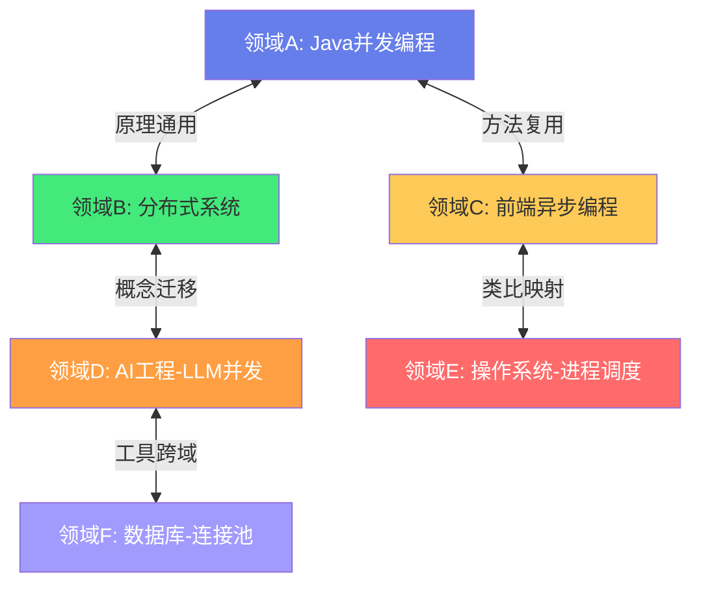
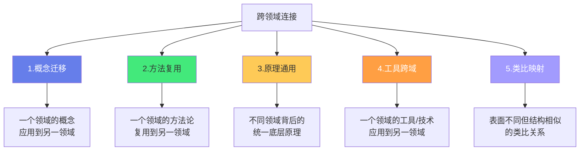
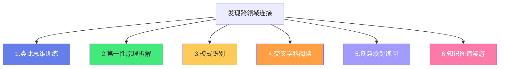
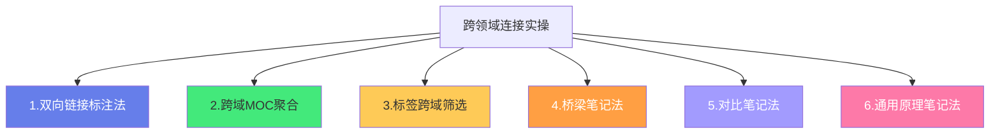
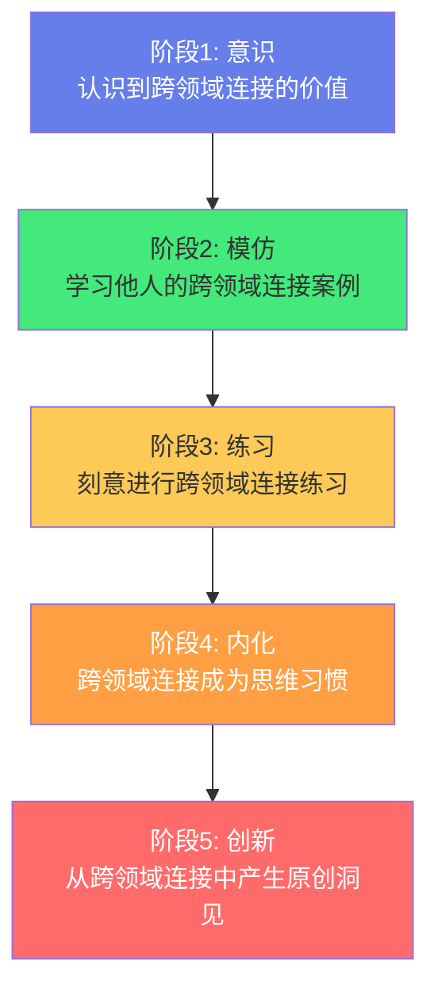

# 🔗 跨领域知识连接方法

> **文档说明**：系统讲解知识库中跨领域知识连接的方法论与实操技巧，涵盖跨领域连接的核心概念与价值（知识迁移/类比思维/创新洞见/认知升级）、跨领域连接的五大类型（概念迁移/方法复用/原理通用/工具跨域/类比映射）、如何发现跨领域连接（类比思维训练/第一性原理拆解/模式识别/交叉学科阅读/刻意联想）、跨领域连接的实操方法（双向链接标注法/跨域MOC聚合/标签跨域筛选/桥梁笔记法/对比笔记法）、全栈+AI知识库中的跨领域连接案例（Java与AI工程/前端与后端/运维与开发/算法与工程/数据库与AI/网络与分布式）、双向链接在跨领域连接中的核心作用、跨领域连接的质量评估标准（深度/准确性/启发性/可验证性）、常见误区（强行连接/表面类比/过度连接/忽视领域差异）、Obsidian工具支持（关系图谱/反向链接面板/Dataview跨域查询/标签筛选）、跨领域连接能力的培养与训练方法、从「知识堆积」到「知识网络」的进化路径、常见问题与最佳实践。
>
> **适用人群**：知识管理实践者、终身学习者、全栈开发者、AI工程师、创新研究者、Obsidian用户
>
> **前置知识**：[[原子笔记原则与实践]] · [[LYT-链接你的思维]] · [[MOC内容地图]] · [[标签与文件夹的边界]]

---

## 一、概述

### 1.1 什么是跨领域知识连接

**跨领域知识连接（Cross-Domain Knowledge Connection）** 是指「在不同知识领域之间发现和建立有意义的关联」——将一个领域的概念、原理、方法、工具或思维模式，映射或迁移到另一个领域，从而产生新的理解、洞见或创新。



**跨领域连接的本质**：
- 不是「表面的关键词匹配」，而是「深层的结构和原理相似性」
- 不是「强行把不相关的东西扯在一起」，而是「发现真正有意义的关联」
- 不是「替代领域内的深度学习」，而是「在深度基础上的广度拓展」
- 不是「一次性的灵感」，而是「可以系统化培养和训练的能力」

> **核心洞察**：知识的价值不在于「孤立的知识点」，而在于「知识点之间的连接」。跨领域连接是最高价值的连接——它能让你用一个领域的思维解决另一个领域的问题，产生「啊哈！」的洞见时刻，这正是创新的源泉。

### 1.2 跨领域连接的价值

| 价值 | 说明 | 示例 |
|------|------|------|
| **知识迁移** | 将一个领域的成熟方法应用到新领域，快速上手 | 用Java的设计模式思维理解前端的组件设计 |
| **类比理解** | 用熟悉的领域类比陌生领域，降低学习门槛 | 用操作系统的进程调度理解K8s的Pod调度 |
| **创新洞见** | 跨领域碰撞产生新想法，这是创新的核心机制 | 将数据库的索引思想应用到AI的RAG检索优化 |
| **认知升级** | 发现不同领域背后的统一原理，提升抽象思维能力 | 发现「缓存」思想无处不在：CPU缓存/CDN/Redis/浏览器缓存 |
| **问题解决** | 当一个领域的方法失效时，从其他领域寻找解决方案 | 后端遇到并发问题，借鉴前端的异步编程模式 |
| **记忆强化** | 多领域连接形成记忆网络，比孤立记忆更牢固 | 学习「负载均衡」时连接Nginx/K8s/DNS/CDN多个领域 |

### 1.3 梅特卡夫定律与知识网络

**梅特卡夫定律（Metcalfe's Law）**：网络的价值与节点数的平方成正比。

这个定律同样适用于知识网络：
- 孤立的 100 篇笔记，价值 ≈ 100（线性）
- 互相连接的 100 篇笔记，价值 ≈ 100² = 10,000（指数）
- 跨领域连接的笔记网络，价值更高——因为跨领域连接是「弱连接」，能带来新信息和新视角（社会学中的「弱连接理论」）


> **关键原则**：在知识库中，「连接」比「内容」更重要，「跨领域连接」比「领域内连接」更有价值。构建知识库的终极目标不是「收集更多笔记」，而是「建立更多有意义的连接，尤其是跨领域连接」。

---

## 二、跨领域连接的五大类型

### 2.1 类型总览



### 2.2 概念迁移（Concept Transfer）

**定义**：将一个领域的核心概念，应用到另一个领域，用新概念解释新问题。

**示例**：
| 源领域 | 概念 | 目标领域 | 应用 |
|--------|------|---------|------|
| 建筑学 | 设计模式 | 软件工程 | GoF 23种设计模式 |
| 生物学 | 进化论 | 算法 | 遗传算法 |
| 经济学 | 供需关系 | 系统设计 | 限流与削峰填谷 |
| 城市规划 | 分区 | 软件架构 | 微服务领域划分 |
| 军事学 | 指挥链 | 分布式系统 | 主从架构与共识机制 |

**识别方法**：问自己「这个领域的核心概念，在另一个领域有没有对应物？」

### 2.3 方法复用（Method Reuse）

**定义**：将一个领域的成熟方法论、工作流程或解决问题的框架，复用到另一个领域。

**示例**：
| 源领域 | 方法 | 目标领域 | 应用 |
|--------|------|---------|------|
| 制造业 | 精益生产 | 软件开发 | 精益创业、Kanban |
| 制造业 | 质量控制（QC） | 软件 | 代码审查、自动化测试 |
| 建筑工程 | 蓝图设计 | 软件 | 架构设计、UML建模 |
| 航空业 | 检查表（Checklist） | 手术/软件发布 | 手术安全表、发布检查表 |
| 项目管理 | 关键路径法 | 学习规划 | 学习路线中的依赖关系 |

**识别方法**：问自己「这个领域解决问题的流程，能不能用来解决另一个领域的问题？」

### 2.4 原理通用（Principle Generalization）

**定义**：不同领域背后共享相同的底层原理或物理/数学规律，发现这些通用原理。

**示例**：
| 通用原理 | 领域A | 领域B | 领域C |
|---------|-------|-------|-------|
| **缓存** | CPU缓存 | Redis | 浏览器缓存/CDN |
| **分层** | OSI七层模型 | 计算机架构 | 软件架构分层 |
| **队列** | 操作系统进程队列 | 消息队列 | 线程池任务队列 |
| **幂等** | 数据库事务 | HTTP方法 | 消息队列消费 |
| **权衡** | CAP定理 | 空间换时间 | 一致性vs可用性 |
| **反馈回路** | 控制论 | 自动扩缩容 | 学习复盘 |

**识别方法**：问自己「这两个领域的现象背后，是不是同一个底层原理在起作用？」

### 2.5 工具跨域（Tool Cross-Domain）

**定义**：一个领域开发的工具或技术，被应用到完全不同的另一个领域。

**示例**：
| 源领域 | 工具 | 目标领域 | 应用 |
|--------|------|---------|------|
| 搜索引擎 | 倒排索引 | AI | RAG检索增强生成 |
| 数据库 | SQL | 大数据 | Hive/Spark SQL |
| 版本控制 | Git | 文档协作 | Git-based Wiki |
| 容器化 | Docker | AI | 模型部署与环境隔离 |
| 游戏引擎 | 物理引擎 | 机器人 | 仿真训练 |

**识别方法**：问自己「这个领域的工具，能不能用来解决另一个领域的问题？」

### 2.6 类比映射（Analogy Mapping）

**定义**：两个领域表面完全不同，但在结构、关系或模式上具有相似性，通过类比建立连接。

**示例**：
| 领域A | 领域B | 类比关系 |
|-------|-------|---------|
| 人体血液循环 | 微服务通信 | 心脏=API网关，血管=服务网格，血液=请求 |
| 森林生态系统 | 软件架构 | 物种=服务，食物链=依赖关系，生态位=领域边界 |
| 城市交通 | 网络流量 | 道路=带宽，红绿灯=限流，导航=负载均衡 |
| 图书馆 | 数据库 | 书架=表，索引卡=索引，借阅=查询 |
| 乐团演奏 | 分布式系统 | 指挥=协调者，乐手=节点，乐谱=共识算法 |

**识别方法**：问自己「这个领域像什么？它的结构和关系能不能映射到另一个领域？」

> **注意**：类比映射是最容易产生「洞见」的类型，但也是最容易「强行连接」的类型。类比只能帮助理解，不能替代严谨的领域分析——类比的两个领域必然有差异，不能忽视差异而强行套用。

---

## 三、如何发现跨领域连接

### 3.1 发现方法总览



### 3.2 类比思维训练

**核心**：养成「这个像什么」的思维习惯，主动在不同领域间寻找类比。

**训练方法**：
1. **每日一类比**：每天选一个学到的概念，问「它像什么其他领域的东西？」
2. **类比日记**：记录发现的类比，定期回顾和深化
3. **随机类比**：随机选两个不相关的领域，强迫自己找类比（如「Java线程池像餐厅」）
4. **类比验证**：找到类比后，分析哪些部分对应、哪些部分不对应，深化理解

**示例练习**：
- 「Redis像什么？」→ 像图书馆的前台书架（热门书放前台，冷门书放仓库）
- 「Kafka像什么？」→ 像邮局的信件分拣中心（生产者=寄信人，消费者=收信人，Topic=邮编）
- 「Docker像什么？」→ 像集装箱（标准化包装，任何船/港口都能处理）

### 3.3 第一性原理拆解

**核心**：将一个领域的知识拆解到最基本的原理，然后看这些原理在其他领域是否也适用。

**拆解步骤**：
1. **识别现象**：这个领域的核心现象是什么？（如「缓存加速访问」）
2. **追问为什么**：为什么会这样？背后的基本原理是什么？（如「局部性原理：刚访问的数据很可能再次访问」）
3. **抽象原理**：将原理抽象到不依赖具体领域的层面（如「基于访问模式的预测性预取」）
4. **跨域应用**：这个抽象原理在其他领域有没有应用？（如「CPU缓存/CDN/浏览器缓存/预加载」）

**示例**：
| 现象 | 第一性原理 | 跨域应用 |
|------|-----------|---------|
| 数据库索引加速查询 | 空间换时间 + 有序结构加速查找 | 搜索引擎倒排索引、Redis跳表 |
| 负载均衡分散压力 | 分工 + 并行 + 故障隔离 | 微服务、CDN、DNS轮询 |
| 熔断防止级联故障 | 快速失败 + 隔离 + 降级 | 电路保险丝、微服务熔断、舱壁模式 |

### 3.4 模式识别

**核心**：在不同领域中反复出现的模式，往往是跨领域连接的信号。

**常见模式**：
| 模式 | 说明 | 出现领域 |
|------|------|---------|
| **分层模式** | 将复杂系统分为多层，每层只依赖下层 | OSI模型、计算机架构、软件分层 |
| **代理模式** | 中间层代理访问，增加控制和灵活性 | 网络代理、AOP、API网关、CDN |
| **观察者模式** | 状态变化时通知所有观察者 | 事件驱动、响应式编程、发布订阅 |
| **池化模式** | 预创建资源池，复用而非创建销毁 | 线程池、连接池、对象池、内存池 |
| **队列模式** | 生产者消费者解耦，削峰填谷 | 消息队列、任务队列、IO队列 |
| **缓存模式** | 热点数据放在高速存储，加速访问 | CPU缓存、Redis、CDN、浏览器缓存 |

**训练方法**：学习新概念时，问「这个模式我在其他领域见过吗？」

### 3.5 交叉学科阅读

**核心**：主动阅读自己领域之外的书籍和文章，积累跨领域的知识素材。

**推荐交叉领域**：
| 领域 | 对技术人的价值 | 推荐入门 |
|------|--------------|---------|
| **生物学/进化论** | 理解复杂系统、适应性、涌现 | 《自私的基因》《演化的故事》 |
| **经济学** | 理解权衡、激励、供需、博弈 | 《经济学原理》《思考，快与慢》 |
| **心理学/认知科学** | 理解学习、记忆、决策、思维偏差 | 《认知心理学》《思考，快与慢》 |
| **物理学** | 理解第一性原理、系统思维 | 《费曼物理学讲义》 |
| **城市规划/建筑学** | 理解分层、模块化、可扩展性 | 《建筑的永恒之道》 |
| **军事学/战略** | 理解竞争、策略、资源分配 | 《孙子兵法》《战争论》 |
| **系统论/控制论** | 理解反馈、稳态、复杂系统 | 《系统之美》 |

**方法**：每周花 1-2 小时阅读非技术领域的内容，刻意寻找与技术的连接。

### 3.6 刻意联想练习

**核心**：主动将不相关的领域放在一起，强迫自己寻找连接。

**练习方法**：
1. **随机组合**：随机选两个领域（如「Java并发」和「AI大模型」），列出 5 个连接点
2. **问题迁移**：选一个领域的难题，问「另一个领域会怎么解决这个问题？」
3. **概念翻译**：用一个领域的语言解释另一个领域的概念
4. **逆向思考**：如果把这个领域的方法反过来用，会怎么样？

**示例**：
- 「Java并发」和「AI大模型」的连接：
  1. 线程池 vs LLM并发请求管理（池化模式通用）
  2. 锁机制 vs 多Agent协作中的资源竞争
  3. 并发容器 vs 向量数据库的并发读写
  4. Future/CompletableFuture vs 异步LLM调用
  5. 并发设计模式 vs Agent编排模式

### 3.7 知识图谱漫游

**核心**：在 Obsidian 关系图谱中随机漫游，发现笔记之间的意外连接。

**方法**：
1. 打开关系图谱，选择一个领域的节点
2. 观察它的邻居节点，特别是跨领域的邻居
3. 点击一个不相关的节点，问「这两个笔记之间有什么连接？」
4. 如果发现有意义的连接，添加双向链接
5. 定期进行「图谱漫游」，每次 10-15 分钟

> **技巧**：在关系图谱中，「桥接节点」（连接两个不同领域群集的节点）往往是跨领域连接的关键节点。关注这些节点，深入挖掘它们的跨域价值。

---

## 四、跨领域连接的实操方法

### 4.1 方法总览



### 4.2 双向链接标注法

**核心**：在笔记中主动添加跨领域的双向链接，并标注连接类型。

**标注格式**：
```markdown
## 🔗 跨领域连接

- [[Redis缓存]] ↔ [[CPU缓存]] — 原理通用：局部性原理
- [[Kafka消息队列]] ↔ [[线程池任务队列]] — 模式复用：生产者消费者模式
- [[Docker容器]] ↔ [[集装箱]] — 类比映射：标准化封装
- [[微服务熔断]] ↔ [[电路保险丝]] — 概念迁移：快速失败+隔离
```

**连接类型标注**：
- `原理通用`：背后是同一个底层原理
- `模式复用`：使用了相同的设计/架构模式
- `概念迁移`：一个领域的概念应用到另一领域
- `方法复用`：一个领域的方法复用到另一领域
- `工具跨域`：一个领域的工具应用到另一领域
- `类比映射`：结构相似的类比关系

**最佳实践**：
- 每篇笔记至少添加 1-2 个跨领域连接
- 在「关联笔记」部分明确区分「同领域关联」和「跨领域连接」
- 跨领域连接要写一句话说明「连接点是什么」，不要只放链接

### 4.3 跨域MOC聚合

**核心**：为跨领域主题创建 MOC（内容地图），聚合不同领域的相关笔记。

**示例：MOC-缓存思想**
```markdown
# MOC-缓存思想

> 缓存是跨领域的通用思想：基于「局部性原理」，将热点数据放在高速存储中加速访问。

## 核心原理
- [[局部性原理]] — 时间局部性 + 空间局部性
- [[缓存命中率]] — 衡量缓存效果的核心指标

## 各领域应用
### 硬件层
- [[CPU缓存]] — L1/L2/L3缓存
- [[磁盘缓存]] — 操作系统页缓存

### 软件层
- [[Redis缓存]] — 分布式缓存
- [[本地缓存]] — Caffeine/Guava Cache
- [[数据库缓存]] — 查询缓存/Buffer Pool

### 网络层
- [[CDN缓存]] — 内容分发网络
- [[DNS缓存]] — 域名解析缓存
- [[浏览器缓存]] — HTTP缓存策略

## 跨领域洞见
- 缓存的本质是「用空间换时间」
- 所有缓存都需要解决「一致性」和「淘汰策略」问题
- 缓存穿透/击穿/雪崩在各领域都有对应问题
```

**适合创建跨域MOC的主题**：
- 缓存思想、分层思想、队列模式、池化模式、代理模式
- 负载均衡、容错与熔断、一致性问题、性能优化
- 安全思想、可观测性、自动化、设计模式

### 4.4 标签跨域筛选

**核心**：使用跨领域标签，通过标签筛选聚合不同领域的笔记。

**跨域标签设计**：
| 标签 | 说明 | 覆盖领域 |
|------|------|---------|
| `#性能优化` | 性能优化相关 | Java/前端/数据库/运维/AI |
| `#安全` | 安全相关 | Web/后端/运维/云原生 |
| `#架构设计` | 架构设计相关 | 全栈/分布式/微服务 |
| `#设计模式` | 设计模式相关 | Java/前端/Python |
| `#高可用` | 高可用相关 | 运维/架构/数据库 |
| `#并发` | 并发相关 | Java/操作系统/分布式/AI |
| `#缓存` | 缓存相关 | 硬件/数据库/中间件/网络 |

**使用方法**：
- 在 Obsidian 标签面板点击跨域标签，查看所有领域的相关笔记
- 用搜索语法组合筛选：`#性能优化 AND path:01-Java全栈`
- 用 Dataview 查询跨域标签的笔记分布

### 4.5 桥梁笔记法

**核心**：创建专门的「桥梁笔记」，连接两个或多个领域，解释它们之间的关系。

**桥梁笔记模板**：
```markdown
---
title: 领域A与领域B的桥梁
tags: [跨领域连接, 桥梁笔记]
---

# 🌉 领域A ↔ 领域B

## 连接概述
一句话说明这两个领域为什么相关。

## 核心连接点
| 领域A概念 | 领域B概念 | 连接类型 | 说明 |
|----------|----------|---------|------|
| ... | ... | 原理通用 | ... |

## 深度类比
详细解释一个最重要的类比或迁移。

## 互相启发
- 领域A可以从领域B学到什么？
- 领域B可以从领域A学到什么？

## 相关笔记
### 领域A
- [[...]]
### 领域B
- [[...]]
```

**桥梁笔记示例**：
- `Java并发 ↔ 分布式系统`：并发原理在分布式场景的延伸
- `前端响应式 ↔ 后端响应式`：响应式编程思想的跨端应用
- `数据库索引 ↔ AI-RAG检索`：索引思想在AI检索中的应用
- `操作系统调度 ↔ K8s调度`：调度算法的跨层应用

### 4.6 对比笔记法

**核心**：创建对比笔记，将不同领域的相似概念放在一起对比，加深理解。

**对比笔记模板**：
```markdown
# 📊 概念A vs 概念B vs 概念C

## 对比总览
| 维度 | 概念A（领域1） | 概念B（领域2） | 概念C（领域3） |
|------|--------------|--------------|--------------|
| 核心目标 | ... | ... | ... |
| 实现原理 | ... | ... | ... |
| 优势 | ... | ... | ... |
| 劣势 | ... | ... | ... |
| 适用场景 | ... | ... | ... |

## 通用原理
这三个概念背后的统一原理是什么？

## 各自特色
每个领域的独特之处是什么？

## 跨域启发
从对比中得到了什么洞见？
```

**对比笔记示例**：
- `线程池 vs 连接池 vs 对象池`：池化模式在不同资源上的应用
- `CPU缓存 vs Redis vs CDN`：缓存在不同层级的实现
- `Java锁 vs 分布式锁 vs 数据库锁`：锁机制在不同层面的实现
- `HTTP负载均衡 vs RPC负载均衡 vs DNS负载均衡`：负载均衡在不同层级

### 4.7 通用原理笔记法

**核心**：为跨领域的通用原理创建专门笔记，聚合所有应用该原理的领域。

**通用原理笔记模板**：
```markdown
---
title: 通用原理：XXX
tags: [通用原理, 跨领域连接]
---

# 🔬 通用原理：XXX

## 原理定义
用不依赖具体领域的语言，定义这个原理。

## 核心要素
这个原理包含哪些基本要素？

## 各领域应用
| 领域 | 具体应用 | 笔记链接 |
|------|---------|---------|
| 硬件 | ... | [[...]] |
| 操作系统 | ... | [[...]] |
| 数据库 | ... | [[...]] |
| 网络 | ... | [[...]] |
| 分布式 | ... | [[...]] |
| AI | ... | [[...]] |

## 跨域洞见
从各领域应用的对比中，得到了什么深层理解？

## 延伸思考
这个原理还能应用到哪些新领域？
```

**适合创建通用原理笔记的主题**：
- 局部性原理、空间换时间、分而治之、抽象分层
- 生产者消费者、发布订阅、责任链、命令模式
- 快速失败、容错降级、幂等性、最终一致性
- 反馈回路、稳态/瞬态、涌现、自组织

---

## 五、全栈+AI知识库中的跨领域连接案例

### 5.1 Java 并发 ↔ AI 大模型并发

| Java并发 | AI大模型并发 | 连接点 |
|---------|------------|--------|
| 线程池 | LLM请求并发管理 | 池化模式：预创建+复用+队列等待 |
| synchronized/ReentrantLock | 多Agent资源竞争 | 锁机制：互斥访问共享资源 |
| ConcurrentHashMap | 向量数据库并发读写 | 并发容器：分段锁/无锁设计 |
| CompletableFuture | 异步LLM调用编排 | 异步编程：链式调用+组合 |
| 信号量Semaphore | LLM API限流 | 流量控制：限制并发数 |
| 阻塞队列 | Agent消息队列 | 生产者消费者：解耦+削峰 |

**跨域洞见**：并发的核心问题在任何领域都是一样的——「如何高效、安全地协调多个执行单元访问共享资源」。Java并发的成熟设计模式可以直接迁移到AI Agent编排中。

### 5.2 前端响应式 ↔ 后端响应式

| 前端响应式 | 后端响应式 | 连接点 |
|-----------|-----------|--------|
| Vue响应式系统 | Reactor/RxJava | 响应式编程：数据流+变化传播 |
| Proxy/defineProperty | 响应式流规范 | 观察者模式：订阅+通知 |
| 虚拟DOM diff | 增量计算 | 最小更新：只变化的部分重新计算 |
| 组件生命周期 | Bean生命周期 | 生命周期管理：初始化→使用→销毁 |
| 前端状态管理(Vuex/Pinia) | 后端状态机 | 状态管理：集中式+可预测 |

**跨域洞见**：响应式的本质是「数据变化驱动视图/逻辑自动更新」，这个思想在前端和后端是统一的。理解了一个领域的响应式，就能快速理解另一个领域。

### 5.3 数据库索引 ↔ AI-RAG检索

| 数据库索引 | AI-RAG检索 | 连接点 |
|-----------|-----------|--------|
| B+树索引 | 向量索引(HNSW/IVF) | 索引结构：加速查找的核心 |
| 倒排索引 | 关键词检索 | 倒排：文档→关键词的反向映射 |
| 查询优化器 | 检索策略选择 | 优化器：选择最优执行计划 |
| 覆盖索引 | 向量+元数据混合检索 | 覆盖：不需要回表的高效查询 |
| 索引选择性 | Embedding质量 | 选择性：索引区分度决定效率 |
| 联合索引 | 多模态检索 | 多字段：组合索引优化多维查询 |

**跨域洞见**：RAG检索的很多思想直接来源于数据库——向量数据库本质上是「支持相似度查询的新型数据库」。理解数据库索引原理，能帮助你更好地理解和优化RAG检索。

### 5.4 操作系统调度 ↔ K8s调度

| 操作系统调度 | K8s调度 | 连接点 |
|------------|---------|--------|
| 进程调度 | Pod调度 | 调度：将任务分配给执行单元 |
| CPU时间片 | 资源配额(CPU/Memory) | 资源分配：限额+共享 |
| 优先级调度 | PriorityClass | 优先级：高优先级任务优先调度 |
| 亲和性/反亲和性 | Node Affinity/Pod Affinity | 亲和性：调度位置偏好 |
| 负载均衡 | 调度器策略 | 均衡：避免热点，分散负载 |
| 抢占式调度 | 抢占(Preemption) | 抢占：高优先级抢占低优先级资源 |

**跨域洞见**：K8s调度器本质上是「集群级别的操作系统调度器」。操作系统调度的很多概念（时间片、优先级、亲和性、抢占）在K8s中都有对应。理解操作系统调度，能让你更快掌握K8s调度。

### 5.5 更多跨领域连接方向

| 连接方向 | 核心连接点 |
|---------|-----------|
| **网络协议 ↔ 微服务通信** | 分层、握手、重试、超时、流量控制 |
| **编译原理 ↔ 前端框架** | AST、解析、转换、代码生成（Vue模板编译） |
| **数据库事务 ↔ 分布式事务** | ACID、隔离级别、两阶段提交、最终一致性 |
| **设计模式 ↔ 架构模式** | 单例→服务注册、观察者→事件驱动、策略→插件化 |
| **安全 ↔ 全栈各层** | 认证授权、加密、注入防护、最小权限（跨Web/后端/运维） |
| **可观测性 ↔ 全栈各层** | 日志、指标、追踪（跨应用/服务/基础设施） |
| **AI ↔ 全栈各层** | AI辅助编码、AI测试、AI运维、AI产品（AI赋能每个领域） |

---

## 六、跨领域连接的质量评估

### 6.1 评估维度

| 维度 | 说明 | 高质量标准 | 低质量表现 |
|------|------|-----------|-----------|
| **深度** | 连接是否触及深层原理，而非表面 | 基于底层原理/模式的连接 | 只是关键词相同的表面连接 |
| **准确性** | 连接是否正确，没有错误映射 | 类比对应准确，差异有说明 | 强行类比，忽视领域差异 |
| **启发性** | 连接是否能带来新洞见 | 能产生「啊哈！」时刻，启发新思路 | 显而易见，没有新增价值 |
| **可验证性** | 连接是否可以通过实践验证 | 有具体的应用案例或可操作的迁移方法 | 纯粹的理论联想，无法落地 |
| **清晰性** | 连接是否表达清楚 | 明确标注连接类型和连接点 | 只放链接，不说明为什么相关 |

### 6.2 连接质量等级

| 等级 | 说明 | 示例 |
|------|------|------|
| **S级（黄金连接）** | 深度原理连接，启发性强，可验证 | 「缓存的局部性原理在CPU/Redis/CDN中通用」 |
| **A级（优质连接）** | 模式/方法复用，有实际应用 | 「线程池和连接池都是池化模式的应用」 |
| **B级（一般连接）** | 概念类比，帮助理解但不够深入 | 「Docker像集装箱」 |
| **C级（弱连接）** | 表面相关，价值有限 | 「Java和JavaScript都有Java」 |
| **D级（无效连接）** | 强行连接，错误或误导 | 「MySQL和Redis都是数据库所以一样」 |

> **原则**：追求 S/A 级连接，避免 C/D 级连接。质量胜于数量——一个黄金连接比一百个表面连接更有价值。

---

## 七、常见误区

### 7.1 误区一：强行连接

**表现**：为了「跨领域连接」而强行把不相关的东西扯在一起，忽视领域差异。

**问题**：
- 类比不准确，可能误导理解
- 连接没有实际价值，只是「为了连接而连接」
- 忽视领域差异，可能导致错误的迁移应用

**正确做法**：
- 连接必须基于真正的相似性（原理/模式/结构）
- 明确标注连接的「适用范围」和「差异点」
- 类比只能帮助理解，不能替代严谨的领域分析
- 如果连接很牵强，不如不连

### 7.2 误区二：表面类比

**表现**：只看到表面的相似，没有深入到原理层面。

**示例**：
- 「Redis和MySQL都是数据库」（表面：都是数据存储；深层：一个是内存KV缓存，一个是磁盘关系型数据库，原理完全不同）
- 「线程和进程都是执行单元」（表面：都能执行代码；深层：资源隔离/切换开销/通信方式完全不同）

**正确做法**：
- 追问「为什么相似？」「背后的原理是什么？」
- 用第一性原理拆解，找到深层的共同原理
- 同时分析「哪些地方相似，哪些地方不同」

### 7.3 误区三：过度连接

**表现**：每篇笔记都加几十个链接，不管是否真正相关。

**问题**：
- 链接质量下降，用户无法判断哪些是真正重要的连接
- 关系图谱变得杂乱，节点交叠连线穿插
- 维护成本高，很多链接是「僵尸链接」
- 违反「原子笔记」原则——一篇笔记应该聚焦一个核心概念

**正确做法**：
- 每篇笔记的出站链接控制在 5-15 个
- 优先添加高质量的连接（S/A级）
- 在「关联笔记」部分分类组织（同领域/跨领域/前置/后续）
- 定期清理低质量链接

### 7.4 误区四：忽视领域差异

**表现**：发现跨领域连接后，完全忽视两个领域的差异，盲目迁移。

**示例**：
- 「CPU缓存用LRU淘汰，所以Redis也应该只用LRU」（忽视Redis有更丰富的淘汰策略和分布式场景）
- 「操作系统用时间片调度，所以K8s也应该用时间片」（忽视K8s调度的是长期运行的服务，不是短时间任务）

**正确做法**：
- 跨领域连接时，明确标注「相同点」和「不同点」
- 迁移方法时，根据目标领域的特点进行调整
- 理解「原理通用，但实现因领域而异」
- 用桥梁笔记或对比笔记详细分析异同

### 7.5 误区五：只连接不深化

**表现**：添加了跨领域链接，但没有深入思考连接的意义，也没有记录洞见。

**问题**：
- 连接只是「放了个链接」，没有产生认知价值
- 下次看到链接时，已经忘了为什么连接
- 没有从连接中提炼出通用原理或创新点

**正确做法**：
- 每个跨领域连接都写一句话说明「连接点是什么」
- 定期回顾跨领域连接，深化理解
- 从连接中提炼通用原理，创建通用原理笔记
- 将有价值的连接转化为桥梁笔记或对比笔记

---

## 八、Obsidian 工具支持

### 8.1 关系图谱（Graph View）

**功能**：可视化展示笔记之间的连接网络，发现跨领域连接。

**跨领域连接相关用法**：
- **观察桥接节点**：连接两个不同领域群集的节点，往往是跨领域连接的关键
- **分组着色**：按文件夹着色，不同颜色代表不同领域，跨领域连接一目了然
- **局部图谱**：选中一篇笔记，查看它的连接网络，发现意外的跨领域邻居
- **图谱漫游**：随机点击节点，探索知识网络，发现意外连接

**设置建议**：
- 开启「按文件夹分组着色」
- 调整节点大小和连线粗细，让跨领域连接更清晰
- 过滤掉低质量链接（如只显示有双向链接的节点）

### 8.2 反向链接面板（Backlinks）

**功能**：显示哪些笔记链接了当前笔记。

**跨领域连接相关用法**：
- 查看当前笔记被哪些其他领域的笔记引用
- 发现「意外的引用」——其他领域的笔记为什么引用这篇？
- 从反向链接中发现新的跨领域连接机会

### 8.3 标签面板（Tags）

**功能**：按标签筛选笔记。

**跨领域连接相关用法**：
- 使用跨域标签（如 `#性能优化` `#缓存` `#并发`）聚合不同领域的笔记
- 点击跨域标签，查看所有领域的相关笔记，发现连接
- 用层级标签组织跨域主题（如 `#跨领域/缓存思想`）

### 8.4 Dataview 查询

**查询跨领域连接的笔记**：
```dataview
TABLE file.folder AS "领域", tags, length(file.outlinks) AS "出站链接"
FROM "知识库"
WHERE contains(tags, "跨领域连接") OR contains(file.name, "桥梁") OR contains(file.name, "对比")
SORT file.folder ASC
```

**查询出站链接最多的笔记**（可能是跨领域连接的枢纽）：
```dataview
TABLE length(file.outlinks) AS "出站链接", length(file.inlinks) AS "入站链接", file.folder AS "领域"
FROM "知识库"
SORT length(file.outlinks) DESC
LIMIT 20
```

**查询特定跨域标签的笔记分布**：
```dataview
TABLE length(rows) AS "笔记数"
FROM "知识库"
WHERE contains(tags, "性能优化")
GROUP BY file.folder
SORT length(rows) DESC
```

### 8.5 搜索语法

| 语法 | 用途 | 示例 |
|------|------|------|
| `[[]]` | 搜索指向特定笔记的链接 | `[[Redis]]` 找到所有链接Redis的笔记 |
| `tag:#标签` | 按标签筛选 | `tag:#缓存` 找到所有缓存相关笔记 |
| `path:文件夹` | 按文件夹筛选 | `path:01-Java全栈` |
| `AND/OR/NOT` | 逻辑组合 | `#并发 AND NOT path:01-Java全栈` |

**跨领域搜索示例**：
- 找到所有领域中与「缓存」相关的笔记：`#缓存`
- 找到Java领域之外引用了「线程池」的笔记：`[[线程池]] AND NOT path:01-Java全栈`
- 找到AI领域中与「并发」相关的笔记：`path:03-AI工程 #并发`

---

## 九、跨领域连接能力的培养

### 9.1 培养路径



### 9.2 每日/每周练习

| 频率 | 练习 | 时间 |
|------|------|------|
| **每日** | 每日一类比：选一个学到的概念，找一个跨领域类比 | 5分钟 |
| **每日** | 添加1-2个跨领域连接到当天的笔记 | 5分钟 |
| **每周** | 随机组合练习：随机选两个领域，找5个连接点 | 15分钟 |
| **每周** | 图谱漫游：在关系图谱中随机探索10分钟 | 10分钟 |
| **每周** | 交叉学科阅读：读1篇非技术领域的文章 | 30分钟 |
| **每月** | 创建1个跨域MOC或桥梁笔记 | 1小时 |
| **每月** | 回顾跨领域连接，提炼1个通用原理 | 30分钟 |

### 9.3 推荐资源

**书籍**：
- 《思考，快与慢》— 认知偏差与思维模式
- 《穷查理宝典》— 多元思维模型（查理·芒格的跨领域思维）
- 《系统之美》— 系统思维
- 《创新者的窘境》— 跨领域创新
- 《费曼物理学讲义》— 第一性原理思维

**思维模型**：
- 查理·芒格的「多元思维模型」：掌握多个学科的核心思维模型，用于跨领域分析
- 第一性原理：拆解到最基本原理，再从原理出发推理
- 二阶思维：考虑决策的长期和间接影响
- 概率思维：用概率思考不确定性

---

## 十、常见问题与最佳实践

### 10.1 常见问题

| 问题 | 解决方案 |
|------|---------|
| **不知道怎么发现跨领域连接？** | 从类比思维训练开始，每天问「这个像什么」；用第一性原理拆解；在关系图谱中漫游 |
| **跨领域连接会不会分散注意力？** | 不会，跨领域连接是在「深度基础上的广度」，先深入一个领域，再连接其他领域 |
| **类比总是不准确怎么办？** | 类比本来就不是完全准确的，关键是明确「相同点」和「不同点」，用类比帮助理解而非替代分析 |
| **跨领域连接太多了管理不过来？** | 质量胜于数量，优先S/A级连接；用跨域MOC和桥梁笔记组织；定期清理低质量连接 |
| **怎么判断一个连接是否有价值？** | 用五维评估：深度/准确性/启发性/可验证性/清晰性；能产生「啊哈！」时刻的就是好连接 |
| **跨领域连接和领域内学习怎么平衡？** | 80%时间深入领域内学习，20%时间进行跨领域连接和思考；深度是基础，广度是升华 |
| **怎么向别人解释跨领域连接的价值？** | 用具体案例说明：如「用数据库索引思想优化RAG检索」「用Java并发模式设计AI Agent编排」 |

### 10.2 最佳实践

**1. 先深度，后广度**
- 先深入掌握一个领域的核心概念和原理
- 有了深度基础，跨领域连接才有「锚点」
- 不要在每个领域都浅尝辄止，那样连接会很表面

**2. 质量胜于数量**
- 一个黄金连接比一百个表面连接更有价值
- 每篇笔记的跨领域连接控制在 1-3 个高质量连接
- 定期评估和清理低质量连接

**3. 明确标注连接类型和连接点**
- 每个跨领域连接都标注类型（原理通用/方法复用/类比映射等）
- 写一句话说明「连接点是什么」
- 不要只放链接，让读者（和未来的自己）明白为什么相关

**4. 用桥梁笔记和对比笔记深化连接**
- 重要的跨领域连接，创建专门的桥梁笔记深入分析
- 多个领域的相似概念，创建对比笔记系统比较
- 从连接中提炼通用原理，创建通用原理笔记

**5. 跨域MOC聚合主题**
- 为跨领域主题（如缓存/性能优化/并发）创建MOC
- MOC聚合不同领域的相关笔记，提供统一的导航入口
- 跨域MOC是发现和管理跨领域连接的最佳工具

**6. 定期回顾和深化**
- 月度回顾中检查跨领域连接的质量
- 从连接中提炼新的通用原理
- 更新桥梁笔记和对比笔记
- 跨领域连接不是「一次完成」，而是「持续深化」

**7. 刻意练习，培养习惯**
- 每日一类比、每周随机组合练习
- 交叉学科阅读，积累跨领域素材
- 在关系图谱中漫游，发现意外连接
- 跨领域连接能力是可以训练的，刻意练习能显著提升

**8. 从连接到创新**
- 跨领域连接的终极目标是「创新」
- 当你能将一个领域的成熟方法应用到另一个领域解决新问题时，就是创新
- 记录跨领域连接带来的洞见和创意，定期回顾和实践
- 创新往往发生在「学科的交叉地带」

---

## 十一、关联笔记

### 知识管理方法论
- [[原子笔记原则与实践]] · [[LYT-链接你的思维]] · [[MOC内容地图]]
- [[标签与文件夹的边界]] · [[笔记标题命名策略]] · [[定期回顾与笔记重构]]
- [[冗余检测与合并策略]] · [[知识折旧与更新机制]] · [[费曼学习法笔记实践]]
- [[常青笔记-EvergreenNotes]]

### 跨领域连接案例
- [[Java并发 ↔ 分布式系统]] · [[数据库索引 ↔ AI-RAG检索]]
- [[操作系统调度 ↔ K8s调度]] · [[缓存思想跨领域应用]]

### 导航
- [[MOC-综合导航]] · [[MOC-知识管理方法论-四级展开]] · [[Home]] · [[学习路线总览]]

> 🔍 **知识点深度解析**
>
> **作用**：跨领域知识连接方法解决的是「如何让知识库从『孤立的知识点堆积』升级为『互联的知识网络』，并通过跨领域碰撞产生创新洞见」的核心问题——很多人的知识库只是「信息的仓库」：笔记之间缺乏连接，尤其是跨领域连接，每个领域的笔记各自为政，知识无法迁移和碰撞。这导致：学习效率低（每个领域都要从零开始，无法利用已有知识）、记忆不牢（孤立的知识点容易遗忘）、缺乏创新（创新往往发生在学科交叉地带）。跨领域知识连接方法提供了一套系统化的方法论：五大连接类型（概念迁移/方法复用/原理通用/工具跨域/类比映射）、六种发现方法（类比思维/第一性原理/模式识别/交叉学科阅读/刻意联想/图谱漫游）、七种实操方法（双向链接标注/跨域MOC/标签跨域/桥梁笔记/对比笔记/通用原理笔记），以及质量评估、常见误区、工具支持和能力培养路径，帮助学习者构建真正「活的知识网络」，让知识在跨领域碰撞中产生创新洞见。
>
> **底层原理**：①跨领域连接的价值基础是「梅特卡夫定律」——网络的价值与节点数的平方成正比。孤立的100篇笔记价值≈100（线性），互相连接的100篇笔记价值≈10000（指数），而跨领域连接作为「弱连接」（社会学弱连接理论：弱连接能带来新信息和新视角），价值更高。这就是为什么「连接比内容更重要，跨领域连接比领域内连接更有价值」。②跨领域连接的认知基础是「知识迁移理论」——学习的本质不是记住孤立的事实，而是建立可迁移的心理模型。当你能将一个领域的原理迁移到另一个领域时，说明你真正理解了这个原理的本质（而非表面形式）。跨领域连接就是「知识迁移」的具体实践——它强迫你抽象出原理的本质，然后在新领域中应用。③类比思维的神经科学基础是「远程联想」——创造力与大脑中「远距离概念之间的连接能力」相关。当你能在两个看似不相关的领域之间建立连接时，你就在进行「远程联想」，这正是创造性思维的核心机制。这就是为什么「跨领域连接是创新的源泉」——它激活了大脑中的远程联想网络，产生新的组合和洞见。④第一性原理与类比的辩证关系：类比思维是「从已知到未知」，用熟悉的领域理解陌生领域，快速但可能不准确；第一性原理是「从基本原理出发」，拆解到最基础的真理再重新构建，准确但慢。跨领域连接需要两者结合：用类比快速发现连接，用第一性原理论证和深化连接。⑤模式识别的价值在于「可复用的解决方案」——当你在不同领域反复看到相同的模式（如缓存/池化/分层/代理），你就积累了一套「可复用的解决方案工具箱」。遇到新问题时，你可以快速识别「这是XX模式的变体」，然后应用已验证的解决方案，这就是「经验」的本质——不是记住具体案例，而是识别可复用的模式。
>
> **用法要点**：① 五大连接类型：概念迁移（一个领域概念应用到另一领域）、方法复用（一个领域方法论复用到另一领域）、原理通用（不同领域背后的统一底层原理）、工具跨域（一个领域工具应用到另一领域）、类比映射（表面不同但结构相似的类比） ② 六种发现方法：类比思维训练（每日一类比/随机类比）、第一性原理拆解（现象→为什么→抽象原理→跨域应用）、模式识别（缓存/池化/分层/代理/队列等反复出现的模式）、交叉学科阅读（生物学/经济学/心理学/物理学/系统论）、刻意联想练习（随机组合/问题迁移/概念翻译）、知识图谱漫游（关系图谱中随机探索，关注桥接节点） ③ 七种实操方法：双向链接标注法（标注连接类型+连接点说明）、跨域MOC聚合（为缓存/性能优化/并发等跨域主题创建MOC）、标签跨域筛选（用#性能优化/#缓存/#并发等跨域标签聚合）、桥梁笔记法（专门连接两个领域的笔记，分析异同）、对比笔记法（多领域相似概念系统对比）、通用原理笔记法（为局部性/空间换时间/分而治之等通用原理创建笔记） ④ 质量评估五维度：深度（触及原理而非表面）、准确性（类比正确，差异有说明）、启发性（能产生啊哈时刻）、可验证性（有具体应用案例）、清晰性（明确标注连接类型和点）；S/A级连接优先，避免C/D级 ⑤ 五大误区：强行连接（为连接而连接忽视差异）、表面类比（只看表面不深入原理）、过度连接（每篇几十个链接质量下降）、忽视领域差异（盲目迁移不调整）、只连接不深化（放链接不记录洞见） ⑥ Obsidian工具：关系图谱（观察桥接节点/按文件夹着色/局部图谱/图谱漫游）、反向链接面板（发现意外的跨域引用）、标签面板（跨域标签聚合）、Dataview（查询跨域连接笔记/出站链接最多的枢纽笔记）、搜索语法（[[]]搜索链接/tag标签/path文件夹组合） ⑦ 全栈+AI案例：Java并发↔AI大模型并发（池化/锁/异步/限流）、前端响应式↔后端响应式（数据流/观察者/生命周期）、数据库索引↔AI-RAG检索（索引结构/倒排/优化器/选择性）、操作系统调度↔K8s调度（调度/资源配额/优先级/亲和性/抢占） ⑧ 能力培养：每日一类比（5分钟）、每日添加1-2跨域连接、每周随机组合练习（15分钟）、每周图谱漫游（10分钟）、每周交叉学科阅读（30分钟）、每月创建1跨域MOC/桥梁笔记、每月提炼1通用原理；推荐《穷查理宝典》多元思维模型、第一性原理、系统思维 ⑨ 最佳实践：先深度后广度（80%深入领域+20%跨域连接）、质量胜于数量（每篇1-3高质量跨域连接）、明确标注连接类型和点、用桥梁/对比/通用原理笔记深化、跨域MOC聚合主题、定期回顾深化、刻意练习培养习惯、从连接到创新（终极目标）。

> 💡 **深度讲解**：跨领域知识连接最核心的智慧是「创新发生在学科的交叉地带，而连接是创新的前提」——很多人以为创新是「凭空创造出全新的东西」，但实际上，绝大多数创新都是「已有概念在新领域的组合和应用」。iPhone不是凭空发明的——它是「手机+iPod+互联网通信」的组合；RAG不是凭空发明的——它是「数据库检索+大模型生成」的组合；微服务不是凭空发明的——它是「Unix哲学（小而专）+网络通信+自动化运维」的组合。这些创新的共同特征是「跨领域连接」——将一个领域的成熟概念，连接到另一个领域，产生新的解决方案。这就是为什么「跨领域连接能力是创新能力的核心」——你能建立的跨领域连接越多、越有质量，你能产生的创新洞见就越多。而知识库就是「跨领域连接的基础设施」——当你的知识库中有丰富的跨领域连接时，你就拥有了一个「创新灵感库」，随时可以从中发现新的组合和洞见。这就是构建知识库的终极意义：不是「存储信息」，而是「构建一个能持续产生创新洞见的知识网络」。「梅特卡夫定律告诉我们：连接比内容更有价值，但前提是连接是『有意义的』」——梅特卡夫定律说网络价值与节点数的平方成正比，但这有一个前提：节点之间的连接是「有意义的」。如果连接是随机的、无意义的，那么网络不仅没有价值，反而会增加噪音和混乱。这就是为什么「跨领域连接的质量比数量更重要」——一个基于深层原理的黄金连接（如「缓存的局部性原理在CPU/Redis/CDN中通用」），比一百个表面的关键词匹配连接（如「Java和JavaScript都有Java」）更有价值。高质量的跨领域连接能让你「啊哈！」——瞬间理解两个领域背后的统一原理，产生认知升级；低质量的连接只会让你「哦」——然后继续忽略。所以，在构建跨领域连接时，要追求「少而精」而非「多而杂」：每篇笔记的跨领域连接控制在1-3个，每个连接都要深入到原理层面，都要明确标注连接类型和连接点，都要能带来新的理解或洞见。记住：一个能改变你思维方式的连接，胜过一千个你看完就忘的连接。「第一性原理与类比思维是跨领域连接的『两条腿』，缺一不可」——跨领域连接有两种基本思维方式：类比思维和第一性原理。类比思维是「从已知到未知」——用你熟悉的领域去类比陌生领域，快速建立理解。比如「Docker像集装箱」，这个类比能让你瞬间理解Docker的核心价值（标准化封装，随处运行）。但类比思维有局限：类比永远是「部分相似」，如果忽视差异，可能导致错误的理解和应用。第一性原理是「从基本原理出发」——将现象拆解到最基本的、不证自明的真理，然后从这些原理出发重新构建理解。比如理解Docker，不是类比「像集装箱」，而是拆解到「进程隔离（Namespace）+资源限制（Cgroups）+文件系统分层（UnionFS）」这些基本原理，然后理解Docker是如何组合这些原理实现容器化的。第一性原理准确但慢，类比思维快但可能不准确。跨领域连接需要两者结合：用类比思维快速发现连接（「这个像什么？」），用第一性原理论证和深化连接（「背后的原理是什么？哪些地方相似？哪些地方不同？」）。只有类比没有第一性原理，连接会停留在表面；只有第一性原理没有类比，你可能很难发现跨领域的连接（因为原理太抽象，难以直接映射）。两者结合，才能既快速发现连接，又深入理解连接，最终产生高质量的跨领域洞见。这就是「两条腿走路」的智慧——类比是「发现的腿」，第一性原理是「深化的腿」，两者配合，才能在跨领域知识的原野上走得又快又稳。

> 📝 **精简总结**：跨领域知识连接方法=在不同知识领域间发现和建立有意义关联的方法论。价值：知识迁移/类比理解/创新洞见/认知升级/问题解决/记忆强化；基于梅特卡夫定律（连接价值指数增长）和弱连接理论（跨域连接带来新视角）。五大类型：概念迁移/方法复用/原理通用/工具跨域/类比映射。六种发现方法：类比思维训练（每日一类比）、第一性原理拆解（现象→原理→抽象→跨域）、模式识别（缓存/池化/分层/代理/队列）、交叉学科阅读（生物/经济/心理/物理/系统论）、刻意联想练习（随机组合/问题迁移）、知识图谱漫游（关注桥接节点）。七种实操：双向链接标注（类型+连接点）、跨域MOC聚合（缓存/性能/并发）、标签跨域筛选（#性能优化等）、桥梁笔记（两领域深度分析）、对比笔记（多领域系统比较）、通用原理笔记（局部性/空间换时间等）。质量五维：深度/准确性/启发性/可验证性/清晰性；S/A级优先。五大误区：强行连接/表面类比/过度连接/忽视领域差异/只连接不深化。全栈+AI案例：Java并发↔AI并发、前端↔后端响应式、数据库索引↔RAG检索、OS调度↔K8s调度。能力培养：每日类比+连接、每周联想+漫游+阅读、每月MOC+原理提炼。最佳实践：先深度后广度、质量胜于数量、标注连接类型、桥梁/对比/原理笔记深化、跨域MOC聚合、定期回顾、刻意练习、从连接到创新。

> **学习路径建议**：先学习 [[原子笔记原则与实践]] 理解笔记的基本单位 → 学习 [[LYT-链接你的思维]] 理解双向链接和MOC → 学习本文档掌握跨领域连接方法论 → 实践：每天为学到的概念找1个跨领域类比，添加到笔记中 → 学习 [[MOC内容地图]] 掌握MOC构建方法 → 实践：创建第一个跨域MOC（如「缓存思想跨领域应用」） → 学习 [[标签与文件夹的边界]] 理解如何用标签做跨域聚合 → 实践：在关系图谱中进行10分钟图谱漫游，发现意外连接 → 学习 [[费曼学习法笔记实践]] 提升知识理解和表达能力 → 实践：创建第一个桥梁笔记（如「Java并发 ↔ AI大模型并发」） → 阅读《穷查理宝典》学习多元思维模型 → 持续练习，将跨领域连接内化为思维习惯 → 从跨领域连接中产生创新洞见，应用到实际项目中。

---

> **跨领域知识连接的本质是「构建一张能持续产生创新洞见的『知识神经网络』」——你的知识库不应该是「信息的仓库」，而应该是「知识的神经网络」：每篇笔记是一个「神经元」，每个连接是一个「突触」，跨领域连接就是「远距离神经元之间的强连接」。神经科学告诉我们，创造力与大脑中「远距离概念之间的连接能力」高度相关——当你能在两个看似不相关的领域之间建立连接时，你就在进行创造性思维。知识库就是你「外部化的大脑」——当你在知识库中建立丰富的跨领域连接时，你就在训练自己的「创造性思维肌肉」，同时构建了一个「创新灵感库」。下次遇到新问题时，你可以在这个知识网络中漫游，发现「这个问题和XX领域的XX问题很像，可以用XX方法解决」——这就是跨领域连接的力量。但记住：连接的质量比数量更重要，一个基于深层原理的黄金连接，胜过一百个表面的关键词匹配。追求「少而精」的跨领域连接，每个连接都深入到原理层面，每个连接都能带来新的理解和洞见。当你的知识网络中有足够多高质量的跨领域连接时，你会发现：学习不再是「每个领域从零开始」，而是「用已有知识快速理解新领域」；记忆不再是「孤立的知识点容易遗忘」，而是「在网络中互相强化，难以忘记」；创新不再是「凭空想象」，而是「在跨领域碰撞中自然涌现」。这就是跨领域知识连接的终极价值：它不仅让你的知识库「活起来」，更让你的思维「活起来」——从「单一领域的专家」升级为「跨领域的创新者」。在这个技术快速迭代、学科边界日益模糊的时代，跨领域连接能力不是「锦上添花」，而是「核心竞争力」——它决定了你能走多远、能创造多少价值。所以，从今天开始，每天问自己一个问题：「我今天学到的这个概念，和其他领域有什么连接？」——你的知识神经网络，会从这个简单的问题开始，持续生长、连接、绽放。**
