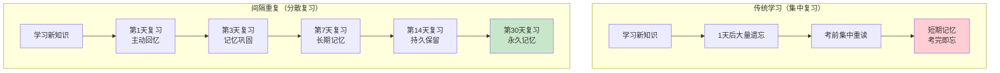

# 间隔重复与记忆巩固

> **文档说明**：系统讲解间隔重复（Spaced Repetition）与记忆巩固的核心理论、底层原理、算法机制（SM-2/FSRS/Leitner）、知识卡片设计原则、Obsidian 间隔重复实践、与原子笔记知识库的融合方法、学习节奏规划、最佳实践和常见问题排查。
>
> **适用人群**：知识工作者、全栈/AI 学习者、Obsidian 知识库构建者、需要长期记忆大量技术知识的开发者
>
> **前置知识**：[[费曼学习法笔记实践]]、[[从输入到输出的知识转化]]、[[GTD时间管理与知识管理结合]]

---

## 一、概述

### 1. 什么是间隔重复

```text
间隔重复（Spaced Repetition）：
- 基于人类记忆遗忘规律的学习方法
- 核心思想：在即将遗忘的临界点进行复习，用最少的时间实现最长期的记忆
- 与"集中复习"（考前突击）相对，强调"分散复习"
- 已被认知科学广泛验证，是目前最高效的长期记忆方法之一

核心概念：
1. 遗忘曲线（Forgetting Curve）
   - 艾宾浩斯（Hermann Ebbinghaus）1885 年提出
   - 记忆随时间呈指数衰减
   - 新学知识 20 分钟后遗忘 42%，1 天后遗忘 66%，1 周后遗忘 75%
   - 但每次复习后，遗忘速度会减慢（记忆巩固）

2. 间隔效应（Spacing Effect）
   - 分散学习比集中学习效果更好
   - 同样的复习时间，分散在多天比集中在一天记忆保留率高 2-3 倍
   - 原因：间隔产生" desirable difficulties"（必要难度），迫使大脑主动提取

3. 测试效应（Testing Effect）
   - 主动回忆（测试）比被动重读更有效
   - 提取过程本身会强化记忆痕迹
   - 间隔重复软件本质上是"定时测试"系统

4. 记忆巩固（Memory Consolidation）
   - 短期记忆转化为长期记忆的神经过程
   - 主要发生在睡眠期间（海马体 → 新皮层转移）
   - 间隔复习加速巩固过程
   - 与知识库结合：笔记不只是存储，更是"可复习的记忆单元"

间隔重复 vs 传统学习：
| 维度 | 传统学习（集中复习） | 间隔重复 |
|------|---------------------|---------|
| 复习时机 | 考前突击、随意复习 | 算法计算最佳复习点 |
| 复习方式 | 被动重读笔记 | 主动回忆（测试） |
| 时间效率 | 低（大量重复已掌握内容） | 高（只复习即将遗忘的） |
| 长期保留 | 差（考完就忘） | 好（持续巩固） |
| 心理负担 | 高（考前焦虑） | 低（每日少量复习） |
| 可量化 | 难以追踪进度 | 精确追踪掌握程度 |
```



### 2. 为什么技术学习者需要间隔重复

```text
全栈/AI 技术学习的特点：
- 知识量大：前端、后端、数据库、运维、AI 模型、算法...
- 概念抽象：设计模式、算法原理、架构思想...
- 更新快：技术栈持续演进，需要持续学习
- 实践性强：需要将理论转化为代码能力
- 容易遗忘：学了后端忘了前端，学了 AI 忘了运维

间隔重复对技术学习者的价值：
1. 对抗"学了就忘"
   - 技术概念多且杂，不复习很快遗忘
   - 间隔重复确保每个知识点在遗忘前被巩固

2. 建立知识网络
   - 卡片之间可以双向链接（Obsidian）
   - 复习时激活相关知识点，形成网络记忆
   - 比孤立记忆更牢固

3. 精准定位薄弱点
   - 算法自动标记"总是忘记"的卡片
   - 集中精力攻克薄弱知识点
   - 避免"已经掌握的内容反复看"

4. 可持续学习节奏
   - 每日 15-30 分钟复习，不占用大量时间
   - 比周末突击 4 小时效果更好
   - 适合在职开发者的碎片化时间

5. 面试准备
   - 技术面试知识点范围广
   - 间隔重复确保面试时知识点都在"活跃记忆"中
   - 比临时抱佛脚可靠
```

---

## 二、底层原理

### 1. 记忆的神经科学基础

```text
记忆的三个阶段：
1. 编码（Encoding）
   - 信息进入大脑的过程
   - 注意力是编码的前提（不注意=没记住）
   - 深度编码（理解、联想、举例）比浅度编码（死记硬背）效果好
   - 费曼技巧（用自己的话解释）是深度编码的有效方法

2. 存储（Storage）
   - 信息在大脑中保持的过程
   - 短期记忆：前额叶，容量有限（7±2 个组块），持续秒到分钟
   - 长期记忆：海马体（近期）→ 新皮层（远期），容量无限
   - 记忆巩固：短期记忆转化为长期记忆的过程，主要在睡眠中完成

3. 提取（Retrieval）
   - 从大脑中调出信息的过程
   - 提取难度越大，记忆强化越强（必要难度理论）
   - 主动提取（测试）比被动识别（重读）效果好
   - 间隔重复的核心就是"定时主动提取"

记忆的神经机制：
- 神经元之间的连接（突触）在学习时增强（长时程增强 LTP）
- 重复激活同一神经回路 → 突触连接更牢固 → 记忆更持久
- 间隔复习 → 每次激活都在巩固突触连接
- 睡眠 → 海马体"回放"白天的记忆，转移到新皮层长期存储

遗忘的机制：
- 不是记忆"消失"了，而是提取路径变弱了
- 干扰理论：新旧记忆互相干扰
- 衰减理论：神经连接随时间自然衰减
- 线索依赖性遗忘：没有合适的提取线索
- 间隔重复通过"定时激活"对抗衰减和干扰
```

### 2. 艾宾浩斯遗忘曲线

```text
艾宾浩斯遗忘曲线（Ebbinghaus Forgetting Curve）：
- 1885 年，德国心理学家艾宾浩斯通过实验得出
- 实验：自己记忆无意义音节（如 "WID", "ZOF"），测试不同时间后的保留率
- 结论：记忆保留率随时间呈指数衰减

典型遗忘曲线数据：
| 时间间隔 | 记忆保留率 | 遗忘率 |
|---------|-----------|--------|
| 刚学完 | 100% | 0% |
| 20 分钟 | 58% | 42% |
| 1 小时 | 44% | 56% |
| 1 天 | 34% | 66% |
| 2 天 | 28% | 72% |
| 1 周 | 25% | 75% |
| 1 个月 | 21% | 79% |

关键发现：
1. 遗忘速度先快后慢：最初几小时遗忘最快，之后逐渐减慢
2. 复习重置曲线：每次复习后，遗忘速度减慢（曲线变平缓）
3. 多次复习后：记忆可以长期保持，遗忘极少

复习对遗忘曲线的影响：
- 第1次复习（1天后）：保留率从 34% 回升到 90%+，遗忘速度减慢
- 第2次复习（3天后）：保留率从 70% 回升到 95%+，遗忘速度进一步减慢
- 第3次复习（7天后）：保留率从 80% 回升到 98%，遗忘极慢
- 第4次复习（14天后）：保留率从 90% 回升到 99%，接近永久记忆
- 第5次复习（30天后）：保留率 99%+，长期稳定

间隔重复的本质：
- 在遗忘曲线下降到"临界点"（通常 80-90% 保留率）时复习
- 既不浪费时间复习已经牢记的内容
- 也不在完全遗忘后重新学习（成本最高）
- 算法的目标就是精准计算这个"临界点"
```

### 3. 间隔效应与测试效应

```text
间隔效应（Spacing Effect）：
- 1885 年艾宾浩斯首次发现，1970 年代被大量实验验证
- 现象：相同的学习时间，分散在多个时间段比集中在一个时间段效果好
- 实验：A 组一天学 4 小时，B 组分 4 天每天学 1 小时 → B 组长期保留率高 2-3 倍

间隔效应的理论解释：
1. 必要难度（Desirable Difficulties）
   - 间隔使提取变得更难（因为已经部分遗忘）
   - 更难的提取 → 更强的记忆强化
   - 集中复习时信息还在短期记忆中，提取太容易，强化效果弱

2. 编码变异性（Encoding Variability）
   - 不同时间、不同情境下学习 → 编码的上下文更丰富
   - 更多的提取线索 → 更容易回忆

3. 记忆巩固（Consolidation）
   - 间隔期间（尤其是睡眠）大脑进行记忆巩固
   - 集中复习没有足够的巩固时间

4. 区分假说（Discriminative Contrast）
   - 间隔学习时，大脑能更好地区分"已记住"和"未记住"
   - 集中学习时产生"熟练度错觉"（觉得自己记住了，其实只是短期记忆）

测试效应（Testing Effect / Retrieval Practice）：
- 主动提取（测试）比被动重读更能强化记忆
- 实验：学完后 A 组重读 3 遍，B 组测试 3 遍 → 一周后 B 组保留率高 50%+
- 也叫"提取练习效应"（Retrieval Practice Effect）

测试效应的机制：
1. 提取努力假说
   - 主动提取需要努力，努力程度与记忆强化正相关
   - 重读是被动识别，几乎不需要提取努力

2. 记忆痕迹强化
   - 提取过程激活记忆痕迹，激活本身会强化痕迹
   - 类似"肌肉越练越强"，记忆越提取越牢固

3. 元认知觉知
   - 测试让你准确知道"自己记住了什么、没记住什么"
   - 重读产生"熟练度错觉"，高估自己的掌握程度

间隔重复 = 间隔效应 + 测试效应：
- 间隔：在最佳时间点复习（间隔效应）
- 重复：通过主动回忆测试（测试效应）
- 两者结合 → 目前已知最高效的长期记忆方法
```

---

## 三、间隔重复算法

### 1. SM-2 算法（Anki 经典算法）

```text
SM-2 算法（SuperMemo 2）：
- 1987 年由波兰研究员 Piotr Woźniak 提出
- Anki、Mnemosyne 等软件的核心算法
- 简单、有效，是使用最广泛的间隔重复算法

SM-2 核心参数：
- ease factor（EF，难度系数）：默认 2.5，范围 1.3-3.0
  - 表示记忆的"容易程度"，越大越容易，间隔增长越快
  - 每次回答后根据评分调整
- interval（间隔）：下次复习的天数
- repetitions（重复次数）：连续答对的次数
- quality（评分）：0-5 分，用户自评回忆质量

SM-2 算法流程：
1. 首次学习
   - interval = 1 天（第1天复习）
   - repetitions = 0
   - ease = 2.5

2. 复习时评分（quality 0-5）
   - 5：完美回忆，毫不费力
   - 4：正确回忆，稍有犹豫
   - 3：正确回忆，需要努力
   - 2：回忆错误，但看到答案后觉得"应该记住"
   - 1：回忆错误，完全没印象
   - 0：完全没印象

3. 如果 quality < 3（答错）
   - repetitions = 0（重置）
   - interval = 1 天（重新开始）
   - ease 调整：ease = ease - 0.2

4. 如果 quality >= 3（答对）
   - repetitions += 1
   - 如果 repetitions == 1：interval = 1 天
   - 如果 repetitions == 2：interval = 6 天
   - 如果 repetitions > 2：interval = interval * ease
   - ease 调整：ease = ease + (0.1 - (5 - quality) * (0.08 + (5 - quality) * 0.02))
   - ease 最低 1.3

SM-2 的典型复习节奏（答对 quality=4）：
- 第1次：1 天后
- 第2次：6 天后
- 第3次：6 * 2.5 = 15 天后
- 第4次：15 * 2.5 = 37 天后
- 第5次：37 * 2.5 = 92 天后（约3个月）
- 第6次：92 * 2.5 = 230 天后（约7.5个月）
- 之后：间隔越来越长，趋近于"永久记忆"

SM-2 的局限性：
- 假设遗忘曲线是固定的指数衰减，不考虑个体差异
- ease factor 调整较粗糙
- 不考虑卡片难度的历史变化
- 对"困难卡片"的间隔调整不够精准
- 已被 FSRS 等新一代算法超越
```

### 2. FSRS 算法（新一代）

```text
FSRS（Free Spaced Repetition Scheduler）：
- 2022 年由 Jarrett Ye 提出的新一代间隔重复算法
- 基于 DSR 模型（Difficulty 难度、Stability 稳定性、Retrievability 可提取性）
- Anki 23.10+ 已内置支持，逐渐替代 SM-2
- 比 SM-2 更精准，复习量减少 20-30%，记忆保留率更高

FSRS 核心概念（DSR 模型）：
1. Difficulty（难度，D）
   - 卡片的固有难度，0-10 范围
   - 影响记忆稳定性的增长速度
   - 越难的卡片，稳定性增长越慢

2. Stability（稳定性，S）
   - 记忆的"牢固程度"，单位：天
   - 表示遗忘概率降到某个阈值所需的时间
   - 每次复习后更新，答对增长，答错降低

3. Retrievability（可提取性，R）
   - 当前能回忆起该卡片的概率，0-1
   - 随时间衰减：R = e^(-t/S)
   - t 是距上次复习的天数
   - 当 R 降到阈值（默认 0.9）时，就是最佳复习时间

FSRS 算法流程：
1. 初始状态
   - 首次学习后，根据卡片难度设置初始 S 和 D

2. 复习时
   - 计算当前 R = e^(-t/S)
   - 用户评分（Again/Hard/Good/Easy）
   - 根据评分更新 S 和 D：
     - Again（答错）：S 大幅降低，D 增加
     - Hard（困难）：S 小幅增长，D 增加
     - Good（良好）：S 中等增长，D 不变
     - Easy（简单）：S 大幅增长，D 降低

3. 计算下次间隔
   - 目标 R = 0.9（默认，可配置）
   - interval = S * ln(1/R) = S * ln(1/0.9) ≈ S * 0.105
   - 即：当 R 降到 90% 时复习

FSRS vs SM-2：
| 维度 | SM-2 | FSRS |
|------|------|------|
| 模型 | 经验公式 | DSR 数学模型 |
| 参数 | ease, interval, reps | difficulty, stability, retrievability |
| 精准度 | 一般 | 高（基于实际遗忘数据） |
| 复习量 | 较多 | 少 20-30% |
| 个体适配 | 弱 | 强（可根据个人数据优化参数） |
| 难度处理 | 粗糙 | 精细（独立的 D 参数） |
| 可解释性 | 简单 | 较复杂 |
| 支持软件 | Anki（默认）、所有 | Anki 23.10+、部分 |

FSRS 推荐配置：
- 启用 FSRS 而非 SM-2（Anki 设置中切换）
- 目标保留率：0.85-0.9（默认 0.9）
- 最大间隔：36500 天（不限制）
- 重新学习后重置难度：开启
- 让 Anki 根据你的复习数据优化参数（"Optimize"按钮）
```

### 3. Leitner 系统（手动间隔重复）

```text
Leitner 系统（莱特纳系统）：
- 1970 年代由德国记者 Sebastian Leitner 提出
- 最简单的间隔重复方法，不需要软件，用物理卡片盒即可
- 核心思想：用多个盒子（或分区）代表不同的复习频率

Leitner 系统规则：
- 5 个盒子（Box 1-5）
- Box 1：每天复习（新知识、答错的卡片）
- Box 2：每 2 天复习
- Box 3：每 4 天复习
- Box 4：每 8 天复习
- Box 5：每 16 天复习（已掌握）

复习流程：
1. 新卡片放入 Box 1
2. 复习 Box 1 时：
   - 答对 → 移到 Box 2
   - 答错 → 留在 Box 1（或退回 Box 1）
3. 复习 Box 2 时：
   - 答对 → 移到 Box 3
   - 答错 → 退回 Box 1
4. 以此类推，Box 5 的卡片视为"已掌握"

Leitner 的优缺点：
- 优点：简单、不需要软件、直观可见进度
- 缺点：间隔固定不灵活、盒子数量有限、不适合大量卡片
- 适用：初学者、卡片量少（<500）、喜欢物理卡片的人

Obsidian 中的 Leitner 实践：
- 用标签模拟盒子：#SR/Box1、#SR/Box2、#SR/Box3...
- 用 Dataview 查询每个盒子的卡片
- 复习后手动更新标签
- 或用 Spaced Repetition 插件自动管理
```

---

## 四、知识卡片设计

### 1. 最小信息原则

```text
最小信息原则（Minimum Information Principle）：
- Piotr Woźniak（SM 算法发明者）提出的卡片设计核心原则
- 一张卡片只包含一个知识点（一个问题、一个答案）
- 信息越简单、越明确，记忆效果越好

为什么要最小信息：
1. 认知负荷低：一次只处理一个知识点，大脑容易编码
2. 复习快：简单卡片 5-10 秒一张，每日复习不耗时
3. 定位准：答错时明确知道是哪个知识点没掌握
4. 间隔精准：算法可以针对单个知识点调整间隔
5. 避免"全部或 nothing"：大卡片要么全记住要么全忘，小卡片可以部分掌握

最小信息原则的具体要求：
- 一张卡片一个问题
- 问题明确，不含糊
- 答案简洁，不冗长
- 不把多个相关知识点塞在一张卡片里
- 复杂概念拆成多张卡片（正面、反面、对比、示例...）

反面示例（信息过载）：
❌ 正面：什么是 REST API？它的六个约束是什么？和 SOAP 有什么区别？
   背面：REST 是...六个约束是...和 SOAP 的区别是...
   问题：三个知识点混在一起，答对其中一个不算"掌握"，算法无法精准评估

正面示例（拆分后）：
✅ 卡片1：REST API 的全称和核心思想是什么？
   背面：Representational State Transfer，核心思想是...
✅ 卡片2：REST API 的六个架构约束是什么？
   背面：1. 客户端-服务器分离 2. 无状态 3. 可缓存 4. 统一接口 5. 分层系统 6. 按需代码（可选）
✅ 卡片3：REST 和 SOAP 的主要区别是什么？
   背面：REST 是架构风格，基于 HTTP，轻量；SOAP 是协议，基于 XML，严格...
```

### 2. 卡片类型

```text
间隔重复卡片的常见类型：

1. 问答卡（Q&A）
   - 最基本、最常用的类型
   - 正面：问题
   - 背面：答案
   - 适用：概念定义、事实记忆、原理理解
   - 示例：
     正面：HTTP 状态码 404 表示什么？
     背面：Not Found，服务器找不到请求的资源

2. 填空卡（Cloze / 完形填空）
   - 正面：包含空白的句子
   - 背面：完整句子（或填空答案）
   - 适用：术语记忆、公式记忆、关键参数
   - 优势：上下文丰富，比孤立问答更容易记忆
   - 示例：
     正面：TCP 三次握手的第一步是客户端发送 ______ 包
     背面：SYN（同步序列编号）

3. 对比卡（Comparison）
   - 正面：两个或多个概念的对比问题
   - 背面：对比表格或列表
   - 适用：易混淆概念、技术选型、方案对比
   - 示例：
     正面：SQL 和 NoSQL 数据库的主要区别是什么？
     背面：| 维度 | SQL | NoSQL |...（表格）

4. 列表卡（List / Enumeration）
   - 正面：要求列出某类事物
   - 背面：列表
   - 适用：步骤、原则、分类、特征
   - 注意：列表项不超过 5-7 个，否则拆成多张
   - 示例：
     正面：SOLID 原则的五个字母分别代表什么？
     背面：S-单一职责、O-开闭原则、L-里氏替换、I-接口隔离、D-依赖倒置

5. 示例卡（Example）
   - 正面：一个具体场景或代码
   - 背面：分析或答案
   - 适用：应用场景、代码识别、问题排查
   - 示例：
     正面：这段代码有什么问题？`for i in range(len(list)): print(list[i])`
     背面：不Pythonic，应该用 `for item in list: print(item)`

6. 正反卡（正反面互换）
   - 同一张卡片，既可以从问题→答案，也可以从答案→问题
   - 适用：术语-定义、英文-中文、公式-名称
   - Anki 中用"基础卡（和反向卡片）"类型

7. 图像卡（Image）
   - 正面：图像（或图像+问题）
   - 背面：答案
   - 适用：架构图识别、UI 模式、图表解读、医学影像
   - 示例：
     正面：[架构图] 这是什么架构模式？
     背面：微服务架构，特征是...

卡片类型选择建议：
- 概念定义 → 问答卡 或 填空卡
- 易混淆概念 → 对比卡
- 步骤/原则 → 列表卡（不超过7项）
- 应用场景 → 示例卡
- 术语翻译 → 正反卡
- 图表/架构 → 图像卡
```

### 3. 卡片设计最佳实践

```text
知识卡片设计的 10 条最佳实践：

1. 最小信息原则
   - 一张卡片一个知识点
   - 复杂概念拆成多张
   - 答案不超过 3-5 行

2. 问题明确具体
   - 避免"什么是 XXX"这种太宽泛的问题
   - 改为"XXX 的核心思想是什么"、"XXX 的三个关键特征是什么"
   - 问题越具体，回忆越精准

3. 答案简洁准确
   - 用自己的话写答案（费曼技巧）
   - 不要复制粘贴大段原文
   - 关键词加粗，便于快速识别
   - 可以用代码片段、公式、表格

4. 避免歧义
   - 问题和答案都不要有多种解释
   - 如果有前提条件，在问题中说明
   - 对比类卡片明确对比维度

5. 利用上下文
   - 填空卡比孤立问答效果好
   - 在句子/场景中记忆术语
   - 关联已有知识（"与 XXX 类似，YYY 的区别是..."）

6. 定期审查卡片
   - 每周/每月审查卡片质量
   - 删除过时内容（技术更新）
   - 拆分信息过载的卡片
   - 合并重复卡片

7. 控制卡片总量
   - 每日新卡 10-20 张（不要贪多）
   - 总卡片量控制在可管理范围（1000-3000 张活跃卡）
   - 已掌握的卡片可以暂停（Leech 暂停）

8. 标签分类
   - 每张卡片加标签（#技术/Java/集合、#技术/AI/RAG）
   - 便于按主题复习
   - 与 Obsidian 知识库标签体系一致

9. 关联笔记
   - 卡片中链接到详细笔记（[[]] 双向链接）
   - 复习时可以快速查看完整内容
   - 卡片是"记忆钩子"，笔记是"详细参考"

10. 主动回忆，不要偷看
    - 复习时先努力回忆，再看答案
    - 不要因为"觉得记住了"就跳过
    - 诚实评分（Again/Hard/Good/Easy）
    - 评分是算法精准调度的基础
```

---

## 五、Obsidian 间隔重复实践

### 1. 插件选择与配置

```text
Obsidian 间隔重复插件对比：

| 插件 | 特点 | 算法 | 卡片格式 | 推荐度 |
|------|------|------|---------|--------|
| **Spaced Repetition** | 最流行，功能完善 | SM-2 | #flashcards 标签 + ?? 分隔 | ⭐⭐⭐⭐⭐ |
| **Anki Sync** | 与 Anki 双向同步 | Anki (SM-2/FSRS) | Anki 卡片格式 | ⭐⭐⭐⭐ |
| **SR Inbox** | 轻量级，简单 | 固定间隔 | 自定义 | ⭐⭐⭐ |
| **Recall** | 新一代，界面好 | SM-2 | 多种格式 | ⭐⭐⭐⭐ |

推荐方案：
- 纯 Obsidian 用户 → Spaced Repetition 插件
- 已经在用 Anki → Anki Sync 插件（双向同步）
- 想要更好体验 → Recall 插件

Spaced Repetition 插件配置：
1. 安装：设置 → 第三方插件 → 浏览 → 搜索 "Spaced Repetition" → 安装并启用
2. 基本设置：
   - Flashcard tags: #flashcards（标记为卡片的笔记标签）
   - Single line card separator: ??（单行卡片正反面分隔符）
   - Multi line card separator: ???（多行卡片分隔符）
   - Inline card separator: ::（行内填空卡分隔符）
3. 复习设置：
   - 打开新标签页复习（推荐）
   - 显示卡片上下文（笔记标题）
   - 复习后自动移动到下一张
4. 算法设置：
   - 使用 SM-2（默认）或切换到 FSRS（如果插件支持）
   - 配置每日新卡上限（10-20张）
   - 配置最大复习量
```

### 2. 卡片标记格式

```markdown
<!-- 方式1：单行问答卡（最常用） -->
<!-- 正面问题 ?? 背面答案 -->

什么是 REST API 的核心思想？ ?? 表述性状态转移（Representational State Transfer），核心是**资源**和**统一接口**，客户端通过 HTTP 方法操作资源。

TCP 和 UDP 的主要区别是什么？ ?? TCP 面向连接、可靠、有序、有流量控制；UDP 无连接、不可靠、无序、低延迟。

<!-- 方式2：多行问答卡（答案较长时） -->
<!-- 正面问题 ??? 背面答案（可以多行、代码、表格） -->

SOLID 原则分别是什么？ ???
- **S** - Single Responsibility Principle（单一职责）
- **O** - Open/Closed Principle（开闭原则）
- **L** - Liskov Substitution Principle（里氏替换）
- **I** - Interface Segregation Principle（接口隔离）
- **D** - Dependency Inversion Principle（依赖倒置）

<!-- 方式3：行内填空卡（Cloze） -->
<!-- 关键词:::答案（三个冒号） -->

HTTP 状态码 200 表示:::OK（请求成功），404 表示:::Not Found（资源未找到），500 表示:::Internal Server Error（服务器内部错误）。

<!-- 方式4：整篇笔记作为卡片（笔记卡） -->
<!-- 在笔记 frontmatter 或开头加 #flashcards 标签 -->
<!-- 整篇笔记的标题作为问题，内容作为答案 -->

---
title: 什么是 RAG 检索增强生成
tags: [AI, RAG, flashcards]
---
# 什么是 RAG 检索增强生成

RAG（Retrieval-Augmented Generation）是一种...
（详细内容作为答案）
```

### 3. 复习流程

```text
Obsidian Spaced Repetition 复习流程：

1. 启动复习
   - 左侧边栏点击 "SR" 图标（或命令面板输入 "Spaced Repetition: Open menu"）
   - 查看今日待复习数量和新卡数量
   - 点击 "Start review" 开始

2. 复习界面
   - 显示卡片正面（问题）
   - 努力回忆答案（主动回忆，不要偷看）
   - 点击 "Show answer" 或按空格键显示答案
   - 对比自己的回忆和实际答案
   - 评分：
     - 0（Forgot/Again）：完全忘记 → 间隔重置为 1 天
     - 1（Hard）：回忆困难 → 间隔较短
     - 2（Good）：正常回忆 → 标准间隔
     - 3（Easy）：轻松回忆 → 间隔较长

3. 键盘快捷键
   - 空格：显示答案 / 下一张
   - 0/1/2/3：评分（Forgot/Hard/Good/Easy）
   - 右箭头：跳过
   - Esc：退出复习

4. 复习完成
   - 显示今日复习统计（复习了多少张、答对率、耗时）
   - 算法自动更新每张卡片的下次复习时间
   - 明日待复习数量自动计算

5. 每日复习节奏
   - 建议固定时间复习（如每天早上或睡前）
   - 每日 15-30 分钟，不要贪多
   - 新卡 10-20 张/天（根据可支配时间调整）
   - 复习量大于新卡量时，暂停加新卡（先消化存量）
```

---

## 六、与原子笔记知识库融合

### 1. 笔记即卡片

```json
"笔记即卡片"（Note as Card）理念：
- 原子笔记本身就是最好的间隔重复卡片
- 不需要单独维护一套 Anki 卡片
- 在 Obsidian 中，笔记 = 知识单元 = 复习单元

实现方式：
1. 原子笔记天然符合"最小信息原则"
   - 一篇笔记一个主题（原子化）
   - 标题即问题，内容即答案
   - 加 #flashcards 标签即可成为复习卡片

2. 笔记中的关键概念提取为单行卡片
   - 笔记正文中用 ?? 标记关键问答
   - 复习时只复习这些"记忆钩子"
   - 需要详细内容时点击链接查看完整笔记

3. 双向链接增强记忆
   - 卡片之间通过 [[]] 链接关联
   - 复习一张卡片时可以看到相关卡片
   - 形成知识网络，比孤立记忆更牢固

示例：原子笔记 + 间隔重复
```
---
title: RAG检索增强生成
tags: [AI, RAG, 大模型, flashcards]
category: AI与效率工具
difficulty: ⭐⭐
---

## RAG检索增强生成

## 概述
RAG（Retrieval-Augmented Generation）检索增强生成是...

## 核心概念
什么是 RAG 的核心思想？ ?? 通过检索外部知识库获取相关文档，将检索结果作为上下文注入 LLM，增强回答的准确性和时效性。

RAG 的三个核心步骤是什么？ ?? 1. 检索（Retrieval）：根据查询从知识库检索相关文档 2. 增强（Augmentation）：将检索结果拼接到 Prompt 3. 生成（Generation）：LLM 基于增强后的 Prompt 生成回答

## 关联笔记
[[大模型微调-LoRA与QLoRA]] · [[向量数据库选型对比]] · [[Prompt工程高级技巧]]
```text

这篇笔记：
- 本身是一篇原子笔记（#flashcards 标签 → 笔记卡）
- 正文中有 2 张单行卡片（?? 分隔）
- 有双向链接关联其他笔记
- 复习时既可以复习整篇笔记，也可以复习单行卡片
```

### 2. 知识库复习调度策略

```text
知识库级别的间隔重复调度策略：

1. 分层复习体系
   - L1 - 概念卡（单行问答）：核心概念、术语、定义
     - 数量最多，每日复习
     - 用 ?? 标记在笔记中
   - L2 - 笔记卡（整篇笔记）：重要的原子笔记
     - 数量中等，每周复习
     - 加 #flashcards 标签
   - L3 - 主题卡（MOC/枢纽笔记）：知识领域总览
     - 数量少，每月复习
     - 加 #flashcards/moc 标签

2. 按优先级调度
   - P0 - 核心基础（必记）：数据结构、算法、网络协议、操作系统
   - P1 - 常用技术（应记）：框架 API、设计模式、常用命令
   - P2 - 了解即可（选记）：冷门技术、历史版本、边缘场景
   - P0 卡片间隔短（频繁复习），P2 卡片间隔长（偶尔复习）

3. 按学习阶段调度
   - 初学阶段：大量新卡，每日复习量逐步增加
   - 巩固阶段：新卡减少，复习量稳定
   - 精通阶段：新卡极少，复习量逐渐减少（大部分已长期记忆）

4. 与学习路线结合
   - 学习新主题时，同步创建卡片
   - 学完一个模块后，集中复习该模块的卡片
   - 面试前，加速复习相关模块（临时缩短间隔）

5. 定期审查与清理
   - 每月审查一次卡片库
   - 删除过时技术卡片（如已废弃的框架版本）
   - 拆分信息过载的卡片
   - 合并重复卡片
   - 标记"水蛭卡"（总是忘记的卡片），重点攻克或暂停
```

### 3. Dataview 复习仪表盘

```markdown
<!-- 复习仪表盘.md - 用 Dataview 展示复习进度 -->

# 📊 间隔重复复习仪表盘

## 今日概览
```
TABLE length(filter(file.etags, (t) => t = "#flashcards")) AS "卡片数"
FROM #flashcards
SORT 卡片数 DESC
```css

## 按板块统计卡片
```
TABLE length(rows) AS "笔记数", sum(length(filter(file.etags, (t) => t = "#flashcards"))) AS "卡片估算"
FROM #flashcards
GROUP BY category
SORT 卡片估算 DESC
```css

## 最近创建的卡片笔记
```
TABLE created AS "创建日期", category AS "板块"
FROM #flashcards
SORT created DESC
LIMIT 10
```css

## 需要复习的笔记（按更新时间排序，模拟待复习）
```
TABLE updated AS "最后复习", category AS "板块"
FROM #flashcards
SORT updated ASC
LIMIT 20
```css

## 水蛭卡（总是忘记的，需要重点关注）
<!-- 手动标记 #flashcards/leech -->
```
TABLE updated AS "最后复习"
FROM #flashcards/leech
SORT updated ASC
```
```

---

## 七、学习节奏与计划

### 1. 每日/每周/每月节奏

```
间隔重复学习节奏建议：

每日（15-30 分钟）：
- 固定时间复习（推荐：早上起床后或晚上睡前）
- 先复习到期卡片（算法调度），再学新卡
- 新卡数量：10-20 张/天（根据可支配时间调整）
- 复习时专注，不要边复习边刷手机
- 记录每日复习量和答对率

每周（1 小时）：
- 周日做周回顾：本周学了多少新卡、复习了多少张、答对率
- 审查卡片质量：拆分信息过载的、删除过时的、合并重复的
- 调整下周新卡数量（如果复习量太大，减少新卡）
- 集中攻克"水蛭卡"（总是忘记的卡片）

每月（2 小时）：
- 月度回顾：本月学习统计、知识覆盖度
- 大规模卡片审查：清理过时、重组分类
- 评估学习目标达成情况
- 调整下月学习计划
- 备份知识库和卡片数据

每季度（半天）：
- 季度大回顾：知识体系完整性评估
- 识别知识盲区，制定下季度学习重点
- 大规模重构知识库结构（如果需要）
- 导出 Anki 卡片备份
- 评估间隔重复效果（长期记忆保留率）
```

### 2. 新卡数量控制

```
新卡数量控制的黄金法则：

1. 不要贪多
   - 每天 10-20 张新卡是合理范围
   - 20 张/天 × 30 天 = 600 张/月，一年 7000+ 张
   - 太多新卡 → 复习量爆炸 → 放弃 → 前功尽弃

2. 复习量优先
   - 每日总时间 = 复习时间 + 新卡学习时间
   - 复习量 > 新卡量时，暂停加新卡
   - 算法会自动计算明日复习量，根据这个调整新卡

3. 动态调整
   - 工作忙时：新卡减到 5 张/天，只复习
   - 有空时：新卡加到 20-30 张/天
   - 考试/面试前：暂停新卡，集中复习

4. 卡片总量管理
   - 活跃卡片（在复习中的）控制在 1000-3000 张
   - 超过 3000 张时，每日复习量可能超过 1 小时
   - 已掌握的卡片（间隔 > 6 个月）可以视为"长期记忆"，减少关注
   - 过时卡片及时删除

5. 质量 > 数量
   - 10 张精心设计的卡片 > 50 张粗糙的卡片
   - 花时间设计好卡片，比快速堆量更有价值
   - 定期审查卡片质量，持续优化
```

---

## 八、最佳实践

### 1. 卡片设计

- [ ] **最小信息原则**：一张卡片一个知识点，答案不超过 3-5 行
- [ ] **问题明确具体**：避免"什么是 XXX"，改为"XXX 的核心思想/三个特征/与 YYY 的区别"
- [ ] **用自己的话写答案**：费曼技巧，不要复制原文
- [ ] **关键词加粗**：答案中核心概念加粗，便于快速识别
- [ ] **填空卡优先**：上下文丰富的填空卡比孤立问答效果好
- [ ] **对比卡用表格**：易混淆概念用对比表格，清晰直观
- [ ] **列表不超过 7 项**：超过 7 项拆成多张卡片
- [ ] **代码卡要精简**：只保留核心代码片段，加注释说明
- [ ] **定期审查**：每月审查卡片质量，拆分、合并、删除

### 2. 复习习惯

- [ ] **固定时间复习**：每天同一时间，形成习惯（如早起后、睡前）
- [ ] **主动回忆**：先努力想答案，再看答案，不要偷看
- [ ] **诚实评分**：Again/Hard/Good/Easy 如实评价，不要骗自己
- [ ] **专注复习**：复习时不刷手机、不 multitask
- [ ] **控制每日量**：15-30 分钟/天，可持续比突击重要
- [ ] **不要跳过复习**：即使忙，也要花 5 分钟复习最紧急的卡片
- [ ] **复习后不立即重读**：给大脑巩固时间（睡眠很重要）
- [ ] **记录进度**：记录每日复习量、答对率，可视化进步

### 3. 知识库融合

- [ ] **笔记即卡片**：原子笔记加 #flashcards 标签，不需要单独维护卡片库
- [ ] **正文嵌入卡片**：笔记中用 ?? 标记关键问答，复习"记忆钩子"
- [ ] **双向链接**：卡片之间 [[]] 链接，形成知识网络
- [ ] **标签体系统一**：卡片标签与知识库标签体系一致（#技术/Java/集合）
- [ ] **MOC 关联**：每张卡片链接到对应的 MOC/枢纽笔记
- [ ] **复习仪表盘**：用 Dataview 制作复习进度仪表盘
- [ ] **定期备份**：知识库和卡片数据定期备份（Git/云盘）

### 4. 长期坚持

- [ ] **从小处开始**：第一天 5 张新卡，逐步增加到 10-20 张
- [ ] **不要追求完美**：卡片设计可以迭代，先有再优
- [ ] **接受波动**：某天没复习没关系，第二天继续，不要因为中断就放弃
- [ ] **看到进步**：定期回顾，发现自己记住了很多知识，获得正反馈
- [ ] **与目标绑定**：间隔重复服务于学习目标（面试、转行、技能提升），不是为了复习而复习
- [ ] **分享知识**：把记住的知识讲给别人听（费曼输出），进一步巩固
- [ ] **持续优化系统**：根据自己的情况调整插件、算法、节奏，找到最适合自己的方式

---

## 九、常见问题与排查

| 问题 | 原因 | 解决方案 |
|------|------|---------|
| **卡片太多复习不完** | 新卡加太多/卡片总量过大/设计不好导致反复遗忘 | 控制每日新卡（10-20张）；暂停新卡先消化存量；删除过时/重复卡片；拆分信息过载卡片；启用"水蛭卡"暂停 |
| **复习了还是记不住** | 被动复习（重读而非回忆）/卡片设计差/没有深度编码 | 强制主动回忆（盖住答案想）；优化卡片设计（最小信息、明确问题）；用费曼技巧写答案；关联已有知识；增加示例和上下文 |
| **总是忘记同一张卡（水蛭卡）** | 卡片太难/信息过载/与已有知识无关联 | 拆分成更简单的多张卡片；增加前置知识卡片；用填空卡替代问答卡；添加记忆技巧（联想、口诀、图像）；如果实在记不住且不重要，暂停这张卡 |
| **复习占用太多时间** | 卡片总量大/新卡太多/每张卡耗时太长 | 控制新卡数量；精简卡片答案（3-5行）；提高复习速度（每张卡5-10秒）；删除不需要的卡片；启用 FSRS 算法减少复习量 20-30% |
| **坚持不下去** | 目标不明确/没有正反馈/复习太枯燥 | 明确学习目标（面试/转行）；记录进度看到进步；固定时间形成习惯；从小处开始（5张/天）；加入学习社群互相监督；把复习和已有习惯绑定（如早起后） |
| **Obsidian 插件不显示卡片** | 标签不对/分隔符不对/插件未启用 | 确认笔记有 #flashcards 标签；确认用 ?? （两个问号）分隔正反面；确认插件已启用；检查插件设置中的标签和分隔符配置；重启 Obsidian |
| **卡片评分后间隔不对** | 算法设置问题/评分不诚实/插件 bug | 检查算法设置（SM-2/FSRS）；诚实评分（不要都点 Easy）；查看插件文档确认算法逻辑；更新插件到最新版；重置卡片进度重新开始 |
| **技术更新快，卡片过时** | 技术栈演进/旧版本内容 | 每月审查删除过时卡片；卡片中标注版本号（如 "Spring Boot 3.x"）；过时卡片标记 #flashcards/archived 暂停；关注技术更新动态，同步更新卡片 |
| **不知道该做什么卡片** | 学习时没有主动提取/不知道什么是重点 | 学习时随时记录疑问和关键点；学完后用费曼技巧总结，不会的就是卡片；面试题是很好的卡片来源；错误/踩坑经验做成卡片；从 MOC 笔记中提取核心概念 |
| **Anki 和 Obsidian 如何选择** | 两个工具各有优势 | 纯记忆卡片 → Anki（算法成熟、移动端好）；笔记+卡片融合 → Obsidian（知识网络、双向链接）；可以两者结合：Obsidian 做笔记，Anki 做卡片，用 Anki Sync 插件同步 |
| **复习时想查看完整笔记** | 卡片只是"记忆钩子"，需要详细内容 | 在卡片答案中加 [[]] 链接到完整笔记；Obsidian 复习时点击链接即可跳转；笔记卡（整篇笔记）本身就是完整内容；设置插件显示卡片上下文（笔记标题） |
| **间隔重复对编程技能有效吗** | 编程是实践技能，不只是记忆 | 间隔重复对"概念记忆"有效（API、设计模式、算法原理）；对"编程能力"需要配合实际编码练习；卡片中加入代码示例和常见错误；结合 LeetCode/项目实践；记忆是基础，实践是提升 |
| **睡眠对记忆巩固的影响** | 记忆巩固主要在睡眠中完成 | 保证充足睡眠（7-8小时）；睡前复习效果好（睡眠中巩固）；不要熬夜复习（反而影响记忆）；午睡也有助于记忆巩固 |
| **多门学科同时学，卡片混乱** | 没有分类/标签体系 | 用标签严格分类（#技术/Java、#技术/AI、#技术/前端）；按板块分别复习（今天 Java，明天 AI）；用 Dataview 按板块统计；不同学科的卡片不要混在一篇笔记里 |

---

## 十、关联笔记

### 知识管理方法论
- [[费曼学习法笔记实践]] · [[从输入到输出的知识转化]] · [[GTD时间管理与知识管理结合]]
- [[知识库文档统一编写标准v2]] · [[知识库健康度评估指标]] · [[质量校验规则]]

### 学习路线
- [[全栈+AI工程双轨融合学习路线图]] · [[知识库覆盖扫描与补全清单_优化版]]
- [[知识库持续优化机制]] · [[知识库维护报告与健康度]]

### 工具与规范
- [[标签命名规范]] · [[Obsidian配置与插件推荐]] · [[知识库文档统一编写标准v2]]

### 导航
- [[MOC-知识管理方法论-四级展开]] · [[MOC-综合导航]] · [[全栈+AI工程双轨融合学习路线图]]

> **学习路径建议**：先掌握 [[费曼学习法笔记实践]] 深度编码 → 学习本文间隔重复与记忆巩固 → 实践 [[从输入到输出的知识转化]] 知识内化 → 结合 [[GTD时间管理与知识管理结合]] 时间管理 → 按照 [[全栈+AI工程双轨融合学习路线图]] 系统学习 → 构建可持续的终身学习体系。
