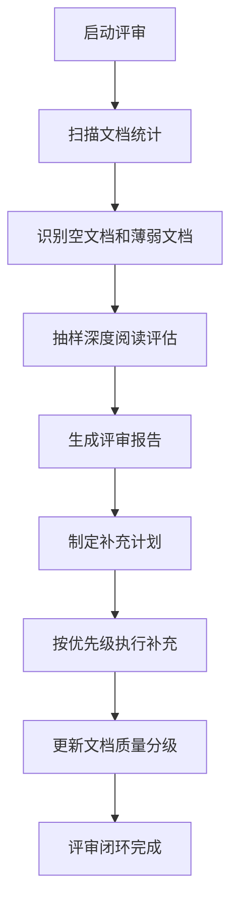

# 🔍 知识库体系评审与补充目录

> **文档说明**：本文档是知识库质量保障的核心评审框架，系统定义知识库的评审维度、评估标准、缺口识别方法和补充优先级策略。通过定期评审确保知识库内容覆盖完整、结构清晰、质量一致，支撑从新手到专家的渐进式学习。
>
> **适用人群**：知识库维护者、学习路径设计者、需要系统梳理知识体系的工程师
>
> **评审周期**：建议每月一次轻量评审，每季度一次全面评审

---

## 一、评审维度体系

### 1.1 六维质量评估模型

| 维度 | 评估要点 | 权重 | 评估方法 |
|------|---------|------|---------|
| **内容丰富度** | 知识点深度与广度、覆盖完整性、示例充足性 | 25% | 抽样阅读+覆盖率统计 |
| **结构合理性** | 章节划分、层级逻辑、分类准确性、导航清晰性 | 20% | 目录审查+链接分析 |
| **解析细致度** | 概念解释、原理剖析、代码示例、实战指导 | 25% | 抽样深度阅读 |
| **视觉美观度** | 排版规范、标题层级、代码块、表格、图表 | 10% | 视觉检查+格式校验 |
| **链接有效性** | 双向链接完整性、死链检测、关联合理性 | 10% | 死链扫描+图谱分析 |
| **学习友好度** | 入门引导、阶段划分、验收标准、避坑指南 | 10% | 新手视角测试 |

### 1.2 文档质量分级标准

| 等级 | 标准 | 占比目标 | 处理策略 |
|------|------|---------|---------|
| **S级（标杆）** | 六维全优，可作为编写范本 | ≥15% | 保持，作为参考标准 |
| **A级（优秀）** | 内容完整，结构清晰，解析透彻 | ≥40% | 定期更新，补充新内容 |
| **B级（合格）** | 内容基本完整，有少量可优化点 | ≥30% | 按优先级逐步优化 |
| **C级（薄弱）** | 内容缺失或结构混乱，需重点补充 | ≤15% | 列入补充计划，优先填补 |
| **D级（空壳）** | 仅有标题或框架，无实质内容 | 0% | 立即填补或删除 |

---

## 二、内容覆盖评审

### 2.1 全栈技术覆盖矩阵

| 领域 | 子领域 | 应有知识点 | 已有笔记 | 覆盖率 | 缺口 |
|------|--------|-----------|---------|--------|------|
| 前端开发 | HTML/CSS | 15 | 12 | 80% | CSS架构、容器查询 |
| 前端开发 | JavaScript | 25 | 22 | 88% | 装饰器、Shadow DOM |
| 前端开发 | Vue3生态 | 20 | 18 | 90% | Nuxt3深度、测试 |
| 前端开发 | 工程化 | 15 | 13 | 87% | 微前端、Module Federation |
| 后端开发 | Java核心 | 30 | 28 | 93% | 虚拟线程、结构化并发 |
| 后端开发 | Spring生态 | 25 | 23 | 92% | Spring AI、Spring Modulith |
| 后端开发 | 微服务 | 20 | 17 | 85% | Service Mesh深度、eBPF |
| 后端开发 | Python全栈 | 25 | 22 | 88% | Django、Tornado |
| 数据库 | MySQL | 20 | 18 | 90% | 窗口函数、CTE递归 |
| 数据库 | Redis | 15 | 13 | 87% | Redis Streams、RedisJSON |
| 数据库 | 分布式 | 15 | 10 | 67% | TiDB、CockroachDB |
| 云原生 | Docker | 12 | 10 | 83% | BuildKit、镜像签名 |
| 云原生 | K8s | 20 | 16 | 80% | Operator开发、CRD深度 |
| 云原生 | 可观测 | 15 | 12 | 80% | OpenTelemetry深度、eBPF |
| AI工程 | 大模型 | 20 | 18 | 90% | 扩散模型、强化学习 |
| AI工程 | RAG | 15 | 14 | 93% | 多模态RAG深度 |
| AI工程 | Agent | 18 | 15 | 83% | Agent评估、多Agent深度 |
| AI工程 | 推理部署 | 15 | 10 | 67% | 训练框架、分布式推理 |

### 2.2 缺口分类与优先级

#### P0（紧急补充）
- 推理部署领域覆盖率仅67%，缺少分布式推理、训练框架相关笔记
- 分布式数据库覆盖率67%，缺少NewSQL数据库实践
- 部分空文档需立即填补（见第三节）

#### P1（计划补充）
- 微前端架构与Module Federation实战
- Service Mesh深度实践与eBPF可观测
- K8s Operator开发与CRD设计
- 多模态RAG深度实践

#### P2（持续完善）
- Java虚拟线程与结构化并发
- Spring AI与Spring Modulith
- CSS容器查询与新布局特性
- 各领域面试题与解析补充

---

## 三、文档质量评审清单

### 3.1 单篇文档评审检查项

#### 内容维度
- [ ] Frontmatter元数据完整（title/tags/category/difficulty/created/updated）
- [ ] 文档说明清晰（适用人群、前置知识、学习目标）
- [ ] 核心概念定义准确，有深度解析（作用+原理+用法）
- [ ] 包含代码示例，且示例可运行、有注释
- [ ] 包含实战场景或项目应用指导
- [ ] 包含常见错误与排查方案
- [ ] 包含最佳实践与进阶技巧
- [ ] 包含相关文档双向链接

#### 结构维度
- [ ] 标题层级规范（H1→H2→H3，不跳级）
- [ ] 章节逻辑递进（概念→原理→实操→问题→拓展）
- [ ] 使用表格整理对比性内容
- [ ] 使用列表整理步骤性内容
- [ ] 使用代码块展示代码
- [ ] 使用Mermaid图表展示流程/架构
- [ ] 章节间有过渡说明

#### 视觉维度
- [ ] 排版整洁，无多余空行
- [ ] 代码块指定语言类型
- [ ] 表格对齐规范
- [ ] 重要内容使用引用块或加粗
- [ ] 无乱码、无格式错误

### 3.2 批量评审执行流程



---

## 四、补充目录与行动计划

### 4.1 当前待补充文档清单

| 优先级 | 文档名称 | 所属领域 | 缺口类型 | 预计工作量 |
|--------|---------|---------|---------|-----------|
| P0 | 分布式推理与训练框架 | AI工程/推理部署 | 内容缺失 | 4小时 |
| P0 | NewSQL数据库实践 | 数据库/分布式 | 内容缺失 | 3小时 |
| P1 | 微前端架构实战 | 前端/工程化 | 内容缺失 | 4小时 |
| P1 | Service Mesh深度 | 后端/微服务 | 内容薄弱 | 3小时 |
| P1 | K8s Operator开发 | 云原生/K8s | 内容缺失 | 4小时 |
| P2 | Java虚拟线程 | 后端/Java核心 | 内容缺失 | 2小时 |
| P2 | CSS容器查询 | 前端/CSS | 内容缺失 | 1小时 |

### 4.2 补充执行策略

#### 批量补充流程
1. **定位缺口**：通过覆盖率矩阵和评审清单识别缺口
2. **制定大纲**：为每个待补充文档制定三级大纲
3. **按模板编写**：遵循[[笔记模板]]和[[编写规范与质量标准]]
4. **交叉链接**：补充完成后添加双向链接到相关文档
5. **质量校验**：按评审检查项自检，确保达到B级以上

#### 编写标准参考
- 标杆文档：[[Java知识点完整整合大全_优化版]]
- 编写规范：[[编写规范与质量标准]]
- 笔记模板：[[笔记模板]]
- 原子化笔记规范：[[原子化笔记规范]]

---

## 五、学习路径评审

### 5.1 学习路径完整性检查

| 检查项 | 状态 | 说明 |
|--------|------|------|
| 四阶段划分清晰 | ✅ | 入门/进阶/高级/专家 |
| 每阶段有明确学习目标 | ✅ | 各阶段指南文档 |
| 每阶段有验收标准 | ✅ | Checklist形式 |
| 每阶段有项目实战 | ✅ | 递进式项目路线 |
| 知识点有前置依赖 | ✅ | 学习依赖图谱 |
| 有阶段过渡指导 | ✅ | 阶段过渡桥梁指南 |
| 有学习进度追踪 | ✅ | Obsidian进度追踪体系 |
| AI与全栈融合 | ✅ | 双轨融合路线图 |

### 5.2 学习路径优化方向

1. **增加技能树可视化**：为每个阶段生成技能树图，直观展示技能依赖
2. **增加时间估算**：为每个知识点标注建议学习时长
3. **增加难度标注**：统一使用🟢入门/🟡进阶/🔴高级/👑专家四级
4. **增加资源推荐**：为每个知识点推荐优质外部学习资源
5. **增加自测题**：每阶段配套自测题和答案解析

---

## 六、评审工具与自动化

### 6.1 自动化检查脚本

| 检查项 | 工具/方法 | 频率 |
|--------|---------|------|
| 死链检测 | Obsidian插件+脚本扫描 | 每周 |
| 空文档检测 | Python脚本扫描文件大小 | 每周 |
| 标签统计 | Dataview查询 | 每月 |
| 覆盖率统计 | 脚本统计各领域笔记数 | 每月 |
| 格式校验 | markdownlint | 每次提交 |

### 6.2 评审记录模板

```markdown
## 评审记录

### 2026-XX-XX 评审
- **评审范围**：XX领域 XX篇文档
- **评审人**：XXX
- **S级**：X篇 | A级：X篇 | B级：X篇 | C级：X篇 | D级：X篇
- **主要问题**：
  1. ...
  2. ...
- **补充计划**：
  - [ ] P0: ...
  - [ ] P1: ...
- **下次评审**：2026-XX-XX
```

---

## 七、关联文档

### 维护工具
- [[知识库健康度评估指标]] — 知识库整体健康度评估
- [[知识库覆盖度扫描与缺口分析]] — 覆盖度扫描与缺口
- [[知识库优化方案与执行报告]] — 优化执行记录
- [[Obsidian学习进度追踪体系]] — 学习进度管理

### 编写规范
- [[编写规范与质量标准]] — 统一编写标准
- [[笔记模板]] — 标准笔记模板
- [[原子化笔记规范]] — 原子化笔记规范
- [[标签命名规范]] — 标签体系规范

### 学习路径
- [[全栈+AI工程双轨融合学习路线图]] — 主学习路线
- [[全栈开发从入门到精通学习路径指南]] — 纯全栈路线
- [[分阶段项目实战递进路线]] — 项目学习顺序
- [[学习依赖图谱与前置知识导航]] — 学习依赖

---

> 💡 **使用建议**：每月执行一次轻量评审（死链+空文档+标签统计），每季度执行一次全面评审（六维质量评估+覆盖率统计+补充计划）。评审结果记录在本文档的"评审记录"部分，确保知识库质量持续提升。
