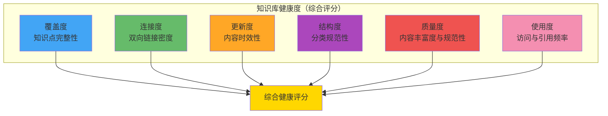

# 📊 知识库健康度评估指标

> **文档说明**：系统讲解知识库健康度的量化评估体系，包括六大健康维度（覆盖度、连接度、更新度、结构度、质量度、使用度）、具体评估指标与计算公式、Dataview 查询与脚本统计方法、健康度评分模型、月度评估流程、常见问题诊断与改进建议。
>
> **适用人群**：知识库维护者、知识管理从业者、全栈/AI 学习者、需要系统化管理个人知识库的内容创作者
>
> **前置知识**：[[知识库覆盖扫描与补全清单_优化版]] · [[知识库文档统一编写标准v2]] · [[质量校验规则]]

---

## 一、概述

### 1. 什么是知识库健康度

```text
知识库健康度（Knowledge Base Health Score）：
- 量化评估知识库整体质量和可用性的综合指标
- 类似"体检报告"，从多个维度评估知识库的"健康状态"
- 目标：发现问题（孤岛笔记、过时内容、死链、结构混乱），指导维护和优化
- 核心思想：可量化才能可改进，可度量才能可管理

为什么需要健康度评估：
1. 发现隐性问题
   - 孤岛笔记（无入链无出链）看似存在，实际无法被访问
   - 死链（指向不存在的笔记）破坏导航体验
   - 过时内容（技术已更新但笔记未更新）误导学习者
   - 这些问题不通过量化评估很难发现

2. 指导维护优先级
   - 健康度低的板块优先补全
   - 高频引用但质量低的笔记优先重写
   - 孤岛笔记优先建立连接

3. 追踪改进效果
   - 月度对比，看健康度是否提升
   - 量化维护工作的价值
   - 避免"越维护越乱"

4. 保障学习体验
   - 健康的知识库 = 可导航、可检索、可信赖
   - 学习者能快速找到所需内容
   - 内容准确、不过时、结构清晰
```

### 2. 健康度评估的六大维度



| 维度 | 核心问题 | 权重 | 评估方式 |
|------|---------|------|---------|
| **覆盖度** | 知识点是否完整？有无盲区？ | 20% | 按学习路线框架核对主题覆盖率 |
| **连接度** | 笔记之间是否互联？有无孤岛？ | 20% | 统计双向链接密度、孤岛笔记比例、死链率 |
| **更新度** | 内容是否过时？是否持续维护？ | 15% | 统计未更新笔记比例、平均更新时间 |
| **结构度** | 分类是否规范？MOC 是否完善？ | 15% | 检查目录结构、MOC 覆盖率、标签规范性 |
| **质量度** | 内容是否丰富规范？符合编写标准？ | 20% | 按四维标准抽查、统计薄文档比例、Frontmatter 完整率 |
| **使用度** | 笔记是否被访问和引用？ | 10% | 统计引用次数、高频笔记、零引用笔记比例 |

---

## 二、覆盖度评估

### 1. 核心指标

| 指标 | 计算公式 | 目标值 | 说明 |
|------|---------|--------|------|
| **核心主题覆盖率** | 已覆盖主题数 / 学习路线规划主题数 × 100% | ≥ 90% | 按全栈+AI 双轨融合学习路线核对 |
| **板块文档数均衡度** | 最小板块文档数 / 最大板块文档数 × 100% | ≥ 50% | 避免某板块过于薄弱 |
| **P0 盲区数量** | 完全缺失的核心领域数量 | = 0 | 参见《覆盖扫描与补全清单》P0 列表 |
| **空文档比例** | 空文档数 / 总文档数 × 100% | ≤ 1% | 有标题但无实质内容的文档 |
| **薄文档比例** | <3000字文档数 / 总文档数 × 100% | ≤ 20% | 内容过于单薄的文档 |

### 2. 评估方法

```text
覆盖度评估流程：
1. 建立知识体系框架（参考《全栈+AI工程双轨融合学习路线图》）
2. 列出每个板块的核心主题清单（如前端：HTML/CSS/JS/Vue3/React/TS/工程化/性能/安全）
3. 核对每个主题是否有对应文档
4. 统计覆盖率，标记盲区
5. 按优先级制定补全计划

Dataview 查询 - 各板块文档数统计：
```
TABLE length(rows) AS 文档数
FROM ""
WHERE file.name != "Home"
GROUP BY category
SORT 文档数 DESC
```text

Dataview 查询 - 空文档检测：
```
TABLE file.size AS 文件大小, file.mtime AS 最后修改
FROM ""
WHERE file.size < 500 AND file.name != "Home"
SORT file.size ASC
```
```

---

## 三、连接度评估

### 1. 核心指标

| 指标 | 计算公式 | 目标值 | 说明 |
|------|---------|--------|------|
| **平均入链数** | 总入链数 / 总文档数 | ≥ 3 | 每篇文档平均被多少篇引用 |
| **平均出链数** | 总出链数 / 总文档数 | ≥ 5 | 每篇文档平均引用多少篇 |
| **孤岛笔记比例** | 无入链且无出链的文档数 / 总文档数 × 100% | ≤ 5% | 完全孤立的笔记 |
| **死链率** | 指向不存在笔记的链接数 / 总链接数 × 100% | ≤ 2% | 破损的双向链接 |
| **MOC 覆盖率** | 被 MOC 收录的文档数 / 总文档数 × 100% | ≥ 80% | 文档是否在导航体系中 |
| **网络密度** | 实际链接数 / 最大可能链接数 × 100% | ≥ 10% | 知识网络的连接紧密程度 |

### 2. Dataview 查询

```dataview
TABLE length(file.inlinks) AS 入链, length(file.outlinks) AS 出链
FROM ""
WHERE length(file.inlinks) = 0 AND length(file.outlinks) = 0 AND file.name != "Home"
SORT file.mtime DESC
```

```dataview
TABLE length(file.inlinks) AS 入链数, length(file.outlinks) AS 出链数
FROM ""
WHERE file.name != "Home"
SORT length(file.inlinks) ASC
LIMIT 20
```

```dataview
TABLE length(file.inlinks) AS 被引用次数
FROM ""
WHERE file.name != "Home"
SORT length(file.inlinks) DESC
LIMIT 20
```

### 3. 死链检测方法

```
死链（Broken Link）检测：
1. Obsidian 内置：设置 → 核心插件 → "反向链接" 面板可看到未创建的链接
2. 插件：Checksum、Broken Links 等插件可批量扫描
3. 手动：搜索 `\[\[(.+?)\]\]` 正则，核对每个链接是否有对应文件
4. 脚本：用 PowerShell/Python 批量扫描所有 .md 文件，提取 [[]] 链接，核对文件是否存在

PowerShell 死链扫描脚本：
```
$root = "知识库路径"
$files = Get-ChildItem -Path $root -Recurse -Filter "*.md"
$allNames = $files.BaseName
$brokenLinks = @{}

foreach ($file in $files) {
    $content = Get-Content $file.FullName -Raw
    $matches = [regex]::Matches($content, '\[\[([^\]|#]+)')
    foreach ($m in $matches) {
        $link = $m.Groups[1].Value.Trim()
        if ($allNames -notcontains $link -and -not $brokenLinks.ContainsKey($link)) {
            $brokenLinks[$link] = @()
        }
        if ($allNames -notcontains $link) {
            $brokenLinks[$link] += $file.Name
        }
    }
}

Write-Host "=== 死链列表 ==="
$brokenLinks.GetEnumerator() | ForEach-Object {
    Write-Host "缺失笔记: $($_.Key) (被 $($_.Value.Count) 篇引用)"
}
```
```

---

## 四、更新度评估

### 1. 核心指标

| 指标 | 计算公式 | 目标值 | 说明 |
|------|---------|--------|------|
| **3个月未更新比例** | 超过90天未更新的文档数 / 总文档数 × 100% | ≤ 15% | 内容可能过时 |
| **6个月未更新比例** | 超过180天未更新的文档数 / 总文档数 × 100% | ≤ 5% | 高风险过时 |
| **平均更新间隔** | 所有文档的 (当前日期 - 最后更新日期) 平均值 | ≤ 45天 | 整体维护频率 |
| **过时标记比例** | 标记 `#过时` 的文档数 / 总文档数 × 100% | ≤ 3% | 已识别的过时内容 |
| **版本标注率** | 标注技术版本的文档数 / 技术类文档数 × 100% | ≥ 60% | 便于判断时效性 |

### 2. Dataview 查询

```dataview
TABLE file.mtime AS 最后更新, date(today) - file.mtime AS 未更新天数
FROM ""
WHERE file.mtime < date(today) - dur(90 days) AND file.name != "Home"
SORT file.mtime ASC
LIMIT 30
```

```dataview
TABLE length(rows) AS 文档数
FROM ""
WHERE file.name != "Home"
FLATTEN choice(file.mtime > date(today) - dur(30 days), "1月内",
    choice(file.mtime > date(today) - dur(90 days), "1-3月",
    choice(file.mtime > date(today) - dur(180 days), "3-6月", "6月以上"))) AS 更新区间
GROUP BY 更新区间
SORT 更新区间 ASC
```

---

## 五、结构度评估

### 1. 核心指标

| 指标 | 计算公式 | 目标值 | 说明 |
|------|---------|--------|------|
| **目录结构合规率** | 符合命名规范的目录数 / 总目录数 × 100% | ≥ 95% | 目录命名是否规范 |
| **MOC 完整率** | 有对应 MOC 的二级目录数 / 总二级目录数 × 100% | = 100% | 每个子板块都有导航 |
| **Frontmatter 完整率** | Frontmatter 字段完整的文档数 / 总文档数 × 100% | ≥ 90% | title/tags/category/difficulty/created/updated |
| **标签合规率** | 标签符合规范的文档数 / 总文档数 × 100% | ≥ 85% | 参见《标签命名规范》 |
| **文档命名规范率** | 文件名符合规范的文档数 / 总文档数 × 100% | ≥ 95% | 中文命名、无空格、简洁明确 |
| **层级深度合理率** | 目录层级 ≤ 4 级的文档数 / 总文档数 × 100% | ≥ 90% | 避免过深的目录嵌套 |

### 2. 评估要点

```
结构度评估检查清单：
- [ ] 一级目录：00-综合导航 ~ 09-AI与效率工具，命名规范（序号-名称）
- [ ] 二级目录：每个一级目录下有清晰的子分类
- [ ] MOC：每个二级目录有对应的 MOC/枢纽笔记
- [ ] Home：首页导航完整，可到达所有板块
- [ ] Frontmatter：每篇文档有 title/tags/category/difficulty/created/updated
- [ ] 标签：3-8个，符合《标签命名规范》
- [ ] 文件名：中文命名，无空格，与 H1 标题一致
- [ ] 目录层级：不超过 4 级（一级/二级/三级/文档）
- [ ] 无重复文档：同一主题没有多篇重复文档
- [ ] 无散落文档：所有文档都在对应目录下，不在根目录散落
```

---

## 六、质量度评估

### 1. 核心指标

| 指标 | 计算公式 | 目标值 | 说明 |
|------|---------|--------|------|
| **四维达标率** | 按《编写标准v2》四维标准达标的文档数 / 抽查文档数 × 100% | ≥ 70% | 内容丰富度/结构合理性/解析细致度/视觉美观性 |
| **六段式结构合规率** | 遵循六段式结构的技术文档数 / 技术文档总数 × 100% | ≥ 80% | 概述/原理/实操/问题/最佳实践/关联笔记 |
| **代码示例覆盖率** | 有代码示例的技术文档数 / 技术文档总数 × 100% | ≥ 85% | 实操类文档必须有代码 |
| **常见问题达标率** | 常见问题 ≥ 8个的文档数 / 技术文档总数 × 100% | ≥ 70% | 问题排查章节 |
| **图示覆盖率** | 有 Mermaid/HTML 图示的文档数 / 技术文档总数 × 100% | ≥ 75% | 架构/流程图 |
| **关联笔记达标率** | 关联笔记 ≥ 8篇的文档数 / 技术文档总数 × 100% | ≥ 75% | 双向链接丰富度 |

### 2. 四维质量抽查方法

```
质量度抽查流程（每月执行）：
1. 随机抽取 10% 的文档（不少于 20 篇）
2. 按《知识库文档统一编写标准v2》四维标准逐篇评分
3. 每维 0-25 分，总分 100 分
4. 统计平均分、各维度得分、达标率（≥70分）

四维评分细则：
【内容丰富度】（25分）
- 六模块齐全（10分）：缺一个模块扣2分
- 代码示例（5分）：≥3个5分，1-2个3分，0个0分
- 常见问题（5分）：≥8个5分，4-7个3分，<4个0分
- 关联笔记（5分）：≥8篇5分，4-7篇3分，<4篇0分

【结构合理性】（25分）
- 六段式结构（10分）：严格遵循10分，基本遵循7分，混乱0分
- 标题层级（5分）：≤4级且编号规范5分，有问题酌情扣分
- 逻辑递进（5分）：由浅入深5分，逻辑混乱0分
- 深度讲解+总结（5分）：每节都有5分，部分有3分，没有0分

【解析细致程度】（25分）
- 原理深度（10分）：讲透"为什么"10分，只讲"是什么"5分，无原理0分
- 代码注释（5分）：注释率≥30%5分，有注释3分，无注释0分
- 问题分析（5分）：现象→原因→方案三要素5分，缺要素酌情扣分
- 三位一体解析（5分）：核心知识点有作用/原理/用法5分，部分有3分

【视觉美观性】（25分）
- 内联HTML动画图（5分）：≥1个5分，没有0分
- Mermaid图（5分）：≥1个5分，没有0分
- 表格使用（5分）：对比内容用表格5分，该用不用酌情扣分
- 代码块规范（5分）：有语言标注5分，部分有3分，没有0分
- 排版整洁（5分）：空行/标题/列表规范5分，混乱酌情扣分

评分等级：
- 优秀（A）：≥90分
- 良好（B）：70-89分
- 合格（C）：60-69分
- 不合格（D）：<60分，需重写
```

---

## 七、使用度评估

### 1. 核心指标

| 指标 | 计算公式 | 目标值 | 说明 |
|------|---------|--------|------|
| **零引用笔记比例** | 入链=0的文档数 / 总文档数 × 100% | ≤ 15% | 从未被引用的笔记 |
| **高频笔记占比** | 入链≥10的文档数 / 总文档数 × 100% | ≥ 10% | 核心枢纽笔记 |
| **平均引用次数** | 总入链数 / 总文档数 | ≥ 3 | 整体引用密度 |
| **MOC 引用覆盖率** | 被至少一个 MOC 引用的文档数 / 总文档数 × 100% | ≥ 80% | 在导航体系中的比例 |
| **学习路线关联率** | 出现在学习路线中的文档数 / 核心文档数 × 100% | ≥ 90% | 核心文档是否在学习路径中 |

### 2. 使用度分析的价值

```
使用度评估的意义：
1. 发现核心笔记（高频引用）→ 优先保证质量，优先重写
2. 发现僵尸笔记（零引用）→ 要么建立连接，要么考虑删除/合并
3. 发现枢纽笔记（MOC）→ 确保导航完整
4. 评估知识网络的健康度 → 连接越丰富，知识网络越健壮

零引用笔记处理策略：
- 有价值但未被引用 → 在相关 MOC 和笔记中添加链接
- 内容重复 → 合并到主笔记，删除重复
- 内容过时 → 更新或标记 #过时
- 无价值 → 删除（谨慎，先确认无引用）
```

---

## 八、健康度综合评分模型

### 1. 加权评分公式

```
综合健康度评分 = 
    覆盖度 × 20% + 
    连接度 × 20% + 
    更新度 × 15% + 
    结构度 × 15% + 
    质量度 × 20% + 
    使用度 × 10%

各维度评分（0-100分）：
- 覆盖度：核心主题覆盖率 × 100
- 连接度：(1 - 孤岛比例) × 50 + (1 - 死链率) × 30 + MOC覆盖率 × 20
- 更新度：(1 - 3月未更新比例) × 60 + (1 - 6月未更新比例) × 40
- 结构度：Frontmatter完整率 × 40 + MOC完整率 × 30 + 标签合规率 × 30
- 质量度：四维抽查平均分
- 使用度：(1 - 零引用比例) × 50 + 高频笔记占比 × 30 + MOC引用覆盖率 × 20
```

### 2. 健康度等级

| 等级 | 分数 | 状态 | 行动建议 |
|------|------|------|---------|
| 🟢 **优秀** | ≥ 85分 | 知识库健康，体系完善 | 持续维护，定期优化，深化内容 |
| 🟡 **良好** | 70-84分 | 基本健康，有改进空间 | 针对低分维度重点改进，补全薄弱环节 |
| 🟠 **一般** | 60-69分 | 存在明显问题，需关注 | 制定专项改进计划，优先解决 P0 问题 |
| 🔴 **较差** | < 60分 | 问题严重，需重构 | 全面梳理，系统性重构，可能需要重新组织 |

### 3. 月度健康度报告模板

```
📊 知识库月度健康度报告 - 2026年8月

【综合评分】78分（🟡 良好）
较上月：+5分（提升中）

【各维度得分】
- 覆盖度：82分（🟡）↑3
- 连接度：75分（🟡）↑8
- 更新度：85分（🟢）→0
- 结构度：88分（🟢）↑2
- 质量度：70分（🟡）↑10
- 使用度：72分（🟡）↑5

【关键指标】
- 总文档数：628篇（+35篇）
- 核心主题覆盖率：82%（目标90%）
- 孤岛笔记比例：8%（目标≤5%）
- 死链率：3%（目标≤2%）
- 3月未更新比例：12%（目标≤15%）
- 薄文档比例：25%（目标≤20%）

【本月完成】
- 完成第25-28批深度重写（28篇）
- 清理死链 45 个
- 新建 MOC 3 个
- 补全 P0 盲区 2 个

【下月重点】
1. 继续薄文档重写（目标：薄文档比例降至20%）
2. 清理剩余死链（目标：死链率≤2%）
3. 处理孤岛笔记（目标：孤岛比例≤5%）
4. 补全前端板块 P1 盲区（React/TypeScript）
5. 完善间隔重复复习体系
```

---

## 九、常见问题与改进建议

| 问题 | 诊断 | 改进建议 |
|------|------|---------|
| **孤岛笔记多** | 笔记创建后未建立双向链接，未在 MOC 中登记 | 每篇笔记创建后立即添加 3-5 个双向链接；在对应 MOC 中登记；月度扫描零引用笔记并补链 |
| **死链率高** | 链接了尚未创建的笔记，或笔记改名后未更新引用 | 新建笔记时先确认目标笔记存在；改名时用全局替换更新所有引用；月度用脚本扫描死链并批量创建/修正 |
| **内容过时** | 技术更新快但笔记未同步更新 | 技术类笔记标注版本号；订阅技术更新资讯；月度扫描 6 月未更新笔记；过时内容标记 `#过时` 或更新 |
| **薄文档多** | 框架搭建快但内容填充慢 | 按文件大小排序逐批重写；每篇重写后扩展 3-5 倍；优先重写高频引用的薄文档 |
| **MOC 不完善** | 新建板块后未及时创建 MOC | 每个二级目录必须有 MOC；MOC 包含该板块所有文档链接；月度检查 MOC 覆盖率 |
| **标签混乱** | 随意创建标签，同义词重复 | 遵循《标签命名规范》；新标签使用≥3次才纳入正式体系；月度审计低频标签并合并；用 Tag Wrangler 插件批量管理 |
| **Frontmatter 不完整** | 新建文档时未填写完整元数据 | 使用模板自动生成 Frontmatter；月度扫描缺失字段的文档；核心字段（title/tags/category/difficulty）必须填写 |
| **目录结构混乱** | 文档随意放置，分类不清晰 | 遵循统一目录结构（一级/二级/三级）；文档按主题归类，不散落根目录；月度整理不符合规范的文档 |
| **重复文档** | 同一主题创建了多篇内容重叠的笔记 | 创建前先搜索是否已有相关笔记；重复内容合并到主笔记；删除冗余文档；月度用相似度检测工具扫描 |
| **质量参差不齐** | 不同时间/不同状态下创建的文档标准不一 | 统一遵循《编写标准v2》；按批次重写不达标文档；建立质量自查清单；新文档必须通过质量检查才标记 `#已审核` |

---

## 十、最佳实践

### 1. 评估机制

- [ ] **月度评估**：每月最后一周执行全面健康度评估，生成报告
- [ ] **周度小检查**：每周花 15 分钟检查新增文档的质量和链接
- [ ] **季度大回顾**：每季度做一次深度评估，调整维护策略
- [ ] **自动化脚本**：用 PowerShell/Python 脚本自动统计指标，减少人工工作量
- [ ] **趋势追踪**：记录每月评分，绘制健康度趋势图，看长期变化

### 2. 维护工作流

- [ ] **周度小维护**（30分钟）：处理新增文档的链接和标签，清理少量死链
- [ ] **月度大维护**（2-3小时）：全面健康度评估，批量重写薄文档，清理孤岛和死链
- [ ] **季度重构**（半天）：调整目录结构，合并重复文档，更新 MOC，优化学习路线
- [ ] **年度盘点**（1天）：全面回顾，重新规划下年度知识库建设方向

### 3. 工具推荐

- [ ] **Dataview**：动态查询和统计，生成健康度报告
- [ ] **Tag Wrangler**：批量管理标签，合并重命名
- [ ] **Checksum**：检测文件变化和死链
- [ ] **Graph Analysis**：图谱分析，发现孤岛和核心节点
- [ ] **PowerShell/Python 脚本**：批量统计、扫描、替换
- [ ] **Git**：版本管理，追踪变更，可回滚

### 4. 避免常见陷阱

- [ ] **不要只评估不行动**：评估发现问题后必须制定改进计划并执行
- [ ] **不要追求完美**：健康度 85 分已经很好，不必追求 100 分
- [ ] **不要频繁调整指标**：评估指标保持稳定，才能对比趋势
- [ ] **不要忽视质量度**：覆盖度和连接度容易提升，质量度才是核心
- [ ] **不要批量删除**：处理孤岛/过时笔记时先备份，确认无引用再删除
- [ ] **不要一次性大改**：结构调整分批进行，避免破坏现有链接

---

## 十一、关联笔记

### 知识库维护
- [[知识库覆盖扫描与补全清单_优化版]] · [[知识库持续优化机制]] · [[知识库维护报告与健康度]]
- [[质量校验规则]]

### 模板与规范
- [[知识库文档统一编写标准v2]] · [[标签命名规范]]

### 知识管理方法论
- [[间隔重复与记忆巩固]] · [[费曼学习法笔记实践]] · [[从输入到输出的知识转化]]
- [[GTD时间管理与知识管理结合]]

### 导航
- [[MOC-知识库维护]] · [[MOC-综合导航]] · [[MOC-模板与规范]] · [[Home]]

> **学习路径建议**：先阅读 [[知识库覆盖扫描与补全清单_优化版]] 了解覆盖盲区 → 学习本文档健康度评估体系 → 遵循 [[知识库文档统一编写标准v2]] 保证输出质量 → 用 [[质量校验规则]] 做自查 → 参考 [[标签命名规范]] 规范标签 → 按照 [[间隔重复与记忆巩固]] 设计复习卡片 → 每月执行健康度评估，持续优化知识库。

---

> **本文档为活文档，评估指标和权重可根据知识库发展阶段调整。每次调整后请记录变更历史和原因。**
