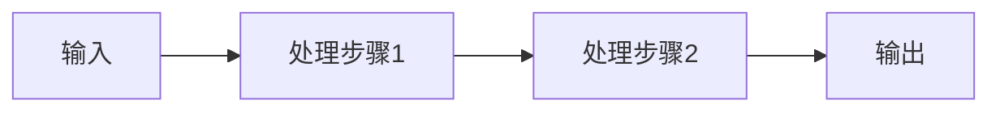

# {{title}}

> **文档说明**：本文档系统讲解{{title}}的核心概念、底层原理、实操用法、常见问题与最佳实践，帮助读者从入门到精通。
>
> **适用人群**：{{target_audience}}
>
> **前置知识**：{{prerequisites}}
>
> **学习目标**：
> 1. 理解{{title}}的核心概念与作用
> 2. 掌握{{title}}的底层原理与实现机制
> 3. 能够在实际项目中正确使用{{title}}
> 4. 能够排查{{title}}相关的常见问题

---

## 一、概述

### 1.1 什么是{{title}}

<!-- 用简洁的语言定义概念，说明它是什么、解决什么问题 -->

### 1.2 为什么需要{{title}}

| 痛点 | {{title}}的解决方案 |
|------|-------------------|
| 痛点1 | 解决方案1 |
| 痛点2 | 解决方案2 |

### 1.3 核心概念速览

| 概念 | 说明 |
|------|------|
| 概念1 | 说明1 |
| 概念2 | 说明2 |

---

## 二、底层原理

> 🔍 **三位一体深度解析**：每个核心知识点从「作用（解决什么问题）」「底层原理（核心逻辑）」「用法要点（实操示例）」三个维度拆解。

### 2.1 核心原理一

#### 作用

<!-- 这个知识点解决什么问题，在什么场景下使用 -->

#### 底层原理

<!-- 核心逻辑、算法、数据结构、执行流程 -->



#### 用法要点

```python
# 代码示例
def example():
    pass
```

### 2.2 核心原理二

#### 作用

#### 底层原理

#### 用法要点

---

## 三、实操用法

### 3.1 基础用法

<!-- 最基本的使用方式，从环境准备到第一个示例 -->

#### 环境准备

```bash
# 安装命令
```

#### 第一个示例

```python
# 最小可运行示例
```

### 3.2 进阶用法

<!-- 更复杂的使用场景、高级特性、配置优化 -->

### 3.3 实战场景

| 场景 | 方案 | 对应代码 |
|------|------|---------|
| 场景1 | 方案1 | 示例1 |
| 场景2 | 方案2 | 示例2 |

---

## 四、常见问题与排查

### 4.1 常见错误

| 错误现象 | 可能原因 | 解决方案 |
|---------|---------|---------|
| 错误1 | 原因1 | 方案1 |
| 错误2 | 原因2 | 方案2 |

### 4.2 性能优化

<!-- 性能瓶颈分析、优化策略、基准测试 -->

### 4.3 最佳实践

1. **实践一**：说明
2. **实践二**：说明
3. **实践三**：说明

---

## 五、知识拓展

### 5.1 相关技术对比

| 特性 | 技术A | 技术B | 技术C |
|------|-------|-------|-------|
| 特性1 | | | |
| 特性2 | | | |

### 5.2 生态与工具

<!-- 相关工具、库、框架、社区资源 -->

### 5.3 学习资源

- 官方文档：[链接]
- 推荐书籍：[书名]
- 优质教程：[链接]

---

## 六、关联文档

### 前置知识
- [[相关文档1]] — 前置概念说明
- [[相关文档2]] — 基础技能

### 后续延伸
- [[相关文档3]] — 进阶主题
- [[相关文档4]] — 实战项目

### 同领域笔记
- [[相关文档5]] — 相关技术
- [[相关文档6]] — 对比技术

---

## 七、学习记录

### 掌握程度自评

- [ ] 🟢 了解概念：能说出是什么、解决什么问题
- [ ] 🟡 基本使用：能照着示例写出来，理解基本原理
- [ ] 🔴 熟练掌握：能独立应用于项目，能排查常见问题
- [ ] 👑 深入精通：理解底层源码，能优化和创新

### 学习笔记

<!-- 记录学习过程中的思考、疑问、收获 -->

### 实践项目

- [ ] 项目1：说明
- [ ] 项目2：说明

---

> 💡 **使用提示**：本文档为标准笔记模板，新建笔记时复制本模板，替换`{{}}`中的占位内容。编写时遵循[[编写规范与质量标准]]，确保内容丰富度、结构合理性、解析细致度和视觉美观度与[[Java知识点完整整合大全_优化版]]保持同等水准。
