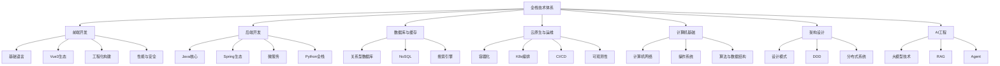
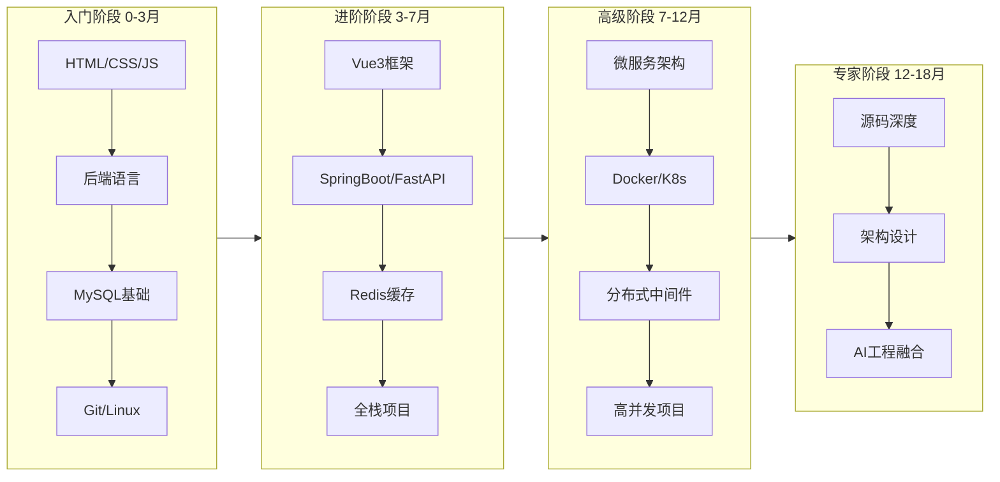

# 全栈技术知识点系统梳理大全（优化版）

> **文档说明**：本文档是全栈技术体系的全景索引，系统梳理前端、后端、数据库、运维、架构五大领域的核心知识点，每个知识点标注学习阶段、核心概念和对应笔记链接。旨在为学习者提供"按图索骥"的知识导航，快速定位任意技术点的学习资源。
>
> **整合来源**：基于知识库全部技术文档提炼归纳，覆盖11个一级分类、54个子领域、600+核心知识点。
>
> **适用人群**：全栈开发者、面试备考者、需要系统复习的工程师、技术架构师
>
> **使用方式**：按领域查阅知识点 → 点击对应笔记深入学习 → 在项目中实践验证

---

## 知识体系总览

---

## 第一篇：前端开发

> **本篇导言**：前端开发是用户直接交互的界面层，涵盖HTML/CSS/JavaScript基础、Vue3框架生态、工程化构建工具、性能优化与安全防护。现代前端已从"切页面"演进为完整的工程体系，TypeScript类型安全、组件化开发、构建优化是核心能力。

## 1. HTML与CSS基础

### 1.1 HTML5语义化

| 知识点 | 核心概念 | 学习阶段 | 对应笔记 |
|--------|---------|---------|---------|
| 语义化标签 | header/nav/main/article/section/aside/footer | 入门 | [[HTML5与CSS3基础入门]] |
| 表单与验证 | input类型、form验证、自定义验证 | 入门 | [[HTML5与CSS3基础入门]] |
| 多媒体 | video/audio/canvas/SVG | 进阶 | [[HTML5与CSS3基础入门]] |
| 无障碍访问 | ARIA属性、键盘导航、屏幕阅读器 | 高级 | [[前端性能与安全]] |

### 1.2 CSS3布局与样式

| 知识点 | 核心概念 | 学习阶段 | 对应笔记 |
|--------|---------|---------|---------|
| Flexbox布局 | 主轴/交叉轴、justify-content/align-items | 入门 | [[CSS3布局与样式基础]] |
| Grid布局 | 网格轨道、grid-template、区域命名 | 进阶 | [[CSS 进阶知识点系统梳理_优化版]] |
| 定位与层叠 | position、z-index、BFC、层叠上下文 | 进阶 | [[CSS 进阶知识点系统梳理_优化版]] |
| 响应式设计 | 媒体查询、rem/vw、移动优先 | 进阶 | [[CSS 进阶知识点系统梳理_优化版]] |
| CSS动画 | transition/animation/@keyframes、性能优化 | 进阶 | [[CSS 进阶知识点系统梳理_优化版]] |
| 预处理器 | Sass/Less、变量、混合、嵌套 | 进阶 | [[前端工程化知识点系统梳理_优化版]] |
| CSS架构 | BEM命名、CSS Modules、原子化CSS | 高级 | [[前端工程化知识点系统梳理_优化版]] |

## 2. JavaScript核心

### 2.1 语法与类型

| 知识点 | 核心概念 | 学习阶段 | 对应笔记 |
|--------|---------|---------|---------|
| 数据类型 | 原始类型/引用类型、类型转换、==与=== | 入门 | [[JavaScript核心语法与ES6+]] |
| 作用域与闭包 | 词法作用域、闭包原理、内存泄漏 | 进阶 | [[JavaScript 核心知识点系统梳理_优化版]] |
| 原型与继承 | 原型链、__proto__、class语法糖 | 进阶 | [[JavaScript 核心知识点系统梳理_优化版]] |
| this指向 | 隐式绑定/显式绑定/new绑定/箭头函数 | 进阶 | [[JavaScript 核心知识点系统梳理_优化版]] |
| 事件循环 | 调用栈、任务队列、微任务/宏任务 | 高级 | [[JavaScript 核心知识点系统梳理_优化版]] |

### 2.2 ES6+特性

| 知识点 | 核心概念 | 学习阶段 | 对应笔记 |
|--------|---------|---------|---------|
| 变量声明 | let/const、块级作用域、暂时性死区 | 入门 | [[JavaScript核心语法与ES6+]] |
| 解构赋值 | 数组/对象解构、默认值、嵌套解构 | 入门 | [[JavaScript核心语法与ES6+]] |
| 箭头函数 | 语法、this绑定、不适用场景 | 入门 | [[JavaScript核心语法与ES6+]] |
| Promise | 状态机、链式调用、错误处理 | 进阶 | [[JavaScript核心语法与ES6+]] |
| async/await | 语法糖、并发控制、错误处理 | 进阶 | [[JavaScript核心语法与ES6+]] |
| 模块化 | ES Module、import/export、动态导入 | 进阶 | [[JavaScript核心语法与ES6+]] |
| 迭代器与生成器 | Symbol.iterator、yield、异步迭代 | 高级 | [[JavaScript 核心知识点系统梳理_优化版]] |

### 2.3 异步编程

| 知识点 | 核心概念 | 学习阶段 | 对应笔记 |
|--------|---------|---------|---------|
| 回调函数 | 回调地狱、错误优先回调 | 入门 | [[JavaScript核心语法与ES6+]] |
| Promise | then/catch/finally、Promise.all/race/allSettled | 进阶 | [[JavaScript核心语法与ES6+]] |
| async/await | 同步写法、try/catch、并发模式 | 进阶 | [[JavaScript核心语法与ES6+]] |
| 事件循环 | 宏任务/微任务、执行顺序、Node.js差异 | 高级 | [[JavaScript 核心知识点系统梳理_优化版]] |
| 并发控制 | 限流、并发池、串行/并行/竞态 | 高级 | [[前端排查与进阶手册_优化版]] |

## 3. TypeScript

| 知识点 | 核心概念 | 学习阶段 | 对应笔记 |
|--------|---------|---------|---------|
| 基础类型 | string/number/boolean/array/tuple/enum | 入门 | [[Vue3+TypeScript核心知识点总结_优化版]] |
| 接口与类型 | interface/type、可选属性、只读 | 进阶 | [[Vue3+TypeScript核心知识点总结_优化版]] |
| 泛型 | 类型参数、约束、条件类型、映射类型 | 高级 | [[Vue3+TypeScript核心知识点总结_优化版]] |
| 类型守卫 | typeof/in/instanceof/自定义守卫 | 高级 | [[Vue3+TypeScript核心知识点总结_优化版]] |
| 装饰器 | 类装饰器、方法装饰器、参数装饰器 | 高级 | [[前端框架与TypeScript知识点完整整合大全_优化版]] |

## 4. Vue3框架

### 4.1 核心概念

| 知识点 | 核心概念 | 学习阶段 | 对应笔记 |
|--------|---------|---------|---------|
| Composition API | setup、ref/reactive、computed/watch | 入门 | [[Vue3快速上手_优化版]] |
| 响应式原理 | Proxy、依赖收集、触发更新、ref vs reactive | 进阶 | [[Vue3-响应式原理Proxy]] |
| 组件通信 | props/emit、provide/inject、pinia、事件总线 | 进阶 | [[Vue3-组件通信全方案]] |
| 生命周期 | onMounted/onUpdated/onUnmounted、父子执行顺序 | 入门 | [[Vue3 知识点系统梳理_优化版]] |
| 组合式函数 | useXxx模式、逻辑复用、状态封装 | 进阶 | [[Vue3-组合式API设计模式]] |

### 4.2 生态系统

| 知识点 | 核心概念 | 学习阶段 | 对应笔记 |
|--------|---------|---------|---------|
| Vue Router | 路由配置、导航守卫、动态路由、懒加载 | 进阶 | [[VueRouter-动态路由与权限]] |
| Pinia | state/getters/actions、持久化、模块化 | 进阶 | [[Pinia-状态管理核心]] |
| Element Plus | 组件使用、主题定制、二次封装 | 进阶 | [[ElementPlus-二次封装]] |
| Nuxt3 | SSR/SSG、自动导入、服务端渲染 | 高级 | [[前端框架与TypeScript知识点完整整合大全_优化版]] |
| Vite | 构建原理、插件开发、HMR、性能优化 | 进阶 | [[Vite-构建原理与插件开发]] |

## 5. 前端工程化

| 知识点 | 核心概念 | 学习阶段 | 对应笔记 |
|--------|---------|---------|---------|
| 包管理 | npm/pnpm/yarn、workspace、版本锁定 | 入门 | [[前端工程化知识点系统梳理_优化版]] |
| 代码规范 | ESLint/Prettier/Stylelint、Husky、lint-staged | 进阶 | [[ESLint+Prettier+Stylelint规范]] |
| 构建工具 | Vite/Webpack、loader/plugin、代码分割 | 进阶 | [[Vite-构建原理与插件开发]] |
| 单元测试 | Vitest/Jest、测试驱动、覆盖率 | 进阶 | [[前端工程化知识点系统梳理_优化版]] |
| CI/CD | GitHub Actions、自动化部署、环境管理 | 高级 | [[GitHub-Actions流水线设计]] |
| Monorepo | pnpm workspace、Turborepo、依赖管理 | 高级 | [[Monorepo架构与实践]] |

## 6. 前端性能与安全

| 知识点 | 核心概念 | 学习阶段 | 对应笔记 |
|--------|---------|---------|---------|
| 性能指标 | FP/FCP/LCP/CLS/TTI、Web Vitals | 进阶 | [[前端性能优化实战]] |
| 加载优化 | 代码分割、懒加载、预加载、资源压缩 | 进阶 | [[前端性能优化实战]] |
| 渲染优化 | 虚拟列表、防抖节流、requestAnimationFrame | 高级 | [[前端排查与进阶手册_优化版]] |
| XSS防护 | 转义、CSP、HttpOnly、输入校验 | 进阶 | [[前端安全防护]] |
| CSRF防护 | Token校验、SameSite、Referer校验 | 进阶 | [[前端安全防护]] |
| 依赖安全 | npm audit、Snyk、依赖锁定 | 高级 | [[前端安全防护]] |

---

## 第二篇：后端开发

> **本篇导言**：后端开发是业务逻辑和数据处理的核心层，涵盖Java/Python两大语言生态、Spring/FastAPI主流框架、微服务架构和中间件集成。后端工程师需要掌握语言核心、框架原理、数据访问、安全认证和系统设计能力。

## 1. Java核心

### 1.1 语言基础

| 知识点 | 核心概念 | 学习阶段 | 对应笔记 |
|--------|---------|---------|---------|
| 数据类型 | 基本类型/包装类、自动拆装箱、值传递 | 入门 | [[Java知识点完整整合大全_优化版]] |
| 面向对象 | 封装/继承/多态、抽象类/接口、内部类 | 入门 | [[Java知识点完整整合大全_优化版]] |
| 集合框架 | List/Set/Map、HashMap原理、并发集合 | 进阶 | [[Java知识点完整整合大全_优化版]] |
| 异常处理 | 受检/非受检异常、try-with-resources、自定义异常 | 入门 | [[Java知识点完整整合大全_优化版]] |
| 泛型 | 类型擦除、通配符、PECS原则 | 进阶 | [[Java知识点完整整合大全_优化版]] |

### 1.2 并发编程

| 知识点 | 核心概念 | 学习阶段 | 对应笔记 |
|--------|---------|---------|---------|
| 线程基础 | 线程状态、创建方式、线程池 | 进阶 | [[Java-并发编程JUC]] |
| 锁机制 | synchronized/ReentrantLock、AQS、读写锁 | 高级 | [[Java-并发编程JUC]] |
| 并发容器 | ConcurrentHashMap、BlockingQueue、CopyOnWrite | 高级 | [[Java-并发编程JUC]] |
| 原子类 | CAS、AtomicInteger、LongAdder | 高级 | [[Java-并发编程JUC]] |
| 线程池 | 核心参数、拒绝策略、线程池监控 | 高级 | [[Java-并发编程JUC]] |

### 1.3 JVM

| 知识点 | 核心概念 | 学习阶段 | 对应笔记 |
|--------|---------|---------|---------|
| 内存模型 | 堆/栈/方法区/程序计数器、对象创建 | 进阶 | [[JVM 知识点系统梳理_优化版]] |
| 垃圾回收 | GC算法、垃圾收集器、GC调优 | 高级 | [[JVM-内存模型与GC调优]] |
| 类加载 | 双亲委派、自定义类加载器、热部署 | 高级 | [[JVM 知识点系统梳理_优化版]] |
| 性能调优 | 内存泄漏、CPU飙高、Arthas诊断 | 高级 | [[JVM-调优工具实战-Arthas]] |

### 1.4 高级特性

| 知识点 | 核心概念 | 学习阶段 | 对应笔记 |
|--------|---------|---------|---------|
| Stream API | 中间操作/终端操作、并行流、收集器 | 进阶 | [[Java-语法进阶与StreamAPI]] |
| 反射与注解 | Class对象、动态代理、元注解 | 进阶 | [[Java知识点完整整合大全_优化版]] |
| IO/NIO | BIO/NIO/AIO、Channel/Buffer/Selector | 高级 | [[Java知识点完整整合大全_优化版]] |
| 新特性 | Record/Sealed类、模式匹配、虚拟线程 | 高级 | [[Java知识点完整整合大全_优化版]] |

## 2. Spring生态

### 2.1 Spring核心

| 知识点 | 核心概念 | 学习阶段 | 对应笔记 |
|--------|---------|---------|---------|
| IoC容器 | Bean定义、依赖注入、Bean生命周期 | 进阶 | [[Spring-IOCAOP核心机制]] |
| AOP | 代理模式、JDK/CGLIB代理、切面编程 | 进阶 | [[Spring-IOCAOP核心机制]] |
| 事务管理 | 传播行为、隔离级别、声明式事务 | 进阶 | [[Spring事务传播机制]] |
| 事件机制 | ApplicationEvent、观察者模式、异步事件 | 高级 | [[Spring-IOCAOP核心机制]] |

### 2.2 SpringBoot

| 知识点 | 核心概念 | 学习阶段 | 对应笔记 |
|--------|---------|---------|---------|
| 自动装配 | @SpringBootApplication、条件注解、starter | 进阶 | [[SpringBoot-自动装配原理]] |
| Web层 | Controller、参数绑定、统一异常处理 | 入门 | [[SpringBoot-Web层设计]] |
| 配置管理 | 多环境配置、外部化配置、配置刷新 | 进阶 | [[SpringBoot-配置管理与多环境]] |
| 数据访问 | MyBatis、JPA、事务管理、连接池 | 进阶 | [[SpringDataJPA与MyBatis对比]] |
| 安全认证 | SpringSecurity、JWT、OAuth2 | 进阶 | [[SpringSecurity-认证授权]] |

### 2.3 SpringCloud

| 知识点 | 核心概念 | 学习阶段 | 对应笔记 |
|--------|---------|---------|---------|
| 注册中心 | Nacos/Eureka、服务发现、健康检查 | 高级 | [[Nacos-注册中心与配置中心]] |
| 配置中心 | Nacos Config、动态刷新、配置加密 | 高级 | [[Nacos-注册中心与配置中心]] |
| 网关 | Gateway、路由、过滤器、限流 | 高级 | [[Gateway-网关路由与鉴权]] |
| 服务调用 | OpenFeign、负载均衡、超时重试 | 高级 | [[OpenFeign-服务间调用]] |
| 熔断降级 | Sentinel/Hystrix、限流、熔断、降级 | 高级 | [[Sentinel-流量控制与熔断]] |

## 3. Python全栈

### 3.1 Python核心

| 知识点 | 核心概念 | 学习阶段 | 对应笔记 |
|--------|---------|---------|---------|
| 语法基础 | 数据类型、控制流、函数、模块 | 入门 | [[Python-语法基础与数据结构]] |
| 面向对象 | 类/对象、继承、多态、元类 | 进阶 | [[Python-面向对象与元类]] |
| 装饰器 | 函数装饰器、类装饰器、带参数装饰器 | 进阶 | [[Python-装饰器与上下文管理器]] |
| 异步编程 | asyncio、协程、事件循环、aiohttp | 高级 | [[Python-异步编程asyncio]] |
| 性能优化 | C扩展、Cython、多进程/多线程 | 高级 | [[Python性能优化知识点系统梳理_优化版]] |

### 3.2 Web框架

| 知识点 | 核心概念 | 学习阶段 | 对应笔记 |
|--------|---------|---------|---------|
| FastAPI | 路由、依赖注入、Pydantic、自动文档 | 入门 | [[FastAPI-路由与依赖注入]] |
| 中间件 | 请求/响应处理、CORS、异常处理 | 进阶 | [[FastAPI-中间件与异常处理]] |
| 数据库 | SQLAlchemy ORM、迁移、连接池 | 进阶 | [[SQLAlchemy-ORM核心原理]] |
| 认证 | OAuth2、JWT、权限控制 | 进阶 | [[Python安全防护知识点系统梳理_优化版]] |
| 部署 | Gunicorn/Uvicorn、Docker、Nginx | 进阶 | [[Python部署运维知识点系统梳理_优化版]] |

---

## 第三篇：数据库与缓存

> **本篇导言**：数据库是数据存储和查询的核心，涵盖关系型数据库MySQL、缓存Redis、搜索引擎Elasticsearch和NoSQL数据库。掌握数据库原理、索引优化、事务管理和高可用方案是后端工程师的核心能力。

## 1. MySQL关系型数据库

| 知识点 | 核心概念 | 学习阶段 | 对应笔记 |
|--------|---------|---------|---------|
| 基础操作 | DDL/DML/DCL、表设计、数据类型 | 入门 | [[关系型数据库索引原理]] |
| 索引原理 | B+树、聚簇索引/非聚簇索引、覆盖索引 | 进阶 | [[关系型数据库索引原理]] |
| 事务管理 | ACID、隔离级别、MVCC、锁机制 | 进阶 | [[事务隔离级别与MVCC]] |
| 查询优化 | EXPLAIN分析、慢查询、索引优化 | 高级 | [[数据库执行计划分析]] |
| 主从复制 |  binlog、读写分离、半同步复制 | 高级 | [[数据库主从复制与读写分离]] |
| 分库分表 | 垂直/水平拆分、分片策略、分布式ID | 高级 | [[数据库分库分表策略]] |

## 2. Redis缓存

| 知识点 | 核心概念 | 学习阶段 | 对应笔记 |
|--------|---------|---------|---------|
| 数据结构 | String/Hash/List/Set/ZSet、使用场景 | 入门 | [[Redis数据结构与应用场景]] |
| 持久化 | RDB/AOF、混合持久化、数据恢复 | 进阶 | [[Redis数据结构与应用场景]] |
| 缓存策略 | 缓存穿透/击穿/雪崩、过期策略 | 进阶 | [[Redis-分布式锁与缓存穿透]] |
| 分布式锁 | RedLock、锁续期、锁释放 | 高级 | [[Redis-分布式锁与缓存穿透]] |
| 高可用 | 主从复制、哨兵、Cluster集群 | 高级 | [[Redis数据结构与应用场景]] |

## 3. Elasticsearch

| 知识点 | 核心概念 | 学习阶段 | 对应笔记 |
|--------|---------|---------|---------|
| 基础概念 | 索引/文档/分片/副本、倒排索引 | 进阶 | [[Elasticsearch-全文检索引擎]] |
| 查询DSL | match/term/bool/聚合分析 | 进阶 | [[Elasticsearch-全文检索引擎]] |
| 性能优化 | 分片策略、索引设计、查询优化 | 高级 | [[Elasticsearch-全文检索引擎]] |

---

## 第四篇：云原生与运维

> **本篇导言**：云原生是现代应用部署和运维的标准范式，涵盖容器化Docker、编排Kubernetes、CI/CD流水线和可观测性体系。掌握云原生技术是全栈工程师从"开发"到"交付"的关键能力。

## 1. Docker容器化

| 知识点 | 核心概念 | 学习阶段 | 对应笔记 |
|--------|---------|---------|---------|
| 核心概念 | 镜像/容器/仓库、命名空间、cgroups | 入门 | [[Docker-核心原理与镜像优化]] |
| Dockerfile | 指令、多阶段构建、镜像优化 | 进阶 | [[Dockerfile最佳实践]] |
| 网络与存储 | 桥接/主机网络、Volume、数据持久化 | 进阶 | [[Docker-核心原理与镜像优化]] |
| Compose编排 | 多容器编排、服务依赖、环境配置 | 进阶 | [[Docker-Compose编排]] |

## 2. Kubernetes

| 知识点 | 核心概念 | 学习阶段 | 对应笔记 |
|--------|---------|---------|---------|
| 核心概念 | Pod/Node/Namespace、集群架构 | 进阶 | [[K8s-核心概念与架构]] |
| 工作负载 | Deployment/StatefulSet/DaemonSet/Job | 进阶 | [[Pod与控制器Deployment]] |
| 服务发现 | Service/Ingress、DNS、负载均衡 | 进阶 | [[Service与Ingress]] |
| 配置管理 | ConfigMap/Secret、环境变量、配置挂载 | 进阶 | [[K8s-核心概念与架构]] |
| 资源管理 | Requests/Limits、HPA自动扩缩容 | 高级 | [[K8s-资源限制与HPA]] |
| Helm | Chart模板、仓库管理、版本管理 | 高级 | [[K8s-核心概念与架构]] |

## 3. CI/CD

| 知识点 | 核心概念 | 学习阶段 | 对应笔记 |
|--------|---------|---------|---------|
| GitHub Actions | Workflow、Job、Step、Action | 进阶 | [[GitHub-Actions流水线设计]] |
| Jenkins | Pipeline、插件、分布式构建 | 进阶 | [[Jenkins流水线实战]] |
| GitOps | ArgoCD、声明式部署、环境管理 | 高级 | [[ArgoCD-GitOps持续部署]] |

## 4. 可观测性

| 知识点 | 核心概念 | 学习阶段 | 对应笔记 |
|--------|---------|---------|---------|
| 指标监控 | Prometheus、Exporter、告警规则 | 进阶 | [[Prometheus-指标采集]] |
| 可视化 | Grafana、Dashboard、数据源 | 进阶 | [[Grafana-可视化看板]] |
| 日志聚合 | ELK/EFK、日志采集、结构化日志 | 进阶 | [[ELK-日志聚合]] |
| 链路追踪 | SkyWalking/Jaeger、Trace/Span、采样 | 高级 | [[SkyWalking-分布式链路追踪]] |

---

## 第五篇：计算机基础

> **本篇导言**：计算机基础是技术能力的基石，决定了工程师的成长上限。涵盖计算机网络、操作系统、算法与数据结构、设计模式四大核心领域，是面试必考和进阶必备的知识。

## 1. 计算机网络

| 知识点 | 核心概念 | 学习阶段 | 对应笔记 |
|--------|---------|---------|---------|
| OSI/TCP模型 | 七层/四层模型、封装与解封装 | 入门 | [[TCPIP协议栈详解]] |
| HTTP协议 | 方法/状态码/头部、缓存、连接管理 | 入门 | [[HTTP1.1-2-3演进]] |
| HTTPS | TLS握手、证书、对称/非对称加密 | 进阶 | [[HTTPS与TLS握手]] |
| TCP/UDP | 三次握手/四次挥手、流量控制、拥塞控制 | 进阶 | [[TCPIP协议栈详解]] |
| DNS | 解析过程、递归/迭代、缓存、CDN | 进阶 | [[DNS解析原理]] |
| HTTP/2/3 | 多路复用、头部压缩、QUIC协议 | 高级 | [[HTTP1.1-2-3演进]] |

## 2. 操作系统

| 知识点 | 核心概念 | 学习阶段 | 对应笔记 |
|--------|---------|---------|---------|
| 进程线程 | 进程/线程/协程、上下文切换 | 入门 | [[进程线程与协程]] |
| 内存管理 | 虚拟内存、分页、分段、缺页中断 | 进阶 | [[内存管理与虚拟内存]] |
| IO模型 | BIO/NIO/IO多路复用/异步IO | 高级 | [[IO模型与零拷贝]] |
| 进程间通信 | 管道/消息队列/共享内存/信号量 | 进阶 | [[进程线程与协程]] |
| Linux命令 | 文件/进程/网络/性能监控命令 | 入门 | [[Linux-运维常用命令手册]] |

## 3. 算法与数据结构

| 知识点 | 核心概念 | 学习阶段 | 对应笔记 |
|--------|---------|---------|---------|
| 数组与链表 | 动态数组、单/双链表、环检测 | 入门 | [[算法与数据结构知识点系统梳理]] |
| 栈与队列 | 栈/队列/双端队列、单调栈、优先队列 | 入门 | [[算法与数据结构知识点系统梳理]] |
| 树与图 | 二叉树、BST、AVL、红黑树、图遍历 | 进阶 | [[算法与数据结构知识点系统梳理]] |
| 排序算法 | 快排/归并/堆排、时间复杂度、稳定性 | 入门 | [[算法与数据结构知识点系统梳理]] |
| 动态规划 | 状态定义、转移方程、空间优化 | 高级 | [[算法与数据结构知识点系统梳理]] |
| 哈希表 | 哈希函数、冲突解决、扩容、一致性哈希 | 进阶 | [[哈希表与一致性哈希]] |

## 4. 设计模式

| 知识点 | 核心概念 | 学习阶段 | 对应笔记 |
|--------|---------|---------|---------|
| 创建型 | 单例/工厂/抽象工厂/建造者/原型 | 进阶 | [[23种设计模式分类速查]] |
| 结构型 | 适配器/装饰器/代理/外观/桥接/组合/享元 | 进阶 | [[23种设计模式分类速查]] |
| 行为型 | 策略/观察者/命令/迭代器/中介者/状态 | 进阶 | [[23种设计模式分类速查]] |
| 架构原则 | SOLID、DRY、KISS、YAGNI | 高级 | [[架构设计原则-SOLID]] |

---

## 第六篇：分布式与架构

> **本篇导言**：分布式系统是高并发、高可用应用的架构基础，涵盖分布式事务、消息队列、微服务架构和高可用设计。掌握分布式原理和架构设计是从高级工程师到架构师的关键跨越。

## 1. 分布式基础

| 知识点 | 核心概念 | 学习阶段 | 对应笔记 |
|--------|---------|---------|---------|
| CAP理论 | 一致性/可用性/分区容错、权衡 | 高级 | [[分布式系统设计]] |
| 一致性协议 | 2PC/3PC、Paxos、Raft | 高级 | [[Raft共识算法详解]] |
| 分布式锁 | Redis/ZooKeeper实现、锁续期 | 高级 | [[分布式锁原理与实现]] |
| 分布式ID | 雪花算法、号段模式、UUID | 高级 | [[分布式系统设计]] |

## 2. 消息队列

| 知识点 | 核心概念 | 学习阶段 | 对应笔记 |
|--------|---------|---------|---------|
| RabbitMQ | Exchange/Queue/Binding、ACK、死信 | 进阶 | [[RabbitMQ-消息中间件]] |
| Kafka | 分区/副本/消费者组、ISR、 Exactly-Once | 高级 | [[Kafka-消息队列与消费模型]] |
| RocketMQ | 事务消息、顺序消息、延迟消息 | 高级 | [[RocketMQ-事务消息]] |

## 3. 高可用架构

| 知识点 | 核心概念 | 学习阶段 | 对应笔记 |
|--------|---------|---------|---------|
| 负载均衡 | 四层/七层、算法、健康检查 | 进阶 | [[高可用架构设计]] |
| 容灾备份 | 异地多活、数据同步、故障切换 | 高级 | [[数据库备份与恢复策略]] |
| 限流降级 | 限流算法、熔断、降级、服务隔离 | 高级 | [[Sentinel-流量控制与熔断]] |
| 混沌工程 | 故障注入、演练、韧性验证 | 高级 | [[混沌工程-ChaosMesh]] |

---

## 第七篇：AI工程（全栈+AI融合）

> **本篇导言**：AI工程是全栈工程师的能力延伸，涵盖大模型技术、RAG检索增强、Agent智能体和AI应用开发。掌握AI工程能力使全栈工程师能够构建智能化应用，是未来技术发展的重要方向。

## 1. 大模型基础

| 知识点 | 核心概念 | 学习阶段 | 对应笔记 |
|--------|---------|---------|---------|
| Transformer | 自注意力、编码器/解码器、位置编码 | 进阶 | [[Transformer架构核心]] |
| 模型选型 | GPT/Claude/LLaMA/Qwen、能力对比 | 入门 | [[主流大模型对比与选型]] |
| Prompt工程 | 零样本/少样本、思维链、角色设定 | 入门 | [[提示词工程方法论]] |
| 微调技术 | SFT/LoRA/QLoRA/DPO、训练流程 | 高级 | [[SFT监督微调实战]] |

## 2. RAG检索增强

| 知识点 | 核心概念 | 学习阶段 | 对应笔记 |
|--------|---------|---------|---------|
| RAG架构 | 索引/检索/生成、流程设计 | 进阶 | [[RAG架构设计与流程]] |
| 文本分块 | 固定大小/语义分块/递归分块 | 进阶 | [[文本分块策略对比]] |
| 向量数据库 | Chroma/Milvus/PgVector、HNSW索引 | 进阶 | [[Chroma-轻量向量库]] |
| 高级RAG | 混合检索、重排序、GraphRAG | 高级 | [[高级RAG-Hybrid检索与重排序]] |

## 3. Agent智能体

| 知识点 | 核心概念 | 学习阶段 | 对应笔记 |
|--------|---------|---------|---------|
| Agent核心 | ReAct规划、工具调用、记忆机制 | 进阶 | [[Agent核心概念-ReAct规划]] |
| 框架 | LangChain/LangGraph/CrewAI/AutoGen | 进阶 | [[LangChain-核心抽象与链]] |
| 多Agent | 角色分工、协作模式、通信机制 | 高级 | [[多Agent协作模式]] |

---

## 学习路径推荐

### 按阶段学习顺序

### 按角色学习重点

| 角色 | 重点领域 | 核心技能 |
|------|---------|---------|
| 前端工程师 | 前端开发 + 计算机基础 | Vue3/TypeScript/工程化/性能优化 |
| 后端工程师 | 后端开发 + 数据库 + 分布式 | Java/Python/微服务/数据库优化 |
| 全栈工程师 | 前端 + 后端 + 运维 | Vue3/SpringBoot/Docker/CI-CD |
| 架构师 | 全部 + 架构设计 | 分布式/高可用/技术选型/团队管理 |
| AI全栈工程师 | 全栈 + AI工程 | RAG/Agent/模型部署/AI应用开发 |

---

## 关联文档

### 学习路线
- [[全栈开发从入门到精通学习路径指南]] — 纯全栈四阶段学习路线
- [[全栈+AI工程双轨融合学习路线图]] — 全栈+AI融合路线（推荐主线）
- [[全栈分级学习路线图与术语表_优化版]] — 分级路线与术语对照

### 领域MOC
- [[MOC-前端开发]] — 前端领域知识导航
- [[MOC-后端开发]] — 后端领域知识导航
- [[MOC-AI与效率工具]] — AI领域知识导航
- [[MOC-云原生与运维]] — 运维领域知识导航
- [[MOC-计算机基础]] — 计算机基础导航
- [[MOC-通用工具]] — 工具链导航

### 核心参考
- [[Java知识点完整整合大全_优化版]] — Java领域完整参考
- [[前端框架与TypeScript知识点完整整合大全_优化版]] — 前端领域完整参考
- [[核心必读笔记清单与质量分级]] — 必读笔记优先级

---

> 💡 **使用建议**：本文档是全栈知识体系的全景索引，建议配合[[全栈+AI工程双轨融合学习路线图]]使用。学习时先通过本文档定位知识点，再点击对应笔记深入学习，最后在项目中实践验证。每掌握一个知识点，在对应笔记中添加`#状态/已掌握`标签，使用Dataview追踪学习进度。
