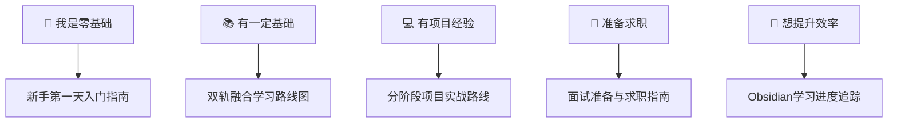

# 🚀 全栈+AI工程学习启动页

> **欢迎来到你的学习知识库！** 这是整个知识库的入口，从这里开始你的全栈+AI工程学习之旅。
>
> **建议将本页设为Obsidian启动页**：设置 → 外观 → 启动页 → 选择本文件

---

## 📍 你现在在哪里？

根据你的当前水平，选择对应的入口：



---

## 🎯 快速入口

### 🌱 从零开始

| 文档 | 说明 |
|------|------|
| [[新手第一天入门指南]] | 手把手教你装环境、写第一个程序、认识知识库 |
| [[HTML5语义化与基础标签]] | 前端第一步：网页骨架 |
| [[CSS3布局与样式基础]] | 前端第二步：网页皮肤 |
| [[JavaScript-ES6核心语法]] | 前端第三步：网页交互 |
| [[Python-语法基础与数据结构]] | 后端/AI第一步：Python基础 |
| [[LLM大模型入门概念]] | AI第一步：什么是大模型 |
| [[AI-API调用入门实战]] | AI第二步：调用AI API |
| [[Prompt工程基础入门]] | AI第三步：写好提示词 |

### 📈 系统学习

| 文档 | 说明 |
|------|------|
| [[全栈+AI工程双轨融合学习路线图]] | 四阶段成长路径，全栈+AI双轨并行 |
| [[学习依赖图谱与前置知识导航]] | 学A之前先学B，避免走弯路 |
| [[分阶段项目实战递进路线]] | 11个项目按难度分级，以战养学 |
| [[算法刷题指南与题型模板]] | 10种核心模板，3个月达到面试水平 |

### 🛠️ 学习工具

| 文档 | 说明 |
|------|------|
| [[Obsidian学习进度追踪体系]] | Dataview看板、打卡、复盘模板 |
| [[开发速查表CheatSheet合集]] | Git/Linux/SQL/CSS/TS常用命令速查 |
| [[常见错误FAQ合集]] | 按板块整理的踩坑集，遇到报错先查 |
| [[学习资源汇总导航]] | 书籍/课程/博客/开源项目精选 |
| [[知识库文档统一编写标准v2]] | 笔记写作规范 |
| [[知识库健康度评估指标]] | 定期检查知识库状态 |

### 🧮 算法与面试

| 文档 | 说明 |
|------|------|
| [[算法刷题指南与题型模板]] | 10种核心模板，3个月达到面试水平 |
| [[LeetCode高频题解]] | 24道高频面试题，按题型分类带代码 |
| [[面试准备与求职指南]] | 简历+技术+项目+薪资全流程 |

---

## 🗺️ 四阶段学习路线

### 第一阶段：入门筑基（0-4个月）🟢

**目标**：掌握编程基础，能独立写简单程序

```text
全栈轨道：HTML → CSS → JavaScript → Python/Java基础 → 数据库基础
AI轨道：  LLM概念 → API调用 → Prompt基础 → 第一个AI应用
融合点：  用AI辅助编程，用前端展示AI结果
```

**里程碑**：完成L1级项目（个人博客/待办应用/AI聊天助手）

### 第二阶段：进阶实战（4-9个月）🟡

**目标**：掌握框架开发，能独立完成完整项目

```text
全栈轨道：Vue3 → Spring Boot/FastAPI → MySQL/Redis → 前后端联调
AI轨道：  RAG基础 → Agent概念 → 向量数据库 → AI应用开发
融合点：  全栈项目中集成AI功能（智能搜索、AI助手）
```

**里程碑**：完成L2级项目（后台管理系统/RAG问答系统）

### 第三阶段：高级架构（9-15个月）🔴

**目标**：掌握分布式和AI工程化，能设计复杂系统

```text
全栈轨道：微服务 → 消息队列 → 分布式事务 → 性能优化
AI轨道：  高级RAG → 多Agent → 模型部署 → 推理优化
融合点：  AI网关、AI可观测性、企业级AI系统
```

**里程碑**：完成L3级项目（微服务电商/企业知识库）

### 第四阶段：专家精通（15-24个月）⭐

**目标**：技术专家，能做架构设计和技术选型

```text
全栈轨道：架构设计 → 技术选型 → 系统治理 → 团队协作
AI轨道：  模型微调 → AI平台建设 → 前沿技术 → 创新应用
融合点：  AI原生架构、多模态系统、AI平台化
```

**里程碑**：完成L4级项目（秒杀系统/多模态AI平台）

> 📖 详细路线见 [[全栈+AI工程双轨融合学习路线图]]

---

## 📚 知识库结构

```text
全栈工程MarkDown文档/
├── 00-综合导航/          ← 你在这里（学习路线、指南、模板、看板）
├── 01-前端开发/          ← 📚参考文档：Vue3/TS前端大而全整合（15篇，原始素材）
├── 02-后端开发/          ← 📚参考文档：Java/Spring后端大而全整合（10篇，含737KBJava大全）
├── 07-通用工具/          ← 📚参考文档：Git等工具系统梳理
├── 10-四级知识框架/      ← 🎯学习单元：原子化笔记（480+篇，按难度分级的学习主体）
│   ├── 01-Python全栈/
│   ├── 02-Java全栈/
│   ├── 03-Vue3TS前端/
│   ├── 04-AIGC与Obsidian/
│   ├── 05-CS基础/
│   ├── 06-AI工程化/
│   ├── 07-DevOps/
│   ├── 08-知识管理方法论/
│   ├── 09-效率工具链/
│   └── 10-项目实战/
└── 99-归档/              ← 历史版本备份
```

> 💡 **目录关系说明**：`01/02/07`是**大而全的参考文档**（适合系统查阅），`10-四级知识框架`是**拆分后的原子化学习笔记**（适合按篇学习）。二者互补：日常学习用10目录，需要深度查阅时用01/02目录的整合文档。

---

## 📊 今日学习检查

- [ ] 打开 [[Obsidian学习进度追踪体系]]，查看今日学习任务
- [ ] 按学习路线学习1-2篇笔记
- [ ] 动手写代码，完成练习
- [ ] 在笔记中标记学习状态（`#状态/学习中` / `#状态/已掌握`）
- [ ] 写学习复盘（遇到的问题、收获）

---

## 💡 学习建议

1. **不要只看不练**：每学一个知识点，动手写代码验证
2. **以项目驱动**：学完一个阶段，完成对应级别的项目
3. **善用AI**：用AI辅助学习，但要理解原理，不要只复制粘贴
4. **定期复盘**：每周回顾学习内容，查漏补缺
5. **输出倒逼输入**：写笔记、写博客、教别人，是最好的学习方式
6. **不要追求完美**：先完成再完美，快速迭代比一直准备更重要

---

## 🔗 核心导航文档

| 类别 | 文档 |
|------|------|
| 🗺️ 路线 | [[全栈+AI工程双轨融合学习路线图]] |
| 🌱 入门 | [[新手第一天入门指南]] · [[第一阶段-入门筑基学习指南]] |
| ⚡ 进阶 | [[第二阶段-进阶实战学习指南]] |
| 🚀 高级 | [[第三阶段-高级架构学习指南]] |
| 👑 专家 | [[第四阶段-专家精通学习指南]] |
| 🌉 过渡 | [[阶段过渡桥梁指南]] |
| 📦 项目 | [[分阶段项目实战递进路线]] |
| 📊 追踪 | [[Obsidian学习进度追踪体系]] · [[学习进度看板]] |
| 🔗 依赖 | [[学习依赖图谱与前置知识导航]] |
| 🧮 算法 | [[算法刷题指南与题型模板]] · [[LeetCode高频题解]] |
| 🎯 求职 | [[面试准备与求职指南]] |
| 📝 自检 | [[四阶段自检题答案与解析]] |
| ⭐ 核心 | [[核心必读笔记清单与质量分级]] |
| 🔧 维护 | [[知识库维护报告与健康度]] · [[知识库持续优化机制]] |

---

> 🎯 **记住**：学习是一场马拉松，不是短跑。每天进步一点点，坚持下去，你会看到惊人的变化。
>
> 从 [[新手第一天入门指南]] 开始你的旅程吧！🚀
