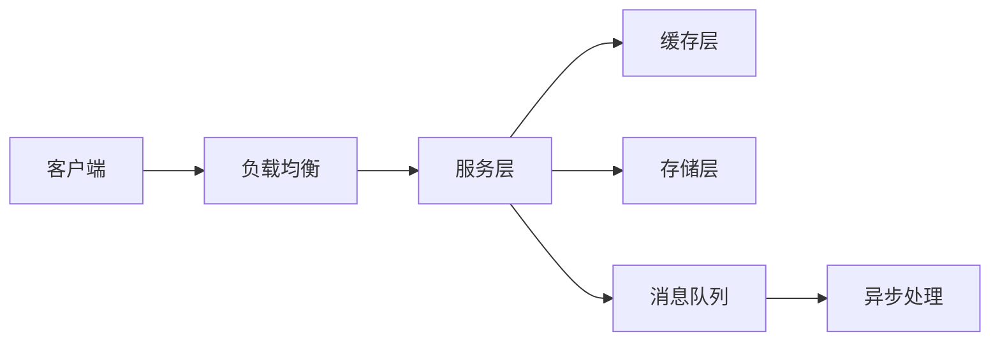
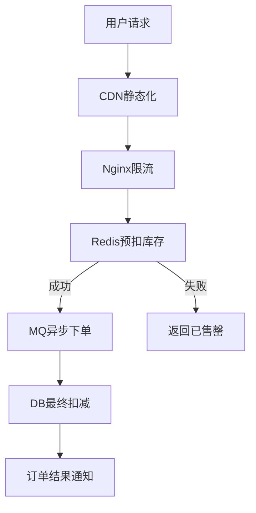

# 系统设计面试指南

> **文档说明**：系统设计面试方法论，包含答题框架、核心组件、高频题目、评分标准。帮助高级工程师通过系统设计面试。
>
> **适用人群**：面试高级/资深/架构师岗位的工程师
>
> **前置知识**：分布式系统、数据库、缓存、消息队列

---

## 一、答题框架（4步法）

### 1.1 需求澄清（3-5分钟）

```text
1. 功能需求：核心功能是什么？有哪些边界？
2. 非功能需求：
   - 规模：DAU/MAU/QPS/TPS？
   - 延迟：P99要求多少？
   - 一致性：强一致还是最终一致？
   - 可用性：几个9？
3. 约束：成本、技术栈、时间？
```

**示例**：设计短链接系统
- 功能：长URL→短URL、短URL→长URL跳转、自定义短码、访问统计
- 规模：日生成100万短链，日跳转1亿次
- 延迟：跳转P99<50ms
- 一致性：最终一致即可

### 1.2 高层设计（5分钟）



- 画出核心组件和数据流
- 说明每个组件的职责
- 不要深入细节

### 1.3 深入设计（15-20分钟）

针对核心模块深入：
- **数据模型**：表结构、索引设计
- **API设计**：接口定义、请求/响应格式
- **核心流程**：关键路径的时序图
- **扩展性**：如何水平扩展、分片策略
- **瓶颈分析**：哪里可能成为瓶颈，如何解决

### 1.4 容错与运维（5分钟）

- 故障处理：单点故障、网络分区、降级熔断
- 监控告警：关键指标、告警阈值
- 容量规划：如何预估资源、如何扩容
- 安全：认证授权、防攻击、数据加密

---

## 二、核心组件库

### 2.1 负载均衡

| 层级 | 方案 |
|------|------|
| DNS | 轮询/地理路由（粗粒度） |
| 四层 | LVS/DPVS（TCP/UDP） |
| 七层 | Nginx/HAProxy（HTTP，路由/限流/SSL） |
| 服务发现 | Consul/Nacos/Etcd + 客户端LB |

### 2.2 缓存策略

| 策略 | 适用 |
|------|------|
| Cache Aside | 通用场景，读多写少 |
| Read/Write Through | 缓存层统一管理 |
| Write Behind | 写多、允许数据丢失 |
| 本地缓存 | 热点数据、极高QPS |

### 2.3 数据库选型

| 场景 | 选型 |
|------|------|
| 事务/关系数据 | MySQL/PostgreSQL |
| 高并发KV | Redis/Memcached |
| 文档/灵活Schema | MongoDB |
| 时序数据 | InfluxDB/TDengine |
| 全文搜索 | Elasticsearch |
| 图数据 | Neo4j |
| 海量分析 | ClickHouse/Doris |

### 2.4 消息队列

| 特性 | Kafka | RabbitMQ | RocketMQ |
|------|-------|----------|----------|
| 吞吐量 | 极高 | 中 | 高 |
| 延迟 | 毫秒级 | 微秒级 | 毫秒级 |
| 可靠性 | 高 | 高 | 极高 |
| 顺序消息 | 分区内有序 | 队列有序 | 队列有序 |
| 事务消息 | 不支持 | 不支持 | 支持 |
| 适用 | 日志/大数据 | 业务解耦 | 金融/电商 |

---

## 三、高频题目

### 3.1 短链接系统

**核心设计**：
- 发号器：雪花算法/号段模式生成唯一ID
- 转码：ID→62进制（0-9a-zA-Z）
- 存储：短码→长URL映射，Redis缓存
- 跳转：302重定向（可被浏览器缓存）
- 统计：异步写入Kafka→ClickHouse

**关键问题**：
- 缓存穿透：布隆过滤器过滤不存在的短码
- 自定义短码冲突：唯一索引+重试
- 高并发跳转：Redis缓存+本地缓存

### 3.2 秒杀系统

**核心设计**：


**关键问题**：
- 超卖：Redis原子扣减（Lua脚本）
- 限流：前端按钮置灰+Nginx限流+后端令牌桶
- 防刷：验证码+用户维度限流+黑名单
- 数据一致性：最终一致，对账补偿

### 3.3 设计Twitter/微博

**核心设计**：
- 写扩散（推模式）：发推文时推到所有粉丝的收件箱（读快写慢，适合粉丝少）
- 读扩散（拉模式）：读时拉取所有关注的推文（写快读慢，适合大V）
- 混合模式：普通用户推模式，大V拉模式
- 存储：推文存MySQL分库分表，时间线存Redis（ZSet/Sorted List）

**关键问题**：
- 大V发推：采用拉模式，不推给百万粉丝
- 时间线排序：按时间倒序，分页用游标
- 搜索：Elasticsearch倒排索引

### 3.4 设计聊天系统

**核心设计**：
- 长连接：WebSocket/QUIC，连接网关集群
- 消息路由：用户ID→连接网关映射（Redis）
- 消息存储：写扩散（存到每个会话的消息表）
- 离线消息：Redis ZSet，上线后拉取
- 已读回执：异步更新

**关键问题**：
- 消息顺序：单会话内单调递增ID
- 消息可靠：客户端ACK+服务端重发
- 跨机房：就近接入+数据同步

### 3.5 设计支付系统

**核心设计**：
- 幂等：请求ID去重（Redis/唯一索引）
- 状态机：待支付→支付中→成功/失败/超时
- 分布式事务：TCC（资金冻结→确认/取消）
- 对账：T+1对账，差异处理
- 风控：实时规则引擎+黑名单

**关键问题**：
- 资金安全：强一致，对账补偿
- 并发支付：分布式锁（用户维度）
- 回调可靠性：重试+幂等

---

## 四、评分标准

| 维度 | 权重 | 优秀标准 |
|------|------|---------|
| 需求澄清 | 15% | 主动问清规模/延迟/一致性约束 |
| 高层设计 | 20% | 组件合理，数据流清晰 |
| 深入设计 | 30% | 数据模型/API/核心流程有深度 |
| 扩展性 | 15% | 水平扩展方案、分片策略 |
| 容错运维 | 10% | 故障处理、监控、容量规划 |
| 沟通表达 | 10% | 思路清晰，主动讨论权衡 |

---

## 五、答题技巧

1. **先问再答**：不要急着画架构，先澄清需求
2. **量化估算**：给出具体数字（QPS/存储/带宽）
3. **讨论权衡**：每个决策说明为什么选A不选B
4. **识别瓶颈**：主动指出系统瓶颈和解决方案
5. **不要过度设计**：根据规模选择合适方案，小项目不用微服务
6. **画图辅助**：架构图/时序图/数据流图
7. **保持互动**：和面试官讨论，确认方向

---

## 关联文档

- [[后端开发面试题库与答案解析]] — 后端面试题
- [[高可用架构设计]] — 高可用
- [[分布式事务 知识点系统梳理_优化版]] — 分布式事务
- [[分库分表实战指南]] — 分库分表
- [[多级缓存架构设计]] — 缓存架构
- [[面试准备与求职指南]] — 面试准备

---

> 💡 系统设计面试考察的是"权衡能力"，不是"标准答案"。没有完美的架构，只有适合当前规模和需求的架构。准备时重点掌握：缓存策略、分片方案、消息队列应用、一致性权衡、高可用设计。
