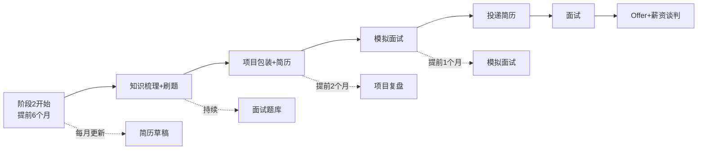
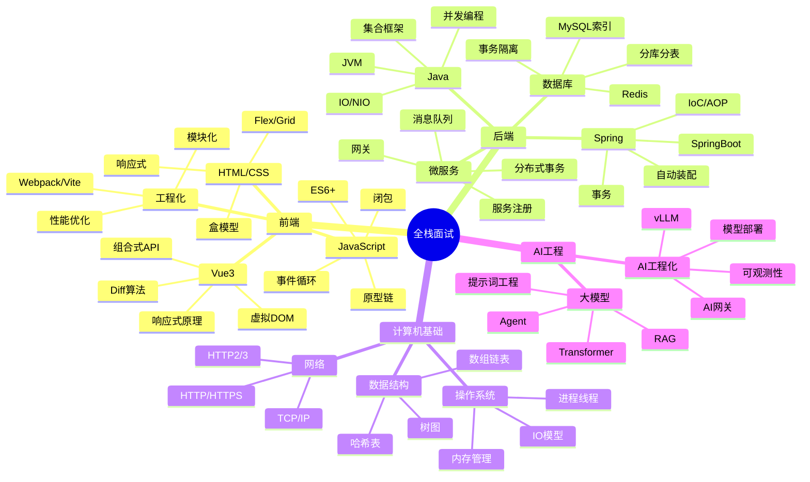

# 面试准备与求职指南

> **文档说明**：系统讲解全栈+AI 方向的面试准备方法、知识体系梳理、高频面试题、项目包装、简历优化、面试技巧、薪资谈判，以及从阶段2到求职成功的完整路径。
>
> **适用人群**：准备求职的全栈/AI 开发者、转行入门者、想跳槽提升的在职工程师
>
> **前置知识**：[[全栈+AI工程双轨融合学习路线图]]、[[分阶段项目实战递进路线]]

---

## 一、概述

面试不是"学完了再准备"，而是**从学习阶段2就开始同步准备**的持续过程。本指南帮你建立系统化的面试准备体系，从知识梳理到拿到 Offer 的全流程。

### 1. 求职时间线



| 时间节点 | 准备内容 | 关键产出 |
|---------|---------|---------|
| 提前 6 个月 | 梳理知识体系，开始刷题 | 知识图谱、刷题笔记 |
| 提前 4 个月 | 项目复盘和包装 | 项目 STAR 描述、技术亮点 |
| 提前 3 个月 | 简历撰写和优化 | 简历终稿 |
| 提前 2 个月 | 模拟面试，查漏补缺 | 面试录音、薄弱点清单 |
| 提前 1 个月 | 投递简历，正式面试 | 面试记录、Offer 对比 |

### 2. 面试考察维度

| 维度 | 占比 | 考察内容 | 准备方法 |
|------|------|---------|---------|
| **基础知识** | 30% | 语言基础、框架原理、计算机基础 | 系统梳理 + 高频题背诵 |
| **项目经验** | 25% | 项目背景、技术选型、难点解决 | STAR 法则 + 项目复盘 |
| **算法能力** | 20% | 数据结构、算法题、系统设计 | LeetCode 刷题 + 模板总结 |
| **技术深度** | 15% | 源码理解、底层原理、性能优化 | 深入学习 + 对比分析 |
| **软素质** | 10% | 沟通表达、学习能力、团队协作 | 模拟面试 + 自我介绍打磨 |

---

## 二、知识体系梳理

### 1. 全栈方向知识图谱



### 2. 各方向高频考点

#### 前端高频考点

| 模块 | 高频问题 | 难度 |
|------|---------|------|
| JavaScript | 原型链与继承 | ⭐⭐⭐ |
| JavaScript | 闭包的应用场景 | ⭐⭐ |
| JavaScript | 事件循环（宏任务/微任务） | ⭐⭐⭐ |
| JavaScript | this 指向 | ⭐⭐ |
| JavaScript | Promise 原理与实现 | ⭐⭐⭐ |
| Vue3 | 响应式原理（Proxy vs defineProperty） | ⭐⭐⭐⭐ |
| Vue3 | 虚拟 DOM 和 Diff 算法 | ⭐⭐⭐⭐ |
| Vue3 | Composition API vs Options API | ⭐⭐ |
| Vue3 | 组件通信方式 | ⭐⭐ |
| 工程化 | Vite 原理（ESM + 预构建） | ⭐⭐⭐ |
| 工程化 | 前端性能优化手段 | ⭐⭐⭐ |
| 工程化 | 模块化发展（CommonJS/ESM） | ⭐⭐ |

#### 后端高频考点

| 模块 | 高频问题 | 难度 |
|------|---------|------|
| Java | HashMap 底层原理 | ⭐⭐⭐ |
| Java | ConcurrentHashMap 实现 | ⭐⭐⭐⭐ |
| Java | 线程池参数与原理 | ⭐⭐⭐ |
| Java | volatile 关键字 | ⭐⭐⭐ |
| Java | JVM 内存模型与 GC | ⭐⭐⭐⭐ |
| Spring | IoC 容器初始化流程 | ⭐⭐⭐⭐ |
| Spring | AOP 实现原理 | ⭐⭐⭐ |
| Spring | 事务传播机制 | ⭐⭐⭐ |
| SpringBoot | 自动装配原理 | ⭐⭐⭐ |
| MySQL | 索引原理（B+树） | ⭐⭐⭐ |
| MySQL | 事务隔离级别与 MVCC | ⭐⭐⭐⭐ |
| MySQL | 慢查询优化 | ⭐⭐⭐ |
| Redis | 数据结构与持久化 | ⭐⭐⭐ |
| Redis | 缓存穿透/击穿/雪崩 | ⭐⭐⭐ |
| Redis | 分布式锁实现 | ⭐⭐⭐ |
| 微服务 | 服务注册与发现 | ⭐⭐⭐ |
| 微服务 | 分布式事务解决方案 | ⭐⭐⭐⭐ |
| 消息队列 | Kafka 架构与高可用 | ⭐⭐⭐ |
| 消息队列 | 消息丢失/重复/顺序 | ⭐⭐⭐ |

#### AI 工程高频考点

| 模块 | 高频问题 | 难度 |
|------|---------|------|
| 大模型 | Transformer 架构（自注意力） | ⭐⭐⭐⭐ |
| 大模型 | Tokenization 与词表 | ⭐⭐ |
| 提示词 | CoT/Few-shot/结构化输出 | ⭐⭐ |
| RAG | RAG 架构与流程 | ⭐⭐⭐ |
| RAG | Embedding 模型选型 | ⭐⭐⭐ |
| RAG | 向量检索算法（HNSW） | ⭐⭐⭐ |
| Agent | ReAct 规划模式 | ⭐⭐⭐ |
| Agent | 工具调用（Function Calling） | ⭐⭐ |
| 推理部署 | vLLM PagedAttention 原理 | ⭐⭐⭐⭐ |
| 推理部署 | 模型量化（GPTQ/AWQ） | ⭐⭐⭐ |
| AI工程 | AI 网关与多模型路由 | ⭐⭐⭐ |
| AI工程 | 成本控制与 Token 计费 | ⭐⭐ |

### 3. 面试题笔记模板

每道高频题创建一篇笔记，按以下模板整理：

```markdown
---
title: 面试题-HashMap底层原理
tags: [面试题, Java, 集合框架]
category: Java基础
difficulty: ⭐⭐⭐
frequency: 🔥🔥🔥🔥🔥  # 出现频率
---

# 面试题：HashMap 底层原理

## 问题
请简述 HashMap 的底层实现原理，以及 JDK 1.7 和 1.8 的区别。

## 核心答案
（100-200字的精炼回答，面试时先说这个）

HashMap 基于哈希表实现，使用数组+链表/红黑树存储键值对。
通过 hashCode 计算数组索引，使用 equals 解决哈希冲突。
JDK 1.8 引入红黑树（链表长度>8且数组长度>64时转换），
解决哈希冲突严重时的性能退化问题。

## 详细展开
（深入讲解，面试时根据面试官追问展开）

### 1. 数据结构
- 数组（Node<K,V>[] table），默认长度 16
- 链表：哈希冲突时使用
- 红黑树：JDK 1.8+，链表长度 > 8 且数组长度 > 64

### 2. put 流程
1. 计算 key 的 hashCode，扰动函数处理
2. (n-1) & hash 计算数组索引
3. 索引位置为空 → 直接插入
4. 索引位置不为空 → 遍历链表/红黑树
5. key 已存在 → 覆盖 value
6. key 不存在 → 尾插法插入（1.8）
7. 插入后检查是否需要扩容（size > threshold）

### 3. 扩容机制
- 扩容阈值 = 数组长度 × 负载因子（0.75）
- 扩容为原来的 2 倍
- 重新计算索引：原索引 或 原索引+旧容量

### 4. JDK 1.7 vs 1.8
| 特性 | 1.7 | 1.8 |
|------|-----|-----|
| 数据结构 | 数组+链表 | 数组+链表+红黑树 |
| 插入方式 | 头插法 | 尾插法 |
| 扩容 | 重新计算索引 | 原索引或+旧容量 |
| 并发问题 | 死循环 | 无死循环（但非线程安全） |

## 常见追问
1. 为什么负载因子是 0.75？
2. 为什么数组长度是 2 的幂？
3. HashMap 是线程安全的吗？ConcurrentHashMap 怎么实现？
4. 自定义对象作为 key 需要注意什么？

## 关联笔记
- [[ConcurrentHashMap实现原理]]
- [[Java集合框架对比]]
- [[哈希表与哈希冲突]]
```

---

## 三、项目包装

### 1. STAR 法则

每个项目经历按 **STAR 法则** 整理：

| 字母 | 含义 | 说明 | 示例 |
|------|------|------|------|
| **S** | Situation（背景） | 项目背景和业务需求 | "电商平台秒杀系统，峰值 QPS 10万" |
| **T** | Task（任务） | 你的职责和任务 | "负责秒杀服务的架构设计和核心开发" |
| **A** | Action（行动） | 你做了什么，用了什么技术 | "使用 Redis+Lua 原子扣减库存，RocketMQ 异步下单" |
| **R** | Result（结果） | 取得了什么成果，量化数据 | "支撑 10万 QPS，超卖率 0，响应时间 < 200ms" |

### 2. 项目描述模板

```markdown
## 项目：企业级 RAG 知识库问答系统

### 项目背景（S）
企业内部文档分散，员工查找信息效率低。需要构建基于大模型的智能问答系统，
支持 5000+ 文档的语义检索，日均查询量 1万+。

### 我的职责（T）
- 负责 RAG 系统的整体架构设计
- 核心模块开发：文档解析、向量检索、LLM 调用
- 性能优化和线上问题排查

### 技术实现（A）
1. **文档处理**：使用 LangChain 解析 PDF/Word/Markdown，
   按语义分块（512 tokens，重叠 50），使用 bge-large-zh 向量化

2. **向量检索**：使用 Milvus 存储向量，HNSW 索引，
   top-20 粗召回 + bge-reranker 精排到 top-5

3. **LLM 调用**：封装统一 SDK，支持 GPT-4o/Qwen2 多模型，
   AI 网关做负载均衡和降级，SSE 流式响应

4. **性能优化**：
   - 语义缓存：相似问题直接返回，命中率 35%
   - 前缀缓存：系统提示词共享 KV Cache
   - 异步预取：用户输入时预加载相关文档

### 项目成果（R）
- 支撑 5000+ 文档，日均查询 1万+，P99 响应 < 3s
- 回答准确率 85%（人工评估），用户满意度 4.2/5
- 语义缓存节省 35% LLM 调用成本
- 系统可用性 99.9%

### 技术亮点（面试重点讲）
1. **混合检索**：BM25 + 向量检索融合，解决专有名词检索问题
2. **多轮对话**：对话历史压缩 + 查询重写，支持上下文追问
3. **可观测性**：接入 Langfuse，全链路追踪，自动评分
```

### 3. 项目技术挖掘

每个项目要能回答以下问题：

| 问题 | 说明 |
|------|------|
| **为什么选这个技术？** | 技术选型的原因，对比了哪些方案 |
| **遇到了什么难点？** | 项目中最大的技术挑战 |
| **怎么解决的？** | 解决方案的详细过程 |
| **还有什么优化空间？** | 如果重做，会怎么改进 |
| **数据量多大？** | QPS、数据量、用户量等量化指标 |
| **你负责哪部分？** | 明确个人贡献，不要说"我们" |

### 4. 项目包装注意事项

- ❌ **不要造假**：没做过的项目不要写，面试官一追问就露馅
- ❌ **不要只列技术栈**："使用了 Vue3/SpringBoot/Redis"没有意义，要讲怎么用的
- ❌ **不要夸大**："优化了 100 倍性能"需要有数据支撑
- ✅ **要有量化数据**：QPS、响应时间、准确率、成本节省等
- ✅ **要有技术深度**：讲清楚原理，而不只是"调用了 API"
- ✅ **要有个人贡献**：明确"我"做了什么，而不是"我们"

---

## 四、简历优化

### 1. 简历结构

```text
┌─────────────────────────────────────────┐
│  个人信息（姓名/电话/邮箱/GitHub/博客）    │
├─────────────────────────────────────────┤
│  求职意向（全栈开发工程师 / AI 应用工程师）  │
├─────────────────────────────────────────┤
│  个人优势（3-5 条核心亮点）                │
├─────────────────────────────────────────┤
│  专业技能（按熟练度排序，分类列出）          │
├─────────────────────────────────────────┤
│  项目经验（2-3 个核心项目，STAR 描述）      │
├─────────────────────────────────────────┤
│  工作/实习经历（公司/职位/时间/职责）       │
├─────────────────────────────────────────┤
│  教育背景（学校/专业/时间/成绩）            │
├─────────────────────────────────────────┤
│  其他（证书/开源/博客/竞赛）                │
└─────────────────────────────────────────┘
```

### 2. 简历写作原则

| 原则 | 说明 | 反例 | 正例 |
|------|------|------|------|
| **一页纸** | 校招/3年以内一页 | 写了三页 | 精简到一页 |
| **量化数据** | 用数字说话 | "优化了系统性能" | "P99 延迟从 2s 降到 500ms" |
| **动词开头** | 使用强动词 | "负责了登录功能" | "设计并实现了 JWT 认证方案" |
| **技术匹配** | 匹配 JD 要求 | 投后端写一堆前端 | 突出后端相关经验 |
| **无废话** | 去掉无关信息 | "熟练使用 Office" | 只写技术相关技能 |
| **无错别字** | 仔细检查 | "熟念掌握" | 通读 3 遍 |

### 3. 专业技能写法

❌ **差的写法**：
```text
技能：Java, Python, JavaScript, MySQL, Redis, Vue, Spring, Docker, Kubernetes, Git, Linux
```
（一堆技术名，看不出熟练度和深度）

✅ **好的写法**：
```text
专业技能：
- 后端：熟练掌握 Java，熟悉 JVM 调优、并发编程；熟练使用 Spring Boot/Spring Cloud，
  理解 IoC/AOP/自动装配原理；熟悉 MySQL 索引优化和事务隔离，有分库分表实践经验
- 前端：熟练使用 Vue3 + TypeScript，理解响应式原理和虚拟 DOM；
  熟悉 Vite/Webpack 构建工具，有前端性能优化经验
- 中间件：熟练使用 Redis（缓存/分布式锁）、Kafka（消息队列）、
  Nginx（反向代理/负载均衡）
- AI 工程：熟悉大模型应用开发（RAG/Agent），有 LangChain/vLLM 实践经验；
  熟悉 Embedding 模型选型和向量检索
- 运维：熟悉 Docker/K8s 部署，有 CI/CD 流水线搭建经验
```

### 4. 简历投递渠道

| 渠道 | 特点 | 建议 |
|------|------|------|
| **Boss 直聘** | 沟通效率高，反馈快 | 主力渠道，每天主动沟通 |
| **牛客网** | 互联网公司多，有面经 | 投递+看面经+刷题 |
| **LinkedIn** | 外企/大厂多 | 完善英文简历，主动联系 HR |
| **官网投递** | 大厂官方渠道 | 关注目标公司官网招聘页 |
| **内推** | 通过率高，进度快 | 找学长/同事/社区朋友内推 |
| **GitHub** | 技术展示 | 完善项目 README，吸引猎头 |

---

## 五、算法刷题

### 1. 刷题路线

| 阶段 | 题量 | 重点 | 时间 |
|------|------|------|------|
| 入门 | 50 题 | 数组/链表/哈希表/字符串 | 2 周 |
| 基础 | 100 题 | 栈/队列/树/递归/排序 | 4 周 |
| 进阶 | 100 题 | 动态规划/图/二分/滑动窗口 | 6 周 |
| 冲刺 | 50 题 | 高频题/系统设计/面试真题 | 2 周 |
| **合计** | **300 题** | | **3-4 个月** |

### 2. 高频题型清单

| 题型 | 频率 | 代表题目 | 核心模板 |
|------|------|---------|---------|
| 双指针 | 🔥🔥🔥🔥🔥 | 两数之和、三数之和、接雨水 | 左右指针/快慢指针 |
| 滑动窗口 | 🔥🔥🔥🔥 | 无重复字符子串、最小覆盖子串 | 窗口扩大/收缩 |
| 链表操作 | 🔥🔥🔥🔥🔥 | 反转链表、环形链表、合并K个链表 | 虚拟头节点/双指针 |
| 二叉树 | 🔥🔥🔥🔥🔥 | 层序遍历、最大深度、最近公共祖先 | 递归/迭代/DFS/BFS |
| 动态规划 | 🔥🔥🔥🔥 | 爬楼梯、最长递增子序列、背包问题 | 状态定义/转移方程 |
| 二分查找 | 🔥🔥🔥🔥 | 搜索插入位置、寻找旋转数组最小值 | 左右边界/循环条件 |
| 栈/队列 | 🔥🔥🔥 | 有效括号、最小栈、单调栈 | 辅助栈/单调栈 |
| 回溯 | 🔥🔥🔥 | 全排列、子集、N皇后 | 选择/递归/撤销 |
| 图 | 🔥🔥 | 岛屿数量、课程表、最短路径 | DFS/BFS/并查集 |
| 排序 | 🔥🔥🔥 | 快速排序、归并排序、TOP K | 分治/堆排序 |

### 3. 刷题方法

1. **第一遍**：看题 → 想 5 分钟 → 没思路看题解 → 理解后自己写 → 提交通过
2. **第二遍**：不看题解 → 自己写 → 写不出来看提示 → 提交通过
3. **第三遍**：限时写（中等题 15 分钟，困难题 30 分钟）→ 优化空间/时间复杂度
4. **总结模板**：每类题型总结通用模板和解题思路

> 💡 **关键**：刷题不在多在于精。300 题刷 3 遍 > 1000 题刷 1 遍。重点是理解解题思路，而不是背代码。

### 4. 系统设计准备

高级岗位常考系统设计，准备以下经典题目：

| 题目 | 考察点 |
|------|--------|
| 设计短链接系统 | 哈希/发号器、缓存、分库分表 |
| 设计秒杀系统 | 限流、缓存、异步、库存扣减 |
| 设计消息队列 | 存储、消费模型、高可用、顺序性 |
| 设计搜索引擎 | 倒排索引、分词、排序、分布式 |
| 设计聊天系统 | 长连接、消息存储、已读回执、群聊 |
| 设计 RAG 系统 | 文档处理、向量检索、LLM 调用、评估 |
| 设计 AI 网关 | 多模型路由、限流、降级、计费、可观测性 |

**系统设计答题框架**：
1. 需求澄清（功能/非功能/规模）
2. 高层设计（架构图、核心模块）
3. 详细设计（数据模型、API、核心流程）
4. 性能优化（缓存、负载均衡、分库分表）
5. 容错与高可用（降级、熔断、多活）
6. 监控与运维（指标、告警、日志）

---

## 六、面试技巧

### 1. 自我介绍（3 分钟版本）

```text
面试官您好，我叫 XXX，毕业于 XXX 大学 XXX 专业，
有 X 年全栈开发经验。

技术方面，我主要使用 Java + Vue3 技术栈：
后端熟练使用 Spring Boot/Spring Cloud，
有微服务架构设计和高并发系统优化经验；
前端熟练使用 Vue3 + TypeScript，
理解响应式原理和前端工程化。

最近一个项目是企业级 RAG 知识库问答系统，
我负责整体架构设计和核心模块开发，
使用 Milvus + bge 模型做向量检索，
AI 网关做多模型路由和降级，
系统支撑日均 1万+ 查询，P99 响应 < 3s。

我对 AI 工程化方向很感兴趣，
最近在深入学习大模型推理优化和 Agent 开发。
以上是我的自我介绍，谢谢。
```

**自我介绍要点**：
- 控制在 2-3 分钟
- 突出核心技术栈和项目经验
- 最后一个项目讲详细一点（引导面试官追问）
- 表达对目标岗位的兴趣
- 不要背简历，用自己的话讲

### 2. 答题技巧

| 题型 | 答题方法 |
|------|---------|
| **基础知识题** | 先给结论 → 再展开原理 → 最后举例子/对比 |
| **项目经历题** | STAR 法则：背景→任务→行动→结果 |
| **算法题** | 先讲思路 → 写伪代码 → 写正式代码 → 分析复杂度 → 优化 |
| **系统设计题** | 需求澄清 → 高层设计 → 详细设计 → 优化 → 容错 |
| **行为面试题** | STAR 法则 + 反思（学到了什么） |
| **不会的题** | 诚实说不会 → 讲自己的理解/思路 → 表示愿意学习 |

### 3. 反问环节

面试最后通常有"你有什么问题要问我吗？"，准备 3-5 个问题：

**好的问题**：
- 这个岗位的核心职责和挑战是什么？
- 团队目前的技术栈和架构是怎样的？
- 这个岗位的晋升路径和考核标准是什么？
- 团队目前在 AI/大模型方向有哪些探索？
- 入职后会有怎样的培训和 mentor 机制？

**避免问的问题**：
- ❌ 公司是做什么的？（说明没做功课）
- ❌ 加班多吗？（太早关注这个）
- ❌ 薪资多少？（HR 面再谈）
- ❌ 没有问题（显得对岗位不感兴趣）

### 4. 面试后复盘

每次面试后立即记录：

```markdown
---
company: XXX公司
position: 全栈开发工程师
date: 2026-08-27
round: 一面（技术面）
interviewer: 技术负责人
result: 待通知
---

# 面试复盘 - XXX公司 一面

## 面试流程
- 自我介绍（3min）
- 项目深挖（15min）
- 技术问答（20min）
- 算法题（15min）
- 反问环节（5min）

## 被问到的问题
1. 项目中 RAG 的检索准确率怎么评估的？
2. HashMap 和 ConcurrentHashMap 的区别？
3. Redis 分布式锁怎么实现的？有什么问题？
4. 算法题：最长无重复字符子串

## 回答得好的地方
1. RAG 项目讲得比较清楚，有数据支撑
2. 算法题一次通过

## 回答得不好的地方
1. Redis 分布式锁的续期机制没讲清楚（Redisson 看门狗）
2. ConcurrentHashMap 的 size 计算讲错了

## 需要补充学习
- [ ] Redisson 分布式锁原理（看门狗续期）
- [ ] ConcurrentHashMap 源码（size 计算、transfer 扩容）

## 整体感受
- 面试官风格：温和，会引导
- 难度：中等
- 通过率预估：60%
```

---

## 七、薪资谈判

### 1. 薪资结构

| 组成 | 说明 | 谈判空间 |
|------|------|---------|
| 基本工资 | 月薪 × 12 | 主要谈判项 |
| 年终奖 | 1-6 个月不等 | 问清楚发放规则和历史数据 |
| 股票/期权 | 大厂常见 | 问清楚归属期（vesting） |
| 补贴 | 餐补/交通补/通讯补 | 一般固定 |
| 福利 | 五险一金/体检/年假 | 关注公积金缴纳比例 |
| 签字费 | 部分公司有 | 可谈，注意返还条款 |

### 2. 薪资谈判技巧

1. **不要先报价**：HR 问期望薪资时，反问"这个岗位的薪资范围是多少？"
2. **了解市场行情**：查脉脉、看准网、牛客网的薪资数据
3. **用 Offer 杠杆**：有其他 Offer 时可以说"我目前有一个 XX 的 Offer，您这边能匹配吗？"
4. **谈总包而非月薪**：关注年薪总包（月薪×月数+年终奖+股票），而不只是月薪
5. **不要轻易接受第一次报价**：HR 第一次报价通常有 10-20% 的空间
6. **关注非薪资因素**：技术成长、团队氛围、晋升空间、工作生活平衡
7. **保持礼貌但坚定**：表达感谢，但说明自己的期望和理由

### 3. 谈薪话术

```text
HR：你的期望薪资是多少？
我：我了解到这个岗位在市场上的范围大概是 25-35K，
    结合我的经验和项目经历，我的期望是 30K×14薪。
    当然，我更看重团队的技术氛围和成长空间，
    薪资可以根据整体 package 来商量。

HR：我们最多能给到 28K。
我：28K 离我的期望有一点差距。我目前还有一个 30K 的 Offer，
    但我对贵司的技术方向更感兴趣。您看能不能在年终奖或股票上
    做一些补偿？或者 28K×15薪我也可以考虑。

HR：我们可以给到 28K×14薪 + 2万签字费。
我：这个方案我可以接受。请问签字费的发放时间和返还条件是怎样的？
```

---

## 八、不同阶段的求职策略

### 1. 应届生/转行（0 经验）

| 策略 | 说明 |
|------|------|
| **突出项目** | 2-3 个完整项目，代码放 GitHub，README 写好 |
| **基础扎实** | 计算机基础、语言基础、框架原理要能讲清楚 |
| **算法刷题** | LeetCode 200+，中等题为主 |
| **实习经历** | 有实习最好，没有就用项目替代 |
| **投递策略** | 海投+重点投递，先拿小厂 Offer 练手再冲大厂 |
| **薪资期望** | 合理定位，不要好高骛远，第一份工作看重成长 |

```text
### 2. 初级（1-3 年）
```

| 策略 | 说明 |
|------|------|
| **项目深度** | 至少一个项目能讲清楚技术细节和难点 |
| **技术广度** | 前后端都能写，有全栈项目经验 |
| **源码理解** | 常用框架的核心原理要能讲 |
| **算法刷题** | LeetCode 300+，系统设计开始准备 |
| **投递策略** | 内推为主，目标中大型公司 |
| **薪资期望** | 涨幅 30-50% 合理，用市场数据支撑 |

```text
### 3. 中级（3-5 年）
```

| 策略 | 说明 |
|------|------|
| **架构能力** | 能独立设计模块/子系统，有技术选型经验 |
| **性能优化** | 有线上性能优化经验，有量化数据 |
| **技术深度** | 至少一个领域深入到源码/原理层面 |
| **系统设计** | 系统设计题是重点，准备 5-10 个经典题 |
| **管理经验** | 带过新人/小团队加分 |
| **投递策略** | 猎头+内推，目标大厂/中厂核心岗位 |
| **薪资期望** | 涨幅 30-50%，关注职级和股票 |

### 4. 高级（5 年+）

| 策略 | 说明 |
|------|------|
| **系统设计** | 核心考察项，能设计复杂系统 |
| **技术决策** | 有技术选型和架构演进经验 |
| **团队管理** | 带团队经验，技术规划能力 |
| **业务理解** | 能从业务角度思考技术方案 |
| **行业影响力** | 技术博客/开源贡献/演讲加分 |
| **投递策略** | 猎头主动联系，目标架构师/技术负责人 |
| **薪资期望** | 总包谈判，关注股票和长期激励 |

---

## 九、AI 方向求职特别建议

### 1. AI 应用工程师（最推荐全栈转）

**岗位要求**：
- 扎实的全栈开发能力（Python/Java + 前端）
- 熟悉大模型 API 调用和提示词工程
- 有 RAG/Agent 项目经验
- 了解向量数据库和 Embedding

**准备重点**：
- 做一个完整的 RAG 项目（文档解析→向量检索→LLM 生成→评估）
- 熟悉 LangChain/LlamaIndex 等框架
- 了解 vLLM、AI 网关等推理部署工具
- 准备 AI 系统设计题（设计 RAG 系统/AI 网关）

### 2. AI 算法工程师（门槛较高）

**岗位要求**：
- 扎实的数学基础（线性代数、概率论、微积分）
- 熟悉机器学习/深度学习原理
- 有模型训练/微调经验
- 熟悉 PyTorch/TensorFlow

**准备重点**：
- 系统学习机器学习和深度学习（吴恩达课程 + 动手实践）
- 做模型微调项目（LoRA/QLoRA 微调开源模型）
- 了解 Transformer 架构和训练流程
- 刷机器学习面试题

### 3. AI 全栈/创业方向

**岗位要求**：
- 全栈开发 + AI 应用能力
- 产品思维，能独立从 0 到 1 做产品
- 了解 AI 产品的商业模式

**准备重点**：
- 做一个完整的 AI 产品（不只是 Demo，要可用）
- 关注 AI 产品的用户体验和商业化
- 了解 AI 产品的成本结构和盈利模式
- 准备产品+技术的综合面试

---

## 十、关联笔记

### 学习路线
- [[全栈+AI工程双轨融合学习路线图]] · [[分阶段项目实战递进路线]]
- [[新手第一天入门指南]] · [[Obsidian学习进度追踪体系]]

### 技术面试题
- [[Java面试高频题]] · [[前端面试高频题]] · [[数据库面试高频题]]
- [[Redis面试高频题]] · [[微服务面试高频题]] · [[AI工程面试题]]

### 项目实战
- [[实战-RAG企业知识库问答系统]] · [[秒杀系统架构设计]]
- [[秒杀系统架构设计]] · [[统一AI网关设计与实现]]

### 职业发展
- [[技术成长路径规划]] · [[程序员副业与变现]] · [[技术博客写作指南]]

### 导航
- [[Home]] · [[MOC-综合导航]] · [[全栈+AI工程双轨融合学习路线图]]

> **行动建议**：从今天开始建立面试题库，每学完一个知识点就整理成面试题笔记。阶段2开始同步准备简历和项目包装，阶段2结束时即可开始投递。记住：**面试是准备出来的，不是碰运气**。
