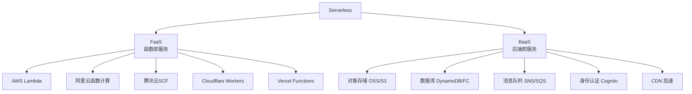
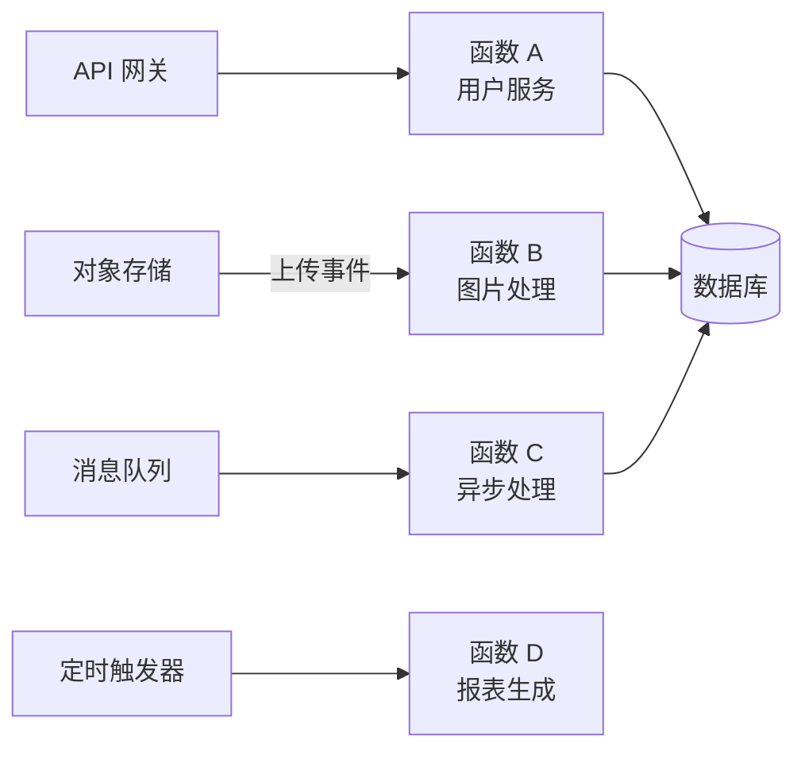

# Serverless架构设计

> **文档说明**：系统讲解 Serverless（无服务器）架构的核心理念、FaaS/BaaS 模型、主流平台对比（AWS Lambda/阿里云函数计算/腾讯云SCF/Vercel/Cloudflare Workers）、冷启动优化、架构模式、应用场景、成本优化，以及生产级最佳实践和常见问题。
>
> **适用人群**：后端开发工程师、全栈开发者、云原生架构师、希望降低运维成本的开发者
>
> **前置知识**：[[云原生架构设计]]、[[K8s-核心概念与架构]]、[[微服务架构设计模式]]、[[CI-CD持续集成与部署]]

---

## 一、概述

### 1. 什么是 Serverless

**Serverless（无服务器架构）** 是一种云计算执行模型，开发者无需管理服务器，只需编写业务代码，由云平台自动完成资源分配、扩缩容、运维等工作。按实际使用量付费，空闲时不收费。

> **注意**：Serverless 不是没有服务器，而是开发者不需要关心服务器。

### 2. Serverless 核心特征

| 特征 | 说明 |
|------|------|
| **免运维** | 无需管理服务器、操作系统、运行时 |
| **自动扩缩容** | 根据请求量自动弹性伸缩，从 0 到 N |
| **按用付费** | 按执行次数和执行时间计费，空闲不收费 |
| **事件驱动** | 由事件触发执行（HTTP 请求、消息、定时任务等） |
| **无状态** | 函数实例是无状态的，状态需外部存储 |
| **快速部署** | 秒级部署，无需构建镜像 |

### 3. Serverless vs 传统架构

| 维度 | 传统服务器 | 容器（K8s） | Serverless |
|------|-----------|------------|-----------|
| **运维成本** | 高（需管理服务器） | 中（需管理集群） | 低（免运维） |
| **弹性伸缩** | 慢（分钟级） | 中（秒级） | 快（毫秒级） |
| **计费模式** | 包年包月 | 按资源用量 | 按执行次数/时间 |
| **空闲成本** | 有（服务器持续运行） | 有（节点持续运行） | 无（空闲不收费） |
| **启动延迟** | 无（常驻） | 低（秒级） | 有冷启动（毫秒-秒级） |
| **运行时长** | 无限制 | 无限制 | 有限制（通常 5-15 分钟） |
| **状态管理** | 自由 | 自由 | 需外部存储 |
| **适用场景** | 长期运行、高负载 | 微服务、复杂应用 | 事件驱动、突发流量、轻量服务 |

---

## 二、FaaS 与 BaaS

### 1. Serverless 组成



### 2. FaaS（Function as a Service）

**FaaS（函数即服务）** 是 Serverless 的核心，开发者编写函数代码，由平台管理执行。

| 特征 | 说明 |
|------|------|
| **函数粒度** | 每个函数处理一个特定功能 |
| **事件触发** | HTTP、消息、定时、文件上传等触发 |
| **无状态** | 函数实例不保存状态 |
| **自动伸缩** | 每个请求可启动新实例 |
| **短时运行** | 执行时间有限制（通常 5-15 分钟） |

### 3. BaaS（Backend as a Service）

**BaaS（后端即服务）** 提供托管的后端服务，开发者通过 API 调用，无需自己搭建和维护。

| BaaS 服务 | 说明 | 示例 |
|-----------|------|------|
| **数据库** | 托管数据库，自动扩缩容 | DynamoDB、Firebase、Supabase |
| **对象存储** | 文件存储，高可用 | S3、OSS、COS |
| **消息队列** | 消息发布订阅 | SNS、SQS、EventBridge |
| **身份认证** | 用户注册登录 | Cognito、Auth0、Firebase Auth |
| **CDN** | 内容分发网络 | CloudFront、Cloudflare |
| **API 网关** | API 管理、限流、认证 | API Gateway、APIG |

---

## 三、主流平台对比

### 1. 云厂商 FaaS

| 平台 | 厂商 | 语言支持 | 最大内存 | 最大时长 | 冷启动 | 特点 |
|------|------|---------|---------|---------|--------|------|
| **AWS Lambda** | 亚马逊 | Node.js/Python/Java/Go/Ruby/.NET/Custom | 10GB | 15 分钟 | 中 | 生态最丰富、市场份额最大 |
| **阿里云函数计算 FC** | 阿里云 | Node.js/Python/Java/Go/PHP/Custom | 32GB | 2 小时 | 中 | 国内访问快、与阿里云生态集成 |
| **腾讯云 SCF** | 腾讯云 | Node.js/Python/Java/Go/PHP/Custom | 32GB | 1 小时 | 中 | 与微信生态集成、国内访问快 |
| **华为云 FunctionGraph** | 华为云 | Node.js/Python/Java/Go/Custom | 4GB | 15 分钟 | 中 | 与华为云生态集成 |
| **Google Cloud Functions** | Google | Node.js/Python/Java/Go/.NET/Ruby/PHP | 8GB | 9 分钟 | 中 | 与 GCP 生态集成 |
| **Azure Functions** | 微软 | Node.js/Python/Java/Go/C#/PowerShell | 1.5GB（消费计划） | 10 分钟 | 中 | 与 Azure 生态集成 |

### 2. 边缘计算 FaaS

| 平台 | 说明 | 特点 |
|------|------|------|
| **Cloudflare Workers** | 边缘函数，V8 Isolate | 极快冷启动（<50ms）、全球边缘节点、适合 API/边缘计算 |
| **Vercel Functions** | Next.js 全栈函数 | 与 Next.js 深度集成、前端全栈开发 |
| **Netlify Functions** | 静态站点函数 | 与 JAMstack 集成、简单易用 |
| **Deno Deploy** | Deno 边缘运行时 | TypeScript 原生支持、边缘部署 |

### 3. 开源 Serverless 框架

| 框架 | 说明 |
|------|------|
| **Knative** | Kubernetes 上的 Serverless 平台，Google 主导 |
| **OpenFaaS** | 轻量级 Serverless 框架，容器化函数 |
| **Kubeless** | K8s 原生 Serverless 框架 |
| **Apache OpenWhisk** | IBM 开源 Serverless 平台 |
| **Serverless Framework** | 多云部署框架，支持 AWS/阿里云/腾讯云等 |

---

## 四、冷启动优化

### 1. 什么是冷启动

**冷启动（Cold Start）** 是指函数首次被调用或长时间未调用后，平台需要创建新的执行环境（下载代码、启动运行时、初始化函数），导致响应延迟增加。

```text
冷启动过程：
1. 调度：选择执行节点（几毫秒）
2. 下载代码：从对象存储下载代码包（几十-几百毫秒）
3. 启动运行时：启动 Node.js/Python/JVM（几百毫秒-几秒）
4. 初始化函数：执行函数初始化代码（几十毫秒-几秒）
5. 处理请求：执行业务逻辑
```

### 2. 冷启动时间对比

| 运行时 | 冷启动时间 | 说明 |
|--------|-----------|------|
| **Node.js** | 200-500ms | 较快 |
| **Python** | 200-500ms | 较快 |
| **Go** | 50-200ms | 快（编译为二进制） |
| **Rust** | 50-200ms | 快（编译为二进制） |
| **Java** | 1-5 秒 | 慢（JVM 启动慢） |
| **.NET** | 500ms-2 秒 | 中等 |

### 3. 冷启动优化策略

| 策略 | 说明 | 效果 |
|------|------|------|
| **选择轻量运行时** | Go/Rust/Node.js 比 Java 冷启动快 | ⭐⭐⭐⭐⭐ |
| **减少代码包大小** | 只打包必要依赖，使用层（Layer）共享 | ⭐⭐⭐⭐ |
| **预置并发（Provisioned Concurrency）** | 预先创建函数实例，保持常驻 | ⭐⭐⭐⭐⭐（但增加成本） |
| **初始化优化** | 减少初始化代码，延迟加载依赖 | ⭐⭐⭐ |
| **保持函数活跃** | 定时触发函数（如每 5 分钟）防止回收 | ⭐⭐⭐（不保证） |
| **使用 SnapStart** | AWS Lambda Java 快照启动 | ⭐⭐⭐⭐ |
| **边缘函数** | Cloudflare Workers 使用 V8 Isolate，几乎无冷启动 | ⭐⭐⭐⭐⭐ |
| **单函数多职责** | 减少函数数量，提高复用率 | ⭐⭐⭐ |

### 4. 预置并发配置

```yaml
# AWS Lambda 预置并发（SAM 模板）
Resources:
  MyFunction:
    Type: AWS::Serverless::Function
    Properties:
      Handler: index.handler
      Runtime: nodejs18.x
      CodeUri: src/
      ProvisionedConcurrencyConfig:
        ProvisionedConcurrentExecutions: 10  # 预置 10 个实例
```

> **注意**：预置并发会持续收费，适合对延迟敏感的核心接口。

---

## 五、Serverless 架构模式

### 1. 事件驱动架构



### 2. 常见架构模式

| 模式 | 说明 | 适用场景 |
|------|------|---------|
| **API 函数** | API 网关 + 函数提供 REST API | Web/移动应用后端 |
| **事件处理** | 存储/消息事件触发函数 | 图片处理、数据转换、通知 |
| **定时任务** | Cron 表达式触发函数 | 报表生成、数据同步、清理 |
| **流式处理** | 数据流触发函数 | 日志处理、实时分析、IoT |
| **Webhook** | HTTP 触发函数处理第三方回调 | 支付回调、GitHub Webhook |
| **BFF（Backend for Frontend）** | 为前端定制的聚合接口 | 微服务聚合、数据裁剪 |
| **Step Functions** | 函数编排，工作流引擎 | 订单流程、审批流、数据管道 |

### 3. 函数编排（Step Functions）

对于复杂业务流程，使用工作流编排多个函数：

```text
订单处理流程：
1. 创建订单函数 → 2. 扣减库存函数 → 3. 支付函数 → 4. 发货函数
   ↓ 失败          ↓ 失败          ↓ 失败
  补偿回滚       补偿回滚       补偿回滚
```

| 编排工具 | 说明 |
|---------|------|
| **AWS Step Functions** | AWS 工作流服务，支持状态机 |
| **阿里云函数工作流** | 阿里云 Serverless 工作流 |
| **Temporal** | 开源工作流引擎，可与 Serverless 集成 |
| **Durable Functions** | Azure 函数编排 |

---

## 六、应用场景

### 1. 适合 Serverless 的场景

| 场景 | 说明 | 优势 |
|------|------|------|
| **突发流量** | 秒杀、活动、促销 | 自动弹性伸缩，无需预留资源 |
| **事件驱动** | 图片/视频处理、文件转换 | 按需执行，空闲不收费 |
| **定时任务** | 报表、数据同步、备份 | 免运维，按次计费 |
| **Webhook 处理** | 第三方回调、支付通知 | 快速部署，自动扩缩 |
| **API 后端** | 移动/Web 应用后端 | 免运维，快速迭代 |
| **数据管道** | ETL、日志处理、实时分析 | 流式触发，弹性处理 |
| **IoT 后端** | 设备消息处理、规则引擎 | 海量设备连接，按需处理 |
| **聊天机器人** | 微信/钉钉/Slack 机器人 | 事件驱动，低成本 |
| **边缘计算** | API 网关、A/B 测试、重定向 | 全球边缘节点，低延迟 |

### 2. 不适合 Serverless 的场景

| 场景 | 原因 | 替代方案 |
|------|------|---------|
| **长时间运行** | 函数有执行时间限制（通常 15 分钟） | 容器/虚拟机 |
| **高并发常驻** | 冷启动和实例创建开销 | 容器/K8s |
| **有状态服务** | 函数无状态，需外部存储 | 有状态应用服务器 |
| **WebSocket 长连接** | 函数执行完即结束，不保持连接 | 容器/WebSocket 服务 |
| **高性能计算** | 函数资源有限，启动开销 | 裸金属/高性能集群 |
| **复杂依赖** | 大型依赖包导致冷启动慢 | 容器化部署 |
| **需要底层控制** | 无法控制操作系统/网络 | 虚拟机/裸金属 |

---

## 七、成本优化

### 1. Serverless 计费模型

| 计费项 | 说明 |
|--------|------|
| **请求次数** | 每百万次请求费用（通常 $0.20/百万次） |
| **执行时间** | 按内存配置 × 执行时间（GB-秒）计费 |
| **网络流量** | 出网流量费用 |
| **附加服务** | API 网关、数据库、存储等 BaaS 费用 |

### 2. 成本优化策略

- [ ] **合理配置内存**：内存越大 CPU 越强，有时高内存反而更便宜（执行更快）
- [ ] **优化执行时间**：减少函数执行时间，降低 GB-秒费用
- [ ] **减少冷启动**：冷启动时间也计费，优化冷启动降低成本
- [ ] **使用预留实例**：稳定负载使用预置并发可享折扣
- [ ] **避免重复调用**：幂等设计，防止重复执行
- [ ] **合理拆分函数** | 粒度适中，过细增加调用次数和冷启动
- [ ] **监控成本** | 设置预算告警，分析函数成本分布
- [ ] **选择合适区域** | 不同区域价格有差异

### 3. 内存配置优化

```bash
AWS Lambda 内存与 CPU 关系：
- 128MB → 1 个 vCPU 份额
- 1024MB → 1 个 vCPU
- 1792MB → 1 个 vCPU（满核）
- 3008MB → 2 个 vCPU
- 10240MB → 6 个 vCPU

优化策略：
- CPU 密集型：配置 1792MB+（获得满核），执行更快，总成本可能更低
- IO 密集型：配置 256-512MB 即可
- 测试不同内存配置，找到性价比最优的配置
```

---

## 八、最佳实践

### 1. 函数设计

- [ ] **单一职责**：每个函数只做一件事
- [ ] **无状态**：不依赖本地状态，状态存外部（数据库/缓存）
- [ ] **幂等设计**：重复调用结果一致，防止重复执行
- [ ] **合理超时**：设置合适的超时时间，避免长时间占用
- [ ] **错误处理**：捕获异常，返回明确错误，配置重试和死信队列
- [ ] **初始化优化**：初始化代码放在函数外（全局变量），利用执行环境复用
- [ ] **依赖精简**：只打包必要依赖，使用 Layer 共享公共依赖
- [ ] **环境变量**：配置通过环境变量注入，不硬编码

### 2. 安全实践

- [ ] **最小权限**：函数 IAM 角色只授予必要权限
- [ ] **密钥管理**：使用密钥管理服务（KMS/Secrets Manager），不硬编码
- [ ] **输入验证**：验证所有输入，防止注入攻击
- [ ] **VPC 配置**：访问内部资源时配置 VPC，注意冷启动影响
- [ ] **审计日志**：开启函数执行日志，监控异常调用

### 3. 可观测性

- [ ] **结构化日志**：使用 JSON 格式日志，便于检索
- [ ] **分布式追踪**：集成 X-Ray/链路追踪，跟踪函数调用链
- [ ] **自定义指标**：上报业务指标（成功率、延迟、业务量）
- [ ] **告警配置**：配置错误率、延迟、并发数告警
- [ ] **成本监控**：监控函数成本，设置预算告警

### 4. 部署与 CI/CD

- [ ] **基础设施即代码**：使用 SAM/Serverless Framework/Terraform 管理
- [ ] **蓝绿部署**：新版本先部署少量流量，验证后全量
- [ ] **版本管理**：使用函数版本和别名，支持回滚
- [ ] **自动化测试**：单元测试 + 集成测试，CI 中运行
- [ ] **配置分离**：不同环境（dev/staging/prod）独立配置

---

## 九、常见问题与排查

| 问题 | 原因 | 解决方案 |
|------|------|---------|
| **冷启动延迟高** | 运行时重 / 代码包大 / 长时间未调用 | 选择轻量运行时、减少代码包、预置并发、边缘函数 |
| **函数执行超时** | 业务逻辑复杂 / 外部调用慢 / 死循环 | 优化代码、异步处理、增加超时、排查死循环 |
| **内存不足（OOM）** | 内存配置不够 / 内存泄漏 | 增加内存配置、排查内存泄漏、流式处理大数据 |
| **并发限制** | 账户并发配额不足 / 函数并发限制 | 申请提高配额、配置函数并发、异步化处理 |
| **重复执行** | 平台重试 / 客户端重试 | 幂等设计、去重机制、唯一键 |
| **VPC 冷启动慢** | VPC 模式下创建 ENI 耗时 | 使用预置并发、减少 VPC 函数、Hyperplane ENI |
| **依赖安装失败** | 原生模块编译问题 / 平台不兼容 | 使用 Layer、在相同环境编译、使用 Docker 镜像 |
| **数据库连接耗尽** | 函数实例多，每个实例创建连接 | 使用数据库代理（RDS Proxy）、连接池、减少连接 |
| **本地调试困难** | 云服务依赖多 / 事件模拟复杂 | 使用本地模拟工具（SAM Local、serverless-offline）、集成测试 |
| **成本超预期** | 函数粒度过细 / 执行时间长 / 循环调用 | 合并函数、优化执行时间、排查循环调用、成本监控 |
| **状态丢失** | 函数实例被回收 / 多实例不共享状态 | 使用外部存储（Redis/数据库）、不要依赖全局变量 |
| **WebSocket 不支持** | 函数执行完即结束 | 使用 API Gateway WebSocket + 函数、或专用 WebSocket 服务 |
| **冷启动 Java 特别慢** | JVM 启动慢 | 使用 SnapStart、GraalVM 原生镜像、换轻量运行时 |
| **部署包过大** | 依赖过多 / 包含不必要文件 | 精简依赖、使用 Layer、排除测试文件和文档 |

---

## 十、关联笔记

### 云原生
- [[云原生架构设计]] · [[K8s-核心概念与架构]] · [[Docker-核心原理与镜像优化]]
- [[CI-CD持续集成与部署]] · [[分布式系统-服务网格ServiceMesh]]

### 微服务
- [[微服务架构设计模式]] · [[微服务核心组件知识点系统梳理_优化版]] · [[SpringCloud-Alibaba组件体系]]
- [[Nacos-注册中心与配置中心]] · [[Gateway-网关路由与鉴权]]

### 前端
- [[WebAssembly入门与实战]] · [[前端工程化知识点系统梳理_优化版]] · [[Vite-构建原理与插件开发]]

### 架构
- [[DDD领域驱动设计实战]] · [[分布式系统-高可用架构设计]] · [[分布式系统-CAP定理与一致性]]

### 导航
- [[MOC-综合导航]] · [[MOC-云原生与运维]] · [[全栈+AI工程双轨融合学习路线图]]

> **学习路径建议**：先掌握 [[云原生架构设计]] 云原生基础 → 学习 [[K8s-核心概念与架构]] 容器编排 → 深入本文 Serverless 架构设计 → 实践 FaaS 函数开发（AWS Lambda/阿里云函数计算）→ 研究 [[微服务架构设计模式]] 微服务与 Serverless 融合 → 应用于事件驱动和弹性伸缩场景。
