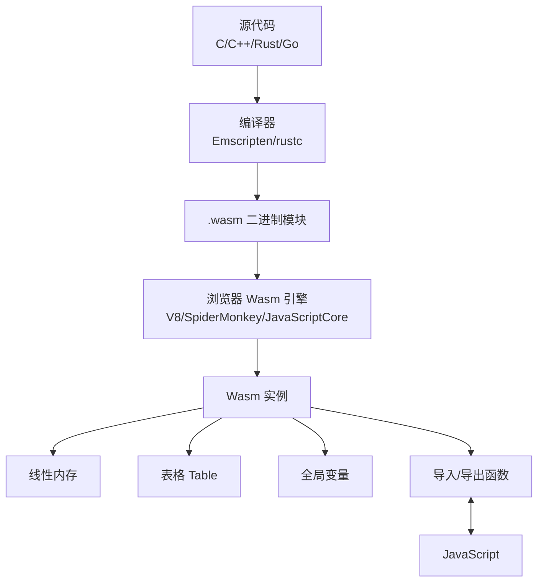

# WebAssembly入门与实战

> **文档说明**：系统讲解 WebAssembly（Wasm）的核心原理、概念体系（模块/实例/内存/表格）、开发工具链（Emscripten/Rust wasm-pack/AssemblyScript）、Rust 开发 WebAssembly 实战、JavaScript 与 Wasm 交互、性能优化、典型应用场景，以及常见问题与排查。
>
> **适用人群**：前端开发工程师、全栈开发者、需要在浏览器中运行高性能计算的开发者
>
> **前置知识**：[[前端工程化知识点系统梳理_优化版]]、[[Vite-构建原理与插件开发]]、[[JavaScript-ES6核心语法]]

---

## 一、概述

### 1. 什么是 WebAssembly

**WebAssembly（Wasm）** 是一种低级的二进制指令格式，设计目标是在浏览器中以接近原生的速度运行，是 JavaScript 的补充而非替代。Wasm 代码可以在浏览器的沙箱环境中安全执行，支持 C/C++、Rust、Go、AssemblyScript 等多种语言编译。

### 2. 核心特性

| 特性 | 说明 |
|------|------|
| **高性能** | 接近原生代码执行速度，比 JavaScript 快 10-30 倍 |
| **可移植** | 一次编译，到处运行（浏览器、Node.js、服务器、嵌入式） |
| **安全** | 沙箱执行，内存隔离，无法直接访问系统资源 |
| **紧凑** | 二进制格式，体积小，加载快 |
| **多语言** | 支持 C/C++、Rust、Go、AssemblyScript、Swift 等 |
| **与 JS 互操作** | 可与 JavaScript 无缝交互 |
| **确定性** | 相同输入产生相同输出（除浮点 NaN 外） |

### 3. 为什么需要 WebAssembly

| 场景 | JavaScript 的局限 | WebAssembly 的优势 |
|------|------------------|-------------------|
| **计算密集型** | 执行慢，阻塞主线程 | 接近原生速度 |
| **游戏/3D** | 性能不足 | 高性能渲染引擎 |
| **视频/音频处理** | 编解码慢 | 高效编解码 |
| **密码学** | 大整数运算慢 | 快速加密解密 |
| **已有 C/C++ 代码** | 需重写为 JS | 直接编译复用 |
| **AI 推理** | 模型推理慢 | 高性能推理引擎 |

### 4. 浏览器支持

| 浏览器 | 支持版本 | 时间 |
|--------|---------|------|
| **Chrome** | 57+ | 2017 |
| **Firefox** | 52+ | 2017 |
| **Safari** | 11+ | 2017 |
| **Edge** | 16+ | 2017 |
| **Node.js** | 8+ | 2017 |

> 目前全球浏览器支持率 > 95%，Wasm 已成为 Web 平台的标准组件。

---

## 二、核心概念

### 1. Wasm 架构



### 2. 核心概念

| 概念 | 说明 |
|------|------|
| **模块（Module）** | 编译后的 Wasm 二进制，包含函数、内存、表格等声明 |
| **实例（Instance）** | 模块的运行时实例，有独立的内存和状态 |
| **线性内存（Memory）** | 一段连续的字节数组，Wasm 唯一的读写内存方式 |
| **表格（Table）** | 函数引用数组，用于间接函数调用（如虚函数、回调） |
| **全局变量（Global）** | 可导入/导出的全局变量 |
| **函数（Function）** | Wasm 的执行单元，可导入或导出 |
| **类型（Type）** | 函数签名（参数和返回值类型） |

### 3. 数据类型

Wasm 只有四种数值类型：

| 类型 | 说明 | 位数 |
|------|------|------|
| **i32** | 32 位整数 | 32 |
| **i64** | 64 位整数 | 64 |
| **f32** | 32 位浮点数 | 32 |
| **f64** | 64 位浮点数 | 64 |

> Wasm 没有字符串、数组、对象等高级类型，这些需要通过线性内存手动管理。

### 4. 线性内存

```javascript
Wasm 线性内存（默认 64KB 页，最大 4GB）：
┌─────────────────────────────────────────┐
│ 0x0000  │ 数据区（栈、堆）              │
│ ...     │                              │
│ 0xFFFF  │                              │
└─────────────────────────────────────────┘

JavaScript 访问 Wasm 内存：
const bytes = new Uint8Array(instance.exports.memory.buffer);
const view = new DataView(instance.exports.memory.buffer);
```

---

## 三、开发工具链

### 1. 工具链对比

| 工具链 | 语言 | 特点 | 适用场景 |
|--------|------|------|---------|
| **Emscripten** | C/C++ | 功能最全，支持 SDL、OpenGL、文件系统 | 移植 C/C++ 项目 |
| **wasm-pack** | Rust | Rust 官方工具，集成 npm | Rust 开发 Wasm |
| **AssemblyScript** | TypeScript-like | 语法接近 TS，学习成本低 | 前端开发者入门 |
| **TinyGo** | Go | Go 子集，体积小 | Go 开发者 |
| **WASI SDK** | C/C++ | 系统接口，非浏览器环境 | 服务端 Wasm |

### 2. Emscripten（C/C++）

```bash
# 安装 Emscripten
git clone https://github.com/emscripten-core/emsdk.git
cd emsdk
./emsdk install latest
./emsdk activate latest
source ./emsdk_env.sh

# 编译 C 代码为 Wasm
emcc hello.c -o hello.html -s WASM=1 -s EXPORTED_FUNCTIONS='["_add"]'

# 常用选项
# -s WASM=1           输出 Wasm（默认）
# -s EXPORTED_FUNCTIONS 导出函数
# -s EXTRA_EXPORTED_RUNTIME_METHODS 导出运行时方法
# -O3                 优化级别
# --bind              支持 Embind（C++ 类绑定）
# -s USE_SDL=2        启用 SDL2
```

```c
// hello.c
#include <emscripten/emscripten.h>

EMSCRIPTEN_KEEPALIVE
int add(int a, int b) {
    return a + b;
}
```

```text
### 3. Rust + wasm-pack
```

```bash
# 安装 Rust
curl --proto '=https' --tlsv1.2 -sSf https://sh.rustup.rs | sh

# 安装 wasm-pack
cargo install wasm-pack

# 安装 wasm32 目标
rustup target add wasm32-unknown-unknown

# 创建项目
cargo new --lib wasm-app
cd wasm-app
```

```toml
# Cargo.toml
[package]
name = "wasm-app"
version = "0.1.0"
edition = "2021"

[lib]
crate-type = ["cdylib"]

[dependencies]
wasm-bindgen = "0.2"
```

```rust
// src/lib.rs
use wasm_bindgen::prelude::*;

// 导出函数到 JavaScript
#[wasm_bindgen]
pub fn add(a: i32, b: i32) -> i32 {
    a + b
}

// 导出结构体
#[wasm_bindgen]
pub struct Calculator {
    value: i32,
}

#[wasm_bindgen]
impl Calculator {
    #[wasm_bindgen(constructor)]
    pub fn new() -> Calculator {
        Calculator { value: 0 }
    }

    pub fn add(&mut self, n: i32) {
        self.value += n;
    }

    pub fn get_value(&self) -> i32 {
        self.value
    }
}

// 调用 JavaScript 函数
#[wasm_bindgen]
extern "C" {
    fn alert(s: &str);

    #[wasm_bindgen(js_namespace = console)]
    fn log(s: &str);
}

#[wasm_bindgen]
pub fn greet(name: &str) {
    log(&format!("Hello, {}!", name));
}
```

```bash
# 构建
wasm-pack build --target web  # 浏览器直接使用
wasm-pack build --target bundler  # 配合 webpack/vite
wasm-pack build --target nodejs  # Node.js 使用

# 发布到 npm
wasm-pack publish
```

### 4. AssemblyScript

```bash
# 安装
npm install --save-dev assemblyscript

# 初始化
npx asinit .
```

```typescript
// assembly/index.ts
// 语法接近 TypeScript，但编译为 Wasm

export function add(a: i32, b: i32): i32 {
  return a + b;
}

export function fibonacci(n: i32): i32 {
  if (n <= 1) return n;
  return fibonacci(n - 1) + fibonacci(n - 2);
}

// 字符串处理（通过内存）
export function greet(name: string): string {
  return `Hello, ${name}!`;
}
```

```bash
# 编译
npx asc assembly/index.ts -o build/optimized.wasm -O3
```

---

## 四、JavaScript 交互

### 1. 加载和实例化 Wasm

```javascript
// 方式1：WebAssembly.instantiateStreaming（推荐，流式编译）
async function loadWasm(url) {
  const response = await fetch(url);
  const result = await WebAssembly.instantiateStreaming(response);
  return result.instance;
}

// 方式2：先编译再实例化
async function loadWasm(url) {
  const response = await fetch(url);
  const bytes = await response.arrayBuffer();
  const module = await WebAssembly.compile(bytes);
  const instance = await WebAssembly.instantiate(module);
  return instance;
}

// 使用
const instance = await loadWasm('/add.wasm');
const result = instance.exports.add(2, 3);
console.log(result);  // 5
```

### 2. 导入 JavaScript 函数

```javascript
// JavaScript 定义导入对象
const importObject = {
  env: {
    // Wasm 可以调用这些 JS 函数
    log: (msg) => console.log(msg),
    now: () => Date.now(),
    memory: new WebAssembly.Memory({ initial: 256, maximum: 512 })
  }
};

const instance = await WebAssembly.instantiateStreaming(
  fetch('/module.wasm'),
  importObject
);
```

### 3. 内存交互

```javascript
// 读取 Wasm 内存
const memory = instance.exports.memory;
const bytes = new Uint8Array(memory.buffer);
const view = new DataView(memory.buffer);

// 读取 i32
const value = view.getInt32(offset, true);  // little-endian

// 写入字符串到 Wasm 内存
function writeString(str, offset) {
  const encoder = new TextEncoder();
  const bytes = encoder.encode(str);
  const mem = new Uint8Array(instance.exports.memory.buffer);
  mem.set(bytes, offset);
  return offset + bytes.length;
}

// 从 Wasm 内存读取字符串
function readString(offset, length) {
  const bytes = new Uint8Array(instance.exports.memory.buffer, offset, length);
  return new TextDecoder().decode(bytes);
}
```

### 4. wasm-bindgen 自动绑定

```javascript
// wasm-bindgen 生成的 JS 代码（自动处理类型转换）
import init, { add, Calculator, greet } from './pkg/wasm_app.js';

async function main() {
  await init();  // 初始化 Wasm

  // 调用函数
  console.log(add(2, 3));  // 5

  // 使用结构体
  const calc = new Calculator();
  calc.add(10);
  console.log(calc.get_value());  // 10

  // 字符串自动转换
  greet('World');  // console.log("Hello, World!")
}

main();
```

### 5. Vite 集成

```typescript
// vite.config.ts
import { defineConfig } from 'vite';
import wasm from 'vite-plugin-wasm';
import topLevelAwait from 'vite-plugin-top-level-await';

export default defineConfig({
  plugins: [wasm(), topLevelAwait()],
  optimizeDeps: {
    exclude: ['wasm-app']  // Wasm 包不预构建
  }
});
```

```bash
# 安装插件
npm install -D vite-plugin-wasm vite-plugin-top-level-await
```

---

## 五、性能优化

### 1. 加载优化

| 优化 | 说明 |
|------|------|
| **流式编译** | 使用 `instantiateStreaming`，边下载边编译 |
| **代码分割** | 大模块拆分为多个 Wasm 模块，按需加载 |
| **压缩** | Wasm 文件启用 gzip/brotli 压缩 |
| **缓存** | 合理设置 HTTP 缓存（hash 文件名） |
| **AOT 编译** | 部分引擎支持提前编译（如 V8 的 Liftoff） |

### 2. 执行优化

| 优化 | 说明 |
|------|------|
| **避免频繁 JS-Wasm 调用** | 跨边界调用有开销，尽量批量处理 |
| **减少内存拷贝** | 直接操作 Wasm 内存，避免数据复制 |
| **使用 SIMD** | Wasm SIMD 指令加速数值计算（128 位向量） |
| **避免动态类型** | Wasm 是静态类型，不要在热路径做类型转换 |
| **线性内存优化** | 合理设置初始内存大小，避免频繁增长 |
| **编译器优化** | 使用 `-O3` / `--release` 优化级别 |

### 3. SIMD 示例（Rust）

```rust
// Rust 中使用 Wasm SIMD
#[cfg(target_arch = "wasm32")]
use std::arch::wasm32::*;

#[wasm_bindgen]
pub fn sum_simd(a: &[f32], b: &[f32]) -> Vec<f32> {
    let mut result = vec![0.0; a.len()];
    let chunks = a.chunks_exact(4).zip(b.chunks_exact(4));

    for (i, (a_chunk, b_chunk)) in chunks.enumerate() {
        let va = f32x4(a_chunk[0], a_chunk[1], a_chunk[2], a_chunk[3]);
        let vb = f32x4(b_chunk[0], b_chunk[1], b_chunk[2], b_chunk[3]);
        let sum = f32x4_add(va, vb);
        // 存储结果...
    }
    result
}
```

---

## 六、应用场景

### 1. 典型应用

| 场景 | 案例 | 说明 |
|------|------|------|
| **游戏引擎** | Unity、Unreal、Godot | 3D 游戏在浏览器中运行 |
| **视频编辑** | FFmpeg.wasm | 浏览器端视频转码、剪辑 |
| **图像处理** | Squoosh、Photopea | 图片压缩、格式转换、PS 在线版 |
| **PDF 处理** | PDF.js（部分）、pdf-lib | PDF 渲染、编辑、生成 |
| **密码学** | libsodium-wrappers | 加密解密、哈希、签名 |
| **AI 推理** | ONNX Runtime Web、TensorFlow.js | 浏览器端机器学习推理 |
| **代码编辑器** | VS Code（Monaco）、CodeSandbox | 语法分析、代码编译 |
| **科学计算** | Pyodide（Python in Wasm） | 浏览器端运行 Python、NumPy |
| **音频处理** | WebAudio + Wasm | 音频效果器、合成器 |
| **CAD/3D 建模** | Onshape、FreeCAD | 浏览器端 3D 建模 |

### 2. 实战示例：斐波那契计算

```rust
// Rust 实现
#[wasm_bindgen]
pub fn fibonacci(n: u32) -> u64 {
    if n <= 1 {
        return n as u64;
    }
    let mut a = 0u64;
    let mut b = 1u64;
    for _ in 2..=n {
        let temp = a + b;
        a = b;
        b = temp;
    }
    b
}
```

```javascript
// JavaScript 对比
function fibonacciJS(n) {
  if (n <= 1) return n;
  let a = 0, b = 1;
  for (let i = 2; i <= n; i++) {
    [a, b] = [b, a + b];
  }
  return b;
}

// 性能对比
console.time('JS');
fibonacciJS(1000000);
console.timeEnd('JS');  // ~50ms

console.time('Wasm');
fibonacci(1000000);
console.timeEnd('Wasm');  // ~5ms（快 10 倍）
```

---

## 七、WebAssembly 系统接口（WASI）

### 1. WASI 概述

**WASI（WebAssembly System Interface）** 是 Wasm 的系统接口标准，使 Wasm 可以在浏览器之外运行，访问文件系统、网络、时钟等系统资源。

### 2. WASI 运行时

| 运行时 | 说明 |
|--------|------|
| **Wasmtime** | Bytecode Alliance 出品，高性能 |
| **Wasmer** | 支持多种后端，易于嵌入 |
| **WasmEdge** | 云原生优化，支持 AI |
| **Node.js** | 内置 WASI 支持 |
| **wasm3** | 解释器，轻量嵌入式 |

```bash
# Rust 编译为 WASI
rustup target add wasm32-wasi
cargo build --target wasm32-wasi --release

# 运行
wasmtime target/wasm32-wasi/release/app.wasm
```

---

## 八、常见问题与排查

| 问题 | 原因 | 解决方案 |
|------|------|---------|
| **Wasm 加载失败** | MIME 类型错误 / 路径错误 / CORS | 服务器配置 `application/wasm` MIME、检查路径、CORS |
| **函数未导出** | 编译器优化移除 / 未标记导出 | 使用 `EMSCRIPTEN_KEEPALIVE` / `#[wasm_bindgen]` |
| **内存访问错误** | 越界访问 / 内存未初始化 | 检查偏移量、初始化内存、开启边界检查调试 |
| **性能不如预期** | 频繁 JS-Wasm 调用 / 未优化编译 | 减少跨边界调用、使用 `-O3`/`--release`、SIMD |
| **字符串乱码** | 编码不匹配 / 长度错误 | 使用 TextEncoder/TextDecoder、确认 UTF-8 |
| **模块编译慢** | Wasm 文件过大 / 首次加载 | 流式编译、代码分割、缓存编译结果 |
| **Rust panic 不显示** | 未配置 panic hook | 使用 `console_error_panic_hook`  crate |
| **调试困难** | Wasm 二进制难以调试 | 使用 DWARF 调试信息、Source Map、浏览器 DevTools |
| **栈溢出** | 递归过深 / 栈大小不足 | 增加栈大小、优化递归为迭代 |
| **浮点精度问题** | Wasm f32/f64 与 JS Number 转换 | 注意 f32 精度损失、使用 f64 |
| **多线程支持** | 浏览器 SharedArrayBuffer 限制 | 配置 COOP/COEP 响应头、使用 `wasm-bindgen-rayon` |
| **DOM 操作慢** | Wasm 不能直接访问 DOM | 通过 JS 桥接操作 DOM，批量更新 |
| **文件系统访问** | 浏览器沙箱限制 | 使用 Emscripten 虚拟文件系统 / IndexedDB |

---

## 九、关联笔记

### 前端工程化
- [[前端工程化知识点系统梳理_优化版]] · [[Vite-构建原理与插件开发]] · [[pnpm-monorepo架构]]
- [[前端性能优化实战]] · [[TypeScript-类型系统进阶]]

### 前端框架
- [[Vue3-组合式API设计模式]] · [[Vue3-性能优化实战]] · [[React-Hooks核心原理与实战]]

### 前沿技术
- [[Serverless架构设计]] · [[云原生架构设计]] · [[AI-Agent核心架构]]
- [[大模型应用开发实战]]

### 导航
- [[MOC-前端开发]] · [[MOC-综合导航]] · [[全栈+AI工程双轨融合学习路线图]]

> **学习路径建议**：先掌握 [[JavaScript-ES6核心语法]] JS 基础 → 学习 [[前端工程化知识点系统梳理_优化版]] 工程化 → 深入本文 WebAssembly 入门与实战 → 实践 Rust + wasm-pack 开发 → 研究 [[前端性能优化实战]] 性能优化 → 应用于计算密集型场景（视频处理、AI 推理、游戏）。
