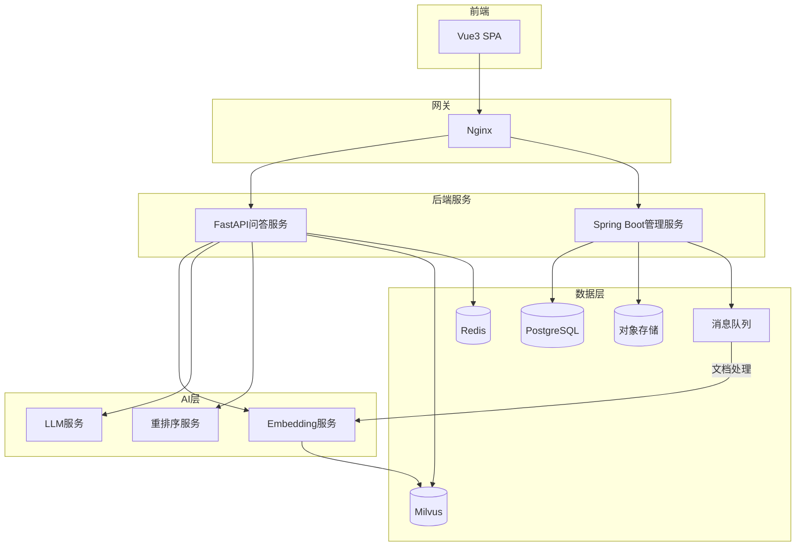
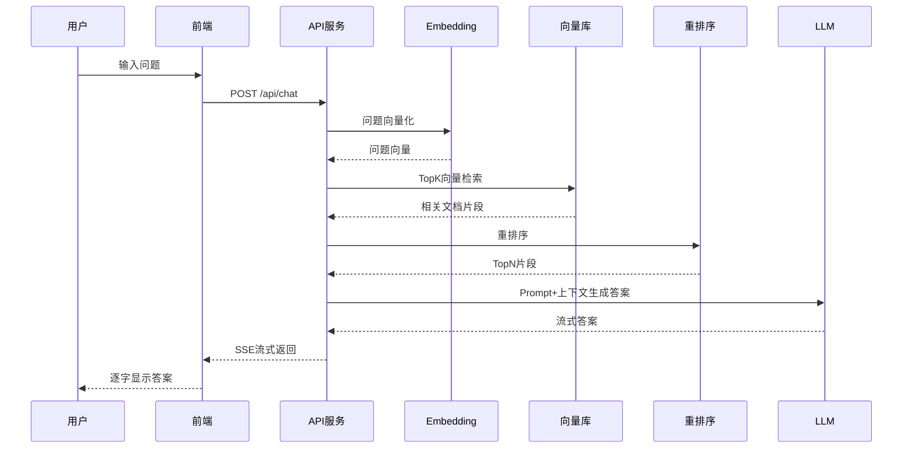

# 全栈+AI端到端实战

> **文档说明**：本文档以一个完整的"智能知识库问答系统"为例，从需求分析、架构设计、前端开发、后端开发、AI集成到部署运维，端到端展示全栈+AI项目的完整开发流程。
>
> **适用人群**：全栈工程师、AI应用开发者、希望构建AI产品的开发者
>
> **前置知识**：Vue3/React、Spring Boot/Python、LLM基础、RAG概念

---

## 一、项目概述

### 1.1 需求分析

**目标**：构建一个企业内部智能知识库问答系统，员工可以用自然语言提问，系统从内部文档中检索相关内容并生成准确答案。

| 功能模块 | 说明 |
|---------|------|
| 文档管理 | 上传/解析/切分企业文档（PDF/Word/Markdown） |
| 智能问答 | 自然语言提问，RAG检索+LLM生成答案 |
| 对话历史 | 多轮对话，上下文理解 |
| 引用溯源 | 答案标注来源文档和页码 |
| 反馈评价 | 用户对答案点赞/点踩，持续优化 |
| 管理后台 | 文档管理、模型配置、使用统计 |

### 1.2 技术选型

| 层级 | 技术 | 说明 |
|------|------|------|
| 前端 | Vue3 + TypeScript + Element Plus | 管理后台+问答界面 |
| 后端API | Python FastAPI | AI接口，异步高性能 |
| 业务后端 | Spring Boot（可选） | 用户/权限/文档管理 |
| 向量数据库 | Milvus / pgvector | 文档向量存储检索 |
| 关系数据库 | PostgreSQL | 用户、文档、对话元数据 |
| 缓存 | Redis | 会话缓存、限流 |
| LLM | OpenAI / 通义千问 / 本地模型 | 答案生成 |
| Embedding | bge-large-zh / text-embedding-3 | 文档向量化 |
| 消息队列 | RabbitMQ / Redis Stream | 文档异步处理 |
| 部署 | Docker + Nginx | 容器化部署 |

---

## 二、系统架构

### 2.1 整体架构



### 2.2 核心流程



---

## 三、核心模块实现

### 3.1 文档处理模块

```python
# document_processor.py
from langchain.text_splitter import RecursiveCharacterTextSplitter
from langchain.document_loaders import PyPDFLoader, Docx2txtLoader

class DocumentProcessor:
    def __init__(self):
        self.splitter = RecursiveCharacterTextSplitter(
            chunk_size=500,
            chunk_overlap=50,
            separators=["\n\n", "\n", "。", "！", "？", ".", " "]
        )

    def process(self, file_path: str, file_type: str) -> list:
        """解析文档并切分"""
        # 1. 加载文档
        if file_type == 'pdf':
            loader = PyPDFLoader(file_path)
        elif file_type == 'docx':
            loader = Docx2txtLoader(file_path)
        else:
            loader = TextLoader(file_path)

        documents = loader.load()

        # 2. 切分
        chunks = self.splitter.split_documents(documents)

        # 3. 添加元数据
        for i, chunk in enumerate(chunks):
            chunk.metadata['chunk_id'] = i
            chunk.metadata['char_count'] = len(chunk.page_content)

        return chunks
```

### 3.2 向量检索模块

```python
# vector_store.py
from pymilvus import Collection, connections

class VectorStore:
    def __init__(self, collection_name="knowledge_base"):
        connections.connect(host="milvus", port="19530")
        self.collection = Collection(collection_name)
        self.collection.load()

    def search(self, query_vector: list, top_k: int = 10,
               expr: str = None) -> list:
        """向量检索+标量过滤"""
        search_params = {"metric_type": "COSINE", "params": {"ef": 128}}
        results = self.collection.search(
            data=[query_vector],
            anns_field="embedding",
            param=search_params,
            limit=top_k,
            expr=expr,
            output_fields=["content", "source", "page", "chunk_id"]
        )
        return [
            {
                "content": hit.entity.get("content"),
                "source": hit.entity.get("source"),
                "page": hit.entity.get("page"),
                "score": hit.score
            }
            for hit in results[0]
        ]
```

### 3.3 RAG问答模块

```python
# rag_service.py
from openai import OpenAI

class RAGService:
    def __init__(self, embedding_service, vector_store, reranker):
        self.embedding = embedding_service
        self.vector_store = vector_store
        self.reranker = reranker
        self.llm = OpenAI(base_url="...", api_key="...")

    SYSTEM_PROMPT = """你是一个专业的知识库助手。请根据以下参考资料回答用户问题。
要求：
1. 只基于参考资料回答，不要编造信息
2. 如果参考资料中没有相关信息，请回答"参考资料中未找到相关内容"
3. 回答后标注引用来源，格式：[来源:文档名, 页码]
4. 用中文回答，条理清晰

参考资料：
{context}
"""

    def chat(self, question: str, conversation_id: str = None):
        # 1. 问题向量化
        query_vec = self.embedding.encode(question)

        # 2. 向量检索（召回20条）
        candidates = self.vector_store.search(query_vec, top_k=20)

        # 3. 重排序（取Top5）
        reranked = self.reranker.rerank(question, candidates, top_n=5)

        # 4. 组装上下文
        context = "\n\n".join([
            f"[文档:{r['source']}, 页码:{r['page']}]\n{r['content']}"
            for r in reranked
        ])

        # 5. LLM生成（流式）
        messages = [
            {"role": "system", "content": self.SYSTEM_PROMPT.format(context=context)},
            {"role": "user", "content": question}
        ]

        stream = self.llm.chat.completions.create(
            model="qwen-plus",
            messages=messages,
            temperature=0.3,
            stream=True
        )

        for chunk in stream:
            if chunk.choices[0].delta.content:
                yield chunk.choices[0].delta.content
```

### 3.4 API接口

```python
# main.py
from fastapi import FastAPI
from fastapi.responses import StreamingResponse
from pydantic import BaseModel

app = FastAPI(title="智能知识库问答API")

class ChatRequest(BaseModel):
    question: str
    conversation_id: str = None

@app.post("/api/chat")
async def chat(req: ChatRequest):
    return StreamingResponse(
        rag_service.chat(req.question, req.conversation_id),
        media_type="text/event-stream"
    )

@app.post("/api/documents/upload")
async def upload_document(file: UploadFile):
    # 保存文件→发送到MQ异步处理
    file_path = save_file(file)
    mq.send("document_process", {"file_path": file_path, "type": file.filename.split('.')[-1]})
    return {"status": "processing", "file_id": file_id}
```

### 3.5 前端问答界面

```vue
<!-- ChatPage.vue -->
<template>
  <div class="chat-container">
    <div class="messages">
      <div v-for="msg in messages" :key="msg.id" :class="msg.role">
        <div class="avatar">{{ msg.role === 'user' ? '我' : 'AI' }}</div>
        <div class="content">
          <p v-html="msg.content"></p>
          <div v-if="msg.sources" class="sources">
            <span v-for="s in msg.sources" :key="s.id">[{{ s.source }} P{{ s.page }}]</span>
          </div>
        </div>
      </div>
    </div>
    <div class="input-area">
      <el-input v-model="question" @keyup.enter="send" placeholder="输入问题..." />
      <el-button @click="send" :loading="loading">发送</el-button>
    </div>
  </div>
</template>

<script setup>
import { ref } from 'vue'
import axios from 'axios'

const messages = ref([])
const question = ref('')
const loading = ref(false)

async function send() {
  if (!question.value.trim()) return
  messages.value.push({ role: 'user', content: question.value })
  const aiMsg = { role: 'assistant', content: '' }
  messages.value.push(aiMsg)
  loading.value = true

  // SSE流式接收
  const response = await fetch('/api/chat', {
    method: 'POST',
    headers: { 'Content-Type': 'application/json' },
    body: JSON.stringify({ question: question.value })
  })
  const reader = response.body.getReader()
  const decoder = new TextDecoder()
  while (true) {
    const { done, value } = await reader.read()
    if (done) break
    aiMsg.content += decoder.decode(value)
  }
  question.value = ''
  loading.value = false
}
</script>
```

---

## 四、关键技术点

### 4.1 文档切分策略

| 文档类型 | 切分方式 | Chunk大小 |
|---------|---------|-----------|
| Markdown | 按标题层级切分 | 500-1000字 |
| PDF | 按页+段落切分 | 500字 |
| Word | 按段落切分 | 500字 |
| 表格 | 整表作为一个Chunk | 按表大小 |
| 代码 | 按函数/类切分 | 按逻辑单元 |

### 4.2 检索优化

1. **混合检索**：向量检索 + BM25关键词检索，结果融合
2. **查询改写**：LLM将用户问题改写为更适合检索的查询
3. **重排序**：CrossEncoder对召回结果精排
4. **元数据过滤**：按文档类型/时间/部门过滤
5. **动态TopK**：根据问题复杂度调整检索数量

### 4.3 Prompt工程

```text
系统提示词设计原则：
1. 明确角色（专业知识库助手）
2. 约束回答范围（只基于参考资料）
3. 输出格式要求（标注来源）
4. 异常处理（无答案时如何回应）
5. 语言要求（中文、条理清晰）

温度设置：
- 问答场景：0.1-0.3（低温度，准确）
- 创意场景：0.7-0.9（高温度，多样）
```

### 4.4 评估指标

| 指标 | 说明 | 目标 |
|------|------|------|
| 检索召回率 | 相关文档是否被召回 | >90% |
| 答案准确率 | 答案是否正确 | >85% |
| 引用准确率 | 引用来源是否正确 | >90% |
| 响应时间 | 首字延迟+总时长 | 首字<2s，总<10s |
| 用户满意度 | 点赞率 | >80% |

---

## 五、部署运维

### 5.1 Docker部署

```yaml
# docker-compose.yml
version: '3.8'
services:
  frontend:
    build: ./frontend
    ports: ["80:80"]
  api:
    build: ./backend
    ports: ["8000:8000"]
    depends_on: [milvus, postgres, redis]
  milvus:
    image: milvusdb/milvus:v2.3.4
  postgres:
    image: postgres:15
  redis:
    image: redis:7
```

### 5.2 监控

- API响应时间、错误率
- LLM调用延迟、Token消耗
- 向量检索延迟、召回率
- 文档处理队列堆积
- 用户活跃度、问答量

---

## 关联文档

- [[RAG检索增强生成]] — RAG原理
- [[向量数据库选型与实战]] — 向量检索
- [[Embedding模型选型]] — 向量化
- [[MCP协议实战指南]] — AI工程化
- [[SpringBoot项目模板与最佳实践]] — 后端模板
- [[Vue3核心知识点系统梳理_优化版]] — 前端

---

> 💡 **实战建议**：全栈+AI项目的核心是"RAG质量决定产品质量"。重点投入：1. 文档切分策略（按结构切分，不是简单按字数）；2. 检索质量（混合检索+重排序）；3. Prompt工程（约束+格式+异常处理）；4. 评估体系（建立测试集，持续优化）。前端用SSE流式输出提升体验，后端用异步队列处理文档。
