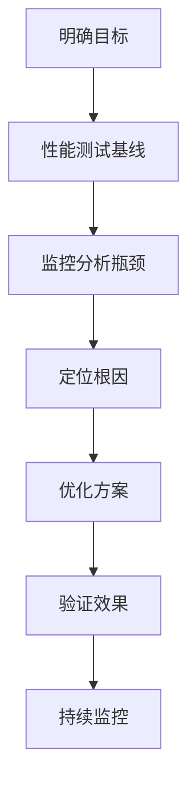

# 性能调优案例集

> **文档说明**：本文档收集真实场景下的性能调优案例，涵盖JVM、SQL、缓存、架构、前端等维度，每个案例包含问题现象、排查过程、根因分析、解决方案和效果数据。
>
> **适用人群**：高级后端工程师、架构师、性能优化工程师
>
> **前置知识**：JVM、SQL、缓存、分布式系统

---

## 一、调优方法论

### 1.1 性能调优步骤



### 1.2 性能指标

| 指标 | 说明 | 目标 |
|------|------|------|
| **吞吐量（QPS/TPS）** | 每秒处理请求数 | 越高越好 |
| **响应时间（RT）** | 请求处理时间 | P99 < 500ms（API） |
| **并发数** | 同时处理的请求数 | 按业务需求 |
| **CPU使用率** | 服务器CPU负载 | <70% |
| **内存使用率** | 堆内存/物理内存 | <80% |
| **错误率** | 请求失败比例 | <0.1% |

### 1.3 调优优先级

```text
1. 架构优化（最大收益）：缓存、异步、微服务拆分
2. SQL优化（高收益）：索引、慢查询、连接池
3. JVM优化（中收益）：垃圾回收、内存配置
4. 代码优化（中收益）：算法、数据结构、并发
5. 操作系统/网络（低收益）：内核参数、TCP配置
```

---

## 二、JVM调优案例

### 案例1：频繁Full GC导致服务卡顿

**现象**：服务响应时间间歇性飙升，从50ms涨到5s，监控显示频繁Full GC。

**排查过程**：
```bash
# 1. 查看GC日志
java -Xlog:gc*:file=gc.log -jar app.jar

# 2. 分析GC日志
grep "Full GC" gc.log | tail -20
# 发现每10分钟一次Full GC，每次耗时3-5秒

# 3. 查看堆内存使用
jmap -heap <pid>
# 老年代使用率95%，每次Full GC后只降到80%

# 4. 导出堆转储
jmap -dump:format=b,file=heap.hprof <pid>

# 5. 分析堆转储（MAT/VisualVM）
# 发现大量byte[]对象，占用60%堆内存
# 追溯到文件下载接口，将整个文件读入内存
```

**根因**：文件下载接口使用`byte[]`读取整个大文件到内存，导致老年代快速填满。

**解决方案**：
```java
// 优化前：整个文件读入内存
@GetMapping("/download")
public byte[] download(String fileId) {
    File file = fileService.getFile(fileId);
    return Files.readAllBytes(file.toPath());  // 大文件OOM风险
}

// 优化后：流式输出，不占用堆内存
@GetMapping("/download")
public void download(String fileId, HttpServletResponse response) {
    File file = fileService.getFile(fileId);
    response.setContentType("application/octet-stream");
    try (InputStream in = new FileInputStream(file);
         OutputStream out = response.getOutputStream()) {
        byte[] buffer = new byte[8192];
        int len;
        while ((len = in.read(buffer)) != -1) {
            out.write(buffer, 0, len);
        }
    }
}
```

**效果**：Full GC从每10分钟1次降到每天1次，P99响应时间从5s降到80ms。

### 案例2：Metaspace OOM

**现象**：服务运行几天后抛出`java.lang.OutOfMemoryError: Metaspace`。

**根因**：动态代理类过多（CGLIB/Spring AOP），Metaspace默认无上限，类元数据不断累积。

**解决方案**：
```bash
# 限制Metaspace大小
-XX:MaxMetaspaceSize=256m
-XX:MetaspaceSize=128m

# 排查动态类生成
# 检查是否有循环创建代理、热部署、Groovy脚本等
```

### 案例3：G1 GC调优

```bash
# 推荐JDK11+ G1配置
-server
-Xms4g -Xmx4g                    # 堆大小固定，避免动态扩缩
-XX:+UseG1GC                     # G1收集器
-XX:MaxGCPauseMillis=200         # 目标停顿200ms
-XX:ParallelGCThreads=8          # 并行GC线程数
-XX:ConcGCThreads=2              # 并发GC线程数
-XX:InitiatingHeapOccupancyPercent=45  # 触发并发标记的堆占用率
-XX:+HeapDumpOnOutOfMemoryError  # OOM时自动dump
-XX:HeapDumpPath=/logs/heapdump.hprof
-XX:+PrintGCDetails
-Xlog:gc*:file=/logs/gc.log:time,uptime:filecount=10,filesize=100m
```

---

## 三、SQL优化案例

### 案例4：慢查询导致接口超时

**现象**：订单列表接口P99响应时间3s，数据库CPU使用率90%。

**排查**：
```sql
-- 查看慢查询
SHOW VARIABLES LIKE 'slow_query_log';
-- 慢查询日志中发现：
SELECT * FROM orders WHERE user_id = 123 AND status = 1 ORDER BY created_at DESC LIMIT 20;
-- 执行时间2.5s，扫描100万行

-- 查看执行计划
EXPLAIN SELECT * FROM orders WHERE user_id = 123 AND status = 1 ORDER BY created_at DESC LIMIT 20;
-- type=ALL（全表扫描），rows=1000000，Extra=Using where; Using filesort
```

**根因**：`user_id`和`status`没有合适的联合索引，且`ORDER BY created_at`导致filesort。

**解决方案**：
```sql
-- 创建联合索引（等值查询在前，排序在后）
CREATE INDEX idx_user_status_created ON orders(user_id, status, created_at DESC);

-- 优化后执行计划
-- type=ref，rows=20，Extra=Using index condition
```

**效果**：查询时间从2.5s降到5ms，数据库CPU从90%降到20%。

### 案例5：深分页性能问题

**现象**：订单列表翻到第100页时接口超时。

```sql
-- 慢查询
SELECT * FROM orders ORDER BY id LIMIT 1000000, 20;
-- 扫描100万行，耗时3s
```

**解决方案**：
```sql
-- 方案1：游标分页（推荐）
SELECT * FROM orders WHERE id > 1000000 ORDER BY id LIMIT 20;

-- 方案2：子查询延迟关联
SELECT * FROM orders o
INNER JOIN (SELECT id FROM orders ORDER BY id LIMIT 1000000, 20) t ON o.id = t.id;
```

### 案例6：连接池耗尽

**现象**：高峰期接口大量超时，日志报`Cannot get a connection, pool error Timeout waiting`。

**排查**：
```text
HikariCP监控：活跃连接=50（最大值），等待线程=200
慢查询日志：多个SQL执行时间>5s
```

**根因**：慢查询占用连接时间过长，连接池被占满。

**解决方案**：
```yaml
spring:
  datasource:
    hikari:
      maximum-pool-size: 50        # 连接数=CPU核数*2 + 磁盘数
      minimum-idle: 10
      connection-timeout: 3000     # 获取连接超时3s（快速失败）
      idle-timeout: 600000
      max-lifetime: 1800000
      leak-detection-threshold: 60000  # 连接泄漏检测
```
同时优化慢查询，从根源减少连接占用时间。

---

## 四、缓存优化案例

### 案例7：缓存击穿导致数据库雪崩

**现象**：热门商品缓存过期瞬间，数据库QPS从100飙升到10000，数据库宕机。

**根因**：热点Key过期，大量请求同时穿透到数据库。

**解决方案**：
```java
// 方案1：互斥锁（只让一个请求查库）
public Product getProduct(Long id) {
    String key = "product:" + id;
    Product product = redis.get(key);
    if (product != null) return product;

    String lockKey = "lock:product:" + id;
    if (redis.setIfAbsent(lockKey, "1", 10, TimeUnit.SECONDS)) {
        try {
            product = db.selectById(id);  // 查库
            redis.set(key, product, 30, TimeUnit.MINUTES);
        } finally {
            redis.delete(lockKey);
        }
    } else {
        Thread.sleep(100);  // 等待，重试
        return getProduct(id);
    }
    return product;
}

// 方案2：逻辑过期（永不过期，异步更新）
// 缓存中存储过期时间，读取时判断是否过期，过期则异步更新
```

### 案例8：缓存与数据库一致性

**方案**：延迟双删 + 订阅binlog（Canal）

```java
// 更新数据时
@Transactional
public void updateProduct(Product product) {
    redis.delete("product:" + product.getId());  // 先删缓存
    productMapper.updateById(product);           // 更新数据库
    // 延迟500ms再删（等待主从同步完成）
    threadPool.schedule(() -> redis.delete("product:" + product.getId()), 500, TimeUnit.MILLISECONDS);
}
// Canal监听binlog，数据变更时删除缓存（最终一致）
```

---

## 五、架构优化案例

### 案例9：同步调用改异步

**现象**：下单接口响应时间2s，包含扣库存、创建订单、发短信、发邮件、统计。

**优化**：
```java
// 优化前：同步串行，总耗时=各步骤之和
public Order createOrder(OrderDTO dto) {
    stockService.deduct(dto);        // 200ms
    Order order = orderMapper.insert(dto);  // 100ms
    smsService.send(order);          // 500ms
    emailService.send(order);        // 800ms
    statsService.record(order);      // 400ms
    return order;  // 总耗时2s
}

// 优化后：核心同步+非核心异步
public Order createOrder(OrderDTO dto) {
    stockService.deduct(dto);        // 200ms（核心，同步）
    Order order = orderMapper.insert(dto);  // 100ms（核心，同步）
    // 非核心操作异步化
    eventPublisher.publish(new OrderCreatedEvent(order));
    return order;  // 总耗时300ms
}

// 异步监听
@EventListener
public void onOrderCreated(OrderCreatedEvent event) {
    smsService.send(event.getOrder());    // 异步
    emailService.send(event.getOrder());  // 异步
    statsService.record(event.getOrder()); // 异步
}
```

**效果**：接口响应时间从2s降到300ms。

### 案例10：多级缓存架构

```text
请求 → 本地缓存(Caffeine, 1ms) → Redis集群(5ms) → 数据库(50ms)
命中率：  90%                    9%               1%
```

```java
// Caffeine本地缓存
@Bean
public Cache<Long, Product> productCache() {
    return Caffeine.newBuilder()
        .maximumSize(10000)
        .expireAfterWrite(5, TimeUnit.MINUTES)
        .recordStats()
        .build();
}
```

---

## 六、前端性能优化案例

### 案例11：首屏加载优化

| 优化手段 | 效果 |
|---------|------|
| 路由懒加载 | 首屏JS从2MB降到500KB |
| Gzip压缩 | 传输体积减少60% |
| CDN加速 | 静态资源加载时间减少50% |
| 图片懒加载+WebP | 图片加载减少40% |
| 预加载关键资源 | LCP减少30% |
| 骨架屏 | 感知加载时间减少50% |

---

## 七、调优工具清单

| 工具 | 用途 |
|------|------|
| **Arthas** | Java在线诊断（方法耗时、线程、JVM） |
| **JProfiler/VisualVM** | JVM性能分析 |
| **MAT** | 堆内存分析 |
| **GCEasy** | GC日志在线分析 |
| **Explain** | SQL执行计划 |
| **Slow Query Log** | MySQL慢查询 |
| **wrk/ab/JMeter** | 压力测试 |
| **SkyWalking** | 分布式链路追踪 |
| **Prometheus+Grafana** | 监控告警 |
| **Lighthouse** | 前端性能分析 |

---

## 关联文档

- [[Java问题排查手册]] — Java排查
- [[MySQL问题排查手册]] — MySQL排查
- [[JVM 知识点系统梳理_优化版]] — JVM深度
- [[高并发系统设计案例]] — 高并发架构
- [[多级缓存架构设计]] — 缓存架构
- [[架构演进案例集]] — 架构演进

---

> 💡 **调优心得**：1. 先压测建立基线，再优化，避免盲目调优；2. 优化最大瓶颈（二八定律），不要纠结细枝末节；3. 架构优化收益最大（缓存/异步/拆分），优先考虑；4. 每次优化后验证效果，用数据说话；5. 监控是调优的眼睛，没有监控不要调优；6. 过早优化是万恶之源，先让系统跑起来再优化。
