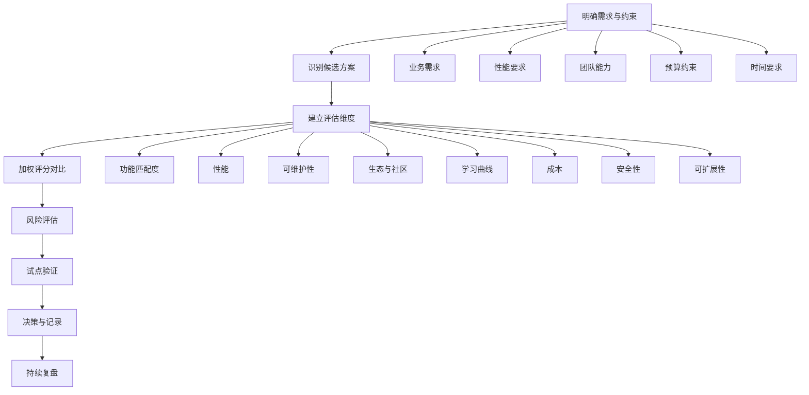

# 技术选型决策指南

> **文档说明**：提供系统化的技术选型决策框架，覆盖前端、后端、数据库、缓存、消息队列、AI 工程、云原生等各领域的主流技术对比，帮助团队在不同场景下做出理性、可追溯的技术选型决策。
>
> **适用人群**：架构师、技术负责人、全栈工程师、需要做技术决策的开发者
>
> **前置知识**：[[架构设计原则-SOLID]]、[[高可用架构设计]]

---

## 一、概述

**技术选型**是软件开发中最关键的决策之一，直接影响项目的开发效率、运行性能、维护成本和团队士气。好的技术选型不是选"最新"或"最火"的技术，而是在特定约束条件下选择最适合的方案。

### 1. 技术选型的常见误区

| 误区 | 说明 | 后果 |
|------|------|------|
| **追新** | 盲目追求最新版本/技术 | 生态不成熟、坑多、招人难 |
| **追热** | 什么火用什么（如盲目上微服务/K8s） | 过度设计、复杂度远超需求 |
| **个人偏好** | 因为自己熟悉/喜欢就选 | 团队能力不匹配、维护困难 |
| **大厂崇拜** | 大厂用什么就用什么 | 忽略规模差异，大厂方案可能过重 |
| **只看性能** | 只看 benchmark 数字 | 忽略开发效率、生态、维护成本 |
| **避免决策** | 拖延不做决定，或让每个人自己选 | 技术栈碎片化、维护成本高 |
| **一次定终身** | 选了就不改，拒绝演进 | 技术债务累积，最终被迫大重构 |

### 2. 技术选型决策框架



### 3. 决策记录（ADR）

**ADR（Architecture Decision Record）** 是记录技术选型决策的轻量级文档，每个决策一个文件，包含背景、决策、理由、后果。

```markdown
# ADR-001: 选择 Vue3 作为前端框架

## 状态
已采纳（2026-08-13）

## 背景
项目需要构建一个中后台管理系统，团队有 3 名前端开发者，
其中 2 人熟悉 Vue2，1 人熟悉 React。

## 决策
选择 Vue3 + TypeScript + Vite + Element Plus 作为前端技术栈。

## 理由
1. 团队 2/3 熟悉 Vue，学习成本低
2. Vue3 Composition API 更适合复杂逻辑复用
3. Vite 构建速度快，开发体验好
4. Element Plus 组件丰富，适合中后台
5. 国内生态好，文档和社区资源丰富

## 后果
- 正面：开发效率高，团队上手快
- 负面：React 生态的某些库不可用（如 React Query）
- 风险：Vue3 相对较新，部分第三方库可能未完全适配
```

---

## 二、评估维度与权重

### 1. 通用评估维度

| 维度 | 说明 | 评估要点 | 建议权重 |
|------|------|---------|---------|
| **功能匹配度** | 是否满足当前和可预见的需求 | 核心功能、扩展能力、集成能力 | 25% |
| **性能** | 运行时性能表现 | 吞吐量、延迟、资源占用、并发能力 | 15% |
| **可维护性** | 长期维护的难易程度 | 代码质量、文档、测试、升级难度 | 15% |
| **生态与社区** | 周边生态和社区活跃度 | GitHub Stars、Issue 响应、插件数量、Stack Overflow | 10% |
| **团队匹配度** | 团队现有技能和学习成本 | 熟悉程度、学习曲线、招聘难度 | 10% |
| **成本** | 总拥有成本（TCO） | 许可费、云资源、人力、培训 | 10% |
| **安全性** | 安全特性和历史漏洞 | CVE 数量、修复速度、安全特性 | 5% |
| **可扩展性** | 未来扩展和演进能力 | 水平扩展、插件机制、API 稳定性 | 5% |
| **成熟度** | 技术成熟度和稳定性 | 版本号、发布历史、生产案例 | 5% |

### 2. 评分模板

| 维度 | 权重 | 方案A评分 | 方案B评分 | 方案C评分 |
|------|------|----------|----------|----------|
| 功能匹配度 | 25% | 8 | 9 | 7 |
| 性能 | 15% | 7 | 8 | 9 |
| 可维护性 | 15% | 8 | 7 | 6 |
| 生态与社区 | 10% | 9 | 8 | 6 |
| 团队匹配度 | 10% | 9 | 6 | 7 |
| 成本 | 10% | 7 | 6 | 9 |
| 安全性 | 5% | 8 | 8 | 7 |
| 可扩展性 | 5% | 7 | 8 | 6 |
| 成熟度 | 5% | 8 | 7 | 6 |
| **加权总分** | **100%** | **7.95** | **7.65** | **7.05** |

评分标准：1-10 分，1=极差，5=及格，8=优秀，10=完美。

### 3. 不同项目类型的权重调整

| 项目类型 | 功能匹配 | 性能 | 可维护 | 团队匹配 | 成本 | 说明 |
|---------|---------|------|--------|---------|------|------|
| **创业 MVP** | 20% | 10% | 10% | 25% | 20% | 快速验证，团队熟悉和成本优先 |
| **企业中后台** | 30% | 10% | 20% | 15% | 10% | 功能完整，长期维护 |
| **高并发系统** | 20% | 30% | 15% | 10% | 10% | 性能是核心约束 |
| **金融系统** | 25% | 15% | 20% | 10% | 10% | 安全和稳定性优先（安全权重提到15%） |
| **AI 应用** | 30% | 15% | 15% | 15% | 15% | 模型能力和集成生态关键 |
| **开源项目** | 25% | 15% | 20% | 10% | 5% | 社区生态和可维护性重要 |

---

## 三、前端技术选型

### 1. 框架选择

| 维度 | Vue3 | React 18 | Angular 17 | Svelte 5 | SolidJS |
|------|------|----------|-----------|----------|---------|
| **学习曲线** | 低（模板语法直观） | 中（JSX+Hooks） | 高（概念多） | 低（编译时） | 中 |
| **生态丰富度** | 高（国内尤甚） | 极高（全球最大） | 高（企业级） | 中（增长快） | 低（新兴） |
| **性能** | 高（虚拟DOM+编译优化） | 高（并发渲染） | 中高（Ivy引擎） | 极高（无虚拟DOM） | 极高（细粒度响应） |
| **类型支持** | 优秀（TS 一等公民） | 优秀 | 优秀（原生TS） | 良好 | 优秀 |
| **企业级方案** | Nuxt3/Pinia/Element Plus | Next.js/Redux/Shadcn | 内置完整方案 | SvelteKit | SolidStart |
| **国内招聘** | 容易 | 容易 | 较难 | 难 | 难 |
| **适用场景** | 中后台、移动端、SSR | 全场景、复杂SPA、SSR | 大型企业应用 | 中小型应用、追求性能 | 高性能应用、实验性 |

**决策建议**：
- 团队熟悉 Vue → Vue3（国内生态好，招人容易）
- 团队熟悉 React → React 18（生态最大，跨平台能力强）
- 大型企业级应用、需要完整方案 → Angular
- 追求极致性能、中小型项目 → Svelte
- 不建议：项目初期选小众框架（招人难、生态弱）

### 2. 构建工具

| 工具 | 特点 | 适用场景 |
|------|------|---------|
| **Vite** | 开发服务器极快（ESM），Rollup 构建，插件生态好 | 大多数项目（推荐） |
| **Webpack** | 功能最全，生态最成熟，配置灵活但复杂 | 老项目维护、复杂构建需求 |
| **Rspack** | Rust 编写，Webpack 兼容，构建速度快 5-10 倍 | 大型项目、Webpack 迁移 |
| **Turbopack** | Rust 编写，Next.js 内置，开发服务器快 | Next.js 项目 |
| **esbuild** | Go 编写，极快，API 简单 | 库打包、简单项目 |
| **Rollup** | ESM 优先，Tree Shaking 好 | 库打包（Vite 生产构建用它） |
| **Parcel** | 零配置，开箱即用 | 原型、小型项目 |

**决策建议**：新项目首选 Vite；老 Webpack 项目可评估迁移到 Rspack；库打包用 Rollup/esbuild。

### 3. 状态管理

| 方案 | 特点 | 适用场景 |
|------|------|---------|
| **Pinia** | Vue3 官方推荐，API 简洁，TS 友好 | Vue3 项目（推荐） |
| **Redux Toolkit** | React 官方推荐，功能完整，中间件生态 | React 大型项目 |
| **Zustand** | 轻量（1KB），API 简洁，无 Provider | React 中小型项目（推荐） |
| **Jotai** | 原子化状态，细粒度更新 | React 复杂状态逻辑 |
| **MobX** | 响应式，面向对象，学习曲线中等 | 喜欢 OOP 的团队 |
| **Valtio** | 代理状态，修改即更新，直观 | 简单状态管理 |
| **NgRx** | Angular 官方，Redux 模式 | Angular 大型项目 |

**决策建议**：Vue3 用 Pinia；React 中小型用 Zustand，大型复杂用 Redux Toolkit；简单场景用 React Query/SWR 管理服务端状态，减少全局状态。

### 4. UI 组件库

| 组件库 | 框架 | 特点 | 适用场景 |
|--------|------|------|---------|
| **Element Plus** | Vue3 | 国内最流行，组件丰富，中后台首选 | Vue3 中后台（推荐） |
| **Ant Design Vue** | Vue3 | Ant Design 的 Vue 版，企业级 | Vue3 企业级中后台 |
| **Naive UI** | Vue3 | TypeScript 原生，主题灵活，性能好 | Vue3 新项目 |
| **Ant Design** | React | 企业级标准，组件最全，设计语言成熟 | React 中后台（推荐） |
| **Shadcn/ui** | React | 复制源码到项目，高度可定制 | React 追求定制化 |
| **MUI (Material UI)** | React | Material Design，组件丰富 | React 通用项目 |
| **Chakra UI** | React | 可访问性好，样式灵活 | React 注重可访问性 |
| **Arco Design** | Vue/React | 字节出品，设计现代 | 字节生态项目 |
| **TDesign** | Vue/React/小程序 | 腾讯出品，跨端统一 | 腾讯生态/跨端项目 |

---

## 四、后端技术选型

### 1. 语言与框架

| 维度 | Java (Spring Boot) | Python (FastAPI) | Node.js (NestJS) | Go (Gin) |
|------|-------------------|------------------|-------------------|----------|
| **性能** | 高（JIT 优化后接近原生） | 中（异步可提升） | 中高（异步非阻塞） | 极高（原生编译） |
| **开发效率** | 中（样板代码多，Spring 简化） | 高（语法简洁，库丰富） | 高（TS 全栈统一） | 中（语法简单，并发需手写） |
| **生态** | 极成熟（企业级首选） | 丰富（AI/数据科学最强） | 丰富（npm 最大） | 增长快（云原生首选） |
| **并发模型** | 线程模型（虚拟线程提升） | asyncio 协程 | 事件循环（单线程） | goroutine（轻量级线程） |
| **类型安全** | 强（静态类型） | 弱（可选类型提示） | 强（TypeScript） | 强（静态类型） |
| **内存占用** | 高（JVM 几百 MB） | 中 | 中低 | 极低（几十 MB） |
| **启动速度** | 慢（几秒~十几秒） | 快 | 快 | 极快（几十毫秒） |
| **国内招聘** | 容易（最多人） | 较容易 | 容易 | 中等 |
| **适用场景** | 企业级系统、金融、大型后端 | AI 应用、数据科学、快速原型 | 全栈统一、BFF、实时应用 | 微服务、云原生、高并发网关 |

**决策建议**：
- 企业级业务系统、团队有 Java 经验 → Spring Boot（生态最成熟）
- AI 应用、数据处理、快速验证 → Python FastAPI（AI 生态最强）
- 前后端统一、BFF 层、实时应用 → Node.js NestJS（全栈 TS）
- 高并发微服务、云原生基础设施、网关 → Go（性能和部署优势）
- 不建议：为了"学习新技术"而在核心业务中用团队不熟悉的语言

### 2. Web 框架细分

**Java**：
| 框架 | 特点 | 适用场景 |
|------|------|---------|
| **Spring Boot 3** | 事实标准，生态最全，自动装配 | 大多数 Java 项目（推荐） |
| **Spring Cloud** | 微服务全家桶 | 微服务架构 |
| **Quarkus** | RedHat 出品，启动快，内存低，K8s 友好 | 云原生、Serverless |
| **Micronaut** | 编译时依赖注入，启动快，低内存 | 微服务、Serverless |
| **Vert.x** | 响应式，事件驱动，高并发 | 高并发网关、实时系统 |
| **Solon** | 国产，轻量，启动快，兼容 Spring 注解 | 国产替代、轻量场景 |

**Python**：
| 框架 | 特点 | 适用场景 |
|------|------|---------|
| **FastAPI** | 现代、异步、自动文档、性能好 | 大多数 Python 项目（推荐） |
| **Django** | 全栈、ORM 强、Admin 后台、功能齐全 | 内容管理、传统 Web |
| **Flask** | 轻量、灵活、微框架 | 小型项目、微服务 |
| **Tornado** | 异步、高并发 | 长连接、实时应用 |
| **Litestar** | 现代、高性能、ASGI | FastAPI 替代方案 |

**Node.js**：
| 框架 | 特点 | 适用场景 |
|------|------|---------|
| **NestJS** | 企业级、TypeScript、依赖注入、模块化 | 大型 Node.js 项目（推荐） |
| **Express** | 最流行、简单、中间件生态 | 中小型项目、BFF |
| **Fastify** | 高性能、Schema 验证、类型安全 | 高性能 API |
| **Koa** | 轻量、异步、洋葱模型 | 喜欢简洁的团队 |
| **Hono** | 极轻量、多运行时、边缘计算友好 | 边缘计算、Serverless |

**Go**：
| 框架 | 特点 | 适用场景 |
|------|------|---------|
| **Gin** | 最流行、高性能、API 简洁 | 大多数 Go 项目（推荐） |
| **Echo** | 轻量、功能丰富、中间件好 | Web API |
| **Fiber** | Express 风格、性能好 | 从 Node.js 迁移 |
| **go-zero** | 国产、微服务框架、代码生成 | 微服务、云原生 |
| **Kitex** | 字节出品、高性能 RPC | 微服务 RPC |
| **标准库 net/http** | 无依赖、性能好 | 简单服务、追求极简 |

---

## 五、数据库选型

### 1. 关系型数据库

| 维度 | MySQL 8 | PostgreSQL 16 | Oracle 19c | SQL Server |
|------|---------|--------------|-----------|------------|
| **性能** | 高（读写均衡） | 极高（复杂查询强） | 极高（企业级优化） | 高 |
| **扩展性** | 分库分表（需中间件） | 丰富扩展（FDW、分区） | RAC 集群 | 复制/分区 |
| **JSON 支持** | 良好（JSON 类型） | 优秀（JSONB，索引） | 良好 | 良好 |
| **全文检索** | 基础（FULLTEXT） | 优秀（内置 FTS） | 优秀（Oracle Text） | 优秀 |
| **地理空间** | 一般（空间扩展） | 优秀（PostGIS） | 优秀 | 优秀 |
| **复杂查询** | 一般 | 优秀（CTE、窗口函数、递归） | 优秀 | 优秀 |
| **运维难度** | 低（生态成熟） | 中 | 高（需专业DBA） | 中高 |
| **成本** | 免费（开源） | 免费（开源） | 极贵（许可费） | 贵（许可费） |
| **国内生态** | 极丰富 | 丰富（增长快） | 金融/国企 | 企业级 |
| **适用场景** | 通用业务、互联网 | 复杂查询、数据分析、GIS | 金融、大型企业 | 微软生态、企业级 |

**决策建议**：
- 通用业务系统、互联网应用 → MySQL 8（生态最成熟，招人容易）
- 复杂查询、数据分析、需要 JSONB/GIS → PostgreSQL 16（功能最强的开源数据库）
- 金融/国企有 Oracle 要求 → Oracle（成本高但稳定性强）
- 不建议：用 MySQL 做复杂数据分析（OLAP），应该用专门的分析型数据库

### 2. NoSQL 数据库

| 类型 | 代表 | 适用场景 | 不适用场景 |
|------|------|---------|-----------|
| **键值存储** | Redis, LevelDB | 缓存、会话、计数器、排行榜 | 复杂查询、事务 |
| **文档数据库** | MongoDB, CouchDB | 内容管理、用户画像、可变 Schema | 强事务、复杂关联查询 |
| **列族数据库** | HBase, Cassandra | 海量数据写入、时间序列、日志 | 小数据量、复杂查询 |
| **图数据库** | Neo4j, NebulaGraph | 社交关系、知识图谱、推荐系统 | 通用业务、非关系密集型 |
| **搜索引擎** | Elasticsearch, OpenSearch | 全文检索、日志分析、监控 | 主存储、事务 |
| **时序数据库** | InfluxDB, TDengine, TimescaleDB | IoT、监控指标、金融行情 | 通用业务 |
| **向量数据库** | Milvus, Qdrant, Pinecone, pgvector | RAG、语义搜索、推荐系统 | 非向量检索场景 |

### 3. 缓存选型

| 维度 | Redis | Memcached | 本地缓存(Caffeine) |
|------|-------|-----------|-------------------|
| **数据结构** | 丰富（String/Hash/List/Set/ZSet/Stream/Bitmap） | 仅 String | 任意对象 |
| **持久化** | 支持（RDB/AOF） | 不支持 | 不支持（进程内） |
| **集群** | 支持（Sentinel/Cluster） | 支持（客户端分片） | 不支持 |
| **性能** | 极高（10万+ QPS） | 极高（略高于 Redis） | 极极高（内存直接访问） |
| **适用场景** | 分布式缓存、排行榜、消息队列 | 简单缓存、纯 KV | 热点数据、减少网络开销 |

**决策建议**：分布式缓存首选 Redis；多级缓存架构 = 本地缓存（Caffeine）+ 分布式缓存（Redis）。

---

## 六、消息队列选型

| 维度 | Kafka | RabbitMQ | RocketMQ | Pulsar | Redis Stream |
|------|-------|----------|----------|--------|-------------|
| **定位** | 分布式流平台 | 传统消息代理 | 金融级消息 | 云原生消息 | 轻量消息 |
| **吞吐量** | 极高（百万级/s） | 中（万级/s） | 高（十万级/s） | 极高 | 中高 |
| **延迟** | 中高（批量） | 低（微秒级） | 低 | 低 | 极低 |
| **消息模型** | 发布订阅（Topic/Partition） | 多种（Queue/Exchange/Topic） | 发布订阅（Topic/Queue） | 发布订阅（Topic/Partition） | 发布订阅 |
| **消息顺序** | Partition 内有序 | 单 Queue 有序 | Queue 内有序 | Partition 内有序 | 消费者内有序 |
| **事务消息** | 支持（Exactly Once） | 支持 | 优秀（事务消息） | 支持 | 不支持 |
| **延迟消息** | 不原生支持 | 支持（插件） | 优秀（18级延迟） | 支持 | 不支持 |
| **死信队列** | 需自行实现 | 原生支持 | 原生支持 | 原生支持 | 需自行实现 |
| **运维复杂度** | 高（依赖 ZK/KRaft） | 低 | 中 | 中高（依赖 BookKeeper） | 低 |
| **生态** | 极丰富（大数据标配） | 丰富 | 国内丰富（阿里） | 增长中 | Redis 生态 |
| **适用场景** | 日志/大数据流/事件溯源 | 业务解耦/任务分发/路由 | 金融/电商/事务消息 | 云原生/多租户 | 轻量消息/即时通知 |

**决策建议**：
- 大数据、日志收集、事件流 → Kafka（事实标准）
- 业务解耦、任务分发、需要复杂路由 → RabbitMQ（简单可靠）
- 金融、电商、需要事务消息/延迟消息 → RocketMQ（阿里出品，国内生态好）
- 云原生、多租户、需要存算分离 → Pulsar
- 轻量消息、已有 Redis、简单通知 → Redis Stream（减少技术栈）

---

## 七、AI 工程技术选型

### 1. 大模型选择

| 维度 | GPT-4o | Claude 3.5 Sonnet | Qwen2.5-72B | DeepSeek V3 | GLM-4 | Llama 3.1 70B |
|------|--------|-------------------|-------------|-------------|-------|---------------|
| **综合能力** | 顶级 | 顶级 | 优秀 | 优秀 | 良好 | 优秀 |
| **中文能力** | 优秀 | 良好 | 顶级 | 优秀 | 优秀 | 良好 |
| **代码能力** | 顶级 | 优秀 | 优秀 | 顶级 | 良好 | 优秀 |
| **长上下文** | 128K | 200K | 128K | 128K | 128K | 128K |
| **调用成本** | 高 | 高 | 低 | 极低 | 低 | 中（自部署） |
| **国内可用** | 需代理 | 需代理 | ✅ 阿里云 | ✅ 直接访问 | ✅ 智谱 | 需自部署 |
| **Function Calling** | 优秀 | 优秀 | 优秀 | 优秀 | 良好 | 良好 |
| **多模态** | ✅ 图文 | ✅ 图文 | ✅ 图文 | ❌ 纯文本 | ✅ 图文 | ❌ 纯文本 |
| **适用场景** | 通用/复杂推理 | 长文档/写作 | 中文业务/低成本 | 代码/低成本 | 国内合规 | 私有化/定制 |

**决策建议**：
- 预算充足、追求最佳效果 → GPT-4o / Claude 3.5 Sonnet
- 国内业务、中文为主、成本敏感 → Qwen2.5-72B（阿里云通义）
- 代码生成、极致性价比 → DeepSeek V3 / DeepSeek-Coder
- 数据敏感、需要私有化部署 → Llama 3.1 / Qwen2.5 自部署
- 推荐架构：主模型（高质量）+ 备用模型（低成本/容灾）+ 小模型（简单任务）

### 2. RAG 技术栈

| 组件 | 推荐方案 | 说明 |
|------|---------|------|
| **文档解析** | Unstructured / LlamaParse / PyMuPDF | 解析 PDF/Word/HTML 等 |
| **文本分块** | 语义分块 / 递归字符分块 | LangChain/LlamaIndex 内置 |
| **Embedding** | bge-m3 / bge-large-zh / text-embedding-3 | 中文首选 bge 系列 |
| **向量数据库** | Milvus（大规模）/ Qdrant（高性能）/ pgvector（小规模） | 根据数据量选择 |
| **检索方式** | 混合检索（向量+BM25）+ RRF 融合 | 详见 [[高级RAG-Hybrid检索与重排序]] |
| **重排序** | bge-reranker-v2-m3 | 中文 Reranker 首选 |
| **框架** | LlamaIndex（RAG 专用）/ LangChain（通用）/ Dify（低代码） | 根据团队能力选择 |
| **评估** | RAGAS / TruLens | 自动化评估 RAG 质量 |

### 3. Agent 框架

| 框架 | 特点 | 适用场景 |
|------|------|---------|
| **LangChain** | 最流行、组件丰富、生态最大 | 通用 Agent 开发（推荐入门） |
| **LlamaIndex** | RAG 强、数据连接丰富 | RAG 为主的 Agent |
| **AutoGen** | 多 Agent 对话、微软出品 | 多 Agent 协作、复杂任务 |
| **CrewAI** | 角色化多 Agent、简洁 | 多 Agent 角色扮演 |
| **Dify** | 低代码、可视化、工作流 | 非技术人员、快速搭建 |
| **Coze** | 字节出品、插件生态、国内 | 国内用户、快速发布 |
| **LangGraph** | LangChain 出品、图式编排、可控 | 复杂工作流、需要精细控制 |
| **OpenAI Assistants** | OpenAI 原生、内置工具 | 深度使用 OpenAI 生态 |
| **自研框架** | 完全可控、无依赖 | 生产级、需要深度定制 |

**决策建议**：
- 快速原型、学习 → LangChain / Dify
- RAG 为主 → LlamaIndex
- 多 Agent 协作 → AutoGen / CrewAI
- 生产级、需要深度定制 → 自研（基于 OpenAI SDK + Function Calling）

### 4. 模型部署与推理

| 方案 | 特点 | 适用场景 |
|------|------|---------|
| **vLLM** | 高吞吐、PagedAttention、OpenAI 兼容 | 生产部署（推荐） |
| **TGI** | HuggingFace 出品、稳定、特性丰富 | HF 生态 |
| **Ollama** | 本地部署、一键启动、模型丰富 | 本地开发、个人使用 |
| **LMDeploy** | 商汤出品、量化强、高性能 | 量化部署、高性能 |
| **TensorRT-LLM** | NVIDIA 出品、极致性能 | NVIDIA GPU、极致性能 |
| **MLC LLM** | 跨平台、移动端、WebGPU | 边缘部署、移动端 |
| **SGLang** | 结构化生成、RadixAttention | Agent、结构化输出 |
| **云服务 API** | 无需部署、按需付费 | 快速验证、中小规模 |

---

## 八、云原生与运维选型

### 1. 容器编排

| 维度 | Kubernetes | Docker Compose | Nomad |
|------|-----------|----------------|-------|
| **复杂度** | 高（学习曲线陡） | 低（简单易懂） | 中 |
| **功能** | 极丰富（事实标准） | 基础（单机） | 丰富（轻量） |
| **生态** | 极丰富（CNCF 全家桶） | Docker 生态 | 较小 |
| **适用规模** | 大规模生产 | 开发/小型生产 | 中小型 |
| **决策建议** | 生产环境、微服务（推荐） | 开发环境、单机部署 | 不想用 K8s 的轻量替代 |

### 2. 服务网格

| 方案 | 特点 | 适用场景 |
|------|------|---------|
| **Istio** | 功能最全、社区最大、控制面复杂 | 大型微服务（推荐） |
| **Linkerd** | 轻量、简单、性能好 | 中小型微服务 |
| **Kuma** | 多网格、跨云 | 多集群/多云 |
| **不使用** | 用 SDK 实现（Spring Cloud） | 小规模、语言统一 |

**决策建议**：微服务规模 < 20 个服务不建议上服务网格（复杂度 > 收益）；超过 50 个服务、多语言、需要统一治理 → Istio。

### 3. 可观测性

| 维度 | 方案 | 说明 |
|------|------|------|
| **指标监控** | Prometheus + Grafana | 事实标准（推荐） |
| **日志** | ELK（Elasticsearch+Logstash+Kibana）/ Loki+Grafana | ELK 功能强，Loki 轻量 |
| **链路追踪** | Jaeger / Zipkin / OpenTelemetry | OpenTelemetry 是新标准（推荐） |
| **APM** | SkyWalking / Pinpoint / Datadog | 语言级性能监控 |
| **告警** | Alertmanager / Grafana Alerting | 配合 Prometheus |

**决策建议**：标准组合 = Prometheus + Grafana + Loki + OpenTelemetry（轻量、开源、统一）。

---

## 九、技术选型流程清单

### 1. 选型前

- [ ] 明确业务需求和非功能需求（性能、可用性、安全性）
- [ ] 评估团队现有技能和学习能力
- [ ] 确定预算约束（许可费、云资源、人力成本）
- [ ] 了解时间要求（紧急项目优先选团队熟悉的技术）
- [ ] 调研行业最佳实践和同类项目的技术栈

### 2. 选型中

- [ ] 列出 2-3 个候选方案（不要只看一个）
- [ ] 建立评估维度和权重（根据项目类型调整）
- [ ] 对每个候选方案进行加权评分
- [ ] 评估技术风险（成熟度、社区活跃度、长期维护）
- [ ] 做最小可行试点（PoC），验证关键假设
- [ ] 考虑退出策略（如果选错了，迁移成本多大）

### 3. 选型后

- [ ] 记录 ADR（架构决策记录），包括背景、决策、理由、后果
- [ ] 制定学习计划和培训方案
- [ ] 建立技术规范和最佳实践文档
- [ ] 设置 Code Review 和质量门禁
- [ ] 定期复盘（每季度），评估技术选型是否仍然合适
- [ ] 关注技术演进，适时升级或迁移

### 4. 红线原则

- [ ] **不用未正式发布的技术做核心业务**（alpha/beta 版本风险高）
- [ ] **不用团队完全不熟悉的技术做关键路径**（学习成本和风险不可控）
- [ ] **不为了 10% 的性能提升引入 100% 的复杂度**（过度设计是万恶之源）
- [ ] **不选社区不活跃、Issue 无人响应的技术**（遇到问题没人帮）
- [ ] **不选许可证有风险的技术**（GPL 传染、商业限制等）
- [ ] **不在一个项目中用过多同类技术**（如同时用 3 种前端框架，维护灾难）

---

## 十、关联笔记

### 架构设计
- [[架构设计原则-SOLID]] · [[高可用架构设计]] · [[高并发系统设计案例]]
- [[微服务架构核心概念]] · [[分布式事务解决方案]] · [[领域驱动设计DDD]]

### 前端
- [[Vue3-组合式API设计模式]] · [[Vue3-响应式原理Proxy]] · [[JavaScript核心语法与ES6+]]
- [[Vite-构建原理与插件开发]] · [[TypeScript-类型系统进阶_backup_skeleton]] · [[前端工程化体系]]

### 后端
- [[SpringBoot-自动装配原理]] · [[Gateway-网关路由与鉴权]] · [[Python-语法基础与数据结构]]
- [[数据库分库分表策略]] · [[关系型数据库索引原理]] · [[事务隔离级别与MVCC]]

### AI 工程
- [[AI网关与多模型路由]] · [[统一AI网关设计与实现]] · [[LLM接口封装与统一SDK]]
- [[RAG架构设计与流程]] · [[高级RAG-Hybrid检索与重排序]] · [[Agent核心概念-ReAct规划]]
- [[vLLM-高吞吐推理引擎]] · [[Embedding模型选型]]

### 云原生
- [[Docker-核心原理与镜像优化]] · [[K8s-核心概念与架构]] · [[Prometheus监控体系]]
- [[Nginx-反向代理与负载均衡]] · [[CI-CD持续集成与部署]]

### 导航
- [[MOC-综合导航]] · [[全栈+AI工程双轨融合学习路线图]] · [[新手第一天入门指南]]

> **学习路径建议**：先掌握 [[架构设计原则-SOLID]] 设计基础 → 学习本文选型决策框架 → 深入 [[高可用架构设计]] 和 [[高并发系统设计案例]] 架构能力 → 实践各领域技术（前端/后端/AI/云原生）→ 积累经验形成自己的选型判断力。
