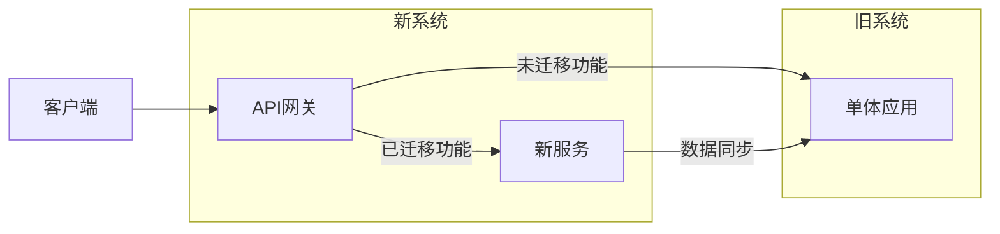

# 架构演进案例集

> **文档说明**：架构不是一成不变的，需要随着业务规模和团队成长持续演进。本文档通过真实案例展示从单体到微服务、从简单到复杂的架构演进路径，包含每个阶段的问题、方案和经验教训。
>
> **适用人群**：架构师、技术负责人、高级工程师
>
> **前置知识**：分布式系统、微服务架构、DDD

---

## 一、架构演进总览

### 1.1 演进路线


### 1.2 各阶段特征

| 阶段 | 团队规模 | QPS | 架构特征 | 核心问题 |
|------|---------|-----|---------|---------|
| 单体 | 1-5人 | <100 | 单应用+单库 | 快速迭代 |
| 模块化单体 | 5-20人 | 100-1000 | 模块化+单库 | 代码组织 |
| 前后端分离 | 10-30人 | 1000-5000 | API+SPA | 协作效率 |
| 服务化 | 20-50人 | 5000-2万 | 核心服务拆分 | 服务边界 |
| 微服务 | 50-200人 | 2万-10万 | 全面微服务化 | 治理+运维 |
| 云原生 | 100+人 | 10万+ | K8s+服务网格 | 弹性+效率 |

### 1.3 演进原则

- **按需演进**：不要提前架构，业务需要时才演进
- **渐进式**：逐步拆分，不要大爆炸式重构
- **可逆性**：每个阶段的决策可以回退
- **业务驱动**：架构服务于业务，不是技术炫技
- **团队匹配**：架构复杂度不超过团队驾驭能力

---

## 二、案例1：电商平台从单体到微服务

### 阶段1：单体架构（0-1年）

```text
架构：Spring Boot单体 + MySQL单库 + Redis
部署：1台应用服务器 + 1台数据库
团队：5人
QPS：峰值500
```

**优点**：开发快、部署简单、调试方便
**问题**：
- 代码量增长后编译慢（10分钟）
- 模块间耦合严重，改一处影响多处
- 数据库成为瓶颈（单库QPS上限）
- 无法独立扩展（订单模块压力大但只能整体扩容）

### 阶段2：模块化单体（1-2年）

```text
架构：按业务模块划分包结构，共享数据库
  com.shop.user      用户模块
  com.shop.product   商品模块
  com.shop.order     订单模块
  com.shop.payment   支付模块
部署：2台应用服务器 + MySQL主从 + Redis
团队：15人
QPS：峰值2000
```

**措施**：
- 按DDD划分限界上下文，模块间通过接口调用
- 数据库按模块分Schema（逻辑分离，物理同库）
- 引入Redis缓存，减轻数据库压力

**问题**：
- 模块间仍有数据库层面的耦合（跨模块JOIN）
- 发布仍需整体发布，一个模块故障影响全站
- 数据库单表数据量增长（订单表5000万行）

### 阶段3：前后端分离+核心服务拆分（2-3年）

```text
架构：
  前端：Vue3 SPA
  网关：Nginx
  用户服务：独立应用+独立库
  商品服务：独立应用+独立库
  订单服务：独立应用+独立库（分库分表）
  支付服务：独立应用+独立库
  其他：仍在单体中
部署：各服务独立部署，Docker容器化
团队：30人（按服务划分团队）
QPS：峰值8000
```

**拆分策略**：
1. 先拆边缘服务（用户、商品），风险低
2. 再拆核心服务（订单、支付），需要数据迁移
3. 拆分时先双写，验证后切读，最后停旧写

**关键技术**：
- 服务间通信：REST API（同步）+ RabbitMQ（异步）
- 分布式事务：本地消息表（最终一致）
- API网关：统一入口、鉴权、限流

**问题**：
- 服务数量增长，运维复杂度上升
- 分布式事务、服务发现、配置管理等问题出现
- 排查问题困难（跨服务调用链）

### 阶段4：微服务架构（3-5年）

```text
架构：
  网关：Spring Cloud Gateway
  注册中心：Nacos
  配置中心：Nacos
  服务：20+微服务
  消息：Kafka + RocketMQ
  缓存：Redis集群
  搜索：Elasticsearch
  部署：Kubernetes
  监控：Prometheus + Grafana + SkyWalking
团队：80人
QPS：峰值5万
```

**服务治理**：
- 服务注册发现：Nacos
- 配置管理：Nacos Config
- 限流熔断：Sentinel
- 链路追踪：SkyWalking
- 日志：ELK
- CI/CD：GitLab CI + K8s

**数据架构**：
- 订单分库分表（ShardingSphere，按用户ID分16库64表）
- 商品数据同步到ES（Canal监听binlog）
- 多级缓存（本地Caffeine + Redis）
- 读写分离（MySQL主从）

### 阶段5：云原生（5年+）

```text
架构：
  K8s集群 + 服务网格Istio
  Serverless（弹性任务）
  多活机房
  数据库：PolarDB（云原生数据库）
  缓存：Redis云集群
  消息：云Kafka
团队：150人
QPS：峰值20万
```

---

## 三、案例2：AI应用架构演进

### 阶段1：API调用原型

```text
前端 → Python Flask → OpenAI API
  直接调用LLM，无RAG，无缓存
  适合验证概念，1周上线
```

### 阶段2：RAG增强

```text
前端 → FastAPI → RAG服务
  文档上传 → 切分 → Embedding → 向量库
  问答 → 检索 → Prompt → LLM
  向量库：pgvector（数据量小）
  适合内部知识库，1000份文档以内
```

### 阶段3：生产级RAG

```text
前端(Vue3) → API网关 → 问答服务(FastAPI)
  文档处理：异步队列（RabbitMQ）
  向量库：Milvus（数据量大）
  检索：混合检索（向量+BM25）+ 重排序
  LLM：多模型路由（按问题类型选择模型）
  缓存：语义缓存（相似问题直接返回）
  评估：离线测试集 + 在线反馈
  适合企业级，10万+文档
```

### 阶段4：Agent化

```text
用户 → Agent编排 → 工具调用 → LLM
  工具：知识库检索、数据库查询、API调用、代码执行
  多Agent协作：规划Agent + 执行Agent + 审核Agent
  记忆：短期（对话上下文）+ 长期（向量库用户画像）
  适合复杂任务自动化
```

---

## 四、拆分策略与经验

### 4.1 微服务拆分时机

| 信号 | 说明 |
|------|------|
| 团队超过20人 | 沟通成本上升，需要独立团队 |
| 单体发布频率受限 | 一个模块故障阻塞全站发布 |
| 数据库成为瓶颈 | 单库无法支撑业务增长 |
| 模块间耦合严重 | 改一个模块需要理解整个系统 |
| 不同模块资源需求差异大 | 订单需要大内存，商品需要大CPU |

### 4.2 拆分原则

1. **按业务能力拆分**：DDD限界上下文，不是按技术层
2. **先边缘后核心**：先拆非核心服务，积累经验
3. **数据先行**：先拆分数据库，再拆分应用
4. **渐进式迁移**：绞杀者模式（Strangler Fig），逐步替换
5. **接口稳定**：服务接口定义清晰，版本化管理

### 4.3 绞杀者模式



- 在旧系统前面加网关，新功能走新服务
- 逐步将旧系统功能迁移到新服务
- 旧系统功能越来越少，最终"被绞杀"

### 4.4 常见陷阱

| 陷阱 | 说明 | 避免 |
|------|------|------|
| 过度拆分 | 拆成太多微服务，运维复杂度爆炸 | 服务粒度适中，20-50个为宜 |
| 分布式单体 | 服务间强耦合，改一个要改多个 | 服务自治，独立部署独立数据 |
| 数据耦合 | 服务间共享数据库 | 每个服务独立数据库 |
| 同步调用链 | 服务A→B→C→D，一个慢全慢 | 异步化，缩短同步调用链 |
| 忽视运维 | 没有监控/链路追踪就上微服务 | 先建治理体系再拆分 |

---

## 五、架构决策记录

### ADR示例：为什么选择微服务

```css
# ADR-003: 从单体迁移到微服务

## 状态
已采纳（2024年Q1开始）

## 背景
- 团队30人，单体代码量50万行
- 编译部署一次30分钟，发布频率从每周降到每月
- 订单模块QPS增长到5000，单库CPU经常80%+
- 一个模块的bug导致全站不可用

## 决策
按业务模块拆分为微服务，先拆用户和商品模块

## 备选方案
- 继续优化单体：模块化+读写分离，但无法解决发布耦合
- 直接全面微服务：风险太高，团队经验不足

## 理由
1. 团队规模已达到微服务适用阈值
2. 业务增长需要独立扩展能力
3. 发布耦合严重影响迭代速度

## 后果
- 需要投入建设服务治理体系（注册中心/配置中心/链路追踪）
- 运维复杂度上升，需要DevOps团队
- 分布式事务需要最终一致方案
```

---

## 关联文档

- [[技术选型决策指南]] — 技术选型
- [[性能调优案例集]] — 性能优化
- [[微服务核心组件知识点系统梳理_优化版]] — 微服务
- [[高可用架构设计]] — 高可用
- [[高并发系统设计案例]] — 高并发
- [[全栈+AI端到端实战]] — AI应用

---

> 💡 **核心经验**：1. 架构是演进出来的，不是设计出来的；2. 不要过早微服务，单体能解决就用单体；3. 拆分的前提是团队能驾驭，运维体系跟得上；4. 渐进式演进（绞杀者模式），不要大爆炸重构；5. 每次架构决策记录ADR，方便回顾；6. 架构的目标是支撑业务增长，不是技术完美。
