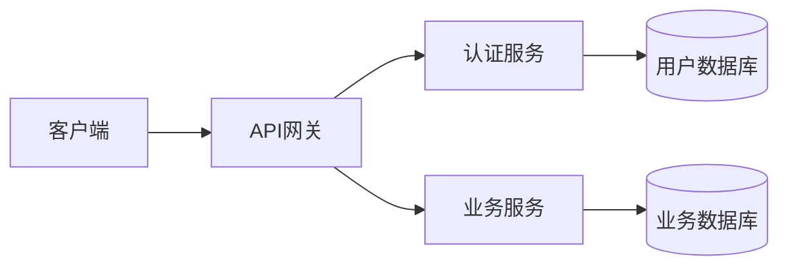
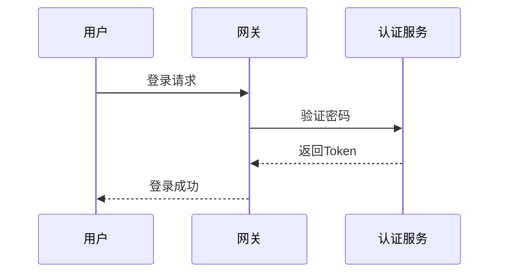

# 技术写作与文档规范

> **文档说明**：技术写作是工程师的核心软技能，好的文档能减少沟通成本、提升团队效率、降低知识流失。本文档覆盖技术文档类型、写作原则、结构规范、常见文档模板、写作工具与最佳实践。
>
> **适用人群**：全栈工程师、技术负责人、需要写技术文档的开发者
>
> **前置知识**：无

---

## 一、为什么技术写作重要

### 1.1 文档的价值

| 价值 | 说明 |
|------|------|
| **减少沟通成本** | 文档代替反复口头解释，新人自助学习 |
| **知识沉淀** | 人员流动时知识不流失 |
| **提升效率** | 接口文档减少联调时间，架构文档减少决策成本 |
| **个人品牌** | 技术博客/开源文档建立个人影响力 |
| **思维梳理** | 写作过程本身就是深度思考 |
| **团队协作** | 统一规范，减少理解偏差 |

### 1.2 工程师写作能力分级

| 级别 | 能力 | 说明 |
|------|------|------|
| **L1** | 能写代码注释 | 代码内注释清晰 |
| **L2** | 能写README | 项目说明、使用方法 |
| **L3** | 能写接口文档 | API文档、技术方案 |
| **L4** | 能写架构设计 | 系统设计、技术选型 |
| **L5** | 能写技术专著 | 系统性技术输出、行业影响力 |

> 大多数工程师停留在L2-L3，L4以上是资深工程师和架构师的分水岭。

---

## 二、技术文档类型

### 2.1 文档分类

| 类型 | 读者 | 目的 | 示例 |
|------|------|------|------|
| **README** | 所有人 | 项目是什么、怎么用 | 项目首页 |
| **接口文档** | 前端/调用方 | API怎么调用 | REST API文档 |
| **技术方案** | 技术团队 | 怎么做、为什么这么做 | 设计文档 |
| **架构文档** | 架构师/技术负责人 | 系统全景、技术决策 | 架构图+说明 |
| **运维手册** | 运维/SRE | 怎么部署、怎么排障 | 部署指南、故障手册 |
| **用户手册** | 终端用户 | 怎么使用产品 | 使用指南 |
| **技术博客** | 技术社区 | 分享经验、建立影响力 | 深度技术文章 |
| **变更记录** | 所有人 | 版本变更了什么 | CHANGELOG |
| **决策记录** | 技术团队 | 为什么做了这个决策 | ADR |

### 2.2 文档生命周期

```text
需求分析 → 大纲设计 → 初稿撰写 → 技术评审 → 修改完善 → 发布上线 → 持续维护
```

---

## 三、写作原则

### 3.1 核心原则

| 原则 | 说明 | 反例 |
|------|------|------|
| **读者优先** | 站在读者角度，假设读者不知道你知道的 | "显然"、"简单"、"众所周知" |
| **结构清晰** | 有明确的层级和逻辑，读者能快速定位 | 一大段文字无标题 |
| **简洁准确** | 用最少的文字表达最准确的意思 | 冗余修饰、模糊表述 |
| **图文结合** | 复杂概念用图表说明 | 纯文字描述架构 |
| **示例驱动** | 用代码示例/示例说明 | 只有理论没有示例 |
| **持续更新** | 文档随代码一起更新 | 文档写完就不管了 |

### 3.2 写作技巧

**1. 先说结论**
```text
❌ 差：由于系统近期用户量增长较快，数据库查询变慢，
   经过分析发现是索引缺失导致的，我们需要添加索引。

✅ 好：数据库查询变慢的根因是缺失索引，
   解决方案：为orders表的user_id和created_at添加联合索引。
   以下是详细分析...
```

**2. 用列表代替段落**
```text
❌ 差：系统包含用户模块、订单模块、商品模块，
   用户模块负责用户注册登录，订单模块负责下单，
   商品模块负责商品管理。

✅ 好：系统包含三大模块：
- 用户模块：用户注册、登录、个人信息管理
- 订单模块：下单、支付、订单状态管理
- 商品模块：商品上架、库存管理、搜索
```

**3. 代码示例要完整可运行**
```css
❌ 差：用Redis实现分布式锁很简单，
   调用setnx方法就行。（没有完整代码）

✅ 好：
public boolean tryLock(String key, String value, long timeout) {
    return redisTemplate.opsForValue()
        .setIfAbsent(key, value, timeout, TimeUnit.SECONDS);
}
// 完整可运行的代码，包含参数说明
```

---

## 四、常见文档模板

### 4.1 README模板

```markdown
# 项目名称

> 一句话描述项目是什么、解决什么问题。

## 功能特性
- 特性1
- 特性2

## 快速开始
### 环境要求
- Java 17+
- MySQL 8.0+
- Redis 6.0+

### 安装运行
```
git clone xxx
cd project
mvn spring-boot:run
```css

### 配置说明
| 配置项 | 说明 | 默认值 |
|--------|------|--------|
| server.port | 端口 | 8080 |

## 技术栈
- Spring Boot 3.x
- MyBatis-Plus
- Redis

## 项目结构
```
src/
├── controller/
├── service/
└── mapper/
```css

## 常见问题
Q: 启动报错怎么办？
A: 检查数据库连接配置...
```

### 4.2 技术方案模板

```markdown
# 技术方案：XXX功能

## 背景与目标
- 背景：为什么要做这个
- 目标：要达到什么效果
- 非目标：不做什么

## 方案设计
### 整体架构
（架构图）

### 核心流程
（流程图）

### 数据模型
（表结构设计）

### 接口设计
| 接口 | 方法 | 说明 |
|------|------|------|

## 技术选型
| 方案 | 优点 | 缺点 | 选择 |
|------|------|------|------|

## 风险与应对
| 风险 | 概率 | 影响 | 应对 |
|------|------|------|------|

## 排期
| 阶段 | 时间 | 负责人 |
|------|------|--------|
```

### 4.3 API接口文档模板

```markdown
## 用户登录

### 接口信息
- **URL**: `/api/auth/login`
- **Method**: `POST`
- **Content-Type**: `application/json`

### 请求参数
| 参数 | 类型 | 必填 | 说明 |
|------|------|------|------|
| username | string | 是 | 用户名 |
| password | string | 是 | 密码 |

### 请求示例
```
{
  "username": "zhangsan",
  "password": "123456"
}
```css

### 响应参数
| 参数 | 类型 | 说明 |
|------|------|------|
| code | int | 状态码，0成功 |
| data.token | string | JWT Token |

### 响应示例
```
{
  "code": 0,
  "message": "success",
  "data": { "token": "eyJhbGci..." }
}
```css

### 错误码
| 错误码 | 说明 |
|--------|------|
| 40001 | 用户名或密码错误 |
| 40002 | 账号已被禁用 |
```

### 4.4 ADR（架构决策记录）模板

```markdown
# ADR-001: 选择PostgreSQL作为主数据库

## 状态
已采纳 / 已废弃 / 待评估

## 背景
描述面临的问题和决策背景。

## 决策
明确说明做了什么决策。

## 备选方案
- 方案A：...
- 方案B：...

## 理由
为什么选择这个方案，列出关键因素。

## 后果
- 正面影响：...
- 负面影响：...
- 需要做的后续工作：...
```

---

## 五、图表规范

### 5.1 常用图表类型

| 图表 | 适用场景 | 工具 |
|------|---------|------|
| **架构图** | 系统组件关系 | draw.io/Excalidraw/Mermaid |
| **流程图** | 业务/技术流程 | Mermaid/Visio |
| **时序图** | 跨系统调用顺序 | Mermaid/PlantUML |
| **ER图** | 数据模型关系 | Mermaid/draw.io |
| **状态图** | 状态转移 | Mermaid/StateSmith |
| **思维导图** | 知识结构 | XMind/Obsidian Canvas |

### 5.2 Mermaid示例（推荐）

Mermaid是文本驱动的图表工具，适合在Markdown中使用：





---

## 六、写作工具

| 工具 | 用途 | 特点 |
|------|------|------|
| **Obsidian** | 知识库/笔记 | 双向链接、本地存储、插件丰富 |
| **Typora** | Markdown写作 | 实时预览、简洁 |
| **VS Code** | 代码+文档 | 插件多、Markdown支持好 |
| **draw.io** | 图表绘制 | 免费、功能全 |
| **Excalidraw** | 手绘风格图表 | 手绘风、适合技术分享 |
| **Swagger/OpenAPI** | API文档 | 标准规范、自动生成 |
| **GitBook** | 在线文档 | 团队协作、版本管理 |
| **语雀/飞书文档** | 团队文档 | 协作方便、国内访问好 |

---

## 七、最佳实践与避坑

### 7.1 DO（应该做）

- [ ] **文档与代码同仓库**：README/设计文档放在代码仓库，随代码一起版本管理
- [ ] **先写文档再写代码**：技术方案先评审，再开发
- [ ] **小步迭代**：先写大纲，再填充内容，不要追求一次完美
- [ ] **有人维护**：指定文档负责人，定期review
- [ ] **版本标注**：重要文档标注适用版本和最后更新时间
- [ ] **示例完整**：代码示例可复制运行，配置示例有注释
- [ ] **读者反馈**：鼓励读者提问题，根据反馈改进文档

### 7.2 DON'T（不要做）

- [ ] ❌ **文档写完就不管**：代码变了文档没变，比没有文档更糟糕
- [ ] ❌ **只有文字没有图**：复杂架构/流程必须配图
- [ ] ❌ **假设读者知道**：不要用"显然"、"简单"，解释清楚
- [ ] ❌ **过度设计文档**：小功能不需要50页设计文档
- [ ] ❌ **复制粘贴不验证**：示例代码必须验证可运行
- [ ] ❌ **中英文混排混乱**：统一术语，中英文之间加空格

### 7.3 文档质量检查清单

```json
发布前检查：
  [ ] 标题清晰，一句话说明文档内容
  [ ] 有明确的读者定位
  [ ] 结构层级清晰（H1-H3不超过3级）
  [ ] 关键概念有解释
  [ ] 代码示例完整可运行
  [ ] 图表清晰有说明
  [ ] 链接有效（无死链）
  [ ] 没有错别字和语法错误
  [ ] 标注了最后更新时间
  [ ] 至少一个人review过
```

---

## 八、提升写作能力的方法

1. **多读**：读优秀的技术文档和博客（阮一峰、美团技术团队、阿里云开发者）
2. **多写**：每周至少写一篇技术笔记，从短到长
3. **多改**：写完放一天再改，会发现很多问题
4. **反馈**：请同事review，接受批评
5. **输出倒逼输入**：为了写清楚，必须想明白
6. **建立模板**：常用文档类型建立模板，减少重复劳动

---

## 关联文档

- [[编写规范与质量标准]] — 知识库编写规范
- [[笔记模板]] — 笔记模板
- [[MOC-综合导航]] — 综合导航
- [[技术职业规划与晋升路径]] — 职业发展

---

> 💡 **核心建议**：技术写作的本质是"把你脑子里的东西，清晰地装进别人脑子里"。好的文档不是写出来的，是改出来的——先写出来，再反复修改。记住：文档是写给别人看的，不是写给自己看的。工程师的价值不只是写代码，能把复杂技术讲清楚、写明白，才是真正的资深工程师。
