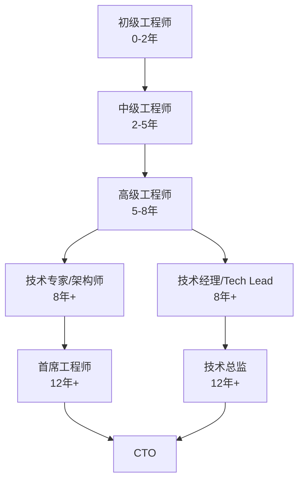

# 技术职业规划与晋升路径

> **文档说明**：从初级工程师到技术专家/架构师的完整成长路径，涵盖各阶段能力要求、晋升标准、学习重点、常见误区、AI时代的机遇与挑战。
>
> **适用人群**：全栈/AI方向的开发者，希望系统规划职业发展
>
> **前置知识**：无

---

## 一、技术职级体系

### 1.1 通用职级模型



### 1.2 各阶段能力要求

| 职级 | 核心能力 | 工作范围 | 决策范围 |
|------|---------|---------|---------|
| **初级** | 完成明确任务 | 模块内开发 | 无决策 |
| **中级** | 独立完成功能 | 单个系统 | 技术实现选择 |
| **高级** | 设计系统方案 | 多个系统 | 技术方案决策 |
| **专家/架构师** | 技术规划与创新 | 跨团队/全公司 | 技术方向决策 |
| **技术经理** | 团队管理+技术 | 团队/部门 | 人员+技术决策 |
| **CTO** | 技术战略 | 全公司 | 技术战略决策 |

---

## 二、各阶段成长指南

### 2.1 初级工程师（0-2年）

**核心目标：打好基础，能独立完成任务**

| 维度 | 要求 |
|------|------|
| **技术深度** | 熟练掌握一门语言和主流框架 |
| **技术广度** | 了解前后端基本概念 |
| **工程能力** | 会用Git、能写单元测试、遵循代码规范 |
| **沟通能力** | 能清晰描述问题、主动汇报进度 |
| **学习能力** | 遇到问题能自己查资料解决 |

**学习重点**：
- 编程语言基础（数据结构、面向对象、异常处理）
- 主流框架（Spring Boot/Vue3/FastAPI）
- 数据库基础（SQL、索引、事务）
- Git版本控制
- 代码规范和最佳实践
- 调试和问题排查基础

**晋升中级的标志**：
- 能独立完成一个完整功能模块（从设计到上线）
- 代码质量稳定，不需要大量review修改
- 能主动发现并修复问题
- 开始指导新人

### 2.2 中级工程师（2-5年）

**核心目标：技术广度+深度，能设计方案**

| 维度 | 要求 |
|------|------|
| **技术深度** | 深入理解框架原理，能排查复杂问题 |
| **技术广度** | 全栈能力，了解分布式/缓存/消息队列 |
| **工程能力** | 能做技术方案设计、代码review、性能优化 |
| **沟通能力** | 能写技术文档、做技术分享 |
| **业务理解** | 理解业务逻辑，能提出技术优化建议 |

**学习重点**：
- 框架原理（Spring IoC/AOP、Vue响应式原理）
- 中间件（Redis、消息队列、Elasticsearch）
- 分布式基础（CAP、一致性、分布式锁）
- 性能优化（SQL优化、JVM调优、前端性能）
- 系统设计（接口设计、表设计、缓存设计）
- 项目管理（需求拆解、排期、风险识别）

**晋升高级的标志**：
- 能独立负责一个系统的技术方案设计
- 能排查线上复杂问题（OOM、死锁、性能瓶颈）
- 有技术影响力（code review、技术分享、带新人）
- 能推动技术改进（重构、性能优化、工具建设）

### 2.3 高级工程师（5-8年）

**核心目标：技术影响力+架构能力，能跨团队协作**

| 维度 | 要求 |
|------|------|
| **技术深度** | 某一领域专家，能做架构设计 |
| **技术广度** | 全栈+分布式+AI，技术视野开阔 |
| **架构能力** | 能设计高可用、高性能、可扩展的系统 |
| **技术决策** | 能做技术选型，权衡利弊 |
| **团队影响** | 能带领小组、制定技术规范 |
| **业务洞察** | 能用技术驱动业务增长 |

**学习重点**：
- 架构设计（微服务、高可用、容灾）
- 中间件原理（Kafka、Redis、ES深度）
- AI工程化（RAG、Agent、LLM应用）
- 技术管理（团队建设、项目管理）
- 技术战略（技术规划、技术债管理）
- 软技能（沟通、谈判、影响力）

**晋升专家/架构师的标志**：
- 能主导跨团队的大型项目
- 能制定技术规范和架构原则
- 有技术专利/开源贡献/技术博客影响力
- 能培养中级工程师
- 对业务有深刻理解，能用技术创造业务价值

### 2.4 专家/架构师（8年+）

**核心目标：技术战略+创新，影响公司技术方向**

| 维度 | 要求 |
|------|------|
| **技术战略** | 制定技术路线图，规划技术演进 |
| **创新能力** | 引入新技术、解决行业级难题 |
| **组织能力** | 建设技术团队、培养技术人才 |
| **业务战略** | 参与公司战略，技术驱动业务 |
| **行业影响** | 行业内有知名度和影响力 |

---

## 三、两条发展路径

### 3.1 技术专家路径（P序列）

```text
高级工程师 → 技术专家 → 资深专家 → 首席工程师 → CTO
```

| 阶段 | 核心职责 | 能力要求 |
|------|---------|---------|
| 技术专家 | 解决复杂技术问题、技术方案评审 | 技术深度+架构能力 |
| 资深专家 | 技术规划、跨领域技术整合 | 技术广度+战略思维 |
| 首席工程师 | 公司技术战略、行业级创新 | 技术远见+行业影响力 |

**适合人群**：热爱技术、喜欢钻研、不喜欢管人、希望在技术领域深耕

### 3.2 技术管理路径（M序列）

```text
高级工程师 → Tech Lead → 技术经理 → 技术总监 → CTO
```

| 阶段 | 核心职责 | 能力要求 |
|------|---------|---------|
| Tech Lead | 带领小团队、技术决策 | 技术+基础管理 |
| 技术经理 | 团队管理、项目交付 | 管理能力+业务理解 |
| 技术总监 | 部门管理、技术规划 | 战略思维+组织能力 |

**适合人群**：喜欢带人、擅长沟通、对业务和管理感兴趣

### 3.3 路径选择建议

```text
问自己几个问题：
1. 你更喜欢写代码还是带人？
   → 写代码 → 专家路径
   → 带人 → 管理路径

2. 你解决问题的方式？
   → 自己动手解决 → 专家路径
   → 组织团队解决 → 管理路径

3. 你的长期目标？
   → 成为某领域技术权威 → 专家路径
   → 带领团队做大事 → 管理路径

注意：两条路径不是互斥的，很多人在高级阶段会尝试管理，
发现不合适再回到技术路径，这很正常。
```

---

## 四、AI时代的机遇与挑战

### 4.1 AI对工程师的影响

| 影响 | 说明 |
|------|------|
| **低端编码被替代** | CRUD、样板代码AI可以完成 |
| **效率大幅提升** | AI辅助编程提升50%+效率 |
| **新岗位涌现** | AI工程师、Prompt工程师、AI产品经理 |
| **能力要求变化** | 从"会写代码"到"会用AI+会设计+会判断" |
| **技术迭代加速** | 新技术层出不穷，学习能力更重要 |

### 4.2 AI时代的核心竞争力

| 能力 | 说明 | 为什么重要 |
|------|------|-----------|
| **系统设计能力** | 架构设计、技术选型 | AI能写代码但不能设计系统 |
| **问题定义能力** | 把业务问题转化为技术问题 | AI需要明确的问题定义 |
| **判断力** | 评估AI输出的质量和风险 | AI会犯错，需要人来把关 |
| **业务理解** | 理解业务本质，用技术创造价值 | AI不懂业务 |
| **学习能力** | 快速掌握新技术 | 技术迭代加速 |
| **沟通协作** | 跨团队协作、需求沟通 | AI替代不了人际协作 |
| **AI工程能力** | RAG、Agent、LLM应用开发 | 新的核心技能 |

### 4.3 全栈+AI的职业优势

```text
全栈工程师 + AI能力 = 全栈AI工程师

优势：
1. 能独立完成从前端到后端到AI的完整产品
2. 理解全链路，能做端到端优化
3. AI应用需要全栈能力（前端交互+后端服务+AI模型）
4. 市场稀缺，薪资溢价高

职业方向：
- AI全栈工程师：构建AI应用
- AI产品工程师：AI产品化
- AI架构师：AI系统架构设计
- 独立开发者：AI驱动的SaaS产品
```

---

## 五、常见误区

| 误区 | 说明 | 正确认知 |
|------|------|---------|
| **唯技术论** | 只关注技术，忽视业务和沟通 | 技术是手段，业务价值是目的 |
| **频繁跳槽** | 1年一跳，追求薪资涨幅 | 深度需要时间积累，2-3年一跳较合理 |
| **追新技术** | 什么火学什么，浅尝辄止 | 先深耕一个领域，再扩展广度 |
| **等机会** | 觉得晋升是水到渠成 | 主动争取，展示能力，管理预期 |
| **忽视软技能** | 觉得技术好就行 | 越往上，软技能越重要 |
| **不写文档** | 觉得写文档浪费时间 | 文档是技术影响力的载体 |
| **不做分享** | 觉得自己还不够格 | 分享是最好的学习，教是最好的学 |

---

## 六、晋升实操指南

### 6.1 晋升准备

```text
1. 了解晋升标准
   → 找HR或上级要职级要求文档
   → 研究已晋升同事的能力和项目

2. 对标差距
   → 列出目标职级的要求
   → 逐条评估自己的差距
   → 制定弥补计划

3. 积累成果
   → 主动承担有挑战的项目
   → 量化成果（性能提升X%、成本降低X%）
   → 建立技术影响力（分享、文档、开源）

4. 主动沟通
   → 和上级定期1on1，表达晋升意愿
   → 请上级反馈不足和建议
   → 不要等到晋升季才准备

5. 晋升答辩
   → 准备PPT：项目成果、技术深度、影响力
   → 用数据说话，不要空泛
   → 展示思考过程，不只是结果
```

### 6.2 能力展示渠道

| 渠道 | 说明 |
|------|------|
| **核心项目** | 主导/参与公司核心项目 |
| **技术分享** | 内部分享、外部大会、技术博客 |
| **开源贡献** | GitHub开源项目、PR |
| **专利** | 技术创新专利申请 |
| **文档建设** | 技术规范、架构文档、最佳实践 |
| **人才培养** | 带新人、做mentor |
| **跨团队协作** | 推动跨团队技术项目 |

### 6.3 薪资谈判

```text
谈判前准备：
1. 了解市场行情（脉脉、BOSS直聘、猎头）
2. 列出自己的核心价值（项目成果、技术能力）
3. 确定期望薪资和底线
4. 准备好其他offer作为筹码

谈判技巧：
1. 让对方先出价
2. 用数据和成果支撑期望
3. 不只谈基本工资，谈总包（股票、奖金、福利）
4. 保持专业，不情绪化
5. 拿到offer后再决定，不急于答应
```

---

## 七、学习资源与持续成长

### 7.1 持续学习方法

| 方法 | 说明 |
|------|------|
| **项目驱动** | 在实际项目中学习新技术 |
| **输出倒逼输入** | 写博客、做分享，为了输出而深入学习 |
| **源码阅读** | 阅读主流框架源码，理解底层原理 |
| **技术社区** | 关注GitHub Trending、Hacker News、掘金 |
| **技术书籍** | 经典书籍系统学习（非碎片化） |
| **同行交流** | 参加技术大会、加入技术社群 |

### 7.2 推荐经典书籍

| 领域 | 书籍 |
|------|------|
| 编程基础 | 《代码大全》《重构》《设计模式》 |
| 架构 | 《设计数据密集型应用》《企业应用架构模式》 |
| 分布式 | 《分布式系统概念与设计》《微服务架构设计模式》 |
| 职业 | 《程序员修炼之道》《软技能：代码之外的生存指南》 |
| 管理 | 《人月神话》《人件》《格鲁夫给经理人的第一课》 |
| AI | 《深度学习》《构建大语言模型应用》 |

---

## 关联文档

- [[技术写作与文档规范]] — 技术写作能力
- [[全栈+AI工程双轨融合学习路线图]] — 学习路径
- [[面试准备与求职指南]] — 面试与求职
- [[技术简历模板与写作指南]] — 简历撰写
- [[MOC-综合导航]] — 综合导航

---

> 💡 **核心建议**：职业发展的本质是"价值交换"——你为公司创造多大价值，就获得多大回报。1. 前5年打基础，技术深度和广度并重；2. 5-8年找方向，确定技术专家还是管理路径；3. 8年以上建影响力，技术+业务+管理综合能力。AI时代，"会用AI的工程师"会替代"不会用AI的工程师"，但"有判断力和设计能力的工程师"永远稀缺。记住：持续学习是这个行业唯一的铁饭碗。
