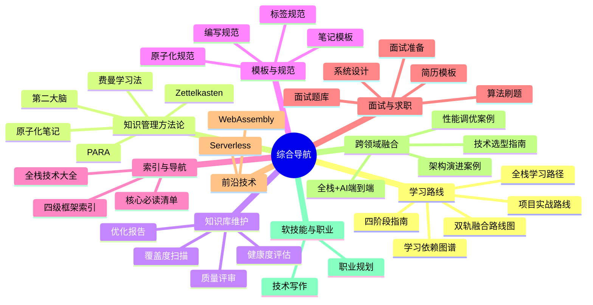

# 🧭 综合导航 MOC

> **内容地图**：知识库的总入口与导航中枢，涵盖学习路线、知识管理方法论、知识库维护、模板规范、索引导航、面试求职、前沿技术、跨领域融合、软技能与职业九大模块，共145+篇文档。是整个知识库的"控制塔"，指引学习者从入门到精通。
>
> **核心理念**：用导航体系把内容串起来，让学习者知道"先学什么→再学什么→做什么项目→如何检验"。

---

## 📚 导航体系总览

---

## 一、学习路线（15篇）

> 从零基础到资深专家的完整学习路径体系，双轨并行、四阶段递进。

### 主线路线
- [[全栈+AI工程双轨融合学习路线图]] — **推荐主线**，全栈+AI四阶段融合路线（12-24个月）
- [[全栈开发从入门到精通学习路径指南]] — 纯全栈工程路线（10-18个月）
- [[全栈分级学习路线图与术语表_优化版]] — 分级路线与技术术语对照表

### 分阶段指南
| 阶段 | 指南 | 周期 | 核心目标 |
|------|------|------|---------|
| 🌱 入门筑基 | [[第一阶段-入门筑基学习指南]] | 0-4月 | 编程基础+前后端入门+AI概念 |
| ⚡ 进阶实战 | [[第二阶段-进阶实战学习指南]] | 4-9月 | 框架精通+全栈项目+AI应用 |
| 🏗️ 高级架构 | [[第三阶段-高级架构学习指南]] | 9-15月 | 微服务+AI工程化+RAG/Agent |
| 👑 专家精通 | [[第四阶段-专家精通学习指南]] | 15-24月 | 源码深度+架构设计+技术领导力 |
| 🔗 阶段过渡 | [[阶段过渡桥梁指南]] | — | 三个过渡期的思维转变与桥梁项目 |

### 学习辅助
- [[分阶段项目实战递进路线]] — 项目学习顺序与技能覆盖
- [[学习依赖图谱与前置知识导航]] — 知识点前置依赖与学习顺序
- [[新手第一天入门指南]] — 从零开始第一步
- [[核心必读笔记清单与质量分级]] — 按优先级阅读核心笔记
- [[普通一本学历者的职业路线选择——全栈工程 vs AI应用工程（未来10-20年）|普通一本学历者职业路线选择]] — 全栈工程 vs AI应用工程的职业路线对比与未来10-20年趋势
- [[四阶段自检题答案与解析]] — 各阶段自测题与详细解析
- [[学习进度看板]] — 学习进度追踪看板
- [[Obsidian学习进度追踪体系]] — 用Obsidian管理学习进度

---

## 二、知识管理方法论（44篇）

> 高效学习与知识管理的方法论体系，从笔记方法到思维模型全覆盖。

### 笔记方法论
- [[Zettelkasten-卡片盒笔记法]] — 德国社会学家卢曼的卡片盒笔记法
- [[PARA-项目领域资源归档]] — Tiago Forte的PARA组织法
- [[第二大脑-构建个人知识管理系统]] — 数字时代的知识管理体系
- [[原子化笔记规范]] — 一篇笔记一个概念的原子化方法
- [[LYT-链接你的思维]] — 链接思维方法论
- [[费曼学习法]] — 以教促学的高效学习法
- [[跨领域知识连接方法]] — 建立知识间的关联网络

### 学习方法论
- [[GTD时间管理与知识管理结合]] — GTD与知识管理的融合
- [[个人知识IP构建]] — 知识输出与个人品牌
- [[团队知识库建设方法论]] — 团队级知识管理
- [[知识管理工具迁移指南]] — 工具切换与数据迁移
- [[Obsidian-vs-Logseq-vs-Notion]] — 主流知识管理工具对比

---

## 三、知识库维护（16篇）

> 知识库质量保障与持续优化的工具和流程。

- [[知识库体系评审与补充目录]] — 六维质量评估模型与补充计划
- [[知识库健康度评估指标]] — 知识库整体健康度评估
- [[知识库覆盖度扫描与缺口分析]] — 覆盖度扫描与缺口识别
- [[知识库优化方案与执行报告]] — 优化执行记录
- [[知识库质量分级与治理规范|知识库质量分级与治理规范]] — S/A/B/C四级质量标准、编写规范、治理流程、MOC规范、统计指标
- [[Inbox处理工作流]] — 知识收件箱处理流程
- [[MOC更新工作流]] — MOC索引更新流程
- [[周度重构工作流]] — 每周知识重构流程
- [[存量迁移指南]] — 存量笔记迁移到新标准的操作指南
- [[AI工具对接指南]] — AI工具与知识库对接的配置与使用指南

---

## 四、模板与规范（21篇）

> 统一的编写标准和模板，确保知识库整体质量一致。

### 编写规范
- [[编写规范与质量标准]] — 统一编写标准（内容/结构/解析/视觉四维）
- [[原子化笔记规范]] — 原子化笔记Frontmatter与结构规范
- [[标签命名规范]] — 标签体系与命名规则
- [[知识摄入标准]] — 新知识摄入的质量标准

### 模板
- [[笔记模板]] — 标准七段式笔记模板
- [[MOC四级展开模板]] — MOC文档模板
- [[原子化笔记模板]] — 原子笔记模板
- [[四级原子笔记模板]] — 四级知识框架笔记模板
- [[枢纽核心笔记模板]] — 枢纽笔记模板
- [[概念卡片模板]] — 概念卡片模板
- [[每日笔记模板]] — 每日笔记模板
- [[跨板块关联笔记模板]] — 跨领域关联笔记模板
- [[学习路径依赖模板]] — 学习路径模板
- [[跨语言代码模板库_Cookbook_优化版|跨语言代码模板库Cookbook]] — Java/Python/JS/TS多语言常用代码模板与最佳实践

---

## 五、索引与导航（10篇）

> 知识库的全景索引和快速导航工具。

- [[全栈技术知识点系统梳理大全_优化版]] — 全技术栈知识点全景索引（600+知识点）
- [[四级框架总索引]] — 四级知识框架总索引
- [[学习启动页]] — Obsidian启动页/首页
- [[核心必读笔记清单与质量分级]] — 必读笔记优先级清单
- [[MOC-综合导航]] — 本MOC
- [[标签索引]] — 全库标签体系索引与按标签筛选指南
- [[跨栈AI应用架构串联与工具生态_优化版|跨栈AI应用架构串联]] — 全栈+AI应用架构全景串联与工具生态映射

---

## 六、面试与求职（7篇）

> 从简历撰写到面试通关的完整求职体系，覆盖全栈+AI各方向。

### 面试准备
- [[面试准备与求职指南]] — 面试准备全流程、简历、面试技巧、offer谈判
- [[技术简历模板与写作指南]] — 简历结构、STAR法则、量化表达、各经验阶段重点、完整模板
- [[算法刷题指南与题型模板]] — 算法刷题方法、题型分类、模板代码、学习路径

### 面试题库
- [[后端开发面试题库与答案解析|后端开发面试题库]] — Java/JVM/Spring/数据库/分布式六大领域高频题
- [[前端开发面试题库与答案解析|前端开发面试题库]] — JS/CSS/Vue3/工程化/性能/浏览器六大领域
- [[AI工程面试题库与答案解析|AI工程面试题库]] — 大模型/RAG/Agent/Prompt/部署/工程化六大领域
- [[系统设计面试指南|系统设计面试指南]] — 4步答题框架、核心组件库、短链接/秒杀/Twitter/聊天/支付高频题

---

## 七、前沿技术（2篇）

> 关注下一代技术趋势，提前布局未来技能。

- [[WebAssembly入门与实战|WebAssembly 入门与实战]] — WASM原理、Rust/Emscripten开发、JS互操作、性能优化、应用场景
- [[Serverless架构设计|Serverless 架构设计]] — FaaS/BaaS、触发器、架构模式、冷启动优化、适用场景、平台对比

---

## 八、跨领域融合（4篇）

> 全栈+AI双轨融合的实战指南，连接技术选型、性能优化、架构演进与端到端项目实战。

- [[全栈+AI端到端实战|全栈+AI 端到端实战]] — 智能知识库问答系统完整开发：架构设计、文档处理、RAG检索、前后端实现、部署运维
- [[技术选型决策指南|技术选型决策指南]] — 选型原则、决策矩阵、后端/前端/AI/运维各领域选型方案、常见场景配置、ADR模板
- [[性能调优案例集|性能调优案例集]] — JVM/SQL/缓存/架构/前端真实调优案例，含问题现象、排查过程、根因分析、解决方案、效果数据
- [[架构演进案例集|架构演进案例集]] — 从单体到微服务到云原生的演进路径、电商/AI应用真实案例、拆分策略、经验教训、ADR记录

---

## 九、软技能与职业（2篇）

> 从技术到老手的最后一公里，涵盖技术写作与职业发展。

- [[技术写作与文档规范|技术写作与文档规范]] — 文档类型、写作原则、结构规范、README/方案/API/ADR模板、图表规范、最佳实践
- [[技术职业规划与晋升路径|技术职业规划与晋升路径]] — 职级体系、各阶段成长指南、技术/管理双路径、AI时代机遇、晋升实操、常见误区

---

## 🗺️ 快速导航

### 我是新手，从哪开始？
1. [[新手第一天入门指南]] → 搭建环境，了解知识库
2. [[核心必读笔记清单与质量分级]] → 按优先级阅读
3. [[第一阶段-入门筑基学习指南]] → 开始系统学习
4. [[全栈+AI工程双轨融合学习路线图]] → 查看完整路线

### 我想找某个技术点？
1. [[全栈技术知识点系统梳理大全_优化版]] → 按领域查找
2. 各领域MOC → [[MOC-前端开发]] [[MOC-后端开发]] [[MOC-AI与效率工具]]
3. Obsidian全局搜索 `Ctrl+O`

### 我想做项目练手？
1. [[分阶段项目实战递进路线]] → 查看项目顺序
2. [[MOC-项目实战]] → 浏览所有项目
3. 按当前学习阶段选择对应难度项目

### 我想检查学习进度？
1. [[学习进度看板]] → 查看整体进度
2. [[Obsidian学习进度追踪体系]] → 配置进度追踪
3. [[四阶段自检题答案与解析]] → 自测检验

---

## 🔗 领域MOC导航

| 领域 | MOC入口 | 文档数 |
|------|---------|--------|
| 🎨 前端开发 | [[MOC-前端开发]] | 112 |
| ☕ 后端开发 | [[MOC-后端开发]] | 99 |
| 💾 数据库与缓存 | [[MOC-数据库与缓存]] | 28 |
| 🔗 分布式与中间件 | [[MOC-分布式与中间件]] | 19 |
| ☁️ 云原生与运维 | [[MOC-云原生与运维]] | 77 |
| 🧠 计算机基础 | [[MOC-计算机基础]] | 106 |
| 🛠️ 通用工具 | [[MOC-通用工具]] | 66 |
| 🐍 Python全栈 | [[MOC-Python全栈]] | 90 |
| 🤖 AI与效率工具 | [[MOC-AI与效率工具]] | 164 |
| 📌 项目实战 | [[MOC-项目实战]] | 64 |

---

## 🏷️ 标签体系

`#学习路径` `#知识管理` `#MOC` `#导航` `#模板` `#规范` `#质量评审` `#面试` `#Obsidian` `#原子化笔记` `#Zettelkasten` `#PARA`

---

[[Home|🏠 返回首页]] · [[全栈+AI工程双轨融合学习路线图|🗺️ 学习路线]] · [[全栈技术知识点系统梳理大全_优化版|📚 技术索引]]
