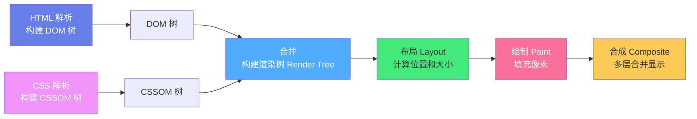
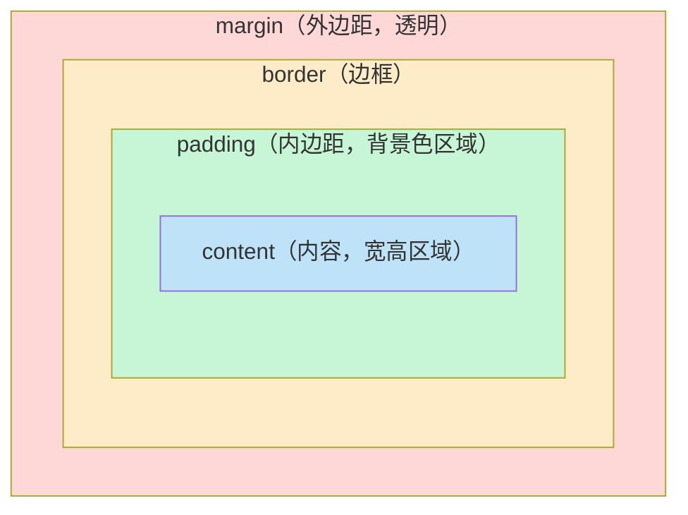

# 🎨 CSS3 布局与样式基础

> **文档说明**：系统讲解 CSS3 核心知识体系，涵盖选择器系统、层叠与继承、盒模型、Flexbox 一维布局、Grid 二维布局、定位体系、文字与背景样式、渐变与阴影、过渡与动画、响应式设计、CSS 变量、BEM 命名规范和浏览器兼容性。CSS 是网页的「皮肤」，控制颜色、大小、布局和动画，是前端三大基础之一，决定用户的视觉体验。
>
> **适用人群**：前端入门学习者、全栈开发者、需要系统掌握 CSS 的工程师
>
> **前置知识**：[[HTML5语义化与基础标签]]

---

## 一、概述

### 1.1 什么是 CSS

CSS（Cascading Style Sheets，层叠样式表）用于描述 HTML 元素的**外观和布局**。HTML 负责页面结构（骨架），CSS 负责页面样式（皮肤），JavaScript 负责页面交互（行为），三者共同构成现代网页。

**CSS3** 是最新标准，相比 CSS2.1 新增了大量强大特性：圆角、阴影、渐变、动画、Flexbox、Grid、多列布局、媒体查询、CSS 变量等。

### 1.2 三种引入方式

| 方式 | 写法 | 优点 | 缺点 | 适用场景 |
|------|------|------|------|---------|
| **行内样式** | `<p style="color:red">` | 优先级最高，直接生效 | 不可复用，结构样式混杂 | 极少用，仅动态样式 |
| **内部样式** | `<style>p{color:red}</style>` | 单文件内复用 | 多页面不可复用 | 单页 demo、邮件模板 |
| **外部样式** | `<link rel="stylesheet" href="style.css">` | 可复用，可缓存，结构分离 | 需额外请求 | **生产环境推荐** |

```html
<!-- 1. 行内样式（不推荐，仅动态内联样式用） -->
<p style="color: #e53e3e; font-size: 16px;">红色文字</p>

<!-- 2. 内部样式 -->
<head>
  <style>
    p { color: #2d3748; line-height: 1.6; }
  </style>
</head>

<!-- 3. 外部样式（推荐） -->
<head>
  <link rel="stylesheet" href="/assets/css/main.css">
</head>

<!-- @import 方式（不推荐，会阻塞渲染） -->
<style>
  @import url("base.css");
</style>
```

### 1.3 CSS 注释与语法

```css
/* CSS 注释：只有这一种注释方式，不支持 // 单行注释 */

/* 基本语法：选择器 { 属性: 值; } */
selector {
  property: value;
  property2: value2;
}

/* 多条规则 */
h1 { font-size: 24px; color: #1a202c; }
h2 { font-size: 20px; color: #2d3748; }

/* 分组选择器：逗号分隔，共享样式 */
h1, h2, h3 { font-weight: 600; line-height: 1.3; }
```

---

## 二、底层原理

### 2.1 浏览器渲染流程



| 阶段 | 说明 | 性能关注点 |
|------|------|-----------|
| **DOM 构建** | 解析 HTML，构建文档对象模型树 | 减少嵌套层级 |
| **CSSOM 构建** | 解析 CSS，构建样式对象模型树 | CSS 会阻塞渲染，放 head 中 |
| **渲染树** | 合并 DOM 和 CSSOM，只包含可见节点 | `display:none` 的节点不在渲染树 |
| **布局（Reflow）** | 计算每个节点的位置和大小 | 避免频繁触发重排 |
| **绘制（Repaint）** | 将节点像素绘制到屏幕 | 避免频繁触发重绘 |
| **合成** | 将多个图层合并显示 | 用 `transform` 和 `opacity` 触发合成，性能最好 |

> **重排（Reflow/Layout）**：元素几何属性变化（宽高、位置）触发，成本高。
> **重绘（Repaint/Paint）**：元素外观变化（颜色、背景）但几何不变，成本中等。
> **合成（Composite）**：`transform` 和 `opacity` 变化，不触发布局和绘制，成本最低，动画首选。

### 2.2 选择器优先级（Specificity）

当多个规则匹配同一元素时，按优先级决定哪个生效。优先级用 **(a, b, c, d)** 四元组表示：

| 级别 | 来源 | 示例 | 权重 |
|------|------|------|------|
| **a** | `!important` | `color: red !important` | 最高，慎用 |
| **b** | 行内样式 | `style="color:red"` | (1,0,0,0) |
| **c** | ID 选择器 | `#header` | (0,1,0,0) |
| **d** | 类/属性/伪类 | `.btn`, `[type=text]`, `:hover` | (0,0,1,0) |
| **e** | 标签/伪元素 | `p`, `::before` | (0,0,0,1) |

**记忆口诀**：`!important` > 行内 > ID > 类 > 标签 > 通配符

```css
/* 优先级计算示例 */
#nav .item a:hover { }  /* (0,1,2,1) = 1个ID + 2个类/伪类 + 1个标签 */
div.container { }       /* (0,0,1,1) = 1个类 + 1个标签 */
p { }                    /* (0,0,0,1) = 1个标签 */

/* 同优先级时，后面的覆盖前面的（层叠） */
p { color: red; }
p { color: blue; }  /* 最终蓝色，因为在后面 */
```

### 2.3 继承

某些属性会自动从父元素继承到子元素，不需要重复设置：

| 可继承属性 | 不可继承属性 |
|-----------|-------------|
| `color`, `font-size`, `font-family` | `width`, `height`, `margin`, `padding` |
| `line-height`, `text-align` | `border`, `background`, `display` |
| `visibility`, `cursor` | `position`, `float`, `overflow` |

```css
/* 强制继承 */
.child {
  color: inherit;       /* 继承父元素的 color */
  border: inherit;      /* 强制继承 border（默认不继承） */
}

/* 重置所有属性 */
.reset {
  all: initial;         /* 重置为初始值 */
  all: inherit;         /* 全部继承父元素 */
  all: unset;           /* 可继承的继承，不可继承的初始 */
}
```

---

## 三、实操示例

### 3.1 选择器大全

```css
/* ===== 基础选择器 ===== */
* { margin: 0; padding: 0; }          /* 通配符选择器（慎用，性能差） */
p { color: #2d3748; }                 /* 标签选择器 */
.btn { padding: 8px 16px; }           /* 类选择器（最常用） */
#header { background: #fff; }         /* ID 选择器（唯一性，少用） */

/* ===== 组合选择器 ===== */
.nav li { list-style: none; }         /* 后代选择器：所有后代 */
.nav > li { margin: 0 10px; }         /* 子选择器：仅直接子元素 */
h1 + p { margin-top: 0; }             /* 相邻兄弟选择器：紧跟的下一个 */
h1 ~ p { color: #666; }               /* 通用兄弟选择器：后面所有同级 */

/* ===== 伪类选择器 ===== */
a:link { color: #3182ce; }            /* 未访问链接 */
a:visited { color: #805ad5; }         /* 已访问链接 */
a:hover { color: #2b6cb0; }           /* 鼠标悬停 */
a:active { color: #2c5282; }          /* 点击激活 */
input:focus { outline: 2px solid #3182ce; }  /* 获取焦点 */
input:disabled { opacity: 0.5; }      /* 禁用状态 */
input:checked { accent-color: #3182ce; }     /* 选中状态 */

/* 结构伪类 */
li:first-child { font-weight: bold; }      /* 第一个子元素 */
li:last-child { border-bottom: none; }     /* 最后一个子元素 */
li:nth-child(odd) { background: #f7fafc; } /* 奇数项 */
li:nth-child(2n) { background: #edf2f7; }  /* 偶数项 */
li:nth-child(3n+1) { color: #3182ce; }     /* 第1,4,7...项 */
li:only-child { color: #e53e3e; }          /* 唯一子元素 */
p:empty { display: none; }                  /* 空元素 */

/* 否定伪类 */
.btn:not(:disabled) { cursor: pointer; }   /* 非禁用的按钮 */
input:not([type="submit"]) { border: 1px solid #cbd5e0; }

/* ===== 伪元素选择器 ===== */
p::first-line { font-weight: 600; }    /* 第一行 */
p::first-letter { font-size: 2em; float: left; }  /* 首字母 */
.box::before { content: "📌"; margin-right: 4px; }  /* 元素前插入 */
.box::after { content: ""; display: block; clear: both; }  /* 元素后插入（清浮动） */
::selection { background: #bee3f8; color: #1a202c; }  /* 选中文字样式 */
::placeholder { color: #a0aec0; }      /* 输入框占位符 */

/* ===== 属性选择器 ===== */
input[type="text"] { border: 1px solid #cbd5e0; }  /* 精确匹配 */
a[href^="https"] { color: #38a169; }    /* 以...开头 */
a[href$=".pdf"]::after { content: "📄"; } /* 以...结尾 */
img[src*="avatar"] { border-radius: 50%; } /* 包含... */
[class~="btn"] { }                      /* 包含独立单词 */
[lang|="en"] { }                        /* 以 en 或 en- 开头 */
```

### 3.2 盒模型（Box Model）

每个 HTML 元素都是一个矩形盒子，由内到外包含：**内容（content）→ 内边距（padding）→ 边框（border）→ 外边距（margin）**。



```css
/* 标准盒模型（content-box，默认） */
.box-standard {
  box-sizing: content-box;
  width: 200px;          /* 内容宽度 200px */
  padding: 20px;         /* 总宽度 = 200 + 20*2 = 240px */
  border: 2px solid #333; /* 总宽度 += 2*2 = 244px */
  margin: 10px;          /* 外边距不占元素宽度 */
}

/* IE 盒模型（border-box，推荐） */
.box-border {
  box-sizing: border-box;
  width: 200px;          /* 总宽度 200px，包含 padding 和 border */
  padding: 20px;         /* 内容宽度 = 200 - 20*2 - 2*2 = 156px */
  border: 2px solid #333;
}

/* 全局设置 border-box（最佳实践） */
*, *::before, *::after {
  box-sizing: border-box;
}

/* margin 折叠（margin collapse） */
/* 相邻块级元素的上下 margin 会合并，取较大值 */
.box1 { margin-bottom: 20px; }
.box2 { margin-top: 30px; }  /* 实际间距 = 30px（不是 50px） */

/* 解决 margin 折叠 */
.parent { overflow: hidden; }     /* 触发 BFC */
.parent { display: flow-root; }   /* 现代方案，触发 BFC */
.parent { padding-top: 1px; }     /* 加 padding 阻隔 */
```

### 3.3 Flexbox 一维布局

Flexbox 是**一维布局**的首选方案，擅长处理单行/单列的对齐和分布。

```css
/* ===== 容器属性（父元素） ===== */
.flex-container {
  display: flex;                    /* 启用 Flexbox */
  /* display: inline-flex; */       /* 行内 Flex */

  flex-direction: row;              /* 主轴方向：row（默认，水平）/ row-reverse / column / column-reverse */
  flex-wrap: wrap;                  /* 换行：nowrap（默认）/ wrap / wrap-reverse */
  /* flex-flow: row wrap; */        /* 简写：direction + wrap */

  justify-content: flex-start;      /* 主轴对齐：flex-start / center / flex-end / space-between / space-around / space-evenly */
  align-items: stretch;             /* 交叉轴对齐：stretch（默认拉伸）/ center / flex-start / flex-end / baseline */
  align-content: stretch;           /* 多行交叉轴对齐（仅 wrap 时有效） */

  gap: 16px;                        /* 元素间距（row-gap + column-gap 简写） */
  /* row-gap: 16px; column-gap: 16px; */
}

/* ===== 项目属性（子元素） ===== */
.flex-item {
  flex: 1;                          /* 简写：flex-grow flex-shrink flex-basis */
  /* flex-grow: 1; */               /* 放大比例：0（不放大，默认）/ 正数 */
  /* flex-shrink: 1; */             /* 缩小比例：1（默认，可缩小）/ 0（不缩小） */
  /* flex-basis: 0%; */             /* 初始大小：auto（默认，内容决定）/ 长度值 */

  align-self: center;               /* 单独覆盖 align-items */
  order: 1;                         /* 排列顺序：0（默认），越小越靠前 */
}

/* ===== 经典布局 ===== */

/* 水平垂直居中（最简单的方法） */
.center {
  display: flex;
  justify-content: center;
  align-items: center;
  min-height: 100vh;
}

/* 导航栏：左 Logo + 右菜单 */
.navbar {
  display: flex;
  justify-content: space-between;
  align-items: center;
  padding: 0 24px;
  height: 64px;
}

/* 等高卡片布局 */
.card-list {
  display: flex;
  gap: 16px;
  flex-wrap: wrap;
}
.card {
  flex: 1 1 300px;                  /* 最小 300px，可放大 */
  display: flex;
  flex-direction: column;
}
.card-body { flex: 1; }             /* 内容区自动撑高，底部按钮对齐 */

/* 粘性页脚（内容不足时页脚在底部，内容多时跟随） */
.page {
  display: flex;
  flex-direction: column;
  min-height: 100vh;
}
.page-content { flex: 1; }          /* 内容区自动填充 */
```

### 3.4 Grid 二维布局

Grid 是**二维布局**的首选方案，擅长处理行和列同时存在的复杂布局。

```css
/* ===== 容器属性 ===== */
.grid-container {
  display: grid;
  /* display: inline-grid; */

  /* 定义列：3 列，分别 200px / 1fr / 1fr */
  grid-template-columns: 200px 1fr 1fr;
  /* 常用函数 */
  grid-template-columns: repeat(3, 1fr);           /* 3 列等分 */
  grid-template-columns: repeat(auto-fit, minmax(250px, 1fr));  /* 响应式：自动填充，最小 250px */
  grid-template-columns: 200px repeat(2, 1fr);     /* 混合 */

  /* 定义行 */
  grid-template-rows: auto 1fr auto;               /* 头/内容/脚布局 */
  grid-template-rows: repeat(3, 100px);            /* 3 行各 100px */

  /* 间距 */
  gap: 20px;                                       /* row-gap + column-gap */
  /* row-gap: 20px; column-gap: 20px; */

  /* 对齐 */
  justify-items: stretch;   /* 单元格内水平对齐：stretch/start/center/end */
  align-items: stretch;     /* 单元格内垂直对齐 */
  place-items: center;      /* 简写：align-items + justify-items */

  justify-content: start;   /* 整个网格水平对齐（容器有剩余空间时） */
  align-content: start;     /* 整个网格垂直对齐 */
}

/* ===== 项目属性 ===== */
.grid-item {
  /* 位置和跨度 */
  grid-column: 1 / 3;                  /* 从第1列线到第3列线（占2列） */
  grid-column: span 2;                 /* 占2列（简写） */
  grid-row: 1 / 3;                     /* 占2行 */
  /* grid-area: 1 / 1 / 3 / 3; */      /* 简写：row-start / col-start / row-end / col-end */

  /* 单独对齐 */
  justify-self: center;
  align-self: center;
  place-self: center;
}

/* ===== 经典布局 ===== */

/* 圣杯布局（Header + Sidebar + Main + Footer） */
.holy-grail {
  display: grid;
  grid-template-columns: 200px 1fr;
  grid-template-rows: auto 1fr auto;
  grid-template-areas:
    "header header"
    "sidebar main"
    "footer footer";
  min-height: 100vh;
  gap: 16px;
}
.holy-grail header { grid-area: header; }
.holy-grail aside { grid-area: sidebar; }
.holy-grail main { grid-area: main; }
.holy-grail footer { grid-area: footer; }

/* 响应式卡片网格（无需 media query） */
.responsive-grid {
  display: grid;
  grid-template-columns: repeat(auto-fit, minmax(280px, 1fr));
  gap: 20px;
}
```

### 3.5 定位（Position）

```css
/* position 取值 */
.position-static { position: static; }       /* 默认，正常文档流 */
.position-relative { position: relative; }   /* 相对定位，相对于自身原位置偏移，仍占空间 */
.position-absolute { position: absolute; }   /* 绝对定位，脱离文档流，相对于最近的非 static 祖先 */
.position-fixed { position: fixed; }         /* 固定定位，脱离文档流，相对于视口 */
.position-sticky { position: sticky; }       /* 粘性定位，滚动到阈值时固定 */

/* 绝对定位居中 */
.absolute-center {
  position: absolute;
  top: 50%;
  left: 50%;
  transform: translate(-50%, -50%);  /* 向左上偏移自身宽高的一半 */
}

/* 固定在右上角 */
.fixed-top-right {
  position: fixed;
  top: 20px;
  right: 20px;
  z-index: 1000;
}

/* 粘性导航（滚动到顶部时固定） */
.sticky-nav {
  position: sticky;
  top: 0;
  z-index: 100;
  background: #fff;
}

/* z-index 层叠上下文 */
/* z-index 只在 position 非 static 时生效 */
.modal { z-index: 1000; }       /* 弹窗最高 */
.dropdown { z-index: 900; }     /* 下拉菜单 */
.navbar { z-index: 100; }       /* 导航栏 */
```

### 3.6 文字与排版

```css
.typography {
  /* 字体 */
  font-family: -apple-system, BlinkMacSystemFont, "Segoe UI", "PingFang SC",
    "Hiragino Sans GB", "Microsoft YaHei", sans-serif;
  font-size: 16px;
  font-weight: 400;               /* 100-900，400=正常，700=加粗 */
  font-style: normal;             /* normal / italic（斜体） */
  line-height: 1.6;               /* 行高，无单位=相对于 font-size */
  letter-spacing: 0.02em;         /* 字间距 */
  word-spacing: 0.1em;            /* 词间距 */

  /* 颜色和对齐 */
  color: #2d3748;
  text-align: left;               /* left / center / right / justify */
  text-indent: 2em;               /* 首行缩进 */
  vertical-align: middle;         /* 垂直对齐（行内元素/表格单元格） */

  /* 装饰 */
  text-decoration: none;          /* none / underline / line-through */
  text-transform: uppercase;      /* uppercase / lowercase / capitalize */
  text-shadow: 1px 1px 2px rgba(0,0,0,0.3);  /* 文字阴影 */

  /* 溢出处理 */
  white-space: nowrap;            /* 不换行 */
  overflow: hidden;
  text-overflow: ellipsis;        /* 超出显示省略号（需配合上面两个） */
}

/* 多行省略（WebKit 内核） */
.line-clamp-2 {
  display: -webkit-box;
  -webkit-line-clamp: 2;
  -webkit-box-orient: vertical;
  overflow: hidden;
}

/* 现代多行省略（2024+ 浏览器支持） */
.line-clamp-modern {
  display: -webkit-box;
  -webkit-line-clamp: 3;
  -webkit-box-orient: vertical;
  overflow: hidden;
}
```

### 3.7 背景、渐变与阴影

```css
/* ===== 背景 ===== */
.background {
  background-color: #f7fafc;
  background-image: url("/images/bg.jpg");
  background-repeat: no-repeat;       /* repeat / repeat-x / repeat-y / no-repeat */
  background-position: center center; /* 位置：left/center/right + top/center/bottom */
  background-size: cover;             /* cover（铺满）/ contain（完整显示）/ 100% 100% */
  background-attachment: fixed;       /* scroll（默认）/ fixed（视差效果） */
  /* 简写 */
  background: #f7fafc url("/images/bg.jpg") no-repeat center / cover;
}

/* ===== 渐变 ===== */
.gradient-linear {
  background: linear-gradient(135deg, #667eea 0%, #764ba2 100%);  /* 线性渐变 */
  background: linear-gradient(to right, #f093fb, #f5576c);       /* 从左到右 */
  background: linear-gradient(45deg, #4facfe 0%, #00f2fe 100%);   /* 45度角 */
}

.gradient-radial {
  background: radial-gradient(circle at center, #667eea, #764ba2);  /* 径向渐变 */
}

.gradient-conic {
  background: conic-gradient(from 0deg, #f093fb, #f5576c, #4facfe);  /* 锥形渐变（色轮） */
}

/* 渐变文字 */
.gradient-text {
  background: linear-gradient(135deg, #667eea, #764ba2);
  -webkit-background-clip: text;
  background-clip: text;
  -webkit-text-fill-color: transparent;
  color: transparent;
}

/* ===== 边框与圆角 ===== */
.bordered {
  border: 2px solid #e2e8f0;        /* width style color */
  border-radius: 12px;              /* 圆角 */
  border-radius: 50%;               /* 圆形（宽高相等时） */
  /* 单独设置 */
  border-top-left-radius: 12px;
  border-bottom-right-radius: 12px;
}

/* ===== 阴影 ===== */
.shadow-sm { box-shadow: 0 1px 3px rgba(0,0,0,0.1); }
.shadow-md { box-shadow: 0 4px 6px rgba(0,0,0,0.1); }
.shadow-lg { box-shadow: 0 10px 25px rgba(0,0,0,0.15); }
.shadow-xl { box-shadow: 0 20px 40px rgba(0,0,0,0.2); }
/* 内阴影 */
.shadow-inner { box-shadow: inset 0 2px 4px rgba(0,0,0,0.1); }
/* 彩色阴影 */
.shadow-color { box-shadow: 0 4px 14px rgba(102, 126, 234, 0.4); }
/* 多重阴影 */
.shadow-multi {
  box-shadow:
    0 2px 4px rgba(0,0,0,0.1),
    0 10px 20px rgba(0,0,0,0.15);
}
```

### 3.8 过渡与动画

```css
/* ===== 过渡 Transition ===== */
.btn {
  background: #3182ce;
  color: #fff;
  padding: 10px 20px;
  border-radius: 8px;
  /* 过渡属性 */
  transition: all 0.3s ease;
  /* 单独指定：transition: background 0.3s, transform 0.2s; */
  /* transition-property: all; */
  /* transition-duration: 0.3s; */
  /* transition-timing-function: ease; */  /* ease / linear / ease-in / ease-out / ease-in-out / cubic-bezier() */
  /* transition-delay: 0s; */
}
.btn:hover {
  background: #2b6cb0;
  transform: translateY(-2px);
  box-shadow: 0 6px 20px rgba(49,130,206,0.4);
}
.btn:active {
  transform: translateY(0);
}

/* ===== 变换 Transform ===== */
.transform-demo {
  transform: translate(10px, 20px);    /* 位移 */
  transform: scale(1.2);               /* 缩放 */
  transform: rotate(45deg);            /* 旋转 */
  transform: skew(10deg, 5deg);        /* 倾斜 */
  transform: perspective(500px) rotateX(30deg);  /* 3D 旋转 */
  /* 组合变换（注意顺序） */
  transform: translate(10px, 10px) scale(1.1) rotate(5deg);
  transform-origin: center center;     /* 变换原点 */
}

/* ===== 关键帧动画 Animation ===== */
@keyframes fadeInUp {
  from {
    opacity: 0;
    transform: translateY(20px);
  }
  to {
    opacity: 1;
    transform: translateY(0);
  }
}

@keyframes pulse {
  0%, 100% { transform: scale(1); }
  50% { transform: scale(1.05); }
}

@keyframes spin {
  from { transform: rotate(0deg); }
  to { transform: rotate(360deg); }
}

@keyframes bounce {
  0%, 20%, 50%, 80%, 100% { transform: translateY(0); }
  40% { transform: translateY(-20px); }
  60% { transform: translateY(-10px); }
}

.animate-fade-in {
  animation: fadeInUp 0.6s ease-out;
  /* animation: name duration timing-function delay iteration-count direction fill-mode play-state; */
  /* animation-name: fadeInUp; */
  /* animation-duration: 0.6s; */
  /* animation-timing-function: ease-out; */
  /* animation-delay: 0s; */
  /* animation-iteration-count: 1; */   /* 次数，infinite=无限 */
  /* animation-direction: normal; */    /* normal / reverse / alternate */
  /* animation-fill-mode: forwards; */  /* 保持结束状态 */
  /* animation-play-state: running; */  /* running / paused */
}

.loading-spinner {
  animation: spin 1s linear infinite;
}

.pulse-btn:hover {
  animation: pulse 1.5s ease-in-out infinite;
}

/*  prefers-reduced-motion：尊重用户减少动画的偏好 */
@media (prefers-reduced-motion: reduce) {
  *, *::before, *::after {
    animation-duration: 0.01ms !important;
    transition-duration: 0.01ms !important;
  }
}
```

### 3.9 响应式设计

```css
/* ===== 媒体查询 Media Query ===== */

/* 移动端优先（Mobile First）：先写基础样式，再用 min-width 增强 */
.container {
  width: 100%;
  padding: 16px;
}

/* 平板及以上（≥768px） */
@media (min-width: 768px) {
  .container {
    max-width: 720px;
    margin: 0 auto;
    padding: 24px;
  }
  .grid { grid-template-columns: repeat(2, 1fr); }
}

/* 桌面及以上（≥1024px） */
@media (min-width: 1024px) {
  .container { max-width: 960px; }
  .grid { grid-template-columns: repeat(3, 1fr); }
}

/* 大屏（≥1280px） */
@media (min-width: 1280px) {
  .container { max-width: 1200px; }
  .grid { grid-template-columns: repeat(4, 1fr); }
}

/* 桌面端优先（Desktop First）：先写大屏，用 max-width 降级 */
.desktop-first { display: flex; }
@media (max-width: 768px) {
  .desktop-first { flex-direction: column; }
}

/* 常用断点 */
/* 超小屏 < 640px：手机竖屏 */
/* 小屏 ≥ 640px：手机横屏/小平板 */
/* 中屏 ≥ 768px：平板 */
/* 大屏 ≥ 1024px：笔记本 */
/* 超大屏 ≥ 1280px：桌面显示器 */

/* 其他媒体特性 */
@media (orientation: landscape) { }       /* 横屏 */
@media (orientation: portrait) { }        /* 竖屏 */
@media (prefers-color-scheme: dark) { }   /* 深色模式 */
@media (min-resolution: 2dppx) { }       /* 高清屏（Retina） */

/* ===== 容器查询（Container Queries，2023+） ===== */
.card-wrapper {
  container-type: inline-size;            /* 声明为查询容器 */
  container-name: card;
}
@container card (min-width: 400px) {
  .card { flex-direction: row; }          /* 容器宽 ≥400px 时横向排列 */
}

/* ===== 响应式图片 ===== */
.responsive-img {
  max-width: 100%;
  height: auto;
}

/* 隐藏/显示 */
.mobile-only { display: block; }
.desktop-only { display: none; }
@media (min-width: 768px) {
  .mobile-only { display: none; }
  .desktop-only { display: block; }
}
```

### 3.10 CSS 变量（自定义属性）

```css
/* ===== 定义变量 ===== */
:root {
  /* 颜色系统 */
  --color-primary: #3182ce;
  --color-primary-hover: #2b6cb0;
  --color-secondary: #718096;
  --color-success: #38a169;
  --color-warning: #d69e2e;
  --color-danger: #e53e3e;
  --color-text: #2d3748;
  --color-text-light: #718096;
  --color-bg: #ffffff;
  --color-bg-gray: #f7fafc;
  --color-border: #e2e8f0;

  /* 间距系统（8px 基准） */
  --space-xs: 4px;
  --space-sm: 8px;
  --space-md: 16px;
  --space-lg: 24px;
  --space-xl: 32px;

  /* 圆角 */
  --radius-sm: 4px;
  --radius-md: 8px;
  --radius-lg: 12px;
  --radius-full: 9999px;

  /* 阴影 */
  --shadow-sm: 0 1px 3px rgba(0,0,0,0.1);
  --shadow-md: 0 4px 6px rgba(0,0,0,0.1);
  --shadow-lg: 0 10px 25px rgba(0,0,0,0.15);

  /* 字体 */
  --font-sans: -apple-system, "PingFang SC", sans-serif;
  --font-mono: "SF Mono", "Fira Code", monospace;
}

/* 深色模式覆盖变量 */
@media (prefers-color-scheme: dark) {
  :root {
    --color-bg: #1a202c;
    --color-text: #e2e8f0;
    --color-border: #4a5568;
  }
}

/* ===== 使用变量 ===== */
.btn-primary {
  background: var(--color-primary);
  color: #fff;
  padding: var(--space-sm) var(--space-md);
  border-radius: var(--radius-md);
  transition: background 0.3s;
}
.btn-primary:hover {
  background: var(--color-primary-hover);
}

/* 变量带默认值 */
.card {
  background: var(--card-bg, #fff);  /* --card-bg 未定义时用 #fff */
}

/* JS 操作 CSS 变量 */
/* document.documentElement.style.setProperty('--color-primary', '#e53e3e'); */
/* const color = getComputedStyle(document.documentElement).getPropertyValue('--color-primary'); */
```

---

## 四、常见问题与排查

| 问题现象 | 可能原因 | 解决方案 |
|---------|---------|---------|
| **样式不生效** | 选择器优先级不够；CSS 未加载；拼写错误；被 `!important` 覆盖 | 用 DevTools 检查 Computed 样式；提高优先级；检查文件路径和拼写；避免滥用 `!important` |
| **布局错位** | 盒模型理解有误；浮动未清除；定位上下文错误 | 全局设置 `box-sizing: border-box`；浮动后 `clear: both` 或 `overflow: hidden`；检查 `position` 祖先 |
| **Flex 不垂直居中** | 父元素没有设置高度；`align-items` 未设置 | 给父元素设 `height` 或 `min-height`；设置 `align-items: center` |
| **margin 重叠** | 相邻块级元素上下 margin 合并；父子元素 margin 穿透 | 用 `padding` 替代；父元素触发 BFC（`overflow:hidden` / `display:flow-root`）；加 `border` 或 `padding` 阻隔 |
| **移动端横向溢出** | 元素宽度超出视口；图片未响应式；`white-space: nowrap` | 设置 `max-width: 100%`；图片 `max-width:100%; height:auto`；检查溢出元素 |
| **z-index 不生效** | 元素 `position` 为 `static`；层叠上下文问题 | 设置 `position: relative/absolute/fixed`；检查父元素是否创建了层叠上下文 |
| **文字溢出不省略** | 缺少 `overflow: hidden` 或 `white-space: nowrap` | 三个属性必须同时：`overflow:hidden` + `white-space:nowrap` + `text-overflow:ellipsis` |
| **动画卡顿** | 动画了 `width/height/top/left`（触发重排）；大量元素同时动画 | 用 `transform` 和 `opacity` 做动画（只触发合成）；`will-change: transform` 提示优化 |
| **1px 边框在高清屏变粗** | Retina 屏 1px 实际是 2 物理像素 | 用 `transform: scaleY(0.5)` 伪元素实现；或 `border-image` 渐变 |
| **inline-block 元素间有间隙** | HTML 换行符被解析为空格 | 父元素 `font-size: 0`，子元素重设 `font-size`；或用 Flex 替代 |
| **图片下方有空白** | 图片是行内元素，基线对齐导致下方留白 | `img { display: block; }` 或 `vertical-align: middle` |
| **position:sticky 不生效** | 父元素有 `overflow:hidden`；未设置 `top`；父元素高度不够 | 检查祖先元素的 `overflow`；必须设置 `top/left` 阈值；确保父元素有足够滚动空间 |
| **Grid 内容溢出** | `minmax` 最小值太大；内容宽度超过轨道 | 用 `minmax(0, 1fr)` 允许收缩；`overflow: hidden` 或 `min-width: 0` |
| **CSS 变量不生效** | 变量名拼写错误；作用域不对；值不合法 | 检查 `--` 前缀和拼写；变量定义在 `:root` 或正确的祖先；用 DevTools 检查 Computed |
| **媒体查询不生效** | `meta viewport` 缺失；断点写错；优先级被覆盖 | HTML 加 `<meta name="viewport" content="width=device-width, initial-scale=1">`；检查 `min-width`/`max-width` 方向 |

---

## 五、进阶与最佳实践

### 5.1 CSS 命名规范（BEM）

BEM（Block Element Modifier）是最流行的 CSS 命名规范，避免样式冲突：

```css
/* Block：独立的功能块 */
.card { }

/* Element：块的组成部分，用 __ 连接 */
.card__header { }
.card__body { }
.card__footer { }
.card__title { }

/* Modifier：块或元素的状态/变体，用 -- 连接 */
.card--featured { }              /* 特色卡片 */
.card--dark { }                  /* 深色卡片 */
.card__title--large { }          /* 大标题 */
.card__button--primary { }       /* 主按钮 */

/* 使用示例 */
/* <div class="card card--featured">
     <div class="card__header">
       <h3 class="card__title card__title--large">标题</h3>
     </div>
     <div class="card__body">内容</div>
     <div class="card__footer">
       <button class="card__button card__button--primary">按钮</button>
     </div>
   </div> */
```

### 5.2 CSS 架构与组织

```css
/* ===== 推荐的 CSS 文件组织（7-1 模式简化版） ===== */
/*
styles/
├── base/           # 基础样式（重置、变量、排版）
│   ├── _reset.css      # CSS Reset
│   ├── _variables.css  # CSS 变量
│   └── _typography.css # 排版
├── components/     # 组件样式（按钮、卡片、表单...）
│   ├── _button.css
│   ├── _card.css
│   └── _form.css
├── layout/         # 布局样式（网格、导航、页脚）
│   ├── _grid.css
│   ├── _navbar.css
│   └── _footer.css
├── pages/          # 页面特定样式
│   ├── _home.css
│   └── _about.css
├── utilities/      # 工具类（间距、颜色、显示）
│   └── _utilities.css
└── main.css        # 主文件，@import 所有部分
*/

/* main.css */
@import "base/reset.css";
@import "base/variables.css";
@import "components/button.css";
@import "components/card.css";
@import "layout/grid.css";
```

### 5.3 性能优化最佳实践

```css
/* 1. 避免使用通配符选择器 *（性能差） */
/* 不要 */ * { margin: 0; }
/* 推荐 */ body, h1, h2, h3, p, ul, ol { margin: 0; }

/* 2. 避免过深的选择器嵌套（增加匹配开销） */
/* 不要 */ .page .header .nav .menu .item a { }
/* 推荐 */ .nav-item a { }

/* 3. 动画用 transform 和 opacity（GPU 加速，不触发重排重绘） */
.good-animation {
  transition: transform 0.3s, opacity 0.3s;
}
.good-animation:hover {
  transform: translateY(-4px) scale(1.02);
  opacity: 0.9;
}

/* 4. 避免使用昂贵的属性 */
/* 谨慎使用：box-shadow（大半径）、filter: blur()、background-attachment: fixed */

/* 5. 字体优化 */
/* 使用 font-display: swap 避免 FOIT（不可见文字） */
/* @font-face { font-display: swap; } */

/* 6. 关键 CSS 内联 */
/* 首屏关键 CSS 内联在 <style> 中，非关键 CSS 异步加载 */

/* 7. 减少重排 */
/* 批量修改样式：先 display:none，修改完再显示 */
/* 使用 class 切换而非逐个修改 style */
```

### 5.4 浏览器兼容性

```css
/* 1. 厂商前缀（现代项目用 Autoprefixer 自动处理，不用手写） */
/* -webkit-：Chrome/Safari/Edge */
/* -moz-：Firefox */
/* -ms-：IE/旧 Edge */

/* 2. 特性查询（Feature Query） */
@supports (display: grid) {
  .layout { display: grid; }  /* 支持 Grid 时用 Grid */
}
@supports not (display: grid) {
  .layout { display: flex; }  /* 不支持时降级为 Flex */
}

/* 3. 渐进增强 */
.gradient-bg {
  background: #667eea;  /* 降级：纯色 */
  background: linear-gradient(135deg, #667eea, #764ba2);  /* 增强：渐变 */
}

/* 4. Autoprefixer 配置（package.json 或 .browserslistrc） */
/* > 1%, last 2 versions, not dead */
/* 构建工具（Vite/Webpack）自动加前缀 */
```

### 5.5 生产环境最佳实践 Checklist

| 类别 | 最佳实践 | 说明 |
|------|---------|------|
| **重置** | 使用 CSS Reset 或 Normalize | 统一浏览器默认样式差异 |
| **盒模型** | 全局 `box-sizing: border-box` | 宽高计算符合直觉 |
| **布局** | Flexbox 做一维，Grid 做二维 | 不用 float/table 做布局 |
| **选择器** | 优先类选择器，少用 ID 和通配符 | 可复用，优先级可控 |
| **命名** | BEM 命名规范 | 避免样式冲突，语义清晰 |
| **变量** | 颜色/间距/圆角用 CSS 变量 | 统一管理，易维护和换肤 |
| **响应式** | 移动端优先 + min-width 渐进增强 | 适配所有设备 |
| **动画** | 用 transform 和 opacity | GPU 加速，流畅不卡顿 |
| **无障碍** | 焦点样式、对比度、减少动画偏好 | 可访问性合规 |
| **性能** | 避免重排属性动画，关键 CSS 内联 | 首屏加载快 |
| **兼容性** | Autoprefixer 自动加前缀，@supports 降级 | 覆盖目标浏览器 |
| **组织** | 按 base/components/layout/pages 分文件 | 模块化，易维护 |
| **调试** | 善用浏览器 DevTools | 实时查看样式、盒模型、动画 |
| **避免** | 不滥用 `!important`，不过度嵌套，不用行内样式 | 保持样式可维护 |

---

## 六、关联笔记

### 前端基础
- [[HTML5语义化与基础标签]] · [[JavaScript-ES6核心语法]] · [[CSS动画与过渡效果]]
- [[响应式设计实战]]

### 前端框架与工具
- [[Vue3-组合式API设计模式_backup_skeleton]] · [[UnoCSS-Tailwind原子化CSS]] · [[Vite构建工具原理]]
- [[TypeScript-类型系统进阶_backup_skeleton]]

### 前端进阶
- [[前端性能优化实战]] · [[浏览器渲染原理]] · [[Web Components]]

### 导航
- [[MOC-前端开发]] · [[MOC-基础语言]] · [[MOC-综合导航]] · [[Home]]

> 🔍 **知识点深度解析**
>
> **作用**：CSS 控制网页的视觉呈现和布局，是前端三大基础之一，直接决定用户的视觉体验和界面可用性。
>
> **底层原理**：浏览器解析 CSS 构建 CSSOM 树，与 DOM 合并为渲染树，经过布局（计算位置大小）、绘制（填充像素）、合成（多层合并）显示到屏幕。选择器优先级用 (a,b,c,d) 四元组决定样式覆盖：`!important` > 行内 > ID > 类 > 标签。盒模型有 content-box（默认，宽高不含 padding/border）和 border-box（推荐，宽高包含）两种。Flexbox 是一维布局，Grid 是二维布局，两者配合覆盖绝大多数布局需求。
>
> **用法要点**：① 全局 `box-sizing: border-box` 统一盒模型 ② Flexbox 做一维布局（导航、卡片行），Grid 做二维布局（页面骨架、网格） ③ 水平垂直居中用 Flex：`display:flex; justify-content:center; align-items:center` ④ 动画用 `transform` 和 `opacity`（GPU 加速），不用 `width/top/left`（触发重排） ⑤ 响应式用移动端优先 + `min-width` 媒体查询 ⑥ 颜色间距用 CSS 变量统一管理 ⑦ BEM 命名避免冲突 ⑧ 文字省略三要素：`overflow:hidden` + `white-space:nowrap` + `text-overflow:ellipsis`。

> 💡 **深度讲解**：CSS 的难点不在属性多，而在「布局思维」。初学者最容易卡在「为什么我的布局不对」——核心是没理解盒模型、文档流和定位上下文。建议学习路径：先掌握盒模型和 display（block/inline/inline-block）→ 再学 Flexbox（能解决 90% 的布局需求）→ 然后学 Grid（复杂二维布局）→ 最后学定位和高级特性。现代 CSS 已经非常强大，不需要再用 float 和 table 布局了。调试 CSS 最有效的工具是浏览器 DevTools 的 Elements 面板，可以实时看到样式的应用、覆盖和盒模型。记住：**CSS 是声明式的，描述「想要什么」而非「怎么做」，理解浏览器的渲染机制才能写出高效的 CSS**。

> 📝 **精简总结**：CSS = 选择器 + 属性 + 值。核心：盒模型（border-box）、Flexbox（一维布局）、Grid（二维布局）、定位（relative/absolute/fixed/sticky）、响应式（media query 移动端优先）。动画用 transform+opacity，样式用 CSS 变量管理，命名用 BEM。优先级：!important > 行内 > ID > 类 > 标签。

> **学习路径建议**：先学习 [[HTML5语义化与基础标签]] 理解结构 → 学习本文档掌握 CSS 核心 → 参考 [[CSS动画与过渡效果]] 深入动画 → 学习 [[UnoCSS-Tailwind原子化CSS]] 提升开发效率 → 在 [[Vue3-组合式API设计模式_backup_skeleton]] 项目中实践组件化样式 → 学习 [[前端性能优化实战]] 掌握 CSS 性能优化。

---

> **CSS 不是「写样式」，而是「用代码描述设计」。好的 CSS 代码像好的设计一样，简洁、有层次、可维护。**
