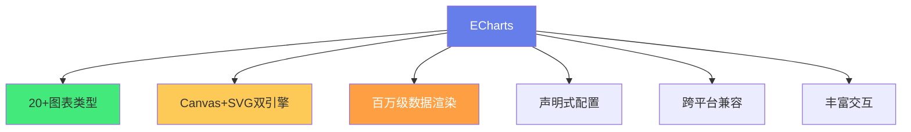

# 📊 ECharts 与 AI 数据可视化

> **文档说明**：系统讲解 Apache ECharts 图表库的核心用法与 AI 时代的数据可视化实践，涵盖 ECharts 概述与核心概念（声明式配置/Canvas+SVG 双引擎/大数据渲染）、基础使用（初始化 init/配置项 option/setOption/响应式 resize/销毁 dispose）、常用图表类型全解（折线图/柱状图/饼图/散点图/雷达图/热力图/地图/关系图/桑基图/树图/漏斗图/仪表盘）、ECharts 配置体系详解（title/tooltip/legend/grid/xAxis/yAxis/series/dataZoom/visualMap/toolbox/axisPointer）、Vue3 集成最佳实践（useECharts 组合式函数/自动 resize/主题切换/卸载清理/TypeScript 类型）、AI 数据可视化场景（LLM Token 使用监控/模型性能对比/训练损失曲线/Embedding 降维可视化/知识图谱关系图/用户行为分析漏斗/A/B 实验结果看板）、动态数据与实时更新（增量数据 appendData/动画配置/流式渲染/数据轮询）、高级特性（数据集 dataset/视觉映射 visualMap/多图联动 connect/事件交互/自定义系列 custom/3D 图表 echarts-gl）、主题定制与暗黑模式（主题生成器/registerTheme/CSS 变量适配）、性能优化（大数据量 progressive/增量渲染/WebGL 加速/懒加载/数据抽样）、ECharts 5 新特性、AI 辅助图表生成（自然语言生成 option/智能图表类型推荐/数据自动可视化）、常见问题与最佳实践。
>
> **适用人群**：前端开发者、数据工程师、AI 应用开发者、需要构建数据看板的全栈工程师
>
> **前置知识**：[[Vue3-组合式API]] · [[TypeScript-类型系统进阶]]

---

## 一、概述

### 1.1 什么是 ECharts

**Apache ECharts** 是百度开源、目前由 Apache 基金会维护的专业级数据可视化库，支持 20+ 种图表类型，兼容 Canvas 和 SVG 双渲染引擎，支持百万级数据渲染。



**核心优势**：
- 📈 **图表丰富**：折线/柱状/饼图/雷达/地图/关系图/桑基图等
- 🚀 **性能优秀**：渐进式渲染、大数据优化、WebGL 加速
- 🎨 **高度可定制**：声明式配置，几乎每个元素都可定制
- 📱 **响应式**：自动适配容器大小，支持移动端
- 🌍 **国际化**：多语言支持
- 🔧 **生态完善**：echarts-gl（3D）、echarts-wordcloud（词云）等扩展

### 1.2 AI 时代的数据可视化

AI 应用产生了大量需要可视化的数据：

| AI 场景 | 可视化需求 | 图表类型 |
|---------|-----------|---------|
| **LLM 监控** | Token 用量、延迟、成本 | 折线图、仪表盘 |
| **模型训练** | Loss 曲线、准确率、学习率 | 多系列折线图 |
| **模型对比** | 多个模型的性能指标 | 雷达图、柱状图 |
| **Embedding** | 高维向量降维展示 | 散点图、热力图 |
| **知识图谱** | 实体关系网络 | 关系图、树图 |
| **用户行为** | 转化漏斗、留存 | 漏斗图、热力图 |
| **A/B 实验** | 指标对比、置信区间 | 柱状图、误差线 |
| **RAG 检索** | 文档相关性、检索耗时 | 散点图、桑基图 |

---

## 二、基础使用

### 2.1 安装与初始化

```bash
pnpm add echarts
```

```typescript
import * as echarts from 'echarts'

// 初始化
const chart = echarts.init(document.getElementById('chart')!)

// 设置配置
chart.setOption({
  title: { text: '示例图表' },
  tooltip: {},
  xAxis: { data: ['周一', '周二', '周三'] },
  yAxis: {},
  series: [{ type: 'bar', data: [120, 200, 150] }]
})

// 响应式
window.addEventListener('resize', () => chart.resize())

// 销毁
// chart.dispose()
```

### 2.2 按需引入（减小体积）

```typescript
// 按需引入核心模块和需要的图表
import * as echarts from 'echarts/core'
import { BarChart, LineChart, PieChart } from 'echarts/charts'
import {
  TitleComponent, TooltipComponent, GridComponent,
  LegendComponent, DataZoomComponent
} from 'echarts/components'
import { CanvasRenderer } from 'echarts/renderers'

echarts.use([
  BarChart, LineChart, PieChart,
  TitleComponent, TooltipComponent, GridComponent,
  LegendComponent, DataZoomComponent,
  CanvasRenderer
])
```

### 2.3 setOption 与响应式

```typescript
// setOption 第二个参数为 notMerge（是否不合并）
chart.setOption(newOption, true)  // 完全替换
chart.setOption(newOption)       // 合并（默认）

// 响应式 resize
chart.resize({ width: 800, height: 400 })

// 获取当前配置
const option = chart.getOption()
```

---

## 三、常用图表类型

### 3.1 图表类型速查

| 图表 | type | 适用场景 |
|------|------|---------|
| **折线图** | `line` | 趋势变化、时间序列 |
| **柱状图** | `bar` | 分类对比、排名 |
| **饼图** | `pie` | 占比分布 |
| **散点图** | `scatter` | 相关性、分布 |
| **雷达图** | `radar` | 多维度能力对比 |
| **热力图** | `heatmap` | 二维密度、矩阵 |
| **地图** | `map` | 地理分布 |
| **关系图** | `graph` | 网络、知识图谱 |
| **桑基图** | `sankey` | 流向、转化路径 |
| **树图** | `tree` | 层级结构 |
| **漏斗图** | `funnel` | 转化漏斗 |
| **仪表盘** | `gauge` | 进度、指标 |
| **旭日图** | `sunburst` | 多层级占比 |
| **平行坐标** | `parallel` | 多维数据分析 |

### 3.2 折线图（趋势/时间序列）

```typescript
const option = {
  title: { text: 'Token 日用量趋势' },
  tooltip: { trigger: 'axis' },
  legend: { data: ['GPT-4', 'GPT-3.5'] },
  xAxis: { type: 'category', data: dates },
  yAxis: { type: 'value', name: 'Tokens' },
  series: [
    { name: 'GPT-4', type: 'line', data: gpt4Data, smooth: true, areaStyle: {} },
    { name: 'GPT-3.5', type: 'line', data: gpt35Data, smooth: true }
  ]
}
```

### 3.3 柱状图（对比/排名）

```typescript
const option = {
  title: { text: '模型性能对比（MMLU）' },
  tooltip: { trigger: 'axis' },
  xAxis: { type: 'category', data: ['GPT-4', 'Claude', 'Gemini', 'LLaMA'] },
  yAxis: { type: 'value', max: 100 },
  series: [{
    type: 'bar',
    data: [86.4, 75.2, 79.8, 65.3],
    itemStyle: {
      color: new echarts.graphic.LinearGradient(0, 0, 0, 1, [
        { offset: 0, color: '#83bff6' },
        { offset: 1, color: '#188df0' }
      ])
    },
    label: { show: true, position: 'top' }
  }]
}
```

### 3.4 饼图（占比）

```typescript
const option = {
  title: { text: 'API 调用分布', left: 'center' },
  tooltip: { trigger: 'item' },
  legend: { bottom: 0 },
  series: [{
    type: 'pie',
    radius: ['40%', '70%'],  // 环形图
    avoidLabelOverlap: true,
    data: [
      { value: 1048, name: '文本生成' },
      { value: 735, name: '代码生成' },
      { value: 580, name: '图像理解' },
      { value: 484, name: '语音识别' }
    ]
  }]
}
```

### 3.5 雷达图（多维度对比）

```typescript
const option = {
  title: { text: '模型能力雷达图' },
  tooltip: {},
  legend: { data: ['GPT-4', 'Claude'] },
  radar: {
    indicator: [
      { name: '推理', max: 100 },
      { name: '代码', max: 100 },
      { name: '数学', max: 100 },
      { name: '写作', max: 100 },
      { name: '多语言', max: 100 }
    ]
  },
  series: [{
    type: 'radar',
    data: [
      { value: [95, 92, 90, 88, 85], name: 'GPT-4' },
      { value: [88, 85, 78, 92, 90], name: 'Claude' }
    ]
  }]
}
```

### 3.6 热力图（二维密度）

```typescript
const option = {
  tooltip: { position: 'top' },
  grid: { height: '50%', top: '10%' },
  xAxis: { type: 'category', data: hours, splitArea: { show: true } },
  yAxis: { type: 'category', data: days, splitArea: { show: true } },
  visualMap: {
    min: 0, max: 100,
    calculable: true,
    orient: 'horizontal',
    left: 'center', bottom: '15%'
  },
  series: [{
    type: 'heatmap',
    data: heatmapData,  // [[x, y, value], ...]
    label: { show: true }
  }]
}
```

### 3.7 关系图（知识图谱）

```typescript
const option = {
  tooltip: {},
  legend: { data: ['概念', '技术', '应用'] },
  series: [{
    type: 'graph',
    layout: 'force',  // 力导向布局
    force: { repulsion: 200, edgeLength: [50, 100] },
    roam: true,  // 可缩放平移
    label: { show: true },
    categories: [
      { name: '概念' }, { name: '技术' }, { name: '应用' }
    ],
    data: [
      { id: '0', name: 'AI', category: 0, symbolSize: 50 },
      { id: '1', name: 'LLM', category: 1, symbolSize: 40 },
      { id: '2', name: 'ChatBot', category: 2, symbolSize: 30 }
    ],
    links: [
      { source: '0', target: '1' },
      { source: '1', target: '2' }
    ]
  }]
}
```

### 3.8 桑基图（流向/转化）

```typescript
const option = {
  series: [{
    type: 'sankey',
    data: [
      { name: '访问' }, { name: '注册' }, { name: '付费' }, { name: '流失' }
    ],
    links: [
      { source: '访问', target: '注册', value: 100 },
      { source: '访问', target: '流失', value: 400 },
      { source: '注册', target: '付费', value: 30 },
      { source: '注册', target: '流失', value: 70 }
    ]
  }]
}
```

---

## 四、配置体系详解

### 4.1 核心配置项

| 配置项 | 作用 |
|--------|------|
| `title` | 标题 |
| `tooltip` | 提示框 |
| `legend` | 图例 |
| `grid` | 直角坐标系网格 |
| `xAxis` / `yAxis` | 坐标轴 |
| `series` | 数据系列（核心） |
| `dataZoom` | 数据区域缩放 |
| `visualMap` | 视觉映射（颜色/大小） |
| `toolbox` | 工具箱（保存/还原/数据视图） |
| `axisPointer` | 坐标轴指示器 |
| `dataset` | 数据集（数据与样式分离） |

### 4.2 Tooltip 高级配置

```typescript
tooltip: {
  trigger: 'axis',  // 'item' | 'axis' | 'none'
  axisPointer: { type: 'cross' },  // 十字准星
  formatter: (params) => {
    // 自定义提示框内容
    return `<div>${params[0].name}</div>`
  },
  backgroundColor: 'rgba(50,50,50,0.9)',
  borderColor: '#333',
  textStyle: { color: '#fff' }
}
```

### 4.3 dataZoom 数据缩放

```typescript
dataZoom: [
  { type: 'inside', start: 0, end: 100 },  // 内置缩放（鼠标滚轮）
  { type: 'slider', start: 0, end: 100 }   // 滑动条
]
```

### 4.4 visualMap 视觉映射

```typescript
visualMap: {
  min: 0, max: 100,
  left: 'left', top: 'center',
  text: ['高', '低'],
  calculable: true,
  inRange: {
    color: ['#50a3ba', '#eac736', '#d94e5d']  // 颜色渐变
  }
}
```

---

## 五、Vue3 集成最佳实践

### 5.1 useECharts 组合式函数

```typescript
// composables/useECharts.ts
import { ref, onMounted, onUnmounted, watch, shallowRef } from 'vue'
import * as echarts from 'echarts'
import type { EChartsOption } from 'echarts'

export function useECharts(theme?: string) {
  const chartRef = ref<HTMLElement>()
  const chart = shallowRef<echarts.ECharts>()
  let resizeObserver: ResizeObserver | null = null

  function init() {
    if (!chartRef.value) return
    chart.value = echarts.init(chartRef.value, theme, { renderer: 'canvas' })
    // 自动响应式
    resizeObserver = new ResizeObserver(() => chart.value?.resize())
    resizeObserver.observe(chartRef.value)
  }

  function setOption(option: EChartsOption, notMerge = false) {
    chart.value?.setOption(option, notMerge)
  }

  function resize() {
    chart.value?.resize()
  }

  function dispose() {
    resizeObserver?.disconnect()
    chart.value?.dispose()
    chart.value = undefined
  }

  onMounted(init)
  onUnmounted(dispose)

  return { chartRef, chart, setOption, resize, dispose }
}
```

### 5.2 组件中使用

```vue
<script setup lang="ts">
import { useECharts } from '@/composables/useECharts'

const { chartRef, setOption } = useECharts('dark')

const option = {
  title: { text: '示例' },
  xAxis: { type: 'category', data: ['A', 'B', 'C'] },
  yAxis: { type: 'value' },
  series: [{ type: 'bar', data: [10, 20, 30] }]
}

// 确保 DOM 挂载后设置
import { nextTick } from 'vue'
nextTick(() => setOption(option))
</script>

<template>
  <div ref="chartRef" style="width: 100%; height: 400px" />
</template>
```

### 5.3 响应式数据更新

```typescript
import { watch } from 'vue'

const props = defineProps<{ data: number[] }>()

watch(() => props.data, (newData) => {
  setOption({
    series: [{ data: newData }]
  })
}, { deep: true })
```

---

## 六、AI 数据可视化实战

### 6.1 LLM Token 监控看板

```typescript
// Token 用量实时监控
const option = {
  title: { text: 'LLM Token 实时监控' },
  tooltip: { trigger: 'axis' },
  legend: { data: ['输入 Token', '输出 Token', '成本($)'] },
  grid: { left: '3%', right: '4%', containLabel: true },
  xAxis: { type: 'category', boundaryGap: false, data: timeLabels },
  yAxis: [
    { type: 'value', name: 'Tokens' },
    { type: 'value', name: '成本($)', position: 'right' }
  ],
  dataZoom: [{ type: 'inside' }, { type: 'slider' }],
  series: [
    { name: '输入 Token', type: 'line', smooth: true, areaStyle: {}, data: inputTokens },
    { name: '输出 Token', type: 'line', smooth: true, areaStyle: {}, data: outputTokens },
    { name: '成本($)', type: 'line', yAxisIndex: 1, smooth: true, data: costs }
  ]
}
```

### 6.2 训练 Loss 曲线

```typescript
const option = {
  title: { text: '模型训练 Loss 曲线' },
  tooltip: { trigger: 'axis' },
  legend: { data: ['Train Loss', 'Val Loss', 'Learning Rate'] },
  xAxis: { type: 'value', name: 'Epoch' },
  yAxis: [
    { type: 'log', name: 'Loss' },  // 对数坐标
    { type: 'value', name: 'LR', position: 'right' }
  ],
  series: [
    { name: 'Train Loss', type: 'line', smooth: true, data: trainLoss },
    { name: 'Val Loss', type: 'line', smooth: true, data: valLoss },
    { name: 'Learning Rate', type: 'line', yAxisIndex: 1, data: lrHistory }
  ]
}
```

### 6.3 Embedding 降维可视化

```typescript
// PCA/t-SNE/UMAP 降维后的散点图
const option = {
  title: { text: 'Embedding 可视化（t-SNE 2D）' },
  tooltip: {
    formatter: (p) => `${p.data[2]}<br/>类别: ${p.data[3]}`
  },
  legend: { data: categories },
  xAxis: {},
  yAxis: {},
  series: categories.map(cat => ({
    name: cat,
    type: 'scatter',
    data: embeddings.filter(e => e[3] === cat).map(e => [e[0], e[1], e[2], e[3]]),
    symbolSize: 10
  }))
}
```

### 6.4 A/B 实验结果

```typescript
const option = {
  title: { text: 'A/B 实验转化率对比' },
  tooltip: { trigger: 'axis' },
  legend: { data: ['对照组', '实验组'] },
  xAxis: { type: 'category', data: ['步骤1', '步骤2', '步骤3', '转化'] },
  yAxis: { type: 'value', name: '转化率(%)' },
  series: [
    {
      name: '对照组', type: 'bar',
      data: [100, 65, 40, 15],
      markLine: { data: [{ type: 'average', name: '均值' }] }
    },
    {
      name: '实验组', type: 'bar',
      data: [100, 78, 55, 25],
      markPoint: { data: [{ type: 'max', name: '最大值' }] }
    }
  ]
}
```

---

## 七、动态数据与实时更新

### 7.1 增量数据追加

```typescript
// 大数据量用 appendData 增量渲染
chart.appendData({
  seriesIndex: 0,
  data: newDataPoints
})
```

### 7.2 实时数据轮询

```typescript
let timer: number

function startRealTime() {
  timer = window.setInterval(() => {
    const newPoint = generateData()
    // 滑动窗口：保留最近 50 个点
    option.series[0].data.shift()
    option.series[0].data.push(newPoint)
    chart.setOption(option)
  }, 1000)
}

function stopRealTime() {
  clearInterval(timer)
}
```

### 7.3 动画配置

```typescript
series: [{
  type: 'line',
  data: data,
  animationDuration: 1000,       // 初始动画时长
  animationDurationUpdate: 500,  // 更新动画时长
  animationEasing: 'cubicOut',   // 缓动函数
  animationEasingUpdate: 'cubicInOut'
}]
```

---

## 八、高级特性

### 8.1 dataset 数据集（数据与样式分离）

```typescript
const option = {
  dataset: {
    source: [
      ['product', '2023', '2024'],
      ['GPT-4', 43.3, 55.1],
      ['Claude', 23.0, 38.5],
      ['Gemini', 15.2, 28.7]
    ]
  },
  xAxis: { type: 'category' },
  yAxis: {},
  series: [
    { type: 'bar', seriesLayoutBy: 'row' },  // 按行
    { type: 'bar', seriesLayoutBy: 'row' }
  ]
}
```

### 8.2 多图联动

```typescript
// 多个图表共享 tooltip 和选中状态
echarts.connect('group1')  // 按 group 联动
chart1.group = 'group1'
chart2.group = 'group1'
```

### 8.3 事件交互

```typescript
chart.on('click', (params) => {
  console.log('点击：', params.name, params.value)
})

chart.on('mouseover', (params) => {
  // 高亮联动
})

chart.off('click')  // 解绑
```

### 8.4 自定义系列（custom）

```typescript
series: [{
  type: 'custom',
  renderItem: (params, api) => {
    // 自定义渲染逻辑
    const categoryIndex = api.value(0)
    const start = api.coord([categoryIndex, api.value(1)])
    const end = api.coord([categoryIndex, api.value(2)])
    return {
      type: 'rect',
      shape: { x: start[0] - 10, y: end[1], width: 20, height: start[1] - end[1] },
      style: api.style()
    }
  },
  data: customData
}]
```

---

## 九、主题与暗黑模式

### 9.1 内置主题

```typescript
echarts.init(dom, 'dark')  // 暗黑主题
echarts.init(dom, 'light') // 亮色主题
```

### 9.2 自定义主题

使用 [ECharts 主题生成器](https://echarts.apache.org/theme-builder.html) 导出主题 JSON：

```typescript
import * as echarts from 'echarts'
import customTheme from './custom-theme.json'

echarts.registerTheme('my-theme', customTheme)
const chart = echarts.init(dom, 'my-theme')
```

### 9.3 暗黑模式适配

```typescript
function updateTheme(isDark: boolean) {
  chart?.dispose()
  chart = echarts.init(dom, isDark ? 'dark' : undefined)
  chart.setOption(option)
}

// 监听系统主题变化
window.matchMedia('(prefers-color-scheme: dark)').addEventListener('change', (e) => {
  updateTheme(e.matches)
})
```

---

## 十、性能优化

| 优化点 | 方法 | 适用场景 |
|--------|------|---------|
| **大数据渲染** | `progressive: true` 渐进式渲染 | 10万+ 数据点 |
| **增量更新** | `appendData` 追加数据 | 实时数据流 |
| **WebGL 加速** | echarts-gl、散点图用 `large: true` | 百万级数据 |
| **按需引入** | 只引入需要的图表和组件 | 减小打包体积 |
| **数据抽样** | `sampling: 'lttb'` 降采样 | 折线图大数据 |
| **懒加载** | 图表进入视口再初始化 | 长页面多图表 |
| **避免频繁 setOption** | 只更新变化的 series | 高频更新 |
| **SVG 渲染** | `renderer: 'svg'` | 数据量小、需要矢量 |
| **Canvas 渲染** | `renderer: 'canvas'` | 大数据、频繁更新 |

```typescript
// 大数据优化配置
series: [{
  type: 'scatter',
  large: true,           // 大数据模式
  largeThreshold: 2000,  // 超过2000点启用
  progressive: 5000,     // 渐进式渲染
  sampling: 'lttb'       // 降采样算法
}]
```

---

## 十一、AI 辅助图表生成

### 11.1 自然语言生成图表配置

AI 可以根据自然语言描述生成 ECharts option：

```json
用户输入：生成一个折线图，展示过去7天的GPT-4和GPT-3.5的Token用量，
x轴是日期，y轴是Token数，要有面积填充和数据缩放

AI 输出：
{
  title: { text: '7天 Token 用量对比' },
  tooltip: { trigger: 'axis' },
  legend: { data: ['GPT-4', 'GPT-3.5'] },
  xAxis: { type: 'category', data: ['周一',...] },
  yAxis: { type: 'value', name: 'Tokens' },
  dataZoom: [{ type: 'inside' }, { type: 'slider' }],
  series: [
    { name: 'GPT-4', type: 'line', smooth: true, areaStyle: {}, data: [...] },
    { name: 'GPT-3.5', type: 'line', smooth: true, areaStyle: {}, data: [...] }
  ]
}
```

### 11.2 智能图表推荐

AI 可以根据数据特征推荐图表类型：

| 数据特征 | 推荐图表 |
|---------|---------|
| 时间序列 | 折线图 |
| 分类对比 | 柱状图 |
| 占比分布 | 饼图/旭日图 |
| 相关性 | 散点图 |
| 多维度 | 雷达图/平行坐标 |
| 层级关系 | 树图/旭日图 |
| 流向 | 桑基图 |
| 网络关系 | 关系图 |

---

## 十二、常见问题

| 问题 | 原因 | 解决方案 |
|------|------|---------|
| **图表不显示** | 容器没有宽高 | 确保容器有明确的 width/height |
| **resize 不生效** | 未监听 resize 或容器隐藏 | ResizeObserver 或 window resize |
| **内存泄漏** | 未 dispose | onUnmounted 中调用 chart.dispose() |
| **大数据卡顿** | 全量渲染 | progressive/large/sampling 优化 |
| **tooltip 被遮挡** | 容器 overflow:hidden | tooltip 设置 `appendToBody: true` |
| **响应式闪烁** | 频繁 setOption | 合并更新，notMerge=false |
| **暗黑模式不变** | 主题初始化后不更新 | dispose 后重新 init |
| **中文乱码** | 字体问题 | 设置 textStyle.fontFamily |
| **导出图片空白** | 异步渲染未完成 | 渲染完成后再 getDataURL |

---

## 十三、最佳实践

1. **容器必须有高度**：ECharts 需要明确的容器尺寸，用 `height: 400px` 或 `height: 100%`+父级高度
2. **封装 useECharts**：统一处理 init/resize/dispose，避免重复代码
3. **按需引入**：生产环境用按需引入，减小打包体积
4. **数据与配置分离**：用 dataset 或单独管理 data，option 只存样式
5. **合理选择图表**：根据数据特征选图表，不要为了炫技用复杂图表
6. **大数据用优化**：10万+ 数据必须用 progressive/large/sampling
7. **暗黑模式支持**：监听主题变化，dispose 后重新 init
8. **交互友好**：tooltip 清晰、图例可切换、dataZoom 可缩放
9. **性能监控**：大数据场景监控渲染时间，必要时降采样
10. **AI 辅助**：用 AI 生成 option 初稿，人工调整细节
11. **类型安全**：用 EChartsOption 类型标注配置
12. **可访问性**：重要图表提供数据表格替代

---

## 十四、关联笔记

### 前端与数据
- [[Vue3-组合式API]] · [[VueUse-工具函数库]] · [[TypeScript-类型系统进阶]]
- [[前端性能优化实战]] · [[对话式UI组件设计]]

### AI 工程
- [[LLM服务架构]] · [[AI应用开发入门]] · [[RAG检索增强生成]]
- [[Java AI Agent开发知识点系统梳理_优化版]] · [[AIGC内容生成]]

### 项目实战
- [[全栈项目实战]] · [[实时协作系统设计]] · [[多语言混合架构设计]]

### 导航
- [[MOC-前端开发]] · [[MOC-AI前端集成]] · [[Home]] · [[学习路线总览]]

> 🔍 **知识点深度解析**
>
> **作用**：ECharts 与 AI 数据可视化解决的是「如何将 AI 应用产生的大量数据（Token 用量、模型性能、训练曲线、Embedding、知识图谱等）以直观、交互、高性能的图表方式呈现，帮助用户理解数据、发现规律、做出决策」的核心问题——AI 时代数据量爆炸，好的可视化是 AI 产品的「最后一公里」。
>
> **底层原理**：①ECharts 的核心设计是「声明式配置 + 命令式操作」——用户通过 `option` 对象声明图表的样子（标题、坐标轴、系列、样式），ECharts 内部将声明式配置转换为渲染指令，通过 Canvas 或 SVG 绘制。`setOption` 是声明式的（描述「是什么」），而 `appendData`、`dispatchAction` 是命令式的（执行「做什么」）。这种混合设计既保留了声明式的简洁，又提供了命令式的灵活性。②ECharts 的双引擎（Canvas + SVG）各有优势——Canvas 基于像素，适合大数据量和频繁更新（性能好），但导出和缩放不如 SVG；SVG 基于矢量，适合小数据量和需要矢量导出/无障碍的场景，但大数据时 DOM 节点多导致性能差。ECharts 5 默认用 Canvas，可通过 `renderer: 'svg'` 切换。③渐进式渲染（progressive）是 ECharts 大数据性能的关键——当数据量很大时，ECharts 不是一次性渲染所有点，而是分帧逐步渲染（每帧渲染 N 个点），这样首屏快速显示部分数据，用户可以交互，后续帧逐步补全。这和「虚拟列表」「懒加载」的思想一致——先展示可见部分，后台逐步加载。④dataset 数据集的设计体现了「数据与样式分离」——传统方式数据嵌在 series 中，dataset 将数据独立出来，多个 series 可以共享同一份数据，数据更新时只改 dataset 不改样式。这和 MVC 中的「数据与视图分离」思想一致。⑤visualMap 视觉映射的本质是「数据到视觉属性的映射函数」——将数据值（如 0-100）映射到颜色（蓝-黄-红）、大小、透明度等视觉属性。这是数据可视化的核心原理——将抽象的数字映射为人类可感知的视觉特征（位置、长度、颜色、大小、形状）。⑥力导向布局（graph layout: 'force'）的本质是「物理模拟」——节点之间有斥力（类似电荷排斥），连线之间有引力（类似弹簧），通过迭代模拟物理系统达到稳定状态。这是网络可视化的经典算法，ECharts 内部实现了斥力、引力、中心引力等参数可调。⑦Vue3 集成的关键是「生命周期管理」——ECharts 实例需要在 DOM 挂载后 init（onMounted），在组件卸载时 dispose（onUnmounted），在容器大小变化时 resize（ResizeObserver）。封装为 useECharts 组合式函数可以统一处理这些逻辑，避免每个组件重复写。⑧AI 数据可视化的特殊性在于「数据的动态性和多维性」——AI 数据通常是实时流式的（Token 用量）、高维的（Embedding）、关系型的（知识图谱），需要折线图实时更新、散点图降维展示、关系图力导向布局。ECharts 的 appendData（增量追加）、scatter（散点）、graph（关系图）正好覆盖这些场景。
>
> **用法要点**：① ECharts核心：声明式option配置+Canvas/SVG双引擎+20+图表类型 ② 基础：init初始化/setOption设置/resize响应式/dispose销毁 ③ 常用图表：line(趋势)/bar(对比)/pie(占比)/scatter(相关)/radar(多维)/heatmap(密度)/graph(关系图)/sankey(流向)/tree(层级)/funnel(漏斗) ④ 配置体系：title/tooltip(trigger+formatter)/legend/grid/xAxis/yAxis/series/dataZoom(缩放)/visualMap(视觉映射)/toolbox/dataset(数据集) ⑤ Vue3集成：useECharts组合式函数(onMounted init/ResizeObserver自动resize/onUnmounted dispose)/nextTick后setOption/watch数据更新 ⑥ AI场景：Token监控(多Y轴折线)/训练Loss(对数坐标)/Embedding降维(散点+类别)/知识图谱(graph力导向)/A/B实验(柱状+markLine)/用户漏斗(funnel) ⑦ 动态数据：appendData增量/setInterval轮询+滑动窗口/动画配置(animationDuration) ⑧ 高级：dataset数据样式分离/echarts.connect多图联动/chart.on事件/custom自定义系列 ⑨ 主题：内置dark/light/registerTheme自定义/暗黑模式dispose后重新init ⑩ 性能：progressive渐进式/large大数据/sampling降采样(lttb)/按需引入/Canvas大数据SVG小数据/懒加载 ⑪ AI辅助：自然语言生成option/智能图表推荐(时间序列→折线/分类→柱状/占比→饼图) ⑫ 常见问题：容器无高度/resize不生效/内存泄漏(dispose)/大数据卡顿(progressive)/tooltip遮挡(appendToBody) ⑬ 最佳实践：容器有高度/封装useECharts/按需引入/数据样式分离/合理选图/大数据优化/暗黑支持/交互友好/AI辅助初稿/类型安全(EChartsOption)。

> 💡 **深度讲解**：ECharts 与 AI 数据可视化最核心的智慧是「将抽象的数字映射为人类可感知的视觉特征——位置、长度、颜色、大小、形状，让数据自己说话」——数据可视化的本质不是「画图」，而是「编码」——将数据的维度编码为视觉通道：X/Y 位置编码两个维度，颜色编码第三个维度，大小编码第四个维度。好的可视化选择最合适的视觉通道编码最重要的数据维度，让用户一眼看到规律。ECharts 提供了丰富的图表类型和视觉映射（visualMap），本质上就是提供了一套完整的「数据→视觉」编码工具。在 AI 时代，数据可视化有了新的挑战和机遇：挑战是 AI 数据往往是高维的（Embedding 有 1536 维）、动态的（实时 Token 流）、关系型的（知识图谱），传统图表不够用；机遇是 AI 可以辅助生成图表配置（自然语言→option）、推荐图表类型、甚至自动分析数据并生成洞察。ECharts 的 graph（关系图）、scatter（散点图，配合降维算法）、line（实时折线）正好覆盖了 AI 可视化的核心场景。性能是大数据可视化的关键——ECharts 的渐进式渲染、large 模式、sampling 降采样，让百万级数据点也能流畅渲染。这些优化的核心思想是「不要一次性做所有事」——分帧渲染、降采样、增量更新，和虚拟列表、懒加载是同一个道理。在 AI 应用中，数据可视化往往是「最后一公里」——模型再强大，如果结果不能直观展示，用户就无法理解和信任。一个好的 Token 监控看板、一个清晰的 Loss 曲线、一个交互式的知识图谱，能让 AI 产品的体验提升一个档次。掌握 ECharts，就是掌握了「让数据说话」的能力——这是 AI 时代全栈开发者的必备技能。

> 📝 **精简总结**：ECharts=Apache专业级数据可视化库，声明式option配置+Canvas/SVG双引擎+20+图表。基础：init/setOption/resize/dispose。常用图表：line/bar/pie/scatter/radar/heatmap/graph/sankey/tree/funnel。配置：title/tooltip/legend/grid/axis/series/dataZoom/visualMap/dataset。Vue3集成：useECharts(init+resize+dispose)/nextTick/watch更新。AI场景：Token监控(多Y轴折线)/训练Loss(对数坐标)/Embedding降维(散点)/知识图谱(graph力导向)/A/B实验(柱状)。动态：appendData增量/轮询滑动窗口/动画。高级：dataset分离/connect联动/事件/custom自定义。主题：dark/registerTheme/暗黑重新init。性能：progressive/large/sampling(lttb)/按需引入/Canvas大数据。AI辅助：自然语言生成option/智能推荐图表。最佳实践：容器有高度/封装useECharts/按需引入/数据样式分离/合理选图/大数据优化/暗黑支持。

> **学习路径建议**：先学习 ECharts 基础（init/setOption/常用图表） → 实践：做一个简单的柱状图和折线图 → 学习 Vue3 集成，封装 useECharts → 实践：在 Vue3 项目中做一个响应式图表 → 学习高级配置（tooltip/dataZoom/visualMap/dataset） → 实践：做一个 AI Token 监控看板（多 Y 轴+数据缩放） → 学习特殊图表（graph 关系图/sankey 桑基图/heatmap 热力图） → 实践：做一个知识图谱可视化 → 学习性能优化（progressive/large/sampling） → 实践：渲染 10 万+ 数据点 → 学习 AI 辅助（用 AI 生成 option） → 形成「数据→图表→洞察」的完整可视化能力。

---

> **ECharts 与 AI 数据可视化的本质是「将抽象的数字映射为人类可感知的视觉特征——位置、长度、颜色、大小、形状，让数据自己说话」——数据可视化的本质不是画图，而是编码：将数据维度编码为视觉通道，X/Y 位置编码两个维度，颜色编码第三个，大小编码第四个。好的可视化选择最合适的视觉通道编码最重要的数据维度，让用户一眼看到规律。ECharts 提供的丰富图表类型和 visualMap，本质上就是一套完整的数据→视觉编码工具。在 AI 时代，数据可视化有了新挑战：AI 数据往往是高维的（Embedding 1536 维）、动态的（实时 Token 流）、关系型的（知识图谱），传统图表不够用；也有了新机遇：AI 可以辅助生成图表配置（自然语言→option）、推荐图表类型、自动分析数据生成洞察。ECharts 的 graph 关系图、scatter 散点图（配合降维）、line 实时折线正好覆盖这些场景。性能是大数据可视化的关键——渐进式渲染、large 模式、sampling 降采样，让百万级数据也能流畅渲染，核心思想是「不要一次性做所有事」，和虚拟列表、懒加载同理。在 AI 应用中，数据可视化往往是最后一公里——模型再强大，结果不能直观展示，用户就无法理解和信任。一个好的 Token 监控看板、清晰的 Loss 曲线、交互式知识图谱，能让 AI 产品体验提升一个档次。掌握 ECharts，就是掌握了让数据说话的能力——这是 AI 时代全栈开发者的必备技能。从今天开始，下次你有一堆数据要看不懂时，不要只看表格，画个图——让数据自己告诉你答案。**
