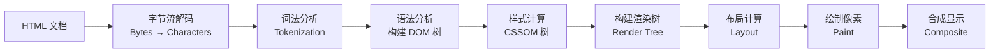

# 📄 HTML5 语义化与基础标签

> **文档说明**：HTML（HyperText Markup Language）是网页的骨架，是所有前端开发的第一步。本文系统涵盖 HTML5 核心标签、语义化布局、文本标签、链接图片、列表表格、表单、多媒体、HTML5 新增特性、浏览器解析原理、无障碍访问、SEO 优化和编码最佳实践，附大量可直接运行的示例代码。
>
> **适用人群**：零基础前端新手、想系统复习 HTML 的开发者、后端工程师补前端基础
>
> **前置知识**：具备基本的电脑操作能力即可，无需编程基础

---

## 一、概述

### 1.1 什么是 HTML

HTML（HyperText Markup Language，超文本标记语言）是用于创建网页的标准标记语言。它用**标签（Tag）**描述网页的结构和内容，浏览器解析这些标签后渲染出可视化的页面。

**HTML、CSS、JavaScript 三者的关系**：

| 技术 | 作用 | 比喻 |
|------|------|------|
| **HTML** | 定义网页有什么内容（标题、段落、图片、按钮...） | 房子的骨架和砖块 |
| **CSS** | 定义内容长什么样（颜色、大小、布局、动画...） | 房子的装修和软装 |
| **JavaScript** | 定义内容如何交互（点击、动画、数据请求...） | 房子的水电和智能家居 |

**HTML5** 是当前最新的 HTML 标准，相比旧版本新增了：
- 语义化标签（`<header>`、`<nav>`、`<article>`、`<section>` 等）
- 原生多媒体支持（`<video>`、`<audio>`，无需 Flash）
- 画布（`<canvas>`）用于图形绘制
- 本地存储（`localStorage`、`sessionStorage`）
- 新表单输入类型（`email`、`date`、`range`、`color` 等）
- 地理定位、拖放 API、Web Workers 等

### 1.2 基本文档结构

```html
<!DOCTYPE html>
<html lang="zh-CN">
<head>
    <!-- 元信息：不会显示在页面上 -->
    <meta charset="UTF-8">
    <meta name="viewport" content="width=device-width, initial-scale=1.0">
    <meta name="description" content="网页描述，用于SEO">
    <title>网页标题（显示在浏览器标签页）</title>
    <link rel="stylesheet" href="style.css">
</head>
<body>
    <!-- 网页内容：显示在页面上 -->
    <header>页头</header>
    <main>
        <h1>主标题</h1>
        <p>这是一个段落</p>
    </main>
    <footer>页脚</footer>
    <script src="app.js"></script>
</body>
</html>
```

**各部分说明**：

| 部分 | 说明 |
|------|------|
| `<!DOCTYPE html>` | 声明文档类型为 HTML5，必须写在第一行 |
| `<html lang="zh-CN">` | 根元素，`lang` 属性声明页面语言（影响搜索引擎和屏幕阅读器） |
| `<head>` | 头部区域，包含元信息（编码、视口、标题、CSS 引用） |
| `<meta charset="UTF-8">` | 声明字符编码为 UTF-8，**必须加**，否则中文乱码 |
| `<meta name="viewport">` | 视口设置，**移动端必须加**，否则页面在手机上显示太小 |
| `<title>` | 网页标题，显示在浏览器标签页和搜索结果中 |
| `<body>` | 主体区域，所有可见内容都写在这里 |

### 1.3 标签语法

```html
<!-- 常规标签：开始标签 + 内容 + 结束标签 -->
<h1>标题内容</h1>
<p>段落内容</p>

<!-- 自闭合标签：没有内容，单标签 -->

<br>
<hr>
<input type="text">

<!-- 标签属性：开始标签中添加键值对 -->
<a href="https://example.com" target="_blank" class="link">链接</a>
<!--    ↑ 属性名    ↑ 属性值          ↑ 另一个属性 -->

<!-- 注释：不会显示在页面上，用于代码说明 -->
<!-- 这是一段注释 -->
```

**属性通用规则**：
- 属性写在开始标签中，格式为 `属性名="属性值"`
- 属性值用双引号包裹（推荐）
- 多个属性之间用空格分隔
- 布尔属性（如 `disabled`、`checked`、`required`）可以只写属性名表示 true

---

## 二、底层原理

### 2.1 浏览器如何解析 HTML



**关键步骤详解**：

1. **字节流解码**：浏览器接收 HTML 文件的二进制字节，根据 `<meta charset>` 解码为字符
2. **词法分析（Tokenization）**：将字符流解析为一个个 Token（开始标签、结束标签、文本、注释等）
3. **语法分析（构建 DOM 树）**：根据 Token 的嵌套关系，构建 DOM（Document Object Model）树
4. **样式计算（CSSOM）**：解析 CSS，构建 CSSOM（CSS Object Model）树
5. **构建渲染树**：将 DOM 和 CSSOM 合并，只包含可见元素（`display:none` 的元素不在渲染树中）
6. **布局（Layout/Reflow）**：计算每个元素的位置和大小
7. **绘制（Paint）**：将元素绘制为像素（颜色、边框、阴影等）
8. **合成（Composite）**：将多个图层合并，显示到屏幕上

> **重要概念**：HTML 解析是**增量式**的——浏览器不需要等整个 HTML 下载完就开始解析和渲染，这就是为什么大页面能逐步显示内容。但如果遇到 `<script>` 标签（没有 `async`/`defer`），HTML 解析会暂停，等脚本下载执行完再继续，因为脚本可能修改 DOM。

### 2.2 语义化的深层意义

语义化（Semantic HTML）是指用**有含义的标签**描述内容，而不是全用 `<div>` 和 `<span>`。

| 维度 | 无语义化（全用 div） | 语义化（用正确标签） |
|------|---------------------|---------------------|
| **代码可读性** | `<div class="header">` 需看 class 才知道含义 | `<header>` 一眼看出是页头 |
| **可维护性** | class 命名混乱，难以统一 | 标签本身就是规范，团队协作更顺畅 |
| **无障碍访问** | 屏幕阅读器无法识别结构 | 屏幕阅读器能正确导航（跳到导航、跳到主内容） |
| **SEO** | 搜索引擎难以判断内容重要性 | 搜索引擎能识别标题、文章、导航，排名更好 |
| **默认样式** | div 无默认样式，需全部手写 | 部分语义标签有默认样式（如 h1 加粗加大） |
| **开发效率** | 需大量 class 命名 | 减少 class 数量，CSS 选择器更简洁 |

**语义化标签速查表**：

| 标签 | 含义 | 常见用途 |
|------|------|---------|
| `<header>` | 页头/页眉 | 网站顶部 Logo、导航、搜索框 |
| `<nav>` | 导航 | 主导航菜单、面包屑、分页 |
| `<main>` | 主要内容 | 页面主体内容，一个页面只能有一个 |
| `<article>` | 独立文章 | 博客文章、论坛帖子、新闻、卡片 |
| `<section>` | 独立区块 | 内容分组，通常有标题 |
| `<aside>` | 侧边栏 | 侧边栏、相关文章、广告 |
| `<footer>` | 页脚 | 版权信息、联系方式、友情链接 |
| `<figure>` | 图文组合 | 图片+图注、图表+说明 |
| `<figcaption>` | 图注 | figure 的标题/说明 |
| `<time>` | 时间/日期 | 发布时间、事件日期 |
| `<address>` | 联系地址 | 作者/企业联系信息 |
| `<mark>` | 高亮标记 | 搜索结果高亮、重点标注 |
| `<details>` | 可折叠详情 | FAQ、折叠面板 |
| `<summary>` | 摘要标题 | details 的标题，点击展开/收起 |

### 2.3 无障碍访问（A11y）基础

无障碍访问（Accessibility，简称 a11y）是指使网页对所有人（包括残障人士）都可访问。HTML 语义化是无障碍的基础。

**关键无障碍实践**：
1. **图片加 `alt`**：``，屏幕阅读器会朗读 alt 文本
2. **表单加 `<label>`**：`<label for="name">姓名</label><input id="name">`，点击 label 可聚焦输入框
3. **语义化按钮**：用 `<button>` 而非 `<div onclick>`，按钮天然支持键盘操作和屏幕阅读器
4. **标题层级**：h1 → h2 → h3 不跳级，屏幕阅读器用户靠标题导航
5. **颜色对比度**：文字和背景颜色对比度 ≥ 4.5:1（WCAG AA 标准）
6. **键盘可访问**：所有交互元素都能用 Tab 键聚焦，Enter/Space 触发
7. **ARIA 标签**：语义化不够用时，用 `aria-label`、`aria-hidden` 等补充

---

## 三、实操示例

### 3.1 文本标签

```html
<!-- 标题：h1~h6，h1 最大最重要，一个页面通常只有一个 h1 -->
<h1>一级标题（页面主标题）</h1>
<h2>二级标题</h2>
<h3>三级标题</h3>
<h4>四级标题</h4>
<h5>五级标题</h5>
<h6>六级标题</h6>

<!-- 段落 -->
<p>这是一个段落。段落之间会自动有间距。</p>
<p>这是另一个段落。</p>

<!-- 文本格式化 -->
<p>
    <strong>加粗（重要，语义强调）</strong>
    <em>斜体（强调）</em>
    <u>下划线</u>
    <s>删除线</s>
    <mark>高亮标记</mark>
    <code>行内代码</code>
    <sub>下标</sub>（如 H<sub>2</sub>O）
    <sup>上标</sup>（如 E=mc<sup>2</sup>）
    <small>小号文字（免责声明、版权）</small>
</p>

<!-- 换行和水平线 -->
<p>第一行<br>第二行（br 强制换行）</p>
<hr> <!-- 水平线，分隔内容 -->

<!-- 引用 -->
<blockquote cite="https://example.com">
    <p>这是一段引用的内容。</p>
    <footer>— 引用来源 <cite>作者名</cite></footer>
</blockquote>

<!-- 预格式化文本（保留空格和换行，适合代码） -->
<pre>
function hello() {
    console.log("Hello World");
}
</pre>

<!-- 缩写 -->
<p><abbr title="HyperText Markup Language">HTML</abbr> 是网页的基础。</p>
```

### 3.2 列表

```html
<!-- 无序列表（ul + li） -->
<ul>
    <li>苹果</li>
    <li>香蕉</li>
    <li>橙子</li>
</ul>

<!-- 有序列表（ol + li） -->
<ol>
    <li>第一步：准备材料</li>
    <li>第二步：开始烹饪</li>
    <li>第三步：装盘享用</li>
</ol>

<!-- 自定义列表（dl + dt + dd） -->
<dl>
    <dt>HTML</dt>
    <dd>超文本标记语言，定义网页结构</dd>
    <dt>CSS</dt>
    <dd>层叠样式表，定义网页样式</dd>
    <dt>JavaScript</dt>
    <dd>脚本语言，定义网页交互</dd>
</dl>

<!-- 嵌套列表 -->
<ul>
    <li>水果
        <ul>
            <li>苹果</li>
            <li>香蕉</li>
        </ul>
    </li>
    <li>蔬菜
        <ul>
            <li>白菜</li>
            <li>萝卜</li>
        </ul>
    </li>
</ul>
```

### 3.3 链接和图片

```html
<!-- 链接（a 标签） -->
<a href="https://example.com" target="_blank" rel="noopener noreferrer">外部链接（新窗口打开）</a>
<a href="about.html">内部链接（同目录页面）</a>
<a href="/docs/guide.html">绝对路径链接</a>
<a href="#section1">页内锚点（跳转到 id="section1" 的元素）</a>
<a href="mailto:test@example.com">邮件链接（打开邮件客户端）</a>
<a href="tel:10086">电话链接（移动端拨号）</a>
<a href="javascript:void(0)">空链接（不跳转，用于 JS 绑定）</a>

<!-- 图片（img 标签，自闭合） -->


<!-- 响应式图片（不同屏幕用不同图） -->
<picture>
    <source media="(min-width: 800px)" srcset="large.jpg">
    <source media="(min-width: 400px)" srcset="medium.jpg">
    
</picture>

<!-- 图文组合（figure + figcaption） -->
<figure>
    
    <figcaption>图1：系统整体架构示意图</figcaption>
</figure>

<!-- 链接图片（图片可点击） -->
<a href="https://example.com">
    
</a>
```

**`alt` 属性写法指南**：
- 描述图片内容，不是描述"这是一张图片"
- 装饰性图片（无实际内容）用空 alt：`alt=""`，屏幕阅读器会跳过
- 长度控制在 125 字符以内
- 不要以"图片 of"开头

### 3.4 表格

```html
<!-- 基础表格 -->
<table border="1">
    <caption>学生成绩表</caption> <!-- 表格标题 -->
    <thead> <!-- 表头 -->
        <tr>
            <th>姓名</th>
            <th>语文</th>
            <th>数学</th>
            <th>英语</th>
        </tr>
    </thead>
    <tbody> <!-- 表体 -->
        <tr>
            <td>张三</td>
            <td>90</td>
            <td>85</td>
            <td>92</td>
        </tr>
        <tr>
            <td>李四</td>
            <td>78</td>
            <td>95</td>
            <td>88</td>
        </tr>
    </tbody>
    <tfoot> <!-- 表尾 -->
        <tr>
            <td>平均分</td>
            <td>84</td>
            <td>90</td>
            <td>90</td>
        </tr>
    </tfoot>
</table>

<!-- 合并单元格 -->
<table border="1">
    <tr>
        <th colspan="2">个人信息</th> <!-- 跨2列 -->
        <th rowspan="2">成绩</th> <!-- 跨2行 -->
    </tr>
    <tr>
        <td>姓名</td>
        <td>年龄</td>
    </tr>
    <tr>
        <td>张三</td>
        <td>20</td>
        <td>90</td>
    </tr>
</table>
```

> **注意**：表格只用于展示**表格数据**，不要用表格做页面布局（那是 CSS 的事）。现代网页布局用 Flexbox 和 Grid。

### 3.5 语义化布局完整示例

```html
<!DOCTYPE html>
<html lang="zh-CN">
<head>
    <meta charset="UTF-8">
    <meta name="viewport" content="width=device-width, initial-scale=1.0">
    <title>我的博客 - 技术分享</title>
</head>
<body>
    <!-- 页头 -->
    <header>
        <div class="logo">
            <h1><a href="/">我的博客</a></h1>
        </div>
        <!-- 导航 -->
        <nav aria-label="主导航">
            <ul>
                <li><a href="/">首页</a></li>
                <li><a href="/articles">文章</a></li>
                <li><a href="/about">关于</a></li>
                <li><a href="/contact">联系</a></li>
            </ul>
        </nav>
    </header>

    <!-- 主要内容 -->
    <main>
        <!-- 文章列表 -->
        <section aria-label="最新文章">
            <h2>最新文章</h2>

            <!-- 每篇文章用 article -->
            <article>
                <header>
                    <h3><a href="/article/html5">HTML5 语义化详解</a></h3>
                    <p>
                        <time datetime="2026-08-28">2026年8月28日</time>
                        · 作者：张三
                    </p>
                </header>
                <p>本文详细介绍了 HTML5 语义化标签的使用方法和最佳实践...</p>
                <footer>
                    <a href="/article/html5">阅读全文 →</a>
                </footer>
            </article>

            <article>
                <header>
                    <h3><a href="/article/css-grid">CSS Grid 布局入门</a></h3>
                    <p>
                        <time datetime="2026-08-25">2026年8月25日</time>
                        · 作者：张三
                    </p>
                </header>
                <p>CSS Grid 是最强大的 CSS 布局系统...</p>
                <footer>
                    <a href="/article/css-grid">阅读全文 →</a>
                </footer>
            </article>
        </section>
    </main>

    <!-- 侧边栏 -->
    <aside aria-label="侧边栏">
        <section>
            <h2>分类</h2>
            <ul>
                <li><a href="/cat/frontend">前端开发 (15)</a></li>
                <li><a href="/cat/backend">后端开发 (12)</a></li>
                <li><a href="/cat/ai">AI 工程 (8)</a></li>
            </ul>
        </section>
        <section>
            <h2>标签云</h2>
            <p>
                <a href="/tag/html">HTML</a>
                <a href="/tag/css">CSS</a>
                <a href="/tag/js">JavaScript</a>
            </p>
        </section>
    </aside>

    <!-- 页脚 -->
    <footer>
        <address>
            联系作者：<a href="mailto:zhangsan@example.com">zhangsan@example.com</a>
        </address>
        <p>&copy; 2026 我的博客. All rights reserved.</p>
    </footer>
</body>
</html>
```

### 3.6 表单

```html
<!-- 完整表单示例 -->
<form action="/api/register" method="POST" enctype="multipart/form-data">
    <fieldset>
        <legend>用户注册</legend>

        <!-- 文本输入 -->
        <div>
            <label for="username">用户名：</label>
            <input type="text" id="username" name="username"
                   placeholder="请输入用户名" required minlength="3" maxlength="20">
        </div>

        <!-- 密码 -->
        <div>
            <label for="password">密码：</label>
            <input type="password" id="password" name="password"
                   placeholder="至少6位" required minlength="6">
        </div>

        <!-- 邮箱（HTML5 新类型，自带格式校验） -->
        <div>
            <label for="email">邮箱：</label>
            <input type="email" id="email" name="email"
                   placeholder="example@email.com" required>
        </div>

        <!-- 手机号 -->
        <div>
            <label for="phone">手机号：</label>
            <input type="tel" id="phone" name="phone" pattern="[0-9]{11}"
                   placeholder="11位手机号">
        </div>

        <!-- 单选按钮 -->
        <div>
            <span>性别：</span>
            <input type="radio" id="male" name="gender" value="male" checked>
            <label for="male">男</label>
            <input type="radio" id="female" name="gender" value="female">
            <label for="female">女</label>
        </div>

        <!-- 复选框 -->
        <div>
            <span>兴趣爱好：</span>
            <input type="checkbox" id="hobby-code" name="hobby" value="code">
            <label for="hobby-code">编程</label>
            <input type="checkbox" id="hobby-read" name="hobby" value="read">
            <label for="hobby-read">阅读</label>
            <input type="checkbox" id="hobby-music" name="hobby" value="music">
            <label for="hobby-music">音乐</label>
        </div>

        <!-- 下拉选择 -->
        <div>
            <label for="city">所在城市：</label>
            <select id="city" name="city">
                <option value="">请选择</option>
                <optgroup label="一线城市">
                    <option value="beijing">北京</option>
                    <option value="shanghai">上海</option>
                    <option value="guangzhou">广州</option>
                    <option value="shenzhen">深圳</option>
                </optgroup>
                <optgroup label="新一线城市">
                    <option value="hangzhou">杭州</option>
                    <option value="chengdu">成都</option>
                </optgroup>
            </select>
        </div>

        <!-- 日期 -->
        <div>
            <label for="birthday">出生日期：</label>
            <input type="date" id="birthday" name="birthday">
        </div>

        <!-- 数字 -->
        <div>
            <label for="age">年龄：</label>
            <input type="number" id="age" name="age" min="1" max="120" value="18">
        </div>

        <!-- 滑块 -->
        <div>
            <label for="salary">期望薪资（K）：</label>
            <input type="range" id="salary" name="salary" min="5" max="100" value="20" step="1">
            <span id="salary-value">20</span>K
        </div>

        <!-- 颜色选择 -->
        <div>
            <label for="color">喜欢的颜色：</label>
            <input type="color" id="color" name="color" value="#ff6600">
        </div>

        <!-- 文件上传 -->
        <div>
            <label for="avatar">头像上传：</label>
            <input type="file" id="avatar" name="avatar" accept="image/*" multiple>
        </div>

        <!-- 多行文本 -->
        <div>
            <label for="bio">个人简介：</label>
            <textarea id="bio" name="bio" rows="4" cols="50"
                      placeholder="介绍一下你自己..." maxlength="500"></textarea>
        </div>

        <!-- 协议同意 -->
        <div>
            <input type="checkbox" id="agree" name="agree" required>
            <label for="agree">我已阅读并同意<a href="/terms">用户协议</a></label>
        </div>

        <!-- 按钮 -->
        <div>
            <button type="submit">注册</button>
            <button type="reset">重置</button>
            <button type="button" onclick="alert('普通按钮')">普通按钮</button>
        </div>
    </fieldset>
</form>
```

**表单关键属性**：

| 属性 | 作用 | 示例 |
|------|------|------|
| `name` | 表单元素名称，提交时的键名（**必须有**，否则不提交） | `name="username"` |
| `value` | 默认值/提交值 | `value="张三"` |
| `placeholder` | 占位提示文字 | `placeholder="请输入"` |
| `required` | 必填项（HTML5 自带校验） | `required` |
| `min`/`max` | 数字/日期的最小/最大值 | `min="1" max="100"` |
| `minlength`/`maxlength` | 文本最小/最大长度 | `minlength="3" maxlength="20"` |
| `pattern` | 正则表达式校验 | `pattern="[0-9]{11}"` |
| `disabled` | 禁用（不可交互，不提交） | `disabled` |
| `readonly` | 只读（不可修改，会提交） | `readonly` |
| `autofocus` | 页面加载时自动聚焦 | `autofocus` |
| `autocomplete` | 自动补全（on/off） | `autocomplete="off"` |

### 3.7 多媒体

```html
<!-- 视频 -->
<video controls width="600" poster="cover.jpg" preload="metadata">
    <source src="movie.mp4" type="video/mp4">
    <source src="movie.webm" type="video/webm">
    您的浏览器不支持视频播放，请<a href="movie.mp4">下载视频</a>。
</video>

<!-- 音频 -->
<audio controls loop>
    <source src="audio.mp3" type="audio/mpeg">
    <source src="audio.ogg" type="audio/ogg">
    您的浏览器不支持音频播放。
</audio>

<!-- 嵌入其他网页（iframe） -->
<iframe src="https://example.com" width="800" height="600"
        title="示例页面" loading="lazy"></iframe>

<!-- 画布（Canvas，用于 JS 绘图） -->
<canvas id="myCanvas" width="400" height="300">
    您的浏览器不支持 Canvas。
</canvas>

<!-- SVG 矢量图形 -->
<svg width="100" height="100" viewBox="0 0 100 100">
    <circle cx="50" cy="50" r="40" fill="#ff6600" stroke="#333" stroke-width="2"/>
    <text x="50" y="55" text-anchor="middle" fill="white" font-size="16">SVG</text>
</svg>
```

### 3.8 HTML5 新增交互元素

```html
<!-- 可折叠面板（details + summary） -->
<details>
    <summary>点击展开/收起详情</summary>
    <p>这里是折叠的内容，可以包含任何 HTML。</p>
    <ul>
        <li>列表项1</li>
        <li>列表项2</li>
    </ul>
</details>

<!-- 默认展开 -->
<details open>
    <summary>默认展开的面板</summary>
    <p>这个面板默认是展开状态。</p>
</details>

<!-- 进度条 -->
<progress value="70" max="100">70%</progress>

<!-- 度量条（仪表盘） -->
<meter value="0.8" min="0" max="1" low="0.3" high="0.7" optimum="0.9">80%</meter>

<!-- 对话框 -->
<dialog id="myDialog">
    <h3>对话框标题</h3>
    <p>对话框内容</p>
    <button onclick="document.getElementById('myDialog').close()">关闭</button>
</dialog>
<button onclick="document.getElementById('myDialog').showModal()">打开对话框</button>

<!-- 数据列表（输入框联想） -->
<input list="browsers" placeholder="选择或输入浏览器">
<datalist id="browsers">
    <option value="Chrome">
    <option value="Firefox">
    <option value="Safari">
    <option value="Edge">
</datalist>
```

---

## 四、常见问题与排查

| 问题现象 | 可能原因 | 解决方案 |
|---------|---------|---------|
| **中文乱码** | 未声明字符编码，或文件保存编码不是 UTF-8 | `<head>` 中加 `<meta charset="UTF-8">`；文件用 UTF-8 编码保存（VSCode 右下角可查看/切换） |
| **图片不显示** | `src` 路径错误；文件不存在；文件名有中文/空格；大小写不匹配（Linux 服务器区分大小写） | 检查路径（相对路径从 HTML 文件位置算起）；确认文件存在；路径用英文，避免空格；大小写一致 |
| **移动端页面显示太小** | 缺少 viewport meta 标签 | `<head>` 中加 `<meta name="viewport" content="width=device-width, initial-scale=1.0">` |
| **布局错乱** | 标签未闭合；嵌套错误（如 `<p>` 里放 `<div>`）；CSS 冲突 | 用 VSCode 的 HTML 验证（波浪线提示）；检查标签配对；用浏览器开发者工具（F12）检查元素 |
| **表单提交后数据丢失** | 表单元素缺少 `name` 属性；`method` 不对；按钮不是 `type="submit"` | 每个需要提交的元素必须有 `name`；确认 `method="POST"` 或 `"GET"`；提交按钮用 `<button type="submit">` 或 `<input type="submit">` |
| **链接点击无反应** | `href` 为空或 `#`；JavaScript 阻止了默认行为；链接被其他元素遮挡 | 检查 `href` 值；检查 JS 事件是否 `preventDefault`；用 F12 检查元素是否被遮挡 |
| **视频/音频无法播放** | 格式不支持（浏览器只支持特定编码）；路径错误；CORS 跨域限制 | MP4 用 H.264 编码，MP3 用标准编码；提供多种格式（`<source>`）；跨域资源需服务器配置 CORS |
| **HTML 验证报错** | 标签嵌套错误；属性名/值错误；使用了已废弃标签 | 用 [W3C Validator](https://validator.w3.org/) 在线检查；参考 MDN 文档确认标签用法；避免使用 `<font>`、`<center>` 等废弃标签 |
| **SEO 排名不好** | 缺少语义化标签；标题层级混乱；缺少 meta description；图片无 alt | 用语义化标签（`<article>`、`<section>` 等）；h1→h2→h3 不跳级；加 `<meta name="description">`；所有图片加 `alt` |
| **屏幕阅读器无法正确导航** | 全用 div 无语义化；图片无 alt；表单无 label；按钮用 div | 用语义化标签；图片加 alt；表单加 `<label for>`；交互用 `<button>` 而非 `<div onclick>` |
| **页面加载慢** | 图片太大未压缩；CSS/JS 未压缩；缺少懒加载 | 图片压缩（TinyPNG），用 WebP 格式；CSS/JS 压缩合并；图片加 `loading="lazy"`；CDN 加速 |
| **iframe 内容不显示** | 被嵌入网站设置了 `X-Frame-Options` 禁止嵌入；路径错误；HTTPS 页面嵌入 HTTP 内容 | 检查目标网站是否允许嵌入（很多网站禁止）；用 HTTPS 页面嵌入 HTTPS 内容；考虑用链接替代 iframe |

---

## 五、进阶与最佳实践

### 5.1 语义化最佳实践

1. **用语义化标签替代无语义 div**：
   - 页头用 `<header>` 而非 `<div class="header">`
   - 导航用 `<nav>` 而非 `<div class="nav">`
   - 文章用 `<article>` 而非 `<div class="article">`
   - 侧边栏用 `<aside>` 而非 `<div class="sidebar">`

2. **标题层级不跳级**：h1 → h2 → h3，不要从 h1 直接跳到 h3。一个页面通常只有一个 h1（页面主标题）。

3. **`<article>` vs `<section>`**：
   - `<article>`：独立的、可单独分发的内容（博客文章、论坛帖子、新闻卡片）
   - `<section>`：内容的主题分组，通常有标题（章节、标签页）
   - 不确定时用 `<section>`，不要滥用 `<article>`

4. **`<main>` 唯一**：一个页面只有一个 `<main>`，包含页面的主要内容，排除导航、页脚、侧边栏。

5. **不要用语义标签做样式钩子**：语义标签是为了结构，不是为了样式。需要样式时加 class，不要因为 `<header>` 有默认样式就用它。

### 5.2 SEO 优化要点

```html
<!-- SEO 关键 meta 标签 -->
<head>
    <meta charset="UTF-8">
    <meta name="viewport" content="width=device-width, initial-scale=1.0">

    <!-- 页面标题（50-60字符，含关键词） -->
    <title>HTML5 语义化详解 - 前端开发教程 | 我的博客</title>

    <!-- 页面描述（150-160字符，搜索结果摘要） -->
    <meta name="description" content="详细介绍 HTML5 语义化标签的使用方法、底层原理和最佳实践，附完整代码示例，适合前端新手和进阶开发者。">

    <!-- 关键词（已不太重要，但可加） -->
    <meta name="keywords" content="HTML5, 语义化, 前端开发, 标签, SEO">

    <!-- 作者 -->
    <meta name="author" content="张三">

    <!-- Open Graph（社交分享时显示） -->
    <meta property="og:title" content="HTML5 语义化详解">
    <meta property="og:description" content="详细介绍 HTML5 语义化标签的使用方法和最佳实践">
    <meta property="og:image" content="https://example.com/cover.jpg">
    <meta property="og:url" content="https://example.com/article/html5">

    <!-- 规范链接（避免重复内容） -->
    <link rel="canonical" href="https://example.com/article/html5">

    <!-- favicon -->
    <link rel="icon" type="image/png" href="/favicon.png">
</head>
```

### 5.3 性能优化要点

1. **图片优化**：
   - 压缩图片（TinyPNG、Squoosh）
   - 用现代格式（WebP、AVIF），`<picture>` 提供降级
   - 加 `loading="lazy"` 懒加载首屏外图片
   - 加 `width`/`height` 防止布局偏移（CLS）

2. **资源加载**：
   - CSS 放在 `<head>` 中（避免无样式闪烁）
   - JS 放在 `</body>` 前，或加 `defer`/`async`
   - 关键 CSS 内联，非关键 CSS 异步加载

3. **减少 DOM 节点**：
   - 不要过度嵌套（如 `<div><div><div>` 三层才到内容）
   - 用语义化标签减少 wrapper div
   - 大型列表用虚拟滚动

### 5.4 编码规范 Checklist

| 类别 | 规范 | 说明 |
|------|------|------|
| **文档声明** | `<!DOCTYPE html>` 写在第一行 | 触发标准模式 |
| **语言** | `<html lang="zh-CN">` | 声明页面语言 |
| **编码** | `<meta charset="UTF-8">` | 防止中文乱码 |
| **视口** | `<meta name="viewport" ...>` | 移动端适配 |
| **语义化** | 用 `<header>/<nav>/<main>/<article>/<footer>` | 替代无语义 div |
| **标题** | h1~h6 不跳级，一个 h1 | 结构清晰，SEO 友好 |
| **图片** | 必须有 `alt`，加 `width/height` | 无障碍 + 防布局偏移 |
| **表单** | 元素有 `name`，`<label for>` 关联 | 数据提交 + 无障碍 |
| **属性** | 用双引号，小写 | `<a href="url">` |
| **缩进** | 子标签缩进 2 或 4 空格 | 代码可读性 |
| **注释** | 关键模块加注释 | 便于维护 |
| **验证** | W3C Validator 检查 | 确保合法性 |
| **废弃标签** | 不用 `<font>/<center>/<strike>/<big>` | 用 CSS 替代 |
| **内联样式** | 尽量不用 `style="..."` | 用 class + CSS 文件 |
| **内联 JS** | 尽量不用 `onclick="..."` | 用 addEventListener |

### 5.5 常用开发工具

| 工具 | 用途 |
|------|------|
| **VSCode** | 代码编辑器，装 HTML/CSS/JS 相关插件 |
| **Live Server** | VSCode 插件，保存后自动刷新浏览器 |
| **Emmet** | VSCode 内置，快速生成 HTML 代码（如 `ul>li*5`） |
| **Chrome DevTools** | 浏览器 F12，检查元素、调试、性能分析 |
| **W3C Validator** | 在线 HTML 合法性检查 |
| **Can I Use** | 查询 HTML/CSS/JS 特性的浏览器兼容性 |
| **MDN Web Docs** | 最权威的 Web 技术文档 |
| **TinyPNG** | 在线图片压缩 |
| **Squoosh** | 在线图片格式转换和压缩 |

---

## 六、关联笔记

### 前端基础
- [[CSS3布局与样式基础]] · [[JavaScript-ES6核心语法]] · [[前端开发学习路线图]]
- [[响应式设计与移动端适配]]

### 前端框架
- [[Vue3-组合式API设计模式]] · [[Vue3组件设计与通信]] · [[TypeScript基础与进阶]]

### 工程化
- [[前端工程化与构建工具]] · [[Vite原理与实战]] · [[前端性能优化实战]]

### 导航
- [[MOC-前端开发]] · [[MOC-基础语言]] · [[MOC-综合导航]] · [[Home]]

> 🔍 **知识点深度解析**
>
> **作用**：HTML 是网页的骨架，定义内容结构，是所有前端开发的基础。没有 HTML 就没有网页，CSS 和 JavaScript 都依附于 HTML 存在。
>
> **底层原理**：浏览器接收 HTML 字节流 → 解码为字符 → 词法分析生成 Token → 语法分析构建 DOM 树 → 结合 CSSOM 构建渲染树 → 布局计算 → 绘制像素 → 合成显示。HTML 解析是增量式的，遇到同步 script 会暂停解析。
>
> **用法要点**：① 用语义化标签（`<header>/<nav>/<main>/<article>/<footer>`）替代无语义 div ② 所有图片加 `alt`（无障碍+SEO） ③ 表单元素加 `name`（否则不提交）和 `<label for>`（无障碍） ④ 移动端必须加 viewport meta ⑤ 标题 h1→h2→h3 不跳级 ⑥ 标签正确闭合，属性用双引号 ⑦ 用 W3C Validator 检查合法性。

> 💡 **深度讲解**：HTML 看似简单，但语义化是很多初学者忽视的重点。很多人写了几年前端还是全用 `<div class="xxx">`，这不仅让代码难以维护，更影响 SEO 和无障碍访问。学习 HTML 不需要死记所有标签（HTML 有 100+ 标签，常用的只有 20 个左右），关键是理解每个标签的语义，在合适的场景用合适的标签。建议直接在 VSCode 中写代码，用 Live Server 插件实时预览，边写边看效果。遇到不确定的标签，查 MDN 文档，不要凭感觉写。

> 📝 **精简总结**：HTML = 用标签描述网页结构。核心是语义化——用 `<header>/<nav>/<main>/<article>/<section>/<aside>/<footer>` 替代无语义 div。掌握 20 个核心标签（h1-h6、p、a、img、ul/ol/li、form/input、table、div、span）+ 语义化布局标签即可应对 90% 场景。三大必备：`<meta charset="UTF-8">`（防乱码）、`<meta viewport>`（移动端）、图片 `alt`（无障碍+SEO）。

> **学习路径建议**：先掌握本文档的 HTML 基础和语义化 → 学习 [[CSS3布局与样式基础]] 给网页加样式 → 学习 [[JavaScript-ES6核心语法]] 给网页加交互 → 学习 [[响应式设计与移动端适配]] 适配各种设备 → 进入 [[Vue3-组合式API设计模式]] 学习现代前端框架 → 参考 [[前端开发学习路线图]] 系统规划学习进度。

---

> **HTML 是 Web 的基石。语义化不是可选的最佳实践，而是每个前端开发者的基本素养。写好 HTML，是成为优秀前端的第一步。**
