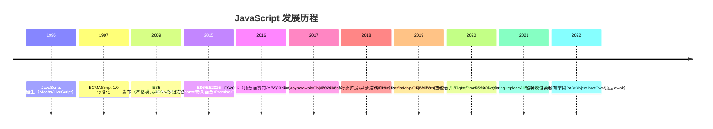
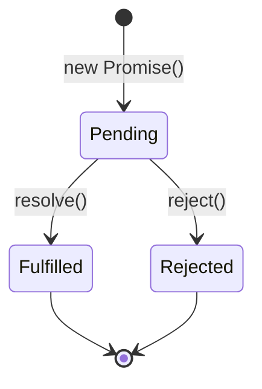

# 📘 JavaScript ES6+ 核心语法

> **文档说明**：系统讲解 JavaScript ES6（ES2015）及后续版本的核心语法特性，涵盖 ES6 概述（发展历程 / 浏览器支持 / Babel 转译 / 为什么学 ES6）、let 与 const（块级作用域 / 变量提升 / 暂时性死区 / const 不可变性 / 最佳实践 / 与 var 对比）、箭头函数（语法简写 / this 指向 / 不适用场景 / 与普通函数对比 / 箭头函数的常见坑）、解构赋值（数组解构 / 对象解构 / 默认值 / 嵌套解构 / 重命名 / 函数参数解构 / 交换变量 / 应用场景大全）、模板字符串（语法 / 多行字符串 / 变量插值 / 表达式计算 / 标签模板 / 应用场景）、扩展运算符与 rest 参数（数组展开 / 对象展开 / 函数调用展开 / rest 参数 / 与 arguments 对比 / 应用场景）、Promise 与异步编程（回调地狱 / Promise 语法 / 三种状态 / then/catch/finally / 链式调用 / Promise.all/race/allSettled/any / async-await / 错误处理 / 并发控制）、ES Module 模块化（import/export / 默认导出与命名导出 / 重命名导出 / 动态 import() / import.meta / 与 CommonJS 对比 / Tree Shaking 原理）、类与继承（class 语法 / constructor / 实例方法 / 静态方法 / getter/setter / 继承 extends / super 关键字 / 私有字段 / 与原型链对比）、Symbol 类型（基本用法 / 唯一性 / 常用内置 Symbol / Symbol.iterator / 应用场景）、迭代器与生成器（Iterator 协议 / for...of 循环 / Generator 函数 / yield 表达式 / yield* / 异步迭代 / 应用场景）、Map 与 Set（Map 数据结构 / WeakMap / Set / WeakSet / 与对象和数组对比 / 常用方法 / 应用场景）、Proxy 与 Reflect（Proxy 拦截器 / 13 种陷阱 / 响应式原理 / Reflect 对象 / 应用场景）、数组新方法（find/findIndex/includes/flat/flatMap/from/of/at / 数组方法链式调用最佳实践）、对象新特性（Object.assign/keys/values/entries/is / 对象扩展运算符 / 可选链 ?. / 空值合并 ?? / 简写语法）、字符串新方法（startsWith/endsWith/includes/repeat/padStart/padEnd/trimStart/trimEnd/raw）、数值扩展（Number.isFinite/isInteger/isNaN/parseInt/parseFloat/Math.trunc/sign/cbrt/hypot/指数运算符 **）、异步迭代（for await...of / 异步 Generator / 顶层 await）、最佳实践与常见坑汇总。
>
> **适用人群**：前端初学者、想系统掌握现代 JavaScript 的开发者、从 ES5 迁移到 ES6+ 的工程师
>
> **前置知识**：[[HTML5语义化与基础标签]] · JavaScript ES5 基础语法

---

## 一、ES6 概述

### 1.1 什么是 ES6

**ES6**（ECMAScript 2015）是 JavaScript 语言的一次重大更新，于 2015 年 6 月正式发布。此后每年发布一个新版本（ES2016/ES2017/...），统称为 **ES6+** 或 **现代 JavaScript**。



### 1.2 为什么学 ES6+

| 特性 | 解决的问题 |
|------|-----------|
| **let/const** | var 的函数作用域和变量提升导致的 bug |
| **箭头函数** | 函数 this 指向混乱、语法冗长 |
| **解构赋值** | 从对象/数组中提取数据需要写多行代码 |
| **模板字符串** | 字符串拼接和多行字符串不优雅 |
| **Promise/async** | 回调地狱（Callback Hell） |
| **模块化** | 没有原生模块系统，依赖第三方（CommonJS/AMD） |
| **Class** | 原型链继承写法复杂、不直观 |
| **Map/Set** | 用对象做 Map 有键类型限制和原型链污染 |
| **Proxy** | 无法拦截对象操作（Vue3 响应式的基础） |
| **扩展运算符** | 数组合并、对象复制需要复杂写法 |

### 1.3 浏览器支持与转译

- **现代浏览器**（Chrome/Firefox/Safari/Edge）：99% 支持 ES6+
- **旧浏览器**（IE11 及以下）：需要 **Babel** 转译为 ES5
- **构建工具**：Vite / Webpack / Rollup 内置 Babel 转译

```bash
# Babel 基本配置
npm install @babel/core @babel/preset-env --save-dev

# .babelrc
{
  "presets": [
    ["@babel/preset-env", {
      "targets": "> 0.25%, not dead",
      "useBuiltIns": "usage",
      "corejs": 3
    }]
  ]
}
```

---

## 二、let 与 const

### 2.1 块级作用域

ES6 新增 `let` 和 `const`，具有**块级作用域**（`{}` 内有效），解决了 `var` 函数作用域的问题。

```javascript
// var：函数作用域，变量提升
function varExample() {
  if (true) {
    var x = 1;
  }
  console.log(x); // 1 —— if 块外也能访问！
}

// let：块级作用域
function letExample() {
  if (true) {
    let y = 2;
  }
  console.log(y); // ReferenceError: y is not defined
}

// const：块级作用域 + 不可重新赋值
function constExample() {
  const z = 3;
  z = 4; // TypeError: Assignment to constant variable
}
```

### 2.2 暂时性死区（TDZ）

```javascript
console.log(a); // undefined —— var 变量提升，值为 undefined
console.log(b); // ReferenceError: Cannot access 'b' before initialization
let b = 2;

// 暂时性死区：从块开始到 let/const 声明之前，变量不可访问
{
  // TDZ 开始
  console.log(c); // ReferenceError
  let c = 3;      // TDZ 结束
  console.log(c); // 3
}
```

### 2.3 const 的不可变性

`const` 保证的是**变量绑定不可变**（不能重新赋值），但对象/数组的内容可以修改：

```javascript
const obj = { name: 'Alice' };
obj.name = 'Bob';      // ✅ 允许：修改对象属性
obj.age = 20;          // ✅ 允许：添加新属性
console.log(obj);      // { name: 'Bob', age: 20 }

obj = { name: 'Charlie' }; // ❌ 错误：不能重新赋值

const arr = [1, 2, 3];
arr.push(4);           // ✅ 允许：修改数组内容
arr[0] = 10;           // ✅ 允许
arr = [5, 6];          // ❌ 错误：不能重新赋值

// 真正的不可变：Object.freeze（浅冻结）
const frozen = Object.freeze({ name: 'Alice' });
frozen.name = 'Bob';   // 严格模式下报错，非严格模式静默失败
```

### 2.4 最佳实践

| 规则 | 说明 |
|------|------|
| **默认用 const** | 大多数变量不需要重新赋值，用 const 更安全 |
| **需要重新赋值用 let** | 如循环计数器、累加器 |
| **不要用 var** | var 有变量提升和函数作用域问题，容易出 bug |
| **const 声明时必须初始化** | `const x;` 会报错，必须 `const x = 1;` |
| **循环中用 let** | `for (let i = 0; i < 10; i++)` 每次迭代有独立的 i |

```javascript
// 经典闭包问题：var vs let
// var：所有回调共享同一个 i，最终都是 10
for (var i = 0; i < 3; i++) {
  setTimeout(() => console.log(i), 100); // 3, 3, 3
}

// let：每次迭代创建新的 i，闭包捕获各自的值
for (let i = 0; i < 3; i++) {
  setTimeout(() => console.log(i), 100); // 0, 1, 2
}
```

---

## 三、箭头函数

### 3.1 语法

```javascript
// 普通函数
const add = function(a, b) {
  return a + b;
};

// 箭头函数
const add = (a, b) => a + b;

// 语法变体
const singleParam = x => x * 2;           // 单参数可省略括号
const noParam = () => 42;                   // 无参数需要括号
const multiLine = (a, b) => {               // 多行需要花括号和 return
  const sum = a + b;
  return sum * 2;
};
const returnObject = () => ({ name: 'Alice' }); // 返回对象需要括号包裹
```

### 3.2 this 指向（核心区别）

箭头函数**没有自己的 this**，它的 this 继承自**定义时的外层作用域**（词法 this）：

```javascript
// 普通函数：this 取决于调用方式
const obj1 = {
  name: 'Alice',
  greet: function() {
    console.log(this.name); // this 指向 obj1
    setTimeout(function() {
      console.log(this.name); // undefined —— 普通函数的 this 指向全局/undefined
    }, 100);
  }
};

// 箭头函数：this 继承自外层
const obj2 = {
  name: 'Alice',
  greet: function() {
    console.log(this.name); // this 指向 obj2
    setTimeout(() => {
      console.log(this.name); // 'Alice' —— 箭头函数继承外层 this
    }, 100);
  }
};
```

### 3.3 不适用场景

| 场景 | 原因 | 正确做法 |
|------|------|---------|
| **对象方法** | 箭头函数的 this 不指向对象 | 用普通函数或方法简写 |
| **构造函数** | 箭头函数不能用 new 调用 | 用普通函数或 class |
| **需要 arguments** | 箭头函数没有 arguments | 用 rest 参数 `...args` |
| **事件监听器** | this 不指向触发元素 | 用普通函数或 `event.currentTarget` |
| **原型方法** | this 不指向实例 | 用普通函数 |

```javascript
// ❌ 错误：对象方法用箭头函数
const obj = {
  name: 'Alice',
  greet: () => console.log(this.name) // this 指向全局，不是 obj
};
obj.greet(); // undefined

// ✅ 正确：方法简写
const obj = {
  name: 'Alice',
  greet() { console.log(this.name); } // this 指向 obj
};

// ❌ 错误：构造函数用箭头函数
const Person = (name) => { this.name = name; };
new Person('Alice'); // TypeError: Person is not a constructor

// ✅ 正确：class
class Person {
  constructor(name) { this.name = name; }
}
```

### 3.4 箭头函数没有 arguments

```javascript
// 普通函数有 arguments
function sum() {
  return Array.from(arguments).reduce((a, b) => a + b, 0);
}

// 箭头函数没有 arguments，用 rest 参数替代
const sum = (...args) => args.reduce((a, b) => a + b, 0);
sum(1, 2, 3); // 6
```

---

## 四、解构赋值

### 4.1 数组解构

```javascript
// 基本用法
const [a, b, c] = [1, 2, 3];
console.log(a, b, c); // 1 2 3

// 跳过元素
const [, , third] = [1, 2, 3];
console.log(third); // 3

// 默认值
const [x = 10, y = 20] = [5];
console.log(x, y); // 5 20

// 交换变量（无需临时变量）
let a = 1, b = 2;
[a, b] = [b, a];
console.log(a, b); // 2 1

// rest 元素
const [first, ...rest] = [1, 2, 3, 4];
console.log(first); // 1
console.log(rest);  // [2, 3, 4]

// 嵌套解构
const [, [, second]] = [1, [2, 3]];
console.log(second); // 3
```

### 4.2 对象解构

```javascript
// 基本用法
const { name, age } = { name: 'Alice', age: 20 };
console.log(name, age); // Alice 20

// 重命名
const { name: userName, age: userAge } = { name: 'Alice', age: 20 };
console.log(userName, userAge); // Alice 20

// 默认值
const { name = 'Anonymous', role = 'user' } = { name: 'Alice' };
console.log(name, role); // Alice user

// 重命名 + 默认值
const { name: n = 'Anonymous' } = {};
console.log(n); // Anonymous

// 嵌套解构
const user = {
  name: 'Alice',
  address: { city: 'Beijing', zip: '100000' }
};
const { address: { city, zip } } = user;
console.log(city, zip); // Beijing 100000

// 动态属性名解构
const key = 'name';
const { [key]: value } = { name: 'Alice' };
console.log(value); // Alice
```

### 4.3 函数参数解构

```javascript
// 对象参数解构
function greet({ name, age = 18 }) {
  console.log(`Hello ${name}, you are ${age}`);
}
greet({ name: 'Alice' }); // Hello Alice, you are 18

// 数组参数解构
function sum([a, b]) {
  return a + b;
}
sum([1, 2]); // 3

// 嵌套 + 默认值
function config({
  host = 'localhost',
  port = 3000,
  database: { name = 'default', user = 'admin' } = {}
} = {}) {
  console.log(host, port, name, user);
}
config(); // localhost 3000 default admin
```

### 4.4 应用场景大全

| 场景 | 示例 |
|------|------|
| **交换变量** | `[a, b] = [b, a]` |
| **函数多返回值** | `const [err, data] = await fetchData();` |
| **函数参数默认值** | `function({ a = 1, b = 2 }) {}` |
| **从 API 响应提取数据** | `const { data: { list, total } } = response;` |
| **遍历对象数组** | `users.forEach(({ name, age }) => console.log(name, age));` |
| **导入模块指定成员** | `import { useState, useEffect } from 'vue';` |
| **配置对象** | `const { timeout = 5000, retries = 3 } = options;` |
| **正则匹配提取** | `const [, year, month, day] = /(\d{4})-(\d{2})-(\d{2})/.exec('2026-08-28');` |

---

## 五、模板字符串

### 5.1 基本用法

```javascript
// 多行字符串
const multiLine = `
  第一行
  第二行
  第三行
`;

// 变量插值
const name = 'Alice';
const age = 20;
const greeting = `Hello, my name is ${name} and I am ${age} years old.`;

// 表达式计算
const a = 5, b = 10;
console.log(`a + b = ${a + b}`); // a + b = 15
console.log(`a * b = ${a * b}`);  // a * b = 50

// 调用函数
function toUpper(str) { return str.toUpperCase(); }
const msg = `Hello, ${toUpper('world')}!`; // Hello, WORLD!

// 嵌套模板字符串
const items = ['apple', 'banana', 'orange'];
const html = `
  <ul>
    ${items.map(item => `<li>${item}</li>`).join('')}
  </ul>
`;
```

### 5.2 标签模板

标签模板是一种更高级的模板字符串用法，可以用函数处理模板字符串：

```javascript
// 标签函数
function highlight(strings, ...values) {
  // strings: 静态文本数组
  // values: 插值数组
  let result = '';
  strings.forEach((str, i) => {
    result += str;
    if (i < values.length) {
      result += `<mark>${values[i]}</mark>`;
    }
  });
  return result;
}

const name = 'Alice';
const age = 20;
const result = highlight`Name: ${name}, Age: ${age}`;
// Name: <mark>Alice</mark>, Age: <mark>20</mark>

// 常用标签函数：String.raw（不转义）
const path = String.raw`C:\Users\name\file.txt`;
// C:\Users\name\file.txt（不转义反斜杠）
```

---

## 六、扩展运算符与 rest 参数

### 6.1 扩展运算符（...）

```javascript
// 数组展开
const arr1 = [1, 2, 3];
const arr2 = [4, 5, 6];
const combined = [...arr1, ...arr2]; // [1, 2, 3, 4, 5, 6]

// 数组复制（浅拷贝）
const original = [1, 2, 3];
const copy = [...original]; // [1, 2, 3]，新数组

// 函数调用展开
const nums = [1, 2, 3];
Math.max(...nums); // 3 —— 等价于 Math.max(1, 2, 3)

// 对象展开（ES2018）
const defaults = { host: 'localhost', port: 3000 };
const config = { ...defaults, port: 8080 }; // { host: 'localhost', port: 8080 }

// 对象复制（浅拷贝）
const obj = { a: 1, b: 2 };
const copy = { ...obj }; // { a: 1, b: 2 }

// 合并对象（后面的覆盖前面的）
const merged = { ...{ a: 1 }, ...{ b: 2 }, ...{ a: 3 } }; // { a: 3, b: 2 }

// 字符串展开为数组
const chars = [...'hello']; // ['h', 'e', 'l', 'l', 'o']

// Set/Map 转数组
const set = new Set([1, 2, 3]);
const arr = [...set]; // [1, 2, 3]
```

### 6.2 rest 参数

```javascript
// 函数的剩余参数
function sum(...numbers) {
  return numbers.reduce((total, n) => total + n, 0);
}
sum(1, 2, 3);    // 6
sum(1, 2, 3, 4); // 10

// 与普通参数混合使用
function greet(greeting, ...names) {
  return `${greeting}, ${names.join(' and ')}!`;
}
greet('Hello', 'Alice', 'Bob'); // Hello, Alice and Bob!

// 解构中的 rest
const [first, ...others] = [1, 2, 3, 4];
console.log(first, others); // 1 [2, 3, 4]

const { a, ...rest } = { a: 1, b: 2, c: 3 };
console.log(a, rest); // 1 { b: 2, c: 3 }
```

### 6.3 rest 参数 vs arguments

| 特性 | rest 参数 | arguments |
|------|----------|-----------|
| **类型** | 真正的数组 | 类数组对象 |
| **数组方法** | 直接可用（map/filter/reduce） | 需 `Array.from(arguments)` |
| **箭头函数** | 支持 | 不支持 |
| **命名** | 有明确名称 | 固定名称 arguments |
| **推荐** | ✅ 推荐使用 | ❌ 避免使用 |

---

## 七、Promise 与异步编程

### 7.1 回调地狱

```javascript
// 回调地狱：嵌套层级深，难以维护
getData(function(a) {
  getMoreData(a, function(b) {
    getMoreData(b, function(c) {
      getMoreData(c, function(d) {
        console.log(d);
      });
    });
  });
});
```

### 7.2 Promise 基础

```javascript
// 创建 Promise
const promise = new Promise((resolve, reject) => {
  // 异步操作
  setTimeout(() => {
    const success = true;
    if (success) {
      resolve('操作成功'); // 成功
    } else {
      reject(new Error('操作失败')); // 失败
    }
  }, 1000);
});

// 使用 Promise
promise
  .then(result => console.log(result))    // 成功回调
  .catch(error => console.error(error))   // 失败回调
  .finally(() => console.log('完成'));     // 无论成功失败都执行
```

### 7.3 Promise 三种状态



| 状态 | 说明 | 可转换为 |
|------|------|---------|
| **Pending（进行中）** | 初始状态，异步操作未完成 | Fulfilled / Rejected |
| **Fulfilled（已成功）** | 操作成功完成 | ——（状态不可逆） |
| **Rejected（已失败）** | 操作失败 | ——（状态不可逆） |

### 7.4 链式调用

```javascript
// Promise 链式调用：解决回调地狱
fetch('/api/user')
  .then(response => response.json())
  .then(user => fetch(`/api/posts?userId=${user.id}`))
  .then(response => response.json())
  .then(posts => console.log(posts))
  .catch(error => console.error('出错了:', error));

// then 中返回 Promise 会自动等待
const result = Promise.resolve(1)
  .then(x => x + 1)        // 返回普通值，自动包装为 Promise
  .then(x => Promise.resolve(x + 1)) // 返回 Promise，等待完成
  .then(x => { throw new Error('出错'); }) // 抛出错误，进入 catch
  .catch(e => { console.log(e.message); return 0; }) // 捕获错误，恢复
  .then(x => console.log(x)); // 0
```

### 7.5 Promise 静态方法

```javascript
// Promise.all：全部成功才成功，一个失败就失败
Promise.all([
  fetch('/api/users'),
  fetch('/api/posts'),
  fetch('/api/comments')
]).then(([users, posts, comments]) => {
  console.log('全部完成');
}).catch(error => {
  console.log('至少一个失败:', error);
});

// Promise.race：第一个完成的决定结果（成功或失败）
Promise.race([
  fetch('/api/data'),
  new Promise((_, reject) => setTimeout(() => reject(new Error('超时')), 5000))
]).then(data => console.log('成功')).catch(err => console.log('失败或超时'));

// Promise.allSettled（ES2020）：等待全部完成，不管成功失败
Promise.allSettled([
  Promise.resolve('成功'),
  Promise.reject('失败')
]).then(results => {
  results.forEach(r => console.log(r.status, r.value || r.reason));
  // "fulfilled" "成功"
  // "rejected" "失败"
});

// Promise.any（ES2021）：第一个成功就成功，全部失败才失败
Promise.any([
  Promise.reject('失败1'),
  Promise.resolve('成功2'),
  Promise.resolve('成功3')
]).then(result => console.log(result)); // 成功2

// Promise.resolve / Promise.reject：快速创建
Promise.resolve(42);        // 立即成功的 Promise
Promise.reject(new Error()); // 立即失败的 Promise
```

### 7.6 async/await

```javascript
// async 函数返回 Promise
async function fetchData() {
  try {
    // await 等待 Promise 完成
    const response = await fetch('/api/user');
    const user = await response.json();
    const posts = await fetch(`/api/posts?userId=${user.id}`).then(r => r.json());
    return posts;
  } catch (error) {
    console.error('出错了:', error);
    throw error; // 重新抛出，让调用者处理
  }
}

// 并发执行（比串行快）
async function fetchAll() {
  // 错误：串行执行，总时间 = t1 + t2 + t3
  // const a = await fetchA();
  // const b = await fetchB();
  // const c = await fetchC();

  // 正确：并行执行，总时间 = max(t1, t2, t3)
  const [a, b, c] = await Promise.all([
    fetchA(),
    fetchB(),
    fetchC()
  ]);
  return { a, b, c };
}

// 顶层 await（ES2022，模块顶层可用）
const config = await fetch('/api/config').then(r => r.json());
console.log(config);
```

### 7.7 异步错误处理最佳实践

```javascript
// 1. try/catch 包裹
async function safeFetch() {
  try {
    return await fetchData();
  } catch (error) {
    console.error('获取数据失败:', error);
    return null; // 返回默认值，避免崩溃
  }
}

// 2. 并行时分别处理错误
async function fetchWithFallback() {
  const [data, error] = await fetchData()
    .then(data => [data, null])
    .catch(error => [null, error]);
  
  if (error) {
    console.log('使用缓存数据');
    return getCachedData();
  }
  return data;
}

// 3. Promise.all 中单个失败不影响其他
async function fetchAllSettled() {
  const results = await Promise.allSettled([fetchA(), fetchB(), fetchC()]);
  const successful = results
    .filter(r => r.status === 'fulfilled')
    .map(r => r.value);
  return successful;
}
```

---

## 八、ES Module 模块化

### 8.1 export 导出

```javascript
// 命名导出
export const name = 'Alice';
export function greet() { return 'Hello'; }
export class Person { constructor(name) { this.name = name; } }

// 统一导出
const name = 'Alice';
function greet() { return 'Hello'; }
export { name, greet };

// 重命名导出
export { name as userName, greet as sayHello };

// 默认导出（一个模块只能有一个）
export default function() { return '默认导出'; }
export default class { /* ... */ }
export default { name: 'Alice', age: 20 };

// 混合导出
export const version = '1.0';          // 命名导出
export default function main() {}      // 默认导出
```

### 8.2 import 导入

```javascript
// 命名导入
import { name, greet } from './module.js';

// 重命名导入
import { name as userName } from './module.js';

// 默认导入
import main from './module.js';

// 混合导入
import main, { version } from './module.js';

// 命名空间导入（全部导入为一个对象）
import * as utils from './module.js';
console.log(utils.name);
console.log(utils.greet());

// 仅导入副作用（不导入任何值）
import './module.js';

// 动态导入（ES2020），返回 Promise
async function loadModule() {
  const module = await import('./module.js');
  console.log(module.name);
}

// 按需加载（路由懒加载）
const routes = [
  {
    path: '/admin',
    component: () => import('./Admin.vue') // 访问时才加载
  }
];
```

### 8.3 ES Module vs CommonJS

| 特性 | ES Module (ESM) | CommonJS (CJS) |
|------|-----------------|----------------|
| **语法** | `import/export` | `require/module.exports` |
| **加载方式** | 静态加载（编译时确定） | 动态加载（运行时执行） |
| **Tree Shaking** | ✅ 支持（静态分析可移除未使用代码） | ❌ 不支持 |
| **异步加载** | ✅ `import()` 动态导入 | ❌ 同步 require |
| **this 指向** | 顶层 this 为 undefined | 顶层 this 为 module.exports |
| **浏览器原生** | ✅ `<script type="module">` | ❌ 需打包工具 |
| **Node.js** | ✅ .mjs 或 package.json type:module | ✅ .cjs 或默认 |

### 8.4 Tree Shaking 原理

Tree Shaking 依赖 ESM 的静态结构，在编译时分析哪些导出被使用，移除未使用的代码：

```javascript
// utils.js
export function used() { return 'used'; }
export function unused() { return 'unused'; } // 未被使用，会被移除

// main.js
import { used } from './utils.js'; // 只导入 used
console.log(used());

// 打包后：unused 函数被移除（Tree Shaking）
```

> **Tree Shaking 生效条件**：使用 ESM 语法（import/export）、不要有副作用、生产模式构建（Vite/Webpack 生产模式自动开启）。

---

## 九、类与继承

### 9.1 class 基础

```javascript
// 类定义
class Person {
  // 构造函数
  constructor(name, age) {
    this.name = name;
    this.age = age;
  }

  // 实例方法
  greet() {
    return `Hello, I'm ${this.name}, ${this.age} years old.`;
  }

  // getter
  get isAdult() {
    return this.age >= 18;
  }

  // setter
  set age(value) {
    if (value < 0) throw new Error('年龄不能为负');
    this._age = value;
  }

  // 静态方法（通过类调用，不通过实例）
  static create(name, age) {
    return new Person(name, age);
  }

  // 静态属性
  static species = 'Homo sapiens';
}

// 使用
const alice = new Person('Alice', 20);
console.log(alice.greet());    // Hello, I'm Alice, 20 years old.
console.log(alice.isAdult);     // true
const bob = Person.create('Bob', 25); // 静态方法
console.log(Person.species);    // Homo sapiens
```

### 9.2 继承

```javascript
// 子类继承父类
class Student extends Person {
  constructor(name, age, grade) {
    super(name, age); // 调用父类构造函数（必须在使用 this 之前）
    this.grade = grade;
  }

  // 重写父类方法
  greet() {
    return `${super.greet()} I'm in grade ${this.grade}.`;
  }

  // 子类新方法
  study() {
    return `${this.name} is studying.`;
  }
}

const student = new Student('Charlie', 15, 9);
console.log(student.greet()); // Hello, I'm Charlie, 15 years old. I'm in grade 9.
console.log(student.study()); // Charlie is studying.
console.log(student instanceof Student); // true
console.log(student instanceof Person);  // true（继承关系）
```

### 9.3 私有字段（ES2022）

```javascript
class Counter {
  // 私有字段（# 开头，外部不可访问）
  #count = 0;

  increment() {
    this.#count++;
    return this.#count;
  }

  get count() {
    return this.#count;
  }

  // 私有方法
  #validate(value) {
    return value >= 0;
  }
}

const counter = new Counter();
counter.increment(); // 1
console.log(counter.count); // 1
console.log(counter.#count); // SyntaxError: Private field '#count' must be declared
```

### 9.4 class 与原型链对比

```javascript
// ES5 原型链写法
function Person(name) {
  this.name = name;
}
Person.prototype.greet = function() {
  return 'Hello, ' + this.name;
};

// ES6 class 写法（语法糖，底层仍是原型链）
class Person {
  constructor(name) {
    this.name = name;
  }
  greet() {
    return `Hello, ${this.name}`;
  }
}

// 两者本质相同，class 更直观、更易维护
```

---

## 十、Symbol 类型

### 10.1 基本用法

```javascript
// 创建 Symbol（每次创建都是唯一的）
const sym1 = Symbol();
const sym2 = Symbol('description'); // 可选描述（仅用于调试）
const sym3 = Symbol('description');

console.log(sym2 === sym3); // false —— 即使描述相同，Symbol 也不相等
console.log(sym2.toString()); // "Symbol(description)"

// Symbol 作为对象属性名（不会被遍历到）
const obj = {
  [Symbol('id')]: 123,
  name: 'Alice'
};
console.log(Object.keys(obj)); // ['name'] —— Symbol 属性不出现在 keys 中
console.log(Object.getOwnPropertySymbols(obj)); // [Symbol(id)] —— 专门获取 Symbol 属性
```

### 10.2 常用内置 Symbol

| Symbol | 作用 |
|--------|------|
| `Symbol.iterator` | 定义对象的默认迭代器（for...of 可用） |
| `Symbol.asyncIterator` | 定义异步迭代器（for await...of） |
| `Symbol.toPrimitive` | 对象转原始值时调用 |
| `Symbol.toStringTag` | 自定义 Object.prototype.toString 返回的标签 |
| `Symbol.hasInstance` | 自定义 instanceof 行为 |
| `Symbol.species` | 自定义派生对象的构造函数 |
| `Symbol.replace/search/split/match` | 自定义字符串方法行为 |

```javascript
// Symbol.iterator：让对象可迭代
const range = {
  start: 1,
  end: 5,
  [Symbol.iterator]() {
    let current = this.start;
    return {
      next: () => ({
        value: current,
        done: current++ > this.end
      })
    };
  }
};
for (const num of range) {
  console.log(num); // 1, 2, 3, 4, 5
}

// Symbol.toPrimitive：自定义对象转原始值
const obj = {
  value: 42,
  [Symbol.toPrimitive](hint) {
    if (hint === 'number') return this.value;
    if (hint === 'string') return `Value: ${this.value}`;
    return this.value;
  }
};
console.log(+obj);      // 42
console.log(`${obj}`);  // "Value: 42"
```

---

## 十一、迭代器与生成器

### 11.1 Iterator 协议

```javascript
// 迭代器：有 next() 方法，返回 { value, done }
const iterator = {
  count: 0,
  next() {
    if (this.count < 3) {
      return { value: this.count++, done: false };
    }
    return { value: undefined, done: true };
  }
};

console.log(iterator.next()); // { value: 0, done: false }
console.log(iterator.next()); // { value: 1, done: false }
console.log(iterator.next()); // { value: 2, done: false }
console.log(iterator.next()); // { value: undefined, done: true }

// 可迭代对象：有 [Symbol.iterator] 方法，返回迭代器
const iterable = {
  items: [1, 2, 3],
  [Symbol.iterator]() {
    let index = 0;
    return {
      next: () => {
        if (index < this.items.length) {
          return { value: this.items[index++], done: false };
        }
        return { value: undefined, done: true };
      }
    };
  }
};

// for...of 自动调用迭代器
for (const item of iterable) {
  console.log(item); // 1, 2, 3
}
```

### 11.2 Generator 函数

Generator 函数是创建迭代器的简洁方式，用 `function*` 和 `yield`：

```javascript
// 定义 Generator 函数
function* countGenerator() {
  yield 1;
  yield 2;
  yield 3;
}

// 使用
const gen = countGenerator();
console.log(gen.next()); // { value: 1, done: false }
console.log(gen.next()); // { value: 2, done: false }
console.log(gen.next()); // { value: 3, done: false }
console.log(gen.next()); // { value: undefined, done: true }

// 用 for...of 遍历 Generator
for (const num of countGenerator()) {
  console.log(num); // 1, 2, 3
}

// yield 可以接收外部传入的值
function* echoGenerator() {
  const input = yield '请输入'; // 第一次 next() 启动，返回 '请输入'
  yield `你输入了: ${input}`;   // 第二次 next(value)，value 赋值给 input
}

const echo = echoGenerator();
console.log(echo.next());      // { value: '请输入', done: false }
console.log(echo.next('Hello')); // { value: '你输入了: Hello', done: false }

// yield* 委托给另一个 Generator
function* inner() {
  yield 'a';
  yield 'b';
}
function* outer() {
  yield 'start';
  yield* inner(); // 委托给 inner
  yield 'end';
}
for (const x of outer()) console.log(x); // start, a, b, end
```

### 11.3 异步迭代（ES2018）

```javascript
// 异步 Generator
async function* asyncGenerator() {
  yield await fetchData(1);
  yield await fetchData(2);
  yield await fetchData(3);
}

// for await...of 遍历异步迭代器
async function process() {
  for await (const data of asyncGenerator()) {
    console.log(data);
  }
}
```

---

## 十二、Map 与 Set

### 12.1 Map

```javascript
// 创建 Map
const map = new Map();

// 基本操作
map.set('name', 'Alice');     // 设置键值
map.set(1, 'number key');      // 键可以是任意类型（对象、函数等）
map.set({ id: 1 }, 'object key');

map.get('name');               // 'Alice' —— 获取值
map.has('name');               // true —— 是否存在
map.delete('name');            // 删除键值
map.size;                      // 大小
map.clear();                   // 清空

// 遍历
for (const [key, value] of map) {
  console.log(key, value);
}
map.forEach((value, key) => console.log(key, value));
map.keys();    // 键迭代器
map.values();  // 值迭代器
map.entries(); // 键值对迭代器

// 从数组创建
const mapFromArray = new Map([
  ['a', 1],
  ['b', 2],
  ['c', 3]
]);

// Map 转数组
const arrayFromMap = [...map]; // [[key, value], ...]
```

### 12.2 Map vs Object

| 特性 | Map | Object |
|------|-----|--------|
| **键类型** | 任意类型（字符串、数字、对象、Symbol） | 只能是字符串或 Symbol |
| **顺序** | 保持插入顺序 | 不保证顺序（现代浏览器基本有序，但不保证） |
| **大小** | `map.size` 直接获取 | 需 `Object.keys(obj).length` |
| **遍历** | 原生可迭代（for...of） | 需 `for...in` 或 `Object.keys` |
| **性能** | 频繁增删时性能更好 | 少量数据时性能好 |
| **原型污染** | 无风险 | 有原型链污染风险 |
| **JSON 序列化** | 不支持（需手动转换） | 原生支持 |

### 12.3 Set

```javascript
// 创建 Set
const set = new Set([1, 2, 3, 3, 3]); // 自动去重
console.log(set); // Set { 1, 2, 3 }

// 基本操作
set.add(4);        // 添加
set.has(1);        // true —— 是否存在
set.delete(1);     // 删除
set.size;          // 大小
set.clear();       // 清空

// 遍历
for (const value of set) console.log(value);
set.forEach(value => console.log(value));
set.keys();    // 键迭代器（与 values 相同）
set.values();  // 值迭代器
set.entries(); // [value, value] 迭代器

// 应用：数组去重
const unique = [...new Set([1, 2, 2, 3, 3, 3])]; // [1, 2, 3]

// 集合运算
const a = new Set([1, 2, 3]);
const b = new Set([2, 3, 4]);

// 并集
const union = new Set([...a, ...b]); // {1, 2, 3, 4}

// 交集
const intersection = new Set([...a].filter(x => b.has(x))); // {2, 3}

// 差集
const difference = new Set([...a].filter(x => !b.has(x))); // {1}
```

### 12.4 WeakMap 与 WeakSet

```javascript
// WeakMap：键必须是对象，弱引用（不阻止垃圾回收）
const weakMap = new WeakMap();
const obj = { id: 1 };
weakMap.set(obj, 'value');
weakMap.get(obj); // 'value'

// 应用：私有变量、DOM 元素关联数据
const _private = new WeakMap();
class Counter {
  constructor() {
    _private.set(this, { count: 0 });
  }
  increment() {
    const data = _private.get(this);
    data.count++;
    return data.count;
  }
}

// WeakSet：值必须是对象，弱引用
const weakSet = new WeakSet();
const obj1 = { id: 1 };
weakSet.add(obj1);
weakSet.has(obj1); // true

// 应用：检测对象是否被处理过、DOM 节点集合
const processed = new WeakSet();
function process(node) {
  if (processed.has(node)) return;
  processed.add(node);
  // 处理逻辑
}
```

| 特性 | Map/Set | WeakMap/WeakSet |
|------|---------|-----------------|
| **键/值类型** | 任意类型 | 必须是对象 |
| **引用** | 强引用（阻止 GC） | 弱引用（不阻止 GC） |
| **遍历** | 支持 | 不支持（不可枚举） |
| **size** | 有 size 属性 | 没有 size |
| **用途** | 通用数据存储 | 私有变量、临时关联、内存敏感场景 |

---

## 十三、Proxy 与 Reflect

### 13.1 Proxy 基础

Proxy 可以拦截对象的 13 种操作，是 Vue3 响应式系统的基础：

```javascript
// 创建 Proxy
const target = { name: 'Alice', age: 20 };
const handler = {
  // 拦截读取
  get(obj, prop) {
    console.log(`读取 ${prop}`);
    return obj[prop];
  },
  // 拦截设置
  set(obj, prop, value) {
    console.log(`设置 ${prop} = ${value}`);
    obj[prop] = value;
    return true; // 必须返回 true 表示成功
  },
  // 拦截删除
  deleteProperty(obj, prop) {
    console.log(`删除 ${prop}`);
    delete obj[prop];
    return true;
  },
  // 拦截 in 操作符
  has(obj, prop) {
    console.log(`检查 ${prop} in obj`);
    return prop in obj;
  }
};

const proxy = new Proxy(target, handler);
console.log(proxy.name); // 读取 name → Alice
proxy.age = 21;          // 设置 age = 21
console.log('name' in proxy); // 检查 name in obj → true
```

### 13.2 13 种拦截器（陷阱）

| 拦截器 | 触发操作 |
|--------|---------|
| `get` | 读取属性 `proxy.prop` |
| `set` | 设置属性 `proxy.prop = value` |
| `has` | `prop in proxy` |
| `deleteProperty` | `delete proxy.prop` |
| `apply` | 函数调用 `proxy(...args)` |
| `construct` | `new proxy(...args)` |
| `getPrototypeOf` | `Object.getPrototypeOf(proxy)` |
| `setPrototypeOf` | `Object.setPrototypeOf(proxy, proto)` |
| `isExtensible` | `Object.isExtensible(proxy)` |
| `preventExtensions` | `Object.preventExtensions(proxy)` |
| `getOwnPropertyDescriptor` | `Object.getOwnPropertyDescriptor(proxy, prop)` |
| `defineProperty` | `Object.defineProperty(proxy, prop, desc)` |
| `ownKeys` | `Object.keys(proxy)` / `for...in` |

### 13.3 应用：响应式系统（Vue3 原理简化版）

```javascript
// 简化版响应式系统
const reactiveMap = new WeakMap(); // 存储对象的依赖

function reactive(target) {
  return new Proxy(target, {
    get(obj, prop) {
      track(obj, prop); // 收集依赖
      return obj[prop];
    },
    set(obj, prop, value) {
      obj[prop] = value;
      trigger(obj, prop); // 触发更新
      return true;
    }
  });
}

let activeEffect = null;

function track(obj, prop) {
  if (!activeEffect) return;
  if (!reactiveMap.has(obj)) reactiveMap.set(obj, new Map());
  const propMap = reactiveMap.get(obj);
  if (!propMap.has(prop)) propMap.set(prop, new Set());
  propMap.get(prop).add(activeEffect);
}

function trigger(obj, prop) {
  const propMap = reactiveMap.get(obj);
  if (!propMap) return;
  const effects = propMap.get(prop);
  if (effects) effects.forEach(effect => effect());
}

function effect(fn) {
  activeEffect = fn;
  fn(); // 首次执行，触发 get 收集依赖
  activeEffect = null;
}

// 使用
const state = reactive({ count: 0 });
effect(() => {
  console.log('count changed:', state.count);
});
state.count++; // 触发 effect，输出 "count changed: 1"
```

### 13.4 Reflect

Reflect 是一个内置对象，提供与 Proxy 拦截器对应的方法，是操作对象的标准方式：

```javascript
const obj = { name: 'Alice' };

// Reflect 方法与 Proxy 拦截器一一对应
Reflect.get(obj, 'name');           // 'Alice' —— 等价于 obj.name
Reflect.set(obj, 'age', 20);        // true —— 等价于 obj.age = 20
Reflect.has(obj, 'name');           // true —— 等价于 'name' in obj
Reflect.deleteProperty(obj, 'age'); // true —— 等价于 delete obj.age
Reflect.ownKeys(obj);               // ['name'] —— 等价于 Object.keys
Reflect.getPrototypeOf(obj);         // 等价于 Object.getPrototypeOf
Reflect.defineProperty(obj, 'x', { value: 1 }); // 等价于 Object.defineProperty

// 在 Proxy 中使用 Reflect（推荐做法）
const proxy = new Proxy(target, {
  get(obj, prop, receiver) {
    return Reflect.get(obj, prop, receiver); // 用 Reflect 保持默认行为
  },
  set(obj, prop, value, receiver) {
    return Reflect.set(obj, prop, value, receiver);
  }
});
```

---

## 十四、数组新方法

### 14.1 查找与判断

```javascript
const arr = [1, 2, 3, 4, 5];

// find：返回第一个满足条件的元素
arr.find(x => x > 3); // 4

// findIndex：返回第一个满足条件的索引
arr.findIndex(x => x > 3); // 3

// findLast / findLastIndex（ES2023）：从后往前找
arr.findLast(x => x > 3); // 5
arr.findLastIndex(x => x > 3); // 4

// includes：是否包含（比 indexOf 更直观，支持 NaN）
arr.includes(3);    // true
arr.includes(10);   // false
[NaN].includes(NaN); // true —— indexOf 无法判断 NaN

// at（ES2022）：支持负索引
arr.at(0);  // 1 —— 第一个
arr.at(-1); // 5 —— 最后一个（比 arr[arr.length - 1] 简洁）
arr.at(-2); // 4 —— 倒数第二个
```

### 14.2 扁平化

```javascript
// flat：扁平化数组
const nested = [1, [2, 3], [4, [5, 6]]];
nested.flat();      // [1, 2, 3, 4, [5, 6]] —— 默认扁平化1层
nested.flat(2);     // [1, 2, 3, 4, 5, 6] —— 扁平化2层
nested.flat(Infinity); // [1, 2, 3, 4, 5, 6] —— 完全扁平化

// flatMap：map + flat（更高效）
const sentences = ['Hello World', 'Goodbye World'];
sentences.flatMap(s => s.split(' ')); // ['Hello', 'World', 'Goodbye', 'World']
// 等价于 sentences.map(s => s.split(' ')).flat()
```

### 14.3 创建与转换

```javascript
// Array.from：从类数组/可迭代对象创建数组
Array.from('hello');           // ['h', 'e', 'l', 'l', 'o']
Array.from(new Set([1, 2, 2])); // [1, 2]
Array.from({ length: 5 }, (_, i) => i * 2); // [0, 2, 4, 6, 8] —— 带映射函数

// Array.of：创建数组（解决 new Array(3) 的歧义）
Array.of(3);   // [3] —— 单个参数也是元素
new Array(3);  // [empty × 3] —— 单个参数是长度

// Array.isArray：判断是否为数组
Array.isArray([]);    // true
Array.isArray({});    // false
Array.isArray('array'); // false
```

### 14.4 数组方法链式调用最佳实践

```javascript
// 链式调用：filter → map → reduce
const result = [1, 2, 3, 4, 5]
  .filter(x => x % 2 === 0)  // [2, 4] —— 过滤偶数
  .map(x => x * 2)            // [4, 8] —— 翻倍
  .reduce((sum, x) => sum + x, 0); // 12 —— 求和

// 注意：sort/reverse/splice 会修改原数组，链式调用时注意
const sorted = [...arr].sort((a, b) => a - b); // 先复制再排序，不修改原数组
```

---

## 十五、对象新特性

### 15.1 Object 静态方法

```javascript
const obj = { a: 1, b: 2, c: 3 };

// Object.assign：合并对象（浅拷贝）
const merged = Object.assign({}, obj, { d: 4 }); // { a: 1, b: 2, c: 3, d: 4 }

// Object.keys / values / entries
Object.keys(obj);    // ['a', 'b', 'c']
Object.values(obj);  // [1, 2, 3]
Object.entries(obj); // [['a', 1], ['b', 2], ['c', 3]]

// Object.fromEntries（ES2019）：entries 转回对象
Object.fromEntries([['a', 1], ['b', 2]]); // { a: 1, b: 2 }

// Object.is：更精确的相等判断
Object.is(0, -0);        // false —— === 认为 true
Object.is(NaN, NaN);     // true —— === 认为 false
Object.is(null, null);   // true

// Object.hasOwn（ES2022）：判断自身属性（比 hasOwnProperty 更安全）
Object.hasOwn(obj, 'a'); // true
Object.hasOwn(obj, 'toString'); // false —— 继承的属性返回 false
```

### 15.2 对象简写语法

```javascript
const name = 'Alice';
const age = 20;

// 属性简写（变量名和属性名相同时）
const obj = {
  name,    // 等价于 name: name
  age,     // 等价于 age: age
  greet() { // 方法简写
    return `Hello, ${this.name}`;
  }
};

// 计算属性名
const key = 'dynamicKey';
const obj2 = {
  [key]: 'value',       // { dynamicKey: 'value' }
  [`${key}_2`]: 'value2' // { dynamicKey_2: 'value2' }
};
```

### 15.3 可选链（?.）

```javascript
// 可选链：安全地访问嵌套属性，不存在时返回 undefined 而不是报错
const user = { name: 'Alice', address: { city: 'Beijing' } };

// 传统写法（冗长）
const city = user && user.address && user.address.city;

// 可选链（简洁）
const city = user?.address?.city; // 'Beijing'
const zip = user?.address?.zip;   // undefined —— 不存在不报错
const street = user?.address?.street?.name; // undefined

// 可选函数调用
const handler = {
  onClick: () => console.log('clicked')
};
handler.onClick?.(); // 存在则调用
handler.onHover?.(); // 不存在，不调用也不报错

// 可选数组访问
const arr = [1, 2, 3];
arr?.[5]; // undefined —— 索引越界不报错
```

### 15.4 空值合并（??）

```javascript
// 空值合并：只有 null 或 undefined 时才取默认值
const value1 = null ?? 'default';   // 'default'
const value2 = undefined ?? 'default'; // 'default'
const value3 = 0 ?? 'default';      // 0 —— 0 不是 null/undefined，不取默认值
const value4 = '' ?? 'default';     // '' —— 空字符串不取默认值
const value5 = false ?? 'default';  // false —— false 不取默认值

// 与 || 的区别（|| 会把所有假值都替换）
const a = 0 || 'default';  // 'default' —— 0 是假值
const b = 0 ?? 'default';  // 0 —— 只有 null/undefined 才替换

// 可选链 + 空值合并（常用组合）
const city = user?.address?.city ?? 'Unknown';
```

### 15.5 逻辑赋值运算符（ES2021）

```javascript
let a = null;
let b = 0;
let c = '';

a ??= 'default'; // a = a ?? 'default' → 'default'
b ||= 10;        // b = b || 10 → 10
c &&= 'has value'; // c = c && 'has value' → ''（c 是假值，不赋值）
```

---

## 十六、字符串新方法

```javascript
const str = 'Hello, World!';

// startsWith / endsWith
str.startsWith('Hello');  // true
str.endsWith('!');        // true
str.startsWith('World', 7); // true —— 从索引7开始

// includes（比 indexOf 更直观）
str.includes('World');    // true
str.includes('world');    // false —— 区分大小写

// repeat：重复字符串
'abc'.repeat(3);          // 'abcabcabc'
'*'.repeat(10);           // '**********'

// padStart / padEnd：填充
'5'.padStart(3, '0');     // '005' —— 左侧填充到3位
'5'.padEnd(3, '0');       // '500' —— 右侧填充到3位
'123'.padStart(5, '*');   // '**123'

// trimStart / trimEnd（ES2019）
'  hello  '.trimStart();  // 'hello  ' —— 去左侧空格
'  hello  '.trimEnd();    // '  hello' —— 去右侧空格
'  hello  '.trim();       // 'hello' —— 去两侧

// replaceAll（ES2021）：替换所有匹配
'aabbcc'.replaceAll('b', '_'); // 'aa__cc' —— 替换所有 b
'aabbcc'.replace('b', '_');    // 'aa_bcc' —— 只替换第一个

// raw：标签模板，不转义
String.raw`C:\Users\name`; // 'C:\\Users\\name' —— 反斜杠不转义
```

---

## 十七、数值扩展

```javascript
// Number 静态方法
Number.isFinite(1);       // true
Number.isFinite(Infinity); // false
Number.isFinite('1');      // false —— 不强制转换（与全局 isFinite 不同）

Number.isInteger(1);       // true
Number.isInteger(1.5);     // false
Number.isInteger(Infinity); // false

Number.isNaN(NaN);         // true
Number.isNaN('NaN');       // false —— 不强制转换

Number.parseInt('123abc'); // 123 —— 从全局移到 Number
Number.parseFloat('3.14'); // 3.14

// Math 新方法
Math.trunc(3.7);           // 3 —— 去除小数部分（不四舍五入）
Math.trunc(-3.7);          // -3
Math.sign(3);              // 1 —— 正数
Math.sign(-3);             // -1 —— 负数
Math.sign(0);              // 0 —— 零
Math.cbrt(8);              // 2 —— 立方根
Math.hypot(3, 4);          // 5 —— 所有参数平方和的平方根（√(3²+4²)）

// 指数运算符（ES2016）
2 ** 3;                     // 8 —— 等价于 Math.pow(2, 3)
2 ** 10;                    // 1024
let base = 2;
base **= 3;                 // 8 —— 指数赋值

// BigInt（ES2020）：大整数
const big = 123456789012345678901234567890n; // n 后缀
typeof big;                 // 'bigint'
big + 1n;                   // 正常计算（不会精度丢失）
// big + 1;                 // TypeError —— BigInt 不能与 Number 混合运算
```

---

## 十八、最佳实践与常见坑

### 18.1 最佳实践

| 实践 | 说明 |
|------|------|
| **默认 const，需要时 let** | 大多数变量不需要重新赋值，const 更安全 |
| **使用箭头函数** | 回调函数优先用箭头函数，避免 this 混乱 |
| **使用解构赋值** | 从对象/数组提取数据时用解构，代码更简洁 |
| **使用模板字符串** | 字符串拼接用模板字符串，不用 `+` |
| **使用 async/await** | 异步代码用 async/await，比 Promise 链更易读 |
| **使用 ES Module** | 模块化用 import/export，支持 Tree Shaking |
| **使用 Map/Set** | 键值对用 Map，去重用 Set，比对象/数组更合适 |
| **使用可选链和空值合并** | 安全访问嵌套属性，不用冗长的 `&&` 链 |
| **使用扩展运算符** | 数组合并、对象复制用 `...`，不用 concat/Object.assign |
| **使用 for...of** | 遍历数组用 for...of，比 for 循环更简洁 |

### 18.2 常见坑

| 坑 | 说明 | 正确做法 |
|----|------|---------|
| **const 对象可修改** | const 只保证变量绑定不可变，对象内容可改 | 需要真正不可变用 Object.freeze 或 Immer |
| **箭头函数 this** | 箭头函数没有自己的 this，继承外层 | 对象方法、构造函数、事件监听不用箭头函数 |
| **箭头函数没有 arguments** | 箭头函数不能用 arguments | 用 rest 参数 `...args` 替代 |
| **解构默认值只对 undefined 生效** | `null` 不会触发默认值 | `const { a = 1 } = { a: null }` → a 是 null，不是 1 |
| **Promise.all 一个失败全失败** | 一个 reject 就全部 reject | 需要部分成功用 Promise.allSettled |
| **await 在循环中串行** | for 循环中 await 会串行执行 | 需要并执行用 Promise.all |
| **Map/Set 不能直接 JSON 序列化** | JSON.stringify(new Map()) 得到 `{}` | 先转数组 `[...map]` 再序列化 |
| **Proxy 不影响原对象** | 修改 proxy 会影响 target，但直接操作 target 不触发拦截 | 始终通过 proxy 操作对象 |
| **let 在 for 循环中每次创建新绑定** | `for (let i...)` 每次迭代有独立的 i | 这是正确行为，解决了 var 的闭包问题 |
| **扩展运算符是浅拷贝** | `{...obj}` 只复制一层，嵌套对象仍是引用 | 深拷贝用 structuredClone 或 lodash.cloneDeep |

---

## 十九、关联笔记

### 前端基础
- [[HTML5语义化与基础标签]] · [[CSS3核心特性与布局]] · [[JavaScript-ES6核心语法]]
- [[TypeScript-类型系统进阶]] · [[浏览器原理与性能优化]]

### Vue3 生态
- [[Vue3-组合式API]] · [[Vue3-组件通信与插槽]] · [[Pinia-状态管理核心]]
- [[Vue3-自定义Hooks封装_backup_skeleton]] · [[Vite构建工具原理]]

### 工程化
- [[前端工程化体系]] · [[Webpack原理与配置]] · [[Vite构建工具原理]]
- [[ESLint与代码规范]] · [[前端性能优化实战]]

### 导航
- [[MOC-前端基础]] · [[MOC-前端开发]] · [[Home]] · [[学习路线总览]]

> 🔍 **知识点深度解析**
>
> **作用**：ES6+ 核心语法解决的是「JavaScript 语言在长期发展中积累的设计缺陷和表达能力不足，通过现代化的语法特性让代码更简洁、更安全、更易维护」的核心问题——从 var 的作用域混乱到 let/const 的块级作用域，从回调地狱到 async/await，从原型链继承到 class，从字符串拼接到模板字符串，每一个特性都是为了解决实际开发中的痛点。
>
> **底层原理**：①let/const 的「块级作用域 + 暂时性死区」本质是「在编译阶段就确定变量的作用域，避免运行时的变量提升导致的意外行为」——var 的变量提升让变量可以在声明前使用（值为 undefined），这在复杂代码中容易导致难以排查的 bug。let/const 通过暂时性死区（TDZ）强制变量必须在声明后才能使用，在编译阶段就报错，而不是运行时返回 undefined。这是「编译时错误优于运行时错误」原则的体现——越早发现错误，修复成本越低。②箭头函数的「词法 this」本质是「this 不再由调用方式决定，而是由定义位置决定」——普通函数的 this 取决于调用方式（obj.method() 指向 obj，独立调用指向全局/undefined，call/apply 可以改变），这种动态绑定在回调函数中经常导致 this 丢失（如 setTimeout 中的 this 指向全局）。箭头函数没有自己的 this，它的 this 继承自定义时的外层作用域（词法作用域），这让回调函数中的 this 行为可预测。但箭头函数也因此不能用作构造函数、对象方法、事件监听器（这些场景需要动态 this）。③解构赋值的本质是「模式匹配」——左边的解构模式和右边的数据结构进行匹配，自动提取对应位置的值。数组解构按位置匹配（索引），对象解构按属性名匹配。解构赋值让「从复杂数据结构中提取多个值」从多行赋值变成一行声明，代码更简洁且意图更明确。解构赋值还支持默认值、嵌套解构、重命名，是处理 API 响应、函数参数、配置对象的利器。④Promise 的本质是「异步操作的状态机 + 回调的统一管理」——Promise 有三种状态（Pending/Fulfilled/Rejected），状态一旦改变就不可逆。then/catch/finally 是注册回调的方式，Promise 链通过 then 返回新的 Promise 实现串行异步操作，解决了回调地狱的嵌套问题。async/await 是 Promise 的语法糖，让异步代码看起来像同步代码（用 await 等待 Promise 完成，用 try/catch 处理错误），但底层仍是 Promise。async/await 的关键优势是「可读性」——异步逻辑的执行顺序和代码书写顺序一致，更容易理解和调试。⑤ES Module 的「静态加载」本质是「在编译阶段就能确定模块的依赖关系，而不是运行时才确定」——CommonJS 的 require 是运行时执行的，可以在条件语句中动态 require，可以用变量作为路径，这导致无法在编译时分析哪些导出被使用（无法 Tree Shaking）。ES Module 的 import/export 是静态的（只能在顶层、路径必须是字符串常量），这让打包工具可以在编译时分析依赖关系，移除未使用的代码（Tree Shaking），显著减小打包体积。静态加载还支持循环依赖的正确处理、模块的预加载等高级特性。⑥Proxy 的本质是「对象操作的拦截器」——Proxy 在目标对象前架设一层代理，所有对对象的操作（读取、设置、删除、枚举等 13 种）都先经过代理的拦截器处理。这是 Vue3 响应式系统的基础——通过拦截 get 收集依赖（哪些组件使用了这个属性），拦截 set 触发更新（属性变化时通知所有依赖它的组件更新）。Vue2 用 Object.defineProperty 只能拦截属性的读取和设置，且无法检测新增/删除属性；Vue3 用 Proxy 可以拦截所有 13 种操作，且可以检测新增/删除属性，响应式更完整。Proxy 还可以用于数据校验、日志记录、性能监控、API 模拟等场景。⑦Map/Set 的本质是「弥补对象和数组作为数据结构的不足」——对象的键只能是字符串或 Symbol，数字键会被转成字符串，且有原型链污染风险（obj.toString 可能被覆盖）；数组可以存储任意值但不保证唯一性，去重需要手动处理。Map 的键可以是任意类型（对象、函数、数字等），保持插入顺序，有 size 属性，原生可迭代，专门用于键值对存储；Set 自动去重，原生支持集合运算（并集/交集/差集），专门用于唯一值集合。WeakMap/WeakSet 的弱引用特性让它们适合存储与对象生命周期绑定的临时数据（如私有变量、DOM 关联数据），不会阻止垃圾回收，避免内存泄漏。
>
> **用法要点**：① 变量声明：默认const(不可重新赋值)，需要重新赋值用let，不用var；const声明必须初始化；const对象内容可修改(需真正不可变用Object.freeze) ② 箭头函数：语法简洁(a=>a*2)，this继承外层(词法this)，没有arguments(用...args)，不适用场景(对象方法/构造函数/事件监听/需要this动态绑定) ③ 解构赋值：数组解构按位置([a,b]=arr)，对象解构按属性({name}=obj)，支持默认值({a=1})、重命名({a:b})、嵌套、函数参数解构；应用场景(交换变量/多返回值/API响应提取/遍历) ④ 模板字符串：反引号``，多行字符串，变量插值${expr}，表达式计算，函数调用，标签模板(highlight`...`) ⑤ 扩展运算符...：数组展开([...arr1,...arr2])、对象展开({...obj,a:1})、函数调用(Math.max(...nums))、浅拷贝；rest参数(...args)用于函数剩余参数 ⑥ Promise：三种状态(Pending/Fulfilled/Rejected不可逆)，then/catch/finally，链式调用，静态方法(all全部成功/race第一个/allSettled全部完成不管结果/any第一个成功)，async/await语法糖(try/catch错误处理，并发用Promise.all) ⑦ ES Module：export命名导出/默认导出，import命名导入/默认导入/命名空间导入(* as)，动态import()按需加载，与CommonJS对比(静态加载支持Tree Shaking) ⑧ class：constructor构造函数，实例方法，静态方法(static)，getter/setter，继承extends+super，私有字段(#前缀ES2022)，是原型链的语法糖 ⑨ Symbol：唯一值(Symbol()每次不同)，作为对象属性名(不被遍历)，内置Symbol(Symbol.iterator可迭代/Symbol.toPrimitive转原始值) ⑩ 迭代器/生成器：Iterator协议(next返回{value,done})，for...of遍历可迭代对象，Generator函数(function*+yield)创建迭代器，yield接收外部值，yield*委托，异步迭代(for await...of) ⑪ Map/Set：Map键任意类型+保持顺序+size+可迭代，vs Object(键类型/顺序/遍历/性能)；Set自动去重+集合运算(并/交/差)；WeakMap/WeakSet弱引用(键必须对象+不阻止GC+不可遍历) ⑫ Proxy/Reflect：Proxy拦截13种操作(get/set/has/deleteProperty等)，Vue3响应式基础(收集依赖+触发更新)；Reflect对应方法(Reflect.get/set/has)，Proxy中推荐用Reflect保持默认行为 ⑬ 数组新方法：find/findIndex/findLast/includes/at(负索引)，flat/flatMap扁平化，Array.from/of创建，链式调用注意sort修改原数组(先[...arr]复制) ⑭ 对象新特性：Object.assign/keys/values/entries/fromEntries/is/hasOwn，简写语法(属性/方法/计算属性名)，可选链?.（安全访问嵌套），空值合并??（仅null/undefined取默认），逻辑赋值(??=/||=/&&=) ⑮ 字符串新方法：startsWith/endsWith/includes/repeat/padStart/padEnd/trimStart/trimEnd/replaceAll ⑯ 数值扩展：Number.isFinite/isInteger/isNaN/parseInt/parseFloat，Math.trunc/sign/cbrt/hypot，指数运算符**，BigInt大整数(n后缀) ⑰ 最佳实践：默认const/箭头函数回调/解构/模板字符串/async-await/ES Module/Map-Set/可选链+空值合并/扩展运算符/for...of ⑱ 常见坑：const对象可修改/箭头函数this/箭头函数无arguments/解构默认值仅undefined生效/Promise.all一败全败/await循环串行/Map-Set不能JSON序列化/Proxy不影响直接操作target/扩展运算符是浅拷贝。

> 💡 **深度讲解**：ES6+ 最核心的智慧是「每一个新语法特性都是为了解决实际开发中的具体痛点，理解痛点才能用好特性」——let/const 解决 var 的作用域混乱和变量提升，箭头函数解决 this 指向混乱和语法冗长，解构赋值解决从复杂结构提取数据的冗长，模板字符串解决字符串拼接和多行字符串的不优雅，Promise/async 解决回调地狱，Module 解决没有原生模块化，Class 解决原型链继承的不直观，Map/Set 解决对象和数组作为数据结构的不足，Proxy 解决无法拦截对象操作的限制。不要为了用新语法而用，要在它能解决问题的场景下用。理解「为什么有这个特性」比「这个特性怎么用」更重要——因为理解了原因，你就能在正确的场景下正确地使用，而不是盲目跟风。比如可选链 ?. 的出现是因为访问嵌套属性需要写冗长的 `a && a.b && a.b.c`，空值合并 ?? 的出现是因为 `||` 会把 0/''/false 这些有效值也替换掉。理解了这些原因，你就知道什么时候用 ?.（嵌套属性可能不存在时）、什么时候用 ??（需要保留 0/''/false 时）、什么时候用 ||（确实要把所有假值都替换时）。ES6+ 的学习路径应该是「先掌握核心特性，再了解高级特性」——核心特性是每天都要用的（let/const、箭头函数、解构、模板字符串、Promise/async、Module、扩展运算符），高级特性是特定场景才用的（Generator、Proxy、Reflect、Symbol、WeakMap/WeakSet）。不要一开始就深入所有特性，先把核心特性用熟，再根据需要学习高级特性。在现代前端开发中（Vue3/React），ES6+ 已经是基础——Vue3 的 Composition API 大量使用箭头函数、解构、ref/reactive（Proxy）、模块化；React Hooks 大量使用箭头函数、解构、数组方法。不掌握 ES6+，根本无法阅读和编写现代前端代码。如果你还在写 ES5 风格的代码（var、function、字符串拼接、回调嵌套、原型链继承），强烈建议尽快迁移到 ES6+——代码会更简洁、更安全、更易维护，而且这是现代前端开发的标配。

> 📝 **精简总结**：ES6+核心语法=现代JavaScript的标准特性集。变量：const默认/let需要/不用var，块级作用域+TDZ。函数：箭头函数(词法this/无arguments/简洁)，不适用对象方法/构造函数。解构：数组按位置/对象按属性，支持默认值/重命名/嵌套/参数解构。字符串：模板字符串(反引号/${}/多行)，新方法(startsWith/includes/repeat/padStart/replaceAll)。异步：Promise(三状态/then链/all/race/allSettled/any)+async/await(try-catch/并发Promise.all)。模块化：import/export(命名/默认/动态import)，静态加载支持Tree Shaking。类：class/constructor/extends/super/静态方法/私有字段#。数据结构：Map(任意键/顺序/size)、Set(去重/集合运算)、WeakMap/WeakSet(弱引用)。对象：可选链?.、空值合并??、Object.assign/entries/fromEntries/hasOwn。数组：find/includes/at(负索引)/flat/flatMap/from。Proxy：拦截13种操作，Vue3响应式基础。最佳实践：默认const/箭头函数回调/解构/模板字符串/async-await/ES Module/Map-Set/可选链+空值合并。常见坑：const对象可修改/箭头函数this/解构默认值仅undefined/Promise.all一败全败/await循环串行/Proxy不影响直接操作target/扩展运算符浅拷贝。

> **学习路径建议**：先学习 [[HTML5语义化与基础标签]] 和 CSS 基础 → 学习 JavaScript ES5 基础（变量、函数、对象、数组、原型链） → 学习本文档 ES6+ 核心语法（let/const、箭头函数、解构、模板字符串、Promise、Module） → 实践：用 ES6+ 重写一个 ES5 项目 → 学习 [[TypeScript-类型系统进阶]] → 学习 [[Vue3-组合式API]]（大量使用 ES6+ 特性） → 学习高级特性（Generator、Proxy、Reflect、Symbol） → 学习 [[Vite构建工具原理]] 理解模块化和 Tree Shaking → 形成完整的现代 JavaScript 能力。

---

> **ES6+ 最核心的智慧是「每一个新语法特性都是为了解决实际开发中的具体痛点，理解痛点才能用好特性」——let/const 解决 var 的作用域混乱和变量提升，箭头函数解决 this 指向混乱和语法冗长，解构赋值解决从复杂结构提取数据的冗长，模板字符串解决字符串拼接的不优雅，Promise/async 解决回调地狱，Module 解决没有原生模块化，Class 解决原型链继承的不直观，Map/Set 解决对象和数组作为数据结构的不足，Proxy 解决无法拦截对象操作的限制。不要为了用新语法而用，要在它能解决问题的场景下用。理解为什么有这个特性比这个特性怎么用更重要——比如可选链 ?. 是因为访问嵌套属性需要写冗长的 a && a.b && a.b.c，空值合并 ?? 是因为 || 会把 0/''/false 这些有效值也替换掉，理解了原因就知道什么时候用 ?.、什么时候用 ??、什么时候用 ||。ES6+ 的学习路径应该是先掌握核心特性再了解高级特性——核心特性是每天都要用的（let/const、箭头函数、解构、模板字符串、Promise/async、Module、扩展运算符），高级特性是特定场景才用的（Generator、Proxy、Reflect、Symbol、WeakMap/WeakSet），不要一开始就深入所有特性。在现代前端开发中（Vue3/React），ES6+ 已经是基础——Vue3 的 Composition API 大量使用箭头函数、解构、Proxy、模块化；React Hooks 大量使用箭头函数、解构、数组方法，不掌握 ES6+ 根本无法阅读和编写现代前端代码。如果你还在写 ES5 风格的代码（var、function、字符串拼接、回调嵌套、原型链继承），强烈建议尽快迁移到 ES6+——代码会更简洁、更安全、更易维护，而且这是现代前端开发的标配。从今天开始，把 var 改成 const/let，把 function 回调改成箭头函数，把字符串拼接改成模板字符串——你会发现代码质量立刻提升一个档次。**
