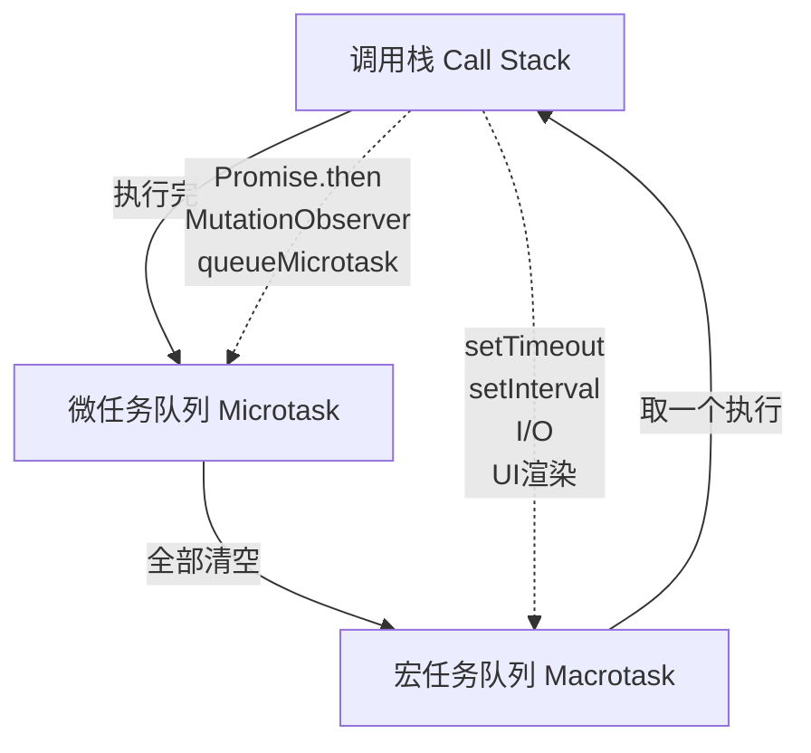

# JavaScript 核心语法与 ES6+

> **文档说明**：系统讲解 JavaScript 核心语法、ES6+ 新特性、异步编程、原型与继承、事件循环、模块化，以及前端开发中的最佳实践和常见坑点。
>
> **适用人群**：前端开发初学者、从其他语言转 JavaScript 的开发者、需要夯实 JS 基础的全栈工程师
>
> **前置知识**：[[HTML-CSS-JavaScript基础]]

---

## 一、概述

**JavaScript** 是 Web 的核心编程语言，从最初的浏览器脚本语言发展为全栈语言（Node.js）、移动端（React Native）、桌面端（Electron）、AI 应用（前端调用大模型）等多领域通用语言。ES6（ECMAScript 2015）是 JavaScript 发展史上的里程碑，引入了大量现代语法特性。

### 1. ECMAScript 版本演进

| 版本 | 年份 | 核心特性 |
|------|------|---------|
| ES5 | 2009 | 严格模式、JSON、数组方法（forEach/map/filter）、Object 方法 |
| **ES6 (ES2015)** | **2015** | **let/const、箭头函数、类、模块、Promise、解构、模板字符串、Symbol、Map/Set、迭代器、生成器、默认参数、展开运算符** |
| ES7 (ES2016) | 2016 | `Array.prototype.includes`、指数运算符 `**` |
| ES8 (ES2017) | 2017 | `async/await`、`Object.values/entries`、字符串填充 `padStart/padEnd` |
| ES9 (ES2018) | 2018 | 异步迭代、对象展开/rest、`Promise.finally`、正则命名捕获组 |
| ES10 (ES2019) | 2019 | `Array.flat/flatMap`、`Object.fromEntries`、`String.trimStart/trimEnd`、可选 `catch` 绑定 |
| ES11 (ES2020) | 2020 | 可选链 `?.`、空值合并 `??`、`BigInt`、`Promise.allSettled`、动态 `import()`、`globalThis` |
| ES12 (ES2021) | 2021 | 逻辑赋值 `&&=/||=/??=`、`String.replaceAll`、`WeakRef`、数字分隔符 `1_000` |
| ES13 (ES2022) | 2022 | 类字段（公有/私有）、顶层 `await`、`Array.at()`、`Object.hasOwn()`、正则 `/d` 标志 |
| ES14 (ES2023) | 2023 | 数组不可变方法（`toSorted/toReversed/toSpliced/with`）、`Hashbang` 语法 |
| ES15 (ES2024) | 2024 | `Promise.withResolvers`、`Object.groupBy`、正则 `/v` 标志、`ArrayBuffer.resize` |

### 2. JavaScript 的核心特点

| 特点 | 说明 |
|------|------|
| **动态类型** | 变量类型运行时确定，无需声明类型（TypeScript 补充了静态类型） |
| **弱类型** | 隐式类型转换灵活但容易出错（`[] + {}` vs `{} + []`） |
| **单线程** | 主线程单线程，通过事件循环实现非阻塞异步 |
| **事件驱动** | 基于事件循环，回调/Promise/async-await 处理异步 |
| **原型继承** | 基于原型链的继承机制，ES6 class 是语法糖 |
| **函数一等公民** | 函数是对象，可赋值、传参、返回、闭包 |
| **跨平台** | 浏览器、Node.js、Deno、Bun 等多运行时 |

---

## 二、变量与数据类型

### 1. var / let / const

| 特性 | var | let | const |
|------|-----|-----|-------|
| 作用域 | 函数作用域 | 块级作用域 | 块级作用域 |
| 变量提升 | ✅ 提升并初始化为 undefined | ✅ 提升但不初始化（暂时性死区） | ✅ 提升但不初始化 |
| 重复声明 | ✅ 允许 | ❌ 不允许 | ❌ 不允许 |
| 重新赋值 | ✅ 允许 | ✅ 允许 | ❌ 不允许（但对象属性可改） |
| 全局挂载 | ✅ 挂载到 window | ❌ 不挂载 | ❌ 不挂载 |

```javascript
// var 的变量提升和函数作用域
function example() {
  console.log(x); // undefined（提升了但未赋值）
  var x = 1;
  if (true) {
    var y = 2; // 函数作用域，if 外也能访问
  }
  console.log(y); // 2
}

// let 的块级作用域和暂时性死区（TDZ）
function example2() {
  // console.log(x); // ReferenceError: Cannot access 'x' before initialization
  let x = 1;
  if (true) {
    let y = 2; // 块级作用域，if 外不可访问
  }
  // console.log(y); // ReferenceError: y is not defined
}

// const 的不可变引用
const arr = [1, 2, 3];
arr.push(4); // ✅ 允许：修改数组内容，不改变引用
// arr = [4, 5, 6]; // ❌ TypeError: Assignment to constant variable

const obj = { name: 'JS' };
obj.name = 'JavaScript'; // ✅ 允许修改属性
// obj = {}; // ❌ 不允许重新赋值

// 真正的不可变：Object.freeze（浅冻结）
const frozen = Object.freeze({ name: 'JS', nested: { a: 1 } });
frozen.name = 'new'; // ❌ 静默失败（严格模式报错）
frozen.nested.a = 2; // ✅ 嵌套对象仍可修改（浅冻结）
```

**最佳实践**：
- 默认使用 `const`，只有需要重新赋值时才用 `let`
- 永远不要用 `var`
- `const` 声明对象/数组时，注意是引用不可变，不是内容不可变

### 2. 数据类型

JavaScript 有 **8 种**数据类型（7 种原始类型 + 1 种引用类型）：

| 类型 | 说明 | 示例 |  typeof 返回 |
|------|------|------|-------------|
| **String** | 字符串 | `'hello'` | `"string"` |
| **Number** | 数字（整数和浮点数） | `42`, `3.14` | `"number"` |
| **Boolean** | 布尔值 | `true`, `false` | `"boolean"` |
| **Undefined** | 未定义 | `let x;`（未赋值） | `"undefined"` |
| **Null** | 空值 | `null` | `"object"`（历史 Bug） |
| **Symbol** | 唯一标识符 | `Symbol('id')` | `"symbol"` |
| **BigInt** | 大整数 | `123n` | `"bigint"` |
| **Object** | 对象（含 Array/Function/Date/RegExp 等） | `{}`, `[]`, `function(){}` | `"object"` / `"function"` |

### 3. 类型判断

```javascript
// typeof：适合原始类型（null 和 数组 不准确）
typeof 'hello'      // "string"
typeof 42           // "number"
typeof true         // "boolean"
typeof undefined    // "undefined"
typeof Symbol()     // "symbol"
typeof 123n         // "bigint"
typeof null         // "object"  ❌ 历史遗留 Bug
typeof []           // "object"  ❌ 数组也是对象
typeof function(){} // "function" ✅

// Array.isArray：判断数组
Array.isArray([])    // true ✅
Array.isArray({})    // false

// instanceof：判断引用类型（基于原型链）
[] instanceof Array           // true
{} instanceof Object          // true
new Date() instanceof Date    // true
// 注意：跨 iframe/窗口的数组 instanceof Array 可能为 false

// Object.prototype.toString.call：最准确的类型判断
Object.prototype.toString.call(null)       // "[object Null]" ✅
Object.prototype.toString.call([])         // "[object Array]" ✅
Object.prototype.toString.call(new Date()) // "[object Date]" ✅
Object.prototype.toString.call(/regex/)    // "[object RegExp]" ✅

// 封装通用类型判断函数
function getType(value) {
  return Object.prototype.toString.call(value).slice(8, -1).toLowerCase();
}
getType(null)    // "null"
getType([])      // "array"
getType(new Date()) // "date"
```

### 4. 类型转换

```javascript
// 隐式转换（容易出错的地方）
console.log([] + {});       // "[object Object]"（[] 转 ""，{} 转 "[object Object]"）
console.log({} + []);       // 0（{} 被当作代码块，+[] 转 0）
console.log([] + ![]);      // "false"（[] 转 ""，![] 转 false，"" + false = "false"）
console.log(true + false);  // 1（true→1, false→0）
console.log("5" - 1);       // 4（减号触发数字转换）
console.log("5" + 1);       // "51"（加号触发字符串拼接）

// 显式转换
Number("42")       // 42
Number("")          // 0
Number("abc")       // NaN
parseInt("42px")    // 42
parseFloat("3.14em")// 3.14
String(42)          // "42"
Boolean(0)          // false
Boolean("")         // false
Boolean(null)       // false
Boolean(undefined)  // false
Boolean(NaN)        // false
// 其他所有值都是 truthy（包括 "0", "false", [], {}）

// == vs ===
// == 允许类型转换后比较，=== 严格比较（类型和值都相同）
console.log(0 == false);    // true（0→false）
console.log(0 === false);   // false（类型不同）
console.log(null == undefined); // true（特殊规则）
console.log(null === undefined); // false
console.log(NaN == NaN);     // false（NaN 不等于任何值，包括自己）
console.log(Number.isNaN(NaN)); // true ✅ 正确判断 NaN

// 最佳实践：永远用 === 和 !==，不要用 == 和 !=
```

---

## 三、函数与作用域

### 1. 函数定义方式

```javascript
// 1. 函数声明（有提升，可在声明前调用）
function add(a, b) {
  return a + b;
}

// 2. 函数表达式（无提升，必须先赋值再调用）
const add = function(a, b) {
  return a + b;
};

// 3. 箭头函数（ES6，无自己的 this/arguments）
const add = (a, b) => a + b;

// 箭头函数的多种写法
const square = x => x * x;           // 单参数可省略括号
const add = (a, b) => a + b;         // 表达式体自动 return
const greet = name => {               // 块体需手动 return
  return `Hello, ${name}`;
};
const getObj = () => ({ name: 'JS' }); // 返回对象需加括号

// 4. 立即执行函数表达式（IIFE）
(function() {
  console.log('立即执行');
})();

// 5. 方法简写（ES6 对象中）
const obj = {
  name: 'JS',
  greet() {  // 等同于 greet: function() {}
    return `Hello, ${this.name}`;
  }
};

// 6. 生成器函数（ES6）
function* generator() {
  yield 1;
  yield 2;
  return 3;
}
const gen = generator();
gen.next(); // { value: 1, done: false }
gen.next(); // { value: 2, done: false }
gen.next(); // { value: 3, done: true }
```

### 2. 箭头函数 vs 普通函数

| 特性 | 普通函数 | 箭头函数 |
|------|---------|---------|
| this | 动态绑定（调用者决定） | 词法绑定（继承外层 this） |
| arguments | 有 arguments 对象 | 无（用 rest 参数代替） |
| 构造函数 | 可 new 调用 | 不可 new（无 prototype） |
| 原型 | 有 prototype | 无 prototype |
| 生成器 | 可作为生成器函数 | 不可用 yield |
| 名称 | 可具名/匿名 | 匿名（可通过变量名推断） |

```javascript
// this 绑定差异
const obj = {
  name: 'JS',
  normalFunc: function() {
    console.log(this.name); // this → obj（调用者）
  },
  arrowFunc: () => {
    console.log(this.name); // this → 外层（全局/模块），不是 obj
  },
  delayedGreet: function() {
    // 普通函数：setTimeout 回调中 this 指向全局
    setTimeout(function() {
      console.log(this.name); // undefined（this → window/global）
    }, 100);
    // 箭头函数：继承外层 this（obj）
    setTimeout(() => {
      console.log(this.name); // "JS"（this → obj）
    }, 100);
  }
};

obj.normalFunc();  // "JS"
obj.arrowFunc();   // undefined（this 不是 obj）
obj.delayedGreet(); // 先 undefined 后 "JS"
```

**箭头函数使用场景**：
- ✅ 回调函数（map/filter/forEach 等）
- ✅ setTimeout/setInterval 回调
- ✅ 事件处理中需要外层 this 时
- ❌ 对象方法（this 不指向对象）
- ❌ 构造函数（不能 new）
- ❌ 需要 arguments 对象时

### 3. 闭包（Closure）

**闭包**是指函数能够访问其词法作用域中的变量，即使函数在其词法作用域之外执行。

```javascript
// 闭包示例：计数器
function createCounter() {
  let count = 0;  // 闭包捕获的变量
  return {
    increment() { count++; return count; },
    decrement() { count--; return count; },
    getCount() { return count; }
  };
}

const counter = createCounter();
counter.increment(); // 1
counter.increment(); // 2
counter.getCount();  // 2
// count 变量无法直接访问，只能通过闭包方法操作

// 闭包常见应用：模块化/私有变量
const module = (function() {
  let privateVar = 'secret';  // 私有变量
  function privateFunc() {    // 私有函数
    return privateVar;
  }
  return {
    publicMethod() {
      return privateFunc();
    }
  };
})();
module.publicMethod(); // "secret"
// module.privateVar  // undefined（不可访问）

// 闭包经典坑：循环中 var 导致的问题
for (var i = 0; i < 3; i++) {
  setTimeout(() => console.log(i), 100);
}
// 输出：3, 3, 3（var 是函数作用域，所有回调共享同一个 i）

// 解决方案1：let（块级作用域，每次循环一个新的 i）
for (let i = 0; i < 3; i++) {
  setTimeout(() => console.log(i), 100);
}
// 输出：0, 1, 2

// 解决方案2：IIFE 捕获每次的 i
for (var i = 0; i < 3; i++) {
  (function(j) {
    setTimeout(() => console.log(j), 100);
  })(i);
}
// 输出：0, 1, 2
```

**闭包的内存管理**：闭包会持有外层变量的引用，导致变量无法被垃圾回收。不需要时应手动释放（将闭包函数设为 null）。

### 4. 作用域链

```javascript
// 作用域：全局作用域 → 函数作用域 → 块级作用域
const globalVar = 'global';

function outer() {
  const outerVar = 'outer';

  function inner() {
    const innerVar = 'inner';
    console.log(innerVar);  // "inner"（当前作用域）
    console.log(outerVar);  // "outer"（外层作用域）
    console.log(globalVar); // "global"（全局作用域）
    // 查找顺序：inner → outer → global（作用域链）
  }
  inner();
}
outer();
```

| 作用域类型 | 说明 | 关键字 |
|-----------|------|--------|
| 全局作用域 | 最外层，整个程序可访问 | - |
| 函数作用域 | function 内部 | `var` |
| 块级作用域 | `{}` 内部（if/for/while 等） | `let`/`const` |
| 模块作用域 | ES Module 内部 | `import`/`export` |
| 词法作用域 | 函数定义时确定的作用域（静态） | 闭包基础 |

---

## 四、ES6+ 核心特性

### 1. 解构赋值

```javascript
// 数组解构
const [a, b, c] = [1, 2, 3];
// a=1, b=2, c=3

const [first, , third] = [1, 2, 3]; // 跳过元素
// first=1, third=3

const [x, y, ...rest] = [1, 2, 3, 4, 5]; // rest 收集剩余
// x=1, y=2, rest=[3,4,5]

const [p = 10, q = 20] = [5]; // 默认值
// p=5, q=20

// 交换变量（无需临时变量）
let a = 1, b = 2;
[a, b] = [b, a];
// a=2, b=1

// 对象解构
const { name, age } = { name: 'JS', age: 28 };
// name='JS', age=28

const { name: userName, age: userAge } = { name: 'JS', age: 28 }; // 重命名
// userName='JS', userAge=28

const { name, gender = 'unknown' } = { name: 'JS' }; // 默认值
// name='JS', gender='unknown'

const { name, ...rest } = { name: 'JS', age: 28, city: 'BJ' }; // 对象 rest
// name='JS', rest={age:28, city:'BJ'}

// 嵌套解构
const user = {
  name: 'JS',
  address: { city: 'Beijing', zip: '100000' },
  scores: [90, 85, 95]
};
const {
  name,
  address: { city },
  scores: [, second]
} = user;
// name='JS', city='Beijing', second=85

// 函数参数解构
function printUser({ name, age = 18 }) {
  console.log(`${name}, ${age}`);
}
printUser({ name: 'JS' }); // "JS, 18"

// 数组参数解构
function sum([a, b]) {
  return a + b;
}
sum([1, 2]); // 3
```

### 2. 展开运算符（Spread）

```javascript
// 数组展开
const arr1 = [1, 2, 3];
const arr2 = [4, 5, 6];
const combined = [...arr1, ...arr2]; // [1,2,3,4,5,6]

// 数组复制（浅拷贝）
const copy = [...arr1]; // [1,2,3]，新数组

// 函数调用展开
const nums = [1, 2, 3];
Math.max(...nums); // 3（等同于 Math.max(1,2,3)）

// 对象展开（ES2018）
const defaults = { theme: 'light', lang: 'en' };
const userConfig = { theme: 'dark' };
const config = { ...defaults, ...userConfig };
// { theme:'dark', lang:'en' }（后面的覆盖前面的）

// 对象复制（浅拷贝）
const original = { a: 1, b: { c: 2 } };
const copy = { ...original };
copy.a = 10;     // 不影响 original
copy.b.c = 20;   // 影响 original（浅拷贝，嵌套对象共享引用）

// 字符串展开
[...'hello']; // ['h','e','l','l','o']

// Set/Map 转数组
[...new Set([1,2,2,3])]; // [1,2,3]（去重）
[...new Map([['a',1]])]; // [['a',1]]
```

### 3. 模板字符串

```javascript
// 基本用法
const name = 'JS';
const greeting = `Hello, ${name}!`; // "Hello, JS!"

// 多行字符串（保留换行和缩进）
const html = `
  <div>
    <h1>${title}</h1>
    <p>${content}</p>
  </div>
`;

// 表达式嵌入
const a = 5, b = 10;
console.log(`a + b = ${a + b}`);  // "a + b = 15"
console.log(`a * b = ${a * b}`);  // "a * b = 50"

// 调用函数
function toUpper(str) { return str.toUpperCase(); }
const msg = `Hello, ${toUpper('world')}!`; // "Hello, WORLD!"

// 嵌套模板
const items = [1, 2, 3];
const list = `
  <ul>
    ${items.map(item => `<li>${item}</li>`).join('')}
  </ul>
`;

// 标签模板（Tagged Template）
function tag(strings, ...values) {
  console.log(strings); // ["Hello, ", "!"] 静态部分
  console.log(values);  // ["JS"] 插值部分
  return strings[0] + values[0].toUpperCase() + strings[1];
}
tag`Hello, ${'JS'}!`; // "Hello, JS!"

// 常用标签模板：String.raw（保留原始字符串，不处理转义）
String.raw`C:\Users\name`; // "C:\\Users\\name"（不转义反斜杠）
```

### 4. 默认参数 / Rest 参数

```javascript
// 默认参数
function greet(name = 'World', greeting = 'Hello') {
  return `${greeting}, ${name}!`;
}
greet();              // "Hello, World!"
greet('JS');          // "Hello, JS!"
greet('JS', 'Hi');    // "Hi, JS!"

// 默认参数可以是表达式
function multiply(a, b = a * 2) {
  return a * b;
}
multiply(5);   // 50（b = 5*2 = 10）
multiply(5, 3); // 15

// 默认参数为 undefined 时触发默认值（null 不会）
function test(x = 'default') { console.log(x); }
test(undefined); // "default"
test(null);      // null

// Rest 参数（收集剩余参数为数组）
function sum(...nums) {
  return nums.reduce((acc, n) => acc + n, 0);
}
sum(1, 2, 3);    // 6
sum(1, 2, 3, 4); // 10

// Rest 参数必须是最后一个参数
function format(prefix, ...args) {
  return prefix + args.join(', ');
}
format('Items:', 'a', 'b', 'c'); // "Items: a, b, c"

// arguments vs Rest 参数
function oldStyle() {
  console.log(arguments); // Arguments 对象（类数组，不是数组）
  // Array.prototype.slice.call(arguments) 才能转数组
}
function newStyle(...args) {
  console.log(args); // 真正的数组，可直接用 map/filter/reduce
}
```

### 5. 解构 + 展开 + 默认参数组合使用

```javascript
// 函数配置对象模式（非常常用）
function createUser({
  name,
  age = 18,
  roles = ['user'],
  ...extra  // 收集其他属性
} = {}) {  // 默认空对象，避免不传参时报错
  return { name, age, roles, ...extra };
}

createUser({ name: 'JS' });
// { name:'JS', age:18, roles:['user'] }

createUser({ name: 'JS', age: 28, city: 'BJ', gender: 'M' });
// { name:'JS', age:28, roles:['user'], city:'BJ', gender:'M' }
```

### 6. Symbol

```javascript
// Symbol 是唯一标识符
const sym1 = Symbol('description');
const sym2 = Symbol('description');
sym1 === sym2; // false（每个 Symbol 都是唯一的）

// Symbol 用途1：对象属性键（避免命名冲突）
const obj = {
  [Symbol('id')]: 123,
  name: 'JS'
};
Object.keys(obj); // ['name']（Symbol 属性不可枚举）
Object.getOwnPropertySymbols(obj); // [Symbol(id)]

// Symbol 用途2：常量（防止重复）
const COLORS = {
  RED: Symbol('red'),
  GREEN: Symbol('green'),
  BLUE: Symbol('blue')
};

// 内置 Symbol（Well-known Symbols）
const arr = [1, 2, 3];
arr[Symbol.iterator]; // 迭代器函数（使对象可 for...of）

// Symbol.iterator 自定义迭代
const range = {
  start: 1,
  end: 5,
  [Symbol.iterator]() {
    let current = this.start;
    return {
      next: () => ({
        value: current,
        done: current++ > this.end
      })
    };
  }
};
[...range]; // [1,2,3,4,5]
for (const n of range) console.log(n); // 1,2,3,4,5
```

### 7. Map / Set / WeakMap / WeakSet

| 特性 | Object | Map | Set | WeakMap | WeakSet |
|------|--------|-----|-----|---------|---------|
| 键类型 | 只能 String/Symbol | 任意类型（对象/函数/原始值） | -（值唯一） | 只能对象 | 只能对象 |
| 可枚举 | ✅ | ✅ | ✅ | ❌ | ❌ |
| 大小 | 需手动计算 | `.size` | `.size` | 无 | 无 |
| 垃圾回收 | 键被引用则不回收 | 同左 | 同左 | 键弱引用，可被GC | 同左 |
| 迭代顺序 | 插入顺序（ES6+） | 插入顺序 | 插入顺序 | 不可迭代 | 不可迭代 |

```javascript
// Map：键值对集合，键可以是任意类型
const map = new Map();
const objKey = { id: 1 };
map.set('name', 'JS');
map.set(objKey, 'object key');     // 对象作为键
map.set(function(){}, 'function key'); // 函数作为键

map.get('name');    // "JS"
map.get(objKey);    // "object key"
map.size;            // 3
map.has('name');     // true
map.delete('name');  // true
// map.clear();      // 清空

// Map 迭代
for (const [key, value] of map) {
  console.log(key, value);
}
map.forEach((value, key) => console.log(key, value));
[...map.keys()];    // 所有键
[...map.values()];  // 所有值
[...map.entries()]; // 所有键值对

// Map 与 Object 转换
const obj = { a: 1, b: 2 };
const map = new Map(Object.entries(obj)); // Object → Map
Object.fromEntries(map); // Map → Object（ES2019）

// Set：值唯一的集合
const set = new Set([1, 2, 2, 3, 3, 3]);
set; // Set {1, 2, 3}（自动去重）

set.add(4);     // Set {1,2,3,4}
set.has(3);     // true
set.delete(1);  // true
set.size;       // 3

// Set 常见用途：数组去重
const unique = [...new Set([1,2,2,3,3,3])]; // [1,2,3]

// Set 运算（并集/交集/差集）
const a = new Set([1,2,3]);
const b = new Set([2,3,4]);
const union = new Set([...a, ...b]);          // {1,2,3,4} 并集
const intersect = new Set([...a].filter(x => b.has(x))); // {2,3} 交集
const difference = new Set([...a].filter(x => !b.has(x))); // {1} 差集

// WeakMap：键必须是对象，弱引用（可被垃圾回收）
const wm = new WeakMap();
const element = document.getElementById('app');
wm.set(element, { clicks: 0 }); // 关联私有数据到 DOM 元素
wm.get(element); // { clicks: 0 }
// element 被移除后，WeakMap 中的条目自动被 GC（内存泄漏安全）

// WeakMap 典型用途：私有变量、DOM 元素关联数据、缓存
const privateData = new WeakMap();
class Counter {
  constructor() {
    privateData.set(this, { count: 0 });
  }
  increment() {
    const data = privateData.get(this);
    data.count++;
    return data.count;
  }
}

// WeakSet：值必须是对象，弱引用
const ws = new WeakSet();
const obj1 = {};
ws.add(obj1);
ws.has(obj1); // true
// obj1 = null 后，WeakSet 中的条目自动被 GC
```

### 8. 可选链 / 空值合并

```javascript
// 可选链 ?.（ES2020）：安全访问嵌套属性
const user = { name: 'JS', address: { city: 'Beijing' } };

// 传统写法（繁琐且容易出错）
const city = user && user.address && user.address.city;

// 可选链（简洁安全）
const city = user?.address?.city; // "Beijing"
const zip = user?.address?.zip;   // undefined（不报错）
const street = user?.address?.street?.name; // undefined

// 可选链调用函数
const handler = obj?.onClick?.(); // 如果 onClick 存在则调用

// 可选链访问数组
const first = arr?.[0]; // 如果 arr 存在则访问第一个元素

// 空值合并 ??（ES2020）：只有 null/undefined 才用默认值
const value = null;
const result = value ?? 'default'; // "default"

// ?? vs || 的区别
console.log(0 ?? 'default');    // 0（0 不是 null/undefined）
console.log(0 || 'default');    // "default"（0 是 falsy）
console.log('' ?? 'default');   // ""（空字符串不是 null/undefined）
console.log('' || 'default');   // "default"（空字符串是 falsy）
console.log(false ?? 'default'); // false
console.log(false || 'default'); // "default"

// 组合使用：可选链 + 空值合并
const config = {
  timeout: 0  // 0 是有效值
};
const timeout = config?.timeout ?? 5000; // 0（正确保留 0）
// 如果用 || 会得到 5000（错误地覆盖了 0）

// 逻辑赋值运算符（ES2021）
let a = null;
a ??= 'default'; // a = a ?? 'default' → a = 'default'

let b = 0;
b ||= 10; // b = b || 10 → b = 10（0 是 falsy）

let c = true;
c &&= false; // c = c && false → c = false
```

---

## 五、异步编程

### 1. 回调函数 → Promise → async/await

```javascript
// 1. 回调函数（Callback Hell 回调地狱）
getData(function(a) {
  getMoreData(a, function(b) {
    getMoreData(b, function(c) {
      getMoreData(c, function(d) {
        console.log(d);
      }, errorHandler);
    }, errorHandler);
  }, errorHandler);
}, errorHandler);

// 2. Promise（链式调用，解决回调地狱）
getData()
  .then(a => getMoreData(a))
  .then(b => getMoreData(b))
  .then(c => getMoreData(c))
  .then(d => console.log(d))
  .catch(error => errorHandler(error));

// 3. async/await（ES2017，同步写法的异步代码）
async function fetchData() {
  try {
    const a = await getData();
    const b = await getMoreData(a);
    const c = await getMoreData(b);
    const d = await getMoreData(c);
    console.log(d);
  } catch (error) {
    errorHandler(error);
  }
}
```

### 2. Promise 详解

```javascript
// Promise 三种状态：pending（等待）、fulfilled（成功）、rejected（失败）
// 状态只能从 pending → fulfilled 或 pending → rejected，不可逆

const promise = new Promise((resolve, reject) => {
  // 异步操作
  setTimeout(() => {
    const success = Math.random() > 0.5;
    if (success) {
      resolve('成功数据'); // 状态 → fulfilled
    } else {
      reject(new Error('失败原因')); // 状态 → rejected
    }
  }, 1000);
});

promise
  .then(result => console.log(result))  // 成功回调
  .catch(error => console.error(error)) // 失败回调
  .finally(() => console.log('无论成功失败都执行'));

// Promise 静态方法
Promise.resolve(1);     // 返回成功的 Promise
Promise.reject(err);    // 返回失败的 Promise

// Promise.all：全部成功才成功，一个失败就失败
Promise.all([fetchA(), fetchB(), fetchC()])
  .then(([a, b, c]) => console.log(a, b, c))
  .catch(err => console.error('有一个失败了', err));

// Promise.allSettled（ES2020）：全部完成才返回，不管成功失败
Promise.allSettled([fetchA(), fetchB()])
  .then(results => {
    results.forEach(r => {
      if (r.status === 'fulfilled') console.log('成功', r.value);
      else console.log('失败', r.reason);
    });
  });

// Promise.race：第一个完成的就返回（成功或失败）
Promise.race([fetchA(), fetchWithTimeout(5000)])
  .then(result => console.log(result))
  .catch(err => console.error(err));

// Promise.any（ES2021）：第一个成功的就返回，全部失败才失败
Promise.any([fetchA(), fetchB(), fetchC()])
  .then(result => console.log('第一个成功的', result))
  .catch(err => console.error('全部失败', err));

// Promise.withResolvers（ES2024）：一次性获取 resolve/reject
const { promise, resolve, reject } = Promise.withResolvers();
// 等同于：
// let resolve, reject;
// const promise = new Promise((res, rej) => { resolve = res; reject = rej; });
```

### 3. async/await 详解

```javascript
// async 函数总是返回 Promise
async function getName() {
  return 'JS'; // 等同于 return Promise.resolve('JS')
}
getName().then(name => console.log(name)); // "JS"

// await 只能在 async 函数中使用（ES2022 支持顶层 await）
async function example() {
  // await 暂停执行，等待 Promise 完成
  const result = await someAsyncOperation();
  console.log(result); // 异步操作完成后才执行
}

// 并行执行（不要串行 await 独立的请求）
async function serial() {
  const a = await fetchA(); // 等 A 完成
  const b = await fetchB(); // 再等 B 完成
  return [a, b]; // 总时间 = A + B
}

async function parallel() {
  const promiseA = fetchA(); // 立即启动 A
  const promiseB = fetchB(); // 立即启动 B
  const a = await promiseA;  // 等 A
  const b = await promiseB;  // 等 B（可能已完成）
  return [a, b]; // 总时间 = max(A, B)
}

// 或用 Promise.all
async function parallel2() {
  const [a, b] = await Promise.all([fetchA(), fetchB()]);
  return [a, b];
}

// 错误处理
async function example() {
  try {
    const result = await riskyOperation();
  } catch (error) {
    console.error('捕获错误', error);
  } finally {
    console.log('清理工作');
  }
}

// 单个 await 的错误处理（不中断后续）
async function example() {
  const a = await fetchA().catch(err => null); // 失败返回 null
  const b = await fetchB(); // A 失败不影响 B
}

// 顶层 await（ES2022，模块顶层）
// file.mjs
const config = await loadConfig(); // 模块顶层直接 await
export default config;
```

### 4. 事件循环（Event Loop）



```javascript
// 事件循环执行顺序：同步代码 → 微任务 → 宏任务 → 微任务 → ...
console.log('1. 同步开始');

setTimeout(() => {
  console.log('3. 宏任务 setTimeout');
  Promise.resolve().then(() => console.log('4. 微任务（宏任务内）'));
}, 0);

Promise.resolve().then(() => {
  console.log('2. 微任务 Promise.then');
});

console.log('1.5. 同步结束');

// 输出顺序：
// 1. 同步开始
// 1.5. 同步结束
// 2. 微任务 Promise.then
// 3. 宏任务 setTimeout
// 4. 微任务（宏任务内）

// 关键规则：
// 1. 同步代码先执行
// 2. 每个宏任务执行完后，清空所有微任务
// 3. 微任务中产生的微任务，在当前轮次继续执行
// 4. requestAnimationFrame 在微任务后、渲染前
```

| 任务类型 | 示例 | 执行时机 |
|---------|------|---------|
| **同步任务** | 普通代码、console.log | 立即执行 |
| **微任务** | Promise.then/catch/finally、queueMicrotask、MutationObserver | 当前宏任务结束后，下一个宏任务前 |
| **宏任务** | setTimeout、setInterval、setImmediate(Node)、I/O、UI 渲染 | 微任务清空后，从队列取一个执行 |

---

## 六、原型与继承

### 1. 原型链

```javascript
// 每个对象都有 __proto__（隐式原型），指向其构造函数的 prototype
// 每个函数都有 prototype（显式原型），是 new 出来的对象的原型

function Person(name) {
  this.name = name;
}
Person.prototype.sayHello = function() {
  return `Hello, ${this.name}`;
};

const p = new Person('JS');
p.sayHello(); // "Hello, JS"

// 原型链：p → Person.prototype → Object.prototype → null
p.__proto__ === Person.prototype;           // true
Person.prototype.__proto__ === Object.prototype; // true
Object.prototype.__proto__ === null;             // true（原型链终点）

// 属性查找：先找自身，找不到沿原型链向上找
p.name;       // "JS"（自身属性）
p.sayHello(); // 找到 Person.prototype.sayHello
p.toString(); // 找到 Object.prototype.toString
p.xyz;        // undefined（原型链上都找不到）
```

### 2. ES6 Class（语法糖）

```javascript
// Class 是原型继承的语法糖，底层仍是原型链
class Person {
  // 构造函数
  constructor(name) {
    this.name = name;
  }

  // 实例方法（挂在 prototype 上）
  sayHello() {
    return `Hello, ${this.name}`;
  }

  // 静态方法（挂在类本身，实例不可访问）
  static create(name) {
    return new Person(name);
  }

  // Getter/Setter
  get greeting() {
    return `Hi, ${this.name}`;
  }

  set greeting(value) {
    this.name = value.replace('Hi, ', '');
  }
}

const p = new Person('JS');
p.sayHello();     // "Hello, JS"
p.greeting;       // "Hi, JS"（getter）
Person.create('X'); // Person { name: 'X' }（静态方法）

// 继承
class Student extends Person {
  constructor(name, grade) {
    super(name); // 调用父类构造函数（必须在 this 之前）
    this.grade = grade;
  }

  // 重写父类方法
  sayHello() {
    return `${super.sayHello()}, I'm in grade ${this.grade}`;
  }

  // 子类自己的方法
  study() {
    return `${this.name} is studying`;
  }
}

const s = new Student('JS', 3);
s.sayHello(); // "Hello, JS, I'm in grade 3"
s.study();    // "JS is studying"

// ES2022 类字段
class Counter {
  // 公有实例字段（等同于 constructor 中 this.count = 0）
  count = 0;

  // 私有字段（# 前缀，外部不可访问）
  #secret = 'private';

  // 静态字段
  static version = '1.0';

  // 私有方法
  #privateMethod() {
    return this.#secret;
  }

  increment() {
    this.count++;
    return this.count;
  }
}
const c = new Counter();
c.count;       // 0
// c.#secret;  // SyntaxError（私有字段外部不可访问）
Counter.version; // "1.0"
```

### 3. this 绑定

| 调用方式 | this 指向 |
|---------|----------|
| 普通函数调用 | 全局对象（window/global），严格模式 undefined |
| 方法调用 | 调用该方法的对象 |
| 构造函数调用（new） | 新创建的实例对象 |
| call/apply/bind | 手动指定的第一个参数 |
| 箭头函数 | 外层作用域的 this（词法绑定） |
| 事件处理函数 | 绑定事件的 DOM 元素 |

```javascript
// call/apply/bind 改变 this
function greet(greeting, punctuation) {
  return `${greeting}, ${this.name}${punctuation}`;
}
const person = { name: 'JS' };

greet.call(person, 'Hello', '!');    // "Hello, JS!"（参数逐个传）
greet.apply(person, ['Hello', '!']); // "Hello, JS!"（参数数组传）
const boundGreet = greet.bind(person, 'Hello'); // 绑定 this 和部分参数
boundGreet('!'); // "Hello, JS!"
```

---

## 七、模块化

### 1. ES Module（ESM）

```javascript
// 导出（export）
// file: math.js
export const PI = 3.14159;

export function add(a, b) {
  return a + b;
}

export class Calculator {
  multiply(a, b) { return a * b; }
}

// 默认导出（每个模块只能一个默认导出）
export default function defaultFunc() {
  return 'default';
}

// 导入（import）
// file: app.js
import defaultFunc, { PI, add, Calculator } from './math.js';
import * as math from './math.js'; // 命名空间导入

console.log(PI);                    // 3.14159
console.log(add(1, 2));             // 3
console.log(math.add(3, 4));        // 7
console.log(defaultFunc());         // "default"

// 重命名导入
import { add as sum } from './math.js';
sum(1, 2); // 3

// 动态导入（ES2020，返回 Promise）
async function loadModule() {
  const math = await import('./math.js');
  console.log(math.add(1, 2));
}

// 顶层 await（ES2022）
const config = await import('./config.js');
```

### 2. ESM vs CommonJS

| 特性 | ES Module (ESM) | CommonJS (CJS) |
|------|----------------|----------------|
| 语法 | `import`/`export` | `require`/`module.exports` |
| 加载方式 | 静态加载（编译时解析） | 动态加载（运行时执行） |
| 异步支持 | ✅ 支持顶层 await | ❌ 不支持 |
| 循环依赖 | 支持（实时绑定） | 支持（值拷贝） |
| 浏览器原生 | ✅ 原生支持（`<script type="module">`） | ❌ 需打包 |
| Node.js | ✅ 原生支持（.mjs 或 package.json type:module） | ✅ 原生支持（.cjs） |
| Tree Shaking | ✅ 支持（静态分析） | ❌ 不支持（动态 require） |
| this 指向 | undefined | module.exports |

---

## 八、数组方法

### 1. 遍历方法

| 方法 | 作用 | 返回值 | 是否改变原数组 |
|------|------|--------|-------------|
| `forEach` | 遍历每个元素 | undefined | ❌ |
| `map` | 映射转换每个元素 | 新数组 | ❌ |
| `filter` | 过滤满足条件的元素 | 新数组 | ❌ |
| `reduce` | 累计归约为单个值 | 任意值 | ❌ |
| `find` | 找第一个满足条件的元素 | 元素或 undefined | ❌ |
| `findIndex` | 找第一个满足条件的索引 | 索引或 -1 | ❌ |
| `findLast` | 找最后一个满足条件的元素 | 元素或 undefined | ❌ |
| `some` | 是否有至少一个满足 | boolean | ❌ |
| `every` | 是否全部满足 | boolean | ❌ |
| `includes` | 是否包含指定值 | boolean | ❌ |
| `flat` | 扁平化嵌套数组 | 新数组 | ❌ |
| `flatMap` | map + flat(1) | 新数组 | ❌ |
| `sort` | 排序 | 原数组（排序后） | ✅ |
| `reverse` | 反转 | 原数组 | ✅ |
| `splice` | 删除/插入/替换 | 被删除的元素 | ✅ |
| `slice` | 截取子数组 | 新数组 | ❌ |
| `concat` | 合并数组 | 新数组 | ❌ |
| `join` | 连接为字符串 | 字符串 | ❌ |
| `at` | 按索引访问（支持负数） | 元素 | ❌ |
| `toSorted` | 排序（不可变） | 新数组 | ❌ |
| `toReversed` | 反转（不可变） | 新数组 | ❌ |
| `toSpliced` | splice（不可变） | 新数组 | ❌ |
| `with` | 替换指定索引（不可变） | 新数组 | ❌ |

```javascript
// 常用方法示例
const nums = [1, 2, 3, 4, 5];

// map：每个元素 × 2
nums.map(n => n * 2); // [2, 4, 6, 8, 10]

// filter：偶数
nums.filter(n => n % 2 === 0); // [2, 4]

// reduce：求和
nums.reduce((acc, n) => acc + n, 0); // 15

// reduce：数组转对象
const users = [{id:1, name:'A'}, {id:2, name:'B'}];
users.reduce((acc, u) => { acc[u.id] = u; return acc; }, {});
// {1: {id:1,name:'A'}, 2: {id:2,name:'B'}}

// find：找第一个大于 3 的
nums.find(n => n > 3); // 4

// some/every
nums.some(n => n > 4);  // true（有 5）
nums.every(n => n > 0); // true（全部大于 0）

// flat/flatMap
const nested = [1, [2, 3], [4, [5]]];
nested.flat();    // [1, 2, 3, 4, [5]]（默认扁平化1层）
nested.flat(2);   // [1, 2, 3, 4, 5]（扁平化2层）

const words = ['hello world', 'foo bar'];
words.flatMap(w => w.split(' ')); // ['hello','world','foo','bar']

// at：支持负数索引（ES2022）
nums.at(-1); // 5（最后一个元素）
nums.at(-2); // 4（倒数第二个）

// 不可变数组方法（ES2023，不修改原数组）
const arr = [3, 1, 2];
arr.toSorted();   // [1, 2, 3]，原数组不变
arr.toReversed(); // [2, 1, 3]，原数组不变
arr.toSpliced(1, 1); // [3, 2]，原数组不变
arr.with(0, 99); // [99, 1, 2]，原数组不变
```

### 2. 链式调用

```javascript
// 数组方法链式调用（函数式风格）
const result = [1, 2, 3, 4, 5, 6, 7, 8, 9, 10]
  .filter(n => n % 2 === 0)     // 偶数：[2,4,6,8,10]
  .map(n => n * n)               // 平方：[4,16,36,64,100]
  .filter(n => n > 10)           // 大于10：[16,36,64,100]
  .reduce((acc, n) => acc + n, 0); // 求和：216
```

---

## 九、常见坑点与最佳实践

### 1. 常见坑点

| 坑点 | 说明 | 正确做法 |
|------|------|---------|
| `==` 隐式转换 | `0 == ''`、`[] == false` 等怪异结果 | 永远用 `===` |
| `var` 变量提升 | for 循环中 var 导致闭包共享 | 用 `let`/`const` |
| `this` 丢失 | 解构方法/回调中 this 改变 | 用箭头函数或 `.bind(this)` |
| `NaN` 比较 | `NaN === NaN` 为 false | 用 `Number.isNaN()` |
| `typeof null` | 返回 `"object"`（历史 Bug） | 用 `value === null` 判断 |
| 数组 `length` | `arr.length = 0` 清空数组，`arr = []` 创建新数组 | 注意引用差异 |
| `sort` 默认排序 | 默认按字符串 Unicode 排序 | 数字排序传比较函数 `(a,b) => a-b` |
| `0.1 + 0.2` | 浮点数精度问题，结果 `0.30000000000000004` | 用 `Math.round((a+b)*1e10)/1e10` 或小数库 |
| `forEach` 无法 break | forEach 不能用 break/continue | 用 for...of 或 `some`/`every` |
| 对象浅拷贝 | `{...obj}` 只拷贝一层，嵌套对象共享引用 | 深拷贝用 `structuredClone()` 或 `JSON.parse(JSON.stringify())` |
| `JSON.stringify` 深拷贝 | 无法处理函数、Symbol、循环引用、Date | 用 `structuredClone()`（浏览器/Node 17+） |

```javascript
// sort 数字排序
[3, 1, 10, 2].sort();           // [1, 10, 2, 3]（字符串排序，错误！）
[3, 1, 10, 2].sort((a, b) => a - b); // [1, 2, 3, 10]（数字排序，正确）

// 深拷贝
const obj = { a: 1, b: { c: 2 }, d: new Date() };

// 方式1：structuredClone（推荐，支持 Date/Map/Set/循环引用）
const copy1 = structuredClone(obj);

// 方式2：JSON（不支持函数/Symbol/Date/循环引用）
const copy2 = JSON.parse(JSON.stringify(obj)); // Date 变成字符串

// 方式3：手动递归（完全可控）
function deepClone(obj, map = new WeakMap()) {
  if (obj === null || typeof obj !== 'object') return obj;
  if (map.has(obj)) return map.get(obj);
  const clone = Array.isArray(obj) ? [] : {};
  map.set(obj, clone);
  for (const key in obj) {
    if (obj.hasOwnProperty(key)) {
      clone[key] = deepClone(obj[key], map);
    }
  }
  return clone;
}
```

### 2. 最佳实践

- [ ] **变量声明**：默认 `const`，需要重新赋值用 `let`，不用 `var`
- [ ] **相等比较**：永远用 `===`/`!==`，不用 `==`/`!=`
- [ ] **函数**：优先箭头函数（回调），对象方法用方法简写
- [ ] **字符串**：用模板字符串代替字符串拼接
- [ ] **数组**：用 `map`/`filter`/`reduce` 代替 for 循环（函数式）
- [ ] **解构**：用解构赋值提取对象/数组属性
- [ ] **展开**：用展开运算符合并数组/对象
- [ ] **异步**：用 `async/await` 代替回调和 Promise 链
- [ ] **模块化**：用 ES Module，默认导出 + 命名导出结合
- [ ] **可选链**：用 `?.` 安全访问嵌套属性
- [ ] **空值合并**：用 `??` 处理 null/undefined（不要用 `||` 处理 0/''/false）
- [ ] **严格模式**：ESM 自动严格模式，CJS 文件顶部加 `'use strict'`
- [ ] **类型安全**：大型项目用 TypeScript
- [ ] **代码风格**：用 ESLint + Prettier 统一代码风格

---

## 十、关联笔记

### 前端基础
- [[HTML-CSS-JavaScript基础]] · [[Vue3-组合式API设计模式]] · [[Vue3-响应式原理Proxy]]
- [[TypeScript-类型系统进阶_backup_skeleton]] · [[Vite-构建原理与插件开发]]

### 前端框架
- [[React-Hooks核心原理]] · [[前端框架对比-Vue-React]] · [[Pinia-状态管理]]

### 工程化
- [[Webpack-模块打包原理]] · [[前端性能优化实战]] · [[前端工程化体系]]

### 面试
- [[面试准备与求职指南]] · [[前端面试高频题]] · [[JavaScript面试高频题]]

### 导航
- [[MOC-前端开发]] · [[全栈+AI工程双轨融合学习路线图]]

> **学习路径建议**：先掌握本文 JavaScript 核心语法 → 学习 [[TypeScript-类型系统进阶_backup_skeleton]] 类型安全 → 深入 [[Vue3-响应式原理Proxy]] 框架原理 → 实践 [[Vue3-组合式API设计模式]] 框架开发 → 研究 [[前端性能优化实战]] 性能调优。
